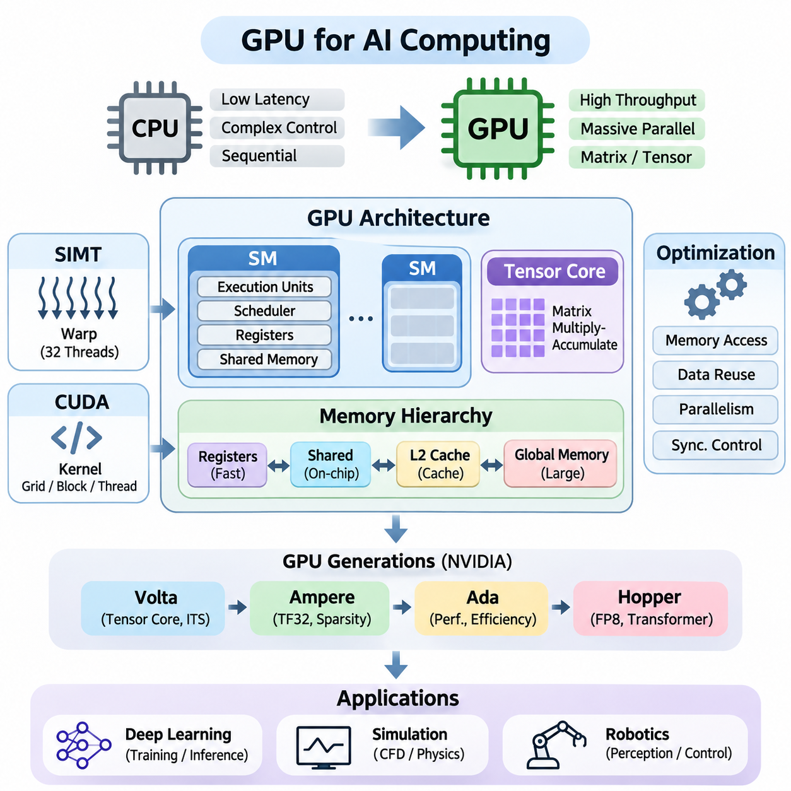
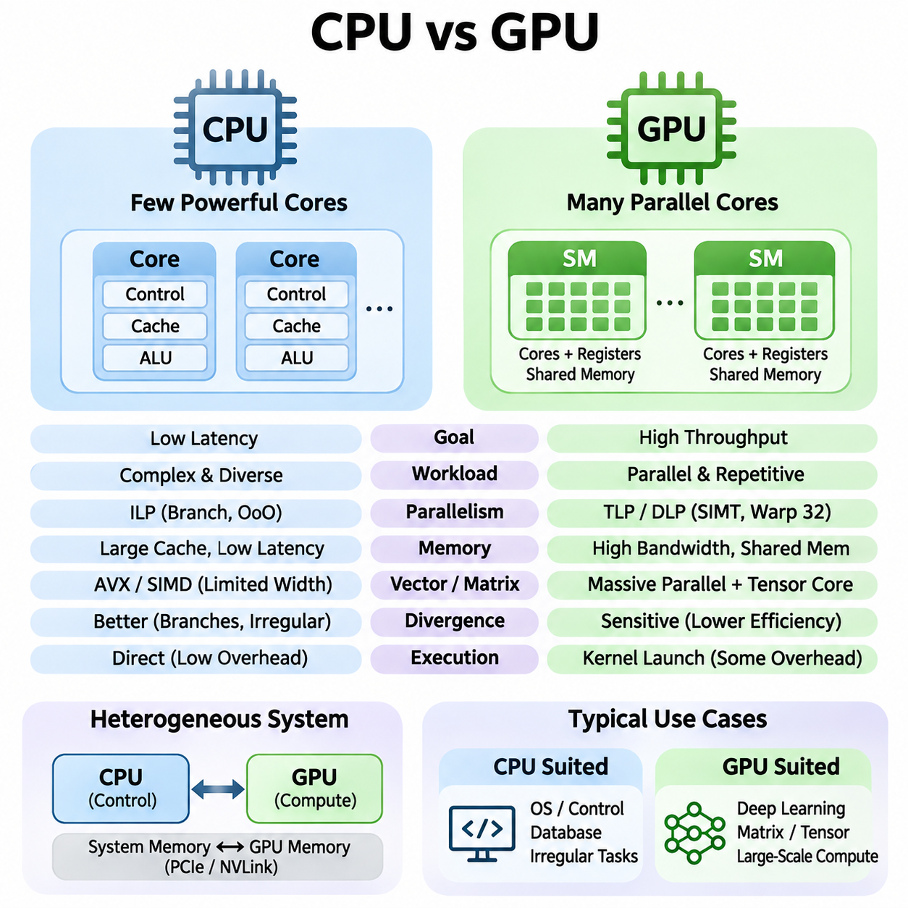
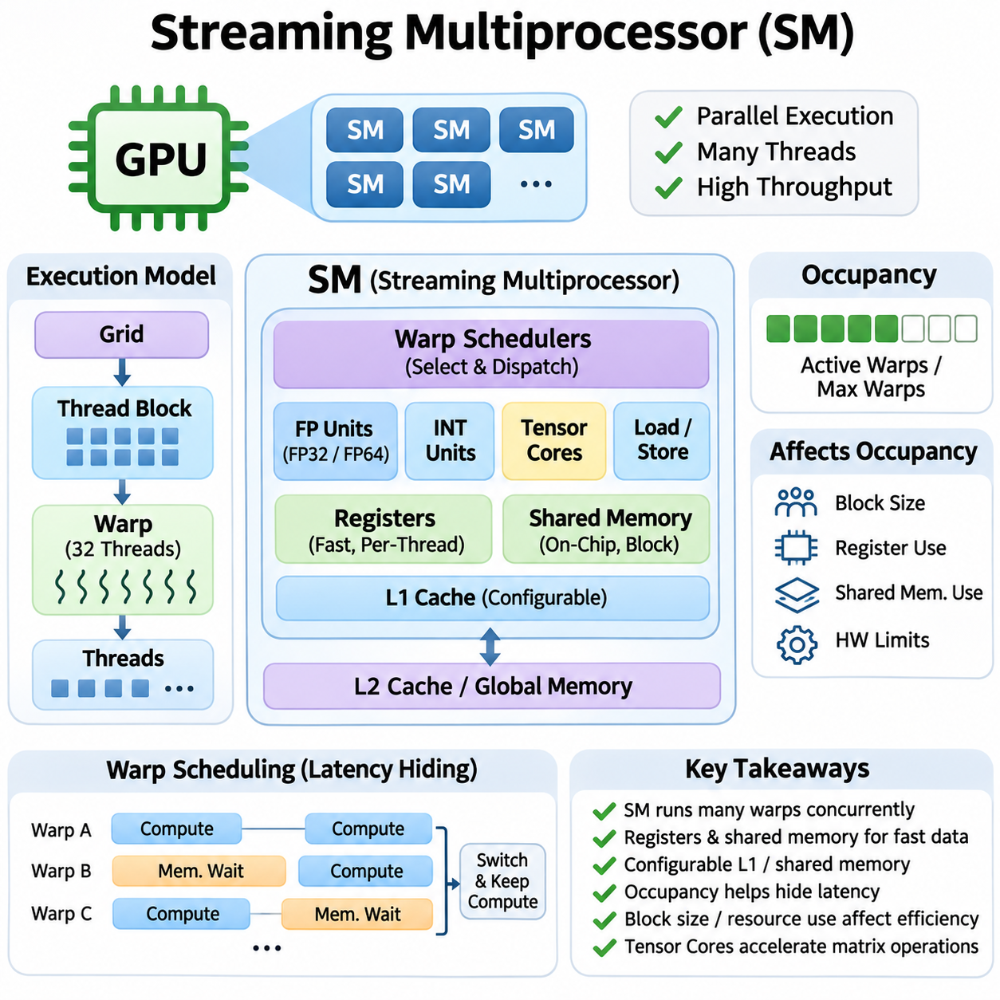
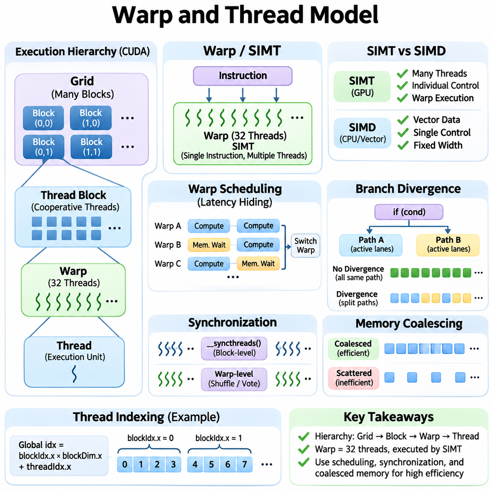
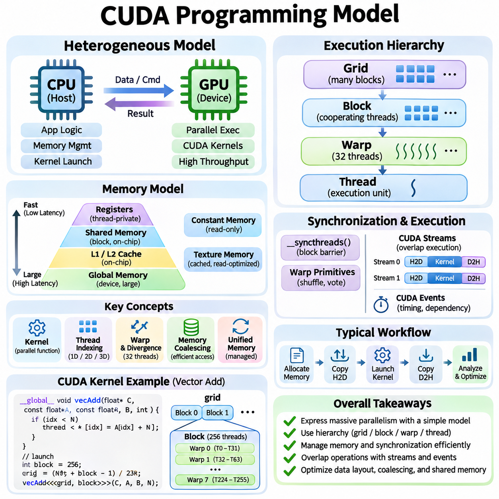
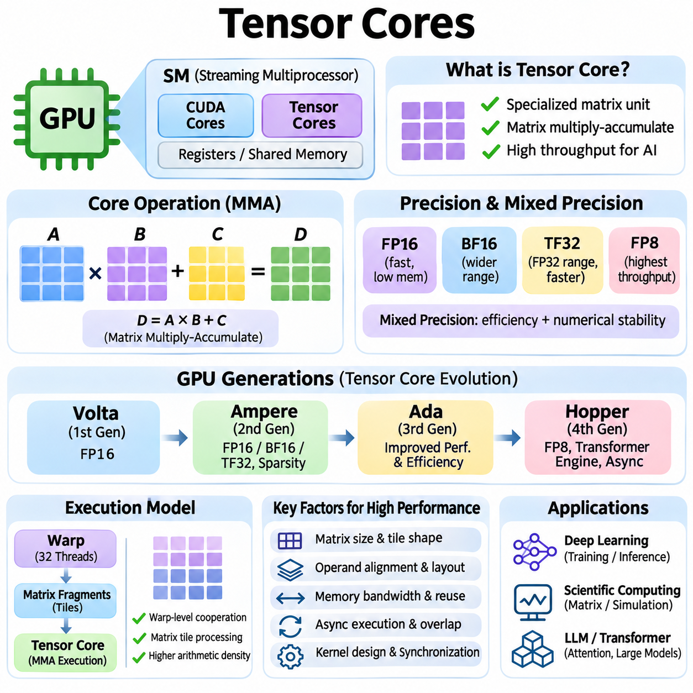
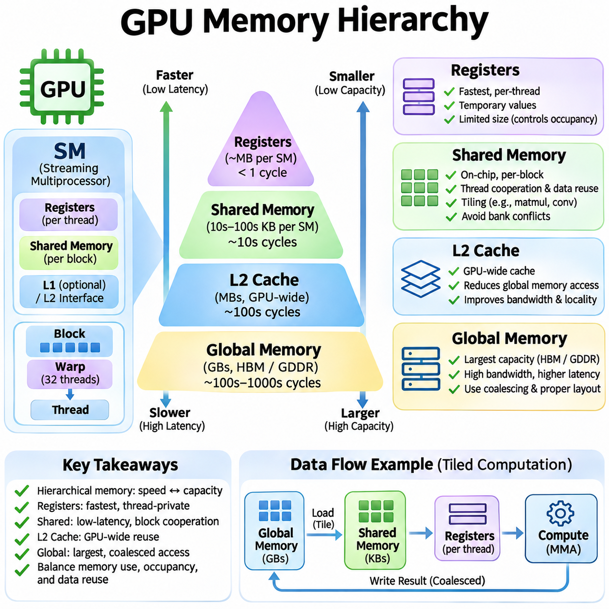
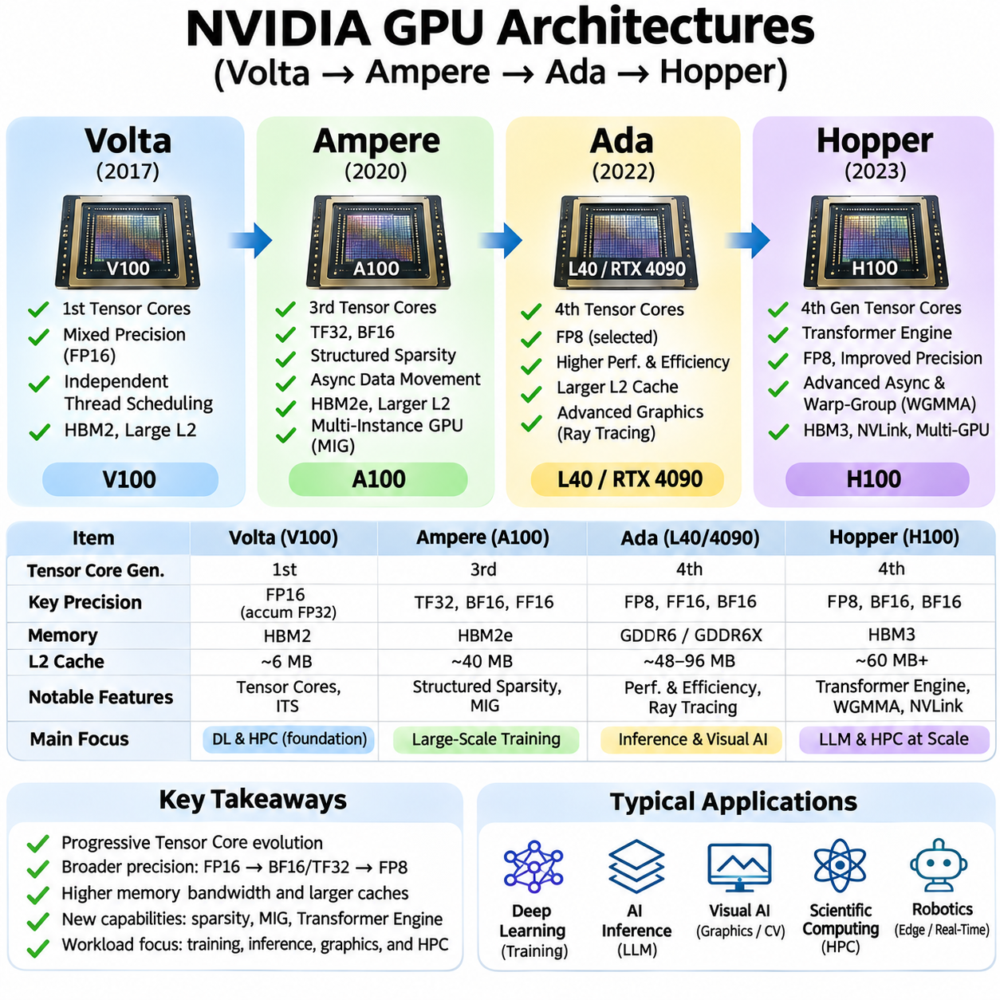
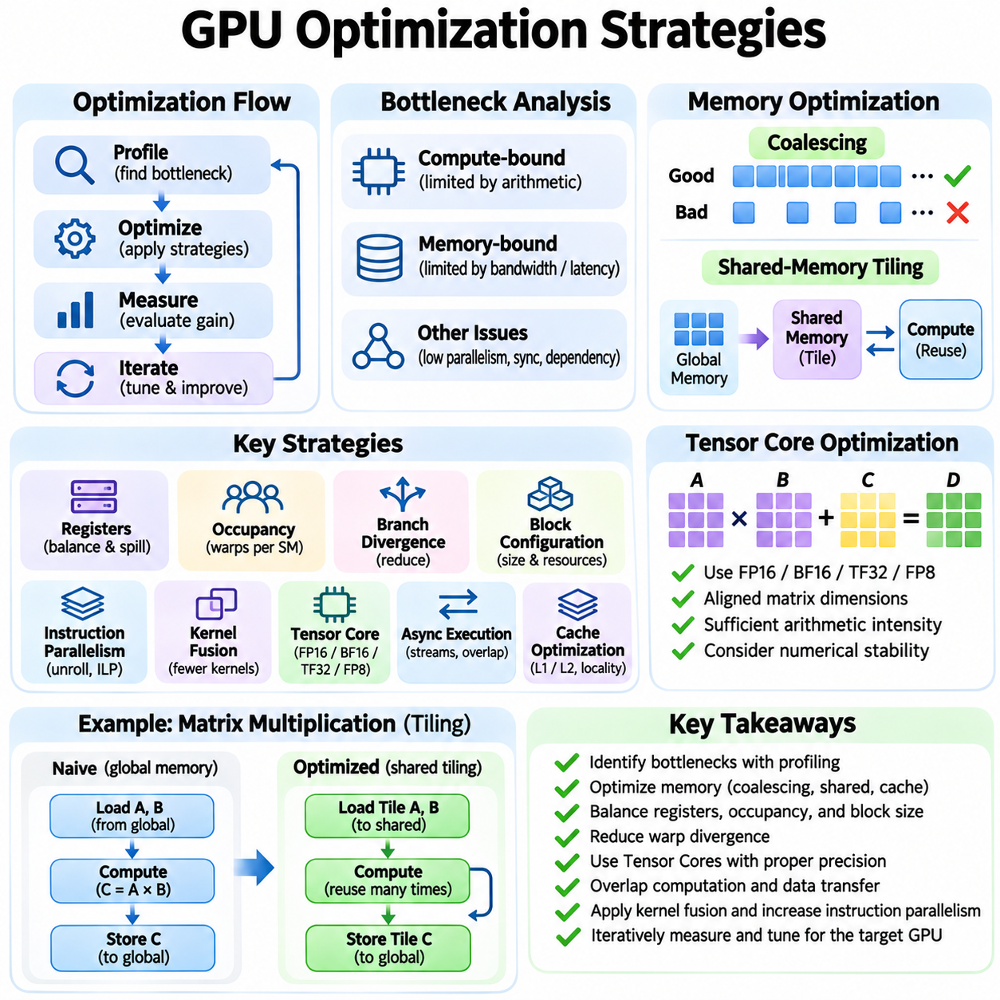
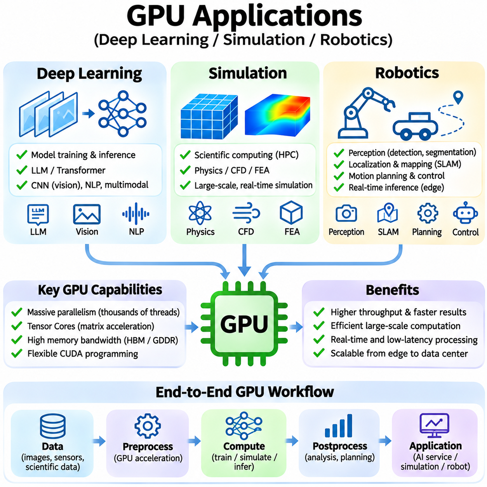

**Volume 39. Hardware for AI**


# 01. GPU Architecture

## 01.00 Overview

{width="7.268055555555556in" height="7.268055555555556in"}

Graphics Processing Units (GPUs) have evolved from specialized graphics rendering devices into fundamental computing platforms for artificial intelligence. Their massively parallel architecture enables thousands of arithmetic operations to execute concurrently, making GPUs particularly effective for neural network training, inference, scientific simulation, and large-scale numerical computation. Understanding GPU architecture is essential for designing efficient AI systems.

Unlike Central Processing Units (CPUs), which prioritize low-latency execution, complex instruction handling, and sequential performance, GPUs emphasize computational throughput. A GPU distributes large workloads across numerous execution units that process many data elements simultaneously. This architectural distinction makes GPUs especially suitable for matrix multiplication, convolution, tensor operations, and other repetitive mathematical workloads.

Modern GPUs contain multiple Streaming Multiprocessors (SMs), each responsible for executing groups of parallel threads. An SM integrates arithmetic execution units, scheduling mechanisms, registers, and configurable on-chip memory resources. By distributing thread blocks across available SMs, the GPU can maintain substantial computational activity while hiding memory access latency through rapid switching among eligible warps.

GPU execution commonly follows the Single Instruction, Multiple Threads (SIMT) programming model. Threads are organized into warps, typically containing 32 threads in NVIDIA architectures, and execute instructions under coordinated scheduling. Individual threads maintain their own registers and execution state, while divergence among threads within a warp can reduce execution efficiency when different control-flow paths must be processed separately.

The CUDA programming model provides a software abstraction for accessing NVIDIA GPU parallelism. Developers define kernels that execute across grids of thread blocks, with each block containing multiple threads. Thread indexing determines which data elements each thread processes, while synchronization and memory management mechanisms coordinate computation. CUDA enables applications to exploit GPU resources without directly controlling every hardware instruction.

Tensor Cores represent an important architectural advancement for AI acceleration. These specialized execution units perform matrix multiply-accumulate operations using supported numerical formats. By accelerating dense matrix computations, Tensor Cores improve the performance of deep learning workloads such as transformer attention, convolutional neural networks, and large language models. Their benefits depend on data types, matrix dimensions, and kernel implementation.

GPU computational performance depends heavily on its memory hierarchy. Global memory provides substantial storage capacity but generally has higher access latency than on-chip resources. Registers offer fast thread-private storage, while shared memory enables efficient communication and data reuse among threads within a block. L2 cache reduces repeated external memory transactions and improves access efficiency across GPU workloads.

Memory bandwidth is often as important as arithmetic throughput. A GPU may contain powerful execution units but remain underutilized when data cannot be delivered quickly enough. Memory coalescing, cache locality, shared-memory tiling, and register reuse help reduce unnecessary data transfers. Effective GPU programming therefore requires balancing computation, memory traffic, synchronization overhead, and available parallelism.

The relationship between arithmetic intensity and memory bandwidth determines whether a workload is compute-bound or memory-bound. Arithmetic intensity measures the number of operations performed per byte transferred from a specified memory level. Workloads with limited data reuse frequently encounter bandwidth constraints, while highly optimized matrix operations can approach the GPU\'s computational limits when sufficient parallelism and suitable numerical precision are available.

GPU architecture has advanced through successive hardware generations that introduce improvements in execution efficiency, numerical capabilities, memory systems, and scheduling. NVIDIA Volta introduced Tensor Cores and independent thread scheduling, establishing important foundations for modern AI acceleration. Subsequent architectures expanded these capabilities while addressing increasingly demanding computational workloads.

NVIDIA Ampere introduced broader Tensor Core capabilities, including support for TensorFloat-32 and structured sparsity acceleration on supported devices. These features improved the efficiency of many deep learning operations while preserving familiar programming interfaces. Ampere also advanced memory and execution resources, although specific capabilities differ between data-center and consumer GPU implementations.

The Ada architecture emphasizes performance improvements in graphics, AI inference, and energy efficiency through architectural refinements and advanced manufacturing. Its Tensor Core capabilities support accelerated machine learning operations, while larger caches in many implementations reduce external memory traffic. Ada-based GPUs demonstrate how architectural improvements can benefit both interactive applications and AI workloads.

NVIDIA Hopper extends GPU acceleration toward large-scale AI training and high-performance computing. Its architecture introduces Transformer Engine capabilities, FP8 computation, and advanced mechanisms for asynchronous data movement and thread-block cooperation. These features are designed to improve computational utilization for demanding tensor workloads, particularly when software frameworks and kernels exploit the available hardware capabilities.

GPU optimization requires coordinated management of execution resources, memory access, and numerical operations. Thread-block dimensions, warp occupancy, register allocation, and shared-memory consumption influence how many workloads can execute concurrently. Increasing occupancy does not always improve performance, because excessive parallelism may introduce resource pressure or unnecessary scheduling overhead without resolving the underlying bottleneck.

Kernel optimization focuses on reducing execution time for individual GPU operations. Techniques include operation fusion, loop unrolling, vectorized memory access, efficient tiling, and minimizing synchronization. Fused kernels can eliminate intermediate memory transfers by combining multiple operations into a single execution sequence. However, fusion must be balanced against register pressure, instruction complexity, and reduced scheduling flexibility.

Numerical precision directly influences GPU performance, memory requirements, and computational accuracy. FP32 remains important for many scientific and machine learning operations, while FP16, BF16, and FP8 can accelerate supported tensor computations and reduce memory traffic. Mixed-precision techniques combine numerical formats to improve efficiency while maintaining acceptable accuracy through appropriate accumulation and stability controls.

Deep learning frameworks such as PyTorch and TensorFlow use GPU libraries and runtime systems to execute computational graphs efficiently. Libraries including cuBLAS and cuDNN provide optimized implementations of common mathematical operations. Framework compilers and execution engines can further improve performance through kernel selection, graph optimization, operation fusion, and hardware-aware scheduling strategies.

GPU architecture plays a central role in training large neural networks. Forward propagation, gradient computation, and parameter updates involve extensive matrix and tensor operations that benefit from parallel execution. Training performance depends not only on GPU arithmetic capacity but also on memory availability, batch size, optimizer state, communication overhead, and the ability to keep execution units continuously supplied with useful work.

During inference, GPUs accelerate model execution under different performance constraints. Interactive applications emphasize response latency, while batch processing emphasizes throughput and hardware utilization. Techniques such as quantization, batching, kernel fusion, and memory-efficient attention can improve inference efficiency. The optimal configuration depends on model architecture, sequence length, concurrency, and deployment requirements.

Multi-GPU systems extend computational capacity beyond individual accelerators. Data parallelism distributes training samples across devices, while tensor and pipeline parallelism partition model computation. Communication technologies such as PCIe and NVLink support data exchange between accelerators. Effective scaling requires balancing computation with synchronization, interconnect bandwidth, memory capacity, and communication latency.

Scientific simulation also benefits from GPU parallelism because many physical models involve repeated numerical calculations over large spatial domains. Fluid dynamics, particle simulation, finite-element methods, and numerical optimization can exploit GPU execution resources. Performance depends on computational regularity, memory locality, precision requirements, and the suitability of numerical algorithms for massively parallel processing.

Robotics applications increasingly use GPUs for perception, localization, mapping, simulation, and learning-based control. Image processing, point-cloud analysis, neural inference, and physics simulation can execute efficiently on GPU hardware. However, robotic systems must also consider deterministic timing, power consumption, thermal constraints, and coordination with CPUs and embedded controllers responsible for real-time operation.

Real-world GPU performance cannot be evaluated solely through theoretical floating-point operations per second. Memory bandwidth, execution occupancy, kernel launch overhead, cache behavior, and data transfer costs strongly influence application performance. Profiling tools such as NVIDIA Nsight Systems and Nsight Compute help identify execution bottlenecks and reveal whether optimization should target arithmetic operations, memory movement, or scheduling.

Power consumption and thermal behavior are additional architectural considerations. High computational utilization increases electrical and cooling requirements, while sustained workloads may experience frequency adjustments under power or temperature limits. Performance-per-watt therefore becomes an important metric for data centers, autonomous machines, and embedded AI platforms where energy availability and cooling capacity impose practical operating constraints.

GPU architecture should ultimately be understood as an integrated relationship between parallel execution, specialized arithmetic units, memory organization, programming abstractions, and system-level communication. Efficient AI computation emerges when algorithms and software exploit these hardware characteristics coherently. This foundation supports deeper exploration of GPU execution models, Tensor Cores, memory optimization, architectural generations, and practical AI applications.

그래픽 처리 장치(Graphics Processing Unit, GPU)는 전문적인 그래픽 렌더링(Graphics Rendering) 장치에서 인공지능(Artificial Intelligence, AI)을 위한 핵심 컴퓨팅 플랫폼(Computing Platform)으로 발전해 왔다. 대규모 병렬 아키텍처(Massively Parallel Architecture)는 수천 개의 산술 연산(Arithmetic Operations)을 동시에 실행할 수 있도록 지원하며, 신경망 학습(Neural Network Training), 추론(Inference), 과학 시뮬레이션(Scientific Simulation), 대규모 수치 계산(Numerical Computation)에 특히 효과적이다. 효율적인 인공지능 시스템을 설계하려면 GPU 아키텍처에 대한 이해가 필수적이다.

중앙 처리 장치(Central Processing Unit, CPU)는 낮은 지연시간(Low Latency), 복잡한 명령어 처리(Instruction Handling), 순차 실행 성능(Sequential Performance)을 우선시하는 반면, GPU는 연산 처리량(Computational Throughput)을 강조한다. GPU는 대규모 작업 부하(Workload)를 다수의 실행 유닛(Execution Unit)에 분산하여 여러 데이터 요소를 동시에 처리한다. 이러한 아키텍처 차이로 인해 GPU는 행렬 곱셈(Matrix Multiplication), 합성곱(Convolution), 텐서 연산(Tensor Operations) 및 반복적인 수학 연산에 특히 적합하다.

현대 GPU는 여러 개의 스트리밍 멀티프로세서(Streaming Multiprocessor, SM)로 구성되며, 각 SM은 병렬 스레드(Thread) 그룹의 실행을 담당한다. SM은 산술 실행 유닛(Arithmetic Execution Unit), 스케줄링 메커니즘(Scheduling Mechanism), 레지스터(Register), 설정 가능한 온칩 메모리(On-Chip Memory) 자원을 통합한다. GPU는 스레드 블록(Thread Block)을 여러 SM에 분산하고 실행 가능한 워프(Warp)를 빠르게 전환함으로써 메모리 접근 지연시간을 은닉(Latency Hiding)하면서 높은 연산 활용률을 유지한다.

GPU 실행은 일반적으로 단일 명령어 다중 스레드(Single Instruction, Multiple Threads, SIMT) 프로그래밍 모델(Programming Model)을 따른다. 스레드는 워프(Warp) 단위로 구성되며, NVIDIA 아키텍처에서는 일반적으로 32개의 스레드가 하나의 워프를 형성한다. 각 스레드는 독립적인 레지스터와 실행 상태(Execution State)를 유지하지만, 워프 내부에서 서로 다른 제어 흐름(Control Flow)이 발생하면 분기 경로를 별도로 처리해야 하므로 실행 효율이 감소할 수 있다.

CUDA 프로그래밍 모델(CUDA Programming Model)은 NVIDIA GPU의 병렬 처리 기능에 접근하기 위한 소프트웨어 추상화(Software Abstraction)를 제공한다. 개발자는 여러 스레드 블록으로 구성된 그리드(Grid)에서 실행되는 커널(Kernel)을 정의한다. 스레드 인덱싱(Thread Indexing)은 각 스레드가 처리할 데이터 요소를 결정하며, 동기화(Synchronization)와 메모리 관리(Memory Management)는 연산을 조정한다. CUDA는 모든 하드웨어 명령어를 직접 제어하지 않고도 GPU 자원을 활용할 수 있도록 한다.

텐서 코어(Tensor Core)는 인공지능 가속(AI Acceleration)을 위한 중요한 아키텍처 발전을 나타낸다. 이러한 특수 실행 유닛은 지원되는 수치 형식(Numerical Format)을 사용하여 행렬 곱셈-누산 연산(Matrix Multiply-Accumulate Operations)을 수행한다. 텐서 코어는 밀집 행렬 연산(Dense Matrix Computation)을 가속하여 트랜스포머 어텐션(Transformer Attention), 합성곱 신경망(Convolutional Neural Network), 대규모 언어 모델(Large Language Model)의 성능을 향상시킨다. 실제 효과는 데이터 유형, 행렬 크기 및 커널 구현 방식에 따라 달라진다.

GPU의 연산 성능은 메모리 계층 구조(Memory Hierarchy)에 크게 의존한다. 전역 메모리(Global Memory)는 큰 저장 용량을 제공하지만 일반적으로 온칩 메모리보다 접근 지연시간이 길다. 레지스터(Register)는 스레드 전용 고속 저장 공간을 제공하며, 공유 메모리(Shared Memory)는 동일 블록 내부 스레드 사이의 효율적인 통신과 데이터 재사용을 지원한다. L2 캐시(L2 Cache)는 반복적인 외부 메모리 접근을 줄여 GPU 작업 부하의 메모리 접근 효율을 향상시킨다.

메모리 대역폭(Memory Bandwidth)은 산술 연산 처리량만큼 중요한 성능 요소이다. GPU에 강력한 실행 유닛이 있더라도 데이터를 충분히 빠르게 공급하지 못하면 연산 자원이 제대로 활용되지 않는다. 메모리 접근 병합(Memory Coalescing), 캐시 지역성(Cache Locality), 공유 메모리 타일링(Shared-Memory Tiling), 레지스터 재사용(Register Reuse)은 불필요한 데이터 전송을 줄인다. 따라서 효율적인 GPU 프로그래밍에는 연산량, 메모리 트래픽(Memory Traffic), 동기화 오버헤드(Synchronization Overhead), 병렬성(Parallelism)의 균형이 필요하다.

산술 집약도(Arithmetic Intensity)와 메모리 대역폭의 관계는 작업 부하가 연산 병목(Compute-Bound)인지 메모리 병목(Memory-Bound)인지를 결정한다. 산술 집약도는 특정 메모리 계층에서 전송된 바이트(Byte)당 수행되는 연산 수를 의미한다. 데이터 재사용이 제한된 작업은 대역폭 제약을 자주 경험하지만, 최적화된 행렬 연산은 충분한 병렬성과 적절한 수치 정밀도(Numerical Precision)가 확보되면 GPU의 이론적 연산 성능에 근접할 수 있다.

GPU 아키텍처는 실행 효율(Execution Efficiency), 수치 연산 기능(Numerical Capabilities), 메모리 시스템(Memory System), 스케줄링(Scheduling)을 개선하는 세대별 하드웨어 발전을 통해 진화해 왔다. NVIDIA 볼타(Volta)는 텐서 코어(Tensor Core)와 독립적 스레드 스케줄링(Independent Thread Scheduling)을 도입하여 현대 인공지능 가속의 중요한 기반을 마련하였다. 이후 아키텍처는 이러한 기능을 확장하면서 점점 더 복잡하고 대규모화되는 연산 작업을 처리하도록 발전하였다.

NVIDIA 암페어(Ampere)는 텐서플로트-32(TensorFloat-32, TF32)와 지원 장치에서의 구조적 희소성 가속(Structured Sparsity Acceleration)을 포함하여 텐서 코어 기능을 확장하였다. 이러한 기능은 기존 프로그래밍 인터페이스(Programming Interface)를 유지하면서 다양한 딥러닝(Deep Learning) 연산의 효율을 향상시켰다. 암페어는 메모리와 실행 자원도 개선하였지만, 구체적인 기능은 데이터센터용 GPU와 소비자용 GPU 구현에 따라 차이가 있다.

에이다(Ada) 아키텍처는 아키텍처 개선과 첨단 제조 공정(Advanced Manufacturing Process)을 통해 그래픽 처리, 인공지능 추론(AI Inference), 에너지 효율(Energy Efficiency)을 향상시키는 데 중점을 둔다. 텐서 코어는 가속된 기계학습(Machine Learning) 연산을 지원하며, 여러 구현에서 확대된 캐시(Cache)는 외부 메모리 트래픽을 감소시킨다. 에이다 기반 GPU는 아키텍처 개선이 대화형 애플리케이션(Interactive Application)과 인공지능 작업 모두에 이점을 제공할 수 있음을 보여준다.

NVIDIA 호퍼(Hopper)는 대규모 인공지능 학습과 고성능 컴퓨팅(High-Performance Computing, HPC)을 위한 GPU 가속 기능을 확장한다. 호퍼는 트랜스포머 엔진(Transformer Engine), FP8 연산, 비동기 데이터 이동(Asynchronous Data Movement), 스레드 블록 협력(Thread-Block Cooperation)을 위한 고급 메커니즘을 도입하였다. 이러한 기능은 소프트웨어 프레임워크와 커널이 하드웨어 기능을 효과적으로 활용할 때 복잡한 텐서 작업의 연산 자원 활용률을 향상시키도록 설계되었다.

GPU 최적화(GPU Optimization)에는 실행 자원, 메모리 접근, 수치 연산에 대한 통합적인 관리가 필요하다. 스레드 블록 크기(Thread-Block Dimensions), 워프 점유율(Warp Occupancy), 레지스터 할당(Register Allocation), 공유 메모리 사용량(Shared-Memory Consumption)은 동시에 실행할 수 있는 작업의 수에 영향을 미친다. 점유율을 높이는 것이 항상 성능 향상으로 이어지지는 않으며, 과도한 병렬성은 근본적인 병목을 해결하지 못한 채 자원 압박(Resource Pressure)이나 스케줄링 오버헤드를 증가시킬 수 있다.

커널 최적화(Kernel Optimization)는 개별 GPU 연산의 실행시간을 줄이는 데 초점을 맞춘다. 주요 기법에는 연산 융합(Operation Fusion), 루프 펼치기(Loop Unrolling), 벡터화된 메모리 접근(Vectorized Memory Access), 효율적인 타일링(Tiling), 동기화 최소화가 포함된다. 융합 커널(Fused Kernel)은 여러 연산을 하나의 실행 과정으로 결합하여 중간 메모리 전송을 제거할 수 있다. 그러나 융합은 레지스터 압박, 명령어 복잡성, 스케줄링 유연성 감소와 균형을 이루어야 한다.

수치 정밀도(Numerical Precision)는 GPU 성능, 메모리 요구량(Memory Requirements), 계산 정확도(Computational Accuracy)에 직접적인 영향을 미친다. FP32는 다양한 과학 및 기계학습 연산에서 중요하며, FP16, BF16, FP8은 지원되는 텐서 연산을 가속하고 메모리 트래픽을 줄일 수 있다. 혼합 정밀도(Mixed Precision) 기법은 여러 수치 형식을 결합하여 적절한 누산(Accumulation)과 수치 안정성(Numerical Stability)을 유지하면서 연산 효율을 향상시킨다.

파이토치(PyTorch)와 텐서플로(TensorFlow) 같은 딥러닝 프레임워크(Deep Learning Framework)는 GPU 라이브러리와 런타임 시스템(Runtime System)을 사용하여 계산 그래프(Computational Graph)를 효율적으로 실행한다. cuBLAS와 cuDNN은 일반적인 수학 연산에 대해 최적화된 구현을 제공한다. 프레임워크 컴파일러(Framework Compiler)와 실행 엔진(Execution Engine)은 커널 선택, 그래프 최적화, 연산 융합, 하드웨어 인식 스케줄링(Hardware-Aware Scheduling)을 통해 성능을 추가로 향상시킨다.

GPU 아키텍처는 대규모 신경망 학습에서 핵심적인 역할을 수행한다. 순전파(Forward Propagation), 기울기 계산(Gradient Computation), 매개변수 갱신(Parameter Update)은 병렬 실행의 이점을 활용하는 대규모 행렬 및 텐서 연산을 포함한다. 학습 성능은 GPU의 산술 연산 능력뿐 아니라 메모리 용량, 배치 크기(Batch Size), 옵티마이저 상태(Optimizer State), 통신 오버헤드(Communication Overhead), 실행 유닛에 지속적으로 유효한 작업을 공급하는 능력에도 의존한다.

추론(Inference) 단계에서 GPU는 서로 다른 성능 제약조건(Performance Constraints)에 따라 모델 실행을 가속한다. 대화형 애플리케이션은 응답 지연시간(Response Latency)을 중시하지만, 배치 처리(Batch Processing)는 처리량(Throughput)과 하드웨어 활용률(Hardware Utilization)을 강조한다. 양자화(Quantization), 배칭(Batching), 커널 융합(Kernel Fusion), 메모리 효율적 어텐션(Memory-Efficient Attention)은 추론 효율을 향상시킨다. 최적 구성은 모델 아키텍처, 시퀀스 길이(Sequence Length), 동시 요청 수(Concurrency), 배포 요구사항(Deployment Requirements)에 따라 달라진다.

다중 GPU 시스템(Multi-GPU System)은 개별 가속기의 한계를 넘어 연산 용량을 확장한다. 데이터 병렬화(Data Parallelism)는 학습 샘플을 여러 장치에 분산하며, 텐서 병렬화(Tensor Parallelism)와 파이프라인 병렬화(Pipeline Parallelism)는 모델 연산을 분할한다. PCIe와 NVLink 같은 통신 기술은 가속기 사이의 데이터 교환을 지원한다. 효율적인 확장에는 연산, 동기화, 인터커넥트 대역폭(Interconnect Bandwidth), 메모리 용량, 통신 지연시간(Communication Latency)의 균형이 필요하다.

과학 시뮬레이션(Scientific Simulation)도 많은 물리 모델이 넓은 공간 영역에서 반복적인 수치 계산을 수행하므로 GPU 병렬 처리의 이점을 활용한다. 유체역학(Fluid Dynamics), 입자 시뮬레이션(Particle Simulation), 유한요소법(Finite-Element Method), 수치 최적화(Numerical Optimization)는 GPU 실행 자원을 효과적으로 사용할 수 있다. 성능은 연산의 규칙성(Computational Regularity), 메모리 지역성(Memory Locality), 정밀도 요구사항, 수치 알고리즘의 대규모 병렬 처리 적합성에 따라 결정된다.

로보틱스(Robotics) 분야에서는 인식(Perception), 위치 추정(Localization), 지도 작성(Mapping), 시뮬레이션(Simulation), 학습 기반 제어(Learning-Based Control)에 GPU 활용이 증가하고 있다. 영상 처리(Image Processing), 포인트 클라우드 분석(Point-Cloud Analysis), 신경망 추론(Neural Inference), 물리 시뮬레이션(Physics Simulation)은 GPU에서 효율적으로 실행될 수 있다. 그러나 로봇 시스템은 결정론적 타이밍(Deterministic Timing), 전력 소비, 열 제약조건(Thermal Constraints), 실시간 동작을 담당하는 CPU 및 임베디드 제어기(Embedded Controller)와의 협력도 고려해야 한다.

실제 GPU 성능은 이론적인 초당 부동소수점 연산 수(Floating-Point Operations Per Second, FLOPS)만으로 평가할 수 없다. 메모리 대역폭, 실행 점유율(Execution Occupancy), 커널 실행 오버헤드(Kernel Launch Overhead), 캐시 동작(Cache Behavior), 데이터 전송 비용(Data Transfer Cost)이 애플리케이션 성능에 큰 영향을 미친다. NVIDIA 엔사이트 시스템즈(Nsight Systems)와 엔사이트 컴퓨트(Nsight Compute) 같은 프로파일링 도구(Profiling Tool)는 실행 병목을 식별하고 최적화 대상이 산술 연산, 메모리 이동, 스케줄링 중 어디에 있는지 분석하도록 지원한다.

전력 소비(Power Consumption)와 열 특성(Thermal Behavior) 역시 중요한 아키텍처 고려사항이다. 높은 연산 활용률은 전력 및 냉각 요구량을 증가시키며, 지속적인 작업 부하는 전력 제한(Power Limit)이나 온도 제한(Temperature Limit)에 따른 동작 주파수(Frequency) 조정을 유발할 수 있다. 따라서 와트당 성능(Performance-per-Watt)은 에너지 공급과 냉각 용량이 실제 운용 조건을 제한하는 데이터센터(Data Center), 자율 시스템(Autonomous System), 임베디드 인공지능 플랫폼(Embedded AI Platform)에서 중요한 평가 지표가 된다.

GPU 아키텍처는 궁극적으로 병렬 실행(Parallel Execution), 특수 산술 연산 유닛(Specialized Arithmetic Unit), 메모리 구성(Memory Organization), 프로그래밍 추상화(Programming Abstraction), 시스템 수준 통신(System-Level Communication) 사이의 통합적인 관계로 이해해야 한다. 효율적인 인공지능 연산은 알고리즘과 소프트웨어가 이러한 하드웨어 특성을 일관되게 활용할 때 실현된다. 이러한 기반은 GPU 실행 모델, 텐서 코어, 메모리 최적화, 아키텍처 세대별 발전, 실제 인공지능 응용에 대한 심층적인 이해로 이어진다.

## 01.01 GPU vs CPU

{width="7.268055555555556in" height="7.268055555555556in"}

Central Processing Units (CPUs) and Graphics Processing Units (GPUs) represent two complementary approaches to computational architecture. CPUs are designed to execute diverse instructions efficiently while minimizing latency for individual tasks. GPUs prioritize aggregate throughput by distributing large numbers of similar operations across parallel execution resources. Their differences influence how artificial intelligence workloads are implemented and optimized.

A CPU typically contains a relatively small number of sophisticated processing cores optimized for sequential execution and complex control flow. Each core includes advanced instruction scheduling, branch prediction, caching, and out-of-order execution mechanisms. These capabilities allow CPUs to respond efficiently to unpredictable workloads, operating system activities, database transactions, and applications requiring frequent decisions.

A GPU contains many parallel arithmetic execution units organized into larger processing structures. Rather than maximizing the performance of individual instruction streams, GPUs execute numerous threads concurrently to achieve high aggregate computational throughput. This organization is particularly effective when workloads contain repeated operations over large arrays, matrices, tensors, or independent data elements.

The fundamental distinction between CPU and GPU design involves latency optimization versus throughput optimization. CPUs attempt to complete individual instruction sequences quickly, whereas GPUs emphasize the total amount of computation completed over time. GPU execution can tolerate longer individual memory access delays by switching among available groups of threads, allowing other computations to proceed while data transfers are pending.

CPU architectures rely heavily on sophisticated control mechanisms to maintain high instruction-level parallelism. Branch prediction anticipates program decisions, speculative execution processes likely instruction paths, and out-of-order execution rearranges independent operations when dependencies permit. These techniques improve responsiveness but require considerable hardware resources, power consumption, and architectural complexity.

GPU architectures instead emphasize thread-level and data-level parallelism. Large collections of threads execute similar instructions on different data elements, enabling efficient utilization of numerous arithmetic units. NVIDIA GPUs commonly organize threads into warps containing 32 threads. Their Single Instruction, Multiple Threads execution model coordinates instruction execution while allowing individual threads to maintain separate registers and execution states.

Control-flow divergence affects CPU and GPU performance differently. CPUs handle complex branches through dedicated prediction and scheduling mechanisms, although mispredictions introduce penalties. GPUs perform best when threads within the same warp follow similar execution paths. When threads diverge, different branches may require separate execution, reducing the proportion of active threads and lowering effective throughput.

Memory architecture also distinguishes CPUs from GPUs. CPUs generally employ sophisticated cache hierarchies designed to reduce latency for irregular memory access patterns. GPUs emphasize high aggregate memory bandwidth and efficient access across many concurrent threads. Their memory systems combine device memory, shared memory, registers, and caches to support parallel execution and repeated data reuse.

Modern CPUs support vector instructions such as AVX and other SIMD extensions, enabling multiple data elements to be processed simultaneously. GPUs extend this parallel processing approach across substantially larger collections of execution units and threads. Consequently, CPUs can perform efficiently on moderate-sized numerical workloads, while GPUs often provide greater acceleration when sufficient parallel work is available.

Arithmetic intensity plays an important role in determining which processor architecture is more suitable. Workloads performing many mathematical operations per transferred byte can benefit substantially from GPU computational capacity. However, applications involving small datasets, frequent synchronization, irregular memory access, or limited parallelism may perform better on CPUs because GPU execution and data movement introduce additional overhead.

Matrix multiplication illustrates the architectural advantages of GPUs. Deep learning models repeatedly multiply large matrices during forward propagation and gradient computation. GPUs distribute these operations across parallel execution units and may use specialized Tensor Cores for supported numerical formats. CPUs can execute the same mathematical operations, but large dense matrix workloads frequently achieve higher throughput on suitable GPUs.

Data transfer between CPU memory and GPU memory can significantly influence application performance. In systems with discrete GPUs, transferring tensors across PCIe introduces latency and consumes communication bandwidth. Small computational tasks may not justify this overhead. Efficient applications therefore minimize unnecessary transfers, retain reusable data on the GPU, and combine operations whenever practical.

Kernel launch overhead introduces another distinction between the two architectures. CPU functions can execute directly within ordinary program control flow, while GPU kernels require runtime scheduling and device execution management. Although launch overhead may be small compared with large computations, repeated execution of extremely short kernels can reduce efficiency. Kernel fusion and asynchronous execution can help address this limitation.

The CPU commonly acts as the control processor in heterogeneous computing systems. It manages operating system services, application logic, memory allocation, input/output operations, and GPU workload scheduling. The GPU operates as a computational accelerator for highly parallel tasks. This division allows applications to combine flexible sequential execution with specialized high-throughput processing.

Deep learning training demonstrates the importance of CPU-GPU cooperation. CPUs typically coordinate dataset loading, preprocessing, training control, and communication with storage systems. GPUs perform computationally intensive tensor operations, including forward propagation, backpropagation, and gradient calculations. Efficient training pipelines overlap data preparation and transfer with GPU execution to reduce idle time.

Inference workloads present different architectural tradeoffs. GPUs are effective for large models, high request concurrency, and substantial batch sizes because they can process many tensor operations simultaneously. CPUs may be preferable for compact models, low request volumes, or applications with strict resource constraints. Actual performance depends on model structure, numerical precision, memory capacity, and execution software.

Power efficiency must be evaluated relative to workload characteristics rather than processor category alone. GPUs can provide superior energy efficiency for large parallel computations by completing more operations per unit of energy. CPUs may consume less total energy for small or irregular tasks that do not utilize GPU resources effectively. System-level measurements should include memory, communication, cooling, and idle power.

Scalability also differs between CPU and GPU systems. Multi-core CPUs expand execution capacity through additional general-purpose cores and shared-memory coordination. Multi-GPU systems distribute computation across accelerators using technologies such as PCIe and NVLink. GPU scaling can provide substantial throughput improvements, but communication overhead, synchronization, and workload partitioning may limit efficiency.

Programming models reflect these architectural differences. CPU applications commonly use conventional threads, task schedulers, and vectorized libraries. GPU applications use specialized programming environments such as CUDA, HIP, or accelerator-oriented compiler frameworks. Effective GPU programming requires attention to thread organization, memory coalescing, synchronization, register pressure, and the distribution of work across execution resources.

Performance comparisons require careful benchmarking under equivalent conditions. CPU and GPU results should account for numerical precision, batch size, memory transfers, preprocessing, and total execution time. Peak floating-point performance alone does not establish practical superiority. End-to-end latency, throughput, energy consumption, hardware utilization, and application accuracy provide a more meaningful basis for comparison.

In scientific computing, CPUs remain valuable for irregular algorithms, complex decision structures, and tasks involving extensive sequential dependencies. GPUs excel in dense linear algebra, structured numerical simulation, image processing, and massively parallel computations. Hybrid implementations often assign irregular control operations to CPUs while accelerating computationally intensive numerical kernels on GPUs.

Robotics and autonomous systems illustrate the complementary relationship between these processors. CPUs handle system coordination, communication, planning, and control tasks requiring predictable execution behavior. GPUs accelerate perception models, image analysis, point-cloud processing, and neural network inference. Reliable robotic systems distribute workloads according to computational requirements, timing constraints, and available hardware resources.

The increasing complexity of artificial intelligence models has strengthened the importance of heterogeneous computing. CPUs provide general-purpose flexibility, while GPUs deliver high-throughput parallel computation and specialized tensor acceleration. Understanding their architectural tradeoffs enables engineers to select appropriate hardware, minimize data movement, optimize execution pipelines, and design scalable AI systems that balance performance, energy efficiency, cost, and reliability.

중앙 처리 장치(Central Processing Unit, CPU)와 그래픽 처리 장치(Graphics Processing Unit, GPU)는 서로 보완적인 두 가지 컴퓨팅 아키텍처(Computing Architecture)를 나타낸다. CPU는 개별 작업의 지연시간(Latency)을 최소화하면서 다양한 명령어를 효율적으로 실행하도록 설계되었다. 반면 GPU는 다수의 유사한 연산을 병렬 실행 자원(Parallel Execution Resources)에 분산하여 전체 처리량(Aggregate Throughput)을 극대화한다. 이러한 차이는 인공지능 작업 부하(AI Workload)의 구현과 최적화 방식에 영향을 미친다.

CPU는 일반적으로 순차 실행(Sequential Execution)과 복잡한 제어 흐름(Control Flow)에 최적화된 비교적 적은 수의 고성능 처리 코어(Processing Core)를 포함한다. 각 코어에는 고급 명령어 스케줄링(Instruction Scheduling), 분기 예측(Branch Prediction), 캐싱(Caching), 비순차 실행(Out-of-Order Execution) 메커니즘이 포함된다. 이러한 기능을 통해 CPU는 예측하기 어려운 작업 부하, 운영체제(Operating System) 활동, 데이터베이스 트랜잭션(Database Transaction), 빈번한 의사결정이 필요한 애플리케이션을 효율적으로 처리한다.

GPU는 다수의 병렬 산술 실행 유닛(Parallel Arithmetic Execution Unit)을 더 큰 처리 구조(Processing Structure)로 구성한다. GPU는 개별 명령어 흐름(Instruction Stream)의 성능을 극대화하기보다 수많은 스레드(Thread)를 동시에 실행하여 높은 전체 연산 처리량(Computational Throughput)을 달성한다. 이러한 구조는 대규모 배열(Array), 행렬(Matrix), 텐서(Tensor), 독립적인 데이터 요소에 대해 반복적인 연산을 수행하는 작업에서 특히 효과적이다.

CPU와 GPU 설계의 근본적인 차이는 지연시간 최적화(Latency Optimization)와 처리량 최적화(Throughput Optimization)에 있다. CPU는 개별 명령어 시퀀스(Instruction Sequence)를 빠르게 완료하는 데 집중하지만, GPU는 일정 시간 동안 완료되는 전체 연산량을 강조한다. GPU는 사용 가능한 스레드 그룹(Thread Group)을 전환하여 개별 메모리 접근 지연시간(Memory Access Latency)을 허용하면서 데이터 전송이 진행되는 동안 다른 연산을 실행할 수 있다.

CPU 아키텍처는 높은 명령어 수준 병렬성(Instruction-Level Parallelism)을 유지하기 위해 정교한 제어 메커니즘(Control Mechanism)에 크게 의존한다. 분기 예측(Branch Prediction)은 프로그램의 실행 경로를 예측하고, 추측 실행(Speculative Execution)은 가능성이 높은 명령어 경로를 처리하며, 비순차 실행(Out-of-Order Execution)은 의존성이 허용하는 범위에서 독립적인 연산의 실행 순서를 조정한다. 이러한 기술은 응답성을 향상시키지만 상당한 하드웨어 자원, 전력 소비, 아키텍처 복잡성을 요구한다.

GPU 아키텍처는 스레드 수준 병렬성(Thread-Level Parallelism)과 데이터 수준 병렬성(Data-Level Parallelism)을 강조한다. 대규모 스레드 집합은 서로 다른 데이터 요소에 대해 유사한 명령어를 실행하여 다수의 산술 연산 유닛(Arithmetic Unit)을 효율적으로 활용한다. NVIDIA GPU는 일반적으로 32개의 스레드로 구성된 워프(Warp)를 사용한다. 단일 명령어 다중 스레드(Single Instruction, Multiple Threads, SIMT) 실행 모델은 명령어 실행을 조정하면서 각 스레드가 독립적인 레지스터(Register)와 실행 상태(Execution State)를 유지하도록 한다.

제어 흐름 분기(Control-Flow Divergence)는 CPU와 GPU의 성능에 서로 다른 영향을 미친다. CPU는 전용 예측 및 스케줄링 메커니즘을 통해 복잡한 분기를 처리하지만, 분기 예측 실패(Branch Misprediction)가 발생하면 성능 저하가 발생한다. GPU는 동일한 워프 내부의 스레드가 유사한 실행 경로를 따를 때 가장 효율적이다. 스레드 사이에 분기가 발생하면 서로 다른 분기 경로를 별도로 실행해야 할 수 있으며, 활성 스레드의 비율이 감소하여 유효 처리량(Effective Throughput)이 낮아진다.

메모리 아키텍처(Memory Architecture) 역시 CPU와 GPU를 구분하는 중요한 요소이다. CPU는 일반적으로 불규칙한 메모리 접근 패턴(Irregular Memory Access Pattern)의 지연시간을 줄이기 위해 정교한 캐시 계층 구조(Cache Hierarchy)를 사용한다. GPU는 높은 전체 메모리 대역폭(Aggregate Memory Bandwidth)과 다수의 동시 실행 스레드에 대한 효율적인 접근을 강조한다. GPU 메모리 시스템은 장치 메모리(Device Memory), 공유 메모리(Shared Memory), 레지스터, 캐시(Cache)를 결합하여 병렬 실행과 반복적인 데이터 재사용을 지원한다.

현대 CPU는 AVX와 같은 벡터 명령어(Vector Instruction) 및 기타 단일 명령어 다중 데이터(Single Instruction, Multiple Data, SIMD) 확장 기능을 지원하여 여러 데이터 요소를 동시에 처리한다. GPU는 이러한 병렬 처리 방식을 훨씬 더 많은 실행 유닛과 스레드로 확장한다. 따라서 CPU는 중간 규모의 수치 연산(Numerical Workload)을 효율적으로 수행할 수 있지만, 충분한 병렬 작업이 존재하면 GPU가 더 높은 가속 성능을 제공하는 경우가 많다.

산술 집약도(Arithmetic Intensity)는 어떤 프로세서 아키텍처가 더 적합한지를 결정하는 중요한 요소이다. 전송된 바이트(Byte)당 많은 수학 연산을 수행하는 작업은 GPU의 높은 연산 능력을 효과적으로 활용할 수 있다. 그러나 작은 데이터셋(Dataset), 빈번한 동기화(Synchronization), 불규칙한 메모리 접근, 제한된 병렬성을 포함하는 애플리케이션은 GPU 실행 및 데이터 이동에 추가 오버헤드(Overhead)가 발생하므로 CPU에서 더 높은 성능을 보일 수 있다.

행렬 곱셈(Matrix Multiplication)은 GPU의 아키텍처적 장점을 보여주는 대표적인 사례이다. 딥러닝 모델(Deep Learning Model)은 순전파(Forward Propagation)와 기울기 계산(Gradient Computation) 과정에서 대규모 행렬 곱셈을 반복적으로 수행한다. GPU는 이러한 연산을 병렬 실행 유닛에 분산하고, 지원되는 수치 형식(Numerical Format)에 대해 특수한 텐서 코어(Tensor Core)를 사용할 수 있다. CPU도 동일한 수학 연산을 수행할 수 있지만, 대규모 밀집 행렬 연산(Dense Matrix Workload)은 적절한 GPU에서 더 높은 처리량을 달성하는 경우가 많다.

CPU 메모리와 GPU 메모리 사이의 데이터 전송(Data Transfer)은 애플리케이션 성능에 상당한 영향을 미칠 수 있다. 개별 GPU(Discrete GPU)를 사용하는 시스템에서 PCIe를 통한 텐서(Tensor) 전송은 지연시간을 발생시키고 통신 대역폭(Communication Bandwidth)을 소비한다. 작은 연산 작업에서는 이러한 오버헤드가 GPU 가속의 이점을 상쇄할 수 있다. 따라서 효율적인 애플리케이션은 불필요한 전송을 최소화하고 재사용 가능한 데이터를 GPU에 유지하며 가능한 경우 여러 연산을 결합한다.

커널 실행 오버헤드(Kernel Launch Overhead)는 두 아키텍처를 구분하는 또 다른 요소이다. CPU 함수(Function)는 일반적인 프로그램 제어 흐름에서 직접 실행할 수 있지만, GPU 커널(Kernel)은 런타임 스케줄링(Runtime Scheduling)과 장치 실행 관리(Device Execution Management)가 필요하다. 커널 실행 오버헤드는 대규모 연산에 비해 작을 수 있지만, 매우 짧은 커널을 반복적으로 실행하면 효율이 감소할 수 있다. 커널 융합(Kernel Fusion)과 비동기 실행(Asynchronous Execution)은 이러한 한계를 완화하는 데 도움이 된다.

CPU는 일반적으로 이기종 컴퓨팅 시스템(Heterogeneous Computing System)에서 제어 프로세서(Control Processor) 역할을 수행한다. CPU는 운영체제 서비스, 애플리케이션 로직(Application Logic), 메모리 할당(Memory Allocation), 입출력(Input/Output, I/O) 작업, GPU 작업 스케줄링을 관리한다. GPU는 높은 병렬성이 필요한 작업을 위한 연산 가속기(Computational Accelerator)로 동작한다. 이러한 역할 분담을 통해 애플리케이션은 유연한 순차 실행과 특화된 고처리량 연산을 결합할 수 있다.

딥러닝 학습(Deep Learning Training)은 CPU와 GPU의 협력이 중요한 이유를 보여준다. CPU는 일반적으로 데이터셋 로딩(Dataset Loading), 전처리(Preprocessing), 학습 제어(Training Control), 저장 시스템(Storage System)과의 통신을 조정한다. GPU는 순전파, 역전파(Backpropagation), 기울기 계산을 포함하는 연산 집약적인 텐서 연산(Compute-Intensive Tensor Operations)을 수행한다. 효율적인 학습 파이프라인(Training Pipeline)은 데이터 준비 및 전송과 GPU 실행을 중첩하여 유휴 시간(Idle Time)을 줄인다.

추론 작업 부하(Inference Workload)는 학습과 다른 아키텍처적 절충관계(Architectural Tradeoff)를 가진다. GPU는 다수의 텐서 연산을 동시에 처리할 수 있으므로 대규모 모델, 높은 동시 요청 수(Request Concurrency), 큰 배치 크기(Batch Size)에 효과적이다. 반면 CPU는 소형 모델(Compact Model), 적은 요청량(Low Request Volume), 엄격한 자원 제약(Resource Constraints)이 있는 애플리케이션에 더 적합할 수 있다. 실제 성능은 모델 구조, 수치 정밀도(Numerical Precision), 메모리 용량, 실행 소프트웨어에 따라 달라진다.

전력 효율(Power Efficiency)은 프로세서 종류만으로 판단하기보다 작업 부하의 특성을 기준으로 평가해야 한다. GPU는 대규모 병렬 연산에서 단위 에너지당 더 많은 연산을 완료하여 높은 에너지 효율(Energy Efficiency)을 제공할 수 있다. 반면 GPU 자원을 충분히 활용하지 못하는 작거나 불규칙한 작업에서는 CPU가 더 적은 총에너지를 소비할 수 있다. 시스템 수준 측정(System-Level Measurement)에는 메모리, 통신, 냉각, 유휴 전력(Idle Power)을 포함해야 한다.

확장성(Scalability) 역시 CPU와 GPU 시스템에서 서로 다르게 나타난다. 멀티코어 CPU(Multi-Core CPU)는 범용 코어(General-Purpose Core)를 추가하고 공유 메모리 조정(Shared-Memory Coordination)을 활용하여 실행 용량을 확장한다. 다중 GPU 시스템(Multi-GPU System)은 PCIe와 NVLink 같은 기술을 사용하여 여러 가속기에 연산을 분산한다. GPU 확장은 상당한 처리량 향상을 제공할 수 있지만, 통신 오버헤드, 동기화, 작업 부하 분할(Workload Partitioning)이 확장 효율을 제한할 수 있다.

프로그래밍 모델(Programming Model)은 이러한 아키텍처 차이를 반영한다. CPU 애플리케이션은 일반적으로 기존 스레드(Thread), 작업 스케줄러(Task Scheduler), 벡터화 라이브러리(Vectorized Library)를 사용한다. GPU 애플리케이션은 CUDA, HIP 또는 가속기 지향 컴파일러 프레임워크(Accelerator-Oriented Compiler Framework)와 같은 전문 프로그래밍 환경을 사용한다. 효율적인 GPU 프로그래밍에는 스레드 구성, 메모리 접근 병합(Memory Coalescing), 동기화, 레지스터 압박(Register Pressure), 실행 자원 사이의 작업 분산을 고려해야 한다.

성능 비교(Performance Comparison)를 위해서는 동등한 조건에서 신중하게 수행한 벤치마킹(Benchmarking)이 필요하다. CPU와 GPU의 결과는 수치 정밀도, 배치 크기, 메모리 전송, 전처리, 전체 실행시간을 고려해야 한다. 최대 부동소수점 연산 성능(Peak Floating-Point Performance)만으로 실제 우수성을 판단할 수는 없다. 종단 간 지연시간(End-to-End Latency), 처리량, 에너지 소비, 하드웨어 활용률(Hardware Utilization), 애플리케이션 정확도(Application Accuracy)는 더욱 의미 있는 비교 기준을 제공한다.

과학 컴퓨팅(Scientific Computing)에서 CPU는 불규칙한 알고리즘(Irregular Algorithm), 복잡한 의사결정 구조(Decision Structure), 광범위한 순차 의존성(Sequential Dependency)을 포함하는 작업에 여전히 중요하다. GPU는 밀집 선형대수(Dense Linear Algebra), 구조화된 수치 시뮬레이션(Structured Numerical Simulation), 영상 처리(Image Processing), 대규모 병렬 연산에 강점을 가진다. 하이브리드 구현(Hybrid Implementation)은 불규칙한 제어 연산을 CPU에 할당하고 연산 집약적인 수치 커널(Numerical Kernel)을 GPU에서 가속하는 경우가 많다.

로보틱스(Robotics)와 자율 시스템(Autonomous System)은 두 프로세서의 상호 보완적인 관계를 잘 보여준다. CPU는 예측 가능한 실행 동작(Predictable Execution Behavior)이 필요한 시스템 조정(System Coordination), 통신, 경로 계획(Planning), 제어(Control) 작업을 처리한다. GPU는 인식 모델(Perception Model), 영상 분석(Image Analysis), 포인트 클라우드 처리(Point-Cloud Processing), 신경망 추론(Neural Network Inference)을 가속한다. 신뢰성 높은 로봇 시스템은 연산 요구사항, 시간 제약조건(Timing Constraints), 사용 가능한 하드웨어 자원에 따라 작업을 분배한다.

인공지능 모델의 복잡성이 증가하면서 이기종 컴퓨팅(Heterogeneous Computing)의 중요성도 더욱 커지고 있다. CPU는 범용적인 유연성(General-Purpose Flexibility)을 제공하고, GPU는 높은 처리량의 병렬 연산(High-Throughput Parallel Computation)과 특수한 텐서 가속(Tensor Acceleration)을 제공한다. 두 아키텍처의 절충관계를 이해하면 엔지니어는 적절한 하드웨어를 선택하고 데이터 이동을 최소화하며 실행 파이프라인(Execution Pipeline)을 최적화할 수 있다. 이를 통해 성능, 에너지 효율, 비용, 신뢰성(Reliability)의 균형을 갖춘 확장 가능한 인공지능 시스템을 설계할 수 있다.

## 01.02 Streaming Multiprocessor (SM)

{width="7.268055555555556in" height="7.268055555555556in"}

A Streaming Multiprocessor (SM) is a fundamental execution unit within NVIDIA GPU architecture, responsible for processing large numbers of parallel threads. Each SM integrates arithmetic execution units, warp schedulers, registers, shared memory, and instruction dispatch mechanisms. By coordinating these resources, an SM executes many independent operations concurrently, enabling GPUs to achieve high computational throughput across demanding artificial intelligence workloads.

Unlike a conventional CPU core, an SM is designed to manage numerous lightweight threads rather than optimize a single instruction stream. Multiple thread blocks can reside on one SM when hardware resources permit. Their threads are organized into warps, typically containing 32 threads in NVIDIA architectures. This organization allows the hardware to distribute execution efficiently while maintaining sufficient parallel work to tolerate instruction and memory latency.

The internal structure of an SM varies across GPU generations, but its fundamental components serve consistent purposes. Arithmetic units perform numerical operations, load/store units manage memory instructions, and specialized execution resources accelerate supported mathematical functions. Warp schedulers select eligible instructions for execution, while registers and shared memory provide low-latency storage for active threads and cooperating thread blocks.

Warp scheduling is central to SM performance because GPU workloads frequently encounter memory and instruction dependencies. When one warp cannot proceed, the scheduler may issue instructions from another ready warp. This latency-hiding mechanism allows useful computation to continue without requiring every memory operation to complete immediately. Its effectiveness depends on available parallelism, resource occupancy, and the number of eligible warps.

An SM maintains execution state for multiple resident warps, including registers, program counters, and scheduling information. Hardware resources determine how many warps and thread blocks can remain active simultaneously. The maximum number of resident threads differs between GPU architectures and specific implementations. Consequently, optimal kernel configurations must account for device-specific limits rather than assuming identical SM capacities across generations.

Registers provide fast, thread-private storage for intermediate values, loop variables, and temporary computational results. Each SM contains a finite register file shared among its resident threads. Kernels requiring many registers per thread can reduce the number of simultaneously active warps. Excessive register demand may also cause spilling into local memory, potentially increasing memory traffic and reducing execution efficiency.

Shared memory is an explicitly managed on-chip storage resource that enables threads within the same block to exchange data efficiently. It is especially valuable for tiled matrix multiplication, convolution, reductions, and algorithms involving repeated data reuse. By loading frequently accessed values into shared memory, kernels can reduce global memory transactions. Correct synchronization is necessary when threads depend on data written by other threads.

Many NVIDIA architectures provide a configurable relationship between shared memory and the L1 cache, although the precise organization differs across generations. L1 caching accelerates selected memory accesses, while shared memory supports programmer-controlled data placement. Allocating more shared memory to individual thread blocks can improve locality but may reduce the number of blocks that fit concurrently on an SM.

The occupancy of an SM describes the proportion of its maximum supported active warps that are currently resident. Occupancy depends on thread-block size, register usage, shared-memory allocation, and architectural resource limits. Higher occupancy can improve latency hiding by providing more eligible warps. However, maximum occupancy does not necessarily produce maximum performance, particularly when execution throughput or memory bandwidth is already saturated.

Thread blocks are assigned to SMs by GPU scheduling hardware, and their threads execute using the resources available on the assigned multiprocessor. A block normally remains associated with its assigned SM throughout execution. Multiple blocks may execute concurrently on one SM, while additional blocks wait until resources become available. This execution model supports scalable kernels without requiring programmers to select individual SMs manually.

The relationship between thread blocks and SM resources directly influences kernel efficiency. Large blocks may provide substantial cooperation and data reuse but consume more registers and shared memory. Smaller blocks can offer greater scheduling flexibility, although they may introduce additional overhead or reduce cooperation opportunities. Selecting appropriate block dimensions requires balancing parallelism, resource consumption, synchronization, and workload characteristics.

Instruction dispatch mechanisms connect warp scheduling decisions to the SM\'s execution pipelines. Different instructions may use distinct functional units, including floating-point arithmetic, integer computation, memory operations, and specialized mathematical pipelines. Hardware generations differ in issue capabilities and execution resources. Effective utilization requires sufficient independent instructions and an appropriate mixture of operations to avoid persistent pipeline bottlenecks.

Floating-point execution units support numerical computation across precision formats defined by the GPU architecture. FP32 arithmetic is widely used in graphics, scientific computing, and machine learning, while supported FP64 capabilities vary significantly among GPU products. Integer execution units process addressing calculations, indexing, logical operations, and integer arithmetic. The balance between these resources influences performance for different computational workloads.

Tensor Cores are specialized computational units integrated into SMs in supported NVIDIA GPU generations. They accelerate matrix multiply-accumulate operations using supported data formats and operand configurations. Deep learning frameworks exploit these units for matrix multiplication, convolution, and transformer computations. Achieving high Tensor Core utilization requires suitable matrix shapes, memory layouts, precision choices, and optimized kernels.

Load/store units manage instructions that transfer data between registers and the GPU memory hierarchy. Efficient memory access patterns are essential because scattered or redundant transactions can reduce effective bandwidth. Coalesced global memory accesses combine suitable requests from neighboring threads into efficient memory transactions. Shared-memory access patterns must also consider bank organization to avoid unnecessary serialization caused by bank conflicts.

Synchronization mechanisms coordinate cooperating threads and preserve correctness when operations depend on shared data. Block-level barriers ensure that participating threads reach required execution points before dependent operations proceed. Memory ordering rules determine when writes become visible to other threads. Excessive synchronization can reduce parallel efficiency, while insufficient synchronization may produce race conditions and incorrect computational results.

Control-flow divergence occurs when threads within a warp follow different execution paths. The SM must manage these paths according to its execution model, potentially reducing the number of threads performing useful work at a given moment. Divergence is particularly costly when branches contain substantial computation. Algorithms that organize threads around similar control behavior can improve execution efficiency and reduce wasted instruction capacity.

SM performance also depends on instruction-level parallelism within individual threads. Independent arithmetic operations may execute efficiently when their dependencies permit overlapping execution. Long dependency chains can limit instruction issue even when arithmetic units remain available. Combining instruction-level parallelism with thread-level parallelism helps sustain execution throughput, especially for computational kernels containing repeated mathematical operations.

Modern SM architectures support increasingly sophisticated mechanisms for coordinating computation and data movement. Depending on the GPU generation, asynchronous memory operations can overlap data transfers with arithmetic execution. Hardware-supported synchronization and specialized transfer mechanisms may reduce instruction overhead. These capabilities are particularly useful for tiled tensor workloads that repeatedly move data between global memory and on-chip storage.

SM scalability enables GPUs to increase computational capacity by integrating many multiprocessors within a single device. Large kernels distribute thread blocks across available SMs, allowing substantial parallel execution. However, overall performance does not necessarily scale linearly with SM count. Global memory bandwidth, cache capacity, synchronization requirements, and workload size can constrain utilization even when additional computational resources are available.

GPU generations such as Volta, Ampere, Ada, and Hopper demonstrate continuing changes in SM organization and capabilities. Improvements include specialized tensor computation, scheduling refinements, memory-system enhancements, and additional mechanisms for overlapping execution and data movement. Because SM configurations differ across products, performance tuning should use the actual device specifications rather than relying solely on architectural family names.

Profiling provides essential information about SM utilization and execution bottlenecks. NVIDIA Nsight Compute can report metrics related to achieved occupancy, instruction throughput, memory behavior, register usage, and execution pipeline activity. These measurements help distinguish insufficient parallelism from memory stalls, dependency limitations, and resource saturation. Optimization decisions should be guided by observed bottlenecks rather than occupancy alone.

In deep learning applications, SMs execute the computational kernels underlying neural network operations. Matrix multiplication, convolution, normalization, activation functions, and gradient calculations rely on coordinated execution across many multiprocessors. Kernel efficiency depends on how effectively these operations use registers, shared memory, arithmetic pipelines, and Tensor Cores. Efficient scheduling and data reuse are therefore essential to achieving high training and inference throughput.

Understanding SM architecture provides a foundation for effective GPU programming and performance engineering. Warp scheduling, register allocation, shared-memory organization, execution pipelines, and occupancy interact to determine computational efficiency. Optimized kernels balance these resources while minimizing unnecessary data movement and synchronization. This architectural understanding supports scalable AI training, efficient inference, scientific computing, and high-performance robotic perception systems.

스트리밍 멀티프로세서(Streaming Multiprocessor, SM)는 NVIDIA GPU 아키텍처의 기본 실행 단위로, 대량의 병렬 스레드(Parallel Thread)를 처리하는 역할을 담당한다. 각 SM은 산술 실행 유닛(Arithmetic Execution Unit), 워프 스케줄러(Warp Scheduler), 레지스터(Register), 공유 메모리(Shared Memory), 명령어 발행 메커니즘(Instruction Dispatch Mechanism)을 통합한다. 이러한 자원을 조정하여 다수의 독립적인 연산을 동시에 실행함으로써 복잡한 인공지능 작업 부하(AI Workload)에서 높은 연산 처리량(Computational Throughput)을 달성한다.

일반적인 CPU 코어(CPU Core)와 달리 SM은 단일 명령어 흐름(Instruction Stream)을 최적화하기보다 수많은 경량 스레드(Lightweight Thread)를 관리하도록 설계되었다. 하드웨어 자원이 허용하면 여러 스레드 블록(Thread Block)이 하나의 SM에 상주할 수 있다. 스레드는 워프(Warp) 단위로 구성되며, NVIDIA 아키텍처에서는 일반적으로 32개의 스레드가 하나의 워프를 형성한다. 이러한 구조는 실행 작업을 효율적으로 분산하면서 명령어 및 메모리 지연시간(Latency)을 허용할 수 있는 충분한 병렬 작업을 유지하도록 한다.

SM의 내부 구조(Internal Structure)는 GPU 세대에 따라 달라지지만, 기본 구성요소는 일관된 목적을 수행한다. 산술 유닛(Arithmetic Unit)은 수치 연산(Numerical Operation)을 수행하고, 로드/스토어 유닛(Load/Store Unit)은 메모리 명령어(Memory Instruction)를 관리하며, 특수 실행 자원(Specialized Execution Resource)은 지원되는 수학 함수를 가속한다. 워프 스케줄러는 실행 가능한 명령어를 선택하고, 레지스터와 공유 메모리는 활성 스레드 및 협력하는 스레드 블록에 저지연 저장 공간(Low-Latency Storage)을 제공한다.

워프 스케줄링(Warp Scheduling)은 GPU 작업에서 메모리 및 명령어 의존성(Instruction Dependency)이 자주 발생하기 때문에 SM 성능의 핵심 요소이다. 특정 워프가 실행을 계속할 수 없으면 스케줄러는 다른 준비된 워프(Ready Warp)의 명령어를 발행할 수 있다. 이러한 지연시간 은닉(Latency Hiding) 메커니즘은 모든 메모리 연산이 즉시 완료되지 않더라도 유효한 연산을 계속 수행하도록 한다. 효과는 사용 가능한 병렬성(Parallelism), 자원 점유율(Resource Occupancy), 실행 가능한 워프의 수에 따라 달라진다.

SM은 레지스터, 프로그램 카운터(Program Counter), 스케줄링 정보(Scheduling Information)를 포함하여 여러 상주 워프(Resident Warp)의 실행 상태(Execution State)를 유지한다. 하드웨어 자원은 동시에 활성화할 수 있는 워프와 스레드 블록의 수를 결정한다. 최대 상주 스레드 수(Maximum Resident Threads)는 GPU 아키텍처와 구체적인 구현에 따라 달라진다. 따라서 최적의 커널 구성(Kernel Configuration)은 모든 GPU 세대가 동일한 SM 용량을 가진다고 가정하기보다 장치별 제한사항(Device-Specific Limits)을 고려해야 한다.

레지스터(Register)는 중간 값(Intermediate Value), 루프 변수(Loop Variable), 임시 연산 결과(Temporary Computational Result)를 저장하는 고속 스레드 전용 저장 공간(Thread-Private Storage)을 제공한다. 각 SM은 상주 스레드가 공유하는 제한된 레지스터 파일(Register File)을 포함한다. 스레드당 많은 레지스터를 요구하는 커널은 동시에 활성화할 수 있는 워프의 수를 감소시킬 수 있다. 과도한 레지스터 요구량은 로컬 메모리(Local Memory)로의 스필링(Spilling)을 유발하여 메모리 트래픽(Memory Traffic)을 증가시키고 실행 효율을 저하시킬 수 있다.

공유 메모리(Shared Memory)는 동일한 블록 내부의 스레드가 데이터를 효율적으로 교환하도록 지원하는 명시적 관리 방식의 온칩 저장 자원(On-Chip Storage Resource)이다. 공유 메모리는 타일 기반 행렬 곱셈(Tiled Matrix Multiplication), 합성곱(Convolution), 리덕션(Reduction), 반복적인 데이터 재사용이 필요한 알고리즘에서 특히 유용하다. 자주 접근하는 데이터를 공유 메모리에 적재하면 전역 메모리 트랜잭션(Global Memory Transaction)을 줄일 수 있다. 다른 스레드가 기록한 데이터에 의존하는 경우 올바른 동기화(Synchronization)가 필요하다.

많은 NVIDIA 아키텍처는 공유 메모리와 L1 캐시(L1 Cache) 사이의 구성 가능한 관계를 제공하지만, 구체적인 구조는 세대별로 다르다. L1 캐싱(L1 Caching)은 특정 메모리 접근을 가속하고, 공유 메모리는 프로그래머가 직접 제어하는 데이터 배치(Data Placement)를 지원한다. 개별 스레드 블록에 더 많은 공유 메모리를 할당하면 데이터 지역성(Data Locality)이 향상될 수 있지만, 하나의 SM에서 동시에 실행할 수 있는 블록 수는 감소할 수 있다.

SM의 점유율(Occupancy)은 하드웨어가 지원하는 최대 활성 워프 수에 대해 현재 상주하는 워프의 비율을 나타낸다. 점유율은 스레드 블록 크기(Thread-Block Size), 레지스터 사용량(Register Usage), 공유 메모리 할당량(Shared-Memory Allocation), 아키텍처 자원 제한(Architectural Resource Limits)에 따라 결정된다. 높은 점유율은 실행 가능한 워프를 더 많이 제공하여 지연시간 은닉을 향상시킬 수 있다. 그러나 실행 처리량이나 메모리 대역폭이 이미 포화된 경우 최대 점유율이 반드시 최대 성능을 의미하지는 않는다.

스레드 블록(Thread Block)은 GPU 스케줄링 하드웨어(GPU Scheduling Hardware)에 의해 SM에 할당되며, 해당 블록의 스레드는 할당된 멀티프로세서(Multiprocessor)의 자원을 사용하여 실행된다. 일반적으로 블록은 실행이 완료될 때까지 할당된 SM과 연결된 상태를 유지한다. 하나의 SM에서 여러 블록이 동시에 실행될 수 있으며, 추가 블록은 자원이 사용 가능해질 때까지 대기한다. 이러한 실행 모델은 프로그래머가 개별 SM을 직접 선택하지 않고도 확장 가능한 커널(Scalable Kernel)을 구현하도록 지원한다.

스레드 블록과 SM 자원 사이의 관계는 커널 효율(Kernel Efficiency)에 직접적인 영향을 미친다. 큰 블록은 상당한 협력 연산(Cooperative Computation)과 데이터 재사용(Data Reuse)을 제공할 수 있지만, 더 많은 레지스터와 공유 메모리를 소비한다. 작은 블록은 더 높은 스케줄링 유연성(Scheduling Flexibility)을 제공할 수 있으나 추가 오버헤드를 발생시키거나 협력 기회를 줄일 수 있다. 적절한 블록 크기를 선택하려면 병렬성, 자원 소비(Resource Consumption), 동기화, 작업 부하 특성(Workload Characteristics)의 균형을 고려해야 한다.

명령어 발행 메커니즘(Instruction Dispatch Mechanism)은 워프 스케줄링 결정을 SM의 실행 파이프라인(Execution Pipeline)에 연결한다. 서로 다른 명령어는 부동소수점 연산(Floating-Point Arithmetic), 정수 연산(Integer Computation), 메모리 연산(Memory Operation), 특수 수학 연산 파이프라인(Specialized Mathematical Pipeline) 등 서로 다른 기능 유닛(Functional Unit)을 사용할 수 있다. 하드웨어 세대마다 명령어 발행 능력(Issue Capability)과 실행 자원이 다르다. 효율적인 활용을 위해서는 충분한 독립 명령어와 적절한 연산 조합이 필요하다.

부동소수점 실행 유닛(Floating-Point Execution Unit)은 GPU 아키텍처에서 정의한 정밀도 형식(Precision Format)에 따라 수치 연산을 지원한다. FP32 연산은 그래픽, 과학 컴퓨팅(Scientific Computing), 기계학습(Machine Learning)에서 널리 사용되며, 지원되는 FP64 기능은 GPU 제품에 따라 상당한 차이가 있다. 정수 실행 유닛(Integer Execution Unit)은 주소 계산(Address Calculation), 인덱싱(Indexing), 논리 연산(Logical Operation), 정수 산술 연산(Integer Arithmetic)을 처리한다. 이러한 자원 사이의 구성 비율은 작업 부하별 성능에 영향을 미친다.

텐서 코어(Tensor Core)는 지원되는 NVIDIA GPU 세대의 SM에 통합된 특수 연산 유닛(Specialized Computational Unit)이다. 텐서 코어는 지원되는 데이터 형식(Data Format)과 피연산자 구성(Operand Configuration)을 사용하여 행렬 곱셈-누산 연산(Matrix Multiply-Accumulate Operation)을 가속한다. 딥러닝 프레임워크(Deep Learning Framework)는 행렬 곱셈, 합성곱, 트랜스포머 연산(Transformer Computation)에 이러한 유닛을 활용한다. 높은 텐서 코어 활용률(Tensor Core Utilization)을 달성하려면 적절한 행렬 형태(Matrix Shape), 메모리 배치(Memory Layout), 정밀도 선택, 최적화된 커널이 필요하다.

로드/스토어 유닛(Load/Store Unit)은 레지스터와 GPU 메모리 계층 구조(Memory Hierarchy) 사이에서 데이터를 전송하는 명령어를 관리한다. 분산되거나 중복된 메모리 트랜잭션(Memory Transaction)은 유효 대역폭(Effective Bandwidth)을 감소시킬 수 있으므로 효율적인 메모리 접근 패턴(Memory Access Pattern)이 중요하다. 병합된 전역 메모리 접근(Coalesced Global Memory Access)은 인접 스레드의 적절한 요청을 효율적인 메모리 트랜잭션으로 결합한다. 공유 메모리 접근에서도 뱅크 충돌(Bank Conflict)로 인한 불필요한 직렬화(Serialization)를 방지하기 위해 뱅크 구성(Bank Organization)을 고려해야 한다.

동기화 메커니즘(Synchronization Mechanism)은 협력하는 스레드를 조정하고 공유 데이터에 의존하는 연산의 정확성을 보장한다. 블록 수준 배리어(Block-Level Barrier)는 참여 스레드가 필요한 실행 지점에 도달한 후 의존 연산(Dependent Operation)이 진행되도록 한다. 메모리 순서 규칙(Memory Ordering Rule)은 기록된 데이터가 다른 스레드에 언제 가시화되는지를 결정한다. 과도한 동기화는 병렬 실행 효율을 감소시키지만, 불충분한 동기화는 경쟁 상태(Race Condition)와 잘못된 연산 결과를 발생시킬 수 있다.

제어 흐름 분기(Control-Flow Divergence)는 동일한 워프 내부의 스레드가 서로 다른 실행 경로(Execution Path)를 따를 때 발생한다. SM은 실행 모델(Execution Model)에 따라 이러한 경로를 관리해야 하며, 특정 시점에 유효한 작업을 수행하는 스레드 수가 감소할 수 있다. 분기 경로에 상당한 연산량이 포함되어 있으면 분기 비용이 특히 커진다. 유사한 제어 동작(Control Behavior)을 수행하는 스레드를 함께 구성하는 알고리즘은 실행 효율을 향상시키고 낭비되는 명령어 처리 용량(Instruction Capacity)을 줄일 수 있다.

SM 성능은 개별 스레드 내부의 명령어 수준 병렬성(Instruction-Level Parallelism)에도 의존한다. 독립적인 산술 연산(Independent Arithmetic Operation)은 의존성이 허용하는 경우 실행을 중첩하여 효율적으로 처리할 수 있다. 긴 의존성 체인(Dependency Chain)은 산술 유닛이 사용 가능한 상태에서도 명령어 발행(Instruction Issue)을 제한할 수 있다. 명령어 수준 병렬성과 스레드 수준 병렬성(Thread-Level Parallelism)을 결합하면 반복적인 수학 연산을 포함하는 계산 커널(Computational Kernel)의 실행 처리량을 유지하는 데 도움이 된다.

현대 SM 아키텍처는 연산과 데이터 이동(Data Movement)을 조정하기 위한 점점 더 정교한 메커니즘을 지원한다. GPU 세대에 따라 비동기 메모리 연산(Asynchronous Memory Operation)은 데이터 전송과 산술 연산 실행을 중첩할 수 있다. 하드웨어 지원 동기화(Hardware-Supported Synchronization)와 특수 전송 메커니즘(Specialized Transfer Mechanism)은 명령어 오버헤드를 줄일 수 있다. 이러한 기능은 전역 메모리와 온칩 저장 공간 사이에서 데이터를 반복적으로 이동시키는 타일 기반 텐서 작업(Tiled Tensor Workload)에 특히 유용하다.

SM의 확장성(SM Scalability)은 하나의 GPU 장치에 다수의 멀티프로세서를 통합하여 연산 용량을 증가시킬 수 있도록 한다. 대규모 커널은 스레드 블록을 사용 가능한 SM에 분산하여 상당한 병렬 실행을 수행한다. 그러나 전체 성능이 SM 수에 비례하여 선형적으로 증가하는 것은 아니다. 전역 메모리 대역폭(Global Memory Bandwidth), 캐시 용량(Cache Capacity), 동기화 요구사항(Synchronization Requirements), 작업 부하 크기(Workload Size)는 추가 연산 자원이 존재하더라도 활용률을 제한할 수 있다.

볼타(Volta), 암페어(Ampere), 에이다(Ada), 호퍼(Hopper)와 같은 GPU 세대는 SM 구성과 기능이 지속적으로 발전하고 있음을 보여준다. 주요 개선사항에는 특수 텐서 연산(Specialized Tensor Computation), 스케줄링 개선(Scheduling Refinement), 메모리 시스템 향상(Memory-System Enhancement), 실행과 데이터 이동을 중첩하기 위한 추가 메커니즘이 포함된다. SM 구성은 제품별로 다르므로 성능 튜닝(Performance Tuning)은 아키텍처 계열(Architectural Family)의 이름에만 의존하지 않고 실제 장치 사양(Device Specification)을 기준으로 수행해야 한다.

프로파일링(Profiling)은 SM 활용률(SM Utilization)과 실행 병목(Execution Bottleneck)에 관한 필수 정보를 제공한다. NVIDIA 엔사이트 컴퓨트(NVIDIA Nsight Compute)는 달성 점유율(Achieved Occupancy), 명령어 처리량(Instruction Throughput), 메모리 동작(Memory Behavior), 레지스터 사용량(Register Usage), 실행 파이프라인 활동(Execution Pipeline Activity)과 관련된 지표를 보고할 수 있다. 이러한 측정값은 병렬성 부족, 메모리 지연(Memory Stall), 의존성 제한(Dependency Limitation), 자원 포화(Resource Saturation)를 구분하는 데 도움이 된다. 최적화 결정은 점유율만이 아니라 관측된 병목을 기준으로 이루어져야 한다.

딥러닝 애플리케이션(Deep Learning Application)에서 SM은 신경망 연산(Neural Network Operation)의 기반이 되는 계산 커널을 실행한다. 행렬 곱셈(Matrix Multiplication), 합성곱(Convolution), 정규화(Normalization), 활성화 함수(Activation Function), 기울기 계산(Gradient Calculation)은 다수의 멀티프로세서 사이에서 조정된 실행에 의존한다. 커널 효율은 이러한 연산이 레지스터, 공유 메모리, 산술 파이프라인(Arithmetic Pipeline), 텐서 코어를 얼마나 효과적으로 활용하는지에 따라 결정된다. 따라서 높은 학습 및 추론 처리량을 달성하려면 효율적인 스케줄링과 데이터 재사용이 필수적이다.

SM 아키텍처에 대한 이해는 효율적인 GPU 프로그래밍(GPU Programming)과 성능 엔지니어링(Performance Engineering)의 기반을 제공한다. 워프 스케줄링, 레지스터 할당(Register Allocation), 공유 메모리 구성(Shared-Memory Organization), 실행 파이프라인, 점유율은 상호작용하여 연산 효율(Computational Efficiency)을 결정한다. 최적화된 커널은 이러한 자원의 균형을 유지하면서 불필요한 데이터 이동과 동기화를 최소화한다. 이러한 아키텍처 이해는 확장 가능한 인공지능 학습(Scalable AI Training), 효율적인 추론(Efficient Inference), 과학 컴퓨팅(Scientific Computing), 고성능 로봇 인식 시스템(High-Performance Robotic Perception System)의 구현을 지원한다.

## 01.03 Warp and Thread Model

{width="7.268055555555556in" height="7.268055555555556in"}

The warp and thread model forms the foundation of parallel execution in NVIDIA GPU architectures. Unlike CPUs, which emphasize the performance of individual instruction streams, GPUs organize computation into thousands of lightweight threads. These threads execute within a hierarchical structure consisting of grids, thread blocks, and warps. Understanding this organization is essential for developing efficient CUDA kernels and optimizing artificial intelligence workloads.

A thread represents the smallest logical execution entity in the CUDA programming model. Each thread executes kernel instructions using its own registers, local variables, and execution state. Threads identify their assigned data through indexing mechanisms, allowing the same kernel to process different elements of an array or tensor. This approach supports scalable parallel computation without requiring separate program definitions for individual data elements.

Threads are grouped into thread blocks, which provide a fundamental unit of cooperative execution. Threads within the same block can exchange data through shared memory and coordinate their activities using synchronization primitives. A block may contain one-dimensional, two-dimensional, or three-dimensional thread arrangements. The number of threads per block is constrained by architectural limits and the resources required by the kernel.

Thread blocks are organized into a grid that defines the complete parallel execution domain of a kernel launch. Grid dimensions determine how many blocks participate in the computation, while block dimensions specify the threads within each block. CUDA indexing variables allow threads to calculate global positions from block and thread coordinates. This hierarchy enables applications to process large datasets independently of the number of physical GPU multiprocessors.

Within each thread block, NVIDIA GPUs organize threads into warps, typically containing 32 consecutive threads. A warp is the fundamental scheduling unit used by the hardware to issue instructions for groups of threads. Threads within a warp execute according to the Single Instruction, Multiple Threads model. Although they share coordinated instruction execution, individual threads maintain their own registers, predicates, and logical execution states.

The Single Instruction, Multiple Threads execution model differs from conventional Single Instruction, Multiple Data vector processing. SIMT exposes independently addressable threads with individual control flow, while SIMD commonly presents vector operations over multiple data elements. Hardware coordinates the execution of warp threads to achieve parallel efficiency. This abstraction allows programmers to express thread-level logic while the GPU manages grouped instruction execution.

Warp scheduling enables Streaming Multiprocessors to maintain computational throughput despite memory and instruction dependencies. Each multiprocessor supports multiple resident warps, subject to architectural resource limits. When one warp encounters a dependency that prevents progress, the scheduler can select another eligible warp. This rapid scheduling mechanism hides latency by overlapping useful computation with outstanding memory operations.

Warp execution efficiency depends on the similarity of control flow among participating threads. When all active threads follow the same instruction path, the hardware can utilize execution resources effectively. Divergence occurs when threads within a warp take different branches of a conditional statement. The GPU must execute the required paths with appropriate thread participation, potentially reducing throughput until the execution paths reconverge.

Branch divergence is particularly important in algorithms containing irregular decisions or data-dependent conditions. For example, neighboring threads may evaluate different branches when processing variable-length sequences or sparse data structures. Organizing data to encourage similar execution paths can reduce divergence. Predication and branch restructuring may also improve efficiency, although their benefits depend on instruction costs and workload characteristics.

Thread synchronization is necessary when parallel operations share intermediate results or depend on coordinated execution. CUDA provides block-level synchronization mechanisms that allow participating threads to reach a common execution point before continuing. Such barriers are commonly used after shared-memory writes. Correct synchronization prevents data hazards, while excessive barriers introduce waiting and reduce opportunities for parallel execution.

Warp-level synchronization supports cooperation among threads within a single warp. CUDA provides warp-level primitives for exchanging values, voting on conditions, and coordinating participating lanes. Shuffle operations can transfer register values between lanes without requiring shared-memory transactions. These capabilities are useful for reductions, scans, and collective computations, provided the programmer respects active-thread masks and synchronization requirements.

The lane identifier represents a thread\'s position within its warp, while the warp identifier distinguishes groups of threads within a block. These concepts help programmers design warp-level algorithms and distribute work efficiently. Thread indexing should account for block dimensions and partial warps. Algorithms must not assume that every warp contains 32 active threads, particularly when block sizes or dataset boundaries leave some lanes inactive.

Memory access patterns are closely related to warp organization. When neighboring threads access consecutive memory addresses, the hardware can often combine their requests into efficient global memory transactions. This behavior is known as memory coalescing. Scattered accesses may require additional transactions and reduce effective bandwidth. Consequently, data layout and thread indexing are important components of GPU memory optimization.

Shared-memory access also depends on how threads within a warp address memory banks. Shared memory is divided into banks that can service compatible accesses efficiently. When multiple threads request different addresses mapped to the same bank, bank conflicts may serialize transactions. Carefully designed indexing and data layouts can reduce conflicts, improving the performance of tiled matrix operations and cooperative algorithms.

Thread-level parallelism contributes directly to latency hiding and execution throughput. A kernel with insufficient active warps may leave execution units idle while waiting for memory operations or dependent instructions. Increasing the number of available warps can improve utilization, but hardware resources impose limits. Register allocation, shared-memory consumption, and thread-block dimensions jointly determine how many warps can remain resident.

Occupancy measures the proportion of the maximum supported active warps that are resident on a Streaming Multiprocessor. Higher occupancy can provide additional scheduling opportunities, but it does not guarantee higher performance. Some kernels achieve excellent throughput with moderate occupancy because they exhibit substantial instruction-level parallelism or efficient data reuse. Optimization therefore requires evaluating actual execution bottlenecks rather than maximizing occupancy alone.

Thread-block size affects both scheduling flexibility and resource utilization. Blocks containing multiples of the warp size generally avoid partially filled warps within the block. However, excessively large blocks may consume substantial registers or shared memory and restrict concurrent block residency. Smaller blocks can improve scheduling flexibility but may reduce cooperation efficiency. The optimal configuration depends on kernel behavior and hardware characteristics.

Independent thread scheduling, introduced with NVIDIA Volta, refined the execution model by allowing more flexible management of thread execution state within a warp. This capability improves support for certain divergent execution patterns but does not eliminate the performance cost of divergence. Programs must use appropriate synchronization rather than relying on implicit lockstep behavior when threads exchange data or coordinate through memory.

Warp-level programming requires careful treatment of active masks and execution participation. Collective operations must specify which lanes participate, and participating threads must satisfy the operation\'s execution requirements. Incorrect assumptions about thread activity can produce undefined behavior or invalid results. Explicit synchronization and well-defined participation rules are especially important for algorithms involving divergence or irregular workloads.

The warp and thread model strongly influences the implementation of parallel reductions. Threads initially process independent elements, then combine intermediate results through shared memory or warp-level operations. Efficient implementations reduce synchronization overhead and unnecessary memory traffic. Similar principles apply to prefix scans, histogram computation, normalization, and other collective operations frequently used in machine learning systems.

Deep learning workloads benefit from carefully organized thread mappings. Matrix multiplication kernels assign threads and warps to tiles of input and output matrices, enabling data reuse and coordinated arithmetic execution. Convolution kernels similarly distribute spatial positions, channels, and output elements across parallel threads. Efficient mappings improve memory locality, execution utilization, and compatibility with specialized Tensor Core operations.

Irregular workloads present additional challenges for warp execution. Graph processing, sparse matrix computation, and variable-length sequence processing may involve uneven work distribution and divergent control flow. Load-balancing techniques can assign tasks more evenly across threads and warps. Persistent kernels and work queues may further improve utilization when conventional static mappings produce substantial imbalance.

Profiling tools provide insight into warp execution behavior and thread-level efficiency. NVIDIA Nsight Compute can expose metrics related to active warps, eligible warps, branch behavior, memory transactions, and execution stalls. These measurements help identify whether performance is limited by insufficient parallelism, divergence, memory access inefficiency, or instruction dependencies. Profiling results should guide kernel restructuring and launch configuration choices.

The warp and thread model ultimately connects CUDA\'s programming abstractions with the physical execution resources of GPU hardware. Threads express independent computations, blocks enable cooperation, and warps provide the scheduling structure for efficient execution. Understanding indexing, divergence, synchronization, memory access, and occupancy allows developers to design scalable kernels that exploit GPU parallelism across deep learning, scientific computing, and robotics.

워프 및 스레드 모델(Warp and Thread Model)은 NVIDIA GPU 아키텍처에서 병렬 실행(Parallel Execution)의 기반을 형성한다. 개별 명령어 흐름(Instruction Stream)의 성능을 강조하는 CPU와 달리 GPU는 수천 개의 경량 스레드(Lightweight Thread)로 연산을 구성한다. 이러한 스레드는 그리드(Grid), 스레드 블록(Thread Block), 워프(Warp)로 이루어진 계층 구조(Hierarchical Structure) 내에서 실행된다. 이러한 구성을 이해하는 것은 효율적인 CUDA 커널(CUDA Kernel)을 개발하고 인공지능 작업 부하(AI Workload)를 최적화하는 데 필수적이다.

스레드(Thread)는 CUDA 프로그래밍 모델(CUDA Programming Model)에서 가장 작은 논리적 실행 단위(Logical Execution Entity)를 나타낸다. 각 스레드는 자체 레지스터(Register), 지역 변수(Local Variable), 실행 상태(Execution State)를 사용하여 커널 명령어(Kernel Instruction)를 실행한다. 스레드는 인덱싱 메커니즘(Indexing Mechanism)을 통해 할당된 데이터를 식별하므로 동일한 커널이 배열(Array)이나 텐서(Tensor)의 서로 다른 요소를 처리할 수 있다. 이러한 접근 방식은 개별 데이터 요소마다 별도의 프로그램을 정의하지 않고도 확장 가능한 병렬 연산(Scalable Parallel Computation)을 지원한다.

스레드는 협력 실행(Cooperative Execution)의 기본 단위를 제공하는 스레드 블록(Thread Block)으로 그룹화된다. 동일한 블록 내부의 스레드는 공유 메모리(Shared Memory)를 통해 데이터를 교환하고 동기화 기본 연산(Synchronization Primitive)을 사용하여 작업을 조정할 수 있다. 블록은 1차원(One-Dimensional), 2차원(Two-Dimensional), 3차원(Three-Dimensional)의 스레드 배열을 가질 수 있다. 블록당 스레드 수는 아키텍처 제한(Architectural Limit)과 커널이 요구하는 자원에 의해 제약된다.

스레드 블록은 커널 실행(Kernel Launch)의 전체 병렬 실행 영역(Parallel Execution Domain)을 정의하는 그리드(Grid)로 구성된다. 그리드 차원(Grid Dimension)은 연산에 참여하는 블록 수를 결정하고, 블록 차원(Block Dimension)은 각 블록 내부의 스레드 구성을 지정한다. CUDA 인덱싱 변수(CUDA Indexing Variable)를 사용하면 스레드는 블록 좌표와 스레드 좌표로부터 전역 위치(Global Position)를 계산할 수 있다. 이러한 계층 구조는 물리적인 GPU 멀티프로세서(Multiprocessor)의 수와 관계없이 대규모 데이터셋(Dataset)을 처리하도록 지원한다.

각 스레드 블록 내부에서 NVIDIA GPU는 일반적으로 연속된 32개의 스레드를 하나의 워프(Warp)로 구성한다. 워프는 하드웨어가 스레드 그룹에 명령어를 발행하는 기본 스케줄링 단위(Fundamental Scheduling Unit)이다. 워프 내부의 스레드는 단일 명령어 다중 스레드(Single Instruction, Multiple Threads, SIMT) 모델에 따라 실행된다. 스레드는 조정된 명령어 실행(Coordinated Instruction Execution)을 공유하지만, 각 스레드는 자체 레지스터, 조건자(Predicate), 논리적 실행 상태(Logical Execution State)를 유지한다.

단일 명령어 다중 스레드(SIMT) 실행 모델은 기존의 단일 명령어 다중 데이터(Single Instruction, Multiple Data, SIMD) 벡터 처리(Vector Processing)와 차이가 있다. SIMT는 개별 제어 흐름(Control Flow)을 가진 독립적으로 주소 지정 가능한 스레드(Independently Addressable Thread)를 제공하지만, SIMD는 일반적으로 여러 데이터 요소에 대한 벡터 연산(Vector Operation)을 표현한다. 하드웨어는 병렬 실행 효율을 높이기 위해 워프 스레드의 실행을 조정한다. 이러한 추상화(Abstraction)는 프로그래머가 스레드 수준 논리(Thread-Level Logic)를 표현하는 동안 GPU가 그룹화된 명령어 실행을 관리하도록 한다.

워프 스케줄링(Warp Scheduling)은 메모리 및 명령어 의존성(Instruction Dependency)이 존재하더라도 스트리밍 멀티프로세서(Streaming Multiprocessor, SM)가 연산 처리량(Computational Throughput)을 유지하도록 한다. 각 멀티프로세서는 아키텍처 자원 제한(Architectural Resource Limit)에 따라 여러 상주 워프(Resident Warp)를 지원한다. 하나의 워프가 실행을 진행할 수 없는 의존성을 만나면 스케줄러는 다른 실행 가능한 워프(Eligible Warp)를 선택할 수 있다. 이러한 빠른 스케줄링 메커니즘은 진행 중인 메모리 연산과 유효한 계산을 중첩하여 지연시간을 은닉(Latency Hiding)한다.

워프 실행 효율(Warp Execution Efficiency)은 참여 스레드 사이의 제어 흐름 유사성(Control-Flow Similarity)에 따라 달라진다. 모든 활성 스레드(Active Thread)가 동일한 명령어 경로(Instruction Path)를 따르면 하드웨어는 실행 자원(Execution Resource)을 효과적으로 활용할 수 있다. 분기 발산(Divergence)은 워프 내부의 스레드가 조건문(Conditional Statement)에서 서로 다른 분기 경로를 선택할 때 발생한다. GPU는 각 경로에 필요한 스레드만 참여시켜 실행해야 하므로 실행 경로가 다시 합류(Reconvergence)할 때까지 처리량이 감소할 수 있다.

분기 발산(Branch Divergence)은 불규칙한 의사결정(Irregular Decision)이나 데이터 의존 조건(Data-Dependent Condition)을 포함하는 알고리즘에서 특히 중요하다. 예를 들어 인접한 스레드가 가변 길이 시퀀스(Variable-Length Sequence)나 희소 데이터 구조(Sparse Data Structure)를 처리할 때 서로 다른 분기를 선택할 수 있다. 유사한 실행 경로를 유도하도록 데이터를 구성하면 분기 발산을 줄일 수 있다. 조건부 실행(Predication)과 분기 구조 재구성(Branch Restructuring)도 효율을 향상시킬 수 있지만, 효과는 명령어 비용과 작업 부하 특성에 따라 달라진다.

병렬 연산(Parallel Operation)이 중간 결과(Intermediate Result)를 공유하거나 조정된 실행(Coordinated Execution)에 의존하는 경우 스레드 동기화(Thread Synchronization)가 필요하다. CUDA는 참여 스레드가 계속 실행하기 전에 공통 실행 지점(Common Execution Point)에 도달하도록 하는 블록 수준 동기화(Block-Level Synchronization) 메커니즘을 제공한다. 이러한 배리어(Barrier)는 일반적으로 공유 메모리 쓰기(Shared-Memory Write) 이후에 사용된다. 올바른 동기화는 데이터 위험(Data Hazard)을 방지하지만, 과도한 배리어는 대기시간을 발생시키고 병렬 실행 기회를 감소시킨다.

워프 수준 동기화(Warp-Level Synchronization)는 단일 워프 내부 스레드 사이의 협력을 지원한다. CUDA는 값 교환(Value Exchange), 조건 투표(Voting), 참여 레인(Participating Lane)의 조정을 위한 워프 수준 기본 연산(Warp-Level Primitive)을 제공한다. 셔플 연산(Shuffle Operation)은 공유 메모리 트랜잭션(Shared-Memory Transaction) 없이 레인 사이에서 레지스터 값을 전달할 수 있다. 이러한 기능은 리덕션(Reduction), 스캔(Scan), 집합 연산(Collective Computation)에 유용하지만, 활성 스레드 마스크(Active-Thread Mask)와 동기화 요구사항을 준수해야 한다.

레인 식별자(Lane Identifier)는 워프 내부에서 스레드의 위치를 나타내며, 워프 식별자(Warp Identifier)는 블록 내부의 스레드 그룹을 구분한다. 이러한 개념은 워프 수준 알고리즘(Warp-Level Algorithm)을 설계하고 작업을 효율적으로 분배하는 데 도움이 된다. 스레드 인덱싱(Thread Indexing)은 블록 차원과 부분 워프(Partial Warp)를 고려해야 한다. 특히 블록 크기나 데이터셋 경계(Dataset Boundary)로 인해 일부 레인이 비활성화될 수 있으므로 모든 워프에 32개의 활성 스레드가 존재한다고 가정해서는 안 된다.

메모리 접근 패턴(Memory Access Pattern)은 워프 구성(Warp Organization)과 밀접하게 관련된다. 인접한 스레드가 연속된 메모리 주소(Consecutive Memory Address)에 접근하면 하드웨어는 해당 요청을 효율적인 전역 메모리 트랜잭션(Global Memory Transaction)으로 결합할 수 있다. 이러한 동작을 메모리 접근 병합(Memory Coalescing)이라고 한다. 분산된 메모리 접근(Scattered Memory Access)은 추가 트랜잭션을 발생시켜 유효 대역폭(Effective Bandwidth)을 감소시킬 수 있다. 따라서 데이터 배치(Data Layout)와 스레드 인덱싱은 GPU 메모리 최적화(Memory Optimization)의 중요한 요소이다.

공유 메모리 접근(Shared-Memory Access)도 워프 내부의 스레드가 메모리 뱅크(Memory Bank)에 접근하는 방식에 따라 영향을 받는다. 공유 메모리는 호환 가능한 접근 요청을 효율적으로 처리할 수 있는 여러 뱅크로 분할된다. 여러 스레드가 동일한 뱅크에 매핑된 서로 다른 주소를 요청하면 뱅크 충돌(Bank Conflict)이 발생하여 트랜잭션이 직렬화(Serialization)될 수 있다. 신중하게 설계된 인덱싱과 데이터 배치는 이러한 충돌을 줄이고 타일 기반 행렬 연산(Tiled Matrix Operation)과 협력 알고리즘(Cooperative Algorithm)의 성능을 향상시킨다.

스레드 수준 병렬성(Thread-Level Parallelism)은 지연시간 은닉(Latency Hiding)과 실행 처리량(Execution Throughput)에 직접적으로 기여한다. 활성 워프(Active Warp)가 부족한 커널은 메모리 연산이나 의존 명령어(Dependent Instruction)를 기다리는 동안 실행 유닛(Execution Unit)이 유휴 상태로 남을 수 있다. 사용 가능한 워프 수를 늘리면 활용률(Utilization)이 향상될 수 있지만 하드웨어 자원에는 한계가 있다. 레지스터 할당(Register Allocation), 공유 메모리 사용량(Shared-Memory Consumption), 스레드 블록 차원(Thread-Block Dimension)은 동시에 상주할 수 있는 워프 수를 결정한다.

점유율(Occupancy)은 스트리밍 멀티프로세서가 지원하는 최대 활성 워프 수에 대해 현재 상주하는 워프의 비율을 나타낸다. 높은 점유율은 추가적인 스케줄링 기회(Scheduling Opportunity)를 제공할 수 있지만 반드시 더 높은 성능을 보장하지는 않는다. 일부 커널은 충분한 명령어 수준 병렬성(Instruction-Level Parallelism)이나 효율적인 데이터 재사용(Data Reuse)을 통해 중간 수준의 점유율에서도 높은 처리량을 달성한다. 따라서 최적화는 점유율 자체를 극대화하기보다 실제 실행 병목(Execution Bottleneck)을 평가해야 한다.

스레드 블록 크기(Thread-Block Size)는 스케줄링 유연성(Scheduling Flexibility)과 자원 활용률(Resource Utilization)에 영향을 미친다. 워프 크기의 배수로 구성된 블록은 일반적으로 블록 내부에서 일부만 채워진 워프(Partially Filled Warp)를 방지한다. 그러나 지나치게 큰 블록은 많은 레지스터나 공유 메모리를 소비하여 동시 블록 상주(Concurrent Block Residency)를 제한할 수 있다. 작은 블록은 스케줄링 유연성을 향상시킬 수 있지만 협력 효율(Cooperation Efficiency)을 감소시킬 수 있다. 최적 구성은 커널 동작(Kernel Behavior)과 하드웨어 특성(Hardware Characteristics)에 따라 결정된다.

NVIDIA 볼타(Volta)에서 도입된 독립적 스레드 스케줄링(Independent Thread Scheduling)은 워프 내부의 스레드 실행 상태를 더욱 유연하게 관리하도록 실행 모델을 개선하였다. 이러한 기능은 일부 분기 실행 패턴(Divergent Execution Pattern)에 대한 지원을 향상시키지만 분기 발산의 성능 비용을 제거하지는 않는다. 스레드가 데이터를 교환하거나 메모리를 통해 협력하는 경우 프로그램은 암묵적인 동기 실행(Implicit Lockstep Behavior)에 의존하지 않고 적절한 동기화 메커니즘을 사용해야 한다.

워프 수준 프로그래밍(Warp-Level Programming)에서는 활성 마스크(Active Mask)와 실행 참여(Execution Participation)를 신중하게 처리해야 한다. 집합 연산(Collective Operation)은 어떤 레인이 참여하는지 명시해야 하며, 참여 스레드는 해당 연산의 실행 요구사항을 충족해야 한다. 스레드 활성 상태(Thread Activity)에 대한 잘못된 가정은 정의되지 않은 동작(Undefined Behavior)이나 잘못된 결과를 발생시킬 수 있다. 명시적 동기화(Explicit Synchronization)와 명확한 참여 규칙(Participation Rule)은 분기 발산이나 불규칙한 작업 부하를 포함하는 알고리즘에서 특히 중요하다.

워프 및 스레드 모델은 병렬 리덕션(Parallel Reduction)의 구현 방식에 큰 영향을 미친다. 스레드는 처음에 독립적인 데이터 요소를 처리한 다음 공유 메모리 또는 워프 수준 연산(Warp-Level Operation)을 통해 중간 결과를 결합한다. 효율적인 구현은 동기화 오버헤드(Synchronization Overhead)와 불필요한 메모리 트래픽(Memory Traffic)을 줄인다. 유사한 원리는 접두사 스캔(Prefix Scan), 히스토그램 계산(Histogram Computation), 정규화(Normalization), 기계학습 시스템에서 자주 사용되는 기타 집합 연산에도 적용된다.

딥러닝 작업 부하(Deep Learning Workload)는 신중하게 구성된 스레드 매핑(Thread Mapping)을 통해 성능상의 이점을 얻는다. 행렬 곱셈 커널(Matrix Multiplication Kernel)은 입력 및 출력 행렬의 타일(Tile)에 스레드와 워프를 할당하여 데이터 재사용과 조정된 산술 실행(Coordinated Arithmetic Execution)을 지원한다. 합성곱 커널(Convolution Kernel)도 공간 위치(Spatial Position), 채널(Channel), 출력 요소(Output Element)를 병렬 스레드에 분산한다. 효율적인 매핑은 메모리 지역성(Memory Locality), 실행 활용률(Execution Utilization), 특수 텐서 코어(Tensor Core) 연산과의 호환성을 향상시킨다.

불규칙한 작업 부하(Irregular Workload)는 워프 실행(Warp Execution)에 추가적인 어려움을 발생시킨다. 그래프 처리(Graph Processing), 희소 행렬 연산(Sparse Matrix Computation), 가변 길이 시퀀스 처리(Variable-Length Sequence Processing)는 불균등한 작업 분배(Uneven Work Distribution)와 분기 발산을 포함할 수 있다. 부하 균형 기법(Load-Balancing Technique)은 작업을 스레드와 워프에 더욱 균등하게 할당할 수 있다. 지속 실행 커널(Persistent Kernel)과 작업 큐(Work Queue)는 기존의 정적 매핑(Static Mapping)이 상당한 불균형을 발생시키는 경우 활용률을 추가로 향상시킬 수 있다.

프로파일링 도구(Profiling Tool)는 워프 실행 동작과 스레드 수준 효율(Thread-Level Efficiency)을 분석하는 데 필요한 정보를 제공한다. NVIDIA 엔사이트 컴퓨트(NVIDIA Nsight Compute)는 활성 워프(Active Warp), 실행 가능한 워프(Eligible Warp), 분기 동작(Branch Behavior), 메모리 트랜잭션(Memory Transaction), 실행 정지(Execution Stall)와 관련된 지표를 제공할 수 있다. 이러한 측정값은 병렬성 부족, 분기 발산, 비효율적인 메모리 접근, 명령어 의존성 중 어떤 요소가 성능을 제한하는지 식별하는 데 도움이 된다. 프로파일링 결과는 커널 구조 재설계(Kernel Restructuring)와 실행 구성(Launch Configuration) 선택의 기준이 되어야 한다.

워프 및 스레드 모델은 궁극적으로 CUDA의 프로그래밍 추상화(Programming Abstraction)를 GPU 하드웨어의 물리적 실행 자원(Physical Execution Resource)과 연결한다. 스레드는 독립적인 연산을 표현하고, 블록은 협력 실행을 지원하며, 워프는 효율적인 실행을 위한 스케줄링 구조(Scheduling Structure)를 제공한다. 인덱싱(Indexing), 분기 발산(Divergence), 동기화(Synchronization), 메모리 접근(Memory Access), 점유율(Occupancy)을 이해하면 개발자는 딥러닝, 과학 컴퓨팅(Scientific Computing), 로보틱스(Robotics) 전반에서 GPU 병렬성을 효과적으로 활용하는 확장 가능한 커널(Scalable Kernel)을 설계할 수 있다.

## 01.04 CUDA Programming Model [w/Code]

{width="7.268055555555556in" height="7.268055555555556in"}

The CUDA programming model provides a structured approach to executing massively parallel computations on NVIDIA GPUs. It extends conventional programming with abstractions for device kernels, thread organization, memory management, and synchronization. CUDA allows developers to express parallel algorithms without directly managing individual hardware execution units. Its design connects high-level software operations with the underlying GPU architecture.

CUDA applications commonly follow a heterogeneous computing model in which the CPU acts as the host and the GPU operates as the device. The host manages application logic, memory allocation, and kernel launches, while the device executes computationally intensive parallel operations. This division enables applications to combine sequential processing with high-throughput acceleration. Efficient coordination between host and device is essential for overall performance.

A CUDA kernel is a function executed by many GPU threads in parallel. The programmer defines the computation performed by each thread, while the CUDA runtime organizes execution across available hardware resources. Kernel launches specify the number of thread blocks and the threads contained within each block. This configuration determines the logical parallelism exposed to the GPU rather than directly assigning work to individual multiprocessors.

CUDA organizes parallel execution into a hierarchy of threads, blocks, and grids. Threads execute individual operations, blocks group cooperating threads, and grids contain the blocks participating in a kernel launch. Each thread identifies its position through built-in indexing variables. This hierarchical structure supports scalable algorithms that can execute across GPUs with different numbers of Streaming Multiprocessors.

Thread indexing connects logical execution positions to application data. One-dimensional indexing is commonly used for vector operations, while two-dimensional and three-dimensional arrangements suit images, matrices, and volumetric datasets. Correct indexing ensures that threads process intended elements without accessing invalid memory locations. Boundary checks are necessary when dataset dimensions do not align exactly with the selected execution configuration.

The CUDA execution model uses warps as fundamental hardware scheduling groups. NVIDIA GPUs typically organize 32 threads into each warp, following the Single Instruction, Multiple Threads execution approach. Threads within a warp execute coordinated instructions while maintaining individual execution states. Branch divergence can reduce efficiency when neighboring threads follow different control paths, making regular computation patterns especially advantageous.

CUDA exposes several memory spaces with different performance characteristics and visibility rules. Registers provide fast thread-private storage, while local memory holds thread-private data that cannot remain entirely in registers. Shared memory enables communication among threads within a block. Global memory provides device-wide storage accessible across kernels, while constant and texture memory support specialized access patterns.

Global memory usually offers substantial capacity but has higher latency than on-chip storage. Efficient CUDA kernels therefore seek coalesced accesses, where neighboring threads request addresses that can be served through a small number of memory transactions. Poorly organized accesses increase memory traffic and reduce effective bandwidth. Data layout and thread mapping should be designed together to improve locality and minimize redundant transfers.

Shared memory provides explicitly managed on-chip storage for cooperating threads. It is frequently used to cache reusable data during matrix multiplication, convolution, and reduction operations. Threads can load data from global memory into shared memory, perform repeated computations, and synchronize before consuming results produced by other threads. Efficient shared-memory usage reduces external memory traffic but must account for capacity limits and bank conflicts.

CUDA synchronization mechanisms preserve correctness when parallel operations depend on shared results. Block-level barriers coordinate threads within a block, while warp-level primitives support communication among participating lanes. Device-wide coordination generally requires separate kernel boundaries or specialized cooperative execution mechanisms. Synchronization should be used carefully because unnecessary waiting reduces parallel efficiency and can introduce deadlocks when participation rules are violated.

The CUDA runtime provides functions for allocating, transferring, and releasing device memory. Traditional explicit memory management distinguishes host allocations from device allocations, requiring transfers between their address spaces. Unified Memory offers a managed address space that can simplify programming by allowing supported data to migrate between processors. However, migration overhead and access locality still require attention during performance optimization.

CUDA streams represent ordered sequences of operations submitted for GPU execution. Operations within a stream follow defined ordering rules, while independent streams can enable overlapping execution when hardware resources and dependencies permit. Asynchronous memory transfers may overlap with kernel execution when the relevant requirements are satisfied. Streams therefore help reduce idle time and improve utilization in applications containing multiple computational stages.

CUDA events provide mechanisms for recording execution progress, measuring elapsed device time, and coordinating dependencies between streams. They are useful for benchmarking kernel performance without relying solely on CPU-side timing. Accurate measurements require appropriate synchronization and consideration of asynchronous execution. Event-based profiling helps distinguish kernel execution time from host overhead, memory transfers, and scheduling delays.

Kernel configuration strongly influences execution efficiency. Block dimensions affect warp utilization, scheduling flexibility, and the resources required per block. Register consumption and shared-memory allocation determine how many blocks can reside concurrently on a Streaming Multiprocessor. Larger blocks are not always faster, and maximum occupancy does not guarantee optimal throughput. Effective tuning requires balancing parallelism, resource pressure, and memory behavior.

CUDA supports atomic operations for safely updating shared values when multiple threads may access the same location concurrently. Atomic instructions provide defined read-modify-write behavior for supported operations and memory scopes. They are useful for counters, histograms, and parallel accumulation. However, heavy contention can serialize execution, making hierarchical aggregation or alternative data structures preferable for some workloads.

Error handling is an essential part of reliable CUDA development. Kernel launches and runtime operations can fail because of invalid configurations, allocation problems, or illegal memory accesses. Since many operations execute asynchronously, errors may become visible during later synchronization or runtime calls. Developers should check return statuses, validate memory boundaries, and use diagnostic tools to identify failures before interpreting performance results.

CUDA libraries provide optimized building blocks for common numerical operations. cuBLAS accelerates dense linear algebra, while cuDNN supports neural network operations such as convolution and normalization. Other libraries address sparse matrices, signal processing, and parallel algorithms. Using established libraries often delivers better performance and portability across GPU generations than implementing every computational primitive manually.

The CUDA compilation process translates source programs into executable code suitable for NVIDIA GPU architectures. Device code may be represented through PTX, an intermediate instruction format, before conversion into hardware-specific instructions. Compilation options influence optimization, supported architectures, and numerical behavior. Understanding this process helps developers manage compatibility and evaluate the effects of compiler transformations.

Performance optimization begins with identifying whether a kernel is limited by computation, memory bandwidth, latency, or insufficient parallelism. Techniques such as memory coalescing, loop unrolling, tiling, and kernel fusion address different bottlenecks. Increasing arithmetic intensity through data reuse can improve efficiency. Optimization decisions should be supported by profiling rather than assumptions about theoretical hardware capabilities.

CUDA Graphs reduce repeated host-side submission overhead by representing a sequence of GPU operations as a reusable execution graph. This approach is particularly valuable when applications repeatedly execute similar computational workflows. Graph execution can improve scheduling efficiency and reduce launch-related costs. However, graph construction, dependencies, and memory lifetimes must be managed carefully to preserve correctness.

Mixed-precision computation is widely used in CUDA-based artificial intelligence workloads. Supported GPU architectures accelerate selected FP16, BF16, TF32, and FP8 operations through specialized hardware such as Tensor Cores. These formats can improve throughput and reduce memory requirements, but numerical stability must be considered. Appropriate accumulation precision and scaling strategies help maintain acceptable model accuracy.

Deep learning frameworks integrate CUDA through optimized kernels, libraries, and execution runtimes. PyTorch and TensorFlow schedule tensor operations on GPUs while managing memory and computational dependencies. Framework compilers may combine operations, select specialized kernels, and optimize execution graphs. Understanding CUDA fundamentals helps developers interpret profiling results and resolve performance limitations that remain hidden behind framework abstractions.

Robotics and real-time AI systems use CUDA to accelerate perception, image processing, point-cloud analysis, and neural inference. GPU computation can reduce processing time for demanding sensor workloads, but asynchronous execution and variable scheduling delays require careful system integration. CPU controllers often retain responsibility for timing-critical control functions. Reliable deployment requires balancing acceleration with latency predictability, power consumption, and thermal constraints.

The CUDA programming model ultimately connects software-defined parallelism with GPU execution resources. Its effectiveness depends on appropriate thread organization, memory access patterns, synchronization, asynchronous execution, and kernel configuration. By combining these principles with optimized libraries and profiling tools, developers can build scalable applications for deep learning, scientific computing, simulation, and autonomous systems while improving performance and resource efficiency.

CUDA 프로그래밍 모델(CUDA Programming Model)은 NVIDIA GPU에서 대규모 병렬 연산(Massively Parallel Computation)을 실행하기 위한 체계적인 접근 방식을 제공한다. CUDA는 기존 프로그래밍 방식에 장치 커널(Device Kernel), 스레드 구성(Thread Organization), 메모리 관리(Memory Management), 동기화(Synchronization)를 위한 추상화(Abstraction)를 추가한다. 개발자는 개별 하드웨어 실행 유닛(Hardware Execution Unit)을 직접 관리하지 않고도 병렬 알고리즘(Parallel Algorithm)을 구현할 수 있다. 이러한 설계는 상위 수준 소프트웨어 연산(High-Level Software Operation)을 GPU의 기본 아키텍처와 연결한다.

CUDA 애플리케이션은 일반적으로 CPU가 호스트(Host) 역할을 하고 GPU가 장치(Device)로 동작하는 이기종 컴퓨팅 모델(Heterogeneous Computing Model)을 따른다. 호스트는 애플리케이션 로직(Application Logic), 메모리 할당(Memory Allocation), 커널 실행(Kernel Launch)을 관리하고, 장치는 연산 집약적인 병렬 작업(Compute-Intensive Parallel Operation)을 수행한다. 이러한 역할 분담을 통해 애플리케이션은 순차 처리(Sequential Processing)와 높은 처리량의 가속 연산(High-Throughput Acceleration)을 결합할 수 있다. 전체 성능을 높이려면 호스트와 장치 사이의 효율적인 조정이 필수적이다.

CUDA 커널(CUDA Kernel)은 다수의 GPU 스레드(Thread)가 병렬로 실행하는 함수(Function)이다. 프로그래머는 각 스레드가 수행할 연산을 정의하고, CUDA 런타임(CUDA Runtime)은 사용 가능한 하드웨어 자원에 실행 작업을 배치한다. 커널 실행 시에는 스레드 블록(Thread Block)의 수와 각 블록에 포함되는 스레드 수를 지정한다. 이러한 구성은 개별 멀티프로세서(Multiprocessor)에 작업을 직접 할당하는 것이 아니라 GPU에 제공할 논리적 병렬성(Logical Parallelism)을 결정한다.

CUDA는 병렬 실행(Parallel Execution)을 스레드(Thread), 블록(Block), 그리드(Grid)의 계층 구조(Hierarchical Structure)로 구성한다. 스레드는 개별 연산을 수행하고, 블록은 협력하는 스레드를 그룹화하며, 그리드는 하나의 커널 실행에 참여하는 블록을 포함한다. 각 스레드는 내장 인덱싱 변수(Built-In Indexing Variable)를 통해 자신의 위치를 식별한다. 이러한 계층 구조는 스트리밍 멀티프로세서(Streaming Multiprocessor)의 수가 서로 다른 GPU에서도 실행할 수 있는 확장 가능한 알고리즘(Scalable Algorithm)을 지원한다.

스레드 인덱싱(Thread Indexing)은 논리적 실행 위치(Logical Execution Position)를 애플리케이션 데이터와 연결한다. 1차원 인덱싱(One-Dimensional Indexing)은 일반적으로 벡터 연산(Vector Operation)에 사용되며, 2차원 및 3차원 배열은 영상(Image), 행렬(Matrix), 체적 데이터셋(Volumetric Dataset)에 적합하다. 올바른 인덱싱은 스레드가 의도한 데이터 요소를 처리하면서 유효하지 않은 메모리 위치(Invalid Memory Location)에 접근하지 않도록 보장한다. 데이터셋 크기가 선택한 실행 구성(Execution Configuration)과 정확히 일치하지 않는 경우 경계 검사(Boundary Check)가 필요하다.

CUDA 실행 모델(CUDA Execution Model)은 워프(Warp)를 기본 하드웨어 스케줄링 그룹(Hardware Scheduling Group)으로 사용한다. NVIDIA GPU는 일반적으로 32개의 스레드를 하나의 워프로 구성하며, 단일 명령어 다중 스레드(Single Instruction, Multiple Threads, SIMT) 실행 방식을 따른다. 워프 내부의 스레드는 개별 실행 상태(Execution State)를 유지하면서 조정된 명령어(Coordinated Instruction)를 실행한다. 인접한 스레드가 서로 다른 제어 경로(Control Path)를 따르면 분기 발산(Branch Divergence)으로 효율이 감소할 수 있으므로 규칙적인 연산 패턴(Regular Computation Pattern)이 유리하다.

CUDA는 서로 다른 성능 특성과 가시성 규칙(Visibility Rule)을 가진 여러 메모리 공간(Memory Space)을 제공한다. 레지스터(Register)는 고속 스레드 전용 저장 공간(Thread-Private Storage)을 제공하며, 로컬 메모리(Local Memory)는 레지스터에 모두 유지할 수 없는 스레드 전용 데이터를 저장한다. 공유 메모리(Shared Memory)는 블록 내부 스레드 사이의 통신을 지원한다. 전역 메모리(Global Memory)는 여러 커널에서 접근할 수 있는 장치 전체 저장 공간(Device-Wide Storage)을 제공하며, 상수 메모리(Constant Memory)와 텍스처 메모리(Texture Memory)는 특수한 접근 패턴을 지원한다.

전역 메모리(Global Memory)는 일반적으로 큰 저장 용량을 제공하지만 온칩 저장 공간(On-Chip Storage)보다 접근 지연시간(Access Latency)이 길다. 따라서 효율적인 CUDA 커널은 인접한 스레드의 메모리 요청을 적은 수의 메모리 트랜잭션(Memory Transaction)으로 처리할 수 있는 병합 메모리 접근(Coalesced Memory Access)을 추구한다. 비효율적으로 구성된 메모리 접근은 메모리 트래픽(Memory Traffic)을 증가시키고 유효 대역폭(Effective Bandwidth)을 감소시킨다. 데이터 배치(Data Layout)와 스레드 매핑(Thread Mapping)은 지역성(Locality)을 향상시키고 중복 전송을 최소화하도록 함께 설계해야 한다.

공유 메모리(Shared Memory)는 협력하는 스레드가 명시적으로 관리하는 온칩 저장 공간(On-Chip Storage)을 제공한다. 공유 메모리는 행렬 곱셈(Matrix Multiplication), 합성곱(Convolution), 리덕션(Reduction) 연산에서 재사용 가능한 데이터를 캐싱(Caching)하는 데 자주 사용된다. 스레드는 전역 메모리에서 공유 메모리로 데이터를 적재하고 반복 연산을 수행한 다음, 다른 스레드가 생성한 결과를 사용하기 전에 동기화할 수 있다. 효율적인 공유 메모리 활용은 외부 메모리 트래픽을 줄이지만 용량 제한(Capacity Limit)과 뱅크 충돌(Bank Conflict)을 고려해야 한다.

CUDA 동기화 메커니즘(Synchronization Mechanism)은 병렬 연산이 공유 결과(Shared Result)에 의존할 때 정확성을 유지한다. 블록 수준 배리어(Block-Level Barrier)는 블록 내부 스레드를 조정하며, 워프 수준 기본 연산(Warp-Level Primitive)은 참여 레인(Participating Lane) 사이의 통신을 지원한다. 장치 전체 동기화(Device-Wide Coordination)는 일반적으로 별도의 커널 경계(Kernel Boundary)나 특수한 협력 실행 메커니즘(Cooperative Execution Mechanism)을 필요로 한다. 불필요한 대기는 병렬 효율을 감소시키고 참여 규칙(Participation Rule)을 위반하면 교착 상태(Deadlock)가 발생할 수 있으므로 동기화는 신중하게 사용해야 한다.

CUDA 런타임(CUDA Runtime)은 장치 메모리(Device Memory)의 할당, 전송, 해제를 위한 함수를 제공한다. 기존의 명시적 메모리 관리(Explicit Memory Management)는 호스트 메모리 할당(Host Allocation)과 장치 메모리 할당(Device Allocation)을 구분하며, 두 주소 공간(Address Space) 사이에서 데이터 전송을 요구한다. 통합 메모리(Unified Memory)는 지원되는 데이터가 프로세서 사이를 이동할 수 있는 관리형 주소 공간(Managed Address Space)을 제공하여 프로그래밍을 단순화한다. 그러나 성능 최적화에서는 데이터 이동 오버헤드(Migration Overhead)와 접근 지역성(Access Locality)을 여전히 고려해야 한다.

CUDA 스트림(CUDA Stream)은 GPU 실행을 위해 제출되는 순서가 있는 연산 시퀀스(Ordered Operation Sequence)를 나타낸다. 하나의 스트림 내부 연산은 정의된 순서 규칙(Ordering Rule)을 따르며, 독립적인 스트림은 하드웨어 자원과 의존성이 허용하는 경우 실행을 중첩할 수 있다. 비동기 메모리 전송(Asynchronous Memory Transfer)은 관련 요구사항이 충족되면 커널 실행(Kernel Execution)과 중첩될 수 있다. 따라서 스트림은 여러 연산 단계(Computational Stage)를 포함하는 애플리케이션에서 유휴 시간(Idle Time)을 줄이고 활용률(Utilization)을 향상시키는 데 도움이 된다.

CUDA 이벤트(CUDA Event)는 실행 진행 상태(Execution Progress)를 기록하고 장치 경과시간(Device Elapsed Time)을 측정하며 스트림 사이의 의존성(Dependency)을 조정하는 메커니즘을 제공한다. 이벤트는 CPU 측 시간 측정(CPU-Side Timing)에만 의존하지 않고 커널 성능을 벤치마킹(Benchmarking)하는 데 유용하다. 정확한 측정을 위해서는 적절한 동기화와 비동기 실행(Asynchronous Execution)의 특성을 고려해야 한다. 이벤트 기반 프로파일링(Event-Based Profiling)은 커널 실행시간을 호스트 오버헤드(Host Overhead), 메모리 전송, 스케줄링 지연(Scheduling Delay)과 구분하는 데 도움이 된다.

커널 구성(Kernel Configuration)은 실행 효율(Execution Efficiency)에 큰 영향을 미친다. 블록 차원(Block Dimension)은 워프 활용률(Warp Utilization), 스케줄링 유연성(Scheduling Flexibility), 블록당 필요한 자원에 영향을 준다. 레지스터 사용량(Register Consumption)과 공유 메모리 할당량(Shared-Memory Allocation)은 하나의 스트리밍 멀티프로세서에 동시에 상주할 수 있는 블록 수를 결정한다. 큰 블록이 항상 더 빠른 것은 아니며 최대 점유율(Maximum Occupancy)이 최적 처리량(Optimal Throughput)을 보장하지도 않는다. 효과적인 튜닝(Tuning)에는 병렬성, 자원 압박(Resource Pressure), 메모리 동작(Memory Behavior)의 균형이 필요하다.

CUDA는 여러 스레드가 동일한 메모리 위치에 동시에 접근할 때 공유 값을 안전하게 갱신하기 위한 원자적 연산(Atomic Operation)을 지원한다. 원자적 명령어(Atomic Instruction)는 지원되는 연산과 메모리 범위(Memory Scope)에 대해 정의된 읽기-수정-쓰기(Read-Modify-Write) 동작을 제공한다. 이러한 기능은 카운터(Counter), 히스토그램(Histogram), 병렬 누산(Parallel Accumulation)에 유용하다. 그러나 심한 경합(Contention)은 실행을 직렬화(Serialization)할 수 있으므로 일부 작업에서는 계층적 집계(Hierarchical Aggregation)나 대체 데이터 구조(Alternative Data Structure)가 더 적합하다.

오류 처리(Error Handling)는 신뢰성 높은 CUDA 개발의 필수 요소이다. 커널 실행과 런타임 연산(Runtime Operation)은 잘못된 구성(Invalid Configuration), 메모리 할당 문제(Allocation Problem), 불법 메모리 접근(Illegal Memory Access)으로 실패할 수 있다. 많은 연산이 비동기적으로 실행되기 때문에 오류는 이후의 동기화나 런타임 함수 호출(Runtime Call)에서 확인될 수 있다. 개발자는 반환 상태(Return Status)를 검사하고 메모리 경계(Memory Boundary)를 검증하며, 성능 결과를 해석하기 전에 진단 도구(Diagnostic Tool)를 사용하여 오류를 식별해야 한다.

CUDA 라이브러리(CUDA Library)는 일반적인 수치 연산(Numerical Operation)을 위한 최적화된 구성요소를 제공한다. cuBLAS는 밀집 선형대수(Dense Linear Algebra)를 가속하며, cuDNN은 합성곱과 정규화(Normalization) 같은 신경망 연산(Neural Network Operation)을 지원한다. 다른 라이브러리는 희소 행렬(Sparse Matrix), 신호 처리(Signal Processing), 병렬 알고리즘(Parallel Algorithm)을 처리한다. 검증된 라이브러리를 활용하면 모든 연산 요소(Computational Primitive)를 직접 구현하는 것보다 GPU 세대 전반에서 더 높은 성능과 이식성(Portability)을 얻는 경우가 많다.

CUDA 컴파일 과정(CUDA Compilation Process)은 소스 프로그램(Source Program)을 NVIDIA GPU 아키텍처에 적합한 실행 코드(Executable Code)로 변환한다. 장치 코드(Device Code)는 하드웨어별 명령어(Hardware-Specific Instruction)로 변환되기 전에 중간 명령어 형식(Intermediate Instruction Format)인 PTX로 표현될 수 있다. 컴파일 옵션(Compilation Option)은 최적화, 지원 아키텍처(Supported Architecture), 수치 연산 동작(Numerical Behavior)에 영향을 미친다. 이러한 과정을 이해하면 개발자는 호환성(Compatibility)을 관리하고 컴파일러 변환(Compiler Transformation)의 효과를 평가할 수 있다.

성능 최적화(Performance Optimization)는 커널이 연산량(Computation), 메모리 대역폭(Memory Bandwidth), 지연시간(Latency), 병렬성 부족(Insufficient Parallelism) 중 어떤 요소에 의해 제한되는지 식별하는 것에서 시작한다. 메모리 접근 병합(Memory Coalescing), 루프 펼치기(Loop Unrolling), 타일링(Tiling), 커널 융합(Kernel Fusion)은 서로 다른 병목(Bottleneck)을 해결한다. 데이터 재사용(Data Reuse)을 통해 산술 집약도(Arithmetic Intensity)를 높이면 효율이 향상될 수 있다. 최적화 결정은 이론적인 하드웨어 성능에 대한 가정보다 프로파일링(Profiling) 결과를 근거로 이루어져야 한다.

CUDA 그래프(CUDA Graph)는 GPU 연산 시퀀스를 재사용 가능한 실행 그래프(Reusable Execution Graph)로 표현하여 반복적인 호스트 측 작업 제출 오버헤드(Host-Side Submission Overhead)를 줄인다. 이러한 접근 방식은 애플리케이션이 유사한 연산 흐름(Computational Workflow)을 반복적으로 실행할 때 특히 유용하다. 그래프 실행(Graph Execution)은 스케줄링 효율(Scheduling Efficiency)을 향상시키고 실행 요청 비용(Launch-Related Cost)을 감소시킬 수 있다. 그러나 정확성을 유지하려면 그래프 생성(Graph Construction), 의존성, 메모리 수명(Memory Lifetime)을 신중하게 관리해야 한다.

혼합 정밀도 연산(Mixed-Precision Computation)은 CUDA 기반 인공지능 작업 부하(AI Workload)에서 널리 사용된다. 지원되는 GPU 아키텍처는 텐서 코어(Tensor Core)와 같은 특수 하드웨어를 통해 FP16, BF16, TF32, FP8 연산을 가속한다. 이러한 수치 형식(Numerical Format)은 처리량(Throughput)을 높이고 메모리 요구량(Memory Requirement)을 줄일 수 있지만, 수치 안정성(Numerical Stability)을 고려해야 한다. 적절한 누산 정밀도(Accumulation Precision)와 스케일링 전략(Scaling Strategy)은 허용 가능한 모델 정확도(Model Accuracy)를 유지하는 데 도움이 된다.

딥러닝 프레임워크(Deep Learning Framework)는 최적화된 커널, 라이브러리, 실행 런타임(Execution Runtime)을 통해 CUDA를 통합한다. 파이토치(PyTorch)와 텐서플로(TensorFlow)는 메모리와 연산 의존성(Computational Dependency)을 관리하면서 GPU에서 텐서 연산(Tensor Operation)을 스케줄링한다. 프레임워크 컴파일러(Framework Compiler)는 연산을 결합하고 특수 커널(Specialized Kernel)을 선택하며 실행 그래프(Execution Graph)를 최적화할 수 있다. CUDA의 기본 원리를 이해하면 프레임워크 추상화(Framework Abstraction) 뒤에 숨겨진 성능 제한을 분석하고 프로파일링 결과를 해석하는 데 도움이 된다.

로보틱스(Robotics)와 실시간 인공지능 시스템(Real-Time AI System)은 인식(Perception), 영상 처리(Image Processing), 포인트 클라우드 분석(Point-Cloud Analysis), 신경망 추론(Neural Inference)을 가속하기 위해 CUDA를 사용한다. GPU 연산은 복잡한 센서 작업 부하(Sensor Workload)의 처리시간을 줄일 수 있지만, 비동기 실행과 가변적인 스케줄링 지연(Variable Scheduling Delay)은 신중한 시스템 통합(System Integration)을 요구한다. CPU 제어기(CPU Controller)는 시간 제약이 엄격한 제어 기능(Timing-Critical Control Function)을 계속 담당하는 경우가 많다. 신뢰성 높은 배포(Deployment)를 위해서는 가속 성능과 지연시간 예측 가능성(Latency Predictability), 전력 소비(Power Consumption), 열 제약조건(Thermal Constraints)의 균형이 필요하다.

CUDA 프로그래밍 모델은 궁극적으로 소프트웨어에서 정의한 병렬성(Software-Defined Parallelism)을 GPU 실행 자원(GPU Execution Resource)과 연결한다. 효과적인 활용은 적절한 스레드 구성(Thread Organization), 메모리 접근 패턴(Memory Access Pattern), 동기화(Synchronization), 비동기 실행(Asynchronous Execution), 커널 구성(Kernel Configuration)에 달려 있다. 이러한 원리를 최적화된 라이브러리와 프로파일링 도구(Profiling Tool)에 결합하면 개발자는 성능과 자원 효율(Resource Efficiency)을 향상시키면서 딥러닝(Deep Learning), 과학 컴퓨팅(Scientific Computing), 시뮬레이션(Simulation), 자율 시스템(Autonomous System)을 위한 확장 가능한 애플리케이션(Scalable Application)을 구축할 수 있다.

## 01.05 Tensor Cores

{width="7.268055555555556in" height="7.268055555555556in"}

Tensor Cores are specialized processing units integrated into NVIDIA GPU Streaming Multiprocessors to accelerate matrix operations used in artificial intelligence. They execute matrix multiply-accumulate computations with supported numerical formats, providing substantially higher throughput than conventional scalar arithmetic for suitable workloads. Their introduction transformed GPU architecture by making dense tensor computation a primary hardware optimization target.

The fundamental operation performed by Tensor Cores is matrix multiplication combined with accumulation. Conceptually, an output matrix is produced by multiplying two input matrices and adding the result to an accumulator. This operation appears repeatedly in neural network layers, attention mechanisms, and scientific numerical algorithms. Dedicated matrix execution hardware reduces the instruction overhead associated with performing equivalent computations through ordinary arithmetic units.

NVIDIA introduced Tensor Cores with the Volta architecture, initially emphasizing mixed-precision matrix computation for deep learning. Early implementations supported FP16 input operations with accumulation capabilities designed to preserve useful numerical accuracy. This architecture established a new relationship between numerical precision and computational throughput. Subsequent GPU generations expanded supported formats, execution capabilities, and integration with software frameworks.

Tensor Core execution differs from traditional CUDA core processing because it operates on matrix fragments rather than individual scalar values. Groups of threads cooperate to supply operands and consume results through supported programming interfaces. Hardware performs multiple multiply-accumulate operations as a coordinated matrix instruction. This organization increases arithmetic density and reduces the instruction scheduling burden for suitable matrix workloads.

Mixed-precision computation is central to Tensor Core acceleration. Lower-precision formats reduce operand storage requirements and increase the amount of computation supported by specialized hardware. FP16 and BF16 are widely used for deep learning, while FP32 remains important for selected calculations and accumulation. Mixed-precision algorithms balance computational efficiency against rounding errors, numerical range, and model convergence requirements.

FP16 uses a compact floating-point representation that reduces memory consumption and can improve matrix processing throughput. However, its limited exponent range may create overflow or underflow problems during training. Loss scaling can mitigate some gradient underflow issues when FP16 is used. Effective implementations also retain appropriate higher-precision operations for numerically sensitive computations, including selected reductions and optimizer updates.

BF16 provides a wider exponent range than FP16 while retaining a compact storage representation. This makes BF16 attractive for neural network training because it can represent values across a range similar to FP32, although with lower mantissa precision. Supported Tensor Cores accelerate BF16 matrix operations efficiently. The choice between FP16 and BF16 depends on hardware support, numerical behavior, and the stability requirements of the model.

TensorFloat-32, or TF32, was introduced in NVIDIA Ampere data-center GPUs to accelerate selected FP32 matrix operations using Tensor Cores. TF32 retains the exponent range associated with FP32 while using reduced input significand precision for multiplication. Accumulation commonly uses FP32 precision. This approach can improve throughput for compatible workloads, although applications requiring stricter numerical accuracy may need different precision settings.

FP8 computation extends reduced-precision acceleration for supported Tensor Core architectures, notably NVIDIA Hopper and later designs. FP8 formats provide compact operands and can substantially reduce memory traffic for suitable tensor workloads. Because their numerical ranges and precision differ, practical implementations require scaling strategies and careful handling of sensitive operations. FP8 performance benefits depend on architecture, software support, and workload characteristics.

Tensor Core performance is influenced by matrix dimensions, operand alignment, memory layout, and supported instruction shapes. Matrices that map efficiently to hardware execution tiles generally achieve better utilization. Irregular dimensions may require padding or alternative kernel configurations, potentially introducing additional computation. Developers must therefore consider both mathematical workload structure and hardware execution requirements when optimizing tensor operations.

Warp-level cooperation plays an important role in Tensor Core programming. CUDA exposes matrix operations through supported programming interfaces, including warp-level matrix instructions and higher-level abstractions. Threads collectively manage matrix fragments and participate in coordinated execution. The exact mapping between threads, operands, and hardware resources depends on GPU architecture and instruction type, making portable high-performance implementations challenging.

Modern Tensor Core architectures increasingly support asynchronous execution and specialized matrix instructions. NVIDIA Hopper introduced warp-group matrix operations and mechanisms for coordinating data movement with computation. These capabilities allow optimized kernels to overlap operand preparation and matrix execution. However, synchronization, shared-memory organization, and hardware-specific constraints must be handled carefully to obtain correct results and high utilization.

Memory bandwidth remains a major constraint even when Tensor Cores provide substantial arithmetic throughput. Matrix operations require input operands to reach execution units efficiently, and poorly organized transfers can leave specialized hardware underutilized. Shared-memory tiling, register reuse, and coalesced global memory accesses reduce redundant data movement. High-performance kernels balance computation with the cost of loading operands and storing results.

Arithmetic intensity determines how effectively Tensor Core workloads use available computational resources. Large matrix multiplications can reuse input values across many operations, producing high arithmetic intensity. Small matrices or operations with limited reuse may remain constrained by memory traffic or launch overhead. Consequently, theoretical Tensor Core throughput should not be interpreted as guaranteed application performance under arbitrary workload conditions.

Tensor Cores are particularly important for transformer architectures, where linear projections and attention calculations involve extensive matrix multiplication. Query, key, and value transformations can exploit specialized matrix hardware, as can the dense operations within feed-forward networks. Attention performance also depends on memory movement, sequence length, and intermediate tensor storage. Optimized attention kernels combine Tensor Core execution with efficient memory management.

Convolutional neural networks also benefit from Tensor Core acceleration. Convolution operations can be transformed or organized into matrix computations that map efficiently to specialized hardware. Libraries such as cuDNN select algorithms according to tensor shapes, data formats, and available GPU resources. Performance depends on channel dimensions, spatial structure, memory layout, and the overhead associated with transforming or organizing convolution data.

During neural network training, Tensor Cores accelerate forward propagation and backward propagation through repeated matrix operations. Mixed-precision training can reduce memory consumption and increase throughput, enabling larger models or batch sizes within available resources. However, training stability requires attention to gradient scaling, accumulation precision, and sensitive mathematical operations. Performance gains must be evaluated alongside convergence behavior and final model accuracy.

Inference workloads exploit Tensor Cores to improve throughput and reduce response latency for supported model operations. FP16, BF16, FP8, and selected integer formats can accelerate computation depending on the GPU architecture. Quantized inference may require calibration or other techniques to preserve accuracy. The optimal precision format depends on model sensitivity, batch size, latency targets, and the numerical capabilities of the deployment hardware.

Structured sparsity can further improve Tensor Core performance on supported NVIDIA architectures. Certain hardware generations accelerate matrix operations when operands follow specific sparsity patterns, such as the supported two-out-of-four structure. Sparse acceleration requires compatible data representations and suitable kernels. Although sparsity can reduce arithmetic work, practical gains depend on pruning methods, accuracy retention, and the overhead of maintaining structured representations.

CUDA libraries and deep learning frameworks provide convenient access to Tensor Core capabilities. cuBLAS and cuDNN implement optimized matrix and convolution operations, while PyTorch and TensorFlow integrate supported acceleration paths. Compiler technologies can select matrix instructions, optimize layouts, and fuse surrounding operations. Nevertheless, framework settings, tensor dimensions, and precision policies strongly influence whether Tensor Cores are actually utilized.

Tensor Core utilization should be evaluated through profiling rather than theoretical specifications alone. NVIDIA Nsight Compute can reveal matrix instruction activity, memory bottlenecks, occupancy limitations, and execution stalls. Low utilization may result from insufficient workload size, unsuitable dimensions, inefficient data transfers, or competing execution demands. Profiling helps identify whether optimization should target arithmetic scheduling, memory organization, or kernel selection.

Different NVIDIA GPU generations provide different Tensor Core capabilities and performance characteristics. Volta established specialized matrix acceleration, Ampere expanded numerical support, Ada refined AI execution capabilities, and Hopper introduced additional low-precision and asynchronous matrix features. Specific functionality varies across product families and configurations. Software should therefore detect supported features and select appropriate execution strategies for the target device.

Tensor Cores also support scientific computing, simulation, and robotics when algorithms can exploit accelerated matrix operations without violating accuracy requirements. Neural perception, image processing, state estimation, and learning-based control may benefit from specialized tensor computation. However, numerical sensitivity, deterministic timing, and power constraints must be considered. Not every algorithm benefits equally from reduced precision or dense matrix acceleration.

Tensor Cores demonstrate the importance of hardware-software co-design in modern artificial intelligence systems. Their effectiveness emerges from the interaction of specialized arithmetic units, numerical formats, memory hierarchies, kernel organization, and optimized software libraries. Understanding these relationships enables engineers to improve training throughput, inference efficiency, and computational scalability while maintaining appropriate numerical accuracy and reliable system behavior.

텐서 코어(Tensor Core)는 인공지능(Artificial Intelligence)에 사용되는 행렬 연산(Matrix Operation)을 가속하기 위해 NVIDIA GPU의 스트리밍 멀티프로세서(Streaming Multiprocessor, SM)에 통합된 특수 처리 장치(Specialized Processing Unit)이다. 텐서 코어는 지원되는 수치 형식(Numerical Format)을 사용하여 행렬 곱셈-누산(Matrix Multiply-Accumulate) 연산을 실행하며, 적합한 작업 부하(Workload)에서 기존 스칼라 산술 연산(Scalar Arithmetic)보다 훨씬 높은 처리량(Throughput)을 제공한다. 텐서 코어의 도입은 밀집 텐서 연산(Dense Tensor Computation)을 하드웨어 최적화의 핵심 대상으로 설정함으로써 GPU 아키텍처를 변화시켰다.

텐서 코어가 수행하는 기본 연산은 행렬 곱셈(Matrix Multiplication)과 누산(Accumulation)의 결합이다. 개념적으로 출력 행렬(Output Matrix)은 두 입력 행렬(Input Matrix)을 곱한 결과를 누산 행렬(Accumulator Matrix)에 더하여 생성된다. 이러한 연산은 신경망 계층(Neural Network Layer), 어텐션 메커니즘(Attention Mechanism), 과학 수치 알고리즘(Scientific Numerical Algorithm)에서 반복적으로 나타난다. 전용 행렬 실행 하드웨어(Dedicated Matrix Execution Hardware)는 일반 산술 유닛(Arithmetic Unit)을 통해 동일한 연산을 수행할 때 발생하는 명령어 오버헤드(Instruction Overhead)를 줄인다.

NVIDIA는 볼타 아키텍처(Volta Architecture)에서 텐서 코어를 처음 도입하였으며, 초기에는 딥러닝(Deep Learning)을 위한 혼합 정밀도 행렬 연산(Mixed-Precision Matrix Computation)에 중점을 두었다. 초기 구현은 FP16 입력 연산을 지원하면서 유용한 수치 정확도(Numerical Accuracy)를 유지하도록 설계된 누산 기능(Accumulation Capability)을 제공하였다. 이러한 아키텍처는 수치 정밀도(Numerical Precision)와 연산 처리량(Computational Throughput) 사이의 새로운 관계를 확립하였다. 이후 GPU 세대에서는 지원되는 수치 형식, 실행 기능, 소프트웨어 프레임워크(Software Framework)와의 통합이 확대되었다.

텐서 코어 실행(Tensor Core Execution)은 개별 스칼라 값(Scalar Value)이 아니라 행렬 조각(Matrix Fragment)을 대상으로 연산한다는 점에서 기존 CUDA 코어(CUDA Core) 처리와 다르다. 스레드 그룹(Thread Group)은 지원되는 프로그래밍 인터페이스(Programming Interface)를 통해 피연산자(Operand)를 제공하고 결과를 사용하도록 협력한다. 하드웨어는 여러 곱셈-누산 연산을 조정된 행렬 명령어(Coordinated Matrix Instruction)로 수행한다. 이러한 구성은 산술 연산 밀도(Arithmetic Density)를 높이고 적합한 행렬 작업 부하에서 명령어 스케줄링 부담(Instruction Scheduling Burden)을 줄인다.

혼합 정밀도 연산(Mixed-Precision Computation)은 텐서 코어 가속(Tensor Core Acceleration)의 핵심이다. 낮은 정밀도의 수치 형식(Lower-Precision Format)은 피연산자 저장 공간(Operand Storage Requirement)을 줄이고 특수 하드웨어가 지원하는 연산량을 증가시킨다. FP16과 BF16은 딥러닝에서 널리 사용되며, FP32는 일부 계산과 누산에서 여전히 중요하다. 혼합 정밀도 알고리즘(Mixed-Precision Algorithm)은 연산 효율(Computational Efficiency)과 반올림 오차(Rounding Error), 수치 표현 범위(Numerical Range), 모델 수렴 요구사항(Model Convergence Requirement) 사이의 균형을 유지한다.

FP16은 메모리 사용량(Memory Consumption)을 줄이고 행렬 처리량(Matrix Processing Throughput)을 향상시킬 수 있는 압축된 부동소수점 표현(Compact Floating-Point Representation)을 사용한다. 그러나 제한된 지수 범위(Exponent Range)로 인해 학습 과정에서 오버플로(Overflow)나 언더플로(Underflow)가 발생할 수 있다. 손실 스케일링(Loss Scaling)은 FP16을 사용할 때 일부 기울기 언더플로(Gradient Underflow) 문제를 완화할 수 있다. 효율적인 구현에서는 일부 리덕션(Reduction)과 옵티마이저 갱신(Optimizer Update)을 포함하여 수치적으로 민감한 연산(Numerically Sensitive Computation)에 적절한 고정밀도 연산(Higher-Precision Operation)을 유지한다.

BF16은 FP16보다 넓은 지수 범위를 제공하면서 압축된 저장 형식(Compact Storage Representation)을 유지한다. BF16은 FP32와 유사한 범위의 값을 표현할 수 있지만 가수 정밀도(Mantissa Precision)는 낮기 때문에 신경망 학습(Neural Network Training)에 적합하다. 지원되는 텐서 코어는 BF16 행렬 연산을 효율적으로 가속한다. FP16과 BF16 사이의 선택은 하드웨어 지원(Hardware Support), 수치적 동작(Numerical Behavior), 모델의 안정성 요구사항(Stability Requirement)에 따라 달라진다.

텐서플로트-32(TensorFloat-32, TF32)는 NVIDIA 암페어 데이터센터 GPU(Ampere Data-Center GPU)에서 텐서 코어를 사용하여 일부 FP32 행렬 연산을 가속하기 위해 도입되었다. TF32는 FP32와 관련된 지수 범위를 유지하면서 곱셈에 사용되는 입력 유효숫자 정밀도(Input Significand Precision)를 낮춘다. 누산에는 일반적으로 FP32 정밀도(Precision)가 사용된다. 이러한 접근 방식은 호환 가능한 작업 부하에서 처리량을 향상시킬 수 있지만, 더욱 엄격한 수치 정확도가 필요한 애플리케이션은 다른 정밀도 설정(Precision Setting)을 사용해야 할 수 있다.

FP8 연산(FP8 Computation)은 NVIDIA 호퍼(Hopper) 및 이후 설계를 포함하여 지원되는 텐서 코어 아키텍처에서 저정밀도 가속(Reduced-Precision Acceleration)을 확장한다. FP8 형식은 압축된 피연산자(Compact Operand)를 제공하며, 적합한 텐서 작업 부하에서 메모리 트래픽(Memory Traffic)을 크게 줄일 수 있다. FP8 형식은 수치 범위와 정밀도가 서로 다르므로 실제 구현에서는 스케일링 전략(Scaling Strategy)과 민감한 연산의 신중한 처리가 필요하다. FP8의 성능 이점은 아키텍처, 소프트웨어 지원, 작업 부하 특성에 따라 달라진다.

텐서 코어 성능(Tensor Core Performance)은 행렬 차원(Matrix Dimension), 피연산자 정렬(Operand Alignment), 메모리 배치(Memory Layout), 지원되는 명령어 형태(Instruction Shape)의 영향을 받는다. 하드웨어 실행 타일(Hardware Execution Tile)에 효율적으로 매핑되는 행렬은 일반적으로 더 높은 활용률(Utilization)을 달성한다. 불규칙한 차원(Irregular Dimension)은 패딩(Padding)이나 대체 커널 구성(Alternative Kernel Configuration)을 필요로 할 수 있으며, 이로 인해 추가 연산이 발생할 수 있다. 따라서 개발자는 텐서 연산을 최적화할 때 수학적 작업 부하 구조(Mathematical Workload Structure)와 하드웨어 실행 요구사항(Hardware Execution Requirement)을 모두 고려해야 한다.

워프 수준 협력(Warp-Level Cooperation)은 텐서 코어 프로그래밍(Tensor Core Programming)에서 중요한 역할을 한다. CUDA는 워프 수준 행렬 명령어(Warp-Level Matrix Instruction)와 상위 수준 추상화(Higher-Level Abstraction)를 포함한 지원 프로그래밍 인터페이스를 통해 행렬 연산을 제공한다. 스레드는 공동으로 행렬 조각(Matrix Fragment)을 관리하고 조정된 실행(Coordinated Execution)에 참여한다. 스레드, 피연산자, 하드웨어 자원 사이의 정확한 매핑은 GPU 아키텍처와 명령어 유형(Instruction Type)에 따라 달라지므로 이식성이 높은 고성능 구현(Portable High-Performance Implementation)은 쉽지 않다.

최신 텐서 코어 아키텍처(Modern Tensor Core Architecture)는 비동기 실행(Asynchronous Execution)과 특수 행렬 명령어(Specialized Matrix Instruction)를 점차 확대하여 지원한다. NVIDIA 호퍼(Hopper)는 워프 그룹 행렬 연산(Warp-Group Matrix Operation)과 데이터 이동(Data Movement)을 연산과 조정하는 메커니즘을 도입하였다. 이러한 기능을 활용하면 최적화된 커널(Optimized Kernel)이 피연산자 준비(Operand Preparation)와 행렬 실행(Matrix Execution)을 중첩할 수 있다. 그러나 올바른 결과와 높은 활용률을 얻으려면 동기화(Synchronization), 공유 메모리 구성(Shared-Memory Organization), 하드웨어별 제약조건(Hardware-Specific Constraint)을 신중하게 처리해야 한다.

텐서 코어가 높은 산술 처리량(Arithmetic Throughput)을 제공하더라도 메모리 대역폭(Memory Bandwidth)은 여전히 중요한 제약조건이다. 행렬 연산은 입력 피연산자가 실행 유닛(Execution Unit)에 효율적으로 전달되어야 하며, 비효율적인 데이터 전송은 특수 하드웨어의 활용률을 낮출 수 있다. 공유 메모리 타일링(Shared-Memory Tiling), 레지스터 재사용(Register Reuse), 병합 전역 메모리 접근(Coalesced Global Memory Access)은 중복 데이터 이동(Redundant Data Movement)을 줄인다. 고성능 커널은 연산량과 피연산자 적재 및 결과 저장 비용 사이의 균형을 유지한다.

산술 집약도(Arithmetic Intensity)는 텐서 코어 작업 부하가 사용 가능한 연산 자원(Computational Resource)을 얼마나 효과적으로 활용하는지 결정한다. 대규모 행렬 곱셈(Large Matrix Multiplication)은 여러 연산에서 입력값을 재사용할 수 있으므로 높은 산술 집약도를 달성한다. 반면 작은 행렬이나 데이터 재사용이 제한된 연산은 메모리 트래픽 또는 커널 실행 오버헤드(Kernel Launch Overhead)에 의해 성능이 제한될 수 있다. 따라서 이론적인 텐서 코어 처리량(Theoretical Tensor Core Throughput)을 임의의 작업 부하에서 보장되는 애플리케이션 성능(Application Performance)으로 해석해서는 안 된다.

텐서 코어는 선형 투영(Linear Projection)과 어텐션 계산(Attention Computation)에 광범위한 행렬 곱셈이 포함되는 트랜스포머 아키텍처(Transformer Architecture)에서 특히 중요하다. 쿼리(Query), 키(Key), 값(Value) 변환은 특수 행렬 하드웨어를 활용할 수 있으며, 피드포워드 네트워크(Feed-Forward Network) 내부의 밀집 연산(Dense Operation)도 마찬가지이다. 어텐션 성능은 메모리 이동, 시퀀스 길이(Sequence Length), 중간 텐서 저장(Intermediate Tensor Storage)의 영향도 받는다. 최적화된 어텐션 커널(Optimized Attention Kernel)은 텐서 코어 실행과 효율적인 메모리 관리를 결합한다.

합성곱 신경망(Convolutional Neural Network, CNN)도 텐서 코어 가속의 이점을 얻는다. 합성곱 연산(Convolution Operation)은 특수 하드웨어에 효율적으로 매핑되는 행렬 연산으로 변환하거나 구성할 수 있다. cuDNN과 같은 라이브러리는 텐서 형태(Tensor Shape), 데이터 형식(Data Format), 사용 가능한 GPU 자원에 따라 알고리즘을 선택한다. 성능은 채널 차원(Channel Dimension), 공간 구조(Spatial Structure), 메모리 배치, 합성곱 데이터를 변환하거나 구성하는 과정에서 발생하는 오버헤드의 영향을 받는다.

신경망 학습(Neural Network Training) 과정에서 텐서 코어는 반복적인 행렬 연산을 통해 순전파(Forward Propagation)와 역전파(Backward Propagation)를 가속한다. 혼합 정밀도 학습(Mixed-Precision Training)은 메모리 사용량을 줄이고 처리량을 증가시켜 사용 가능한 자원 내에서 더 큰 모델이나 배치 크기(Batch Size)를 지원할 수 있다. 그러나 학습 안정성(Training Stability)을 유지하려면 기울기 스케일링(Gradient Scaling), 누산 정밀도(Accumulation Precision), 민감한 수학 연산(Sensitive Mathematical Operation)을 고려해야 한다. 성능 향상은 수렴 동작(Convergence Behavior)과 최종 모델 정확도(Final Model Accuracy)를 함께 평가해야 한다.

추론 작업 부하(Inference Workload)는 텐서 코어를 활용하여 지원되는 모델 연산의 처리량을 높이고 응답 지연시간(Response Latency)을 줄인다. GPU 아키텍처에 따라 FP16, BF16, FP8 및 일부 정수 형식(Integer Format)이 연산을 가속할 수 있다. 양자화 추론(Quantized Inference)은 정확도를 유지하기 위해 보정(Calibration)이나 다른 기법이 필요할 수 있다. 최적의 정밀도 형식은 모델 민감도(Model Sensitivity), 배치 크기, 지연시간 목표(Latency Target), 배포 하드웨어(Deployment Hardware)의 수치 연산 기능(Numerical Capability)에 따라 결정된다.

구조적 희소성(Structured Sparsity)은 지원되는 NVIDIA 아키텍처에서 텐서 코어 성능을 추가로 향상시킬 수 있다. 일부 하드웨어 세대는 지원되는 4개 중 2개 구조(Two-Out-of-Four Structure)와 같은 특정 희소 패턴(Sparsity Pattern)을 따르는 피연산자의 행렬 연산을 가속한다. 희소 연산 가속(Sparse Acceleration)을 위해서는 호환 가능한 데이터 표현(Data Representation)과 적합한 커널이 필요하다. 희소성은 산술 연산량을 줄일 수 있지만 실제 성능 향상은 가지치기 기법(Pruning Method), 정확도 유지(Accuracy Retention), 구조적 표현을 유지하는 데 필요한 오버헤드에 따라 달라진다.

CUDA 라이브러리와 딥러닝 프레임워크(Deep Learning Framework)는 텐서 코어 기능에 편리하게 접근할 수 있는 수단을 제공한다. cuBLAS와 cuDNN은 최적화된 행렬 및 합성곱 연산을 구현하며, 파이토치(PyTorch)와 텐서플로(TensorFlow)는 지원되는 가속 실행 경로(Acceleration Path)를 통합한다. 컴파일러 기술(Compiler Technology)은 행렬 명령어를 선택하고 메모리 배치를 최적화하며 주변 연산을 융합(Fusion)할 수 있다. 그러나 실제 텐서 코어 사용 여부는 프레임워크 설정(Framework Setting), 텐서 차원(Tensor Dimension), 정밀도 정책(Precision Policy)에 크게 영향을 받는다.

텐서 코어 활용률(Tensor Core Utilization)은 이론적인 사양만으로 판단하지 않고 프로파일링(Profiling)을 통해 평가해야 한다. NVIDIA 엔사이트 컴퓨트(NVIDIA Nsight Compute)는 행렬 명령어 활동(Matrix Instruction Activity), 메모리 병목(Memory Bottleneck), 점유율 제한(Occupancy Limitation), 실행 정지(Execution Stall)를 분석할 수 있다. 낮은 활용률은 작업 부하 크기 부족, 부적절한 차원, 비효율적인 데이터 전송, 실행 자원 경쟁(Competing Execution Demand)으로 인해 발생할 수 있다. 프로파일링은 산술 스케줄링(Arithmetic Scheduling), 메모리 구성(Memory Organization), 커널 선택(Kernel Selection) 중 어떤 부분을 최적화해야 하는지 식별하는 데 도움이 된다.

NVIDIA GPU의 세대에 따라 텐서 코어 기능(Tensor Core Capability)과 성능 특성(Performance Characteristic)은 서로 다르다. 볼타(Volta)는 특수 행렬 가속(Specialized Matrix Acceleration)의 기반을 확립하였고, 암페어(Ampere)는 수치 형식 지원(Numerical Format Support)을 확대하였으며, 에이다(Ada)는 인공지능 실행 기능(AI Execution Capability)을 개선하였다. 호퍼(Hopper)는 추가적인 저정밀도 연산(Low-Precision Operation)과 비동기 행렬 기능(Asynchronous Matrix Feature)을 도입하였다. 구체적인 기능은 제품군(Product Family)과 구성(Configuration)에 따라 다르므로 소프트웨어는 지원 기능을 확인하고 대상 장치(Target Device)에 적합한 실행 전략(Execution Strategy)을 선택해야 한다.

텐서 코어는 알고리즘이 정확도 요구사항(Accuracy Requirement)을 위반하지 않으면서 가속된 행렬 연산을 활용할 수 있는 경우 과학 컴퓨팅(Scientific Computing), 시뮬레이션(Simulation), 로보틱스(Robotics)에도 적용될 수 있다. 신경망 기반 인식(Neural Perception), 영상 처리(Image Processing), 상태 추정(State Estimation), 학습 기반 제어(Learning-Based Control)는 특수 텐서 연산(Specialized Tensor Computation)의 이점을 얻을 수 있다. 그러나 수치 민감도(Numerical Sensitivity), 결정적 실행시간(Deterministic Timing), 전력 제약조건(Power Constraint)을 고려해야 한다. 모든 알고리즘이 저정밀도 연산이나 밀집 행렬 가속(Dense Matrix Acceleration)에서 동일한 이점을 얻는 것은 아니다.

텐서 코어는 현대 인공지능 시스템(Modern Artificial Intelligence System)에서 하드웨어-소프트웨어 공동 설계(Hardware-Software Co-Design)의 중요성을 보여준다. 텐서 코어의 효과는 특수 산술 유닛(Specialized Arithmetic Unit), 수치 형식(Numerical Format), 메모리 계층 구조(Memory Hierarchy), 커널 구성(Kernel Organization), 최적화된 소프트웨어 라이브러리(Optimized Software Library)의 상호작용에서 나타난다. 이러한 관계를 이해하면 엔지니어는 적절한 수치 정확도와 신뢰성 높은 시스템 동작(Reliable System Behavior)을 유지하면서 학습 처리량(Training Throughput), 추론 효율(Inference Efficiency), 연산 확장성(Computational Scalability)을 향상시킬 수 있다.

## 01.06 Memory Hierarchy

{width="7.268055555555556in" height="7.268055555555556in"}

The GPU memory hierarchy is designed to balance storage capacity, access latency, bandwidth, and parallel execution requirements. NVIDIA GPUs organize memory into several levels, including registers, shared memory, L2 cache, and global memory. Each level provides different performance characteristics and access rules. Understanding their interactions is essential for optimizing CUDA kernels and reducing data movement in artificial intelligence workloads.

Global memory provides the primary large-capacity storage space accessible to GPU kernels. It is typically implemented using external device memory such as GDDR or HBM, depending on the GPU architecture. Global memory stores model parameters, input tensors, intermediate activations, and output results. Although it offers substantial bandwidth, its access latency is relatively high compared with on-chip memory resources.

Global memory performance depends heavily on access patterns generated by parallel threads. When neighboring threads access consecutive or suitably aligned addresses, memory requests can be combined into fewer transactions through memory coalescing. Scattered accesses may generate additional transactions and waste bandwidth. Efficient CUDA programs therefore organize data layouts and thread indexing to maximize contiguous access and minimize unnecessary transfers.

Global memory allocation and transfer management influence overall application efficiency. CUDA applications can allocate device buffers explicitly and transfer data between host and device memory. Asynchronous transfers and pinned host memory can improve transfer efficiency when used appropriately. Unified Memory simplifies address-space management, but page migration and placement decisions may introduce overhead if access patterns are poorly controlled.

Shared memory is a programmer-managed, low-latency memory space located on the GPU chip. It is accessible to threads within the same thread block and is particularly useful for exchanging intermediate results. Unlike global memory, shared memory can be explicitly populated with reusable data. Its limited capacity requires careful allocation, but effective usage can substantially reduce repeated global memory accesses.

Shared-memory tiling is a fundamental optimization technique for matrix multiplication and convolution. Threads cooperatively load portions of input data into shared memory and reuse them across multiple arithmetic operations. Synchronization ensures that data is available before dependent computations begin. By increasing data reuse, tiling reduces external memory traffic and improves arithmetic intensity, especially in compute-intensive neural network kernels.

Shared memory is divided into banks that enable multiple accesses to be serviced efficiently. Bank conflicts occur when threads in a warp request different addresses mapped to the same bank, requiring some accesses to be serialized. Carefully selected indexing schemes, padding, and memory layouts can reduce these conflicts. Broadcast and other supported access patterns may avoid conflicts even when multiple threads reference related locations.

Shared-memory synchronization is essential when threads cooperate on intermediate data. Block-level barriers ensure that participating threads complete required memory operations before dependent execution continues. Incorrect synchronization can produce race conditions or inconsistent results. Excessive synchronization also reduces throughput by introducing waiting periods, making synchronization placement an important part of kernel optimization.

The L2 cache provides an intermediate storage layer between GPU execution resources and external global memory. It is generally shared across Streaming Multiprocessors and caches data accessed through supported memory paths. Repeated accesses to cached data can avoid expensive external memory transactions. The L2 cache therefore improves effective bandwidth and reduces average memory access latency when workloads exhibit useful locality.

L2 cache effectiveness depends on working-set size, access locality, and competing memory traffic. Frequently reused tensor data may remain cached, while streaming workloads can displace previously useful information. Modern CUDA architectures provide selected cache-management capabilities, including access-policy mechanisms on supported devices. However, cache behavior remains partly hardware-managed, and application performance must be evaluated empirically.

Registers represent the fastest general-purpose storage available to individual GPU threads. They hold temporary variables, addresses, arithmetic operands, and intermediate computation results. Registers are allocated from hardware register files associated with Streaming Multiprocessors. Unlike shared memory, registers are private to individual threads, making them particularly effective for computations with substantial thread-local data reuse.

Register allocation directly influences kernel occupancy and scheduling flexibility. Each Streaming Multiprocessor has a finite register capacity, and kernels requiring many registers per thread may reduce the number of resident warps. Lower occupancy can limit latency hiding, although additional registers may improve performance by reducing memory traffic. Effective optimization balances register usage, instruction-level parallelism, and available execution resources.

Register spilling occurs when the compiler cannot keep all required thread-local values in available registers. Spilled values are typically stored in local memory, which is logically private to each thread but physically backed by device memory and supported caches. Frequent spilling introduces additional memory operations and may significantly reduce performance. Profiling and compiler diagnostics help identify excessive register pressure.

The relationship between registers and shared memory is central to efficient CUDA kernel design. Registers support rapid thread-local computation, while shared memory enables cooperation and data exchange within a block. Global memory provides capacity, and L2 cache reduces the cost of selected repeated accesses. Efficient kernels move data through these levels strategically, retaining frequently reused values close to execution units whenever possible.

Memory latency and bandwidth impose different performance limitations. Latency describes the time required to complete an individual access, while bandwidth measures the amount of data transferred per unit time. A kernel with irregular dependent accesses may be latency-bound even when bandwidth utilization is low. Conversely, large streaming operations may saturate memory bandwidth despite having sufficient parallelism to hide individual access delays.

Arithmetic intensity connects memory behavior with computational throughput. It measures the amount of arithmetic work performed relative to data movement, commonly expressed as operations per byte. Kernels with low arithmetic intensity are often limited by memory bandwidth, while those with substantial reuse may become compute-bound. The roofline model helps explain these relationships and identify whether optimization should target memory traffic or arithmetic execution.

Memory hierarchy optimization is particularly important for deep learning workloads. Matrix multiplication, convolution, and attention operations repeatedly access large tensors and intermediate results. Efficient implementations use registers and shared memory to increase reuse while relying on L2 cache to reduce external traffic. Kernel fusion can further improve performance by eliminating unnecessary intermediate writes and reads between successive operations.

Transformer models create complex memory-access requirements involving weights, activations, attention scores, and key-value caches. During inference, key-value cache traffic can become a major bandwidth constraint, particularly with long contexts or large batches. Optimized attention algorithms reduce intermediate storage and improve locality through tiling and fusion. The effectiveness of these techniques depends on sequence length, tensor dimensions, and available memory capacity.

Convolutional neural networks benefit from memory layouts that support efficient access across channels and spatial dimensions. Different tensor layouts can influence coalescing, cache locality, and compatibility with specialized matrix instructions. Libraries such as cuDNN select algorithms based on tensor shapes and hardware characteristics. Performance improvements often arise from coordinating memory organization with arithmetic execution rather than optimizing either component independently.

GPU memory capacity is a critical constraint for large artificial intelligence models. Model parameters, optimizer states, gradients, and activations compete for available device memory during training. Techniques such as activation checkpointing, mixed precision, and tensor partitioning reduce memory requirements at different computational costs. Efficient memory planning helps prevent allocation failures while balancing additional computation and communication overhead.

Memory fragmentation and allocation overhead can affect applications that repeatedly create and destroy tensors. Framework memory allocators commonly use caching strategies to reuse previously allocated buffers and reduce expensive allocation operations. Nevertheless, fragmented memory regions and unpredictable allocation patterns may restrict effective capacity. Stable tensor shapes, buffer reuse, and careful lifetime management can improve operational efficiency.

Asynchronous memory movement can overlap data transfers with computation when hardware and dependency requirements permit. CUDA streams, asynchronous copy operations, and architecture-specific mechanisms support pipelined execution. Double buffering allows one data tile to be processed while another is prepared. Such techniques improve utilization by reducing periods when arithmetic units wait for operands, although synchronization and resource usage must be carefully controlled.

Profiling provides the evidence required to identify memory hierarchy bottlenecks. NVIDIA Nsight Compute exposes metrics related to cache hit rates, memory throughput, memory transactions, register pressure, and shared-memory conflicts. These measurements help distinguish bandwidth saturation from latency limitations and inefficient access patterns. Optimization should focus on observed bottlenecks rather than assuming that every kernel benefits from the same caching or tiling strategy.

The GPU memory hierarchy ultimately determines how effectively computational resources receive and reuse data. Global memory supplies capacity, L2 cache reduces repeated external accesses, shared memory enables cooperative reuse, and registers support fast thread-local operations. Understanding these complementary roles allows developers to design scalable CUDA kernels that improve throughput, reduce latency, and support efficient deep learning, simulation, and robotics workloads.

GPU 메모리 계층 구조(GPU Memory Hierarchy)는 저장 용량(Storage Capacity), 접근 지연시간(Access Latency), 대역폭(Bandwidth), 병렬 실행 요구사항(Parallel Execution Requirement) 사이의 균형을 유지하도록 설계되었다. NVIDIA GPU는 레지스터(Register), 공유 메모리(Shared Memory), L2 캐시(L2 Cache), 전역 메모리(Global Memory)를 포함하는 여러 계층으로 메모리를 구성한다. 각 계층은 서로 다른 성능 특성(Performance Characteristic)과 접근 규칙(Access Rule)을 제공한다. 이러한 계층 사이의 상호작용을 이해하는 것은 CUDA 커널(CUDA Kernel)을 최적화하고 인공지능 작업 부하(Artificial Intelligence Workload)에서 데이터 이동(Data Movement)을 줄이는 데 필수적이다.

전역 메모리(Global Memory)는 GPU 커널이 접근할 수 있는 주요 대용량 저장 공간(Large-Capacity Storage Space)을 제공한다. 전역 메모리는 GPU 아키텍처에 따라 일반적으로 GDDR 또는 HBM과 같은 외부 장치 메모리(External Device Memory)를 사용하여 구현된다. 전역 메모리에는 모델 매개변수(Model Parameter), 입력 텐서(Input Tensor), 중간 활성화 값(Intermediate Activation), 출력 결과(Output Result)가 저장된다. 전역 메모리는 높은 대역폭을 제공하지만 온칩 메모리 자원(On-Chip Memory Resource)에 비해 접근 지연시간이 상대적으로 길다.

전역 메모리 성능(Global Memory Performance)은 병렬 스레드(Parallel Thread)가 생성하는 접근 패턴(Access Pattern)에 크게 의존한다. 인접한 스레드가 연속되거나 적절하게 정렬된 메모리 주소(Aligned Memory Address)에 접근하면 메모리 접근 병합(Memory Coalescing)을 통해 요청을 더 적은 수의 트랜잭션(Transaction)으로 결합할 수 있다. 분산된 메모리 접근(Scattered Memory Access)은 추가적인 트랜잭션을 발생시키고 대역폭을 낭비할 수 있다. 따라서 효율적인 CUDA 프로그램은 연속 접근(Contiguous Access)을 극대화하고 불필요한 전송을 최소화하도록 데이터 배치(Data Layout)와 스레드 인덱싱(Thread Indexing)을 구성한다.

전역 메모리 할당(Global Memory Allocation)과 전송 관리(Transfer Management)는 전체 애플리케이션 효율(Application Efficiency)에 영향을 미친다. CUDA 애플리케이션은 장치 버퍼(Device Buffer)를 명시적으로 할당하고 호스트 메모리(Host Memory)와 장치 메모리(Device Memory) 사이에서 데이터를 전송할 수 있다. 비동기 전송(Asynchronous Transfer)과 페이지 고정 호스트 메모리(Pinned Host Memory)는 적절하게 사용하면 전송 효율을 향상시킬 수 있다. 통합 메모리(Unified Memory)는 주소 공간 관리(Address-Space Management)를 단순화하지만, 접근 패턴을 적절하게 제어하지 않으면 페이지 이동(Page Migration)과 데이터 배치 결정(Placement Decision)으로 인한 오버헤드가 발생할 수 있다.

공유 메모리(Shared Memory)는 GPU 칩 내부에 위치하며 프로그래머가 관리하는 저지연 메모리 공간(Low-Latency Memory Space)이다. 공유 메모리는 동일한 스레드 블록(Thread Block) 내부의 스레드가 접근할 수 있으며, 중간 결과(Intermediate Result)를 교환하는 데 특히 유용하다. 전역 메모리와 달리 공유 메모리에는 재사용할 데이터를 명시적으로 적재할 수 있다. 제한된 용량으로 인해 신중한 할당이 필요하지만, 효과적으로 활용하면 반복적인 전역 메모리 접근(Global Memory Access)을 크게 줄일 수 있다.

공유 메모리 타일링(Shared-Memory Tiling)은 행렬 곱셈(Matrix Multiplication)과 합성곱(Convolution)을 위한 기본적인 최적화 기법(Optimization Technique)이다. 스레드는 협력하여 입력 데이터의 일부를 공유 메모리에 적재하고 여러 산술 연산(Arithmetic Operation)에서 재사용한다. 동기화(Synchronization)는 의존 연산(Dependent Computation)이 시작되기 전에 데이터가 준비되도록 보장한다. 타일링은 데이터 재사용(Data Reuse)을 증가시켜 외부 메모리 트래픽(External Memory Traffic)을 줄이고 산술 집약도(Arithmetic Intensity)를 향상시키며, 특히 연산 집약적인 신경망 커널(Compute-Intensive Neural Network Kernel)에서 효과적이다.

공유 메모리는 여러 접근 요청을 효율적으로 처리할 수 있도록 메모리 뱅크(Memory Bank)로 분할된다. 뱅크 충돌(Bank Conflict)은 워프(Warp) 내부의 스레드가 동일한 뱅크에 매핑된 서로 다른 주소를 요청할 때 발생하며, 일부 접근이 직렬화(Serialization)되어야 한다. 신중하게 선택한 인덱싱 방식(Indexing Scheme), 패딩(Padding), 메모리 배치(Memory Layout)는 이러한 충돌을 줄일 수 있다. 브로드캐스트(Broadcast)와 기타 지원되는 접근 패턴은 여러 스레드가 관련된 메모리 위치를 참조하더라도 충돌을 방지할 수 있다.

스레드가 중간 데이터를 공동으로 처리할 때 공유 메모리 동기화(Shared-Memory Synchronization)는 필수적이다. 블록 수준 배리어(Block-Level Barrier)는 참여 스레드가 의존 실행(Dependent Execution)을 계속하기 전에 필요한 메모리 연산(Memory Operation)을 완료하도록 보장한다. 잘못된 동기화는 경쟁 상태(Race Condition)나 일관되지 않은 결과(Inconsistent Result)를 발생시킬 수 있다. 과도한 동기화 역시 대기시간(Waiting Period)을 발생시켜 처리량(Throughput)을 감소시키므로 동기화 위치(Synchronization Placement)는 커널 최적화의 중요한 요소이다.

L2 캐시(L2 Cache)는 GPU 실행 자원(GPU Execution Resource)과 외부 전역 메모리(External Global Memory) 사이에 위치하는 중간 저장 계층(Intermediate Storage Layer)을 제공한다. 일반적으로 여러 스트리밍 멀티프로세서(Streaming Multiprocessor, SM)가 공유하며, 지원되는 메모리 경로(Memory Path)를 통해 접근한 데이터를 캐싱(Caching)한다. 캐시된 데이터에 반복적으로 접근하면 비용이 높은 외부 메모리 트랜잭션(External Memory Transaction)을 피할 수 있다. 따라서 L2 캐시는 작업 부하가 유용한 지역성(Locality)을 보일 때 유효 대역폭(Effective Bandwidth)을 높이고 평균 메모리 접근 지연시간(Average Memory Access Latency)을 줄인다.

L2 캐시 효율(L2 Cache Effectiveness)은 작업 집합 크기(Working-Set Size), 접근 지역성(Access Locality), 경쟁하는 메모리 트래픽(Competing Memory Traffic)에 따라 달라진다. 자주 재사용되는 텐서 데이터(Tensor Data)는 캐시에 유지될 수 있지만, 스트리밍 작업 부하(Streaming Workload)는 이전에 유용했던 데이터를 캐시에서 밀어낼 수 있다. 최신 CUDA 아키텍처는 지원되는 장치에서 접근 정책 메커니즘(Access-Policy Mechanism)을 포함한 일부 캐시 관리 기능(Cache-Management Capability)을 제공한다. 그러나 캐시 동작은 부분적으로 하드웨어가 관리하므로 애플리케이션 성능은 실측을 통해 평가해야 한다.

레지스터(Register)는 개별 GPU 스레드가 사용할 수 있는 가장 빠른 범용 저장 공간(General-Purpose Storage)을 나타낸다. 레지스터는 임시 변수(Temporary Variable), 주소(Address), 산술 피연산자(Arithmetic Operand), 중간 연산 결과(Intermediate Computation Result)를 저장한다. 레지스터는 스트리밍 멀티프로세서와 연결된 하드웨어 레지스터 파일(Hardware Register File)에서 할당된다. 공유 메모리와 달리 레지스터는 개별 스레드 전용(Thread-Private)이므로 스레드 내부 데이터 재사용(Thread-Local Data Reuse)이 많은 연산에서 특히 효과적이다.

레지스터 할당(Register Allocation)은 커널 점유율(Kernel Occupancy)과 스케줄링 유연성(Scheduling Flexibility)에 직접적인 영향을 미친다. 각 스트리밍 멀티프로세서는 제한된 레지스터 용량(Register Capacity)을 가지며, 스레드당 많은 레지스터가 필요한 커널은 상주 워프(Resident Warp)의 수를 감소시킬 수 있다. 낮은 점유율은 지연시간 은닉(Latency Hiding)을 제한할 수 있지만, 추가 레지스터는 메모리 트래픽을 줄여 성능을 향상시킬 수도 있다. 효과적인 최적화는 레지스터 사용량(Register Usage), 명령어 수준 병렬성(Instruction-Level Parallelism), 사용 가능한 실행 자원(Execution Resource)의 균형을 유지한다.

레지스터 스필링(Register Spilling)은 컴파일러(Compiler)가 필요한 모든 스레드 지역 값(Thread-Local Value)을 사용 가능한 레지스터에 유지할 수 없을 때 발생한다. 스필된 값(Spilled Value)은 일반적으로 로컬 메모리(Local Memory)에 저장되며, 로컬 메모리는 논리적으로 각 스레드에 전용이지만 물리적으로 장치 메모리(Device Memory)와 지원되는 캐시(Cache)를 기반으로 구현된다. 빈번한 스필링은 추가 메모리 연산을 발생시켜 성능을 크게 감소시킬 수 있다. 프로파일링(Profiling)과 컴파일러 진단(Compiler Diagnostics)은 과도한 레지스터 압박(Register Pressure)을 식별하는 데 도움이 된다.

레지스터와 공유 메모리 사이의 관계는 효율적인 CUDA 커널 설계(CUDA Kernel Design)의 핵심이다. 레지스터는 빠른 스레드 지역 연산(Thread-Local Computation)을 지원하고, 공유 메모리는 블록 내부의 협력(Cooperation)과 데이터 교환(Data Exchange)을 가능하게 한다. 전역 메모리는 저장 용량을 제공하며, L2 캐시는 일부 반복 접근의 비용을 줄인다. 효율적인 커널은 이러한 계층을 통해 데이터를 전략적으로 이동시키고, 자주 재사용되는 값을 가능한 한 실행 유닛(Execution Unit) 가까이에 유지한다.

메모리 지연시간(Memory Latency)과 대역폭(Bandwidth)은 서로 다른 성능 제한(Performance Limitation)을 발생시킨다. 지연시간은 개별 메모리 접근을 완료하는 데 필요한 시간을 의미하며, 대역폭은 단위 시간당 전송되는 데이터 양을 나타낸다. 불규칙하고 의존성이 있는 메모리 접근(Irregular Dependent Memory Access)을 수행하는 커널은 대역폭 활용률(Bandwidth Utilization)이 낮더라도 지연시간에 의해 성능이 제한될 수 있다. 반대로 대규모 스트리밍 연산(Large Streaming Operation)은 개별 접근 지연을 은닉할 충분한 병렬성을 확보하더라도 메모리 대역폭을 포화(Saturation)시킬 수 있다.

산술 집약도(Arithmetic Intensity)는 메모리 동작(Memory Behavior)과 연산 처리량(Computational Throughput)을 연결한다. 산술 집약도는 데이터 이동량(Data Movement)에 대한 산술 연산량(Arithmetic Work)의 비율을 측정하며, 일반적으로 바이트당 연산 수(Operations per Byte)로 표현된다. 산술 집약도가 낮은 커널은 메모리 대역폭에 의해 제한되는 경우가 많지만, 데이터 재사용이 충분한 커널은 연산 성능에 의해 제한되는 연산 병목(Compute-Bound) 상태가 될 수 있다. 루프라인 모델(Roofline Model)은 이러한 관계를 설명하고 최적화가 메모리 트래픽과 산술 실행(Arithmetic Execution) 중 어디에 집중되어야 하는지 식별하는 데 도움이 된다.

메모리 계층 구조 최적화(Memory Hierarchy Optimization)는 딥러닝 작업 부하(Deep Learning Workload)에서 특히 중요하다. 행렬 곱셈, 합성곱, 어텐션 연산(Attention Operation)은 대규모 텐서와 중간 결과에 반복적으로 접근한다. 효율적인 구현은 레지스터와 공유 메모리를 활용하여 데이터 재사용을 늘리고, L2 캐시를 통해 외부 메모리 트래픽을 줄인다. 커널 융합(Kernel Fusion)은 연속된 연산 사이에서 불필요한 중간 데이터 쓰기(Intermediate Write)와 읽기(Read)를 제거하여 성능을 추가로 향상시킬 수 있다.

트랜스포머 모델(Transformer Model)은 가중치(Weight), 활성화 값(Activation), 어텐션 점수(Attention Score), 키-값 캐시(Key-Value Cache, KV Cache)를 포함하는 복잡한 메모리 접근 요구사항(Memory-Access Requirement)을 생성한다. 추론(Inference) 과정에서는 특히 긴 문맥(Long Context)이나 큰 배치(Large Batch)에서 키-값 캐시 트래픽이 주요 대역폭 제약조건(Bandwidth Constraint)이 될 수 있다. 최적화된 어텐션 알고리즘(Optimized Attention Algorithm)은 타일링(Tiling)과 융합(Fusion)을 통해 중간 저장 공간을 줄이고 지역성을 향상시킨다. 이러한 기법의 효과는 시퀀스 길이(Sequence Length), 텐서 차원(Tensor Dimension), 사용 가능한 메모리 용량에 따라 달라진다.

합성곱 신경망(Convolutional Neural Network, CNN)은 채널(Channel)과 공간 차원(Spatial Dimension)에 걸친 효율적인 접근을 지원하는 메모리 배치(Memory Layout)의 이점을 얻는다. 서로 다른 텐서 배치(Tensor Layout)는 메모리 접근 병합(Memory Coalescing), 캐시 지역성(Cache Locality), 특수 행렬 명령어(Specialized Matrix Instruction)와의 호환성에 영향을 미칠 수 있다. cuDNN과 같은 라이브러리는 텐서 형태(Tensor Shape)와 하드웨어 특성(Hardware Characteristic)에 따라 알고리즘을 선택한다. 성능 향상은 메모리 구성과 산술 실행을 독립적으로 최적화하기보다 서로 조정함으로써 얻어지는 경우가 많다.

GPU 메모리 용량(GPU Memory Capacity)은 대규모 인공지능 모델(Large Artificial Intelligence Model)의 중요한 제약조건이다. 학습(Training) 과정에서 모델 매개변수(Model Parameter), 옵티마이저 상태(Optimizer State), 기울기(Gradient), 활성화 값(Activation)은 사용 가능한 장치 메모리(Device Memory)를 공유하며 경쟁한다. 활성화 체크포인팅(Activation Checkpointing), 혼합 정밀도(Mixed Precision), 텐서 분할(Tensor Partitioning)과 같은 기법은 서로 다른 연산 비용(Computational Cost)을 수반하면서 메모리 요구량을 줄인다. 효율적인 메모리 계획(Memory Planning)은 추가 연산 및 통신 오버헤드(Communication Overhead)와 균형을 유지하면서 메모리 할당 실패(Allocation Failure)를 방지하는 데 도움이 된다.

메모리 단편화(Memory Fragmentation)와 할당 오버헤드(Allocation Overhead)는 텐서를 반복적으로 생성하고 해제하는 애플리케이션에 영향을 미칠 수 있다. 프레임워크 메모리 할당기(Framework Memory Allocator)는 일반적으로 이전에 할당한 버퍼(Buffer)를 재사용하고 비용이 높은 메모리 할당 연산을 줄이기 위해 캐싱 전략(Caching Strategy)을 사용한다. 그러나 단편화된 메모리 영역(Fragmented Memory Region)과 예측하기 어려운 할당 패턴(Unpredictable Allocation Pattern)은 유효 메모리 용량(Effective Memory Capacity)을 제한할 수 있다. 안정적인 텐서 형태(Stable Tensor Shape), 버퍼 재사용(Buffer Reuse), 신중한 수명 관리(Lifetime Management)는 운영 효율(Operational Efficiency)을 향상시킬 수 있다.

비동기 메모리 이동(Asynchronous Memory Movement)은 하드웨어 및 의존성 요구사항(Dependency Requirement)이 허용하는 경우 데이터 전송(Data Transfer)과 연산(Computation)을 중첩할 수 있다. CUDA 스트림(CUDA Stream), 비동기 복사 연산(Asynchronous Copy Operation), 아키텍처별 메커니즘(Architecture-Specific Mechanism)은 파이프라인 실행(Pipelined Execution)을 지원한다. 이중 버퍼링(Double Buffering)은 하나의 데이터 타일(Data Tile)을 처리하는 동안 다른 타일을 준비하도록 한다. 이러한 기법은 산술 유닛(Arithmetic Unit)이 피연산자(Operand)를 기다리는 시간을 줄여 활용률(Utilization)을 향상시키지만, 동기화와 자원 사용량(Resource Usage)을 신중하게 제어해야 한다.

프로파일링(Profiling)은 메모리 계층 구조의 병목(Memory Hierarchy Bottleneck)을 식별하는 데 필요한 실측 근거를 제공한다. NVIDIA 엔사이트 컴퓨트(NVIDIA Nsight Compute)는 캐시 적중률(Cache Hit Rate), 메모리 처리량(Memory Throughput), 메모리 트랜잭션(Memory Transaction), 레지스터 압박(Register Pressure), 공유 메모리 충돌(Shared-Memory Conflict)과 관련된 지표를 제공한다. 이러한 측정값은 대역폭 포화(Bandwidth Saturation)를 지연시간 제한(Latency Limitation)이나 비효율적인 접근 패턴(Inefficient Access Pattern)과 구분하는 데 도움이 된다. 최적화는 모든 커널이 동일한 캐싱 또는 타일링 전략의 이점을 얻는다고 가정하기보다 관찰된 병목에 집중해야 한다.

GPU 메모리 계층 구조는 궁극적으로 연산 자원(Computational Resource)이 데이터를 얼마나 효율적으로 공급받고 재사용할 수 있는지를 결정한다. 전역 메모리(Global Memory)는 저장 용량을 제공하고, L2 캐시(L2 Cache)는 반복적인 외부 메모리 접근을 줄이며, 공유 메모리(Shared Memory)는 협력적 데이터 재사용(Cooperative Data Reuse)을 가능하게 하고, 레지스터(Register)는 빠른 스레드 지역 연산(Thread-Local Operation)을 지원한다. 이러한 상호 보완적 역할(Complementary Role)을 이해하면 개발자는 처리량을 높이고 지연시간을 줄이면서 딥러닝(Deep Learning), 시뮬레이션(Simulation), 로보틱스(Robotics) 작업 부하를 효율적으로 지원하는 확장 가능한 CUDA 커널(Scalable CUDA Kernel)을 설계할 수 있다.

## 01.07 GPU Architectures

{width="7.268055555555556in" height="7.268055555555556in"}

GPU architectures have evolved to meet increasing demands for parallel computation, memory bandwidth, and artificial intelligence acceleration. NVIDIA Volta, Ampere, Ada, and Hopper represent successive architectural advances with different priorities and capabilities. Their development illustrates how GPU design has expanded beyond graphics processing toward specialized matrix computation, efficient data movement, and large-scale AI workloads.

NVIDIA Volta introduced a major architectural transition by integrating Tensor Cores into the Streaming Multiprocessor. The Volta V100 combined conventional CUDA cores with specialized matrix execution hardware, enabling accelerated mixed-precision computation. This design significantly improved performance for deep learning training and scientific applications. Volta established Tensor Core acceleration as a central feature of modern NVIDIA compute architectures.

Volta introduced independent thread scheduling, allowing more flexible execution management within warps. Earlier architectures relied more heavily on warp-level lockstep assumptions, while Volta maintained finer-grained thread execution state. This change improved support for divergent control flow and certain synchronization patterns. However, correct CUDA programs still required explicit synchronization when threads exchanged data or depended on coordinated execution.

The Volta memory subsystem combined high-bandwidth memory with on-chip caches and configurable shared-memory resources. The V100 employed HBM2 memory and a substantial L2 cache to support data-intensive scientific and neural network workloads. Improved memory access capabilities complemented the increased arithmetic throughput of Tensor Cores. Effective applications nevertheless required careful management of locality, bandwidth, and register pressure.

NVIDIA Ampere expanded Tensor Core functionality and improved the balance between computation and memory access. The A100 introduced third-generation Tensor Cores, supporting formats such as TF32 and BF16 alongside established mixed-precision operations. TF32 accelerated selected FP32 matrix workloads without requiring complete conversion to lower-precision data storage. These capabilities made Ampere particularly important for large-scale AI training.

Ampere also introduced hardware support for structured sparsity in selected Tensor Core operations. Compatible sparse matrices could reduce the amount of arithmetic required, increasing effective throughput under supported conditions. The architecture expanded asynchronous data movement capabilities, allowing optimized kernels to transfer data into shared memory while coordinating computation. These improvements strengthened the relationship between matrix execution and memory hierarchy optimization.

The Ampere A100 incorporated HBM2e memory, a larger L2 cache than Volta V100, and high-speed interconnect capabilities for multi-GPU computing. Its architecture supported demanding training workloads involving large matrices and substantial communication. Multi-instance GPU functionality enabled supported A100 devices to partition resources into isolated computing instances. This capability improved flexibility for shared infrastructure and diverse deployment requirements.

Ampere appeared across different NVIDIA product families, including data-center and consumer GPUs. Although these products shared architectural foundations, their memory technologies, Tensor Core features, and numerical capabilities differed. The A100 emphasized scientific computing and large-scale training, while other Ampere products targeted graphics, visualization, and general acceleration. Hardware selection therefore required attention to specific device capabilities rather than architecture names alone.

NVIDIA Ada Lovelace refined GPU architecture with particular emphasis on graphics, rendering, and AI-assisted workloads. Ada GPUs introduced fourth-generation Tensor Cores and improved performance for supported neural network operations. The architecture also expanded specialized graphics capabilities, including advances in ray tracing. These improvements made Ada suitable for applications combining visual processing, neural inference, and interactive computation.

Ada introduced architectural improvements in cache capacity and memory efficiency across supported products. Larger L2 caches in many Ada GPUs reduced external memory traffic for workloads exhibiting useful locality. This design helped compensate for bandwidth constraints in selected applications. Actual performance depended on memory access patterns, cache behavior, and the relationship between computational throughput and external memory bandwidth.

Ada Tensor Cores supported accelerated matrix computation and selected low-precision operations, including FP8 capabilities on supported devices. These features benefited AI inference and other tensor-intensive applications when compatible software execution paths were available. However, Ada product capabilities varied by model, and not every feature offered the same practical performance. Numerical format support and software compatibility remained essential deployment considerations.

Ada GPUs were widely relevant to workstation AI, visual computing, and edge-oriented acceleration where power and system constraints mattered. Applications such as computer vision, neural rendering, and robotics perception could benefit from improved tensor processing and cache efficiency. Nevertheless, consumer and professional Ada products differed in memory capacity, reliability features, and deployment characteristics. System design required evaluating complete hardware configurations.

NVIDIA Hopper represented another major transition toward large-scale AI and high-performance computing. The H100 introduced fourth-generation Tensor Cores with expanded numerical capabilities and specialized execution mechanisms. Hopper emphasized transformer workloads, mixed-precision training, and efficient processing of large matrices. Its architecture integrated improvements across arithmetic units, memory movement, synchronization, and interconnect performance.

Hopper introduced the Transformer Engine, which coordinates supported FP8 and higher-precision operations to accelerate transformer computations. The engine uses software and hardware capabilities to select suitable numerical representations for supported workloads. This approach can reduce memory requirements and improve throughput while maintaining acceptable numerical behavior. Its effectiveness depends on model characteristics, scaling strategies, and framework integration.

Hopper expanded asynchronous execution through mechanisms such as the Tensor Memory Accelerator and warp-group matrix operations. These features support efficient movement of multidimensional tensor data and coordinated matrix computation. Optimized kernels can overlap data preparation with arithmetic execution more effectively. However, the programming model introduces additional synchronization and resource-management requirements that must be handled correctly.

The Hopper H100 uses high-bandwidth memory and a substantial L2 cache to support intensive training and scientific workloads. Its memory subsystem is designed to supply specialized matrix hardware with data at high rates. Improved interconnect technologies support communication among GPUs in larger systems. Nevertheless, distributed performance still depends on communication patterns, model partitioning, and the balance between computation and data exchange.

The architectural progression from Volta to Hopper demonstrates the increasing importance of numerical specialization. Volta established Tensor Core computation, Ampere expanded precision formats and sparsity support, Ada improved graphics-oriented AI capabilities, and Hopper introduced advanced transformer acceleration. Each generation refined the interaction between computation, memory, and scheduling. Performance gains depended on software using the features available on the target architecture.

Memory hierarchy design evolved alongside arithmetic capabilities. Larger caches, improved shared-memory mechanisms, and more efficient data movement reduced pressure on external memory systems. These changes were especially valuable for matrix multiplication, attention, and convolution workloads with substantial data reuse. However, memory capacity and bandwidth remained important constraints, particularly when model sizes exceeded available device resources.

CUDA software compatibility enables applications to target multiple GPU generations, but performance portability is not automatic. Kernels optimized for one architecture may perform differently on another because of changes in register capacity, cache organization, instruction support, or scheduling behavior. Compiler options and library versions influence which hardware features are utilized. Architecture-aware tuning remains important for extracting maximum performance.

Tensor Core programming illustrates these portability challenges. Different generations support different matrix instruction forms, operand formats, and execution mechanisms. A kernel designed for Volta warp-level matrix operations cannot automatically exploit every Hopper-specific asynchronous capability. High-level libraries and compiler frameworks can hide some architectural differences, but specialized kernels often require separate optimization paths.

Multi-GPU scalability also depends on architectural features beyond individual compute throughput. High-speed interconnects, memory capacity, communication libraries, and system topology influence distributed training performance. Data parallelism requires efficient gradient synchronization, while tensor and pipeline parallelism introduce additional communication dependencies. Hopper and Ampere data-center systems were designed to support these demanding computational environments.

Energy efficiency and thermal characteristics are essential when comparing GPU generations. Architectural improvements may increase operations per watt, but actual efficiency depends on precision, workload utilization, memory traffic, and power limits. Data-center GPUs prioritize sustained computation and infrastructure integration, while workstation products balance performance with different operational constraints. Hardware comparisons should therefore consider measured application efficiency rather than peak arithmetic specifications alone.

For deep learning training, Volta and Ampere established important foundations for mixed-precision acceleration, while Hopper expanded support for transformer-oriented execution. Ada provides strong capabilities for compatible inference and visual AI workloads, although deployment suitability varies across products. Model size, numerical stability, batch configuration, and memory requirements determine the practical benefits of each architecture. Benchmarking representative workloads is necessary for reliable selection.

Robotics, simulation, and autonomous systems impose additional requirements beyond raw GPU throughput. Real-time perception benefits from accelerated neural inference, while simulation may require substantial memory bandwidth and numerical accuracy. Power consumption, thermal limits, software compatibility, and predictable execution latency influence hardware selection. The most appropriate architecture depends on the complete system workload rather than the newest available generation.

Understanding Volta, Ampere, Ada, and Hopper provides a foundation for evaluating NVIDIA GPU capabilities in modern AI systems. Their evolution reflects coordinated advances in Tensor Cores, memory hierarchies, execution scheduling, numerical precision, and multi-GPU communication. Effective deployment requires matching these architectural characteristics to application requirements. This hardware-software alignment enables scalable training, efficient inference, and reliable computational performance.

GPU 아키텍처(GPU Architecture)는 병렬 연산(Parallel Computation), 메모리 대역폭(Memory Bandwidth), 인공지능 가속(Artificial Intelligence Acceleration)에 대한 증가하는 요구를 충족하기 위해 발전해 왔다. NVIDIA 볼타(Volta), 암페어(Ampere), 에이다(Ada), 호퍼(Hopper)는 서로 다른 설계 우선순위와 기능을 가진 연속적인 아키텍처 발전 단계를 나타낸다. 이러한 발전 과정은 GPU 설계가 그래픽 처리(Graphics Processing)를 넘어 특수 행렬 연산(Specialized Matrix Computation), 효율적인 데이터 이동(Data Movement), 대규모 인공지능 작업 부하(Large-Scale AI Workload)로 확장되어 왔음을 보여준다.

NVIDIA 볼타(Volta)는 스트리밍 멀티프로세서(Streaming Multiprocessor, SM)에 텐서 코어(Tensor Core)를 통합함으로써 중요한 아키텍처 전환(Architectural Transition)을 이루었다. 볼타 V100(Volta V100)은 기존 CUDA 코어(CUDA Core)와 특수 행렬 실행 하드웨어(Specialized Matrix Execution Hardware)를 결합하여 혼합 정밀도 연산(Mixed-Precision Computation)을 가속하였다. 이러한 설계는 딥러닝 학습(Deep Learning Training)과 과학 응용(Scientific Application)의 성능을 크게 향상시켰다. 볼타는 텐서 코어 가속을 현대 NVIDIA 연산 아키텍처(Compute Architecture)의 핵심 기능으로 확립하였다.

볼타는 독립적 스레드 스케줄링(Independent Thread Scheduling)을 도입하여 워프(Warp) 내부의 실행을 더욱 유연하게 관리할 수 있도록 하였다. 이전 아키텍처는 워프 수준의 동기 실행 가정(Warp-Level Lockstep Assumption)에 더 크게 의존했지만, 볼타는 더욱 세분화된 스레드 실행 상태(Thread Execution State)를 유지하였다. 이러한 변화는 분기 제어 흐름(Divergent Control Flow)과 일부 동기화 패턴(Synchronization Pattern)에 대한 지원을 향상시켰다. 그러나 스레드가 데이터를 교환하거나 조정된 실행(Coordinated Execution)에 의존하는 경우 올바른 CUDA 프로그램은 여전히 명시적 동기화(Explicit Synchronization)를 필요로 한다.

볼타 메모리 하위 시스템(Volta Memory Subsystem)은 고대역폭 메모리(High-Bandwidth Memory), 온칩 캐시(On-Chip Cache), 구성 가능한 공유 메모리 자원(Configurable Shared-Memory Resource)을 결합하였다. V100은 HBM2 메모리와 상당한 용량의 L2 캐시(L2 Cache)를 사용하여 데이터 집약적인 과학 연산(Data-Intensive Scientific Computation)과 신경망 작업 부하(Neural Network Workload)를 지원하였다. 개선된 메모리 접근 기능(Memory Access Capability)은 텐서 코어의 증가된 산술 처리량(Arithmetic Throughput)을 보완하였다. 그러나 효율적인 애플리케이션을 구현하려면 데이터 지역성(Data Locality), 대역폭, 레지스터 압박(Register Pressure)을 신중하게 관리해야 했다.

NVIDIA 암페어(Ampere)는 텐서 코어 기능(Tensor Core Functionality)을 확장하고 연산과 메모리 접근 사이의 균형을 개선하였다. A100은 3세대 텐서 코어(Third-Generation Tensor Core)를 도입하여 기존 혼합 정밀도 연산과 함께 TF32 및 BF16과 같은 수치 형식(Numerical Format)을 지원하였다. TF32는 데이터 저장 형식을 저정밀도로 완전히 변환하지 않고도 일부 FP32 행렬 작업 부하(Matrix Workload)를 가속하였다. 이러한 기능으로 암페어는 대규모 인공지능 학습(Large-Scale AI Training)에서 특히 중요한 아키텍처가 되었다.

암페어는 일부 텐서 코어 연산에서 구조적 희소성(Structured Sparsity)을 위한 하드웨어 지원도 도입하였다. 호환 가능한 희소 행렬(Sparse Matrix)은 필요한 산술 연산량(Arithmetic Work)을 줄여 지원되는 조건에서 유효 처리량(Effective Throughput)을 높일 수 있었다. 또한 이 아키텍처는 비동기 데이터 이동 기능(Asynchronous Data Movement Capability)을 확장하여 최적화된 커널(Optimized Kernel)이 연산을 조정하면서 데이터를 공유 메모리(Shared Memory)로 전송할 수 있도록 하였다. 이러한 개선은 행렬 실행(Matrix Execution)과 메모리 계층 구조 최적화(Memory Hierarchy Optimization) 사이의 연관성을 강화하였다.

암페어 A100은 HBM2e 메모리, 볼타 V100보다 큰 L2 캐시, 다중 GPU 컴퓨팅(Multi-GPU Computing)을 위한 고속 인터커넥트(High-Speed Interconnect) 기능을 통합하였다. 이 아키텍처는 대규모 행렬과 상당한 통신량을 포함하는 까다로운 학습 작업 부하(Training Workload)를 지원하였다. 다중 인스턴스 GPU(Multi-Instance GPU, MIG) 기능을 통해 지원되는 A100 장치의 자원을 격리된 컴퓨팅 인스턴스(Isolated Computing Instance)로 분할할 수 있었다. 이러한 기능은 공유 인프라(Shared Infrastructure)와 다양한 배포 요구사항(Deployment Requirement)에 대한 유연성을 향상시켰다.

암페어는 데이터센터 GPU(Data-Center GPU)와 소비자용 GPU(Consumer GPU)를 포함한 여러 NVIDIA 제품군(Product Family)에 적용되었다. 이러한 제품들은 공통된 아키텍처 기반(Architectural Foundation)을 공유했지만 메모리 기술(Memory Technology), 텐서 코어 기능, 수치 연산 기능(Numerical Capability)은 서로 달랐다. A100은 과학 컴퓨팅(Scientific Computing)과 대규모 학습에 중점을 두었으며, 다른 암페어 제품은 그래픽, 시각화(Visualization), 범용 가속(General Acceleration)을 목표로 하였다. 따라서 하드웨어 선택에서는 아키텍처 이름만이 아니라 구체적인 장치 기능(Device Capability)을 확인해야 했다.

NVIDIA 에이다 러브레이스(Ada Lovelace)는 그래픽, 렌더링(Rendering), 인공지능 지원 작업 부하(AI-Assisted Workload)에 특히 중점을 두어 GPU 아키텍처를 개선하였다. 에이다 GPU는 4세대 텐서 코어(Fourth-Generation Tensor Core)를 도입하고 지원되는 신경망 연산(Neural Network Operation)의 성능을 향상시켰다. 또한 이 아키텍처는 광선 추적(Ray Tracing)의 발전을 포함하여 특수 그래픽 기능(Specialized Graphics Capability)을 확장하였다. 이러한 개선으로 에이다는 시각 처리(Visual Processing), 신경망 추론(Neural Inference), 대화형 연산(Interactive Computation)을 결합하는 애플리케이션에 적합해졌다.

에이다는 지원되는 제품 전반에서 캐시 용량(Cache Capacity)과 메모리 효율(Memory Efficiency)을 개선하였다. 많은 에이다 GPU의 더 큰 L2 캐시는 유용한 지역성(Locality)을 보이는 작업 부하에서 외부 메모리 트래픽(External Memory Traffic)을 줄였다. 이러한 설계는 일부 애플리케이션의 대역폭 제약조건(Bandwidth Constraint)을 완화하는 데 도움이 되었다. 실제 성능은 메모리 접근 패턴(Memory Access Pattern), 캐시 동작(Cache Behavior), 연산 처리량(Computational Throughput)과 외부 메모리 대역폭 사이의 관계에 따라 달라졌다.

에이다 텐서 코어(Ada Tensor Core)는 가속된 행렬 연산(Accelerated Matrix Computation)과 지원되는 장치의 FP8 기능을 포함한 일부 저정밀도 연산(Low-Precision Operation)을 지원하였다. 이러한 기능은 호환 가능한 소프트웨어 실행 경로(Software Execution Path)가 제공되는 경우 인공지능 추론(AI Inference)과 기타 텐서 집약적 애플리케이션(Tensor-Intensive Application)에 이점을 제공하였다. 그러나 에이다 제품의 기능은 모델에 따라 달랐으며 모든 기능이 동일한 실제 성능을 제공하는 것은 아니었다. 수치 형식 지원(Numerical Format Support)과 소프트웨어 호환성(Software Compatibility)은 여전히 중요한 배포 고려사항이었다.

에이다 GPU는 전력 및 시스템 제약조건(Power and System Constraint)이 중요한 워크스테이션 인공지능(Workstation AI), 시각 컴퓨팅(Visual Computing), 엣지 지향 가속(Edge-Oriented Acceleration)에 폭넓게 활용될 수 있었다. 컴퓨터 비전(Computer Vision), 신경망 렌더링(Neural Rendering), 로보틱스 인식(Robotics Perception)과 같은 애플리케이션은 개선된 텐서 처리(Tensor Processing)와 캐시 효율의 이점을 얻을 수 있었다. 그러나 소비자용 및 전문가용 에이다 제품은 메모리 용량, 신뢰성 기능(Reliability Feature), 배포 특성(Deployment Characteristic)에서 차이가 있었다. 따라서 시스템 설계에서는 전체 하드웨어 구성(Hardware Configuration)을 평가해야 했다.

NVIDIA 호퍼(Hopper)는 대규모 인공지능과 고성능 컴퓨팅(High-Performance Computing, HPC)을 향한 또 다른 중요한 전환을 나타냈다. H100은 확장된 수치 연산 기능과 특수 실행 메커니즘(Specialized Execution Mechanism)을 갖춘 4세대 텐서 코어를 도입하였다. 호퍼는 트랜스포머 작업 부하(Transformer Workload), 혼합 정밀도 학습(Mixed-Precision Training), 대규모 행렬의 효율적인 처리에 중점을 두었다. 이 아키텍처는 산술 유닛(Arithmetic Unit), 메모리 이동, 동기화, 인터커넥트 성능(Interconnect Performance) 전반의 개선을 통합하였다.

호퍼는 지원되는 FP8 및 고정밀도 연산(Higher-Precision Operation)을 조정하여 트랜스포머 연산(Transformer Computation)을 가속하는 트랜스포머 엔진(Transformer Engine)을 도입하였다. 이 엔진은 소프트웨어와 하드웨어 기능을 활용하여 지원되는 작업 부하에 적합한 수치 표현(Numerical Representation)을 선택한다. 이러한 접근 방식은 허용 가능한 수치적 동작(Numerical Behavior)을 유지하면서 메모리 요구량(Memory Requirement)을 줄이고 처리량을 향상시킬 수 있다. 효과는 모델 특성(Model Characteristic), 스케일링 전략(Scaling Strategy), 프레임워크 통합(Framework Integration)에 따라 달라진다.

호퍼는 텐서 메모리 가속기(Tensor Memory Accelerator, TMA)와 워프 그룹 행렬 연산(Warp-Group Matrix Operation)과 같은 메커니즘을 통해 비동기 실행(Asynchronous Execution)을 확장하였다. 이러한 기능은 다차원 텐서 데이터(Multidimensional Tensor Data)의 효율적인 이동과 조정된 행렬 연산(Coordinated Matrix Computation)을 지원한다. 최적화된 커널은 데이터 준비(Data Preparation)와 산술 실행(Arithmetic Execution)을 더욱 효과적으로 중첩할 수 있다. 그러나 이러한 프로그래밍 모델(Programming Model)은 올바르게 처리해야 하는 추가적인 동기화 및 자원 관리 요구사항(Resource-Management Requirement)을 수반한다.

호퍼 H100은 고대역폭 메모리(High-Bandwidth Memory)와 상당한 용량의 L2 캐시를 사용하여 집약적인 학습 및 과학 연산 작업 부하를 지원한다. 메모리 하위 시스템(Memory Subsystem)은 특수 행렬 하드웨어(Specialized Matrix Hardware)에 높은 속도로 데이터를 공급하도록 설계되었다. 개선된 인터커넥트 기술(Interconnect Technology)은 대규모 시스템에서 GPU 사이의 통신을 지원한다. 그러나 분산 처리 성능(Distributed Performance)은 여전히 통신 패턴(Communication Pattern), 모델 분할(Model Partitioning), 연산과 데이터 교환 사이의 균형에 따라 달라진다.

볼타에서 호퍼까지의 아키텍처 발전 과정(Architectural Progression)은 수치 연산 특화(Numerical Specialization)의 중요성이 증가하고 있음을 보여준다. 볼타는 텐서 코어 연산의 기반을 확립하였고, 암페어는 정밀도 형식(Precision Format)과 희소성 지원(Sparsity Support)을 확장하였으며, 에이다는 그래픽 중심의 인공지능 기능(Graphics-Oriented AI Capability)을 개선하였다. 호퍼는 고급 트랜스포머 가속(Advanced Transformer Acceleration)을 도입하였다. 각 세대는 연산, 메모리, 스케줄링 사이의 상호작용을 개선하였으며, 성능 향상은 소프트웨어가 대상 아키텍처의 기능을 활용하는 정도에 따라 달라졌다.

메모리 계층 구조 설계(Memory Hierarchy Design)는 산술 연산 기능(Arithmetic Capability)과 함께 발전하였다. 더 큰 캐시, 개선된 공유 메모리 메커니즘(Shared-Memory Mechanism), 효율적인 데이터 이동은 외부 메모리 시스템(External Memory System)에 가해지는 부담을 줄였다. 이러한 변화는 데이터 재사용(Data Reuse)이 많은 행렬 곱셈(Matrix Multiplication), 어텐션(Attention), 합성곱(Convolution) 작업 부하에서 특히 유용하였다. 그러나 메모리 용량과 대역폭은 여전히 중요한 제약조건이며, 특히 모델 크기(Model Size)가 사용 가능한 장치 자원(Device Resource)을 초과하는 경우 더욱 중요하다.

CUDA 소프트웨어 호환성(CUDA Software Compatibility)은 애플리케이션이 여러 GPU 세대를 대상으로 실행될 수 있도록 하지만 성능 이식성(Performance Portability)이 자동으로 보장되는 것은 아니다. 하나의 아키텍처에 최적화된 커널은 레지스터 용량(Register Capacity), 캐시 구성(Cache Organization), 명령어 지원(Instruction Support), 스케줄링 동작(Scheduling Behavior)의 변화로 인해 다른 아키텍처에서 서로 다른 성능을 보일 수 있다. 컴파일러 옵션(Compiler Option)과 라이브러리 버전(Library Version)은 활용되는 하드웨어 기능에 영향을 미친다. 최대 성능을 얻기 위해서는 아키텍처 인식 튜닝(Architecture-Aware Tuning)이 여전히 중요하다.

텐서 코어 프로그래밍(Tensor Core Programming)은 이러한 이식성 문제(Portability Challenge)를 잘 보여준다. GPU 세대마다 지원하는 행렬 명령어 형태(Matrix Instruction Form), 피연산자 형식(Operand Format), 실행 메커니즘(Execution Mechanism)이 다르다. 볼타의 워프 수준 행렬 연산(Warp-Level Matrix Operation)을 위해 설계된 커널이 호퍼의 모든 비동기 기능(Asynchronous Capability)을 자동으로 활용할 수 있는 것은 아니다. 상위 수준 라이브러리(High-Level Library)와 컴파일러 프레임워크(Compiler Framework)는 일부 아키텍처 차이를 숨길 수 있지만, 특수 커널(Specialized Kernel)은 별도의 최적화 경로(Optimization Path)가 필요한 경우가 많다.

다중 GPU 확장성(Multi-GPU Scalability)은 개별 GPU의 연산 처리량뿐 아니라 다른 아키텍처 기능에도 의존한다. 고속 인터커넥트(High-Speed Interconnect), 메모리 용량, 통신 라이브러리(Communication Library), 시스템 토폴로지(System Topology)는 분산 학습 성능(Distributed Training Performance)에 영향을 미친다. 데이터 병렬성(Data Parallelism)은 효율적인 기울기 동기화(Gradient Synchronization)를 요구하며, 텐서 병렬성(Tensor Parallelism)과 파이프라인 병렬성(Pipeline Parallelism)은 추가적인 통신 의존성(Communication Dependency)을 발생시킨다. 호퍼와 암페어 데이터센터 시스템은 이러한 까다로운 연산 환경(Computational Environment)을 지원하도록 설계되었다.

에너지 효율(Energy Efficiency)과 열 특성(Thermal Characteristic)은 GPU 세대를 비교할 때 필수적으로 고려해야 하는 요소이다. 아키텍처 개선은 와트당 연산량(Operations per Watt)을 증가시킬 수 있지만 실제 효율은 정밀도(Precision), 작업 부하 활용률(Workload Utilization), 메모리 트래픽(Memory Traffic), 전력 제한(Power Limit)에 따라 달라진다. 데이터센터 GPU는 지속적인 연산(Sustained Computation)과 인프라 통합(Infrastructure Integration)을 우선시하는 반면, 워크스테이션 제품(Workstation Product)은 서로 다른 운영 제약조건(Operational Constraint) 아래에서 성능의 균형을 유지한다. 따라서 하드웨어 비교에서는 최대 산술 성능 사양(Peak Arithmetic Specification)만이 아니라 측정된 애플리케이션 효율(Measured Application Efficiency)을 고려해야 한다.

딥러닝 학습(Deep Learning Training)에서 볼타와 암페어는 혼합 정밀도 가속(Mixed-Precision Acceleration)의 중요한 기반을 확립하였으며, 호퍼는 트랜스포머 중심 실행(Transformer-Oriented Execution)에 대한 지원을 확장하였다. 에이다는 호환 가능한 추론(Inference) 및 시각 인공지능 작업 부하(Visual AI Workload)에 강력한 기능을 제공하지만 배포 적합성(Deployment Suitability)은 제품마다 다르다. 모델 크기, 수치 안정성(Numerical Stability), 배치 구성(Batch Configuration), 메모리 요구사항은 각 아키텍처의 실제 이점을 결정한다. 신뢰성 높은 선택을 위해서는 대표적인 작업 부하(Representative Workload)를 사용한 벤치마킹(Benchmarking)이 필요하다.

로보틱스(Robotics), 시뮬레이션(Simulation), 자율 시스템(Autonomous System)은 GPU의 순수 연산 처리량(Raw GPU Throughput) 이외에도 추가적인 요구사항을 가진다. 실시간 인식(Real-Time Perception)은 가속된 신경망 추론(Accelerated Neural Inference)의 이점을 얻으며, 시뮬레이션은 상당한 메모리 대역폭과 수치 정확도(Numerical Accuracy)를 요구할 수 있다. 전력 소비(Power Consumption), 열 제한(Thermal Limit), 소프트웨어 호환성, 예측 가능한 실행 지연시간(Predictable Execution Latency)은 하드웨어 선택에 영향을 미친다. 가장 적합한 아키텍처는 단순히 최신 세대인지 여부가 아니라 전체 시스템 작업 부하(Complete System Workload)에 따라 결정된다.

볼타, 암페어, 에이다, 호퍼를 이해하는 것은 현대 인공지능 시스템에서 NVIDIA GPU 기능을 평가하기 위한 기반을 제공한다. 이러한 아키텍처의 발전은 텐서 코어(Tensor Core), 메모리 계층 구조(Memory Hierarchy), 실행 스케줄링(Execution Scheduling), 수치 정밀도(Numerical Precision), 다중 GPU 통신(Multi-GPU Communication)의 조화로운 개선을 반영한다. 효과적인 배포(Effective Deployment)를 위해서는 이러한 아키텍처 특성(Architectural Characteristic)을 애플리케이션 요구사항(Application Requirement)에 맞추어야 한다. 이러한 하드웨어-소프트웨어 정합(Hardware-Software Alignment)은 확장 가능한 학습(Scalable Training), 효율적인 추론(Efficient Inference), 신뢰성 높은 연산 성능(Reliable Computational Performance)을 가능하게 한다.

## 01.08 Optimization Strategies [w/Code]

{width="7.268055555555556in" height="7.268055555555556in"}

GPU optimization strategies aim to maximize computational throughput while minimizing memory latency, data movement, and resource contention. Effective optimization requires understanding how CUDA kernels interact with Streaming Multiprocessors, warps, registers, caches, and execution pipelines. Performance is determined not only by arithmetic capability but also by how efficiently instructions and data reach execution units. Systematic measurement is essential.

Performance optimization begins with identifying the dominant bottleneck in a workload. Compute-bound kernels are limited primarily by arithmetic execution capacity, while memory-bound kernels depend on bandwidth or access latency. Other kernels suffer from insufficient parallelism, synchronization overhead, or instruction dependencies. Profiling tools such as NVIDIA Nsight Compute provide measurements that help distinguish these conditions before optimization decisions are made.

Memory coalescing is one of the most important techniques for improving GPU efficiency. Threads within a warp should access consecutive or appropriately aligned memory locations whenever possible. Coalesced accesses reduce the number of global memory transactions required to transfer useful data. Poor access patterns increase bandwidth consumption and latency. Data layout transformations and revised thread indexing can often improve memory efficiency substantially.

Shared-memory tiling reduces repeated global memory accesses by storing reusable data close to execution units. Matrix multiplication kernels commonly divide input matrices into tiles that cooperating threads load into shared memory. These tiles are reused across multiple arithmetic operations before replacement. Proper synchronization preserves correctness, while carefully designed layouts minimize bank conflicts and improve effective bandwidth.

Register optimization balances fast thread-local storage against hardware resource limitations. Registers provide low-latency access to temporary values, but excessive allocation reduces the number of resident warps. Register spilling introduces additional local-memory traffic and may significantly reduce throughput. Developers can adjust kernel structure, variable lifetimes, and launch configurations to control register pressure without sacrificing necessary data reuse.

Occupancy describes the proportion of available warp capacity occupied by active warps on a Streaming Multiprocessor. Higher occupancy can improve latency hiding by providing additional scheduling opportunities. However, maximum occupancy does not necessarily produce maximum performance. Kernels with efficient data reuse and substantial instruction-level parallelism may perform better with moderate occupancy and greater register availability.

Warp divergence reduces execution efficiency when threads within the same warp follow different control paths. Conditional branches involving irregular data can force the hardware to execute separate instruction paths with different active-thread masks. Organizing workloads so neighboring threads perform similar operations reduces divergence. Predication and branch restructuring may help, but additional instructions can sometimes outweigh the benefits.

Thread-block configuration affects scheduling flexibility, resource consumption, and execution efficiency. Block sizes should generally align with the hardware warp size while accounting for register and shared-memory requirements. Very large blocks may limit concurrent residency, whereas excessively small blocks can increase scheduling overhead or reduce cooperation efficiency. Empirical tuning is necessary because optimal configurations vary across kernels and GPU architectures.

Instruction-level parallelism allows a thread or warp to execute independent operations without waiting for previous results. Increasing independent arithmetic work can reduce dependency stalls and improve pipeline utilization. Loop unrolling sometimes exposes additional parallelism and reduces control overhead. However, excessive unrolling increases code size and register consumption, potentially reducing occupancy and instruction-cache efficiency.

Kernel fusion combines multiple computational stages into fewer GPU kernel launches. Fusion can eliminate intermediate global-memory writes and reads, reducing data movement and launch overhead. Operations such as activation functions, normalization, and elementwise transformations are common fusion candidates. Excessive fusion may increase register pressure or complicate scheduling, so benefits depend on the resulting kernel structure.

Tensor Core optimization focuses on mapping matrix operations to supported hardware instruction shapes and numerical formats. FP16, BF16, TF32, and selected FP8 operations can provide substantial acceleration on compatible architectures. Efficient implementations use suitable tensor layouts, aligned dimensions, and sufficient arithmetic intensity. Numerical stability and accumulation precision must be evaluated alongside throughput improvements.

Asynchronous execution enables overlap between computation and memory movement. CUDA streams allow independent operations to progress concurrently when dependencies and hardware resources permit. Asynchronous copies and double buffering can prepare upcoming data tiles while current tiles are processed. These techniques reduce idle execution time, but synchronization must correctly protect data dependencies and buffer reuse.

Cache optimization seeks to exploit temporal and spatial locality in memory access patterns. Repeatedly accessed data may benefit from L1 or L2 caching, while streaming workloads can create unnecessary cache pressure. Data blocking and access reordering improve reuse within available cache capacity. Cache policies may provide additional control on supported architectures, although their effects should be validated through profiling.

Arithmetic intensity provides a useful framework for understanding performance limits. It measures computational work relative to bytes transferred from memory. Increasing data reuse raises arithmetic intensity and can move a kernel from bandwidth-limited toward compute-limited execution. The roofline model relates arithmetic intensity to achievable throughput, helping developers determine whether memory optimization or arithmetic optimization offers greater potential.

Parallel reductions require special attention because multiple threads contribute to shared results. Efficient reductions combine partial values within warps or blocks before producing final outputs. Warp shuffle operations can reduce shared-memory traffic, while hierarchical aggregation limits synchronization and atomic contention. The optimal strategy depends on input size, reduction dimensions, and numerical precision requirements.

Atomic operations ensure correct updates to shared memory locations but may serialize execution when many threads contend for the same address. Histograms, counters, and sparse accumulation kernels can experience substantial contention. Privatizing intermediate results within registers or shared memory reduces conflicting updates. Combining local results hierarchically often improves throughput while preserving required correctness.

Workload balancing becomes important when threads process irregular amounts of data. Graph algorithms, sparse computations, and variable-length sequences can leave some warps idle while others remain active. Dynamic work assignment, persistent kernels, and compacted task queues can improve utilization. These techniques introduce management overhead, so their effectiveness depends on workload variability and task granularity.

Mixed-precision optimization reduces memory requirements and increases arithmetic throughput by using lower-precision numerical formats where appropriate. Deep learning workloads commonly combine reduced-precision multiplication with higher-precision accumulation. Loss scaling, numerical validation, and selective precision retention help preserve training stability. Precision choices should reflect model accuracy requirements rather than hardware throughput alone.

Memory allocation and transfer overhead can significantly affect applications with many small operations. Reusing device buffers reduces allocation costs, while pinned host memory can support efficient asynchronous transfers. CUDA Graphs reduce repeated launch overhead for suitable execution sequences. Stable memory lifetimes and predictable operation dependencies improve opportunities for efficient scheduling and execution.

Architecture-aware optimization accounts for differences among Volta, Ampere, Ada, and Hopper GPUs. These architectures vary in Tensor Core capabilities, cache organization, asynchronous execution features, and resource limits. A kernel optimized for one generation may not achieve equivalent efficiency on another. Compiler settings, library versions, and supported instruction sets should therefore be considered during performance tuning.

Profiling should follow an iterative process of measurement, hypothesis formation, modification, and validation. Metrics such as achieved occupancy, memory throughput, execution stalls, and Tensor Core utilization reveal different performance limitations. Controlled experiments help isolate the effects of individual changes. Benchmarking must include representative input sizes and synchronization to avoid misleading conclusions from asynchronous execution.

Deep learning optimization often combines multiple strategies across computational layers. Matrix multiplication benefits from tiling and Tensor Cores, while attention kernels exploit fusion and memory-efficient data reuse. Convolution performance depends on tensor layout, arithmetic intensity, and library algorithm selection. Effective system optimization considers interactions between kernels rather than maximizing the performance of each operation independently.

Robotics and real-time AI workloads require optimization beyond average throughput. Perception pipelines must meet latency budgets while sharing resources with sensor processing and control systems. GPU utilization, memory transfers, and execution variability influence end-to-end responsiveness. Optimization should therefore evaluate worst-case behavior, thermal limits, and scheduling predictability alongside conventional performance metrics.

GPU optimization ultimately requires coordinated decisions across algorithms, numerical formats, memory hierarchy, and hardware execution. Techniques such as coalescing, tiling, fusion, asynchronous execution, and occupancy tuning address different bottlenecks. No single strategy guarantees optimal performance across workloads. Profiling-driven experimentation and architecture-aware design provide the foundation for scalable, efficient, and reliable CUDA applications.

GPU 최적화 전략(GPU Optimization Strategy)은 메모리 지연시간(Memory Latency), 데이터 이동(Data Movement), 자원 경합(Resource Contention)을 최소화하면서 연산 처리량(Computational Throughput)을 극대화하는 것을 목표로 한다. 효과적인 최적화를 위해서는 CUDA 커널(CUDA Kernel)이 스트리밍 멀티프로세서(Streaming Multiprocessor, SM), 워프(Warp), 레지스터(Register), 캐시(Cache), 실행 파이프라인(Execution Pipeline)과 어떻게 상호작용하는지 이해해야 한다. 성능은 산술 연산 능력(Arithmetic Capability)뿐만 아니라 명령어와 데이터가 실행 유닛(Execution Unit)에 얼마나 효율적으로 전달되는지에 따라서도 결정된다. 체계적인 측정(Systematic Measurement)은 필수적이다.

성능 최적화(Performance Optimization)는 작업 부하(Workload)에서 지배적인 병목(Bottleneck)을 식별하는 것에서 시작한다. 연산 병목 커널(Compute-Bound Kernel)은 주로 산술 실행 용량(Arithmetic Execution Capacity)에 의해 제한되며, 메모리 병목 커널(Memory-Bound Kernel)은 대역폭(Bandwidth)이나 접근 지연시간(Access Latency)에 의존한다. 다른 커널은 병렬성 부족(Insufficient Parallelism), 동기화 오버헤드(Synchronization Overhead), 명령어 의존성(Instruction Dependency)으로 인해 성능이 저하될 수 있다. NVIDIA 엔사이트 컴퓨트(NVIDIA Nsight Compute)와 같은 프로파일링 도구(Profiling Tool)는 최적화 결정을 내리기 전에 이러한 상태를 구분하는 데 필요한 측정값을 제공한다.

메모리 접근 병합(Memory Coalescing)은 GPU 효율을 향상시키는 가장 중요한 기법 중 하나이다. 워프 내부의 스레드(Thread)는 가능한 한 연속되거나 적절하게 정렬된 메모리 위치(Aligned Memory Location)에 접근해야 한다. 병합된 메모리 접근(Coalesced Memory Access)은 유효 데이터를 전송하는 데 필요한 전역 메모리 트랜잭션(Global Memory Transaction)의 수를 줄인다. 비효율적인 접근 패턴(Access Pattern)은 대역폭 소비와 지연시간을 증가시킨다. 데이터 배치 변환(Data Layout Transformation)과 스레드 인덱싱(Thread Indexing)의 재구성을 통해 메모리 효율(Memory Efficiency)을 크게 향상시킬 수 있다.

공유 메모리 타일링(Shared-Memory Tiling)은 재사용 가능한 데이터를 실행 유닛 가까이에 저장하여 반복적인 전역 메모리 접근(Global Memory Access)을 줄인다. 행렬 곱셈 커널(Matrix Multiplication Kernel)은 일반적으로 입력 행렬(Input Matrix)을 타일(Tile)로 나누고 협력하는 스레드가 이를 공유 메모리(Shared Memory)에 적재한다. 이러한 타일은 교체되기 전에 여러 산술 연산(Arithmetic Operation)에서 재사용된다. 적절한 동기화(Synchronization)는 정확성을 유지하며, 신중하게 설계된 메모리 배치(Memory Layout)는 뱅크 충돌(Bank Conflict)을 최소화하고 유효 대역폭(Effective Bandwidth)을 향상시킨다.

레지스터 최적화(Register Optimization)는 빠른 스레드 지역 저장 공간(Thread-Local Storage)과 하드웨어 자원 제한(Hardware Resource Limitation) 사이의 균형을 유지한다. 레지스터는 임시 값(Temporary Value)에 대한 저지연 접근(Low-Latency Access)을 제공하지만, 과도한 할당은 상주 워프(Resident Warp)의 수를 감소시킨다. 레지스터 스필링(Register Spilling)은 추가적인 로컬 메모리 트래픽(Local-Memory Traffic)을 발생시켜 처리량을 크게 감소시킬 수 있다. 개발자는 필요한 데이터 재사용(Data Reuse)을 유지하면서 커널 구조(Kernel Structure), 변수 수명(Variable Lifetime), 실행 구성(Launch Configuration)을 조정하여 레지스터 압박(Register Pressure)을 제어할 수 있다.

점유율(Occupancy)은 스트리밍 멀티프로세서에서 사용 가능한 워프 수용 능력(Warp Capacity) 중 활성 워프(Active Warp)가 차지하는 비율을 나타낸다. 높은 점유율은 추가적인 스케줄링 기회(Scheduling Opportunity)를 제공하여 지연시간 은닉(Latency Hiding)을 향상시킬 수 있다. 그러나 최대 점유율(Maximum Occupancy)이 반드시 최대 성능(Maximum Performance)을 의미하지는 않는다. 효율적인 데이터 재사용과 충분한 명령어 수준 병렬성(Instruction-Level Parallelism)을 가진 커널은 중간 수준의 점유율과 더 많은 레지스터 가용성(Register Availability)을 통해 더 높은 성능을 달성할 수 있다.

워프 분기 발산(Warp Divergence)은 동일한 워프 내부의 스레드가 서로 다른 제어 경로(Control Path)를 따를 때 실행 효율(Execution Efficiency)을 감소시킨다. 불규칙한 데이터(Irregular Data)를 포함하는 조건 분기(Conditional Branch)는 하드웨어가 서로 다른 활성 스레드 마스크(Active-Thread Mask)를 사용하여 별도의 명령어 경로(Instruction Path)를 실행하도록 만들 수 있다. 인접한 스레드가 유사한 연산을 수행하도록 작업 부하를 구성하면 분기 발산을 줄일 수 있다. 조건부 실행(Predication)과 분기 구조 재구성(Branch Restructuring)이 도움이 될 수 있지만, 추가 명령어로 인한 비용이 이점을 상쇄할 수도 있다.

스레드 블록 구성(Thread-Block Configuration)은 스케줄링 유연성(Scheduling Flexibility), 자원 소비(Resource Consumption), 실행 효율에 영향을 미친다. 블록 크기(Block Size)는 일반적으로 하드웨어 워프 크기(Warp Size)에 맞추면서 레지스터와 공유 메모리 요구사항을 고려해야 한다. 지나치게 큰 블록은 동시 상주(Concurrent Residency)를 제한할 수 있으며, 지나치게 작은 블록은 스케줄링 오버헤드(Scheduling Overhead)를 증가시키거나 협력 효율(Cooperation Efficiency)을 감소시킬 수 있다. 최적 구성은 커널과 GPU 아키텍처(GPU Architecture)에 따라 달라지므로 실험적 튜닝(Empirical Tuning)이 필요하다.

명령어 수준 병렬성(Instruction-Level Parallelism)은 스레드나 워프가 이전 결과를 기다리지 않고 독립적인 연산(Independent Operation)을 실행할 수 있도록 한다. 독립적인 산술 연산(Arithmetic Work)을 늘리면 의존성으로 인한 실행 정지(Dependency Stall)를 줄이고 파이프라인 활용률(Pipeline Utilization)을 향상시킬 수 있다. 루프 펼치기(Loop Unrolling)는 추가적인 병렬성을 노출하고 제어 오버헤드(Control Overhead)를 줄이는 경우가 있다. 그러나 과도한 루프 펼치기는 코드 크기(Code Size)와 레지스터 사용량을 증가시켜 점유율과 명령어 캐시 효율(Instruction-Cache Efficiency)을 감소시킬 수 있다.

커널 융합(Kernel Fusion)은 여러 연산 단계(Computational Stage)를 더 적은 수의 GPU 커널 실행(Kernel Launch)으로 결합한다. 커널 융합은 중간 데이터의 전역 메모리 쓰기(Global-Memory Write)와 읽기(Global-Memory Read)를 제거하여 데이터 이동과 실행 오버헤드(Launch Overhead)를 줄일 수 있다. 활성화 함수(Activation Function), 정규화(Normalization), 요소별 변환(Elementwise Transformation)은 대표적인 융합 대상이다. 그러나 과도한 융합은 레지스터 압박을 증가시키거나 스케줄링을 복잡하게 만들 수 있으므로 효과는 최종 커널 구조에 따라 달라진다.

텐서 코어 최적화(Tensor Core Optimization)는 행렬 연산(Matrix Operation)을 지원되는 하드웨어 명령어 형태(Hardware Instruction Shape)와 수치 형식(Numerical Format)에 매핑하는 데 중점을 둔다. FP16, BF16, TF32 및 일부 FP8 연산은 호환 가능한 아키텍처에서 상당한 가속 효과를 제공할 수 있다. 효율적인 구현은 적절한 텐서 배치(Tensor Layout), 정렬된 차원(Aligned Dimension), 충분한 산술 집약도(Arithmetic Intensity)를 활용한다. 수치 안정성(Numerical Stability)과 누산 정밀도(Accumulation Precision)는 처리량 향상과 함께 평가해야 한다.

비동기 실행(Asynchronous Execution)은 연산(Computation)과 메모리 이동(Memory Movement)을 중첩할 수 있도록 한다. CUDA 스트림(CUDA Stream)은 의존성(Dependency)과 하드웨어 자원이 허용하는 경우 독립적인 연산이 동시에 진행되도록 지원한다. 비동기 복사(Asynchronous Copy)와 이중 버퍼링(Double Buffering)은 현재 타일을 처리하는 동안 다음 데이터 타일(Data Tile)을 준비할 수 있다. 이러한 기법은 실행 유휴 시간(Idle Execution Time)을 줄이지만, 동기화는 데이터 의존성과 버퍼 재사용(Buffer Reuse)을 올바르게 보호해야 한다.

캐시 최적화(Cache Optimization)는 메모리 접근 패턴에서 시간적 지역성(Temporal Locality)과 공간적 지역성(Spatial Locality)을 활용하는 것을 목표로 한다. 반복적으로 접근하는 데이터는 L1 또는 L2 캐싱(Caching)의 이점을 얻을 수 있지만, 스트리밍 작업 부하(Streaming Workload)는 불필요한 캐시 압박(Cache Pressure)을 발생시킬 수 있다. 데이터 블로킹(Data Blocking)과 접근 순서 재구성(Access Reordering)은 사용 가능한 캐시 용량 내에서 데이터 재사용을 향상시킨다. 지원되는 아키텍처에서는 캐시 정책(Cache Policy)이 추가적인 제어 기능을 제공할 수 있지만, 그 효과는 프로파일링을 통해 검증해야 한다.

산술 집약도(Arithmetic Intensity)는 성능 한계(Performance Limit)를 이해하기 위한 유용한 분석 기준을 제공한다. 산술 집약도는 메모리에서 전송된 바이트 수(Bytes Transferred)에 대한 연산량(Computational Work)을 측정한다. 데이터 재사용을 증가시키면 산술 집약도가 높아지고 커널의 실행 특성이 대역폭 제한(Bandwidth-Limited)에서 연산 제한(Compute-Limited)으로 이동할 수 있다. 루프라인 모델(Roofline Model)은 산술 집약도와 달성 가능한 처리량(Achievable Throughput)을 연결하여 메모리 최적화와 산술 최적화 중 어느 쪽이 더 큰 개선 가능성을 제공하는지 판단하도록 돕는다.

병렬 리덕션(Parallel Reduction)은 여러 스레드가 공유 결과(Shared Result)에 기여하므로 특별한 주의가 필요하다. 효율적인 리덕션은 최종 출력을 생성하기 전에 워프 또는 블록 내부에서 부분 값(Partial Value)을 결합한다. 워프 셔플 연산(Warp Shuffle Operation)은 공유 메모리 트래픽을 줄일 수 있으며, 계층적 집계(Hierarchical Aggregation)는 동기화와 원자적 연산 경합(Atomic Contention)을 제한한다. 최적의 전략은 입력 크기(Input Size), 리덕션 차원(Reduction Dimension), 수치 정밀도 요구사항(Numerical Precision Requirement)에 따라 달라진다.

원자적 연산(Atomic Operation)은 공유 메모리 위치(Shared Memory Location)에 대한 올바른 갱신을 보장하지만, 많은 스레드가 동일한 주소에 접근하면 실행이 직렬화(Serialization)될 수 있다. 히스토그램(Histogram), 카운터(Counter), 희소 누산 커널(Sparse Accumulation Kernel)은 상당한 경합(Contention)을 경험할 수 있다. 레지스터나 공유 메모리 내부에서 중간 결과(Intermediate Result)를 개별적으로 유지하는 사유화(Privatization)는 충돌하는 갱신을 줄인다. 지역 결과(Local Result)를 계층적으로 결합하면 필요한 정확성을 유지하면서 처리량을 향상시킬 수 있다.

부하 균형(Workload Balancing)은 스레드가 불규칙한 양의 데이터를 처리할 때 중요해진다. 그래프 알고리즘(Graph Algorithm), 희소 연산(Sparse Computation), 가변 길이 시퀀스(Variable-Length Sequence)는 일부 워프가 유휴 상태(Idle State)에 있는 동안 다른 워프가 계속 실행되는 상황을 발생시킬 수 있다. 동적 작업 할당(Dynamic Work Assignment), 지속 실행 커널(Persistent Kernel), 압축된 작업 큐(Compacted Task Queue)는 활용률을 향상시킬 수 있다. 이러한 기법은 관리 오버헤드(Management Overhead)를 발생시키므로 효과는 작업 부하의 변동성(Workload Variability)과 작업 단위 크기(Task Granularity)에 따라 달라진다.

혼합 정밀도 최적화(Mixed-Precision Optimization)는 적절한 경우 낮은 정밀도의 수치 형식(Lower-Precision Numerical Format)을 사용하여 메모리 요구량을 줄이고 산술 처리량(Arithmetic Throughput)을 증가시킨다. 딥러닝 작업 부하는 일반적으로 저정밀도 곱셈(Reduced-Precision Multiplication)과 고정밀도 누산(Higher-Precision Accumulation)을 결합한다. 손실 스케일링(Loss Scaling), 수치 검증(Numerical Validation), 선택적 정밀도 유지(Selective Precision Retention)는 학습 안정성(Training Stability)을 보존하는 데 도움이 된다. 정밀도 선택(Precision Choice)은 하드웨어 처리량만이 아니라 모델 정확도 요구사항(Model Accuracy Requirement)을 반영해야 한다.

메모리 할당(Memory Allocation)과 전송 오버헤드(Transfer Overhead)는 작은 연산이 많은 애플리케이션의 성능에 상당한 영향을 미칠 수 있다. 장치 버퍼(Device Buffer)를 재사용하면 할당 비용(Allocation Cost)이 감소하며, 페이지 고정 호스트 메모리(Pinned Host Memory)는 효율적인 비동기 전송(Asynchronous Transfer)을 지원할 수 있다. CUDA 그래프(CUDA Graph)는 적합한 실행 시퀀스(Execution Sequence)에서 반복적인 커널 실행 오버헤드를 줄인다. 안정적인 메모리 수명(Memory Lifetime)과 예측 가능한 연산 의존성(Operation Dependency)은 효율적인 스케줄링과 실행 기회를 향상시킨다.

아키텍처 인식 최적화(Architecture-Aware Optimization)는 볼타(Volta), 암페어(Ampere), 에이다(Ada), 호퍼(Hopper) GPU 사이의 차이를 고려한다. 이러한 아키텍처는 텐서 코어 기능(Tensor Core Capability), 캐시 구성(Cache Organization), 비동기 실행 기능(Asynchronous Execution Feature), 자원 제한(Resource Limit)에서 차이가 있다. 한 세대에 최적화된 커널이 다른 세대에서 동일한 효율을 달성하지 못할 수 있다. 따라서 성능 튜닝(Performance Tuning)에서는 컴파일러 설정(Compiler Setting), 라이브러리 버전(Library Version), 지원되는 명령어 집합(Instruction Set)을 고려해야 한다.

프로파일링(Profiling)은 측정(Measurement), 가설 수립(Hypothesis Formation), 수정(Modification), 검증(Validation)의 반복적인 과정을 따라야 한다. 실제 달성 점유율(Achieved Occupancy), 메모리 처리량(Memory Throughput), 실행 정지(Execution Stall), 텐서 코어 활용률(Tensor Core Utilization)과 같은 지표는 서로 다른 성능 제한을 보여준다. 통제된 실험(Controlled Experiment)은 개별 변경사항의 효과를 분리하여 평가하는 데 도움이 된다. 벤치마킹(Benchmarking)에는 대표적인 입력 크기(Representative Input Size)와 적절한 동기화를 포함하여 비동기 실행으로 인한 잘못된 결론을 방지해야 한다.

딥러닝 최적화(Deep Learning Optimization)는 여러 연산 계층(Computational Layer)에 걸쳐 다양한 전략을 결합하는 경우가 많다. 행렬 곱셈은 타일링(Tiling)과 텐서 코어의 이점을 얻으며, 어텐션 커널(Attention Kernel)은 융합(Fusion)과 메모리 효율적인 데이터 재사용(Memory-Efficient Data Reuse)을 활용한다. 합성곱 성능(Convolution Performance)은 텐서 배치(Tensor Layout), 산술 집약도, 라이브러리 알고리즘 선택(Library Algorithm Selection)에 따라 달라진다. 효과적인 시스템 최적화(System Optimization)는 각 연산의 성능을 독립적으로 극대화하기보다 커널 사이의 상호작용(Interaction)을 고려한다.

로보틱스(Robotics)와 실시간 인공지능 작업 부하(Real-Time AI Workload)는 평균 처리량(Average Throughput)을 넘어서는 최적화를 요구한다. 인식 파이프라인(Perception Pipeline)은 센서 처리(Sensor Processing) 및 제어 시스템(Control System)과 자원을 공유하면서 지연시간 예산(Latency Budget)을 충족해야 한다. GPU 활용률(GPU Utilization), 메모리 전송, 실행 변동성(Execution Variability)은 종단 간 응답성(End-to-End Responsiveness)에 영향을 미친다. 따라서 최적화에서는 기존 성능 지표와 함께 최악 조건 동작(Worst-Case Behavior), 열 제한(Thermal Limit), 스케줄링 예측 가능성(Scheduling Predictability)을 평가해야 한다.

GPU 최적화는 궁극적으로 알고리즘(Algorithm), 수치 형식(Numerical Format), 메모리 계층 구조(Memory Hierarchy), 하드웨어 실행(Hardware Execution) 전반에 걸친 조정된 의사결정(Coordinated Decision)을 요구한다. 메모리 접근 병합(Coalescing), 타일링(Tiling), 커널 융합(Fusion), 비동기 실행(Asynchronous Execution), 점유율 튜닝(Occupancy Tuning)과 같은 기법은 서로 다른 병목을 해결한다. 어떤 단일 전략도 모든 작업 부하에서 최적 성능을 보장하지 않는다. 프로파일링 기반 실험(Profiling-Driven Experimentation)과 아키텍처 인식 설계(Architecture-Aware Design)는 확장 가능하고 효율적이며 신뢰성 높은 CUDA 애플리케이션(Scalable, Efficient, and Reliable CUDA Application)을 구축하기 위한 기반을 제공한다.

## 01.09 Applications

{width="7.268055555555556in" height="7.268055555555556in"}

GPU architectures support a broad range of applications by combining massive parallelism, high memory bandwidth, and specialized computational units. Deep learning, simulation, and robotics represent three important domains that benefit from these capabilities. Although their computational requirements differ, all three depend on efficient execution, memory management, and scalable processing. Understanding these applications helps connect GPU hardware architecture with practical system design.

Deep learning relies heavily on matrix multiplication, convolution, and tensor operations that map efficiently onto GPU parallel execution resources. Streaming Multiprocessors coordinate thousands of threads, while Tensor Cores accelerate supported matrix computations. High-bandwidth memory supplies model parameters and activations to execution units. Together, these components enable efficient training and inference for increasingly complex neural networks.

During neural network training, GPUs perform forward propagation, backward propagation, and parameter updates across large datasets. Mixed-precision computation reduces memory consumption and accelerates compatible arithmetic operations. Tensor Cores provide substantial throughput for matrix-intensive layers, while optimized libraries manage data layouts and kernel execution. Training efficiency depends on balancing numerical stability, memory capacity, and computational utilization.

Large language models introduce demanding memory and communication requirements because their parameters and intermediate activations can exceed individual GPU capacity. Data parallelism distributes training examples, while tensor and pipeline parallelism partition model computation across devices. High-speed interconnects and communication libraries coordinate distributed execution. Overall scalability depends on communication overhead, workload partitioning, and synchronization efficiency.

Deep learning inference emphasizes response latency, throughput, and efficient memory usage. GPUs execute trained neural networks for classification, detection, language generation, and multimodal reasoning. Reduced-precision arithmetic and optimized execution engines can improve performance while controlling resource consumption. Batch size, model architecture, and memory access patterns determine whether an application is limited by computation, bandwidth, or execution overhead.

Computer vision applications use GPU acceleration for image classification, object detection, semantic segmentation, and visual tracking. Convolutional networks and vision transformers process large volumes of image data through parallel tensor operations. Real-time applications require efficient preprocessing, inference, and postprocessing pipelines. Kernel fusion, asynchronous transfers, and optimized memory layouts help reduce end-to-end processing latency.

Simulation uses GPUs to accelerate mathematical models that involve large numbers of independent or partially coupled computations. Physical systems can be represented through particles, grids, finite elements, or differential equations. GPU threads evaluate these models concurrently, reducing execution time for suitable workloads. Performance depends on numerical precision, data dependencies, memory locality, and the ability to expose sufficient parallelism.

Computational fluid dynamics benefits from GPU acceleration when solving discretized equations over large spatial domains. Parallel kernels update velocity, pressure, temperature, and other physical quantities across computational grids. Memory bandwidth and communication between neighboring grid elements strongly influence performance. Efficient solvers combine structured memory access, iterative algorithms, and synchronization strategies appropriate to the numerical method.

Particle-based simulation represents fluids, granular materials, or interacting objects using collections of discrete elements. GPUs can update particle positions, velocities, and forces concurrently, making them effective for large particle populations. Neighbor searches and collision calculations introduce irregular memory access patterns. Spatial partitioning and efficient data structures help reduce computational complexity and improve parallel utilization.

Finite element simulation and structural analysis involve assembling and solving mathematical systems that describe deformation, stress, and dynamic behavior. GPUs accelerate suitable sparse linear algebra and element-level computations. However, irregular connectivity and synchronization requirements can limit efficiency. Performance optimization often combines sparse matrix representations, parallel solvers, and careful distribution of computational work.

Scientific simulation frequently requires higher numerical precision than conventional neural network inference. FP64 arithmetic may be essential for numerical stability, convergence, and reproducibility in selected applications. GPU architectures differ significantly in their double-precision throughput and memory capabilities. Hardware selection must therefore consider numerical requirements and measured solver performance rather than relying solely on Tensor Core specifications.

GPU-accelerated simulation also supports digital twins, synthetic data generation, and reinforcement learning environments. Multiple simulation instances can run concurrently to generate diverse observations and training experiences. Parallel execution increases data generation throughput and reduces dependence on physical experiments. Nevertheless, simulation fidelity, numerical stability, and the gap between simulated and real environments remain important considerations.

Robotics integrates GPU computation with perception, localization, mapping, planning, and intelligent control. Cameras, depth sensors, and LiDAR systems generate large volumes of data that must be processed within operational deadlines. GPUs accelerate image processing, neural inference, geometric transformations, and selected optimization algorithms. Their effectiveness depends on coordinating computational performance with real-time system requirements.

Robotic perception pipelines commonly combine object detection, segmentation, depth estimation, and scene understanding. Neural networks process sensor observations to identify objects, obstacles, and navigable regions. Tensor Core acceleration improves supported inference workloads, while efficient memory transfers reduce sensor-to-decision latency. Reliable operation also requires evaluating prediction uncertainty, environmental variation, and failure conditions.

Simultaneous localization and mapping combines sensor measurements to estimate robot motion and construct environmental representations. GPU acceleration can support feature extraction, image matching, point-cloud processing, and selected optimization procedures. Parallel algorithms improve throughput for dense mapping and large sensor datasets. However, sequential dependencies and irregular graph structures may limit acceleration in some stages of the pipeline.

Autonomous navigation uses GPU-accelerated perception and prediction to support safe movement through dynamic environments. Neural networks can estimate traversability, recognize obstacles, and predict nearby object motion. Planning algorithms may also benefit from parallel evaluation of candidate trajectories. However, safety-critical motion control requires bounded execution behavior and independent safeguards rather than relying exclusively on GPU inference.

Robotic manipulation involves recognizing objects, estimating poses, planning grasps, and generating collision-free movements. GPU-based neural networks support visual pose estimation and learned grasp prediction. Parallel geometric computation can accelerate collision checking and candidate evaluation. Integration with robot controllers requires accurate coordinate transformations, predictable communication, and appropriate validation of commanded movements.

Reinforcement learning for robotics benefits from the combination of GPU simulation and neural network training. Thousands of simulated environments may generate experience concurrently while policies are updated using accelerated tensor operations. This approach can reduce training time and support exploration of complex control behaviors. Successful physical deployment still requires domain randomization, safety validation, and adaptation to real-world dynamics.

Edge robotics imposes stricter power, thermal, and memory constraints than centralized data-center computing. Embedded GPU platforms execute perception and decision models directly on mobile robots, reducing dependence on network connectivity. Model quantization, efficient inference engines, and careful scheduling help meet latency budgets. System designers must balance accuracy, computational capacity, battery consumption, and environmental operating conditions.

Multi-robot systems extend GPU applications beyond individual autonomous machines. Centralized or distributed computing resources can process fleet observations, perform mapping, and support coordinated planning. Edge GPUs handle time-sensitive local inference, while servers perform computationally intensive training and global analysis. Communication bandwidth, synchronization, and network reliability influence the distribution of computational responsibilities.

The convergence of simulation, deep learning, and robotics creates opportunities for integrated physical AI systems. Simulation generates training data, deep learning extracts useful representations, and robotic platforms apply learned capabilities to physical environments. GPUs provide computational acceleration across these stages, enabling iterative development and validation. Effective integration requires consistent data interfaces, reproducible experiments, and realistic performance evaluation.

Application performance depends on matching GPU architecture to workload characteristics. Deep learning benefits from Tensor Core throughput, simulation may prioritize FP64 performance or memory bandwidth, and robotics often emphasizes latency and power efficiency. Volta, Ampere, Ada, and Hopper provide different combinations of these capabilities. Selecting hardware requires examining numerical formats, memory capacity, interconnects, software compatibility, and deployment constraints.

Profiling and benchmarking are necessary to evaluate GPU applications under representative conditions. Deep learning measurements include training throughput, inference latency, and memory consumption. Simulation benchmarks assess solver speed, numerical accuracy, and scalability. Robotics evaluation additionally considers sensor processing deadlines, end-to-end responsiveness, and operational reliability. These measurements provide a practical basis for optimization and hardware selection.

GPU applications in deep learning, simulation, and robotics demonstrate the importance of coordinated hardware-software design. Parallel execution, specialized arithmetic, memory hierarchies, and efficient communication provide the computational foundation for advanced intelligent systems. Their practical value depends on algorithms that exploit these resources while respecting numerical, timing, and operational constraints. This integration enables scalable AI development and increasingly capable physical systems.

GPU 아키텍처(GPU Architecture)는 대규모 병렬성(Massive Parallelism), 높은 메모리 대역폭(High Memory Bandwidth), 특수 연산 유닛(Specialized Computational Unit)을 결합하여 광범위한 애플리케이션(Application)을 지원한다. 딥러닝(Deep Learning), 시뮬레이션(Simulation), 로보틱스(Robotics)는 이러한 기능의 이점을 활용하는 세 가지 중요한 분야이다. 각 분야의 연산 요구사항(Computational Requirement)은 서로 다르지만, 모두 효율적인 실행(Efficient Execution), 메모리 관리(Memory Management), 확장 가능한 처리(Scalable Processing)에 의존한다. 이러한 응용 분야를 이해하면 GPU 하드웨어 아키텍처와 실제 시스템 설계(Practical System Design) 사이의 관계를 파악할 수 있다.

딥러닝은 GPU의 병렬 실행 자원(Parallel Execution Resource)에 효율적으로 매핑되는 행렬 곱셈(Matrix Multiplication), 합성곱(Convolution), 텐서 연산(Tensor Operation)에 크게 의존한다. 스트리밍 멀티프로세서(Streaming Multiprocessor, SM)는 수천 개의 스레드(Thread)를 조정하며, 텐서 코어(Tensor Core)는 지원되는 행렬 연산(Matrix Computation)을 가속한다. 고대역폭 메모리(High-Bandwidth Memory)는 모델 매개변수(Model Parameter)와 활성화 값(Activation)을 실행 유닛(Execution Unit)에 공급한다. 이러한 구성 요소들은 함께 작동하여 점점 복잡해지는 신경망(Neural Network)의 효율적인 학습(Training)과 추론(Inference)을 가능하게 한다.

신경망 학습(Neural Network Training) 과정에서 GPU는 대규모 데이터셋(Dataset)에 대해 순전파(Forward Propagation), 역전파(Backward Propagation), 매개변수 갱신(Parameter Update)을 수행한다. 혼합 정밀도 연산(Mixed-Precision Computation)은 메모리 사용량(Memory Consumption)을 줄이고 호환 가능한 산술 연산(Arithmetic Operation)을 가속한다. 텐서 코어는 행렬 연산 집약적 계층(Matrix-Intensive Layer)에 높은 처리량(Throughput)을 제공하며, 최적화된 라이브러리(Optimized Library)는 데이터 배치(Data Layout)와 커널 실행(Kernel Execution)을 관리한다. 학습 효율(Training Efficiency)은 수치 안정성(Numerical Stability), 메모리 용량(Memory Capacity), 연산 자원 활용률(Computational Utilization) 사이의 균형에 따라 결정된다.

대규모 언어 모델(Large Language Model, LLM)은 모델 매개변수와 중간 활성화 값(Intermediate Activation)이 개별 GPU의 용량을 초과할 수 있으므로 높은 메모리 및 통신 요구사항(Memory and Communication Requirement)을 발생시킨다. 데이터 병렬성(Data Parallelism)은 학습 데이터를 분산하고, 텐서 병렬성(Tensor Parallelism)과 파이프라인 병렬성(Pipeline Parallelism)은 모델 연산을 여러 장치에 분할한다. 고속 인터커넥트(High-Speed Interconnect)와 통신 라이브러리(Communication Library)는 분산 실행(Distributed Execution)을 조정한다. 전체 확장성(Overall Scalability)은 통신 오버헤드(Communication Overhead), 작업 부하 분할(Workload Partitioning), 동기화 효율(Synchronization Efficiency)에 따라 달라진다.

딥러닝 추론(Deep Learning Inference)은 응답 지연시간(Response Latency), 처리량(Throughput), 효율적인 메모리 사용(Efficient Memory Usage)을 중요하게 고려한다. GPU는 분류(Classification), 탐지(Detection), 언어 생성(Language Generation), 다중모달 추론(Multimodal Reasoning)을 위해 학습된 신경망을 실행한다. 저정밀도 산술 연산(Reduced-Precision Arithmetic)과 최적화된 실행 엔진(Optimized Execution Engine)은 자원 소비(Resource Consumption)를 제어하면서 성능을 향상시킬 수 있다. 배치 크기(Batch Size), 모델 아키텍처(Model Architecture), 메모리 접근 패턴(Memory Access Pattern)은 애플리케이션이 연산, 대역폭, 실행 오버헤드 중 어떤 요소에 의해 제한되는지를 결정한다.

컴퓨터 비전(Computer Vision) 애플리케이션은 영상 분류(Image Classification), 객체 탐지(Object Detection), 의미론적 분할(Semantic Segmentation), 시각적 추적(Visual Tracking)에 GPU 가속(GPU Acceleration)을 활용한다. 합성곱 신경망(Convolutional Neural Network)과 비전 트랜스포머(Vision Transformer)는 병렬 텐서 연산(Parallel Tensor Operation)을 통해 대량의 영상 데이터를 처리한다. 실시간 애플리케이션(Real-Time Application)은 효율적인 전처리(Preprocessing), 추론(Inference), 후처리(Postprocessing) 파이프라인(Pipeline)을 필요로 한다. 커널 융합(Kernel Fusion), 비동기 전송(Asynchronous Transfer), 최적화된 메모리 배치(Optimized Memory Layout)는 종단 간 처리 지연시간(End-to-End Processing Latency)을 줄이는 데 도움이 된다.

시뮬레이션(Simulation)은 다수의 독립적이거나 부분적으로 결합된 연산(Independent or Partially Coupled Computation)을 포함하는 수학적 모델(Mathematical Model)을 GPU로 가속한다. 물리 시스템(Physical System)은 입자(Particle), 격자(Grid), 유한 요소(Finite Element), 미분방정식(Differential Equation)을 통해 표현할 수 있다. GPU 스레드는 이러한 모델을 동시에 계산하여 적합한 작업 부하의 실행시간(Execution Time)을 단축한다. 성능은 수치 정밀도(Numerical Precision), 데이터 의존성(Data Dependency), 메모리 지역성(Memory Locality), 충분한 병렬성을 확보할 수 있는 능력에 따라 달라진다.

전산유체역학(Computational Fluid Dynamics, CFD)은 넓은 공간 영역(Spatial Domain)에 걸쳐 이산화된 방정식(Discretized Equation)을 해결할 때 GPU 가속의 이점을 얻는다. 병렬 커널(Parallel Kernel)은 계산 격자(Computational Grid) 전반에서 속도(Velocity), 압력(Pressure), 온도(Temperature), 기타 물리량(Physical Quantity)을 갱신한다. 메모리 대역폭과 인접한 격자 요소(Neighboring Grid Element) 사이의 통신은 성능에 큰 영향을 미친다. 효율적인 솔버(Solver)는 구조화된 메모리 접근(Structured Memory Access), 반복 알고리즘(Iterative Algorithm), 수치 해법(Numerical Method)에 적합한 동기화 전략(Synchronization Strategy)을 결합한다.

입자 기반 시뮬레이션(Particle-Based Simulation)은 유체(Fluid), 입상 물질(Granular Material), 상호작용하는 객체(Interacting Object)를 개별 요소(Discrete Element)의 집합으로 표현한다. GPU는 입자의 위치(Position), 속도(Velocity), 힘(Force)을 동시에 갱신할 수 있으므로 대규모 입자 집합(Large Particle Population)을 효율적으로 처리한다. 이웃 탐색(Neighbor Search)과 충돌 계산(Collision Calculation)은 불규칙한 메모리 접근 패턴(Irregular Memory Access Pattern)을 발생시킨다. 공간 분할(Spatial Partitioning)과 효율적인 자료구조(Data Structure)는 연산 복잡도(Computational Complexity)를 줄이고 병렬 활용률(Parallel Utilization)을 향상시키는 데 도움이 된다.

유한 요소 시뮬레이션(Finite Element Simulation)과 구조 해석(Structural Analysis)은 변형(Deformation), 응력(Stress), 동적 거동(Dynamic Behavior)을 설명하는 수학적 시스템(Mathematical System)을 구성하고 해결하는 과정을 포함한다. GPU는 적합한 희소 선형대수 연산(Sparse Linear Algebra Operation)과 요소 수준 연산(Element-Level Computation)을 가속한다. 그러나 불규칙한 연결 구조(Irregular Connectivity)와 동기화 요구사항(Synchronization Requirement)은 효율을 제한할 수 있다. 성능 최적화는 희소 행렬 표현(Sparse Matrix Representation), 병렬 솔버(Parallel Solver), 신중한 연산 작업 분배(Computational Work Distribution)를 결합하는 경우가 많다.

과학 시뮬레이션(Scientific Simulation)은 일반적인 신경망 추론보다 높은 수치 정밀도를 요구하는 경우가 많다. FP64 산술 연산(FP64 Arithmetic)은 일부 애플리케이션에서 수치 안정성(Numerical Stability), 수렴성(Convergence), 재현성(Reproducibility)을 확보하는 데 필수적일 수 있다. GPU 아키텍처는 배정밀도 처리량(Double-Precision Throughput)과 메모리 기능(Memory Capability)에서 상당한 차이를 보인다. 따라서 하드웨어 선택에서는 텐서 코어 사양(Tensor Core Specification)에만 의존하지 않고 수치 요구사항(Numerical Requirement)과 측정된 솔버 성능(Measured Solver Performance)을 고려해야 한다.

GPU 가속 시뮬레이션(GPU-Accelerated Simulation)은 디지털 트윈(Digital Twin), 합성 데이터 생성(Synthetic Data Generation), 강화학습 환경(Reinforcement Learning Environment)도 지원한다. 여러 시뮬레이션 인스턴스(Simulation Instance)를 동시에 실행하여 다양한 관측값(Observation)과 학습 경험(Training Experience)을 생성할 수 있다. 병렬 실행(Parallel Execution)은 데이터 생성 처리량(Data Generation Throughput)을 높이고 물리적 실험(Physical Experiment)에 대한 의존도를 줄인다. 그러나 시뮬레이션 충실도(Simulation Fidelity), 수치 안정성, 시뮬레이션 환경과 실제 환경 사이의 차이(Simulation-to-Reality Gap)는 여전히 중요한 고려사항이다.

로보틱스(Robotics)는 GPU 연산을 인식(Perception), 위치 추정(Localization), 지도 작성(Mapping), 경로 계획(Planning), 지능형 제어(Intelligent Control)와 통합한다. 카메라(Camera), 깊이 센서(Depth Sensor), 라이다(LiDAR) 시스템은 운영상 정해진 시간 제한(Operational Deadline) 내에 처리해야 하는 대량의 데이터를 생성한다. GPU는 영상 처리(Image Processing), 신경망 추론(Neural Inference), 기하학적 변환(Geometric Transformation), 일부 최적화 알고리즘(Optimization Algorithm)을 가속한다. 효과적인 활용을 위해서는 연산 성능(Computational Performance)과 실시간 시스템 요구사항(Real-Time System Requirement)을 조정해야 한다.

로봇 인식 파이프라인(Robotic Perception Pipeline)은 일반적으로 객체 탐지(Object Detection), 분할(Segmentation), 깊이 추정(Depth Estimation), 장면 이해(Scene Understanding)를 결합한다. 신경망(Neural Network)은 센서 관측값(Sensor Observation)을 처리하여 객체(Object), 장애물(Obstacle), 주행 가능 영역(Navigable Region)을 식별한다. 텐서 코어 가속(Tensor Core Acceleration)은 지원되는 추론 작업 부하(Inference Workload)의 성능을 높이고, 효율적인 메모리 전송(Memory Transfer)은 센서 입력에서 의사결정까지의 지연시간(Sensor-to-Decision Latency)을 줄인다. 신뢰성 높은 동작(Reliable Operation)을 위해서는 예측 불확실성(Prediction Uncertainty), 환경 변화(Environmental Variation), 실패 조건(Failure Condition)도 평가해야 한다.

동시적 위치 추정 및 지도 작성(Simultaneous Localization and Mapping, SLAM)은 센서 측정값(Sensor Measurement)을 결합하여 로봇의 움직임(Robot Motion)을 추정하고 환경 표현(Environmental Representation)을 구축한다. GPU 가속은 특징 추출(Feature Extraction), 영상 정합(Image Matching), 포인트 클라우드 처리(Point-Cloud Processing), 일부 최적화 절차(Optimization Procedure)를 지원할 수 있다. 병렬 알고리즘(Parallel Algorithm)은 밀집 지도 작성(Dense Mapping)과 대규모 센서 데이터셋(Large Sensor Dataset)의 처리량을 향상시킨다. 그러나 순차적 의존성(Sequential Dependency)과 불규칙한 그래프 구조(Irregular Graph Structure)는 파이프라인의 일부 단계에서 가속 효과를 제한할 수 있다.

자율 주행 및 이동(Autonomous Navigation)은 GPU 가속 인식(Perception)과 예측(Prediction)을 활용하여 동적 환경(Dynamic Environment)에서 안전한 이동을 지원한다. 신경망은 주행 가능성(Traversability)을 추정하고 장애물을 인식하며 주변 객체의 움직임(Object Motion)을 예측할 수 있다. 경로 계획 알고리즘(Planning Algorithm)도 후보 궤적(Candidate Trajectory)을 병렬로 평가함으로써 이점을 얻을 수 있다. 그러나 안전 필수 모션 제어(Safety-Critical Motion Control)는 GPU 추론에만 의존하기보다 실행시간이 제한된 동작(Bounded Execution Behavior)과 독립적인 안전 보호장치(Independent Safeguard)를 필요로 한다.

로봇 조작(Robotic Manipulation)은 객체 인식(Object Recognition), 자세 추정(Pose Estimation), 파지 계획(Grasp Planning), 충돌 없는 움직임 생성(Collision-Free Motion Generation)을 포함한다. GPU 기반 신경망(GPU-Based Neural Network)은 시각적 자세 추정(Visual Pose Estimation)과 학습 기반 파지 예측(Learned Grasp Prediction)을 지원한다. 병렬 기하 연산(Parallel Geometric Computation)은 충돌 검사(Collision Checking)와 후보 평가(Candidate Evaluation)를 가속할 수 있다. 로봇 제어기(Robot Controller)와 통합하려면 정확한 좌표 변환(Coordinate Transformation), 예측 가능한 통신(Predictable Communication), 명령된 움직임(Commanded Movement)에 대한 적절한 검증(Validation)이 필요하다.

로보틱스를 위한 강화학습(Reinforcement Learning for Robotics)은 GPU 시뮬레이션(GPU Simulation)과 신경망 학습(Neural Network Training)을 결합함으로써 이점을 얻는다. 수천 개의 시뮬레이션 환경(Simulated Environment)이 동시에 경험 데이터(Experience Data)를 생성하는 동안 가속된 텐서 연산(Accelerated Tensor Operation)을 사용하여 정책(Policy)을 갱신할 수 있다. 이러한 접근 방식은 학습시간(Training Time)을 줄이고 복잡한 제어 행동(Control Behavior)의 탐색(Exploration)을 지원한다. 실제 물리 환경에 성공적으로 배포하려면 도메인 무작위화(Domain Randomization), 안전성 검증(Safety Validation), 실제 동역학(Real-World Dynamics)에 대한 적응(Adaptation)이 여전히 필요하다.

엣지 로보틱스(Edge Robotics)는 중앙 집중식 데이터센터 컴퓨팅(Centralized Data-Center Computing)보다 엄격한 전력(Power), 열(Thermal), 메모리 제약조건(Memory Constraint)을 가진다. 임베디드 GPU 플랫폼(Embedded GPU Platform)은 이동 로봇(Mobile Robot)에서 직접 인식 및 의사결정 모델(Perception and Decision Model)을 실행하여 네트워크 연결(Network Connectivity)에 대한 의존도를 줄인다. 모델 양자화(Model Quantization), 효율적인 추론 엔진(Efficient Inference Engine), 신중한 스케줄링(Scheduling)은 지연시간 예산(Latency Budget)을 충족하는 데 도움이 된다. 시스템 설계자는 정확도(Accuracy), 연산 용량(Computational Capacity), 배터리 소비(Battery Consumption), 환경 운영 조건(Environmental Operating Condition) 사이의 균형을 유지해야 한다.

다중 로봇 시스템(Multi-Robot System)은 GPU 응용 범위를 개별 자율 기계(Autonomous Machine)를 넘어 확장한다. 중앙 집중식 또는 분산 컴퓨팅 자원(Centralized or Distributed Computing Resource)은 로봇 군집(Fleet)의 관측값을 처리하고 지도 작성(Mapping)과 협력적 경로 계획(Coordinated Planning)을 지원할 수 있다. 엣지 GPU(Edge GPU)는 시간 민감도가 높은 지역 추론(Time-Sensitive Local Inference)을 처리하고, 서버(Server)는 연산 집약적인 학습(Computationally Intensive Training)과 전역 분석(Global Analysis)을 수행한다. 통신 대역폭(Communication Bandwidth), 동기화(Synchronization), 네트워크 신뢰성(Network Reliability)은 연산 책임(Computational Responsibility)의 분배 방식에 영향을 미친다.

시뮬레이션, 딥러닝, 로보틱스의 융합(Convergence)은 통합된 피지컬 인공지능 시스템(Physical AI System)을 구축할 수 있는 기회를 제공한다. 시뮬레이션은 학습 데이터(Training Data)를 생성하고, 딥러닝은 유용한 표현(Representation)을 추출하며, 로봇 플랫폼(Robotic Platform)은 학습된 기능(Learned Capability)을 물리적 환경(Physical Environment)에 적용한다. GPU는 이러한 단계 전반에서 연산 가속(Computational Acceleration)을 제공하여 반복적인 개발(Iterative Development)과 검증(Validation)을 가능하게 한다. 효과적인 통합을 위해서는 일관된 데이터 인터페이스(Data Interface), 재현 가능한 실험(Reproducible Experiment), 현실적인 성능 평가(Realistic Performance Evaluation)가 필요하다.

애플리케이션 성능(Application Performance)은 GPU 아키텍처를 작업 부하 특성(Workload Characteristic)에 얼마나 적절하게 맞추는지에 따라 달라진다. 딥러닝은 텐서 코어 처리량(Tensor Core Throughput)의 이점을 얻고, 시뮬레이션은 FP64 성능이나 메모리 대역폭(Memory Bandwidth)을 우선시할 수 있으며, 로보틱스는 지연시간(Latency)과 전력 효율(Power Efficiency)을 강조하는 경우가 많다. 볼타(Volta), 암페어(Ampere), 에이다(Ada), 호퍼(Hopper)는 이러한 기능을 서로 다른 조합으로 제공한다. 하드웨어를 선택하려면 수치 형식(Numerical Format), 메모리 용량(Memory Capacity), 인터커넥트(Interconnect), 소프트웨어 호환성(Software Compatibility), 배포 제약조건(Deployment Constraint)을 검토해야 한다.

대표적인 조건(Representative Condition)에서 GPU 애플리케이션을 평가하려면 프로파일링(Profiling)과 벤치마킹(Benchmarking)이 필요하다. 딥러닝 측정 항목에는 학습 처리량(Training Throughput), 추론 지연시간(Inference Latency), 메모리 사용량(Memory Consumption)이 포함된다. 시뮬레이션 벤치마크(Simulation Benchmark)는 솔버 속도(Solver Speed), 수치 정확도(Numerical Accuracy), 확장성(Scalability)을 평가한다. 로보틱스 평가(Robotics Evaluation)는 추가로 센서 처리 마감시간(Sensor Processing Deadline), 종단 간 응답성(End-to-End Responsiveness), 운영 신뢰성(Operational Reliability)을 고려한다. 이러한 측정값은 최적화와 하드웨어 선택을 위한 실질적인 근거를 제공한다.

딥러닝, 시뮬레이션, 로보틱스에서 GPU를 활용하는 사례는 하드웨어-소프트웨어 공동 설계(Hardware-Software Co-Design)의 중요성을 보여준다. 병렬 실행(Parallel Execution), 특수 산술 연산(Specialized Arithmetic), 메모리 계층 구조(Memory Hierarchy), 효율적인 통신(Efficient Communication)은 고급 지능형 시스템(Advanced Intelligent System)을 위한 연산 기반(Computational Foundation)을 제공한다. 이러한 기술의 실질적인 가치는 수치적 제약조건(Numerical Constraint), 시간적 제약조건(Timing Constraint), 운영 제약조건(Operational Constraint)을 준수하면서 하드웨어 자원을 효과적으로 활용하는 알고리즘에 달려 있다. 이러한 통합은 확장 가능한 인공지능 개발(Scalable AI Development)과 더욱 높은 능력을 갖춘 피지컬 시스템(Physical System)을 가능하게 한다.
