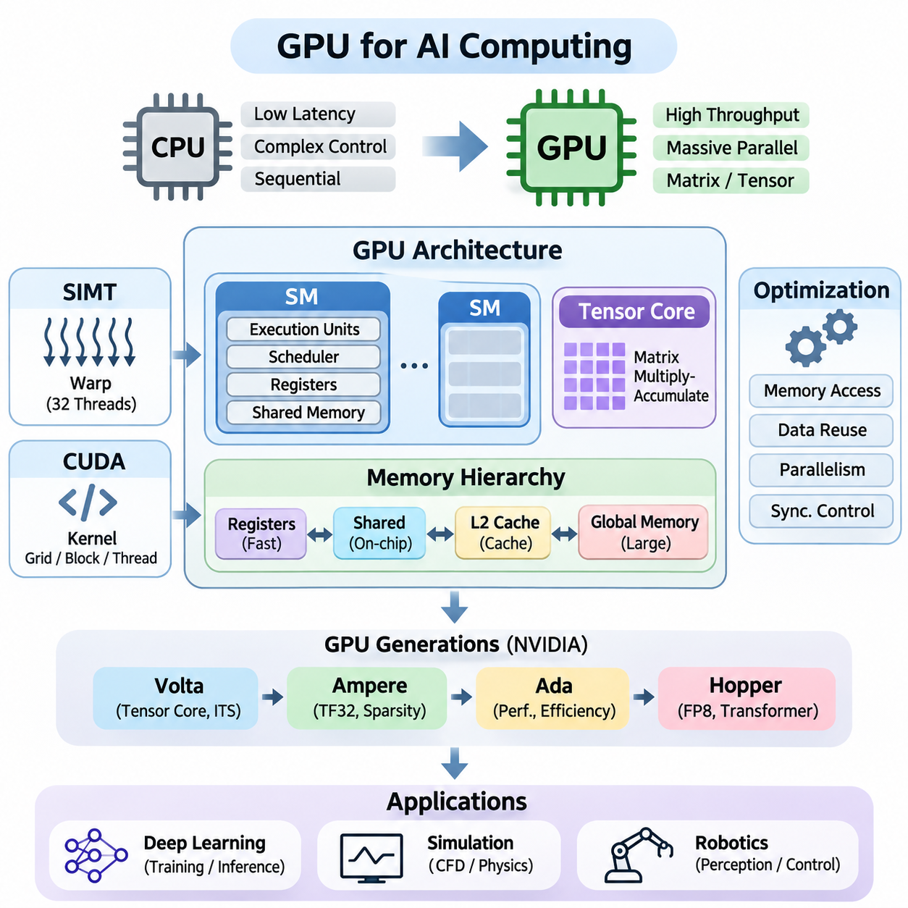
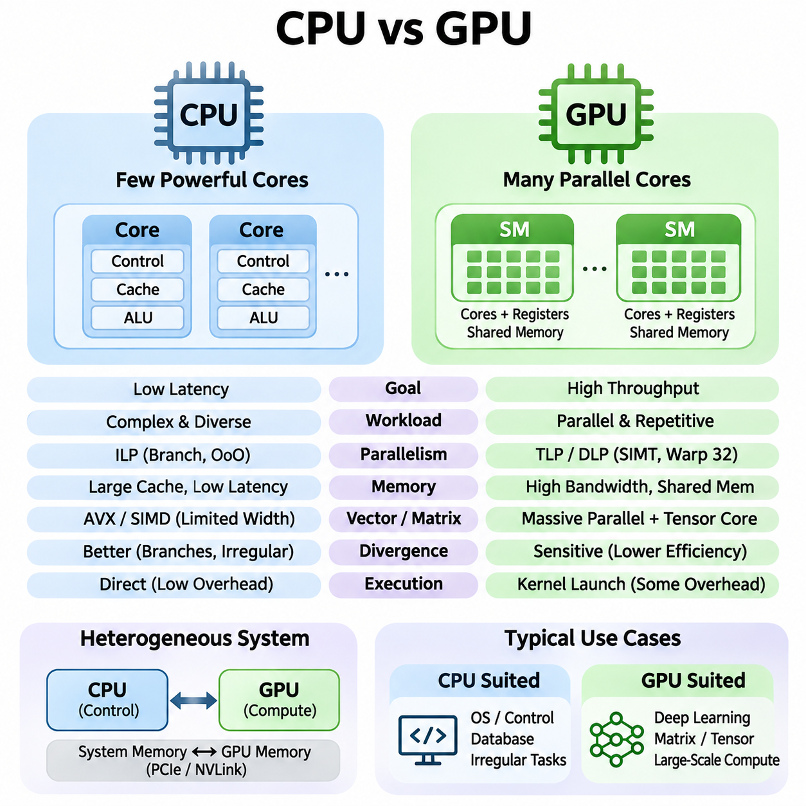
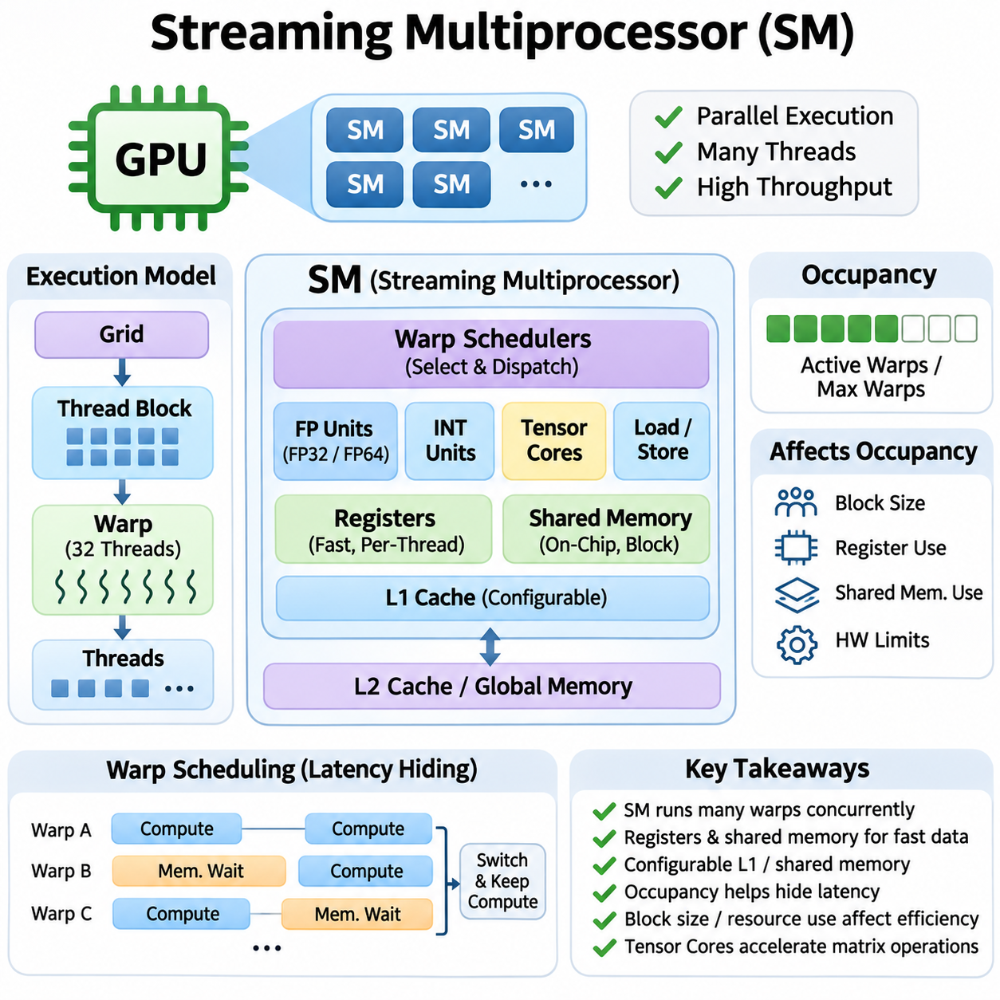
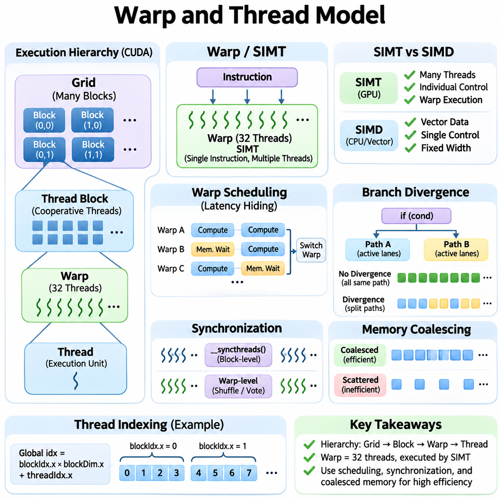
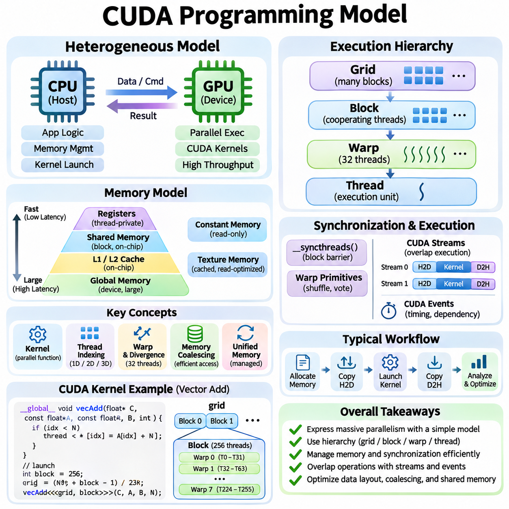
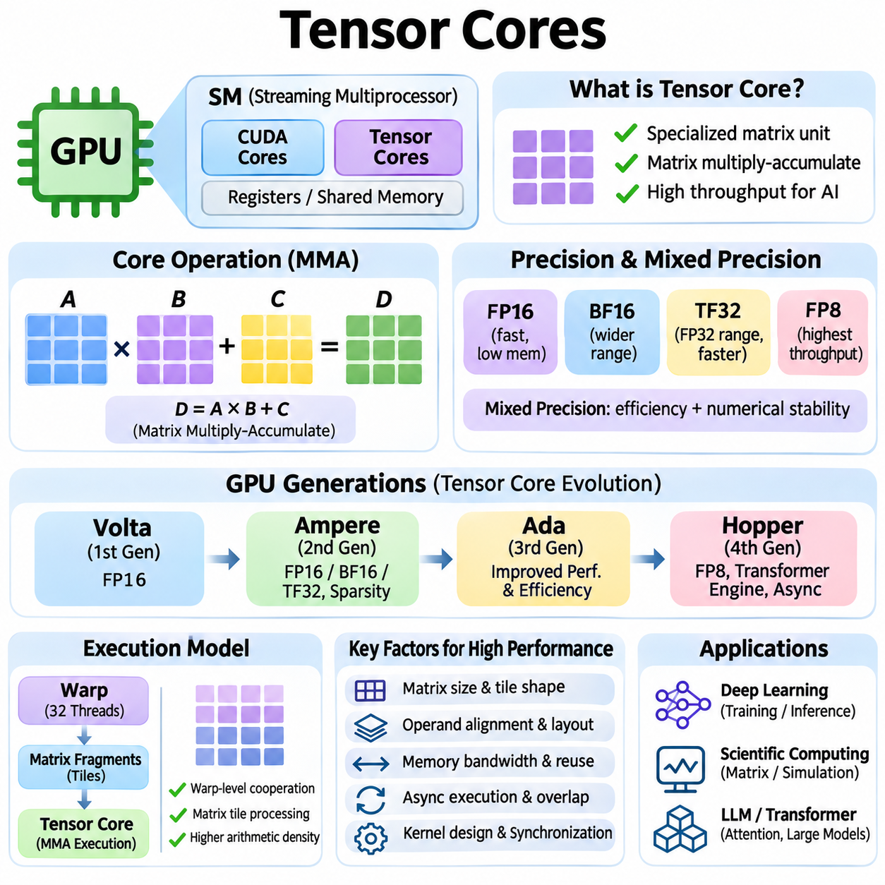
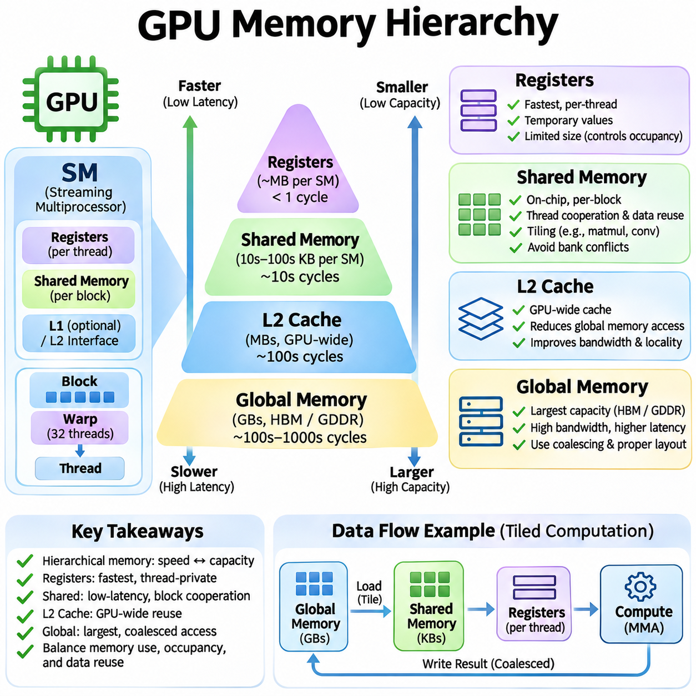
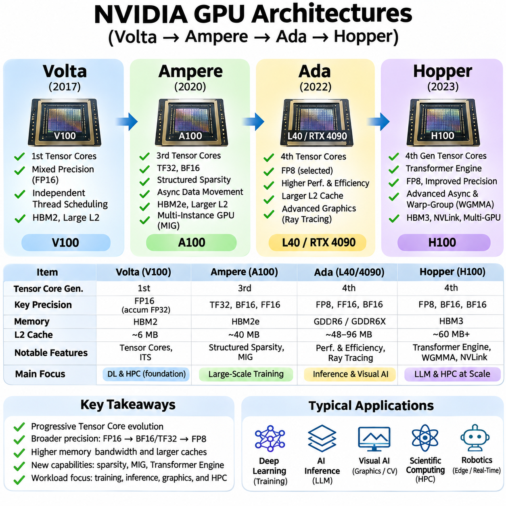
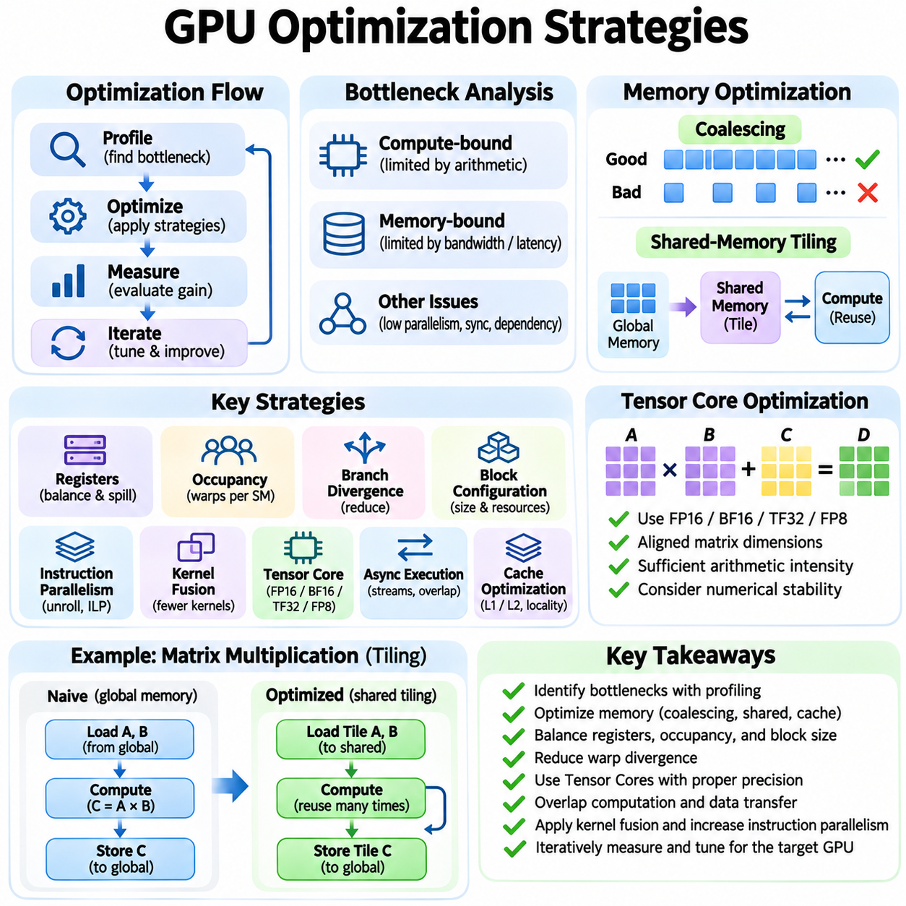
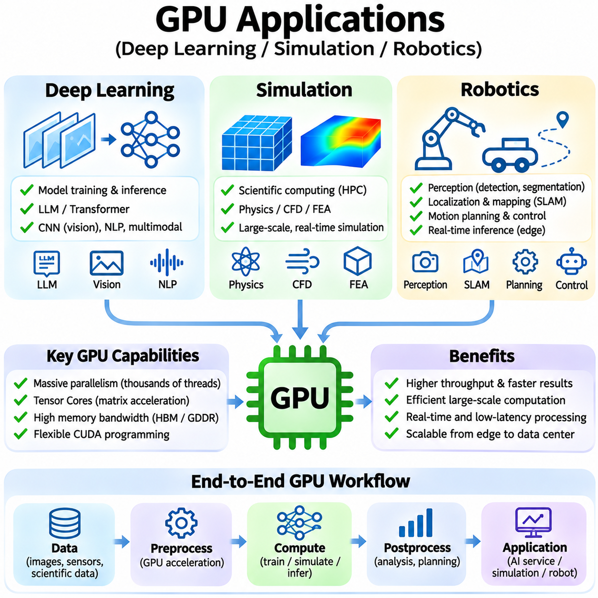

**Volume 39. Hardware for AI**

# 01. GPU Architecture

## 01.00 Overview

{width="7.268055555555556in" height="7.268055555555556in"}

Graphics Processing Units (GPUs) have evolved from specialized graphics rendering devices into fundamental computing platforms for artificial intelligence. Their massively parallel architecture enables thousands of arithmetic operations to execute concurrently, making GPUs particularly effective for neural network training, inference, scientific simulation, and large-scale numerical computation. Understanding GPU architecture is essential for designing efficient AI systems.

Unlike Central Processing Units (CPUs), which prioritize low-latency execution, complex instruction handling, and sequential performance, GPUs emphasize computational throughput. A GPU distributes large workloads across numerous execution units that process many data elements simultaneously. This architectural distinction makes GPUs especially suitable for matrix multiplication, convolution, tensor operations, and other repetitive mathematical workloads.

Modern GPUs contain multiple Streaming Multiprocessors (SMs), each responsible for executing groups of parallel threads. An SM integrates arithmetic execution units, scheduling mechanisms, registers, and configurable on-chip memory resources. By distributing thread blocks across available SMs, the GPU can maintain substantial computational activity while hiding memory access latency through rapid switching among eligible warps.

GPU execution commonly follows the Single Instruction, Multiple Threads (SIMT) programming model. Threads are organized into warps, typically containing 32 threads in NVIDIA architectures, and execute instructions under coordinated scheduling. Individual threads maintain their own registers and execution state, while divergence among threads within a warp can reduce execution efficiency when different control-flow paths must be processed separately.

The CUDA programming model provides a software abstraction for accessing NVIDIA GPU parallelism. Developers define kernels that execute across grids of thread blocks, with each block containing multiple threads. Thread indexing determines which data elements each thread processes, while synchronization and memory management mechanisms coordinate computation. CUDA enables applications to exploit GPU resources without directly controlling every hardware instruction.

Tensor Cores represent an important architectural advancement for AI acceleration. These specialized execution units perform matrix multiply-accumulate operations using supported numerical formats. By accelerating dense matrix computations, Tensor Cores improve the performance of deep learning workloads such as transformer attention, convolutional neural networks, and large language models. Their benefits depend on data types, matrix dimensions, and kernel implementation.

GPU computational performance depends heavily on its memory hierarchy. Global memory provides substantial storage capacity but generally has higher access latency than on-chip resources. Registers offer fast thread-private storage, while shared memory enables efficient communication and data reuse among threads within a block. L2 cache reduces repeated external memory transactions and improves access efficiency across GPU workloads.

Memory bandwidth is often as important as arithmetic throughput. A GPU may contain powerful execution units but remain underutilized when data cannot be delivered quickly enough. Memory coalescing, cache locality, shared-memory tiling, and register reuse help reduce unnecessary data transfers. Effective GPU programming therefore requires balancing computation, memory traffic, synchronization overhead, and available parallelism.

The relationship between arithmetic intensity and memory bandwidth determines whether a workload is compute-bound or memory-bound. Arithmetic intensity measures the number of operations performed per byte transferred from a specified memory level. Workloads with limited data reuse frequently encounter bandwidth constraints, while highly optimized matrix operations can approach the GPU\'s computational limits when sufficient parallelism and suitable numerical precision are available.

GPU architecture has advanced through successive hardware generations that introduce improvements in execution efficiency, numerical capabilities, memory systems, and scheduling. NVIDIA Volta introduced Tensor Cores and independent thread scheduling, establishing important foundations for modern AI acceleration. Subsequent architectures expanded these capabilities while addressing increasingly demanding computational workloads.

NVIDIA Ampere introduced broader Tensor Core capabilities, including support for TensorFloat-32 and structured sparsity acceleration on supported devices. These features improved the efficiency of many deep learning operations while preserving familiar programming interfaces. Ampere also advanced memory and execution resources, although specific capabilities differ between data-center and consumer GPU implementations.

The Ada architecture emphasizes performance improvements in graphics, AI inference, and energy efficiency through architectural refinements and advanced manufacturing. Its Tensor Core capabilities support accelerated machine learning operations, while larger caches in many implementations reduce external memory traffic. Ada-based GPUs demonstrate how architectural improvements can benefit both interactive applications and AI workloads.

NVIDIA Hopper extends GPU acceleration toward large-scale AI training and high-performance computing. Its architecture introduces Transformer Engine capabilities, FP8 computation, and advanced mechanisms for asynchronous data movement and thread-block cooperation. These features are designed to improve computational utilization for demanding tensor workloads, particularly when software frameworks and kernels exploit the available hardware capabilities.

GPU optimization requires coordinated management of execution resources, memory access, and numerical operations. Thread-block dimensions, warp occupancy, register allocation, and shared-memory consumption influence how many workloads can execute concurrently. Increasing occupancy does not always improve performance, because excessive parallelism may introduce resource pressure or unnecessary scheduling overhead without resolving the underlying bottleneck.

Kernel optimization focuses on reducing execution time for individual GPU operations. Techniques include operation fusion, loop unrolling, vectorized memory access, efficient tiling, and minimizing synchronization. Fused kernels can eliminate intermediate memory transfers by combining multiple operations into a single execution sequence. However, fusion must be balanced against register pressure, instruction complexity, and reduced scheduling flexibility.

Numerical precision directly influences GPU performance, memory requirements, and computational accuracy. FP32 remains important for many scientific and machine learning operations, while FP16, BF16, and FP8 can accelerate supported tensor computations and reduce memory traffic. Mixed-precision techniques combine numerical formats to improve efficiency while maintaining acceptable accuracy through appropriate accumulation and stability controls.

Deep learning frameworks such as PyTorch and TensorFlow use GPU libraries and runtime systems to execute computational graphs efficiently. Libraries including cuBLAS and cuDNN provide optimized implementations of common mathematical operations. Framework compilers and execution engines can further improve performance through kernel selection, graph optimization, operation fusion, and hardware-aware scheduling strategies.

GPU architecture plays a central role in training large neural networks. Forward propagation, gradient computation, and parameter updates involve extensive matrix and tensor operations that benefit from parallel execution. Training performance depends not only on GPU arithmetic capacity but also on memory availability, batch size, optimizer state, communication overhead, and the ability to keep execution units continuously supplied with useful work.

During inference, GPUs accelerate model execution under different performance constraints. Interactive applications emphasize response latency, while batch processing emphasizes throughput and hardware utilization. Techniques such as quantization, batching, kernel fusion, and memory-efficient attention can improve inference efficiency. The optimal configuration depends on model architecture, sequence length, concurrency, and deployment requirements.

Multi-GPU systems extend computational capacity beyond individual accelerators. Data parallelism distributes training samples across devices, while tensor and pipeline parallelism partition model computation. Communication technologies such as PCIe and NVLink support data exchange between accelerators. Effective scaling requires balancing computation with synchronization, interconnect bandwidth, memory capacity, and communication latency.

Scientific simulation also benefits from GPU parallelism because many physical models involve repeated numerical calculations over large spatial domains. Fluid dynamics, particle simulation, finite-element methods, and numerical optimization can exploit GPU execution resources. Performance depends on computational regularity, memory locality, precision requirements, and the suitability of numerical algorithms for massively parallel processing.

Robotics applications increasingly use GPUs for perception, localization, mapping, simulation, and learning-based control. Image processing, point-cloud analysis, neural inference, and physics simulation can execute efficiently on GPU hardware. However, robotic systems must also consider deterministic timing, power consumption, thermal constraints, and coordination with CPUs and embedded controllers responsible for real-time operation.

Real-world GPU performance cannot be evaluated solely through theoretical floating-point operations per second. Memory bandwidth, execution occupancy, kernel launch overhead, cache behavior, and data transfer costs strongly influence application performance. Profiling tools such as NVIDIA Nsight Systems and Nsight Compute help identify execution bottlenecks and reveal whether optimization should target arithmetic operations, memory movement, or scheduling.

Power consumption and thermal behavior are additional architectural considerations. High computational utilization increases electrical and cooling requirements, while sustained workloads may experience frequency adjustments under power or temperature limits. Performance-per-watt therefore becomes an important metric for data centers, autonomous machines, and embedded AI platforms where energy availability and cooling capacity impose practical operating constraints.

GPU architecture should ultimately be understood as an integrated relationship between parallel execution, specialized arithmetic units, memory organization, programming abstractions, and system-level communication. Efficient AI computation emerges when algorithms and software exploit these hardware characteristics coherently. This foundation supports deeper exploration of GPU execution models, Tensor Cores, memory optimization, architectural generations, and practical AI applications.

## 01.01 GPU vs CPU

{width="7.268055555555556in" height="7.268055555555556in"}

Central Processing Units (CPUs) and Graphics Processing Units (GPUs) represent two complementary approaches to computational architecture. CPUs are designed to execute diverse instructions efficiently while minimizing latency for individual tasks. GPUs prioritize aggregate throughput by distributing large numbers of similar operations across parallel execution resources. Their differences influence how artificial intelligence workloads are implemented and optimized.

A CPU typically contains a relatively small number of sophisticated processing cores optimized for sequential execution and complex control flow. Each core includes advanced instruction scheduling, branch prediction, caching, and out-of-order execution mechanisms. These capabilities allow CPUs to respond efficiently to unpredictable workloads, operating system activities, database transactions, and applications requiring frequent decisions.

A GPU contains many parallel arithmetic execution units organized into larger processing structures. Rather than maximizing the performance of individual instruction streams, GPUs execute numerous threads concurrently to achieve high aggregate computational throughput. This organization is particularly effective when workloads contain repeated operations over large arrays, matrices, tensors, or independent data elements.

The fundamental distinction between CPU and GPU design involves latency optimization versus throughput optimization. CPUs attempt to complete individual instruction sequences quickly, whereas GPUs emphasize the total amount of computation completed over time. GPU execution can tolerate longer individual memory access delays by switching among available groups of threads, allowing other computations to proceed while data transfers are pending.

CPU architectures rely heavily on sophisticated control mechanisms to maintain high instruction-level parallelism. Branch prediction anticipates program decisions, speculative execution processes likely instruction paths, and out-of-order execution rearranges independent operations when dependencies permit. These techniques improve responsiveness but require considerable hardware resources, power consumption, and architectural complexity.

GPU architectures instead emphasize thread-level and data-level parallelism. Large collections of threads execute similar instructions on different data elements, enabling efficient utilization of numerous arithmetic units. NVIDIA GPUs commonly organize threads into warps containing 32 threads. Their Single Instruction, Multiple Threads execution model coordinates instruction execution while allowing individual threads to maintain separate registers and execution states.

Control-flow divergence affects CPU and GPU performance differently. CPUs handle complex branches through dedicated prediction and scheduling mechanisms, although mispredictions introduce penalties. GPUs perform best when threads within the same warp follow similar execution paths. When threads diverge, different branches may require separate execution, reducing the proportion of active threads and lowering effective throughput.

Memory architecture also distinguishes CPUs from GPUs. CPUs generally employ sophisticated cache hierarchies designed to reduce latency for irregular memory access patterns. GPUs emphasize high aggregate memory bandwidth and efficient access across many concurrent threads. Their memory systems combine device memory, shared memory, registers, and caches to support parallel execution and repeated data reuse.

Modern CPUs support vector instructions such as AVX and other SIMD extensions, enabling multiple data elements to be processed simultaneously. GPUs extend this parallel processing approach across substantially larger collections of execution units and threads. Consequently, CPUs can perform efficiently on moderate-sized numerical workloads, while GPUs often provide greater acceleration when sufficient parallel work is available.

Arithmetic intensity plays an important role in determining which processor architecture is more suitable. Workloads performing many mathematical operations per transferred byte can benefit substantially from GPU computational capacity. However, applications involving small datasets, frequent synchronization, irregular memory access, or limited parallelism may perform better on CPUs because GPU execution and data movement introduce additional overhead.

Matrix multiplication illustrates the architectural advantages of GPUs. Deep learning models repeatedly multiply large matrices during forward propagation and gradient computation. GPUs distribute these operations across parallel execution units and may use specialized Tensor Cores for supported numerical formats. CPUs can execute the same mathematical operations, but large dense matrix workloads frequently achieve higher throughput on suitable GPUs.

Data transfer between CPU memory and GPU memory can significantly influence application performance. In systems with discrete GPUs, transferring tensors across PCIe introduces latency and consumes communication bandwidth. Small computational tasks may not justify this overhead. Efficient applications therefore minimize unnecessary transfers, retain reusable data on the GPU, and combine operations whenever practical.

Kernel launch overhead introduces another distinction between the two architectures. CPU functions can execute directly within ordinary program control flow, while GPU kernels require runtime scheduling and device execution management. Although launch overhead may be small compared with large computations, repeated execution of extremely short kernels can reduce efficiency. Kernel fusion and asynchronous execution can help address this limitation.

The CPU commonly acts as the control processor in heterogeneous computing systems. It manages operating system services, application logic, memory allocation, input/output operations, and GPU workload scheduling. The GPU operates as a computational accelerator for highly parallel tasks. This division allows applications to combine flexible sequential execution with specialized high-throughput processing.

Deep learning training demonstrates the importance of CPU-GPU cooperation. CPUs typically coordinate dataset loading, preprocessing, training control, and communication with storage systems. GPUs perform computationally intensive tensor operations, including forward propagation, backpropagation, and gradient calculations. Efficient training pipelines overlap data preparation and transfer with GPU execution to reduce idle time.

Inference workloads present different architectural tradeoffs. GPUs are effective for large models, high request concurrency, and substantial batch sizes because they can process many tensor operations simultaneously. CPUs may be preferable for compact models, low request volumes, or applications with strict resource constraints. Actual performance depends on model structure, numerical precision, memory capacity, and execution software.

Power efficiency must be evaluated relative to workload characteristics rather than processor category alone. GPUs can provide superior energy efficiency for large parallel computations by completing more operations per unit of energy. CPUs may consume less total energy for small or irregular tasks that do not utilize GPU resources effectively. System-level measurements should include memory, communication, cooling, and idle power.

Scalability also differs between CPU and GPU systems. Multi-core CPUs expand execution capacity through additional general-purpose cores and shared-memory coordination. Multi-GPU systems distribute computation across accelerators using technologies such as PCIe and NVLink. GPU scaling can provide substantial throughput improvements, but communication overhead, synchronization, and workload partitioning may limit efficiency.

Programming models reflect these architectural differences. CPU applications commonly use conventional threads, task schedulers, and vectorized libraries. GPU applications use specialized programming environments such as CUDA, HIP, or accelerator-oriented compiler frameworks. Effective GPU programming requires attention to thread organization, memory coalescing, synchronization, register pressure, and the distribution of work across execution resources.

Performance comparisons require careful benchmarking under equivalent conditions. CPU and GPU results should account for numerical precision, batch size, memory transfers, preprocessing, and total execution time. Peak floating-point performance alone does not establish practical superiority. End-to-end latency, throughput, energy consumption, hardware utilization, and application accuracy provide a more meaningful basis for comparison.

In scientific computing, CPUs remain valuable for irregular algorithms, complex decision structures, and tasks involving extensive sequential dependencies. GPUs excel in dense linear algebra, structured numerical simulation, image processing, and massively parallel computations. Hybrid implementations often assign irregular control operations to CPUs while accelerating computationally intensive numerical kernels on GPUs.

Robotics and autonomous systems illustrate the complementary relationship between these processors. CPUs handle system coordination, communication, planning, and control tasks requiring predictable execution behavior. GPUs accelerate perception models, image analysis, point-cloud processing, and neural network inference. Reliable robotic systems distribute workloads according to computational requirements, timing constraints, and available hardware resources.

The increasing complexity of artificial intelligence models has strengthened the importance of heterogeneous computing. CPUs provide general-purpose flexibility, while GPUs deliver high-throughput parallel computation and specialized tensor acceleration. Understanding their architectural tradeoffs enables engineers to select appropriate hardware, minimize data movement, optimize execution pipelines, and design scalable AI systems that balance performance, energy efficiency, cost, and reliability.

## 01.02 Streaming Multiprocessor (SM)

{width="7.268055555555556in" height="7.268055555555556in"}

A Streaming Multiprocessor (SM) is a fundamental execution unit within NVIDIA GPU architecture, responsible for processing large numbers of parallel threads. Each SM integrates arithmetic execution units, warp schedulers, registers, shared memory, and instruction dispatch mechanisms. By coordinating these resources, an SM executes many independent operations concurrently, enabling GPUs to achieve high computational throughput across demanding artificial intelligence workloads.

Unlike a conventional CPU core, an SM is designed to manage numerous lightweight threads rather than optimize a single instruction stream. Multiple thread blocks can reside on one SM when hardware resources permit. Their threads are organized into warps, typically containing 32 threads in NVIDIA architectures. This organization allows the hardware to distribute execution efficiently while maintaining sufficient parallel work to tolerate instruction and memory latency.

The internal structure of an SM varies across GPU generations, but its fundamental components serve consistent purposes. Arithmetic units perform numerical operations, load/store units manage memory instructions, and specialized execution resources accelerate supported mathematical functions. Warp schedulers select eligible instructions for execution, while registers and shared memory provide low-latency storage for active threads and cooperating thread blocks.

Warp scheduling is central to SM performance because GPU workloads frequently encounter memory and instruction dependencies. When one warp cannot proceed, the scheduler may issue instructions from another ready warp. This latency-hiding mechanism allows useful computation to continue without requiring every memory operation to complete immediately. Its effectiveness depends on available parallelism, resource occupancy, and the number of eligible warps.

An SM maintains execution state for multiple resident warps, including registers, program counters, and scheduling information. Hardware resources determine how many warps and thread blocks can remain active simultaneously. The maximum number of resident threads differs between GPU architectures and specific implementations. Consequently, optimal kernel configurations must account for device-specific limits rather than assuming identical SM capacities across generations.

Registers provide fast, thread-private storage for intermediate values, loop variables, and temporary computational results. Each SM contains a finite register file shared among its resident threads. Kernels requiring many registers per thread can reduce the number of simultaneously active warps. Excessive register demand may also cause spilling into local memory, potentially increasing memory traffic and reducing execution efficiency.

Shared memory is an explicitly managed on-chip storage resource that enables threads within the same block to exchange data efficiently. It is especially valuable for tiled matrix multiplication, convolution, reductions, and algorithms involving repeated data reuse. By loading frequently accessed values into shared memory, kernels can reduce global memory transactions. Correct synchronization is necessary when threads depend on data written by other threads.

Many NVIDIA architectures provide a configurable relationship between shared memory and the L1 cache, although the precise organization differs across generations. L1 caching accelerates selected memory accesses, while shared memory supports programmer-controlled data placement. Allocating more shared memory to individual thread blocks can improve locality but may reduce the number of blocks that fit concurrently on an SM.

The occupancy of an SM describes the proportion of its maximum supported active warps that are currently resident. Occupancy depends on thread-block size, register usage, shared-memory allocation, and architectural resource limits. Higher occupancy can improve latency hiding by providing more eligible warps. However, maximum occupancy does not necessarily produce maximum performance, particularly when execution throughput or memory bandwidth is already saturated.

Thread blocks are assigned to SMs by GPU scheduling hardware, and their threads execute using the resources available on the assigned multiprocessor. A block normally remains associated with its assigned SM throughout execution. Multiple blocks may execute concurrently on one SM, while additional blocks wait until resources become available. This execution model supports scalable kernels without requiring programmers to select individual SMs manually.

The relationship between thread blocks and SM resources directly influences kernel efficiency. Large blocks may provide substantial cooperation and data reuse but consume more registers and shared memory. Smaller blocks can offer greater scheduling flexibility, although they may introduce additional overhead or reduce cooperation opportunities. Selecting appropriate block dimensions requires balancing parallelism, resource consumption, synchronization, and workload characteristics.

Instruction dispatch mechanisms connect warp scheduling decisions to the SM\'s execution pipelines. Different instructions may use distinct functional units, including floating-point arithmetic, integer computation, memory operations, and specialized mathematical pipelines. Hardware generations differ in issue capabilities and execution resources. Effective utilization requires sufficient independent instructions and an appropriate mixture of operations to avoid persistent pipeline bottlenecks.

Floating-point execution units support numerical computation across precision formats defined by the GPU architecture. FP32 arithmetic is widely used in graphics, scientific computing, and machine learning, while supported FP64 capabilities vary significantly among GPU products. Integer execution units process addressing calculations, indexing, logical operations, and integer arithmetic. The balance between these resources influences performance for different computational workloads.

Tensor Cores are specialized computational units integrated into SMs in supported NVIDIA GPU generations. They accelerate matrix multiply-accumulate operations using supported data formats and operand configurations. Deep learning frameworks exploit these units for matrix multiplication, convolution, and transformer computations. Achieving high Tensor Core utilization requires suitable matrix shapes, memory layouts, precision choices, and optimized kernels.

Load/store units manage instructions that transfer data between registers and the GPU memory hierarchy. Efficient memory access patterns are essential because scattered or redundant transactions can reduce effective bandwidth. Coalesced global memory accesses combine suitable requests from neighboring threads into efficient memory transactions. Shared-memory access patterns must also consider bank organization to avoid unnecessary serialization caused by bank conflicts.

Synchronization mechanisms coordinate cooperating threads and preserve correctness when operations depend on shared data. Block-level barriers ensure that participating threads reach required execution points before dependent operations proceed. Memory ordering rules determine when writes become visible to other threads. Excessive synchronization can reduce parallel efficiency, while insufficient synchronization may produce race conditions and incorrect computational results.

Control-flow divergence occurs when threads within a warp follow different execution paths. The SM must manage these paths according to its execution model, potentially reducing the number of threads performing useful work at a given moment. Divergence is particularly costly when branches contain substantial computation. Algorithms that organize threads around similar control behavior can improve execution efficiency and reduce wasted instruction capacity.

SM performance also depends on instruction-level parallelism within individual threads. Independent arithmetic operations may execute efficiently when their dependencies permit overlapping execution. Long dependency chains can limit instruction issue even when arithmetic units remain available. Combining instruction-level parallelism with thread-level parallelism helps sustain execution throughput, especially for computational kernels containing repeated mathematical operations.

Modern SM architectures support increasingly sophisticated mechanisms for coordinating computation and data movement. Depending on the GPU generation, asynchronous memory operations can overlap data transfers with arithmetic execution. Hardware-supported synchronization and specialized transfer mechanisms may reduce instruction overhead. These capabilities are particularly useful for tiled tensor workloads that repeatedly move data between global memory and on-chip storage.

SM scalability enables GPUs to increase computational capacity by integrating many multiprocessors within a single device. Large kernels distribute thread blocks across available SMs, allowing substantial parallel execution. However, overall performance does not necessarily scale linearly with SM count. Global memory bandwidth, cache capacity, synchronization requirements, and workload size can constrain utilization even when additional computational resources are available.

GPU generations such as Volta, Ampere, Ada, and Hopper demonstrate continuing changes in SM organization and capabilities. Improvements include specialized tensor computation, scheduling refinements, memory-system enhancements, and additional mechanisms for overlapping execution and data movement. Because SM configurations differ across products, performance tuning should use the actual device specifications rather than relying solely on architectural family names.

Profiling provides essential information about SM utilization and execution bottlenecks. NVIDIA Nsight Compute can report metrics related to achieved occupancy, instruction throughput, memory behavior, register usage, and execution pipeline activity. These measurements help distinguish insufficient parallelism from memory stalls, dependency limitations, and resource saturation. Optimization decisions should be guided by observed bottlenecks rather than occupancy alone.

In deep learning applications, SMs execute the computational kernels underlying neural network operations. Matrix multiplication, convolution, normalization, activation functions, and gradient calculations rely on coordinated execution across many multiprocessors. Kernel efficiency depends on how effectively these operations use registers, shared memory, arithmetic pipelines, and Tensor Cores. Efficient scheduling and data reuse are therefore essential to achieving high training and inference throughput.

Understanding SM architecture provides a foundation for effective GPU programming and performance engineering. Warp scheduling, register allocation, shared-memory organization, execution pipelines, and occupancy interact to determine computational efficiency. Optimized kernels balance these resources while minimizing unnecessary data movement and synchronization. This architectural understanding supports scalable AI training, efficient inference, scientific computing, and high-performance robotic perception systems.

## 01.03 Warp and Thread Model

{width="7.268055555555556in" height="7.268055555555556in"}

The warp and thread model forms the foundation of parallel execution in NVIDIA GPU architectures. Unlike CPUs, which emphasize the performance of individual instruction streams, GPUs organize computation into thousands of lightweight threads. These threads execute within a hierarchical structure consisting of grids, thread blocks, and warps. Understanding this organization is essential for developing efficient CUDA kernels and optimizing artificial intelligence workloads.

A thread represents the smallest logical execution entity in the CUDA programming model. Each thread executes kernel instructions using its own registers, local variables, and execution state. Threads identify their assigned data through indexing mechanisms, allowing the same kernel to process different elements of an array or tensor. This approach supports scalable parallel computation without requiring separate program definitions for individual data elements.

Threads are grouped into thread blocks, which provide a fundamental unit of cooperative execution. Threads within the same block can exchange data through shared memory and coordinate their activities using synchronization primitives. A block may contain one-dimensional, two-dimensional, or three-dimensional thread arrangements. The number of threads per block is constrained by architectural limits and the resources required by the kernel.

Thread blocks are organized into a grid that defines the complete parallel execution domain of a kernel launch. Grid dimensions determine how many blocks participate in the computation, while block dimensions specify the threads within each block. CUDA indexing variables allow threads to calculate global positions from block and thread coordinates. This hierarchy enables applications to process large datasets independently of the number of physical GPU multiprocessors.

Within each thread block, NVIDIA GPUs organize threads into warps, typically containing 32 consecutive threads. A warp is the fundamental scheduling unit used by the hardware to issue instructions for groups of threads. Threads within a warp execute according to the Single Instruction, Multiple Threads model. Although they share coordinated instruction execution, individual threads maintain their own registers, predicates, and logical execution states.

The Single Instruction, Multiple Threads execution model differs from conventional Single Instruction, Multiple Data vector processing. SIMT exposes independently addressable threads with individual control flow, while SIMD commonly presents vector operations over multiple data elements. Hardware coordinates the execution of warp threads to achieve parallel efficiency. This abstraction allows programmers to express thread-level logic while the GPU manages grouped instruction execution.

Warp scheduling enables Streaming Multiprocessors to maintain computational throughput despite memory and instruction dependencies. Each multiprocessor supports multiple resident warps, subject to architectural resource limits. When one warp encounters a dependency that prevents progress, the scheduler can select another eligible warp. This rapid scheduling mechanism hides latency by overlapping useful computation with outstanding memory operations.

Warp execution efficiency depends on the similarity of control flow among participating threads. When all active threads follow the same instruction path, the hardware can utilize execution resources effectively. Divergence occurs when threads within a warp take different branches of a conditional statement. The GPU must execute the required paths with appropriate thread participation, potentially reducing throughput until the execution paths reconverge.

Branch divergence is particularly important in algorithms containing irregular decisions or data-dependent conditions. For example, neighboring threads may evaluate different branches when processing variable-length sequences or sparse data structures. Organizing data to encourage similar execution paths can reduce divergence. Predication and branch restructuring may also improve efficiency, although their benefits depend on instruction costs and workload characteristics.

Thread synchronization is necessary when parallel operations share intermediate results or depend on coordinated execution. CUDA provides block-level synchronization mechanisms that allow participating threads to reach a common execution point before continuing. Such barriers are commonly used after shared-memory writes. Correct synchronization prevents data hazards, while excessive barriers introduce waiting and reduce opportunities for parallel execution.

Warp-level synchronization supports cooperation among threads within a single warp. CUDA provides warp-level primitives for exchanging values, voting on conditions, and coordinating participating lanes. Shuffle operations can transfer register values between lanes without requiring shared-memory transactions. These capabilities are useful for reductions, scans, and collective computations, provided the programmer respects active-thread masks and synchronization requirements.

The lane identifier represents a thread\'s position within its warp, while the warp identifier distinguishes groups of threads within a block. These concepts help programmers design warp-level algorithms and distribute work efficiently. Thread indexing should account for block dimensions and partial warps. Algorithms must not assume that every warp contains 32 active threads, particularly when block sizes or dataset boundaries leave some lanes inactive.

Memory access patterns are closely related to warp organization. When neighboring threads access consecutive memory addresses, the hardware can often combine their requests into efficient global memory transactions. This behavior is known as memory coalescing. Scattered accesses may require additional transactions and reduce effective bandwidth. Consequently, data layout and thread indexing are important components of GPU memory optimization.

Shared-memory access also depends on how threads within a warp address memory banks. Shared memory is divided into banks that can service compatible accesses efficiently. When multiple threads request different addresses mapped to the same bank, bank conflicts may serialize transactions. Carefully designed indexing and data layouts can reduce conflicts, improving the performance of tiled matrix operations and cooperative algorithms.

Thread-level parallelism contributes directly to latency hiding and execution throughput. A kernel with insufficient active warps may leave execution units idle while waiting for memory operations or dependent instructions. Increasing the number of available warps can improve utilization, but hardware resources impose limits. Register allocation, shared-memory consumption, and thread-block dimensions jointly determine how many warps can remain resident.

Occupancy measures the proportion of the maximum supported active warps that are resident on a Streaming Multiprocessor. Higher occupancy can provide additional scheduling opportunities, but it does not guarantee higher performance. Some kernels achieve excellent throughput with moderate occupancy because they exhibit substantial instruction-level parallelism or efficient data reuse. Optimization therefore requires evaluating actual execution bottlenecks rather than maximizing occupancy alone.

Thread-block size affects both scheduling flexibility and resource utilization. Blocks containing multiples of the warp size generally avoid partially filled warps within the block. However, excessively large blocks may consume substantial registers or shared memory and restrict concurrent block residency. Smaller blocks can improve scheduling flexibility but may reduce cooperation efficiency. The optimal configuration depends on kernel behavior and hardware characteristics.

Independent thread scheduling, introduced with NVIDIA Volta, refined the execution model by allowing more flexible management of thread execution state within a warp. This capability improves support for certain divergent execution patterns but does not eliminate the performance cost of divergence. Programs must use appropriate synchronization rather than relying on implicit lockstep behavior when threads exchange data or coordinate through memory.

Warp-level programming requires careful treatment of active masks and execution participation. Collective operations must specify which lanes participate, and participating threads must satisfy the operation\'s execution requirements. Incorrect assumptions about thread activity can produce undefined behavior or invalid results. Explicit synchronization and well-defined participation rules are especially important for algorithms involving divergence or irregular workloads.

The warp and thread model strongly influences the implementation of parallel reductions. Threads initially process independent elements, then combine intermediate results through shared memory or warp-level operations. Efficient implementations reduce synchronization overhead and unnecessary memory traffic. Similar principles apply to prefix scans, histogram computation, normalization, and other collective operations frequently used in machine learning systems.

Deep learning workloads benefit from carefully organized thread mappings. Matrix multiplication kernels assign threads and warps to tiles of input and output matrices, enabling data reuse and coordinated arithmetic execution. Convolution kernels similarly distribute spatial positions, channels, and output elements across parallel threads. Efficient mappings improve memory locality, execution utilization, and compatibility with specialized Tensor Core operations.

Irregular workloads present additional challenges for warp execution. Graph processing, sparse matrix computation, and variable-length sequence processing may involve uneven work distribution and divergent control flow. Load-balancing techniques can assign tasks more evenly across threads and warps. Persistent kernels and work queues may further improve utilization when conventional static mappings produce substantial imbalance.

Profiling tools provide insight into warp execution behavior and thread-level efficiency. NVIDIA Nsight Compute can expose metrics related to active warps, eligible warps, branch behavior, memory transactions, and execution stalls. These measurements help identify whether performance is limited by insufficient parallelism, divergence, memory access inefficiency, or instruction dependencies. Profiling results should guide kernel restructuring and launch configuration choices.

The warp and thread model ultimately connects CUDA\'s programming abstractions with the physical execution resources of GPU hardware. Threads express independent computations, blocks enable cooperation, and warps provide the scheduling structure for efficient execution. Understanding indexing, divergence, synchronization, memory access, and occupancy allows developers to design scalable kernels that exploit GPU parallelism across deep learning, scientific computing, and robotics.

## 01.04 CUDA Programming Model [w/Code]

{width="7.268055555555556in" height="7.268055555555556in"}

The CUDA programming model provides a structured approach to executing massively parallel computations on NVIDIA GPUs. It extends conventional programming with abstractions for device kernels, thread organization, memory management, and synchronization. CUDA allows developers to express parallel algorithms without directly managing individual hardware execution units. Its design connects high-level software operations with the underlying GPU architecture.

CUDA applications commonly follow a heterogeneous computing model in which the CPU acts as the host and the GPU operates as the device. The host manages application logic, memory allocation, and kernel launches, while the device executes computationally intensive parallel operations. This division enables applications to combine sequential processing with high-throughput acceleration. Efficient coordination between host and device is essential for overall performance.

A CUDA kernel is a function executed by many GPU threads in parallel. The programmer defines the computation performed by each thread, while the CUDA runtime organizes execution across available hardware resources. Kernel launches specify the number of thread blocks and the threads contained within each block. This configuration determines the logical parallelism exposed to the GPU rather than directly assigning work to individual multiprocessors.

CUDA organizes parallel execution into a hierarchy of threads, blocks, and grids. Threads execute individual operations, blocks group cooperating threads, and grids contain the blocks participating in a kernel launch. Each thread identifies its position through built-in indexing variables. This hierarchical structure supports scalable algorithms that can execute across GPUs with different numbers of Streaming Multiprocessors.

Thread indexing connects logical execution positions to application data. One-dimensional indexing is commonly used for vector operations, while two-dimensional and three-dimensional arrangements suit images, matrices, and volumetric datasets. Correct indexing ensures that threads process intended elements without accessing invalid memory locations. Boundary checks are necessary when dataset dimensions do not align exactly with the selected execution configuration.

The CUDA execution model uses warps as fundamental hardware scheduling groups. NVIDIA GPUs typically organize 32 threads into each warp, following the Single Instruction, Multiple Threads execution approach. Threads within a warp execute coordinated instructions while maintaining individual execution states. Branch divergence can reduce efficiency when neighboring threads follow different control paths, making regular computation patterns especially advantageous.

CUDA exposes several memory spaces with different performance characteristics and visibility rules. Registers provide fast thread-private storage, while local memory holds thread-private data that cannot remain entirely in registers. Shared memory enables communication among threads within a block. Global memory provides device-wide storage accessible across kernels, while constant and texture memory support specialized access patterns.

Global memory usually offers substantial capacity but has higher latency than on-chip storage. Efficient CUDA kernels therefore seek coalesced accesses, where neighboring threads request addresses that can be served through a small number of memory transactions. Poorly organized accesses increase memory traffic and reduce effective bandwidth. Data layout and thread mapping should be designed together to improve locality and minimize redundant transfers.

Shared memory provides explicitly managed on-chip storage for cooperating threads. It is frequently used to cache reusable data during matrix multiplication, convolution, and reduction operations. Threads can load data from global memory into shared memory, perform repeated computations, and synchronize before consuming results produced by other threads. Efficient shared-memory usage reduces external memory traffic but must account for capacity limits and bank conflicts.

CUDA synchronization mechanisms preserve correctness when parallel operations depend on shared results. Block-level barriers coordinate threads within a block, while warp-level primitives support communication among participating lanes. Device-wide coordination generally requires separate kernel boundaries or specialized cooperative execution mechanisms. Synchronization should be used carefully because unnecessary waiting reduces parallel efficiency and can introduce deadlocks when participation rules are violated.

The CUDA runtime provides functions for allocating, transferring, and releasing device memory. Traditional explicit memory management distinguishes host allocations from device allocations, requiring transfers between their address spaces. Unified Memory offers a managed address space that can simplify programming by allowing supported data to migrate between processors. However, migration overhead and access locality still require attention during performance optimization.

CUDA streams represent ordered sequences of operations submitted for GPU execution. Operations within a stream follow defined ordering rules, while independent streams can enable overlapping execution when hardware resources and dependencies permit. Asynchronous memory transfers may overlap with kernel execution when the relevant requirements are satisfied. Streams therefore help reduce idle time and improve utilization in applications containing multiple computational stages.

CUDA events provide mechanisms for recording execution progress, measuring elapsed device time, and coordinating dependencies between streams. They are useful for benchmarking kernel performance without relying solely on CPU-side timing. Accurate measurements require appropriate synchronization and consideration of asynchronous execution. Event-based profiling helps distinguish kernel execution time from host overhead, memory transfers, and scheduling delays.

Kernel configuration strongly influences execution efficiency. Block dimensions affect warp utilization, scheduling flexibility, and the resources required per block. Register consumption and shared-memory allocation determine how many blocks can reside concurrently on a Streaming Multiprocessor. Larger blocks are not always faster, and maximum occupancy does not guarantee optimal throughput. Effective tuning requires balancing parallelism, resource pressure, and memory behavior.

CUDA supports atomic operations for safely updating shared values when multiple threads may access the same location concurrently. Atomic instructions provide defined read-modify-write behavior for supported operations and memory scopes. They are useful for counters, histograms, and parallel accumulation. However, heavy contention can serialize execution, making hierarchical aggregation or alternative data structures preferable for some workloads.

Error handling is an essential part of reliable CUDA development. Kernel launches and runtime operations can fail because of invalid configurations, allocation problems, or illegal memory accesses. Since many operations execute asynchronously, errors may become visible during later synchronization or runtime calls. Developers should check return statuses, validate memory boundaries, and use diagnostic tools to identify failures before interpreting performance results.

CUDA libraries provide optimized building blocks for common numerical operations. cuBLAS accelerates dense linear algebra, while cuDNN supports neural network operations such as convolution and normalization. Other libraries address sparse matrices, signal processing, and parallel algorithms. Using established libraries often delivers better performance and portability across GPU generations than implementing every computational primitive manually.

The CUDA compilation process translates source programs into executable code suitable for NVIDIA GPU architectures. Device code may be represented through PTX, an intermediate instruction format, before conversion into hardware-specific instructions. Compilation options influence optimization, supported architectures, and numerical behavior. Understanding this process helps developers manage compatibility and evaluate the effects of compiler transformations.

Performance optimization begins with identifying whether a kernel is limited by computation, memory bandwidth, latency, or insufficient parallelism. Techniques such as memory coalescing, loop unrolling, tiling, and kernel fusion address different bottlenecks. Increasing arithmetic intensity through data reuse can improve efficiency. Optimization decisions should be supported by profiling rather than assumptions about theoretical hardware capabilities.

CUDA Graphs reduce repeated host-side submission overhead by representing a sequence of GPU operations as a reusable execution graph. This approach is particularly valuable when applications repeatedly execute similar computational workflows. Graph execution can improve scheduling efficiency and reduce launch-related costs. However, graph construction, dependencies, and memory lifetimes must be managed carefully to preserve correctness.

Mixed-precision computation is widely used in CUDA-based artificial intelligence workloads. Supported GPU architectures accelerate selected FP16, BF16, TF32, and FP8 operations through specialized hardware such as Tensor Cores. These formats can improve throughput and reduce memory requirements, but numerical stability must be considered. Appropriate accumulation precision and scaling strategies help maintain acceptable model accuracy.

Deep learning frameworks integrate CUDA through optimized kernels, libraries, and execution runtimes. PyTorch and TensorFlow schedule tensor operations on GPUs while managing memory and computational dependencies. Framework compilers may combine operations, select specialized kernels, and optimize execution graphs. Understanding CUDA fundamentals helps developers interpret profiling results and resolve performance limitations that remain hidden behind framework abstractions.

Robotics and real-time AI systems use CUDA to accelerate perception, image processing, point-cloud analysis, and neural inference. GPU computation can reduce processing time for demanding sensor workloads, but asynchronous execution and variable scheduling delays require careful system integration. CPU controllers often retain responsibility for timing-critical control functions. Reliable deployment requires balancing acceleration with latency predictability, power consumption, and thermal constraints.

The CUDA programming model ultimately connects software-defined parallelism with GPU execution resources. Its effectiveness depends on appropriate thread organization, memory access patterns, synchronization, asynchronous execution, and kernel configuration. By combining these principles with optimized libraries and profiling tools, developers can build scalable applications for deep learning, scientific computing, simulation, and autonomous systems while improving performance and resource efficiency.

## 01.05 Tensor Cores

{width="7.268055555555556in" height="7.268055555555556in"}

Tensor Cores are specialized processing units integrated into NVIDIA GPU Streaming Multiprocessors to accelerate matrix operations used in artificial intelligence. They execute matrix multiply-accumulate computations with supported numerical formats, providing substantially higher throughput than conventional scalar arithmetic for suitable workloads. Their introduction transformed GPU architecture by making dense tensor computation a primary hardware optimization target.

The fundamental operation performed by Tensor Cores is matrix multiplication combined with accumulation. Conceptually, an output matrix is produced by multiplying two input matrices and adding the result to an accumulator. This operation appears repeatedly in neural network layers, attention mechanisms, and scientific numerical algorithms. Dedicated matrix execution hardware reduces the instruction overhead associated with performing equivalent computations through ordinary arithmetic units.

NVIDIA introduced Tensor Cores with the Volta architecture, initially emphasizing mixed-precision matrix computation for deep learning. Early implementations supported FP16 input operations with accumulation capabilities designed to preserve useful numerical accuracy. This architecture established a new relationship between numerical precision and computational throughput. Subsequent GPU generations expanded supported formats, execution capabilities, and integration with software frameworks.

Tensor Core execution differs from traditional CUDA core processing because it operates on matrix fragments rather than individual scalar values. Groups of threads cooperate to supply operands and consume results through supported programming interfaces. Hardware performs multiple multiply-accumulate operations as a coordinated matrix instruction. This organization increases arithmetic density and reduces the instruction scheduling burden for suitable matrix workloads.

Mixed-precision computation is central to Tensor Core acceleration. Lower-precision formats reduce operand storage requirements and increase the amount of computation supported by specialized hardware. FP16 and BF16 are widely used for deep learning, while FP32 remains important for selected calculations and accumulation. Mixed-precision algorithms balance computational efficiency against rounding errors, numerical range, and model convergence requirements.

FP16 uses a compact floating-point representation that reduces memory consumption and can improve matrix processing throughput. However, its limited exponent range may create overflow or underflow problems during training. Loss scaling can mitigate some gradient underflow issues when FP16 is used. Effective implementations also retain appropriate higher-precision operations for numerically sensitive computations, including selected reductions and optimizer updates.

BF16 provides a wider exponent range than FP16 while retaining a compact storage representation. This makes BF16 attractive for neural network training because it can represent values across a range similar to FP32, although with lower mantissa precision. Supported Tensor Cores accelerate BF16 matrix operations efficiently. The choice between FP16 and BF16 depends on hardware support, numerical behavior, and the stability requirements of the model.

TensorFloat-32, or TF32, was introduced in NVIDIA Ampere data-center GPUs to accelerate selected FP32 matrix operations using Tensor Cores. TF32 retains the exponent range associated with FP32 while using reduced input significand precision for multiplication. Accumulation commonly uses FP32 precision. This approach can improve throughput for compatible workloads, although applications requiring stricter numerical accuracy may need different precision settings.

FP8 computation extends reduced-precision acceleration for supported Tensor Core architectures, notably NVIDIA Hopper and later designs. FP8 formats provide compact operands and can substantially reduce memory traffic for suitable tensor workloads. Because their numerical ranges and precision differ, practical implementations require scaling strategies and careful handling of sensitive operations. FP8 performance benefits depend on architecture, software support, and workload characteristics.

Tensor Core performance is influenced by matrix dimensions, operand alignment, memory layout, and supported instruction shapes. Matrices that map efficiently to hardware execution tiles generally achieve better utilization. Irregular dimensions may require padding or alternative kernel configurations, potentially introducing additional computation. Developers must therefore consider both mathematical workload structure and hardware execution requirements when optimizing tensor operations.

Warp-level cooperation plays an important role in Tensor Core programming. CUDA exposes matrix operations through supported programming interfaces, including warp-level matrix instructions and higher-level abstractions. Threads collectively manage matrix fragments and participate in coordinated execution. The exact mapping between threads, operands, and hardware resources depends on GPU architecture and instruction type, making portable high-performance implementations challenging.

Modern Tensor Core architectures increasingly support asynchronous execution and specialized matrix instructions. NVIDIA Hopper introduced warp-group matrix operations and mechanisms for coordinating data movement with computation. These capabilities allow optimized kernels to overlap operand preparation and matrix execution. However, synchronization, shared-memory organization, and hardware-specific constraints must be handled carefully to obtain correct results and high utilization.

Memory bandwidth remains a major constraint even when Tensor Cores provide substantial arithmetic throughput. Matrix operations require input operands to reach execution units efficiently, and poorly organized transfers can leave specialized hardware underutilized. Shared-memory tiling, register reuse, and coalesced global memory accesses reduce redundant data movement. High-performance kernels balance computation with the cost of loading operands and storing results.

Arithmetic intensity determines how effectively Tensor Core workloads use available computational resources. Large matrix multiplications can reuse input values across many operations, producing high arithmetic intensity. Small matrices or operations with limited reuse may remain constrained by memory traffic or launch overhead. Consequently, theoretical Tensor Core throughput should not be interpreted as guaranteed application performance under arbitrary workload conditions.

Tensor Cores are particularly important for transformer architectures, where linear projections and attention calculations involve extensive matrix multiplication. Query, key, and value transformations can exploit specialized matrix hardware, as can the dense operations within feed-forward networks. Attention performance also depends on memory movement, sequence length, and intermediate tensor storage. Optimized attention kernels combine Tensor Core execution with efficient memory management.

Convolutional neural networks also benefit from Tensor Core acceleration. Convolution operations can be transformed or organized into matrix computations that map efficiently to specialized hardware. Libraries such as cuDNN select algorithms according to tensor shapes, data formats, and available GPU resources. Performance depends on channel dimensions, spatial structure, memory layout, and the overhead associated with transforming or organizing convolution data.

During neural network training, Tensor Cores accelerate forward propagation and backward propagation through repeated matrix operations. Mixed-precision training can reduce memory consumption and increase throughput, enabling larger models or batch sizes within available resources. However, training stability requires attention to gradient scaling, accumulation precision, and sensitive mathematical operations. Performance gains must be evaluated alongside convergence behavior and final model accuracy.

Inference workloads exploit Tensor Cores to improve throughput and reduce response latency for supported model operations. FP16, BF16, FP8, and selected integer formats can accelerate computation depending on the GPU architecture. Quantized inference may require calibration or other techniques to preserve accuracy. The optimal precision format depends on model sensitivity, batch size, latency targets, and the numerical capabilities of the deployment hardware.

Structured sparsity can further improve Tensor Core performance on supported NVIDIA architectures. Certain hardware generations accelerate matrix operations when operands follow specific sparsity patterns, such as the supported two-out-of-four structure. Sparse acceleration requires compatible data representations and suitable kernels. Although sparsity can reduce arithmetic work, practical gains depend on pruning methods, accuracy retention, and the overhead of maintaining structured representations.

CUDA libraries and deep learning frameworks provide convenient access to Tensor Core capabilities. cuBLAS and cuDNN implement optimized matrix and convolution operations, while PyTorch and TensorFlow integrate supported acceleration paths. Compiler technologies can select matrix instructions, optimize layouts, and fuse surrounding operations. Nevertheless, framework settings, tensor dimensions, and precision policies strongly influence whether Tensor Cores are actually utilized.

Tensor Core utilization should be evaluated through profiling rather than theoretical specifications alone. NVIDIA Nsight Compute can reveal matrix instruction activity, memory bottlenecks, occupancy limitations, and execution stalls. Low utilization may result from insufficient workload size, unsuitable dimensions, inefficient data transfers, or competing execution demands. Profiling helps identify whether optimization should target arithmetic scheduling, memory organization, or kernel selection.

Different NVIDIA GPU generations provide different Tensor Core capabilities and performance characteristics. Volta established specialized matrix acceleration, Ampere expanded numerical support, Ada refined AI execution capabilities, and Hopper introduced additional low-precision and asynchronous matrix features. Specific functionality varies across product families and configurations. Software should therefore detect supported features and select appropriate execution strategies for the target device.

Tensor Cores also support scientific computing, simulation, and robotics when algorithms can exploit accelerated matrix operations without violating accuracy requirements. Neural perception, image processing, state estimation, and learning-based control may benefit from specialized tensor computation. However, numerical sensitivity, deterministic timing, and power constraints must be considered. Not every algorithm benefits equally from reduced precision or dense matrix acceleration.

Tensor Cores demonstrate the importance of hardware-software co-design in modern artificial intelligence systems. Their effectiveness emerges from the interaction of specialized arithmetic units, numerical formats, memory hierarchies, kernel organization, and optimized software libraries. Understanding these relationships enables engineers to improve training throughput, inference efficiency, and computational scalability while maintaining appropriate numerical accuracy and reliable system behavior.

## 01.06 Memory Hierarchy

{width="7.268055555555556in" height="7.268055555555556in"}

The GPU memory hierarchy is designed to balance storage capacity, access latency, bandwidth, and parallel execution requirements. NVIDIA GPUs organize memory into several levels, including registers, shared memory, L2 cache, and global memory. Each level provides different performance characteristics and access rules. Understanding their interactions is essential for optimizing CUDA kernels and reducing data movement in artificial intelligence workloads.

Global memory provides the primary large-capacity storage space accessible to GPU kernels. It is typically implemented using external device memory such as GDDR or HBM, depending on the GPU architecture. Global memory stores model parameters, input tensors, intermediate activations, and output results. Although it offers substantial bandwidth, its access latency is relatively high compared with on-chip memory resources.

Global memory performance depends heavily on access patterns generated by parallel threads. When neighboring threads access consecutive or suitably aligned addresses, memory requests can be combined into fewer transactions through memory coalescing. Scattered accesses may generate additional transactions and waste bandwidth. Efficient CUDA programs therefore organize data layouts and thread indexing to maximize contiguous access and minimize unnecessary transfers.

Global memory allocation and transfer management influence overall application efficiency. CUDA applications can allocate device buffers explicitly and transfer data between host and device memory. Asynchronous transfers and pinned host memory can improve transfer efficiency when used appropriately. Unified Memory simplifies address-space management, but page migration and placement decisions may introduce overhead if access patterns are poorly controlled.

Shared memory is a programmer-managed, low-latency memory space located on the GPU chip. It is accessible to threads within the same thread block and is particularly useful for exchanging intermediate results. Unlike global memory, shared memory can be explicitly populated with reusable data. Its limited capacity requires careful allocation, but effective usage can substantially reduce repeated global memory accesses.

Shared-memory tiling is a fundamental optimization technique for matrix multiplication and convolution. Threads cooperatively load portions of input data into shared memory and reuse them across multiple arithmetic operations. Synchronization ensures that data is available before dependent computations begin. By increasing data reuse, tiling reduces external memory traffic and improves arithmetic intensity, especially in compute-intensive neural network kernels.

Shared memory is divided into banks that enable multiple accesses to be serviced efficiently. Bank conflicts occur when threads in a warp request different addresses mapped to the same bank, requiring some accesses to be serialized. Carefully selected indexing schemes, padding, and memory layouts can reduce these conflicts. Broadcast and other supported access patterns may avoid conflicts even when multiple threads reference related locations.

Shared-memory synchronization is essential when threads cooperate on intermediate data. Block-level barriers ensure that participating threads complete required memory operations before dependent execution continues. Incorrect synchronization can produce race conditions or inconsistent results. Excessive synchronization also reduces throughput by introducing waiting periods, making synchronization placement an important part of kernel optimization.

The L2 cache provides an intermediate storage layer between GPU execution resources and external global memory. It is generally shared across Streaming Multiprocessors and caches data accessed through supported memory paths. Repeated accesses to cached data can avoid expensive external memory transactions. The L2 cache therefore improves effective bandwidth and reduces average memory access latency when workloads exhibit useful locality.

L2 cache effectiveness depends on working-set size, access locality, and competing memory traffic. Frequently reused tensor data may remain cached, while streaming workloads can displace previously useful information. Modern CUDA architectures provide selected cache-management capabilities, including access-policy mechanisms on supported devices. However, cache behavior remains partly hardware-managed, and application performance must be evaluated empirically.

Registers represent the fastest general-purpose storage available to individual GPU threads. They hold temporary variables, addresses, arithmetic operands, and intermediate computation results. Registers are allocated from hardware register files associated with Streaming Multiprocessors. Unlike shared memory, registers are private to individual threads, making them particularly effective for computations with substantial thread-local data reuse.

Register allocation directly influences kernel occupancy and scheduling flexibility. Each Streaming Multiprocessor has a finite register capacity, and kernels requiring many registers per thread may reduce the number of resident warps. Lower occupancy can limit latency hiding, although additional registers may improve performance by reducing memory traffic. Effective optimization balances register usage, instruction-level parallelism, and available execution resources.

Register spilling occurs when the compiler cannot keep all required thread-local values in available registers. Spilled values are typically stored in local memory, which is logically private to each thread but physically backed by device memory and supported caches. Frequent spilling introduces additional memory operations and may significantly reduce performance. Profiling and compiler diagnostics help identify excessive register pressure.

The relationship between registers and shared memory is central to efficient CUDA kernel design. Registers support rapid thread-local computation, while shared memory enables cooperation and data exchange within a block. Global memory provides capacity, and L2 cache reduces the cost of selected repeated accesses. Efficient kernels move data through these levels strategically, retaining frequently reused values close to execution units whenever possible.

Memory latency and bandwidth impose different performance limitations. Latency describes the time required to complete an individual access, while bandwidth measures the amount of data transferred per unit time. A kernel with irregular dependent accesses may be latency-bound even when bandwidth utilization is low. Conversely, large streaming operations may saturate memory bandwidth despite having sufficient parallelism to hide individual access delays.

Arithmetic intensity connects memory behavior with computational throughput. It measures the amount of arithmetic work performed relative to data movement, commonly expressed as operations per byte. Kernels with low arithmetic intensity are often limited by memory bandwidth, while those with substantial reuse may become compute-bound. The roofline model helps explain these relationships and identify whether optimization should target memory traffic or arithmetic execution.

Memory hierarchy optimization is particularly important for deep learning workloads. Matrix multiplication, convolution, and attention operations repeatedly access large tensors and intermediate results. Efficient implementations use registers and shared memory to increase reuse while relying on L2 cache to reduce external traffic. Kernel fusion can further improve performance by eliminating unnecessary intermediate writes and reads between successive operations.

Transformer models create complex memory-access requirements involving weights, activations, attention scores, and key-value caches. During inference, key-value cache traffic can become a major bandwidth constraint, particularly with long contexts or large batches. Optimized attention algorithms reduce intermediate storage and improve locality through tiling and fusion. The effectiveness of these techniques depends on sequence length, tensor dimensions, and available memory capacity.

Convolutional neural networks benefit from memory layouts that support efficient access across channels and spatial dimensions. Different tensor layouts can influence coalescing, cache locality, and compatibility with specialized matrix instructions. Libraries such as cuDNN select algorithms based on tensor shapes and hardware characteristics. Performance improvements often arise from coordinating memory organization with arithmetic execution rather than optimizing either component independently.

GPU memory capacity is a critical constraint for large artificial intelligence models. Model parameters, optimizer states, gradients, and activations compete for available device memory during training. Techniques such as activation checkpointing, mixed precision, and tensor partitioning reduce memory requirements at different computational costs. Efficient memory planning helps prevent allocation failures while balancing additional computation and communication overhead.

Memory fragmentation and allocation overhead can affect applications that repeatedly create and destroy tensors. Framework memory allocators commonly use caching strategies to reuse previously allocated buffers and reduce expensive allocation operations. Nevertheless, fragmented memory regions and unpredictable allocation patterns may restrict effective capacity. Stable tensor shapes, buffer reuse, and careful lifetime management can improve operational efficiency.

Asynchronous memory movement can overlap data transfers with computation when hardware and dependency requirements permit. CUDA streams, asynchronous copy operations, and architecture-specific mechanisms support pipelined execution. Double buffering allows one data tile to be processed while another is prepared. Such techniques improve utilization by reducing periods when arithmetic units wait for operands, although synchronization and resource usage must be carefully controlled.

Profiling provides the evidence required to identify memory hierarchy bottlenecks. NVIDIA Nsight Compute exposes metrics related to cache hit rates, memory throughput, memory transactions, register pressure, and shared-memory conflicts. These measurements help distinguish bandwidth saturation from latency limitations and inefficient access patterns. Optimization should focus on observed bottlenecks rather than assuming that every kernel benefits from the same caching or tiling strategy.

The GPU memory hierarchy ultimately determines how effectively computational resources receive and reuse data. Global memory supplies capacity, L2 cache reduces repeated external accesses, shared memory enables cooperative reuse, and registers support fast thread-local operations. Understanding these complementary roles allows developers to design scalable CUDA kernels that improve throughput, reduce latency, and support efficient deep learning, simulation, and robotics workloads.

## 01.07 GPU Architectures

{width="7.268055555555556in" height="7.268055555555556in"}

GPU architectures have evolved to meet increasing demands for parallel computation, memory bandwidth, and artificial intelligence acceleration. NVIDIA Volta, Ampere, Ada, and Hopper represent successive architectural advances with different priorities and capabilities. Their development illustrates how GPU design has expanded beyond graphics processing toward specialized matrix computation, efficient data movement, and large-scale AI workloads.

NVIDIA Volta introduced a major architectural transition by integrating Tensor Cores into the Streaming Multiprocessor. The Volta V100 combined conventional CUDA cores with specialized matrix execution hardware, enabling accelerated mixed-precision computation. This design significantly improved performance for deep learning training and scientific applications. Volta established Tensor Core acceleration as a central feature of modern NVIDIA compute architectures.

Volta introduced independent thread scheduling, allowing more flexible execution management within warps. Earlier architectures relied more heavily on warp-level lockstep assumptions, while Volta maintained finer-grained thread execution state. This change improved support for divergent control flow and certain synchronization patterns. However, correct CUDA programs still required explicit synchronization when threads exchanged data or depended on coordinated execution.

The Volta memory subsystem combined high-bandwidth memory with on-chip caches and configurable shared-memory resources. The V100 employed HBM2 memory and a substantial L2 cache to support data-intensive scientific and neural network workloads. Improved memory access capabilities complemented the increased arithmetic throughput of Tensor Cores. Effective applications nevertheless required careful management of locality, bandwidth, and register pressure.

NVIDIA Ampere expanded Tensor Core functionality and improved the balance between computation and memory access. The A100 introduced third-generation Tensor Cores, supporting formats such as TF32 and BF16 alongside established mixed-precision operations. TF32 accelerated selected FP32 matrix workloads without requiring complete conversion to lower-precision data storage. These capabilities made Ampere particularly important for large-scale AI training.

Ampere also introduced hardware support for structured sparsity in selected Tensor Core operations. Compatible sparse matrices could reduce the amount of arithmetic required, increasing effective throughput under supported conditions. The architecture expanded asynchronous data movement capabilities, allowing optimized kernels to transfer data into shared memory while coordinating computation. These improvements strengthened the relationship between matrix execution and memory hierarchy optimization.

The Ampere A100 incorporated HBM2e memory, a larger L2 cache than Volta V100, and high-speed interconnect capabilities for multi-GPU computing. Its architecture supported demanding training workloads involving large matrices and substantial communication. Multi-instance GPU functionality enabled supported A100 devices to partition resources into isolated computing instances. This capability improved flexibility for shared infrastructure and diverse deployment requirements.

Ampere appeared across different NVIDIA product families, including data-center and consumer GPUs. Although these products shared architectural foundations, their memory technologies, Tensor Core features, and numerical capabilities differed. The A100 emphasized scientific computing and large-scale training, while other Ampere products targeted graphics, visualization, and general acceleration. Hardware selection therefore required attention to specific device capabilities rather than architecture names alone.

NVIDIA Ada Lovelace refined GPU architecture with particular emphasis on graphics, rendering, and AI-assisted workloads. Ada GPUs introduced fourth-generation Tensor Cores and improved performance for supported neural network operations. The architecture also expanded specialized graphics capabilities, including advances in ray tracing. These improvements made Ada suitable for applications combining visual processing, neural inference, and interactive computation.

Ada introduced architectural improvements in cache capacity and memory efficiency across supported products. Larger L2 caches in many Ada GPUs reduced external memory traffic for workloads exhibiting useful locality. This design helped compensate for bandwidth constraints in selected applications. Actual performance depended on memory access patterns, cache behavior, and the relationship between computational throughput and external memory bandwidth.

Ada Tensor Cores supported accelerated matrix computation and selected low-precision operations, including FP8 capabilities on supported devices. These features benefited AI inference and other tensor-intensive applications when compatible software execution paths were available. However, Ada product capabilities varied by model, and not every feature offered the same practical performance. Numerical format support and software compatibility remained essential deployment considerations.

Ada GPUs were widely relevant to workstation AI, visual computing, and edge-oriented acceleration where power and system constraints mattered. Applications such as computer vision, neural rendering, and robotics perception could benefit from improved tensor processing and cache efficiency. Nevertheless, consumer and professional Ada products differed in memory capacity, reliability features, and deployment characteristics. System design required evaluating complete hardware configurations.

NVIDIA Hopper represented another major transition toward large-scale AI and high-performance computing. The H100 introduced fourth-generation Tensor Cores with expanded numerical capabilities and specialized execution mechanisms. Hopper emphasized transformer workloads, mixed-precision training, and efficient processing of large matrices. Its architecture integrated improvements across arithmetic units, memory movement, synchronization, and interconnect performance.

Hopper introduced the Transformer Engine, which coordinates supported FP8 and higher-precision operations to accelerate transformer computations. The engine uses software and hardware capabilities to select suitable numerical representations for supported workloads. This approach can reduce memory requirements and improve throughput while maintaining acceptable numerical behavior. Its effectiveness depends on model characteristics, scaling strategies, and framework integration.

Hopper expanded asynchronous execution through mechanisms such as the Tensor Memory Accelerator and warp-group matrix operations. These features support efficient movement of multidimensional tensor data and coordinated matrix computation. Optimized kernels can overlap data preparation with arithmetic execution more effectively. However, the programming model introduces additional synchronization and resource-management requirements that must be handled correctly.

The Hopper H100 uses high-bandwidth memory and a substantial L2 cache to support intensive training and scientific workloads. Its memory subsystem is designed to supply specialized matrix hardware with data at high rates. Improved interconnect technologies support communication among GPUs in larger systems. Nevertheless, distributed performance still depends on communication patterns, model partitioning, and the balance between computation and data exchange.

The architectural progression from Volta to Hopper demonstrates the increasing importance of numerical specialization. Volta established Tensor Core computation, Ampere expanded precision formats and sparsity support, Ada improved graphics-oriented AI capabilities, and Hopper introduced advanced transformer acceleration. Each generation refined the interaction between computation, memory, and scheduling. Performance gains depended on software using the features available on the target architecture.

Memory hierarchy design evolved alongside arithmetic capabilities. Larger caches, improved shared-memory mechanisms, and more efficient data movement reduced pressure on external memory systems. These changes were especially valuable for matrix multiplication, attention, and convolution workloads with substantial data reuse. However, memory capacity and bandwidth remained important constraints, particularly when model sizes exceeded available device resources.

CUDA software compatibility enables applications to target multiple GPU generations, but performance portability is not automatic. Kernels optimized for one architecture may perform differently on another because of changes in register capacity, cache organization, instruction support, or scheduling behavior. Compiler options and library versions influence which hardware features are utilized. Architecture-aware tuning remains important for extracting maximum performance.

Tensor Core programming illustrates these portability challenges. Different generations support different matrix instruction forms, operand formats, and execution mechanisms. A kernel designed for Volta warp-level matrix operations cannot automatically exploit every Hopper-specific asynchronous capability. High-level libraries and compiler frameworks can hide some architectural differences, but specialized kernels often require separate optimization paths.

Multi-GPU scalability also depends on architectural features beyond individual compute throughput. High-speed interconnects, memory capacity, communication libraries, and system topology influence distributed training performance. Data parallelism requires efficient gradient synchronization, while tensor and pipeline parallelism introduce additional communication dependencies. Hopper and Ampere data-center systems were designed to support these demanding computational environments.

Energy efficiency and thermal characteristics are essential when comparing GPU generations. Architectural improvements may increase operations per watt, but actual efficiency depends on precision, workload utilization, memory traffic, and power limits. Data-center GPUs prioritize sustained computation and infrastructure integration, while workstation products balance performance with different operational constraints. Hardware comparisons should therefore consider measured application efficiency rather than peak arithmetic specifications alone.

For deep learning training, Volta and Ampere established important foundations for mixed-precision acceleration, while Hopper expanded support for transformer-oriented execution. Ada provides strong capabilities for compatible inference and visual AI workloads, although deployment suitability varies across products. Model size, numerical stability, batch configuration, and memory requirements determine the practical benefits of each architecture. Benchmarking representative workloads is necessary for reliable selection.

Robotics, simulation, and autonomous systems impose additional requirements beyond raw GPU throughput. Real-time perception benefits from accelerated neural inference, while simulation may require substantial memory bandwidth and numerical accuracy. Power consumption, thermal limits, software compatibility, and predictable execution latency influence hardware selection. The most appropriate architecture depends on the complete system workload rather than the newest available generation.

Understanding Volta, Ampere, Ada, and Hopper provides a foundation for evaluating NVIDIA GPU capabilities in modern AI systems. Their evolution reflects coordinated advances in Tensor Cores, memory hierarchies, execution scheduling, numerical precision, and multi-GPU communication. Effective deployment requires matching these architectural characteristics to application requirements. This hardware-software alignment enables scalable training, efficient inference, and reliable computational performance.

## 01.08 Optimization Strategies [w/Code]

{width="7.268055555555556in" height="7.268055555555556in"}

GPU optimization strategies aim to maximize computational throughput while minimizing memory latency, data movement, and resource contention. Effective optimization requires understanding how CUDA kernels interact with Streaming Multiprocessors, warps, registers, caches, and execution pipelines. Performance is determined not only by arithmetic capability but also by how efficiently instructions and data reach execution units. Systematic measurement is essential.

Performance optimization begins with identifying the dominant bottleneck in a workload. Compute-bound kernels are limited primarily by arithmetic execution capacity, while memory-bound kernels depend on bandwidth or access latency. Other kernels suffer from insufficient parallelism, synchronization overhead, or instruction dependencies. Profiling tools such as NVIDIA Nsight Compute provide measurements that help distinguish these conditions before optimization decisions are made.

Memory coalescing is one of the most important techniques for improving GPU efficiency. Threads within a warp should access consecutive or appropriately aligned memory locations whenever possible. Coalesced accesses reduce the number of global memory transactions required to transfer useful data. Poor access patterns increase bandwidth consumption and latency. Data layout transformations and revised thread indexing can often improve memory efficiency substantially.

Shared-memory tiling reduces repeated global memory accesses by storing reusable data close to execution units. Matrix multiplication kernels commonly divide input matrices into tiles that cooperating threads load into shared memory. These tiles are reused across multiple arithmetic operations before replacement. Proper synchronization preserves correctness, while carefully designed layouts minimize bank conflicts and improve effective bandwidth.

Register optimization balances fast thread-local storage against hardware resource limitations. Registers provide low-latency access to temporary values, but excessive allocation reduces the number of resident warps. Register spilling introduces additional local-memory traffic and may significantly reduce throughput. Developers can adjust kernel structure, variable lifetimes, and launch configurations to control register pressure without sacrificing necessary data reuse.

Occupancy describes the proportion of available warp capacity occupied by active warps on a Streaming Multiprocessor. Higher occupancy can improve latency hiding by providing additional scheduling opportunities. However, maximum occupancy does not necessarily produce maximum performance. Kernels with efficient data reuse and substantial instruction-level parallelism may perform better with moderate occupancy and greater register availability.

Warp divergence reduces execution efficiency when threads within the same warp follow different control paths. Conditional branches involving irregular data can force the hardware to execute separate instruction paths with different active-thread masks. Organizing workloads so neighboring threads perform similar operations reduces divergence. Predication and branch restructuring may help, but additional instructions can sometimes outweigh the benefits.

Thread-block configuration affects scheduling flexibility, resource consumption, and execution efficiency. Block sizes should generally align with the hardware warp size while accounting for register and shared-memory requirements. Very large blocks may limit concurrent residency, whereas excessively small blocks can increase scheduling overhead or reduce cooperation efficiency. Empirical tuning is necessary because optimal configurations vary across kernels and GPU architectures.

Instruction-level parallelism allows a thread or warp to execute independent operations without waiting for previous results. Increasing independent arithmetic work can reduce dependency stalls and improve pipeline utilization. Loop unrolling sometimes exposes additional parallelism and reduces control overhead. However, excessive unrolling increases code size and register consumption, potentially reducing occupancy and instruction-cache efficiency.

Kernel fusion combines multiple computational stages into fewer GPU kernel launches. Fusion can eliminate intermediate global-memory writes and reads, reducing data movement and launch overhead. Operations such as activation functions, normalization, and elementwise transformations are common fusion candidates. Excessive fusion may increase register pressure or complicate scheduling, so benefits depend on the resulting kernel structure.

Tensor Core optimization focuses on mapping matrix operations to supported hardware instruction shapes and numerical formats. FP16, BF16, TF32, and selected FP8 operations can provide substantial acceleration on compatible architectures. Efficient implementations use suitable tensor layouts, aligned dimensions, and sufficient arithmetic intensity. Numerical stability and accumulation precision must be evaluated alongside throughput improvements.

Asynchronous execution enables overlap between computation and memory movement. CUDA streams allow independent operations to progress concurrently when dependencies and hardware resources permit. Asynchronous copies and double buffering can prepare upcoming data tiles while current tiles are processed. These techniques reduce idle execution time, but synchronization must correctly protect data dependencies and buffer reuse.

Cache optimization seeks to exploit temporal and spatial locality in memory access patterns. Repeatedly accessed data may benefit from L1 or L2 caching, while streaming workloads can create unnecessary cache pressure. Data blocking and access reordering improve reuse within available cache capacity. Cache policies may provide additional control on supported architectures, although their effects should be validated through profiling.

Arithmetic intensity provides a useful framework for understanding performance limits. It measures computational work relative to bytes transferred from memory. Increasing data reuse raises arithmetic intensity and can move a kernel from bandwidth-limited toward compute-limited execution. The roofline model relates arithmetic intensity to achievable throughput, helping developers determine whether memory optimization or arithmetic optimization offers greater potential.

Parallel reductions require special attention because multiple threads contribute to shared results. Efficient reductions combine partial values within warps or blocks before producing final outputs. Warp shuffle operations can reduce shared-memory traffic, while hierarchical aggregation limits synchronization and atomic contention. The optimal strategy depends on input size, reduction dimensions, and numerical precision requirements.

Atomic operations ensure correct updates to shared memory locations but may serialize execution when many threads contend for the same address. Histograms, counters, and sparse accumulation kernels can experience substantial contention. Privatizing intermediate results within registers or shared memory reduces conflicting updates. Combining local results hierarchically often improves throughput while preserving required correctness.

Workload balancing becomes important when threads process irregular amounts of data. Graph algorithms, sparse computations, and variable-length sequences can leave some warps idle while others remain active. Dynamic work assignment, persistent kernels, and compacted task queues can improve utilization. These techniques introduce management overhead, so their effectiveness depends on workload variability and task granularity.

Mixed-precision optimization reduces memory requirements and increases arithmetic throughput by using lower-precision numerical formats where appropriate. Deep learning workloads commonly combine reduced-precision multiplication with higher-precision accumulation. Loss scaling, numerical validation, and selective precision retention help preserve training stability. Precision choices should reflect model accuracy requirements rather than hardware throughput alone.

Memory allocation and transfer overhead can significantly affect applications with many small operations. Reusing device buffers reduces allocation costs, while pinned host memory can support efficient asynchronous transfers. CUDA Graphs reduce repeated launch overhead for suitable execution sequences. Stable memory lifetimes and predictable operation dependencies improve opportunities for efficient scheduling and execution.

Architecture-aware optimization accounts for differences among Volta, Ampere, Ada, and Hopper GPUs. These architectures vary in Tensor Core capabilities, cache organization, asynchronous execution features, and resource limits. A kernel optimized for one generation may not achieve equivalent efficiency on another. Compiler settings, library versions, and supported instruction sets should therefore be considered during performance tuning.

Profiling should follow an iterative process of measurement, hypothesis formation, modification, and validation. Metrics such as achieved occupancy, memory throughput, execution stalls, and Tensor Core utilization reveal different performance limitations. Controlled experiments help isolate the effects of individual changes. Benchmarking must include representative input sizes and synchronization to avoid misleading conclusions from asynchronous execution.

Deep learning optimization often combines multiple strategies across computational layers. Matrix multiplication benefits from tiling and Tensor Cores, while attention kernels exploit fusion and memory-efficient data reuse. Convolution performance depends on tensor layout, arithmetic intensity, and library algorithm selection. Effective system optimization considers interactions between kernels rather than maximizing the performance of each operation independently.

Robotics and real-time AI workloads require optimization beyond average throughput. Perception pipelines must meet latency budgets while sharing resources with sensor processing and control systems. GPU utilization, memory transfers, and execution variability influence end-to-end responsiveness. Optimization should therefore evaluate worst-case behavior, thermal limits, and scheduling predictability alongside conventional performance metrics.

GPU optimization ultimately requires coordinated decisions across algorithms, numerical formats, memory hierarchy, and hardware execution. Techniques such as coalescing, tiling, fusion, asynchronous execution, and occupancy tuning address different bottlenecks. No single strategy guarantees optimal performance across workloads. Profiling-driven experimentation and architecture-aware design provide the foundation for scalable, efficient, and reliable CUDA applications.

## 01.09 Applications

{width="7.268055555555556in" height="7.268055555555556in"}

GPU architectures support a broad range of applications by combining massive parallelism, high memory bandwidth, and specialized computational units. Deep learning, simulation, and robotics represent three important domains that benefit from these capabilities. Although their computational requirements differ, all three depend on efficient execution, memory management, and scalable processing. Understanding these applications helps connect GPU hardware architecture with practical system design.

Deep learning relies heavily on matrix multiplication, convolution, and tensor operations that map efficiently onto GPU parallel execution resources. Streaming Multiprocessors coordinate thousands of threads, while Tensor Cores accelerate supported matrix computations. High-bandwidth memory supplies model parameters and activations to execution units. Together, these components enable efficient training and inference for increasingly complex neural networks.

During neural network training, GPUs perform forward propagation, backward propagation, and parameter updates across large datasets. Mixed-precision computation reduces memory consumption and accelerates compatible arithmetic operations. Tensor Cores provide substantial throughput for matrix-intensive layers, while optimized libraries manage data layouts and kernel execution. Training efficiency depends on balancing numerical stability, memory capacity, and computational utilization.

Large language models introduce demanding memory and communication requirements because their parameters and intermediate activations can exceed individual GPU capacity. Data parallelism distributes training examples, while tensor and pipeline parallelism partition model computation across devices. High-speed interconnects and communication libraries coordinate distributed execution. Overall scalability depends on communication overhead, workload partitioning, and synchronization efficiency.

Deep learning inference emphasizes response latency, throughput, and efficient memory usage. GPUs execute trained neural networks for classification, detection, language generation, and multimodal reasoning. Reduced-precision arithmetic and optimized execution engines can improve performance while controlling resource consumption. Batch size, model architecture, and memory access patterns determine whether an application is limited by computation, bandwidth, or execution overhead.

Computer vision applications use GPU acceleration for image classification, object detection, semantic segmentation, and visual tracking. Convolutional networks and vision transformers process large volumes of image data through parallel tensor operations. Real-time applications require efficient preprocessing, inference, and postprocessing pipelines. Kernel fusion, asynchronous transfers, and optimized memory layouts help reduce end-to-end processing latency.

Simulation uses GPUs to accelerate mathematical models that involve large numbers of independent or partially coupled computations. Physical systems can be represented through particles, grids, finite elements, or differential equations. GPU threads evaluate these models concurrently, reducing execution time for suitable workloads. Performance depends on numerical precision, data dependencies, memory locality, and the ability to expose sufficient parallelism.

Computational fluid dynamics benefits from GPU acceleration when solving discretized equations over large spatial domains. Parallel kernels update velocity, pressure, temperature, and other physical quantities across computational grids. Memory bandwidth and communication between neighboring grid elements strongly influence performance. Efficient solvers combine structured memory access, iterative algorithms, and synchronization strategies appropriate to the numerical method.

Particle-based simulation represents fluids, granular materials, or interacting objects using collections of discrete elements. GPUs can update particle positions, velocities, and forces concurrently, making them effective for large particle populations. Neighbor searches and collision calculations introduce irregular memory access patterns. Spatial partitioning and efficient data structures help reduce computational complexity and improve parallel utilization.

Finite element simulation and structural analysis involve assembling and solving mathematical systems that describe deformation, stress, and dynamic behavior. GPUs accelerate suitable sparse linear algebra and element-level computations. However, irregular connectivity and synchronization requirements can limit efficiency. Performance optimization often combines sparse matrix representations, parallel solvers, and careful distribution of computational work.

Scientific simulation frequently requires higher numerical precision than conventional neural network inference. FP64 arithmetic may be essential for numerical stability, convergence, and reproducibility in selected applications. GPU architectures differ significantly in their double-precision throughput and memory capabilities. Hardware selection must therefore consider numerical requirements and measured solver performance rather than relying solely on Tensor Core specifications.

GPU-accelerated simulation also supports digital twins, synthetic data generation, and reinforcement learning environments. Multiple simulation instances can run concurrently to generate diverse observations and training experiences. Parallel execution increases data generation throughput and reduces dependence on physical experiments. Nevertheless, simulation fidelity, numerical stability, and the gap between simulated and real environments remain important considerations.

Robotics integrates GPU computation with perception, localization, mapping, planning, and intelligent control. Cameras, depth sensors, and LiDAR systems generate large volumes of data that must be processed within operational deadlines. GPUs accelerate image processing, neural inference, geometric transformations, and selected optimization algorithms. Their effectiveness depends on coordinating computational performance with real-time system requirements.

Robotic perception pipelines commonly combine object detection, segmentation, depth estimation, and scene understanding. Neural networks process sensor observations to identify objects, obstacles, and navigable regions. Tensor Core acceleration improves supported inference workloads, while efficient memory transfers reduce sensor-to-decision latency. Reliable operation also requires evaluating prediction uncertainty, environmental variation, and failure conditions.

Simultaneous localization and mapping combines sensor measurements to estimate robot motion and construct environmental representations. GPU acceleration can support feature extraction, image matching, point-cloud processing, and selected optimization procedures. Parallel algorithms improve throughput for dense mapping and large sensor datasets. However, sequential dependencies and irregular graph structures may limit acceleration in some stages of the pipeline.

Autonomous navigation uses GPU-accelerated perception and prediction to support safe movement through dynamic environments. Neural networks can estimate traversability, recognize obstacles, and predict nearby object motion. Planning algorithms may also benefit from parallel evaluation of candidate trajectories. However, safety-critical motion control requires bounded execution behavior and independent safeguards rather than relying exclusively on GPU inference.

Robotic manipulation involves recognizing objects, estimating poses, planning grasps, and generating collision-free movements. GPU-based neural networks support visual pose estimation and learned grasp prediction. Parallel geometric computation can accelerate collision checking and candidate evaluation. Integration with robot controllers requires accurate coordinate transformations, predictable communication, and appropriate validation of commanded movements.

Reinforcement learning for robotics benefits from the combination of GPU simulation and neural network training. Thousands of simulated environments may generate experience concurrently while policies are updated using accelerated tensor operations. This approach can reduce training time and support exploration of complex control behaviors. Successful physical deployment still requires domain randomization, safety validation, and adaptation to real-world dynamics.

Edge robotics imposes stricter power, thermal, and memory constraints than centralized data-center computing. Embedded GPU platforms execute perception and decision models directly on mobile robots, reducing dependence on network connectivity. Model quantization, efficient inference engines, and careful scheduling help meet latency budgets. System designers must balance accuracy, computational capacity, battery consumption, and environmental operating conditions.

Multi-robot systems extend GPU applications beyond individual autonomous machines. Centralized or distributed computing resources can process fleet observations, perform mapping, and support coordinated planning. Edge GPUs handle time-sensitive local inference, while servers perform computationally intensive training and global analysis. Communication bandwidth, synchronization, and network reliability influence the distribution of computational responsibilities.

The convergence of simulation, deep learning, and robotics creates opportunities for integrated physical AI systems. Simulation generates training data, deep learning extracts useful representations, and robotic platforms apply learned capabilities to physical environments. GPUs provide computational acceleration across these stages, enabling iterative development and validation. Effective integration requires consistent data interfaces, reproducible experiments, and realistic performance evaluation.

Application performance depends on matching GPU architecture to workload characteristics. Deep learning benefits from Tensor Core throughput, simulation may prioritize FP64 performance or memory bandwidth, and robotics often emphasizes latency and power efficiency. Volta, Ampere, Ada, and Hopper provide different combinations of these capabilities. Selecting hardware requires examining numerical formats, memory capacity, interconnects, software compatibility, and deployment constraints.

Profiling and benchmarking are necessary to evaluate GPU applications under representative conditions. Deep learning measurements include training throughput, inference latency, and memory consumption. Simulation benchmarks assess solver speed, numerical accuracy, and scalability. Robotics evaluation additionally considers sensor processing deadlines, end-to-end responsiveness, and operational reliability. These measurements provide a practical basis for optimization and hardware selection.

GPU applications in deep learning, simulation, and robotics demonstrate the importance of coordinated hardware-software design. Parallel execution, specialized arithmetic, memory hierarchies, and efficient communication provide the computational foundation for advanced intelligent systems. Their practical value depends on algorithms that exploit these resources while respecting numerical, timing, and operational constraints. This integration enables scalable AI development and increasingly capable physical systems.
