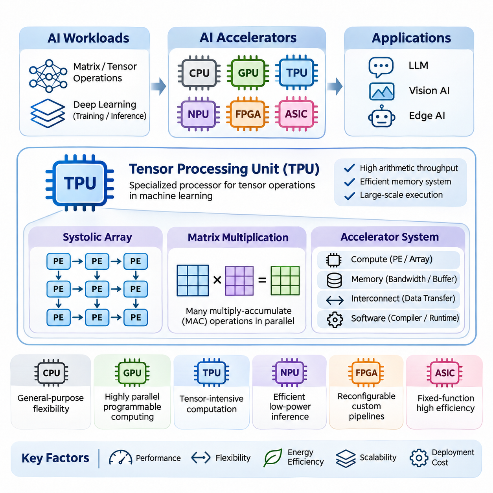
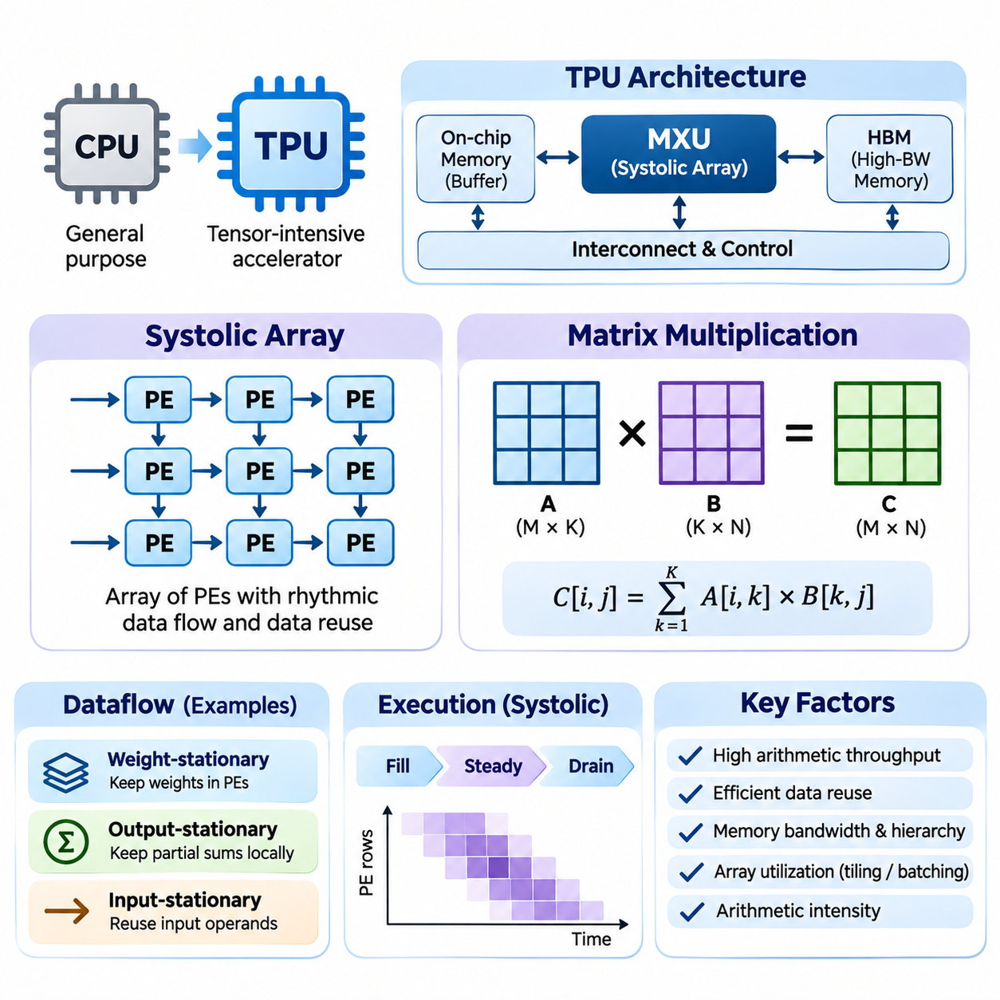
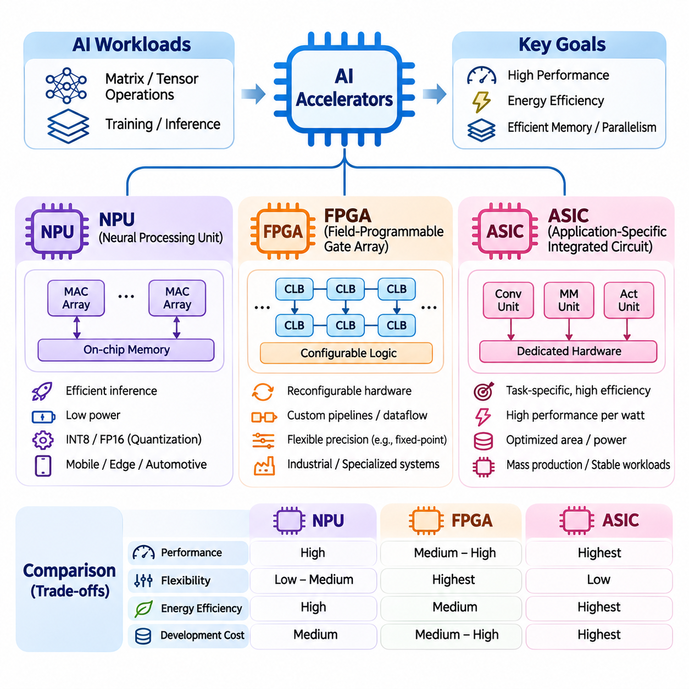
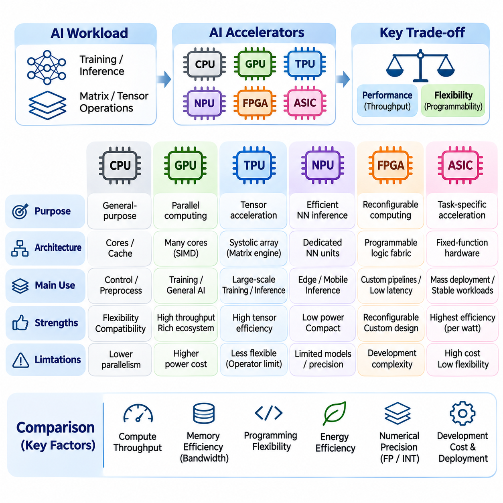
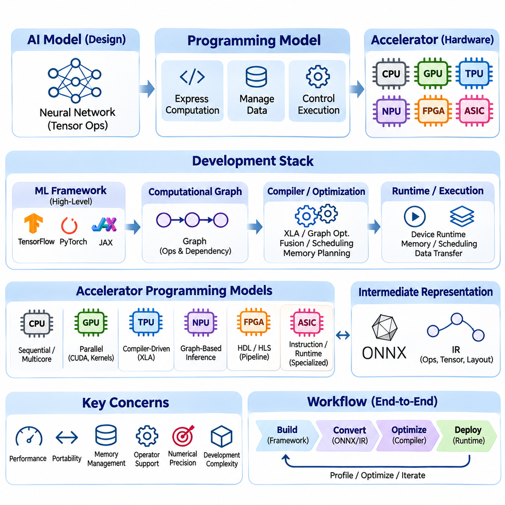
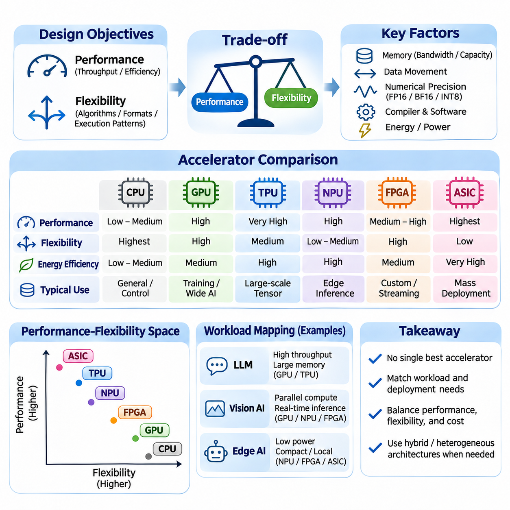
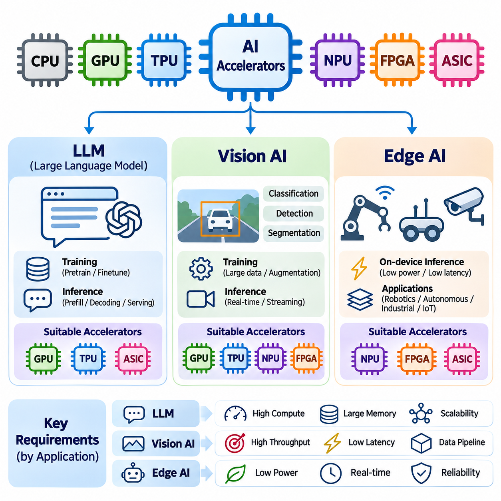

**Volume 39. Hardware for AI**

# 02. TPU and Accelerators

## 02.00 Overview

{width="7.268055555555556in" height="7.268055555555556in"}

Artificial intelligence has transformed computing requirements by introducing workloads dominated by large-scale matrix operations, tensor transformations, and repeated numerical calculations. Traditional central processing units provide general-purpose flexibility, while specialized AI accelerators improve computational efficiency through architectures designed around neural network operations. Tensor Processing Units and related accelerators represent an important evolution toward workload-specific computing.

The development of AI accelerators is driven by the increasing complexity of deep learning models and the growing demand for efficient training and inference. Modern neural networks contain millions or billions of parameters and require substantial computational resources. Specialized processors address these challenges by optimizing arithmetic throughput, memory access, parallel execution, and energy consumption for common machine learning operations.

A Tensor Processing Unit, commonly abbreviated as TPU, is a specialized processor developed by Google to accelerate machine learning workloads. Unlike conventional CPUs, which execute diverse instructions through general-purpose cores, TPUs emphasize tensor operations frequently used in neural networks. Their architecture integrates dedicated computational structures, optimized memory systems, and software interfaces supporting large-scale machine learning execution.

One of the fundamental architectural concepts underlying TPU computation is the systolic array. A systolic array consists of interconnected processing elements that perform coordinated arithmetic operations while passing data between neighboring elements. This arrangement supports efficient matrix multiplication by increasing data reuse and reducing repeated memory transfers, particularly when computational workloads map effectively onto the array structure.

Matrix multiplication is central to modern artificial intelligence because neural network layers frequently express their computations as products of matrices or higher-dimensional tensors. Fully connected layers, convolutional transformations, and attention mechanisms can exploit specialized matrix-processing hardware. Accelerators increase efficiency by executing many multiply-accumulate operations concurrently rather than relying exclusively on sequential instruction execution.

The effectiveness of tensor accelerators depends not only on arithmetic capability but also on the movement of data through the computing system. Memory bandwidth, local buffering, cache organization, and interconnect topology determine how efficiently processing elements receive operands. An accelerator with high theoretical computational throughput may achieve limited practical performance when memory transfers or communication delays dominate execution.

Beyond TPUs, the AI hardware ecosystem includes Neural Processing Units, Field-Programmable Gate Arrays, and Application-Specific Integrated Circuits. These accelerator categories differ in their programmability, computational specialization, deployment environments, and development costs. Each architecture provides a distinct balance between performance, flexibility, energy efficiency, and the ability to support evolving neural network workloads.

Neural Processing Units, or NPUs, are specialized processors designed to execute neural network operations efficiently. They commonly appear in smartphones, embedded computers, automotive platforms, and edge AI devices. NPU architectures often emphasize low-power inference, compact memory organization, and hardware acceleration for convolution, matrix multiplication, activation functions, and other operations required by deployed neural networks.

Field-Programmable Gate Arrays, or FPGAs, provide reconfigurable digital logic that can be adapted to specific computational pipelines. Unlike fixed-function accelerators, FPGAs allow developers to implement customized processing structures, data paths, and interfaces. This flexibility makes them useful for specialized inference pipelines, low-latency signal processing, industrial automation, and applications requiring integration with unusual hardware interfaces.

Application-Specific Integrated Circuits, or ASICs, are designed to perform a defined set of functions using dedicated hardware structures. Their specialization can deliver high computational efficiency and favorable power characteristics when the target workload is sufficiently stable. However, ASIC development involves substantial engineering effort, manufacturing costs, and limited opportunities to modify the underlying hardware after fabrication.

Comparing CPU, GPU, TPU, NPU, FPGA, and ASIC architectures requires understanding their computational organization rather than considering peak arithmetic throughput alone. CPUs prioritize general-purpose execution, GPUs support highly parallel programmable workloads, and TPUs emphasize tensor-intensive computation. NPUs often target efficient inference, while FPGAs and custom ASICs provide different degrees of hardware specialization and implementation flexibility.

The programming model of an AI accelerator determines how software expresses computations and how efficiently those computations are translated into hardware execution. High-level machine learning frameworks describe neural networks using tensor operations and computational graphs. Compilers and runtime systems transform these representations into executable instructions, schedule operations, allocate memory, and coordinate data transfers across accelerator resources.

Compiler optimization plays a particularly important role in specialized accelerator performance. Techniques such as operator fusion, graph transformation, memory planning, tensor layout optimization, and instruction scheduling reduce unnecessary computation and communication. Framework integration through systems such as TensorFlow, JAX, and PyTorch helps developers access accelerator capabilities without manually implementing every hardware-specific operation.

Numerical precision is another essential consideration in accelerator design. Neural networks frequently tolerate reduced-precision arithmetic under appropriate training or inference conditions. Formats such as FP32, FP16, BF16, and integer representations enable different tradeoffs between numerical accuracy, memory consumption, arithmetic throughput, and energy efficiency. Hardware support and model sensitivity determine which precision strategy is appropriate.

Performance and flexibility form a central tradeoff in accelerator architecture. Highly specialized processing structures can execute supported operations with exceptional efficiency, but they may perform poorly when computational patterns differ from their intended workloads. More programmable architectures accommodate diverse algorithms and experimental models, although their additional control mechanisms and general-purpose features may introduce overhead.

Large Language Models place particularly demanding requirements on accelerator systems because transformer architectures involve extensive matrix multiplication, attention computation, and memory-intensive inference. Training emphasizes sustained computational throughput and communication across multiple devices. Inference additionally depends on memory capacity, memory bandwidth, batching behavior, and efficient management of attention-related cached representations.

Vision AI workloads also benefit from specialized acceleration because image classification, object detection, segmentation, and visual representation learning involve repeated tensor operations. Convolutional networks and vision transformers expose substantial parallelism, but their computational characteristics differ. Efficient deployment requires matching operator support, tensor dimensions, memory requirements, and latency constraints to the selected accelerator architecture.

Edge AI introduces additional constraints involving electrical power, thermal dissipation, physical size, and response time. Embedded accelerators must process sensor information while operating within limited energy and memory budgets. Applications such as robotics, intelligent cameras, autonomous machines, and smart devices benefit from local inference that reduces dependence on remote servers and minimizes network-related delays.

Real-time applications require careful evaluation of execution latency and predictability rather than throughput alone. An accelerator capable of processing many requests per second may still exhibit unacceptable response-time variation under changing workloads. Industrial control, robotic perception, and safety-sensitive systems therefore require coordinated consideration of scheduling behavior, memory contention, communication delays, and worst-case execution requirements.

The energy efficiency of AI accelerators is commonly evaluated through useful computational work or completed inference tasks relative to electrical energy consumption. Although specialized hardware can reduce energy per operation, actual efficiency depends on utilization, workload characteristics, memory traffic, and supporting system components. Thermal management and sustained operating conditions are equally important when evaluating performance in production environments.

Scalability becomes essential when AI workloads exceed the computational or memory capacity of a single accelerator. Multi-device systems distribute model parameters, training data, or computational stages across interconnected processors. Their effectiveness depends on communication bandwidth, synchronization overhead, workload partitioning, and software support. Increasing accelerator count does not automatically produce proportional improvements in application performance.

Hardware selection should therefore consider the complete AI execution pipeline, including preprocessing, tensor computation, intermediate storage, postprocessing, and communication. The most suitable accelerator is not necessarily the device with the highest advertised operations per second. Practical decisions require examining supported operators, model compatibility, development tools, memory capacity, deployment constraints, operational reliability, and total ownership cost.

Benchmarking provides a systematic method for comparing accelerator architectures under representative conditions. Measurements should include computational throughput, end-to-end latency, energy consumption, memory utilization, and sustained performance. Standardized benchmarks offer useful reference points, but application-specific testing remains necessary because theoretical specifications and synthetic workloads may not accurately represent production behavior.

The continuing development of TPU and accelerator technologies reflects a broader movement toward hardware-software co-design. Processor architectures, compiler systems, numerical formats, and neural network algorithms increasingly influence one another. Understanding these relationships provides the foundation for evaluating specialized AI hardware and designing efficient computing systems for large language models, vision intelligence, and edge applications.

## 02.01 Tensor Processing Unit (TPU)

{width="7.268055555555556in" height="7.268055555555556in"}

The Tensor Processing Unit (TPU) is a specialized artificial intelligence accelerator developed by Google to execute tensor-intensive machine learning workloads efficiently. Its architecture emphasizes large-scale matrix operations, predictable data movement, and high computational density. Unlike general-purpose processors, TPUs dedicate substantial hardware resources to operations that dominate neural network training and inference.

The fundamental motivation behind TPU architecture is the computational structure of deep learning. Neural networks repeatedly perform matrix multiplication, accumulation, and nonlinear transformations across large tensors. Conventional processors execute these operations through general-purpose instruction pipelines, while TPUs organize specialized arithmetic units to exploit parallelism and data reuse, reducing overhead for supported computational patterns.

A defining architectural feature of many TPU generations is the Matrix Multiplication Unit (MXU), which implements a systolic array of processing elements. These elements execute coordinated multiply-accumulate operations while exchanging data through regular communication paths. The resulting structure provides high arithmetic density and reduces the need to repeatedly retrieve intermediate operands from distant memory locations.

A systolic array is a spatial computing architecture in which data flows rhythmically through interconnected processing elements. Each element performs a local arithmetic operation and forwards selected values to neighboring elements. Rather than repeatedly moving operands between memory and independent execution units, the architecture maintains structured data movement that enables efficient reuse during matrix computations.

The processing elements within a systolic array typically contain multiplication and accumulation logic, along with registers for temporary data storage. During matrix multiplication, operands enter the array according to a carefully coordinated schedule. Individual elements multiply incoming values, update partial sums, and propagate data as required by the selected dataflow, allowing many operations to proceed simultaneously.

The efficiency of systolic arrays depends on selecting appropriate dataflow strategies. Weight-stationary execution retains model weights near processing elements, while output-stationary execution keeps partial results locally during accumulation. Input-stationary strategies emphasize reuse of input operands. Different implementations select or combine these approaches according to hardware organization, tensor dimensions, and workload characteristics.

Consider matrix multiplication expressed as C = A × B, where A contains M rows and K columns, while B contains K rows and N columns. The resulting matrix C has dimensions M × N. Each output element is calculated by accumulating K products from the corresponding row of A and column of B. This regular computational structure makes matrix multiplication particularly suitable for spatially organized accelerator hardware.

In a conventional implementation, matrix multiplication involves nested loops that repeatedly access input operands and update output values. A systolic array transforms this computation into coordinated parallel operations distributed across processing elements. Once the array is sufficiently populated, multiple products and accumulations can execute concurrently, increasing computational throughput while reducing redundant operand transfers.

The temporal behavior of systolic computation includes an initial filling phase, a steady-state processing phase, and a final draining phase. During filling, operands propagate toward the processing elements that require them. In steady state, many elements perform useful calculations simultaneously. During draining, remaining results complete their accumulation and become available for subsequent processing stages.

Array utilization is an important determinant of practical TPU performance. Large matrices can keep many processing elements active, whereas small or irregular matrices may leave substantial portions of the array underutilized. Padding, tiling, and workload batching can improve utilization, although these techniques may introduce additional computation, memory consumption, or latency depending on the execution conditions.

Tiling divides large matrices into smaller blocks that fit the available computational array and local memory resources. Each tile is processed through repeated matrix operations, and partial results are combined to construct the complete output. Effective tiling improves data locality and reduces external memory traffic, but tile dimensions must balance processing-element utilization, buffer capacity, and scheduling overhead.

Matrix multiplication performance can be understood through arithmetic intensity, which measures the number of arithmetic operations performed relative to data transferred from memory. Operations with high arithmetic intensity can benefit substantially from dedicated matrix hardware. Systolic arrays increase effective data reuse by allowing operands to participate in multiple calculations as they move through the processing structure.

Memory hierarchy plays a critical role in sustaining TPU computational throughput. High-bandwidth memory, on-chip buffers, registers, and specialized data-transfer mechanisms provide operands to matrix execution units. The precise organization varies across TPU generations. Efficient execution requires coordinating memory movement with computation so that arithmetic units remain active instead of waiting for data.

The relationship between computation and memory bandwidth can be analyzed using the roofline performance model. This model compares attainable arithmetic throughput against the limits imposed by data movement. A matrix operation becomes compute-bound when arithmetic execution determines performance, while memory-bound behavior occurs when operand delivery limits progress. TPU optimization therefore requires balancing both resources.

Numerical precision strongly influences TPU matrix multiplication efficiency. Supported formats vary by hardware generation and may include BF16, FP32-related execution modes, and selected integer or reduced-precision representations. Lower-precision operands can reduce storage requirements and increase arithmetic throughput, provided that accumulation behavior and numerical error remain compatible with the model\'s accuracy requirements.

Brain Floating Point 16 (BF16) is particularly relevant to TPU computation because it preserves the exponent width of FP32 while reducing significand precision. This representation provides a broad numerical range with lower operand storage requirements. Many neural network workloads can use BF16 effectively, although numerical stability, accumulation precision, and sensitive operations require appropriate software handling.

Matrix multiplication is fundamental to fully connected neural network layers. Given an input activation matrix X and a weight matrix W, a layer computes a transformation such as Y = XW + b. TPU matrix units accelerate the multiplication component, while other execution resources handle bias addition and activation functions. Efficient scheduling coordinates these operations to minimize intermediate data movement.

Convolutional neural networks also benefit from matrix-oriented acceleration. Convolution can be transformed into matrix multiplication through techniques such as im2col, although explicit transformation may increase memory requirements. Alternative compiler mappings avoid materializing large intermediate matrices. The most effective strategy depends on convolution dimensions, tensor layouts, available hardware operations, and memory constraints.

Transformer architectures rely extensively on matrix multiplication for attention projections, feedforward networks, and output transformations. Query, key, and value representations are generated through matrix operations, while attention computation involves additional products and normalization. TPU execution benefits from mapping these operations efficiently onto matrix units and coordinating surrounding operations through compiler optimization.

Large language model training introduces additional requirements because matrix multiplication occurs during both forward propagation and gradient computation. Backpropagation calculates gradients using operations that frequently reduce to matrix products or related tensor contractions. TPU systems accelerate these computations while distributed execution coordinates parameter updates, gradient aggregation, and communication across multiple devices.

Inference workloads introduce different utilization challenges. Large training batches often expose substantial parallelism, while autoregressive generation may involve smaller matrix dimensions and frequent memory accesses. Prefill computation can exploit large matrix operations, whereas token-by-token decoding may become limited by memory bandwidth, model size, or batching efficiency rather than peak arithmetic throughput.

Compiler technology is essential for translating neural network computations into efficient TPU execution. Systems such as XLA analyze computational graphs, select operation layouts, organize tensor transformations, and schedule compatible operations. Compiler decisions influence array utilization, memory allocation, numerical precision, and communication overhead, making software optimization inseparable from accelerator architecture.

The performance advantages of systolic arrays are accompanied by architectural limitations. Irregular control flow, sparse computations without suitable hardware support, small tensor dimensions, and unsupported operators may not map efficiently onto matrix processing units. Such operations can require alternative execution resources or additional transformations, reducing the benefits of specialization.

Evaluating TPU matrix multiplication requires measuring sustained throughput, execution latency, array utilization, memory traffic, and energy consumption under representative workloads. Peak theoretical operations per second describe hardware capability but do not guarantee application-level performance. Accurate benchmarking must account for tensor dimensions, precision formats, compilation behavior, data-transfer overhead, and execution configuration.

The combination of systolic arrays and specialized matrix multiplication establishes the architectural foundation of TPU acceleration. By organizing arithmetic operations around regular dataflow and extensive operand reuse, TPUs improve the efficiency of supported neural network computations. Understanding these principles enables informed optimization of training and inference workloads and provides a basis for comparing specialized AI accelerator architectures.

## 02.02 AI Accelerators

{width="7.268055555555556in" height="7.268055555555556in"}

Artificial intelligence accelerators are specialized computing devices designed to execute machine learning operations more efficiently than general-purpose processors. Their architectures prioritize parallel arithmetic, efficient memory access, and reduced energy consumption. Neural Processing Units, Field-Programmable Gate Arrays, and Application-Specific Integrated Circuits represent three important approaches to accelerating neural network workloads across cloud, industrial, and embedded computing environments.

The increasing complexity of neural networks creates computational demands that conventional CPUs cannot always satisfy efficiently. Matrix multiplication, convolution, activation functions, and tensor transformations require substantial arithmetic throughput and memory bandwidth. Specialized accelerators address these requirements through dedicated execution units, optimized dataflow, and hardware structures that exploit the repetitive computational patterns of deep learning.

A Neural Processing Unit (NPU) is a specialized processor optimized for executing neural network operations, particularly inference workloads. NPUs commonly integrate matrix multiplication engines, convolution accelerators, local memory, and dedicated data movement mechanisms. Their primary objective is to provide high inference throughput with low power consumption while supporting neural network models deployed in mobile, embedded, and edge computing systems.

NPU architectures typically organize computation around parallel processing elements capable of performing multiply-accumulate operations. These processing elements execute mathematical operations commonly found in convolutional neural networks, transformers, and other deep learning architectures. Dedicated memory buffers reduce repeated access to external memory, while specialized instruction scheduling improves utilization and minimizes unnecessary data transfers.

Modern NPUs frequently support reduced-precision numerical formats such as INT8, FP16, and other hardware-dependent representations. Quantization converts model parameters and activations into lower-precision formats to reduce memory requirements and computational cost. Although quantization can improve inference efficiency, its effectiveness depends on model sensitivity, calibration quality, supported operators, and the numerical behavior of individual network layers.

NPUs are widely integrated into smartphones, intelligent cameras, automotive processors, and embedded AI platforms. Their ability to perform local inference reduces communication with remote servers and supports applications requiring low latency or improved data privacy. Typical workloads include image classification, object detection, speech recognition, language processing, and sensor interpretation within constrained power and thermal environments.

The software ecosystem surrounding NPUs is essential for practical deployment. Machine learning models developed using frameworks such as TensorFlow or PyTorch must often be converted into hardware-compatible representations. Compiler toolchains analyze computational graphs, select supported operators, optimize tensor layouts, and generate executable instructions. Unsupported operations may require CPU or GPU execution, potentially increasing latency and memory transfers.

Field-Programmable Gate Arrays (FPGAs) provide a fundamentally different acceleration approach through reconfigurable digital logic. Instead of executing neural network operations exclusively through fixed processing units, FPGAs allow developers to construct customized computational pipelines. Their programmable fabric contains configurable logic blocks, routing resources, memory elements, and specialized arithmetic components that can implement application-specific processing architectures.

An FPGA can accelerate neural networks by mapping mathematical operations directly into hardware circuits. Multipliers, accumulators, activation functions, and data movement structures can be arranged into parallel or pipelined execution paths. This spatial organization enables multiple processing stages to operate concurrently, reducing instruction overhead and supporting predictable execution behavior when the design is appropriately optimized.

FPGA acceleration is particularly effective when computational pipelines require customized dataflow or unusual numerical precision. Developers can implement specialized fixed-point arithmetic, tailored buffering strategies, and application-specific interfaces. Such flexibility allows FPGA designs to optimize hardware utilization for particular neural network architectures, although achieving high performance requires careful consideration of resource constraints and timing requirements.

The reconfigurability of FPGAs distinguishes them from fixed-function accelerators. Hardware configurations can be modified after manufacturing by loading new configuration data, allowing the same device to support different computational architectures. This capability is valuable for evolving algorithms, experimental acceleration methods, and industrial systems requiring long-term adaptability without replacing the underlying semiconductor device.

FPGA development traditionally relies on hardware description languages such as Verilog and VHDL, which describe digital circuits at the register-transfer level. High-Level Synthesis (HLS) tools provide an alternative by translating higher-level programming descriptions into hardware implementations. However, developers must still understand parallelism, pipelining, memory interfaces, resource utilization, and timing closure to achieve efficient accelerator designs.

The performance of an FPGA accelerator depends on available logic resources, digital signal processing blocks, on-chip memory, external memory bandwidth, and achievable clock frequency. Unlike general-purpose processors, FPGA performance cannot be evaluated solely through clock speed. Effective throughput emerges from the degree of spatial parallelism, pipeline efficiency, data reuse, and the ability to sustain continuous operand delivery.

FPGAs are particularly useful in industrial automation, telecommunications, robotics, and real-time signal processing. Their configurable interfaces allow direct integration with cameras, sensors, communication networks, and specialized control equipment. Neural network inference can be combined with preprocessing and postprocessing inside a single hardware pipeline, potentially reducing intermediate data movement and end-to-end processing latency.

Application-Specific Integrated Circuits (ASICs) represent another major category of AI acceleration hardware. An ASIC is a semiconductor device designed to implement a defined set of functions through dedicated circuits. Unlike FPGAs, whose programmable logic introduces configuration and routing overhead, ASICs can optimize transistor-level structures for targeted workloads, potentially achieving superior performance, power efficiency, and silicon area utilization.

AI-oriented ASICs frequently incorporate dedicated matrix multiplication engines, specialized memory hierarchies, tensor processing units, and optimized interconnect structures. Their architectures may employ systolic arrays, vector processing elements, or other domain-specific computational organizations. By tailoring hardware directly to neural network operations, designers can reduce unnecessary control logic and improve computational efficiency for supported workloads.

The design of an AI ASIC requires detailed analysis of target algorithms, numerical precision, memory traffic, and expected operating conditions. Architectural decisions determine processing-element organization, buffer capacity, communication topology, and supported instructions. Because these choices become largely fixed after fabrication, developers must anticipate future workload requirements and balance specialization against long-term compatibility.

ASIC development involves a complex engineering process that includes architectural modeling, hardware description, functional verification, logic synthesis, physical design, and semiconductor fabrication. Manufacturing introduces substantial non-recurring engineering costs, particularly for advanced process technologies. Consequently, custom ASIC development is generally most attractive when expected deployment volume or performance requirements justify the initial investment.

The economic advantages of ASICs emerge when large production volumes distribute development costs across many devices. Once manufactured, specialized circuits can provide favorable performance per watt and performance per unit of silicon area. However, design errors, changing algorithms, and manufacturing constraints can introduce significant financial risks because modifying fabricated hardware may require an expensive redesign.

Although NPU, FPGA, and ASIC are often discussed as separate accelerator categories, their definitions describe different architectural properties. NPU identifies a processor specialized for neural network computation, while FPGA and ASIC describe implementation technologies. An NPU may itself be implemented as an ASIC, and FPGA devices can host neural network processing architectures. Understanding this distinction prevents misleading comparisons between overlapping hardware classifications.

Selecting an AI accelerator requires evaluating computational throughput, latency, energy efficiency, memory capacity, programmability, and development complexity. NPUs often provide accessible deployment environments for supported inference models. FPGAs offer configurable hardware pipelines and specialized interfaces, while custom ASICs provide opportunities for extensive optimization when workload requirements are sufficiently stable and development resources are available.

Memory architecture strongly influences the effectiveness of all three accelerator approaches. Neural network execution involves transferring weights, activations, and intermediate results between storage and computational units. Local buffering, data reuse, and efficient memory scheduling can reduce external bandwidth requirements. Without adequate data delivery, even highly parallel arithmetic hardware may remain underutilized.

Hardware-software co-design is essential for obtaining practical acceleration benefits. Neural network architectures, compiler optimizations, numerical formats, and execution schedules must align with hardware capabilities. Operator fusion, tensor layout optimization, quantization, and workload partitioning can improve efficiency, while unsupported operations and excessive data transfers can eliminate expected performance advantages.

Benchmarking AI accelerators requires representative workloads rather than relying exclusively on theoretical operations per second. Evaluation should include sustained inference throughput, end-to-end latency, energy consumption, memory utilization, and numerical accuracy. Development effort, software compatibility, thermal behavior, and deployment reliability also influence the overall suitability of an accelerator for production environments.

The continued evolution of NPUs, FPGAs, and ASICs reflects the growing importance of domain-specific computing in artificial intelligence. Each approach addresses computational efficiency through a different combination of specialization, programmability, and hardware organization. Understanding their architectural principles and engineering tradeoffs enables informed accelerator selection for large-scale AI systems, industrial intelligence, robotics, and resource-constrained edge applications.

## 02.03 Architecture Comparison

{width="7.268055555555556in" height="7.268055555555556in"}

AI accelerator architecture comparison examines how different processor designs balance computational throughput, programmability, memory efficiency, energy consumption, and deployment requirements. CPUs, GPUs, TPUs, NPUs, FPGAs, and ASICs employ distinct execution structures to address machine learning workloads. Understanding these differences is essential for selecting hardware that matches the computational characteristics of modern neural networks.

Central Processing Units (CPUs) emphasize general-purpose computing through sophisticated instruction pipelines, cache hierarchies, and control mechanisms. Their architecture supports diverse operations, conditional execution, and irregular memory access. Although CPUs can execute neural network workloads, their relatively limited arithmetic parallelism often makes them less efficient than specialized accelerators for large-scale tensor computation.

Graphics Processing Units (GPUs) achieve high computational throughput by organizing numerous arithmetic units into parallel execution groups. Their architecture is particularly effective for workloads containing large numbers of independent operations. GPU programming environments provide substantial flexibility, enabling developers to implement neural network layers, numerical simulations, and custom computational kernels using general-purpose parallel programming techniques.

Tensor Processing Units (TPUs) prioritize tensor-oriented computation through specialized matrix multiplication hardware. Many TPU generations employ systolic arrays that execute coordinated multiply-accumulate operations with structured data movement. This architecture reduces repeated operand transfers and supports high arithmetic density. However, its efficiency depends on how effectively computational workloads map onto the available matrix execution structures.

Neural Processing Units (NPUs) typically focus on efficient neural network inference within constrained computing environments. Their architectures integrate dedicated matrix engines, convolution units, local memory, and reduced-precision arithmetic. Compared with large training accelerators, many NPUs prioritize power efficiency, compact integration, and predictable inference latency, making them suitable for mobile devices, intelligent sensors, and embedded systems.

Field-Programmable Gate Arrays (FPGAs) differ from conventional processors because their computational structures can be reconfigured after manufacturing. Developers implement customized datapaths, parallel pipelines, and specialized interfaces using programmable logic resources. This flexibility enables precise adaptation to unusual workloads and deterministic processing requirements, although development complexity and hardware resource limitations can restrict practical performance.

Application-Specific Integrated Circuits (ASICs) implement targeted computational functions through dedicated semiconductor structures. Their designs can eliminate unnecessary general-purpose control mechanisms and optimize arithmetic units, memory organization, and communication paths. ASICs may achieve excellent performance per watt for supported workloads, but substantial development costs and limited post-fabrication flexibility create important engineering tradeoffs.

These architectural categories are not completely independent. An NPU describes a processor specialized for neural network execution, whereas FPGA and ASIC describe implementation technologies. Many commercial NPUs and TPUs are implemented as ASICs, while neural network accelerators can also be constructed within FPGA fabric. Architecture comparison must therefore distinguish computational specialization from the underlying hardware implementation method.

Execution parallelism provides a fundamental basis for comparing accelerator architectures. CPUs exploit instruction-level parallelism and multicore processing, while GPUs emphasize large-scale data parallelism. TPUs and many NPUs exploit structured tensor parallelism through matrix engines. FPGAs provide configurable spatial parallelism, whereas custom ASICs can combine multiple parallel execution strategies according to application requirements.

Memory hierarchy is equally important because neural network execution frequently requires moving large volumes of weights, activations, and intermediate results. CPUs employ sophisticated cache systems, while GPUs combine high-bandwidth memory with registers and shared memory. TPUs and NPUs emphasize local buffering and structured operand reuse. FPGA and ASIC designs can customize memory structures to reduce unnecessary data movement.

The balance between computational throughput and memory bandwidth determines whether an accelerator can sustain its theoretical performance. Matrix-intensive workloads may become compute-bound when arithmetic units operate near capacity. Other workloads become memory-bound because operand delivery cannot keep pace with computation. Architectural comparisons should therefore evaluate arithmetic intensity, memory traffic, and effective bandwidth rather than peak operations alone.

Numerical precision support also differentiates accelerator designs. CPUs and GPUs commonly provide several floating-point and integer formats, while specialized matrix engines may offer particularly efficient reduced-precision execution. NPUs frequently emphasize quantized inference, and FPGA designs can implement custom fixed-point representations. ASIC designers may select numerical formats specifically matched to the accuracy and efficiency requirements of target workloads.

Programming flexibility varies significantly across accelerator architectures. CPUs offer broad software compatibility and relatively straightforward development. GPUs provide mature parallel programming environments and extensive machine learning libraries. TPUs depend heavily on compiler-supported tensor execution, while NPUs often require vendor-specific conversion tools. FPGA and custom ASIC development generally demand deeper hardware knowledge and specialized design workflows.

Compiler technology influences how efficiently software maps onto each architecture. Graph optimization, operator fusion, tensor layout selection, memory scheduling, and kernel generation can substantially improve execution performance. Specialized accelerators often rely on compilers to transform high-level neural network operations into supported hardware instructions. Unsupported operators may require alternative execution paths, reducing expected acceleration benefits.

Latency and throughput represent different performance objectives. Training systems commonly prioritize sustained throughput across large batches, while interactive inference systems require low response latency. Edge applications may impose strict timing constraints and limited memory resources. A processor optimized for maximum batch throughput may perform poorly when handling small, irregular, or latency-sensitive workloads.

Energy efficiency is particularly important when comparing data center accelerators with embedded AI hardware. Large GPUs and TPUs may deliver substantial aggregate computational capacity but require significant electrical power and cooling infrastructure. NPUs and specialized embedded ASICs often emphasize low-power inference. FPGA efficiency depends strongly on implementation quality, operating frequency, resource utilization, and memory access patterns.

Scalability introduces additional architectural considerations for large machine learning systems. GPUs and TPUs can participate in distributed computing environments that combine multiple accelerators through high-speed interconnects. Effective scaling depends on communication bandwidth, synchronization overhead, and workload partitioning. Embedded NPUs and FPGA systems may instead prioritize local processing or specialized multi-device configurations.

Large language model training generally benefits from accelerators offering high matrix throughput, substantial memory capacity, and efficient inter-device communication. GPUs provide broad software flexibility, while TPU systems offer specialized tensor execution within supported software environments. The most appropriate architecture depends on model structure, training framework, numerical precision, memory requirements, and available distributed infrastructure.

Large language model inference presents different architectural challenges. Prefill operations often benefit from substantial matrix parallelism, whereas autoregressive decoding may become limited by memory bandwidth and model parameter access. GPUs, TPUs, and specialized inference ASICs address these requirements through different memory and execution designs. Batch size, sequence length, and latency targets strongly influence comparative performance.

Computer vision workloads include convolution, matrix multiplication, feature extraction, and image preprocessing. GPUs provide flexibility across diverse model architectures, while NPUs support efficient inference in embedded cameras and mobile systems. FPGAs can combine image acquisition, preprocessing, and neural network execution within customized pipelines. Specialized ASICs may provide additional efficiency when vision workloads are sufficiently stable.

Robotics and industrial AI introduce requirements extending beyond arithmetic performance. Sensor interfaces, deterministic execution, power consumption, thermal constraints, and operational reliability influence accelerator selection. Embedded NPUs may support perception inference, GPUs can execute complex multimodal models, and FPGAs can implement specialized low-latency processing pipelines. System-level integration often matters more than isolated accelerator benchmarks.

Development cost and product lifecycle must also be considered. CPUs and GPUs benefit from established software ecosystems, while NPUs may require compatibility with specific vendor toolchains. FPGAs offer post-deployment reconfiguration but involve substantial design effort. Custom ASICs demand significant initial investment and verification, making them most attractive when production scale or specialized requirements justify development expenses.

A meaningful architectural benchmark must use representative models, numerical formats, batch sizes, and execution conditions. Measurements should include sustained throughput, end-to-end latency, energy consumption, memory utilization, and numerical accuracy. Theoretical peak performance provides useful context but cannot capture compiler efficiency, unsupported operations, communication overhead, or thermal limitations encountered during deployment.

Ultimately, AI accelerator architecture comparison is a multidimensional engineering problem rather than a simple ranking of processing devices. General-purpose flexibility, specialized arithmetic efficiency, configurable hardware structures, and deployment constraints create different advantages for each architecture. Selecting appropriate hardware requires aligning computational characteristics, software capabilities, system integration, and long-term operational requirements.

## 02.04 Programming Models

{width="7.268055555555556in" height="7.268055555555556in"}

Programming models define how developers express computations, manage data, and control execution on artificial intelligence accelerators. Unlike general-purpose processors, specialized hardware often requires software abstractions that expose tensor operations, parallel execution, and memory organization. Effective programming models bridge high-level machine learning frameworks and hardware-specific instructions while balancing portability, performance, and development complexity.

The programming model of an AI accelerator reflects its underlying computational architecture. CPUs primarily execute sequential instruction streams with multicore parallelism, while GPUs organize thousands of threads into coordinated execution groups. TPUs emphasize compiler-managed tensor operations, and NPUs frequently expose graph-based inference interfaces. FPGAs and custom ASICs may require specialized descriptions of computational pipelines and data movement.

High-level machine learning frameworks provide the primary interface for developing accelerator-based applications. TensorFlow, PyTorch, and JAX allow developers to express neural networks using tensor operations and automatic differentiation. These frameworks separate mathematical model definitions from hardware execution details, enabling the same conceptual network to run on different accelerators when compatible operators and software backends are available.

Computational graphs represent mathematical operations as interconnected nodes with dependencies defined by data flow. Compilers analyze these graphs to identify opportunities for optimization, parallel execution, and memory reuse. Static graph representations expose predictable execution structures, while dynamic execution approaches provide flexibility for changing control flow. Modern programming environments increasingly combine both methods.

Tensor Processing Units commonly rely on compiler-driven programming models that transform high-level operations into optimized accelerator instructions. XLA analyzes tensor computations, performs graph transformations, selects execution layouts, and generates device-specific code. This approach allows developers to concentrate on mathematical operations while the compiler manages scheduling, memory placement, and supported hardware execution patterns.

JAX provides a functional programming environment particularly suited to compiler-based accelerator execution. Transformations such as just-in-time compilation, automatic differentiation, vectorization, and parallel mapping help express efficient numerical workloads. Functional purity and explicit handling of program state can simplify optimization, although dynamic shapes, side effects, and unsupported operations may introduce additional constraints.

PyTorch and TensorFlow also support accelerator execution through compilation, runtime integration, and device-specific backends. Their programming models combine tensor operations, automatic differentiation, and high-level neural network abstractions. Actual TPU compatibility depends on supported framework versions and execution environments, while model performance depends on graph structure, operator coverage, and compiler optimization.

Neural Processing Units frequently use inference-oriented programming models based on model conversion and compilation. A trained network is exported into an intermediate representation and processed by a vendor-specific toolchain. The compiler maps supported operations onto NPU execution units, applies quantization or layout transformations, and generates deployable artifacts. Unsupported operators may execute on another processor.

Intermediate representations provide an important abstraction between machine learning frameworks and accelerator hardware. Formats such as ONNX and compiler-level representations describe operations, tensor types, and computational dependencies. They support model exchange and optimization, but portability is not guaranteed because hardware backends differ in operator support, numerical behavior, tensor layouts, and dynamic execution capabilities.

GPU programming models provide a useful comparison because they expose more explicit control over parallel execution. CUDA organizes computation into kernels, thread blocks, and grids, allowing developers to manage memory access and synchronization. Higher-level frameworks hide much of this complexity, but custom kernels remain valuable for specialized operations, performance optimization, and workloads not efficiently supported by standard libraries.

FPGA programming models differ substantially because computation is implemented as configurable hardware structures rather than conventional instruction sequences. Hardware description languages such as Verilog and VHDL define registers, combinational logic, and synchronous behavior. High-Level Synthesis translates selected high-level descriptions into circuits, but developers must still consider pipelining, resource sharing, memory interfaces, and timing constraints.

Custom ASIC programming interfaces depend on the architecture implemented in silicon. Some devices expose instruction sets and compiler toolchains, while others operate through command queues, fixed-function interfaces, or dedicated runtime libraries. The programming model must reflect supported operators, memory organization, and execution restrictions. Hardware specialization can improve efficiency while limiting software flexibility.

Memory management is a central concern across accelerator programming models. Developers and compilers must coordinate tensor allocation, data transfers, buffer reuse, and memory lifetime. Efficient execution minimizes unnecessary movement between host memory and accelerator memory. Local storage limitations, alignment requirements, and memory bandwidth constraints influence tensor layouts, operation scheduling, and achievable computational throughput.

Parallel programming abstractions determine how workloads are distributed across available execution resources. Data parallelism processes independent inputs simultaneously, while model parallelism partitions neural network components across devices. Pipeline parallelism overlaps different computational stages. The effectiveness of each approach depends on synchronization costs, communication bandwidth, memory capacity, and the accelerator\'s supported execution mechanisms.

Numerical precision is closely connected to programming model design. Frameworks and compilers may support FP32, BF16, FP16, INT8, and other hardware-dependent representations. Mixed-precision execution combines different formats to balance computational efficiency and numerical stability. Quantization-aware training and post-training quantization provide mechanisms for preparing models for reduced-precision inference hardware.

Operator fusion is a common compiler optimization that combines compatible computations into fewer execution stages. For example, matrix multiplication, bias addition, and activation functions may be fused when hardware capabilities permit. Fusion reduces intermediate memory traffic and execution overhead, but its effectiveness depends on tensor dimensions, memory capacity, supported operations, and compiler transformation rules.

Runtime systems coordinate compiled operations with physical accelerator resources. They manage device initialization, memory allocation, execution queues, synchronization, and error reporting. Some runtimes support asynchronous execution, allowing host processors and accelerators to operate concurrently. Efficient runtime behavior is particularly important for low-latency inference, multi-device execution, and applications with continuous input streams.

Distributed accelerator programming introduces communication and synchronization requirements beyond single-device execution. Training frameworks coordinate gradient aggregation, parameter synchronization, and workload partitioning across multiple processors. Collective communication operations must be matched to interconnect capabilities. Poor communication scheduling can reduce scaling efficiency even when individual accelerators provide substantial arithmetic throughput.

Debugging specialized accelerator programs requires attention to both mathematical correctness and execution behavior. Numerical differences may arise from reduced precision, operator transformations, or nondeterministic parallel execution. Performance problems can result from compilation overhead, inefficient tensor shapes, memory transfers, or synchronization. Profiling tools help identify bottlenecks and distinguish hardware limitations from software inefficiencies.

Portability remains a significant challenge because accelerator vendors provide different instruction sets, compiler capabilities, and runtime interfaces. A model that executes efficiently on one platform may require conversion or restructuring on another. Standardized representations and portable compiler infrastructures can reduce development effort, but performance portability requires additional optimization for each target architecture.

Programming model selection should consider the complete development lifecycle, including model training, compilation, deployment, monitoring, and maintenance. Research environments often prioritize flexibility and rapid experimentation, while production systems emphasize predictable latency, reliability, and reproducibility. Embedded applications additionally require careful management of memory consumption, power usage, and integration with surrounding software.

Hardware-software co-design increasingly shapes accelerator programming models. Neural network algorithms influence instruction sets, memory structures, and supported numerical formats, while hardware capabilities affect model architecture and compiler optimization strategies. Understanding these interactions enables developers to construct efficient execution pipelines and adapt applications to evolving AI hardware without sacrificing correctness or maintainability.

## 02.05 Performance vs Flexibility

{width="7.268055555555556in" height="7.268055555555556in"}

Performance and flexibility represent two fundamental design objectives in artificial intelligence accelerator architecture. Performance describes how efficiently hardware executes computational workloads, while flexibility indicates its ability to support different algorithms, numerical formats, and execution patterns. Specialized accelerators often improve throughput and energy efficiency by limiting general-purpose capabilities, creating tradeoffs that influence hardware selection.

General-purpose processors emphasize flexibility through broad instruction sets, sophisticated control logic, and adaptable memory systems. CPUs execute diverse workloads involving conditional branches, irregular data structures, and sequential dependencies. This versatility makes them suitable for orchestration, preprocessing, and application control, although their computational density is generally lower than that of specialized matrix accelerators.

Graphics Processing Units provide a balance between programmability and high computational throughput. Their massively parallel execution architecture supports matrix operations, tensor transformations, and custom computational kernels. GPUs accommodate changing neural network architectures through programmable instructions and mature software libraries, but scheduling overhead and memory movement can reduce efficiency for small or irregular workloads.

Tensor Processing Units prioritize performance for structured tensor computation. Dedicated matrix multiplication engines and systolic arrays execute repeated multiply-accumulate operations with efficient operand reuse. Such specialization provides high arithmetic throughput for compatible workloads, but irregular control flow, unsupported operations, and poorly aligned tensor dimensions may reduce utilization and expose architectural limitations.

Neural Processing Units generally emphasize efficient inference under strict power and thermal constraints. Their hardware commonly accelerates convolution, matrix multiplication, activation functions, and quantized arithmetic. This specialization enables compact and energy-efficient deployment, particularly in embedded systems, but supported operator sets, numerical formats, and model conversion requirements can limit programming flexibility.

Field-Programmable Gate Arrays provide flexibility through reconfigurable hardware rather than conventional software execution. Developers can construct customized datapaths, processing pipelines, and numerical representations that match application requirements. FPGA implementations may achieve predictable latency and efficient streaming execution, although hardware resource limitations, timing closure, and development effort influence attainable performance.

Application-Specific Integrated Circuits achieve specialization by implementing selected functions directly in dedicated semiconductor structures. Removing unnecessary general-purpose features can improve performance per watt and silicon area efficiency. However, fixed hardware decisions restrict post-fabrication adaptability, making ASIC development most appropriate when target workloads are stable or deployment volumes justify substantial engineering investment.

The relationship between performance and flexibility is not strictly linear. A highly specialized accelerator may outperform programmable hardware on supported operations while performing poorly on unsupported workloads. Conversely, flexible processors may execute diverse algorithms efficiently through software optimization. Actual performance depends on workload characteristics, compiler quality, memory organization, and the degree of hardware utilization.

Computational throughput is commonly measured using operations per second, but theoretical peak performance does not guarantee practical efficiency. Matrix engines achieve high throughput when tensor dimensions provide sufficient parallelism and data reuse. Small matrices, irregular shapes, and frequent synchronization may leave execution resources underutilized. Sustained throughput under representative workloads provides a more meaningful comparison.

Latency introduces a separate performance dimension. Large accelerators may maximize aggregate throughput through batching, while real-time applications require rapid completion of individual requests. Increasing batch size can improve resource utilization but may increase waiting time. Flexible execution architectures may handle unpredictable workloads effectively, whereas specialized pipelines can provide low latency when processing patterns remain consistent.

Memory bandwidth and capacity frequently determine accelerator performance more strongly than arithmetic capability. Large language models require repeated access to extensive parameter arrays, while computer vision systems process high-dimensional feature maps. Specialized memory hierarchies improve data reuse, but fixed buffer capacities can constrain supported models. Flexible memory management expands compatibility while introducing additional control overhead.

Data movement is a major source of energy consumption and execution delay. Accelerators improve efficiency by retaining operands near arithmetic units, fusing operations, and reducing transfers between memory levels. Systolic arrays and dedicated tensor engines exploit regular communication patterns, whereas programmable processors support more diverse access behaviors. The optimal architecture depends on how predictably data can be reused.

Numerical precision creates another tradeoff between performance and flexibility. Reduced-precision formats such as FP16, BF16, and INT8 can improve arithmetic density and reduce memory traffic. Specialized accelerators may provide exceptional efficiency for selected formats but limited support for others. Flexible processors accommodate broader numerical requirements, although their efficiency varies across precision modes and hardware generations.

Quantization illustrates how algorithm design interacts with hardware specialization. Converting neural network weights and activations to lower-precision representations can reduce computational cost and memory consumption. However, accuracy degradation may occur in sensitive layers, and unsupported quantized operators may require fallback execution. Effective deployment requires matching numerical formats to model characteristics and accelerator capabilities.

Compiler technology can partially reduce the performance penalties associated with flexibility. Graph optimization, operator fusion, kernel selection, and memory scheduling transform high-level computations into efficient hardware execution. Advanced compilers enable programmable accelerators to approach specialized performance on selected workloads, although unsupported instructions and architectural restrictions cannot always be eliminated through software optimization.

Programming flexibility also affects development speed and experimentation. Researchers frequently modify model architectures, activation functions, attention mechanisms, and training algorithms. GPUs and general-purpose frameworks support rapid iteration through established libraries and debugging tools. Highly specialized accelerators may require additional compilation, operator implementation, or model restructuring before new algorithms can execute efficiently.

Hardware flexibility has important implications for long-term system maintenance. Reconfigurable FPGA designs can accommodate updated processing pipelines without replacing semiconductor hardware. Programmable accelerators can support new algorithms through software updates when sufficient resources and compatible instructions exist. Fixed-function ASICs may offer greater efficiency but require careful anticipation of future requirements during architectural design.

Large language model training favors substantial matrix throughput, memory capacity, and efficient communication across accelerators. GPUs provide adaptable execution environments for changing model architectures, while TPU systems optimize supported tensor workloads through compiler-managed execution. Comparative performance depends on model dimensions, parallelization strategies, precision formats, and distributed communication rather than accelerator category alone.

Inference workloads introduce additional specialization opportunities. Repeated execution of a stable model can justify dedicated kernels, quantized operators, and optimized memory layouts. Specialized inference accelerators may provide high performance per watt, particularly when model structures remain predictable. However, frequent model updates, variable sequence lengths, and heterogeneous requests can increase the value of programmable execution.

Edge AI systems operate under constrained electrical power, physical size, thermal dissipation, and memory capacity. NPUs and specialized ASICs often provide efficient inference for supported models, while embedded GPUs accommodate broader computational requirements. FPGA implementations offer customized sensor interfaces and streaming pipelines. Selecting hardware requires balancing application flexibility against energy budgets and real-time processing constraints.

Robotics and industrial automation demonstrate why system-level requirements matter beyond peak computational performance. Perception models, sensor preprocessing, communication, and control tasks may exhibit different timing characteristics. A heterogeneous architecture can assign neural network inference to an NPU, flexible computation to a GPU, and deterministic processing to dedicated logic, improving overall efficiency without forcing every task onto one accelerator.

Economic considerations influence the performance-flexibility balance throughout the product lifecycle. General-purpose accelerators reduce initial development effort through mature software ecosystems. FPGA solutions require specialized engineering but allow hardware reconfiguration. Custom ASICs involve substantial non-recurring engineering costs, although high production volumes may justify investment through lower unit costs and improved energy efficiency.

A rigorous comparison should evaluate sustained throughput, end-to-end latency, energy consumption, memory utilization, software compatibility, and development complexity. Benchmarks must use representative models, realistic batch sizes, supported precision formats, and production-like operating conditions. Measuring only theoretical operations per second overlooks the practical costs of compilation, data movement, unsupported operators, and thermal constraints.

The optimal balance between performance and flexibility depends on workload stability, deployment scale, development resources, and future adaptability. Specialized hardware delivers substantial benefits when computation is predictable and efficiently mapped to dedicated execution structures. Programmable architectures provide broader compatibility and faster adaptation. Effective AI system design combines these strengths through informed accelerator selection and hardware-software co-design.

## 02.06 Applications

{width="7.268055555555556in" height="7.268055555555556in"}

Artificial intelligence accelerators enable practical deployment of computationally intensive models across large language models, computer vision, and edge intelligence. Each application imposes different requirements for arithmetic throughput, memory capacity, latency, and energy efficiency. GPUs, TPUs, NPUs, FPGAs, and specialized ASICs address these requirements through distinct execution architectures, programming environments, and memory management strategies.

Large Language Models (LLMs) require substantial computational resources because transformer architectures repeatedly execute matrix multiplication, attention mechanisms, and nonlinear transformations. Training involves forward propagation, gradient computation, and parameter updates across extensive datasets. Accelerators with high tensor throughput, efficient numerical precision support, and substantial memory bandwidth are essential for maintaining practical training performance.

GPU-based LLM training benefits from programmable parallel execution and mature distributed computing frameworks. Tensor Cores accelerate matrix operations using reduced-precision formats such as BF16 and FP16. Multiple GPUs cooperate through data, tensor, and pipeline parallelism, while high-speed interconnects support communication. Overall efficiency depends on memory capacity, synchronization overhead, and workload partitioning.

TPU-based LLM training emphasizes structured tensor execution through specialized matrix engines and compiler optimization. Systolic arrays support efficient multiply-accumulate operations, while distributed TPU configurations coordinate computation across multiple devices. Compiler-managed execution can improve operand reuse and scheduling, although model compatibility and performance depend on supported operations and available software frameworks.

LLM inference introduces computational characteristics different from training. Prefill processing evaluates input tokens with substantial parallelism, while autoregressive decoding generates tokens sequentially and repeatedly accesses model parameters. Prefill can be compute-intensive, whereas decoding is frequently constrained by memory bandwidth. Accelerator selection must therefore consider both execution phases and their differing resource requirements.

Inference optimization techniques include quantization, key-value cache management, continuous batching, and efficient attention implementations. Lower-precision weights reduce memory requirements and data movement, while optimized caching avoids unnecessary recomputation. Specialized inference ASICs and NPUs may provide attractive energy efficiency for supported models, although variable sequence lengths and unsupported operators can limit utilization.

Large-scale LLM serving requires coordinated scheduling across accelerator resources. Requests vary in input length, output length, and latency sensitivity, creating uneven computational demand. Runtime systems allocate memory, organize batches, and manage concurrent execution. Effective serving architectures balance throughput, response latency, memory fragmentation, and operational cost rather than optimizing arithmetic performance alone.

Vision AI applications involve image classification, object detection, semantic segmentation, instance segmentation, and visual feature extraction. Convolutional neural networks and vision transformers generate substantial tensor workloads involving convolutions, matrix multiplication, and activation processing. Accelerators improve execution efficiency by exploiting parallel computation, local data reuse, and optimized memory access patterns.

GPU architectures remain important for vision model training because they support diverse network structures, large image batches, and extensive augmentation pipelines. Programmable kernels accelerate convolution, attention, and image transformations. GPU memory capacity influences feasible image resolution and batch size, while mixed-precision training can improve throughput without necessarily compromising model accuracy.

TPUs also support large-scale vision workloads through compiler-optimized tensor execution. Matrix-intensive vision transformers and compatible convolution operations can benefit from specialized arithmetic hardware. Efficient training requires appropriate tensor layouts, supported operators, and balanced data pipelines. Hardware utilization may decrease when preprocessing, irregular image dimensions, or unsupported operations interrupt structured execution.

Vision inference frequently prioritizes predictable latency and efficient processing of continuous image streams. NPUs integrate dedicated convolution and matrix engines that support classification, detection, and segmentation on embedded devices. Quantized models reduce memory consumption and power demand, but deployment requires careful validation of numerical accuracy, operator compatibility, and preprocessing consistency.

FPGAs offer distinctive advantages for vision applications requiring customized streaming pipelines. Image acquisition, color conversion, filtering, feature extraction, and neural network inference can be integrated into coordinated hardware stages. This architecture can reduce buffering requirements and provide deterministic processing latency. However, resource constraints and hardware development complexity influence achievable model sophistication.

Industrial vision systems combine inference with camera synchronization, object tracking, measurement, and automated decision-making. Accelerator performance must be evaluated across the entire processing pipeline rather than neural network execution alone. Image transfer, decoding, preprocessing, inference, and postprocessing contribute to total latency. Reliable deployment requires consistent timing, calibrated sensors, and robust handling of environmental variation.

Edge AI brings intelligence closer to sensors, machines, and users by executing models directly on local computing devices. Applications include mobile robotics, autonomous vehicles, intelligent cameras, industrial monitoring, and portable electronics. Local inference can reduce dependence on network connectivity, improve response time, and limit transmission of sensitive data, although hardware resources remain constrained.

Edge accelerators must operate within strict power, thermal, memory, and physical size limits. NPUs and embedded ASICs emphasize efficient execution of supported neural network operations, while embedded GPUs provide greater flexibility for complex models. FPGA-based systems can integrate customized interfaces and deterministic processing. Hardware selection depends on workload stability, required precision, and deployment conditions.

Model optimization is particularly important for edge deployment. Quantization, pruning, knowledge distillation, and architecture simplification reduce computational and memory requirements. However, theoretical reductions do not always translate into faster execution because hardware support, memory access, and compiler behavior influence practical performance. Each optimized model must be evaluated on its intended accelerator.

Robotics applications often combine multiple AI workloads with conventional control software. Perception networks process camera and depth sensor inputs, while localization, mapping, planning, and control operate under different timing constraints. Heterogeneous computing architectures can assign neural network inference to specialized accelerators and general-purpose computation to CPUs or GPUs, improving resource allocation.

Real-time edge intelligence requires careful coordination between sensing, computation, and actuation. Processing delays can reduce responsiveness in autonomous systems, particularly when multiple sensors produce continuous data streams. Accelerator scheduling, memory allocation, and communication overhead must be controlled to maintain predictable performance. Safety-critical functions may require independent monitoring and deterministic control mechanisms.

Privacy and connectivity considerations further influence edge accelerator deployment. Local processing can keep selected sensor data within a device or facility, reducing unnecessary external transmission. However, secure storage, authenticated updates, and access control remain necessary. Hybrid edge-cloud architectures can perform time-sensitive inference locally while using centralized resources for training, analytics, and fleet management.

The economic characteristics of LLM, Vision AI, and Edge AI applications differ substantially. Large-scale LLM infrastructure emphasizes accelerator utilization, memory capacity, and energy cost across distributed systems. Vision applications balance processing throughput with camera and pipeline requirements. Edge deployments prioritize unit cost, power consumption, reliability, and long-term maintenance across potentially numerous devices.

Benchmarking must reflect the actual requirements of each application category. LLM systems should measure token throughput, time to first token, decoding latency, and memory usage. Vision systems require frame rate, end-to-end latency, and task accuracy measurements. Edge AI evaluations should additionally consider energy per inference, thermal stability, startup behavior, and sustained operation under realistic environmental conditions.

Hardware-software co-design enables application-specific optimization across these domains. LLM architectures benefit from efficient attention kernels and memory management, vision systems require optimized tensor layouts and preprocessing, and edge devices depend on compact models and predictable execution. Compiler capabilities, runtime scheduling, numerical formats, and communication interfaces collectively determine how effectively accelerator hardware supports deployed AI applications.

Ultimately, accelerator selection must follow application requirements rather than theoretical peak performance. GPUs provide broad programmability, TPUs emphasize structured tensor computation, NPUs support efficient inference, and FPGAs or ASICs enable deeper specialization. Combining suitable architectures with optimized software allows LLM, Vision AI, and Edge AI systems to achieve practical performance, scalability, energy efficiency, and operational reliability.
