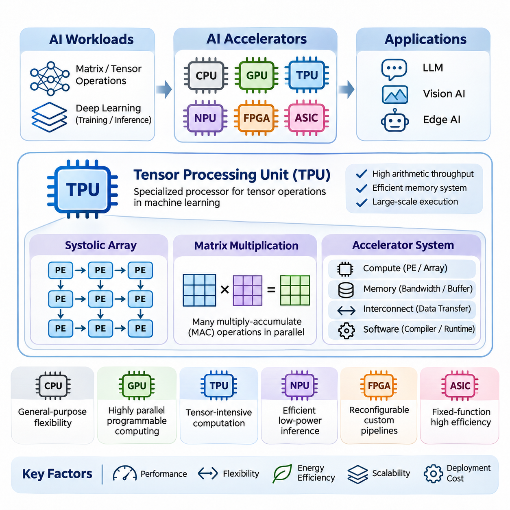
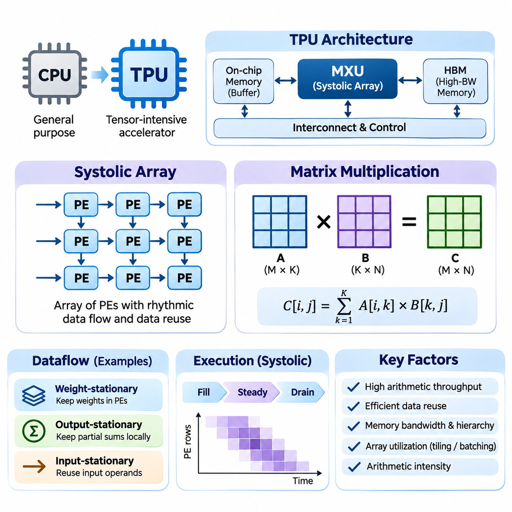
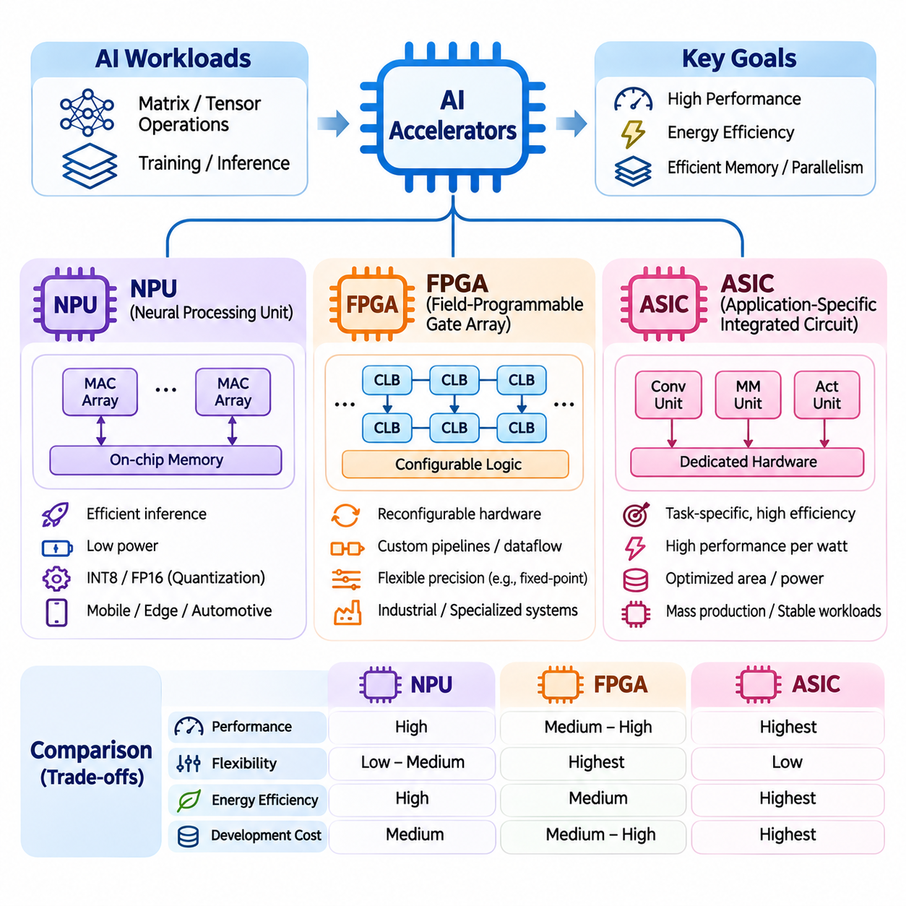
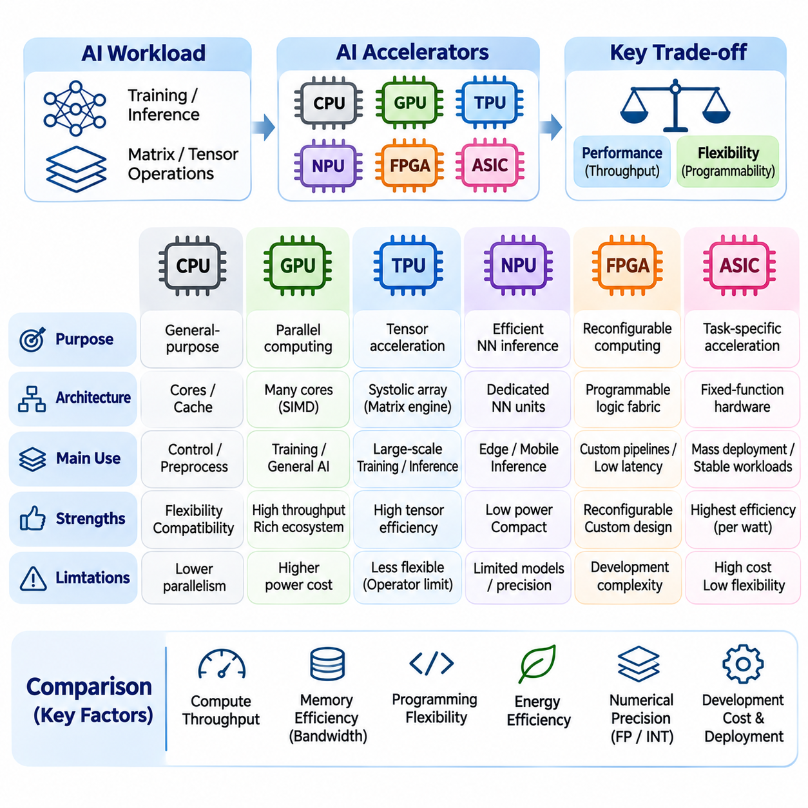
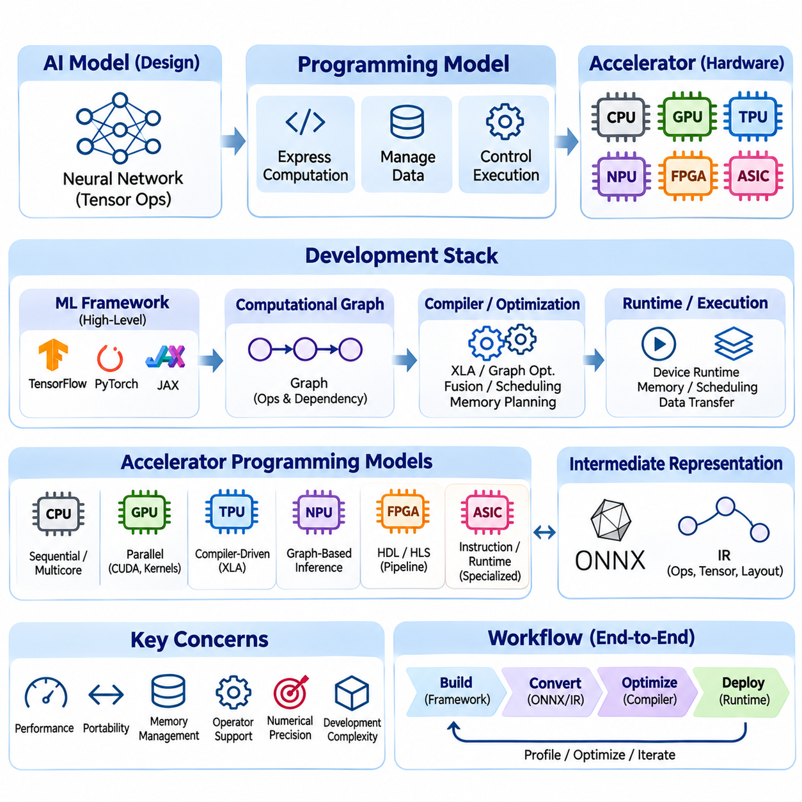
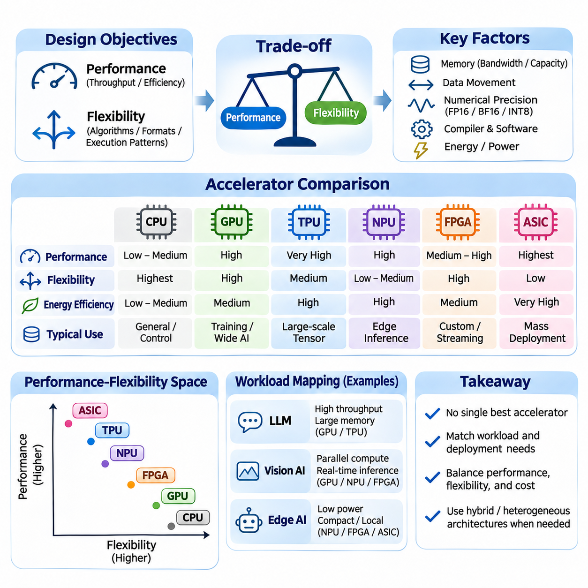
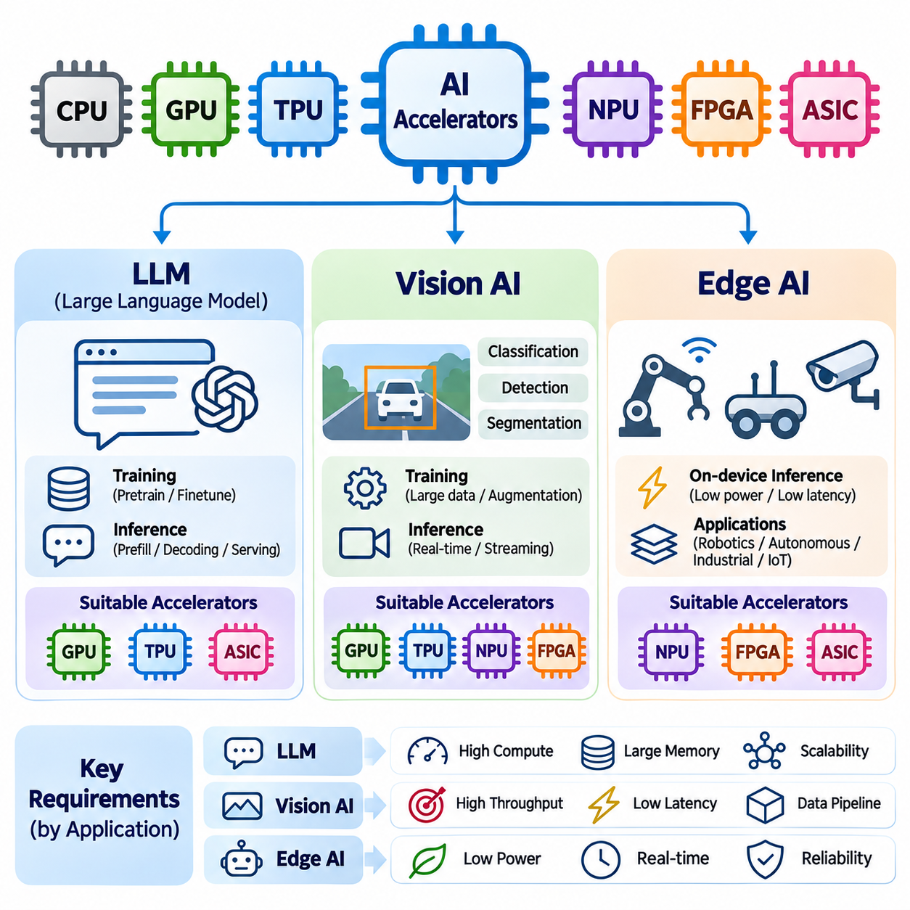

**Volume 39. Hardware for AI**

# 02. TPU and Accelerators

## 02.00 Overview

{width="7.268055555555556in" height="7.268055555555556in"}

인공지능(Artificial Intelligence, AI)은 대규모 행렬 연산(Matrix Operations), 텐서 변환(Tensor Transformations), 반복적인 수치 계산(Numerical Computations)이 중심이 되는 작업 부하(Workload)를 도입하면서 컴퓨팅 요구사항을 근본적으로 변화시켰다. 기존 중앙처리장치(Central Processing Unit, CPU)는 범용적인 유연성을 제공하지만, 특수 목적 인공지능 가속기(AI Accelerator)는 신경망(Neural Network) 연산에 최적화된 아키텍처(Architecture)를 통해 계산 효율성을 향상시킨다. 텐서 처리 장치(Tensor Processing Unit, TPU)와 관련 가속기는 작업 부하에 특화된 컴퓨팅(Workload-Specific Computing)으로 발전하는 중요한 기술적 진화를 보여준다.

인공지능 가속기(AI Accelerator)의 발전은 딥러닝 모델(Deep Learning Model)의 복잡성이 증가하고 효율적인 학습(Training)과 추론(Inference)에 대한 요구가 확대되면서 가속화되고 있다. 현대 신경망은 수백만 개에서 수십억 개 이상의 매개변수(Parameter)를 포함하며 상당한 계산 자원(Computational Resources)을 필요로 한다. 특수 목적 프로세서(Specialized Processor)는 일반적인 기계학습(Machine Learning) 연산에 대해 산술 처리량(Arithmetic Throughput), 메모리 접근(Memory Access), 병렬 실행(Parallel Execution), 에너지 소비(Energy Consumption)를 최적화하여 이러한 문제를 해결한다.

텐서 처리 장치(Tensor Processing Unit, TPU)는 구글(Google)이 기계학습 작업 부하를 가속하기 위해 개발한 특수 목적 프로세서이다. 다양한 명령어를 범용 코어(General-Purpose Core)에서 실행하는 기존 CPU와 달리, TPU는 신경망에서 빈번하게 사용되는 텐서 연산(Tensor Operations)에 중점을 둔다. TPU 아키텍처는 전용 연산 구조(Dedicated Computational Structures), 최적화된 메모리 시스템(Optimized Memory Systems), 소프트웨어 인터페이스(Software Interfaces)를 통합하여 대규모 기계학습 실행을 지원한다.

TPU 연산의 기반이 되는 핵심 아키텍처 개념 중 하나는 시스톨릭 배열(Systolic Array)이다. 시스톨릭 배열은 서로 연결된 처리 요소(Processing Elements)로 구성되며, 각 요소는 인접한 요소 사이에서 데이터를 전달하면서 조정된 산술 연산을 수행한다. 이러한 구조는 데이터 재사용(Data Reuse)을 증가시키고 반복적인 메모리 전송(Memory Transfers)을 줄여 효율적인 행렬 곱셈(Matrix Multiplication)을 지원한다. 특히 계산 작업을 배열 구조에 효과적으로 배치할 수 있을 때 높은 효율성을 제공한다.

행렬 곱셈(Matrix Multiplication)은 신경망 계층(Neural Network Layer)이 연산을 행렬 또는 고차원 텐서(Higher-Dimensional Tensor)의 곱으로 표현하는 경우가 많기 때문에 현대 인공지능의 핵심 연산이다. 완전연결 계층(Fully Connected Layer), 합성곱 변환(Convolutional Transformation), 어텐션 메커니즘(Attention Mechanism)은 특수 목적 행렬 처리 하드웨어를 활용할 수 있다. 가속기는 순차적인 명령어 실행에만 의존하지 않고 다수의 곱셈-누산 연산(Multiply-Accumulate Operations)을 동시에 수행하여 계산 효율성을 높인다.

텐서 가속기(Tensor Accelerator)의 효율성은 산술 연산 능력뿐만 아니라 컴퓨팅 시스템 내부의 데이터 이동(Data Movement)에 의해서도 결정된다. 메모리 대역폭(Memory Bandwidth), 로컬 버퍼링(Local Buffering), 캐시 구성(Cache Organization), 상호연결 토폴로지(Interconnect Topology)는 처리 요소에 피연산자(Operand)가 얼마나 효율적으로 공급되는지를 결정한다. 이론적인 계산 처리량이 높은 가속기라도 메모리 전송이나 통신 지연(Communication Latency)이 실행 시간을 지배하면 실제 성능이 제한될 수 있다.

TPU 외에도 인공지능 하드웨어 생태계(AI Hardware Ecosystem)에는 신경망 처리 장치(Neural Processing Unit, NPU), 필드 프로그래머블 게이트 어레이(Field-Programmable Gate Array, FPGA), 주문형 반도체(Application-Specific Integrated Circuit, ASIC)가 포함된다. 이러한 가속기 유형은 프로그래밍 가능성(Programmability), 계산 특화 수준(Computational Specialization), 배포 환경(Deployment Environment), 개발 비용(Development Cost)에서 차이를 보인다. 각 아키텍처는 성능, 유연성, 에너지 효율성, 변화하는 신경망 작업 부하에 대한 대응 능력 사이에서 서로 다른 균형을 제공한다.

신경망 처리 장치(Neural Processing Unit, NPU)는 신경망 연산을 효율적으로 실행하도록 설계된 특수 목적 프로세서이다. NPU는 스마트폰(Smartphone), 임베디드 컴퓨터(Embedded Computer), 자동차 플랫폼(Automotive Platform), 엣지 인공지능 장치(Edge AI Device)에 널리 사용된다. NPU 아키텍처는 일반적으로 저전력 추론(Low-Power Inference), 소형 메모리 구성(Compact Memory Organization), 합성곱(Convolution), 행렬 곱셈, 활성화 함수(Activation Function) 등 배포된 신경망에 필요한 연산의 하드웨어 가속(Hardware Acceleration)에 중점을 둔다.

필드 프로그래머블 게이트 어레이(Field-Programmable Gate Array, FPGA)는 특정 계산 파이프라인(Computational Pipeline)에 맞게 조정할 수 있는 재구성 가능한 디지털 논리(Reconfigurable Digital Logic)를 제공한다. 고정 기능 가속기(Fixed-Function Accelerator)와 달리 FPGA는 개발자가 처리 구조(Processing Structure), 데이터 경로(Data Path), 인터페이스(Interface)를 사용자 정의 방식으로 구현할 수 있다. 이러한 유연성은 특수 추론 파이프라인, 저지연 신호 처리(Low-Latency Signal Processing), 산업 자동화(Industrial Automation), 비표준 하드웨어 인터페이스와의 통합이 필요한 응용 분야에서 유용하다.

주문형 반도체(Application-Specific Integrated Circuit, ASIC)는 정의된 기능 집합을 전용 하드웨어 구조(Dedicated Hardware Structure)로 수행하도록 설계된다. 이러한 특화 설계는 목표 작업 부하가 충분히 안정적일 때 높은 계산 효율성과 유리한 전력 특성을 제공할 수 있다. 그러나 ASIC 개발에는 상당한 엔지니어링 노력(Engineering Effort), 제조 비용(Manufacturing Cost)이 필요하며, 반도체 제작(Fabrication) 이후에는 기본 하드웨어 구조를 수정하기 어렵다는 한계가 있다.

CPU, GPU, TPU, NPU, FPGA, ASIC 아키텍처를 비교하려면 최대 산술 처리량(Peak Arithmetic Throughput)만이 아니라 계산 구조(Computational Organization)를 이해해야 한다. CPU는 범용 실행(General-Purpose Execution)을 우선하며, GPU는 고도로 병렬화된 프로그래밍 가능 작업을 지원하고, TPU는 텐서 중심 연산(Tensor-Intensive Computation)에 특화된다. NPU는 효율적인 추론을 주로 목표로 하며, FPGA와 사용자 정의 ASIC는 서로 다른 수준의 하드웨어 특화(Hardware Specialization)와 구현 유연성(Implementation Flexibility)을 제공한다.

인공지능 가속기의 프로그래밍 모델(Programming Model)은 소프트웨어가 계산을 표현하는 방식과 해당 계산이 하드웨어에서 얼마나 효율적으로 실행되는지를 결정한다. 고수준 기계학습 프레임워크(High-Level Machine Learning Framework)는 텐서 연산과 계산 그래프(Computational Graph)를 사용하여 신경망을 표현한다. 컴파일러(Compiler)와 런타임 시스템(Runtime System)은 이러한 표현을 실행 가능한 명령어로 변환하고, 연산을 스케줄링(Scheduling)하며, 메모리를 할당하고 가속기 자원 사이의 데이터 전송을 조정한다.

컴파일러 최적화(Compiler Optimization)는 특수 목적 가속기의 성능에서 특히 중요한 역할을 수행한다. 연산자 융합(Operator Fusion), 그래프 변환(Graph Transformation), 메모리 계획(Memory Planning), 텐서 배치 최적화(Tensor Layout Optimization), 명령어 스케줄링(Instruction Scheduling) 등의 기술은 불필요한 계산과 통신을 줄인다. 텐서플로(TensorFlow), 잭스(JAX), 파이토치(PyTorch)와 같은 프레임워크 통합(Framework Integration)은 개발자가 모든 하드웨어 전용 연산을 직접 구현하지 않고도 가속기의 기능을 활용하도록 지원한다.

수치 정밀도(Numerical Precision)는 가속기 설계에서 또 다른 핵심 고려사항이다. 신경망은 적절한 학습 또는 추론 조건에서 낮은 정밀도의 산술 연산(Reduced-Precision Arithmetic)을 허용하는 경우가 많다. FP32, FP16, BF16 및 정수 표현(Integer Representation)과 같은 데이터 형식은 수치 정확도(Numerical Accuracy), 메모리 소비(Memory Consumption), 산술 처리량, 에너지 효율성 사이에서 서로 다른 절충 관계(Tradeoff)를 제공한다. 적절한 정밀도 전략(Precision Strategy)은 하드웨어 지원 범위와 모델의 수치 민감도(Model Sensitivity)에 따라 결정된다.

성능(Performance)과 유연성(Flexibility)은 가속기 아키텍처의 핵심적인 절충 관계를 형성한다. 고도로 특화된 처리 구조는 지원되는 연산을 매우 효율적으로 실행할 수 있지만, 계산 패턴(Computational Pattern)이 설계 목적과 다를 경우 성능이 크게 저하될 수 있다. 프로그래밍 가능성이 높은 아키텍처는 다양한 알고리즘(Algorithm)과 실험적인 모델을 수용할 수 있지만, 추가적인 제어 메커니즘(Control Mechanism)과 범용 기능으로 인해 실행 오버헤드(Execution Overhead)가 발생할 수 있다.

대규모 언어 모델(Large Language Model, LLM)은 트랜스포머 아키텍처(Transformer Architecture)가 방대한 행렬 곱셈, 어텐션 계산(Attention Computation), 메모리 집약적 추론(Memory-Intensive Inference)을 포함하기 때문에 가속기 시스템에 매우 높은 요구사항을 부과한다. 학습에서는 지속적인 계산 처리량(Sustained Computational Throughput)과 다중 장치 간 통신이 중요하다. 추론에서는 메모리 용량(Memory Capacity), 메모리 대역폭, 배치 처리(Batching Behavior), 어텐션 관련 캐시 표현(Cached Representation)의 효율적인 관리가 추가적으로 중요해진다.

비전 인공지능(Vision AI) 작업 부하 역시 영상 분류(Image Classification), 객체 탐지(Object Detection), 영상 분할(Segmentation), 시각적 표현 학습(Visual Representation Learning)이 반복적인 텐서 연산을 포함하기 때문에 특수 목적 가속의 이점을 얻는다. 합성곱 신경망(Convolutional Neural Network)과 비전 트랜스포머(Vision Transformer)는 상당한 병렬성을 제공하지만 계산 특성은 서로 다르다. 효율적인 배포를 위해서는 연산자 지원(Operator Support), 텐서 차원(Tensor Dimensions), 메모리 요구사항, 지연시간 제약(Latency Constraints)을 선택한 가속기 아키텍처와 일치시켜야 한다.

엣지 인공지능(Edge AI)은 전력(Electrical Power), 열 방출(Thermal Dissipation), 물리적 크기(Physical Size), 응답시간(Response Time)에 관한 추가적인 제약을 도입한다. 임베디드 가속기(Embedded Accelerator)는 제한된 에너지와 메모리 예산(Memory Budget) 안에서 센서 정보를 처리해야 한다. 로봇공학(Robotics), 지능형 카메라(Intelligent Camera), 자율 기계(Autonomous Machine), 스마트 장치(Smart Device)는 원격 서버(Remote Server)에 대한 의존성을 줄이고 네트워크 지연(Network Latency)을 최소화하는 로컬 추론(Local Inference)을 통해 이점을 얻는다.

실시간 응용 시스템(Real-Time Application)은 처리량만이 아니라 실행 지연시간(Execution Latency)과 예측 가능성(Predictability)을 신중하게 평가해야 한다. 초당 많은 요청을 처리할 수 있는 가속기라도 작업 부하 변화에 따라 응답시간 변동(Response-Time Variation)이 커지면 요구사항을 충족하지 못할 수 있다. 따라서 산업 제어(Industrial Control), 로봇 인지(Robotic Perception), 안전 필수 시스템(Safety-Critical System)은 스케줄링 동작(Scheduling Behavior), 메모리 경합(Memory Contention), 통신 지연, 최악 실행시간 요구사항(Worst-Case Execution Requirements)을 종합적으로 고려해야 한다.

인공지능 가속기의 에너지 효율성(Energy Efficiency)은 일반적으로 전기 에너지 소비량(Electrical Energy Consumption) 대비 유효 계산량(Useful Computational Work) 또는 완료된 추론 작업(Inference Task)을 기준으로 평가한다. 특수 목적 하드웨어는 연산당 에너지 소비(Energy per Operation)를 줄일 수 있지만, 실제 효율성은 자원 활용률(Utilization), 작업 부하 특성, 메모리 트래픽(Memory Traffic), 주변 시스템 구성요소(Supporting System Components)에 따라 달라진다. 생산 환경(Production Environment)에서 성능을 평가할 때는 열 관리(Thermal Management)와 지속 운전 조건(Sustained Operating Conditions)도 중요하다.

인공지능 작업 부하가 단일 가속기의 계산 능력이나 메모리 용량을 초과하면 확장성(Scalability)이 필수적이다. 다중 장치 시스템(Multi-Device System)은 모델 매개변수, 학습 데이터 또는 계산 단계를 상호 연결된 프로세서에 분산한다. 이러한 시스템의 효율성은 통신 대역폭(Communication Bandwidth), 동기화 오버헤드(Synchronization Overhead), 작업 부하 분할(Workload Partitioning), 소프트웨어 지원에 따라 결정된다. 가속기 수를 증가시키는 것만으로 응용 프로그램 성능이 비례하여 향상되는 것은 아니다.

따라서 하드웨어 선정(Hardware Selection)에서는 전처리(Preprocessing), 텐서 계산(Tensor Computation), 중간 데이터 저장(Intermediate Storage), 후처리(Postprocessing), 통신(Communication)을 포함한 전체 인공지능 실행 파이프라인(AI Execution Pipeline)을 고려해야 한다. 가장 적합한 가속기가 반드시 가장 높은 초당 연산 성능(Operations per Second)을 광고하는 장치는 아니다. 실제 선정에서는 지원 연산자, 모델 호환성(Model Compatibility), 개발 도구(Development Tools), 메모리 용량, 배포 제약, 운영 신뢰성(Operational Reliability), 총소유비용(Total Cost of Ownership, TCO)을 검토해야 한다.

벤치마킹(Benchmarking)은 대표적인 실행 조건에서 가속기 아키텍처를 비교하기 위한 체계적인 방법을 제공한다. 측정 항목에는 계산 처리량(Computational Throughput), 종단 간 지연시간(End-to-End Latency), 에너지 소비량, 메모리 활용률(Memory Utilization), 지속 성능(Sustained Performance)이 포함되어야 한다. 표준화된 벤치마크(Standardized Benchmark)는 유용한 비교 기준을 제공하지만, 이론적인 하드웨어 사양과 합성 작업 부하(Synthetic Workload)가 실제 운영 환경의 동작을 정확하게 반영하지 못할 수 있으므로 응용 분야별 시험(Application-Specific Testing)이 필요하다.

TPU와 가속기 기술의 지속적인 발전은 하드웨어-소프트웨어 공동설계(Hardware-Software Co-Design)로 향하는 광범위한 기술적 변화를 반영한다. 프로세서 아키텍처, 컴파일러 시스템, 수치 형식(Numerical Format), 신경망 알고리즘은 점차 서로에게 영향을 주면서 함께 발전하고 있다. 이러한 상호관계를 이해하는 것은 특수 목적 인공지능 하드웨어를 평가하고 대규모 언어 모델, 비전 인공지능, 엣지 응용 분야를 위한 효율적인 컴퓨팅 시스템을 설계하는 데 필요한 기초를 제공한다.

## 02.01 Tensor Processing Unit (TPU)

{width="7.268055555555556in" height="7.268055555555556in"}

텐서 처리 장치(Tensor Processing Unit, TPU)는 텐서 집약적 기계학습 작업 부하(Tensor-Intensive Machine Learning Workload)를 효율적으로 실행하기 위해 구글(Google)이 개발한 특수 목적 인공지능 가속기(Specialized Artificial Intelligence Accelerator)이다. TPU 아키텍처는 대규모 행렬 연산(Large-Scale Matrix Operations), 예측 가능한 데이터 이동(Predictable Data Movement), 높은 연산 밀도(High Computational Density)에 중점을 둔다. 범용 프로세서(General-Purpose Processor)와 달리 TPU는 신경망 학습(Neural Network Training)과 추론(Inference)에서 지배적인 비중을 차지하는 연산에 상당한 하드웨어 자원을 할당한다.

TPU 아키텍처의 근본적인 개발 동기는 딥러닝(Deep Learning)의 계산 구조(Computational Structure)에 있다. 신경망(Neural Network)은 대규모 텐서(Tensor)에 대해 행렬 곱셈(Matrix Multiplication), 누산(Accumulation), 비선형 변환(Nonlinear Transformation)을 반복적으로 수행한다. 기존 프로세서는 범용 명령어 파이프라인(General-Purpose Instruction Pipeline)을 통해 이러한 연산을 실행하지만, TPU는 특수 산술 연산 장치(Specialized Arithmetic Unit)를 구성하여 병렬성(Parallelism)과 데이터 재사용(Data Reuse)을 활용하고 지원되는 계산 패턴(Computational Pattern)의 실행 오버헤드(Execution Overhead)를 줄인다.

여러 세대의 TPU에서 핵심적인 아키텍처 특징은 처리 요소(Processing Element)의 시스톨릭 배열(Systolic Array)로 구현되는 행렬 곱셈 장치(Matrix Multiplication Unit, MXU)이다. 이러한 처리 요소는 규칙적인 통신 경로(Communication Path)를 통해 데이터를 교환하면서 조정된 곱셈-누산 연산(Multiply-Accumulate Operation)을 실행한다. 이 구조는 높은 산술 연산 밀도(Arithmetic Density)를 제공하며, 중간 피연산자(Intermediate Operand)를 멀리 떨어진 메모리에서 반복적으로 가져와야 하는 필요성을 줄인다.

시스톨릭 배열(Systolic Array)은 상호 연결된 처리 요소 사이에서 데이터가 리듬감 있게 흐르는 공간 컴퓨팅 아키텍처(Spatial Computing Architecture)이다. 각 처리 요소는 로컬 산술 연산(Local Arithmetic Operation)을 수행하고 선택된 값을 인접한 요소로 전달한다. 메모리와 독립적인 실행 장치(Execution Unit) 사이에서 피연산자를 반복적으로 이동시키는 대신, 구조화된 데이터 이동(Structured Data Movement)을 유지하여 행렬 계산 과정에서 효율적인 데이터 재사용을 가능하게 한다.

시스톨릭 배열 내부의 처리 요소는 일반적으로 곱셈 및 누산 논리(Multiplication and Accumulation Logic)와 임시 데이터 저장을 위한 레지스터(Register)를 포함한다. 행렬 곱셈 과정에서 피연산자는 정교하게 조정된 일정에 따라 배열로 입력된다. 각 처리 요소는 입력값을 곱하고 부분합(Partial Sum)을 갱신하며, 선택된 데이터 흐름(Dataflow)에 따라 데이터를 전달한다. 이러한 동작을 통해 다수의 연산이 동시에 진행된다.

시스톨릭 배열의 효율성은 적절한 데이터 흐름 전략(Dataflow Strategy)을 선택하는 데 달려 있다. 가중치 고정 방식(Weight-Stationary Execution)은 모델 가중치(Model Weight)를 처리 요소 가까이에 유지하고, 출력 고정 방식(Output-Stationary Execution)은 누산 과정에서 부분 결과를 로컬에 유지한다. 입력 고정 방식(Input-Stationary Strategy)은 입력 피연산자(Input Operand)의 재사용을 강조한다. 구현 방식에 따라 하드웨어 구성, 텐서 차원(Tensor Dimension), 작업 부하 특성(Workload Characteristics)을 고려하여 이러한 접근법을 선택하거나 결합한다.

행렬 곱셈을 C = A × B로 표현한다고 가정하면, 행렬 A는 M개의 행과 K개의 열을 가지며 행렬 B는 K개의 행과 N개의 열을 가진다. 결과 행렬 C의 크기는 M × N이다. 각 출력 요소(Output Element)는 A의 해당 행과 B의 해당 열에서 K개의 곱을 누적하여 계산한다. 이러한 규칙적인 계산 구조는 행렬 곱셈을 공간적으로 구성된 가속기 하드웨어(Spatially Organized Accelerator Hardware)에 특히 적합하게 만든다.

기존 구현 방식에서 행렬 곱셈은 입력 피연산자에 반복적으로 접근하고 출력값을 갱신하는 중첩 반복문(Nested Loop)을 포함한다. 시스톨릭 배열은 이러한 계산을 처리 요소 전체에 분산된 조정된 병렬 연산(Coordinated Parallel Operations)으로 변환한다. 배열에 데이터가 충분히 채워지면 여러 곱셈과 누산이 동시에 실행되어 계산 처리량(Computational Throughput)이 증가하고 중복된 피연산자 전송(Redundant Operand Transfer)이 감소한다.

시스톨릭 연산(Systolic Computation)의 시간적 동작은 초기 채움 단계(Filling Phase), 정상 상태 처리 단계(Steady-State Processing Phase), 최종 배출 단계(Draining Phase)로 구성된다. 채움 단계에서는 피연산자가 필요한 처리 요소를 향해 이동한다. 정상 상태에서는 많은 처리 요소가 동시에 유효한 계산을 수행한다. 배출 단계에서는 남아 있는 결과의 누산이 완료되고 후속 처리 단계(Subsequent Processing Stage)에서 사용할 수 있는 상태가 된다.

배열 활용률(Array Utilization)은 실제 TPU 성능을 결정하는 중요한 요소이다. 대규모 행렬은 많은 처리 요소를 활성 상태로 유지할 수 있지만, 작거나 불규칙한 행렬은 배열의 상당 부분을 활용하지 못할 수 있다. 패딩(Padding), 타일링(Tiling), 작업 부하 배치 처리(Workload Batching)는 활용률을 향상시킬 수 있다. 그러나 실행 조건에 따라 이러한 기술은 추가 계산, 메모리 소비 또는 지연시간(Latency)을 발생시킬 수 있다.

타일링(Tiling)은 대규모 행렬을 사용 가능한 계산 배열(Computational Array)과 로컬 메모리(Local Memory)에 적합한 작은 블록으로 분할하는 기술이다. 각 타일(Tile)은 반복적인 행렬 연산을 통해 처리되며, 부분 결과를 결합하여 전체 출력을 구성한다. 효과적인 타일링은 데이터 지역성(Data Locality)을 향상시키고 외부 메모리 트래픽(External Memory Traffic)을 줄인다. 그러나 타일 크기는 처리 요소 활용률, 버퍼 용량(Buffer Capacity), 스케줄링 오버헤드(Scheduling Overhead) 사이의 균형을 고려해야 한다.

행렬 곱셈 성능은 메모리에서 전송되는 데이터량 대비 수행되는 산술 연산 수를 나타내는 산술 집약도(Arithmetic Intensity)를 통해 이해할 수 있다. 산술 집약도가 높은 연산은 전용 행렬 하드웨어(Dedicated Matrix Hardware)에서 상당한 이점을 얻을 수 있다. 시스톨릭 배열은 피연산자가 처리 구조를 통과하는 동안 여러 계산에 참여하도록 하여 실질적인 데이터 재사용 효율성을 높인다.

메모리 계층 구조(Memory Hierarchy)는 TPU의 계산 처리량을 지속적으로 유지하는 데 핵심적인 역할을 수행한다. 고대역폭 메모리(High-Bandwidth Memory), 온칩 버퍼(On-Chip Buffer), 레지스터(Register), 특수 데이터 전송 메커니즘(Specialized Data-Transfer Mechanism)은 행렬 실행 장치(Matrix Execution Unit)에 피연산자를 공급한다. 구체적인 구성은 TPU 세대에 따라 다르다. 효율적인 실행을 위해서는 산술 연산 장치가 데이터를 기다리지 않고 활성 상태를 유지하도록 메모리 이동과 계산을 조정해야 한다.

계산과 메모리 대역폭(Memory Bandwidth)의 관계는 루프라인 성능 모델(Roofline Performance Model)을 사용하여 분석할 수 있다. 이 모델은 달성 가능한 산술 처리량(Attainable Arithmetic Throughput)을 데이터 이동으로 인한 한계와 비교한다. 산술 실행이 성능을 결정하면 연산 병목(Compute-Bound) 상태가 되고, 피연산자 공급이 진행을 제한하면 메모리 병목(Memory-Bound) 상태가 된다. 따라서 TPU 최적화(TPU Optimization)는 두 자원 사이의 균형을 필요로 한다.

수치 정밀도(Numerical Precision)는 TPU 행렬 곱셈의 효율성에 큰 영향을 미친다. 지원되는 데이터 형식은 하드웨어 세대에 따라 다르며 BF16, FP32 관련 실행 모드(FP32-Related Execution Mode), 일부 정수 표현(Integer Representation), 저정밀 표현(Reduced-Precision Representation)을 포함할 수 있다. 낮은 정밀도의 피연산자는 저장 요구사항(Storage Requirements)을 줄이고 산술 처리량을 높일 수 있다. 다만 누산 동작(Accumulation Behavior)과 수치 오차(Numerical Error)가 모델의 정확도 요구사항과 호환되어야 한다.

브레인 부동소수점 16(Brain Floating Point 16, BF16)은 FP32의 지수부 폭(Exponent Width)을 유지하면서 가수부 정밀도(Significand Precision)를 줄이기 때문에 TPU 연산에서 특히 중요하다. 이 표현 방식은 피연산자의 저장 요구사항을 줄이면서 넓은 수치 표현 범위(Numerical Range)를 제공한다. 많은 신경망 작업 부하는 BF16을 효과적으로 사용할 수 있지만, 수치 안정성(Numerical Stability), 누산 정밀도(Accumulation Precision), 민감한 연산(Sensitive Operation)은 적절한 소프트웨어 처리가 필요하다.

행렬 곱셈은 완전연결 신경망 계층(Fully Connected Neural Network Layer)의 기본 연산이다. 입력 활성화 행렬(Input Activation Matrix) X와 가중치 행렬(Weight Matrix) W가 주어지면 계층은 Y = XW + b와 같은 변환을 계산한다. TPU의 행렬 연산 장치는 곱셈 부분을 가속하고, 다른 실행 자원(Execution Resource)은 편향 덧셈(Bias Addition)과 활성화 함수(Activation Function)를 처리한다. 효율적인 스케줄링(Scheduling)은 중간 데이터 이동(Intermediate Data Movement)을 최소화하도록 이러한 연산을 조정한다.

합성곱 신경망(Convolutional Neural Network, CNN)도 행렬 중심 가속(Matrix-Oriented Acceleration)의 이점을 얻는다. 합성곱(Convolution)은 im2col과 같은 기술을 통해 행렬 곱셈으로 변환할 수 있지만, 명시적인 변환은 메모리 요구사항을 증가시킬 수 있다. 다른 컴파일러 매핑(Compiler Mapping) 방식은 대규모 중간 행렬을 실제로 생성하지 않도록 한다. 가장 효과적인 전략은 합성곱 차원(Convolution Dimensions), 텐서 배치(Tensor Layout), 사용 가능한 하드웨어 연산, 메모리 제약에 따라 달라진다.

트랜스포머 아키텍처(Transformer Architecture)는 어텐션 투영(Attention Projection), 피드포워드 네트워크(Feedforward Network), 출력 변환(Output Transformation)에 행렬 곱셈을 광범위하게 사용한다. 쿼리(Query), 키(Key), 값(Value) 표현은 행렬 연산을 통해 생성되며, 어텐션 계산에는 추가적인 행렬 곱과 정규화(Normalization)가 포함된다. TPU는 이러한 연산을 행렬 연산 장치에 효율적으로 매핑하고 주변 연산을 컴파일러 최적화(Compiler Optimization)를 통해 조정함으로써 성능상의 이점을 얻는다.

대규모 언어 모델(Large Language Model, LLM)의 학습은 순전파(Forward Propagation)와 기울기 계산(Gradient Computation) 모두에서 행렬 곱셈이 발생하므로 추가적인 요구사항을 도입한다. 역전파(Backpropagation)는 행렬 곱이나 관련 텐서 축약(Tensor Contraction)으로 표현되는 연산을 통해 기울기(Gradient)를 계산하는 경우가 많다. TPU 시스템은 이러한 계산을 가속하면서 분산 실행(Distributed Execution)을 통해 매개변수 갱신(Parameter Update), 기울기 집계(Gradient Aggregation), 다중 장치 간 통신을 조정한다.

추론 작업 부하(Inference Workload)는 학습과 다른 활용률 문제를 발생시킨다. 대규모 학습 배치(Training Batch)는 상당한 병렬성을 제공하지만, 자기회귀 생성(Autoregressive Generation)은 작은 행렬 차원과 빈번한 메모리 접근을 포함할 수 있다. 사전 채움 연산(Prefill Computation)은 대규모 행렬 연산을 활용할 수 있는 반면, 토큰 단위 디코딩(Token-by-Token Decoding)은 최대 산술 처리량보다 메모리 대역폭, 모델 크기(Model Size), 배치 처리 효율성(Batching Efficiency)에 의해 제한될 수 있다.

컴파일러 기술(Compiler Technology)은 신경망 계산을 효율적인 TPU 실행으로 변환하는 데 필수적이다. XLA와 같은 시스템은 계산 그래프(Computational Graph)를 분석하고, 연산 배치(Operation Layout)를 선택하며, 텐서 변환을 구성하고, 호환 가능한 연산을 스케줄링한다. 컴파일러의 결정은 배열 활용률(Array Utilization), 메모리 할당(Memory Allocation), 수치 정밀도, 통신 오버헤드(Communication Overhead)에 영향을 미친다. 따라서 소프트웨어 최적화(Software Optimization)는 가속기 아키텍처와 분리하여 고려할 수 없다.

시스톨릭 배열의 성능상 이점에는 아키텍처적 한계(Architectural Limitation)도 수반된다. 불규칙한 제어 흐름(Irregular Control Flow), 적절한 하드웨어 지원이 없는 희소 연산(Sparse Computation), 작은 텐서 차원, 지원되지 않는 연산자(Unsupported Operator)는 행렬 처리 장치(Matrix Processing Unit)에 효율적으로 매핑되지 않을 수 있다. 이러한 연산은 대체 실행 자원(Alternative Execution Resource)이나 추가적인 변환(Transformation)을 필요로 하며, 특수화(Specialization)의 이점을 감소시킬 수 있다.

TPU 행렬 곱셈의 성능을 평가하려면 대표적인 작업 부하에서 지속 처리량(Sustained Throughput), 실행 지연시간(Execution Latency), 배열 활용률, 메모리 트래픽(Memory Traffic), 에너지 소비(Energy Consumption)를 측정해야 한다. 이론적인 최대 초당 연산 수(Peak Theoretical Operations per Second)는 하드웨어의 능력을 나타내지만 응용 프로그램 수준의 성능(Application-Level Performance)을 보장하지는 않는다. 정확한 벤치마킹(Benchmarking)은 텐서 차원, 정밀도 형식(Precision Format), 컴파일 동작(Compilation Behavior), 데이터 전송 오버헤드(Data-Transfer Overhead), 실행 구성(Execution Configuration)을 고려해야 한다.

시스톨릭 배열(Systolic Array)과 특수 목적 행렬 곱셈(Specialized Matrix Multiplication)의 결합은 TPU 가속(TPU Acceleration)의 아키텍처적 기반을 형성한다. 규칙적인 데이터 흐름(Regular Dataflow)과 광범위한 피연산자 재사용(Operand Reuse)을 중심으로 산술 연산을 구성함으로써 TPU는 지원되는 신경망 계산의 효율성을 향상시킨다. 이러한 원리를 이해하면 학습 및 추론 작업 부하를 효과적으로 최적화할 수 있으며, 특수 목적 인공지능 가속기 아키텍처(Specialized AI Accelerator Architecture)를 비교하기 위한 기술적 기반을 확보할 수 있다.

## 02.02 AI Accelerators

{width="7.268055555555556in" height="7.268055555555556in"}

인공지능 가속기(Artificial Intelligence Accelerator)는 범용 프로세서(General-Purpose Processor)보다 기계학습 연산(Machine Learning Operations)을 효율적으로 실행하도록 설계된 특수 목적 컴퓨팅 장치(Specialized Computing Device)이다. 이러한 아키텍처(Architecture)는 병렬 산술 연산(Parallel Arithmetic), 효율적인 메모리 접근(Memory Access), 에너지 소비 감소(Reduced Energy Consumption)를 우선한다. 신경망 처리 장치(Neural Processing Unit, NPU), 필드 프로그래머블 게이트 어레이(Field-Programmable Gate Array, FPGA), 주문형 반도체(Application-Specific Integrated Circuit, ASIC)는 클라우드(Cloud), 산업용 컴퓨팅(Industrial Computing), 임베디드 컴퓨팅(Embedded Computing) 환경에서 신경망 작업 부하(Neural Network Workload)를 가속하는 세 가지 중요한 접근법을 나타낸다.

신경망(Neural Network)의 복잡성이 증가하면서 기존 중앙처리장치(Central Processing Unit, CPU)가 항상 효율적으로 충족할 수 없는 계산 요구사항(Computational Demands)이 발생하고 있다. 행렬 곱셈(Matrix Multiplication), 합성곱(Convolution), 활성화 함수(Activation Function), 텐서 변환(Tensor Transformation)은 상당한 산술 처리량(Arithmetic Throughput)과 메모리 대역폭(Memory Bandwidth)을 필요로 한다. 특수 목적 가속기(Specialized Accelerator)는 전용 실행 장치(Dedicated Execution Unit), 최적화된 데이터 흐름(Optimized Dataflow), 딥러닝(Deep Learning)의 반복적인 계산 패턴(Computational Pattern)을 활용하는 하드웨어 구조를 통해 이러한 요구사항을 해결한다.

신경망 처리 장치(Neural Processing Unit, NPU)는 신경망 연산, 특히 추론 작업 부하(Inference Workload)를 효율적으로 실행하도록 최적화된 특수 목적 프로세서(Specialized Processor)이다. NPU는 일반적으로 행렬 곱셈 엔진(Matrix Multiplication Engine), 합성곱 가속기(Convolution Accelerator), 로컬 메모리(Local Memory), 전용 데이터 이동 메커니즘(Dedicated Data Movement Mechanism)을 통합한다. 주요 목적은 모바일(Mobile), 임베디드(Embedded), 엣지 컴퓨팅(Edge Computing) 시스템에 배포된 신경망 모델을 지원하면서 낮은 전력 소비로 높은 추론 처리량(Inference Throughput)을 제공하는 것이다.

NPU 아키텍처는 일반적으로 곱셈-누산 연산(Multiply-Accumulate Operation)을 수행할 수 있는 병렬 처리 요소(Parallel Processing Element)를 중심으로 계산을 구성한다. 이러한 처리 요소는 합성곱 신경망(Convolutional Neural Network), 트랜스포머(Transformer), 기타 딥러닝 아키텍처에서 일반적으로 사용되는 수학 연산을 실행한다. 전용 메모리 버퍼(Dedicated Memory Buffer)는 외부 메모리(External Memory)에 대한 반복적인 접근을 줄이며, 특수 명령어 스케줄링(Specialized Instruction Scheduling)은 자원 활용률(Utilization)을 높이고 불필요한 데이터 전송(Data Transfer)을 최소화한다.

현대 NPU는 INT8, FP16 및 하드웨어에 따라 달라지는 기타 저정밀 수치 형식(Reduced-Precision Numerical Format)을 지원하는 경우가 많다. 양자화(Quantization)는 모델 매개변수(Model Parameter)와 활성화 값(Activation)을 낮은 정밀도의 형식으로 변환하여 메모리 요구사항(Memory Requirements)과 계산 비용(Computational Cost)을 줄인다. 양자화는 추론 효율성(Inference Efficiency)을 향상시킬 수 있지만, 그 효과는 모델 민감도(Model Sensitivity), 보정 품질(Calibration Quality), 지원 연산자(Supported Operator), 개별 신경망 계층(Neural Network Layer)의 수치적 동작(Numerical Behavior)에 따라 달라진다.

NPU는 스마트폰(Smartphone), 지능형 카메라(Intelligent Camera), 자동차용 프로세서(Automotive Processor), 임베디드 인공지능 플랫폼(Embedded AI Platform)에 널리 통합되고 있다. 로컬 추론(Local Inference)을 수행하는 능력은 원격 서버(Remote Server)와의 통신을 줄이고, 낮은 지연시간(Low Latency)이나 향상된 데이터 개인정보 보호(Data Privacy)가 필요한 응용 분야를 지원한다. 대표적인 작업 부하에는 영상 분류(Image Classification), 객체 탐지(Object Detection), 음성 인식(Speech Recognition), 언어 처리(Language Processing), 제한된 전력 및 열 환경에서의 센서 정보 해석(Sensor Interpretation)이 포함된다.

NPU를 둘러싼 소프트웨어 생태계(Software Ecosystem)는 실제 배포(Deployment)에 필수적이다. 텐서플로(TensorFlow)나 파이토치(PyTorch)와 같은 프레임워크(Framework)로 개발한 기계학습 모델은 하드웨어와 호환되는 표현(Hardware-Compatible Representation)으로 변환해야 하는 경우가 많다. 컴파일러 도구 체인(Compiler Toolchain)은 계산 그래프(Computational Graph)를 분석하고, 지원되는 연산자를 선택하며, 텐서 배치(Tensor Layout)를 최적화하고, 실행 가능한 명령어(Executable Instruction)를 생성한다. 지원되지 않는 연산은 CPU나 그래픽 처리 장치(Graphics Processing Unit, GPU)에서 실행해야 할 수 있으며, 이로 인해 지연시간과 메모리 전송량이 증가할 수 있다.

필드 프로그래머블 게이트 어레이(Field-Programmable Gate Array, FPGA)는 재구성 가능한 디지털 논리(Reconfigurable Digital Logic)를 통해 근본적으로 다른 가속 방식(Acceleration Approach)을 제공한다. 고정된 처리 장치(Fixed Processing Unit)만으로 신경망 연산을 실행하는 대신, FPGA는 개발자가 사용자 정의 계산 파이프라인(Customized Computational Pipeline)을 구성할 수 있도록 한다. 프로그래밍 가능한 논리 구조(Programmable Fabric)는 구성 가능한 논리 블록(Configurable Logic Block), 라우팅 자원(Routing Resource), 메모리 요소(Memory Element), 특수 산술 구성요소(Specialized Arithmetic Component)를 포함하며, 이를 통해 응용 분야별 처리 아키텍처(Application-Specific Processing Architecture)를 구현할 수 있다.

FPGA는 수학 연산을 하드웨어 회로(Hardware Circuit)에 직접 매핑(Mapping)하여 신경망을 가속할 수 있다. 곱셈기(Multiplier), 누산기(Accumulator), 활성화 함수, 데이터 이동 구조(Data Movement Structure)는 병렬 또는 파이프라인 실행 경로(Parallel or Pipelined Execution Path)로 구성할 수 있다. 이러한 공간적 구성(Spatial Organization)은 여러 처리 단계(Processing Stage)가 동시에 동작하도록 하여 명령어 오버헤드(Instruction Overhead)를 줄이고, 설계가 적절하게 최적화된 경우 예측 가능한 실행 동작(Predictable Execution Behavior)을 지원한다.

FPGA 가속(FPGA Acceleration)은 계산 파이프라인이 사용자 정의 데이터 흐름(Customized Dataflow)이나 비표준 수치 정밀도(Unusual Numerical Precision)를 필요로 할 때 특히 효과적이다. 개발자는 특수 고정소수점 산술 연산(Specialized Fixed-Point Arithmetic), 맞춤형 버퍼링 전략(Tailored Buffering Strategy), 응용 분야별 인터페이스(Application-Specific Interface)를 구현할 수 있다. 이러한 유연성은 특정 신경망 아키텍처에 맞게 하드웨어 활용률(Hardware Utilization)을 최적화할 수 있도록 하지만, 높은 성능을 달성하려면 자원 제약(Resource Constraints)과 타이밍 요구사항(Timing Requirements)을 신중하게 고려해야 한다.

FPGA의 재구성 가능성(Reconfigurability)은 고정 기능 가속기(Fixed-Function Accelerator)와 구별되는 핵심 특징이다. 새로운 구성 데이터(Configuration Data)를 로드하면 제조 이후에도 하드웨어 구성을 수정할 수 있으므로 동일한 장치에서 서로 다른 계산 아키텍처를 지원할 수 있다. 이러한 기능은 변화하는 알고리즘(Evolving Algorithm), 실험적인 가속 방법(Experimental Acceleration Method), 기본 반도체 장치를 교체하지 않고 장기적인 적응성(Long-Term Adaptability)을 확보해야 하는 산업 시스템에서 가치가 높다.

FPGA 개발은 전통적으로 베릴로그(Verilog)와 VHDL 같은 하드웨어 기술 언어(Hardware Description Language, HDL)를 사용하며, 이러한 언어는 레지스터 전송 수준(Register-Transfer Level, RTL)에서 디지털 회로를 기술한다. 고수준 합성(High-Level Synthesis, HLS) 도구는 고수준 프로그래밍 표현(Higher-Level Programming Description)을 하드웨어 구현(Hardware Implementation)으로 변환하는 대안을 제공한다. 그러나 효율적인 가속기 설계를 위해서는 병렬성(Parallelism), 파이프라이닝(Pipelining), 메모리 인터페이스(Memory Interface), 자원 활용률(Resource Utilization), 타이밍 클로저(Timing Closure)에 대한 이해가 여전히 필요하다.

FPGA 가속기의 성능은 사용 가능한 논리 자원(Logic Resource), 디지털 신호 처리 블록(Digital Signal Processing Block), 온칩 메모리(On-Chip Memory), 외부 메모리 대역폭(External Memory Bandwidth), 달성 가능한 클록 주파수(Achievable Clock Frequency)에 따라 결정된다. 범용 프로세서와 달리 FPGA의 성능은 클록 속도(Clock Speed)만으로 평가할 수 없다. 실질적인 처리량(Effective Throughput)은 공간적 병렬성(Spatial Parallelism), 파이프라인 효율성(Pipeline Efficiency), 데이터 재사용(Data Reuse), 지속적인 피연산자 공급(Continuous Operand Delivery)을 유지하는 능력에서 결정된다.

FPGA는 산업 자동화(Industrial Automation), 통신(Telecommunications), 로봇공학(Robotics), 실시간 신호 처리(Real-Time Signal Processing)에서 특히 유용하다. 구성 가능한 인터페이스(Configurable Interface)를 통해 카메라(Camera), 센서(Sensor), 통신 네트워크(Communication Network), 특수 제어 장비(Specialized Control Equipment)와 직접 통합할 수 있다. 신경망 추론(Neural Network Inference)은 단일 하드웨어 파이프라인 내부에서 전처리(Preprocessing) 및 후처리(Postprocessing)와 결합될 수 있으며, 이를 통해 중간 데이터 이동(Intermediate Data Movement)과 종단 간 처리 지연시간(End-to-End Processing Latency)을 줄일 수 있다.

주문형 반도체(Application-Specific Integrated Circuit, ASIC)는 인공지능 가속 하드웨어(AI Acceleration Hardware)의 또 다른 주요 범주이다. ASIC는 정의된 기능 집합(Defined Set of Functions)을 전용 회로(Dedicated Circuit)로 구현하도록 설계된 반도체 장치(Semiconductor Device)이다. 프로그래밍 가능한 논리 구조로 인해 구성 및 라우팅 오버헤드(Configuration and Routing Overhead)가 발생하는 FPGA와 달리, ASIC는 목표 작업 부하(Target Workload)에 맞게 트랜지스터 수준 구조(Transistor-Level Structure)를 최적화하여 성능, 전력 효율성(Power Efficiency), 실리콘 면적 활용률(Silicon Area Utilization)을 향상시킬 수 있다.

인공지능 전용 ASIC(AI-Oriented ASIC)는 전용 행렬 곱셈 엔진(Dedicated Matrix Multiplication Engine), 특수 메모리 계층 구조(Specialized Memory Hierarchy), 텐서 처리 장치(Tensor Processing Unit), 최적화된 상호연결 구조(Optimized Interconnect Structure)를 포함하는 경우가 많다. 이러한 아키텍처는 시스톨릭 배열(Systolic Array), 벡터 처리 요소(Vector Processing Element), 기타 도메인 특화 계산 구조(Domain-Specific Computational Organization)를 활용할 수 있다. 하드웨어를 신경망 연산에 직접 맞춤화함으로써 설계자는 불필요한 제어 논리(Control Logic)를 줄이고 지원되는 작업 부하의 계산 효율성(Computational Efficiency)을 향상시킬 수 있다.

인공지능 ASIC의 설계에는 목표 알고리즘(Target Algorithm), 수치 정밀도(Numerical Precision), 메모리 트래픽(Memory Traffic), 예상 운전 조건(Expected Operating Conditions)에 대한 상세한 분석이 필요하다. 아키텍처 설계 결정(Architectural Decision)은 처리 요소 구성(Processing-Element Organization), 버퍼 용량(Buffer Capacity), 통신 토폴로지(Communication Topology), 지원 명령어(Supported Instruction)를 결정한다. 이러한 선택은 반도체 제작(Fabrication) 이후 대부분 고정되므로 개발자는 미래의 작업 부하 요구사항을 예측하고 특수화(Specialization)와 장기적인 호환성(Long-Term Compatibility) 사이의 균형을 유지해야 한다.

ASIC 개발은 아키텍처 모델링(Architectural Modeling), 하드웨어 기술(Hardware Description), 기능 검증(Functional Verification), 논리 합성(Logic Synthesis), 물리 설계(Physical Design), 반도체 제작(Semiconductor Fabrication)을 포함하는 복잡한 엔지니어링 과정(Engineering Process)을 필요로 한다. 제조에는 상당한 일회성 엔지니어링 비용(Non-Recurring Engineering Cost, NRE)이 발생하며, 특히 첨단 공정 기술(Advanced Process Technology)에서는 비용 부담이 커진다. 따라서 사용자 정의 ASIC(Custom ASIC) 개발은 예상 생산량(Deployment Volume)이나 성능 요구사항(Performance Requirements)이 초기 투자를 정당화할 수 있을 때 일반적으로 가장 매력적인 선택이 된다.

ASIC의 경제적 이점(Economic Advantage)은 대량 생산(Large Production Volume)을 통해 개발 비용을 여러 장치에 분산할 때 나타난다. 제조가 완료되면 특수 회로(Specialized Circuit)는 와트당 성능(Performance per Watt)과 단위 실리콘 면적당 성능(Performance per Unit of Silicon Area)에서 유리한 특성을 제공할 수 있다. 그러나 설계 오류(Design Error), 알고리즘 변경(Changing Algorithm), 제조 제약(Manufacturing Constraint)은 상당한 재정적 위험(Financial Risk)을 초래할 수 있다. 제작된 하드웨어를 수정하려면 비용이 많이 드는 재설계(Redesign)가 필요할 수 있기 때문이다.

NPU, FPGA, ASIC는 종종 서로 다른 가속기 범주(Accelerator Category)로 논의되지만, 실제로는 서로 다른 아키텍처 속성(Architectural Property)을 설명하는 용어이다. NPU는 신경망 계산(Neural Network Computation)에 특화된 프로세서를 의미하며, FPGA와 ASIC는 구현 기술(Implementation Technology)을 나타낸다. NPU 자체가 ASIC로 구현될 수 있으며, FPGA 장치에도 신경망 처리 아키텍처를 구현할 수 있다. 이러한 차이를 이해하면 서로 중첩되는 하드웨어 분류(Hardware Classification)를 잘못 비교하는 문제를 방지할 수 있다.

인공지능 가속기를 선정하려면 계산 처리량(Computational Throughput), 지연시간(Latency), 에너지 효율성(Energy Efficiency), 메모리 용량(Memory Capacity), 프로그래밍 가능성(Programmability), 개발 복잡도(Development Complexity)를 평가해야 한다. NPU는 지원되는 추론 모델(Inference Model)에 대해 비교적 접근하기 쉬운 배포 환경(Deployment Environment)을 제공하는 경우가 많다. FPGA는 구성 가능한 하드웨어 파이프라인(Configurable Hardware Pipeline)과 특수 인터페이스를 제공하며, 사용자 정의 ASIC는 작업 부하 요구사항이 충분히 안정적이고 개발 자원이 확보된 경우 광범위한 최적화 기회를 제공한다.

메모리 아키텍처(Memory Architecture)는 세 가지 가속 방식 모두의 효율성에 큰 영향을 미친다. 신경망 실행(Neural Network Execution)에는 가중치(Weight), 활성화 값(Activation), 중간 결과(Intermediate Result)를 저장 장치(Storage)와 계산 장치(Computational Unit) 사이에서 전송하는 과정이 포함된다. 로컬 버퍼링(Local Buffering), 데이터 재사용, 효율적인 메모리 스케줄링(Efficient Memory Scheduling)은 외부 대역폭 요구사항(External Bandwidth Requirements)을 줄일 수 있다. 충분한 데이터 공급이 이루어지지 않으면 고도로 병렬화된 산술 하드웨어라도 활용률이 낮아질 수 있다.

하드웨어-소프트웨어 공동설계(Hardware-Software Co-Design)는 실제 가속 효과를 얻기 위해 필수적이다. 신경망 아키텍처(Neural Network Architecture), 컴파일러 최적화(Compiler Optimization), 수치 형식(Numerical Format), 실행 일정(Execution Schedule)은 하드웨어 기능(Hardware Capability)과 일치해야 한다. 연산자 융합(Operator Fusion), 텐서 배치 최적화(Tensor Layout Optimization), 양자화(Quantization), 작업 부하 분할(Workload Partitioning)은 효율성을 향상시킬 수 있지만, 지원되지 않는 연산과 과도한 데이터 전송은 예상했던 성능상의 이점을 상쇄할 수 있다.

인공지능 가속기의 벤치마킹(Benchmarking)은 이론적인 초당 연산 수(Theoretical Operations per Second)에만 의존하지 않고 대표적인 작업 부하(Representative Workload)를 사용해야 한다. 평가에는 지속적인 추론 처리량(Sustained Inference Throughput), 종단 간 지연시간(End-to-End Latency), 에너지 소비(Energy Consumption), 메모리 활용률(Memory Utilization), 수치 정확도(Numerical Accuracy)가 포함되어야 한다. 개발 노력(Development Effort), 소프트웨어 호환성(Software Compatibility), 열적 동작(Thermal Behavior), 배포 신뢰성(Deployment Reliability) 역시 생산 환경(Production Environment)에 대한 가속기의 전반적인 적합성(Overall Suitability)에 영향을 미친다.

NPU, FPGA, ASIC의 지속적인 발전은 인공지능 분야에서 도메인 특화 컴퓨팅(Domain-Specific Computing)의 중요성이 커지고 있음을 보여준다. 각 접근법은 특수화(Specialization), 프로그래밍 가능성(Programmability), 하드웨어 구성(Hardware Organization)을 서로 다르게 결합하여 계산 효율성(Computational Efficiency)을 개선한다. 이러한 아키텍처 원리(Architectural Principles)와 엔지니어링 절충 관계(Engineering Tradeoffs)를 이해하면 대규모 인공지능 시스템(Large-Scale AI System), 산업 지능(Industrial Intelligence), 로봇공학(Robotics), 자원 제약형 엣지 응용 분야(Resource-Constrained Edge Application)에 적합한 가속기를 합리적으로 선정할 수 있다.

## 02.03 Architecture Comparison

{width="7.268055555555556in" height="7.268055555555556in"}

인공지능 가속기 아키텍처 비교(AI Accelerator Architecture Comparison)는 서로 다른 프로세서 설계(Processor Design)가 계산 처리량(Computational Throughput), 프로그래밍 가능성(Programmability), 메모리 효율성(Memory Efficiency), 에너지 소비(Energy Consumption), 배포 요구사항(Deployment Requirements) 사이에서 어떻게 균형을 유지하는지 분석하는 것이다. 중앙처리장치(Central Processing Unit, CPU), 그래픽 처리 장치(Graphics Processing Unit, GPU), 텐서 처리 장치(Tensor Processing Unit, TPU), 신경망 처리 장치(Neural Processing Unit, NPU), 필드 프로그래머블 게이트 어레이(Field-Programmable Gate Array, FPGA), 주문형 반도체(Application-Specific Integrated Circuit, ASIC)는 기계학습 작업 부하(Machine Learning Workload)를 처리하기 위해 서로 다른 실행 구조(Execution Structure)를 사용한다. 이러한 차이를 이해하는 것은 현대 신경망(Neural Network)의 계산 특성에 적합한 하드웨어를 선정하는 데 필수적이다.

중앙처리장치(Central Processing Unit, CPU)는 정교한 명령어 파이프라인(Instruction Pipeline), 캐시 계층 구조(Cache Hierarchy), 제어 메커니즘(Control Mechanism)을 통해 범용 컴퓨팅(General-Purpose Computing)에 중점을 둔다. CPU 아키텍처는 다양한 연산, 조건부 실행(Conditional Execution), 불규칙한 메모리 접근(Irregular Memory Access)을 지원한다. CPU도 신경망 작업 부하를 실행할 수 있지만, 상대적으로 제한적인 산술 병렬성(Arithmetic Parallelism) 때문에 대규모 텐서 계산(Large-Scale Tensor Computation)에서는 특수 목적 가속기보다 효율성이 낮은 경우가 많다.

그래픽 처리 장치(Graphics Processing Unit, GPU)는 수많은 산술 연산 장치(Arithmetic Unit)를 병렬 실행 그룹(Parallel Execution Group)으로 구성하여 높은 계산 처리량을 달성한다. 이러한 아키텍처는 다수의 독립적인 연산(Independent Operation)을 포함하는 작업 부하에 특히 효과적이다. GPU 프로그래밍 환경(Programming Environment)은 상당한 유연성을 제공하므로 개발자는 범용 병렬 프로그래밍 기술(General-Purpose Parallel Programming Technique)을 사용하여 신경망 계층(Neural Network Layer), 수치 시뮬레이션(Numerical Simulation), 사용자 정의 계산 커널(Custom Computational Kernel)을 구현할 수 있다.

텐서 처리 장치(Tensor Processing Unit, TPU)는 특수 목적 행렬 곱셈 하드웨어(Specialized Matrix Multiplication Hardware)를 통해 텐서 중심 계산(Tensor-Oriented Computation)을 우선한다. 여러 세대의 TPU는 구조화된 데이터 이동(Structured Data Movement)과 조정된 곱셈-누산 연산(Multiply-Accumulate Operation)을 수행하는 시스톨릭 배열(Systolic Array)을 사용한다. 이러한 아키텍처는 반복적인 피연산자 전송(Operand Transfer)을 줄이고 높은 산술 연산 밀도(Arithmetic Density)를 지원한다. 그러나 효율성은 계산 작업 부하가 사용 가능한 행렬 실행 구조(Matrix Execution Structure)에 얼마나 효과적으로 매핑되는지에 따라 달라진다.

신경망 처리 장치(Neural Processing Unit, NPU)는 일반적으로 제한된 컴퓨팅 환경(Constrained Computing Environment)에서 효율적인 신경망 추론(Neural Network Inference)에 중점을 둔다. NPU 아키텍처는 전용 행렬 연산 엔진(Dedicated Matrix Engine), 합성곱 연산 장치(Convolution Unit), 로컬 메모리(Local Memory), 저정밀 산술 연산(Reduced-Precision Arithmetic)을 통합한다. 대규모 학습 가속기(Large Training Accelerator)와 비교하면 많은 NPU는 전력 효율성(Power Efficiency), 소형 통합 설계(Compact Integration), 예측 가능한 추론 지연시간(Predictable Inference Latency)을 우선하므로 모바일 장치(Mobile Device), 지능형 센서(Intelligent Sensor), 임베디드 시스템(Embedded System)에 적합하다.

필드 프로그래머블 게이트 어레이(Field-Programmable Gate Array, FPGA)는 제조 이후에도 계산 구조(Computational Structure)를 재구성할 수 있다는 점에서 기존 프로세서와 다르다. 개발자는 프로그래밍 가능한 논리 자원(Programmable Logic Resource)을 사용하여 사용자 정의 데이터 경로(Customized Datapath), 병렬 파이프라인(Parallel Pipeline), 특수 인터페이스(Specialized Interface)를 구현한다. 이러한 유연성은 비정형 작업 부하(Unusual Workload)와 결정적 처리 요구사항(Deterministic Processing Requirements)에 정밀하게 대응할 수 있도록 하지만, 개발 복잡도(Development Complexity)와 하드웨어 자원 제한(Hardware Resource Limitation)이 실제 성능을 제약할 수 있다.

주문형 반도체(Application-Specific Integrated Circuit, ASIC)는 전용 반도체 구조(Dedicated Semiconductor Structure)를 통해 목표 계산 기능(Targeted Computational Function)을 구현한다. ASIC 설계는 불필요한 범용 제어 메커니즘(General-Purpose Control Mechanism)을 제거하고 산술 연산 장치, 메모리 구성(Memory Organization), 통신 경로(Communication Path)를 최적화할 수 있다. ASIC는 지원되는 작업 부하에 대해 우수한 와트당 성능(Performance per Watt)을 달성할 수 있지만, 상당한 개발 비용(Development Cost)과 제조 이후의 제한적인 유연성(Post-Fabrication Flexibility)은 중요한 엔지니어링 절충 관계(Engineering Tradeoff)를 형성한다.

이러한 아키텍처 범주(Architectural Category)는 완전히 독립적인 개념이 아니다. NPU는 신경망 실행(Neural Network Execution)에 특화된 프로세서를 의미하지만, FPGA와 ASIC는 구현 기술(Implementation Technology)을 설명한다. 많은 상용 NPU와 TPU는 ASIC로 구현되며, 신경망 가속기(Neural Network Accelerator)를 FPGA의 프로그래밍 가능한 논리 구조(Programmable Fabric) 내부에 구현할 수도 있다. 따라서 아키텍처를 비교할 때는 계산 특화(Computational Specialization)와 기본적인 하드웨어 구현 방식(Hardware Implementation Method)을 구분해야 한다.

실행 병렬성(Execution Parallelism)은 가속기 아키텍처를 비교하는 기본적인 기준을 제공한다. CPU는 명령어 수준 병렬성(Instruction-Level Parallelism)과 멀티코어 처리(Multicore Processing)를 활용하며, GPU는 대규모 데이터 병렬성(Large-Scale Data Parallelism)을 강조한다. TPU와 많은 NPU는 행렬 연산 엔진(Matrix Engine)을 통해 구조화된 텐서 병렬성(Structured Tensor Parallelism)을 활용한다. FPGA는 구성 가능한 공간적 병렬성(Configurable Spatial Parallelism)을 제공하고, 사용자 정의 ASIC는 응용 분야의 요구사항에 따라 여러 병렬 실행 전략(Parallel Execution Strategy)을 결합할 수 있다.

메모리 계층 구조(Memory Hierarchy) 역시 중요하다. 신경망 실행에서는 대량의 가중치(Weight), 활성화 값(Activation), 중간 결과(Intermediate Result)를 이동해야 하는 경우가 많기 때문이다. CPU는 정교한 캐시 시스템(Cache System)을 사용하고, GPU는 고대역폭 메모리(High-Bandwidth Memory)를 레지스터(Register) 및 공유 메모리(Shared Memory)와 결합한다. TPU와 NPU는 로컬 버퍼링(Local Buffering)과 구조화된 피연산자 재사용(Structured Operand Reuse)을 강조한다. FPGA와 ASIC 설계에서는 불필요한 데이터 이동(Data Movement)을 줄이도록 메모리 구조를 사용자 정의 방식으로 구성할 수 있다.

계산 처리량과 메모리 대역폭(Memory Bandwidth) 사이의 균형은 가속기가 이론적인 성능(Theoretical Performance)을 지속적으로 유지할 수 있는지를 결정한다. 행렬 집약적 작업 부하(Matrix-Intensive Workload)는 산술 연산 장치가 최대 용량에 가깝게 동작할 때 연산 병목(Compute-Bound) 상태가 될 수 있다. 다른 작업 부하는 피연산자 공급(Operand Delivery)이 계산 속도를 따라가지 못하여 메모리 병목(Memory-Bound) 상태가 된다. 따라서 아키텍처 비교에서는 최대 연산 성능(Peak Operations)뿐만 아니라 산술 집약도(Arithmetic Intensity), 메모리 트래픽(Memory Traffic), 유효 대역폭(Effective Bandwidth)을 평가해야 한다.

수치 정밀도 지원(Numerical Precision Support) 역시 가속기 설계를 구분하는 요소이다. CPU와 GPU는 일반적으로 여러 부동소수점(Floating-Point) 및 정수 형식(Integer Format)을 지원하지만, 특수 목적 행렬 연산 엔진은 저정밀 실행(Reduced-Precision Execution)에서 특히 높은 효율성을 제공할 수 있다. NPU는 양자화 추론(Quantized Inference)을 강조하는 경우가 많고, FPGA 설계에서는 사용자 정의 고정소수점 표현(Custom Fixed-Point Representation)을 구현할 수 있다. ASIC 설계자는 목표 작업 부하의 정확도(Accuracy)와 효율성 요구사항에 맞는 수치 형식을 선택할 수 있다.

프로그래밍 유연성(Programming Flexibility)은 가속기 아키텍처에 따라 크게 달라진다. CPU는 폭넓은 소프트웨어 호환성(Software Compatibility)과 비교적 간단한 개발 환경을 제공한다. GPU는 성숙한 병렬 프로그래밍 환경(Parallel Programming Environment)과 광범위한 기계학습 라이브러리(Machine Learning Library)를 제공한다. TPU는 컴파일러가 지원하는 텐서 실행(Compiler-Supported Tensor Execution)에 크게 의존하며, NPU는 제조사별 변환 도구(Vendor-Specific Conversion Tool)가 필요한 경우가 많다. FPGA와 사용자 정의 ASIC 개발은 일반적으로 더 깊은 하드웨어 지식(Hardware Knowledge)과 특수 설계 워크플로(Design Workflow)를 요구한다.

컴파일러 기술(Compiler Technology)은 소프트웨어가 각 아키텍처에 얼마나 효율적으로 매핑되는지에 영향을 미친다. 그래프 최적화(Graph Optimization), 연산자 융합(Operator Fusion), 텐서 배치 선택(Tensor Layout Selection), 메모리 스케줄링(Memory Scheduling), 커널 생성(Kernel Generation)은 실행 성능을 크게 향상시킬 수 있다. 특수 목적 가속기는 고수준 신경망 연산(High-Level Neural Network Operation)을 지원되는 하드웨어 명령어(Hardware Instruction)로 변환하기 위해 컴파일러에 의존하는 경우가 많다. 지원되지 않는 연산자(Unsupported Operator)는 대체 실행 경로(Alternative Execution Path)를 필요로 하며, 예상했던 가속 효과를 감소시킬 수 있다.

지연시간(Latency)과 처리량(Throughput)은 서로 다른 성능 목표(Performance Objective)를 나타낸다. 학습 시스템(Training System)은 일반적으로 대규모 배치(Large Batch)에 대한 지속적인 처리량(Sustained Throughput)을 우선하지만, 대화형 추론 시스템(Interactive Inference System)은 짧은 응답 지연시간(Response Latency)을 요구한다. 엣지 응용 분야(Edge Application)는 엄격한 시간 제약(Timing Constraint)과 제한된 메모리 자원(Memory Resource)을 가질 수 있다. 최대 배치 처리량(Maximum Batch Throughput)에 최적화된 프로세서는 작거나 불규칙하거나 지연시간에 민감한 작업 부하(Latency-Sensitive Workload)를 처리할 때 성능이 낮을 수 있다.

에너지 효율성(Energy Efficiency)은 데이터센터 가속기(Data Center Accelerator)와 임베디드 인공지능 하드웨어(Embedded AI Hardware)를 비교할 때 특히 중요하다. 대규모 GPU와 TPU는 상당한 총계산 능력(Aggregate Computational Capacity)을 제공할 수 있지만, 많은 전력(Electrical Power)과 냉각 인프라(Cooling Infrastructure)를 필요로 한다. NPU와 특수 목적 임베디드 ASIC는 저전력 추론(Low-Power Inference)을 강조하는 경우가 많다. FPGA의 효율성은 구현 품질(Implementation Quality), 동작 주파수(Operating Frequency), 자원 활용률(Resource Utilization), 메모리 접근 패턴(Memory Access Pattern)에 크게 의존한다.

확장성(Scalability)은 대규모 기계학습 시스템(Large Machine Learning System)에 추가적인 아키텍처 고려사항을 도입한다. GPU와 TPU는 고속 상호연결(High-Speed Interconnect)을 통해 여러 가속기를 결합하는 분산 컴퓨팅 환경(Distributed Computing Environment)에 참여할 수 있다. 효과적인 확장은 통신 대역폭(Communication Bandwidth), 동기화 오버헤드(Synchronization Overhead), 작업 부하 분할(Workload Partitioning)에 따라 달라진다. 반면 임베디드 NPU와 FPGA 시스템은 로컬 처리(Local Processing)나 특수 다중 장치 구성(Specialized Multi-Device Configuration)을 우선할 수 있다.

대규모 언어 모델(Large Language Model, LLM)의 학습은 일반적으로 높은 행렬 연산 처리량(Matrix Throughput), 충분한 메모리 용량(Memory Capacity), 효율적인 장치 간 통신(Inter-Device Communication)을 제공하는 가속기에서 이점을 얻는다. GPU는 폭넓은 소프트웨어 유연성(Software Flexibility)을 제공하며, TPU 시스템은 지원되는 소프트웨어 환경에서 특수 목적 텐서 실행(Specialized Tensor Execution)을 제공한다. 가장 적합한 아키텍처는 모델 구조(Model Structure), 학습 프레임워크(Training Framework), 수치 정밀도(Numerical Precision), 메모리 요구사항, 사용 가능한 분산 인프라(Distributed Infrastructure)에 따라 결정된다.

대규모 언어 모델의 추론(LLM Inference)은 학습과 다른 아키텍처적 과제(Architectural Challenge)를 제시한다. 사전 채움 연산(Prefill Operation)은 상당한 행렬 병렬성(Matrix Parallelism)에서 이점을 얻는 경우가 많지만, 자기회귀 디코딩(Autoregressive Decoding)은 메모리 대역폭과 모델 매개변수 접근(Model Parameter Access)에 의해 제한될 수 있다. GPU, TPU, 특수 목적 추론 ASIC(Specialized Inference ASIC)은 서로 다른 메모리 및 실행 설계(Memory and Execution Design)를 통해 이러한 요구사항을 처리한다. 배치 크기(Batch Size), 시퀀스 길이(Sequence Length), 지연시간 목표(Latency Target)는 상대적인 성능에 큰 영향을 미친다.

컴퓨터 비전 작업 부하(Computer Vision Workload)에는 합성곱(Convolution), 행렬 곱셈(Matrix Multiplication), 특징 추출(Feature Extraction), 영상 전처리(Image Preprocessing)가 포함된다. GPU는 다양한 모델 아키텍처(Model Architecture)에 걸쳐 유연성을 제공하며, NPU는 임베디드 카메라(Embedded Camera)와 모바일 시스템(Mobile System)에서 효율적인 추론을 지원한다. FPGA는 영상 획득(Image Acquisition), 전처리, 신경망 실행을 사용자 정의 파이프라인(Customized Pipeline) 내부에서 결합할 수 있다. 특수 목적 ASIC는 비전 작업 부하(Vision Workload)가 충분히 안정적일 때 추가적인 효율성을 제공할 수 있다.

로봇공학(Robotics)과 산업 인공지능(Industrial AI)은 산술 성능(Arithmetic Performance)을 넘어서는 요구사항을 도입한다. 센서 인터페이스(Sensor Interface), 결정적 실행(Deterministic Execution), 전력 소비(Power Consumption), 열 제약(Thermal Constraint), 운영 신뢰성(Operational Reliability)은 가속기 선정에 영향을 미친다. 임베디드 NPU는 인지 추론(Perception Inference)을 지원할 수 있고, GPU는 복잡한 다중모달 모델(Multimodal Model)을 실행할 수 있으며, FPGA는 특수 저지연 처리 파이프라인(Low-Latency Processing Pipeline)을 구현할 수 있다. 시스템 수준 통합(System-Level Integration)은 개별 가속기 벤치마크(Isolated Accelerator Benchmark)보다 중요한 경우가 많다.

개발 비용(Development Cost)과 제품 수명주기(Product Lifecycle)도 고려해야 한다. CPU와 GPU는 확립된 소프트웨어 생태계(Established Software Ecosystem)의 이점을 얻지만, NPU는 특정 제조사의 도구 체인(Vendor Toolchain)과의 호환성이 필요할 수 있다. FPGA는 배포 이후 재구성(Post-Deployment Reconfiguration)이 가능하지만 상당한 설계 노력(Design Effort)이 필요하다. 사용자 정의 ASIC는 높은 초기 투자(Initial Investment)와 검증(Verification)을 요구하므로 생산 규모(Production Scale)나 특수 요구사항(Specialized Requirements)이 개발 비용을 정당화할 수 있을 때 가장 매력적인 선택이 된다.

의미 있는 아키텍처 벤치마크(Architectural Benchmark)는 대표적인 모델(Representative Model), 수치 형식(Numerical Format), 배치 크기(Batch Size), 실행 조건(Execution Condition)을 사용해야 한다. 측정 항목에는 지속 처리량(Sustained Throughput), 종단 간 지연시간(End-to-End Latency), 에너지 소비(Energy Consumption), 메모리 활용률(Memory Utilization), 수치 정확도(Numerical Accuracy)가 포함되어야 한다. 이론적인 최대 성능(Theoretical Peak Performance)은 유용한 비교 기준을 제공하지만, 배포 과정에서 발생하는 컴파일러 효율성(Compiler Efficiency), 지원되지 않는 연산, 통신 오버헤드(Communication Overhead), 열적 제한(Thermal Limitation)을 모두 반영하지는 못한다.

궁극적으로 인공지능 가속기 아키텍처 비교는 처리 장치의 단순한 순위 결정이 아니라 다차원적인 엔지니어링 문제(Multidimensional Engineering Problem)이다. 범용 유연성(General-Purpose Flexibility), 특수 산술 연산 효율성(Specialized Arithmetic Efficiency), 구성 가능한 하드웨어 구조(Configurable Hardware Structure), 배포 제약(Deployment Constraint)은 각 아키텍처에 서로 다른 장점을 제공한다. 적절한 하드웨어를 선정하려면 계산 특성(Computational Characteristics), 소프트웨어 기능(Software Capabilities), 시스템 통합(System Integration), 장기 운영 요구사항(Long-Term Operational Requirements)을 종합적으로 일치시켜야 한다.

## 02.04 Programming Models

{width="7.268055555555556in" height="7.268055555555556in"}

프로그래밍 모델(Programming Model)은 개발자가 인공지능 가속기(Artificial Intelligence Accelerator)에서 계산을 표현하고, 데이터를 관리하며, 실행을 제어하는 방식을 정의한다. 범용 프로세서(General-Purpose Processor)와 달리 특수 목적 하드웨어(Specialized Hardware)는 텐서 연산(Tensor Operation), 병렬 실행(Parallel Execution), 메모리 구성(Memory Organization)을 활용할 수 있는 소프트웨어 추상화(Software Abstraction)를 필요로 하는 경우가 많다. 효과적인 프로그래밍 모델은 고수준 기계학습 프레임워크(High-Level Machine Learning Framework)와 하드웨어 전용 명령어(Hardware-Specific Instruction)를 연결하면서 이식성(Portability), 성능(Performance), 개발 복잡도(Development Complexity) 사이의 균형을 유지한다.

인공지능 가속기의 프로그래밍 모델은 기본적인 계산 아키텍처(Computational Architecture)를 반영한다. 중앙처리장치(Central Processing Unit, CPU)는 주로 멀티코어 병렬성(Multicore Parallelism)을 활용하는 순차적 명령어 흐름(Sequential Instruction Stream)을 실행하며, 그래픽 처리 장치(Graphics Processing Unit, GPU)는 수천 개의 스레드(Thread)를 조정된 실행 그룹(Execution Group)으로 구성한다. 텐서 처리 장치(Tensor Processing Unit, TPU)는 컴파일러가 관리하는 텐서 연산(Compiler-Managed Tensor Operation)을 강조하고, 신경망 처리 장치(Neural Processing Unit, NPU)는 그래프 기반 추론 인터페이스(Graph-Based Inference Interface)를 제공하는 경우가 많다. 필드 프로그래머블 게이트 어레이(Field-Programmable Gate Array, FPGA)와 사용자 정의 주문형 반도체(Custom Application-Specific Integrated Circuit, ASIC)는 계산 파이프라인(Computational Pipeline)과 데이터 이동(Data Movement)에 대한 특수한 기술 방식을 요구할 수 있다.

고수준 기계학습 프레임워크(High-Level Machine Learning Framework)는 가속기 기반 응용 프로그램(Accelerator-Based Application)을 개발하기 위한 주요 인터페이스(Interface)를 제공한다. 텐서플로(TensorFlow), 파이토치(PyTorch), 잭스(JAX)는 개발자가 텐서 연산과 자동 미분(Automatic Differentiation)을 사용하여 신경망을 표현할 수 있도록 한다. 이러한 프레임워크는 수학적 모델 정의(Mathematical Model Definition)를 하드웨어 실행 세부사항(Hardware Execution Details)과 분리하므로, 호환 가능한 연산자(Compatible Operator)와 소프트웨어 백엔드(Software Backend)가 제공되는 경우 동일한 개념적 신경망(Conceptual Network)을 서로 다른 가속기에서 실행할 수 있다.

계산 그래프(Computational Graph)는 수학 연산(Mathematical Operation)을 상호 연결된 노드(Node)로 표현하며, 데이터 흐름(Data Flow)을 통해 의존성(Dependency)을 정의한다. 컴파일러(Compiler)는 이러한 그래프를 분석하여 최적화(Optimization), 병렬 실행(Parallel Execution), 메모리 재사용(Memory Reuse)의 기회를 식별한다. 정적 그래프 표현(Static Graph Representation)은 예측 가능한 실행 구조(Predictable Execution Structure)를 제공하는 반면, 동적 실행 방식(Dynamic Execution Approach)은 변화하는 제어 흐름(Control Flow)에 대한 유연성을 제공한다. 현대 프로그래밍 환경은 이러한 두 가지 방식을 점차 결합하고 있다.

텐서 처리 장치(Tensor Processing Unit, TPU)는 일반적으로 고수준 연산(High-Level Operation)을 최적화된 가속기 명령어(Optimized Accelerator Instruction)로 변환하는 컴파일러 중심 프로그래밍 모델(Compiler-Driven Programming Model)에 의존한다. XLA는 텐서 계산(Tensor Computation)을 분석하고, 그래프 변환(Graph Transformation)을 수행하며, 실행 배치(Execution Layout)를 선택하고, 장치별 코드(Device-Specific Code)를 생성한다. 이러한 접근법은 개발자가 수학적 연산에 집중하도록 하면서 컴파일러가 스케줄링(Scheduling), 메모리 배치(Memory Placement), 지원되는 하드웨어 실행 패턴(Hardware Execution Pattern)을 관리하도록 한다.

잭스(JAX)는 컴파일러 기반 가속기 실행(Compiler-Based Accelerator Execution)에 특히 적합한 함수형 프로그래밍 환경(Functional Programming Environment)을 제공한다. 적시 컴파일(Just-in-Time Compilation), 자동 미분(Automatic Differentiation), 벡터화(Vectorization), 병렬 매핑(Parallel Mapping)과 같은 변환 기능은 효율적인 수치 계산 작업 부하(Numerical Workload)를 표현하는 데 도움을 준다. 함수적 순수성(Functional Purity)과 명시적인 프로그램 상태 관리(Explicit Program State Handling)는 최적화를 단순화할 수 있지만, 동적 형상(Dynamic Shape), 부작용(Side Effect), 지원되지 않는 연산은 추가적인 제약을 발생시킬 수 있다.

파이토치(PyTorch)와 텐서플로(TensorFlow) 역시 컴파일(Compilation), 런타임 통합(Runtime Integration), 장치별 백엔드(Device-Specific Backend)를 통해 가속기 실행을 지원한다. 이러한 프로그래밍 모델은 텐서 연산, 자동 미분, 고수준 신경망 추상화(High-Level Neural Network Abstraction)를 결합한다. 실제 TPU 호환성(TPU Compatibility)은 지원되는 프레임워크 버전(Framework Version)과 실행 환경(Execution Environment)에 따라 달라지며, 모델 성능(Model Performance)은 그래프 구조(Graph Structure), 연산자 지원 범위(Operator Coverage), 컴파일러 최적화(Compiler Optimization)에 영향을 받는다.

신경망 처리 장치(Neural Processing Unit, NPU)는 모델 변환(Model Conversion)과 컴파일을 기반으로 하는 추론 중심 프로그래밍 모델(Inference-Oriented Programming Model)을 사용하는 경우가 많다. 학습된 신경망(Trained Network)은 중간 표현(Intermediate Representation)으로 내보낸 후 제조사별 도구 체인(Vendor-Specific Toolchain)에서 처리된다. 컴파일러는 지원되는 연산을 NPU 실행 장치(Execution Unit)에 매핑(Mapping)하고, 양자화(Quantization) 또는 배치 변환(Layout Transformation)을 적용하며, 배포 가능한 산출물(Deployable Artifact)을 생성한다. 지원되지 않는 연산자는 다른 프로세서에서 실행될 수 있다.

중간 표현(Intermediate Representation)은 기계학습 프레임워크와 가속기 하드웨어 사이에서 중요한 추상화 계층(Abstraction Layer)을 제공한다. ONNX와 컴파일러 수준 표현(Compiler-Level Representation) 같은 형식은 연산, 텐서 유형(Tensor Type), 계산 의존성(Computational Dependency)을 기술한다. 이러한 형식은 모델 교환(Model Exchange)과 최적화를 지원하지만, 하드웨어 백엔드마다 연산자 지원, 수치적 동작(Numerical Behavior), 텐서 배치(Tensor Layout), 동적 실행 기능(Dynamic Execution Capability)이 다르므로 이식성이 항상 보장되는 것은 아니다.

GPU 프로그래밍 모델은 병렬 실행에 대한 더욱 명시적인 제어(Explicit Control)를 제공하므로 유용한 비교 기준이 된다. 쿠다(CUDA)는 계산을 커널(Kernel), 스레드 블록(Thread Block), 그리드(Grid)로 구성하여 개발자가 메모리 접근(Memory Access)과 동기화(Synchronization)를 관리할 수 있도록 한다. 고수준 프레임워크는 이러한 복잡성의 상당 부분을 숨기지만, 사용자 정의 커널(Custom Kernel)은 특수 연산(Specialized Operation), 성능 최적화(Performance Optimization), 표준 라이브러리(Standard Library)에서 효율적으로 지원하지 않는 작업 부하에 여전히 유용하다.

FPGA 프로그래밍 모델은 계산이 기존 명령어 시퀀스(Instruction Sequence)가 아니라 구성 가능한 하드웨어 구조(Configurable Hardware Structure)로 구현된다는 점에서 상당한 차이가 있다. 베릴로그(Verilog)와 VHDL 같은 하드웨어 기술 언어(Hardware Description Language, HDL)는 레지스터(Register), 조합 논리(Combinational Logic), 동기식 동작(Synchronous Behavior)을 정의한다. 고수준 합성(High-Level Synthesis, HLS)은 선택된 고수준 기술(High-Level Description)을 회로(Circuit)로 변환하지만, 개발자는 여전히 파이프라이닝(Pipelining), 자원 공유(Resource Sharing), 메모리 인터페이스(Memory Interface), 타이밍 제약(Timing Constraint)을 고려해야 한다.

사용자 정의 ASIC의 프로그래밍 인터페이스(Programming Interface)는 실리콘(Silicon)에 구현된 아키텍처에 따라 달라진다. 일부 장치는 명령어 집합(Instruction Set)과 컴파일러 도구 체인(Compiler Toolchain)을 제공하지만, 다른 장치는 명령 큐(Command Queue), 고정 기능 인터페이스(Fixed-Function Interface), 전용 런타임 라이브러리(Dedicated Runtime Library)를 통해 동작한다. 프로그래밍 모델은 지원되는 연산자, 메모리 구성, 실행 제한(Execution Restriction)을 반영해야 한다. 하드웨어 특수화(Hardware Specialization)는 효율성을 높일 수 있지만 소프트웨어 유연성(Software Flexibility)을 제한할 수 있다.

메모리 관리(Memory Management)는 모든 가속기 프로그래밍 모델에서 핵심적인 고려사항이다. 개발자와 컴파일러는 텐서 할당(Tensor Allocation), 데이터 전송(Data Transfer), 버퍼 재사용(Buffer Reuse), 메모리 수명(Memory Lifetime)을 조정해야 한다. 효율적인 실행은 호스트 메모리(Host Memory)와 가속기 메모리(Accelerator Memory) 사이의 불필요한 데이터 이동을 최소화한다. 로컬 저장 공간 제한(Local Storage Limitation), 정렬 요구사항(Alignment Requirement), 메모리 대역폭 제약(Memory Bandwidth Constraint)은 텐서 배치, 연산 스케줄링(Operation Scheduling), 달성 가능한 계산 처리량(Computational Throughput)에 영향을 미친다.

병렬 프로그래밍 추상화(Parallel Programming Abstraction)는 작업 부하를 사용 가능한 실행 자원(Execution Resource)에 분산하는 방식을 결정한다. 데이터 병렬성(Data Parallelism)은 독립적인 입력을 동시에 처리하며, 모델 병렬성(Model Parallelism)은 신경망 구성요소(Neural Network Component)를 여러 장치에 분할한다. 파이프라인 병렬성(Pipeline Parallelism)은 서로 다른 계산 단계(Computational Stage)를 중첩하여 실행한다. 각 접근법의 효율성은 동기화 비용(Synchronization Cost), 통신 대역폭(Communication Bandwidth), 메모리 용량(Memory Capacity), 가속기가 지원하는 실행 메커니즘(Execution Mechanism)에 따라 달라진다.

수치 정밀도(Numerical Precision)는 프로그래밍 모델 설계(Programming Model Design)와 밀접하게 연결되어 있다. 프레임워크와 컴파일러는 FP32, BF16, FP16, INT8 및 기타 하드웨어 의존적 표현(Hardware-Dependent Representation)을 지원할 수 있다. 혼합 정밀도 실행(Mixed-Precision Execution)은 서로 다른 수치 형식을 결합하여 계산 효율성(Computational Efficiency)과 수치 안정성(Numerical Stability)의 균형을 유지한다. 양자화 인식 학습(Quantization-Aware Training)과 학습 후 양자화(Post-Training Quantization)는 저정밀 추론 하드웨어(Reduced-Precision Inference Hardware)에 적합하도록 모델을 준비하는 방법을 제공한다.

연산자 융합(Operator Fusion)은 호환 가능한 계산을 더 적은 실행 단계(Execution Stage)로 결합하는 일반적인 컴파일러 최적화(Compiler Optimization)이다. 예를 들어 하드웨어 기능(Hardware Capability)이 허용하는 경우 행렬 곱셈(Matrix Multiplication), 편향 덧셈(Bias Addition), 활성화 함수(Activation Function)를 융합할 수 있다. 융합은 중간 메모리 트래픽(Intermediate Memory Traffic)과 실행 오버헤드(Execution Overhead)를 줄이지만, 그 효과는 텐서 차원(Tensor Dimension), 메모리 용량, 지원 연산, 컴파일러 변환 규칙(Compiler Transformation Rule)에 따라 달라진다.

런타임 시스템(Runtime System)은 컴파일된 연산(Compiled Operation)과 물리적 가속기 자원(Physical Accelerator Resource)을 조정한다. 런타임은 장치 초기화(Device Initialization), 메모리 할당(Memory Allocation), 실행 큐(Execution Queue), 동기화, 오류 보고(Error Reporting)를 관리한다. 일부 런타임은 비동기 실행(Asynchronous Execution)을 지원하여 호스트 프로세서(Host Processor)와 가속기가 동시에 동작할 수 있도록 한다. 효율적인 런타임 동작은 저지연 추론(Low-Latency Inference), 다중 장치 실행(Multi-Device Execution), 연속적인 입력 스트림(Continuous Input Stream)을 처리하는 응용 프로그램에서 특히 중요하다.

분산 가속기 프로그래밍(Distributed Accelerator Programming)은 단일 장치 실행(Single-Device Execution)을 넘어서는 통신 및 동기화 요구사항을 도입한다. 학습 프레임워크(Training Framework)는 여러 프로세서 사이에서 기울기 집계(Gradient Aggregation), 매개변수 동기화(Parameter Synchronization), 작업 부하 분할(Workload Partitioning)을 조정한다. 집합 통신 연산(Collective Communication Operation)은 상호연결 기능(Interconnect Capability)에 맞게 구성되어야 한다. 개별 가속기가 상당한 산술 처리량(Arithmetic Throughput)을 제공하더라도 통신 스케줄링(Communication Scheduling)이 비효율적이면 확장 효율성(Scaling Efficiency)이 감소할 수 있다.

특수 목적 가속기 프로그램(Specialized Accelerator Program)의 디버깅(Debugging)에서는 수학적 정확성(Mathematical Correctness)과 실행 동작(Execution Behavior)을 모두 고려해야 한다. 수치적 차이(Numerical Difference)는 저정밀 연산(Reduced-Precision Operation), 연산자 변환(Operator Transformation), 비결정적 병렬 실행(Nondeterministic Parallel Execution)으로 인해 발생할 수 있다. 성능 문제는 컴파일 오버헤드(Compilation Overhead), 비효율적인 텐서 형상(Inefficient Tensor Shape), 메모리 전송, 동기화에서 비롯될 수 있다. 프로파일링 도구(Profiling Tool)는 병목 현상(Bottleneck)을 식별하고 하드웨어 한계(Hardware Limitation)와 소프트웨어 비효율성(Software Inefficiency)을 구분하는 데 도움을 준다.

가속기 제조사마다 서로 다른 명령어 집합, 컴파일러 기능(Compiler Capability), 런타임 인터페이스(Runtime Interface)를 제공하므로 이식성(Portability)은 여전히 중요한 과제로 남아 있다. 한 플랫폼에서 효율적으로 실행되는 모델이라도 다른 플랫폼에서는 변환(Conversion)이나 구조 변경(Restructuring)이 필요할 수 있다. 표준화된 표현(Standardized Representation)과 이식 가능한 컴파일러 인프라(Portable Compiler Infrastructure)는 개발 노력을 줄일 수 있지만, 성능 이식성(Performance Portability)을 확보하려면 각 목표 아키텍처(Target Architecture)에 대한 추가 최적화가 필요하다.

프로그래밍 모델 선정(Programming Model Selection)에서는 모델 학습(Model Training), 컴파일(Compilation), 배포(Deployment), 모니터링(Monitoring), 유지보수(Maintenance)를 포함한 전체 개발 수명주기(Development Lifecycle)를 고려해야 한다. 연구 환경(Research Environment)은 유연성과 빠른 실험(Rapid Experimentation)을 우선하는 경우가 많지만, 생산 시스템(Production System)은 예측 가능한 지연시간(Predictable Latency), 신뢰성(Reliability), 재현성(Reproducibility)을 강조한다. 임베디드 응용 프로그램(Embedded Application)은 추가로 메모리 소비(Memory Consumption), 전력 사용(Power Usage), 주변 소프트웨어와의 통합(Software Integration)을 신중하게 관리해야 한다.

하드웨어-소프트웨어 공동설계(Hardware-Software Co-Design)는 가속기 프로그래밍 모델의 발전 방향을 점차 결정하고 있다. 신경망 알고리즘(Neural Network Algorithm)은 명령어 집합(Instruction Set), 메모리 구조(Memory Structure), 지원되는 수치 형식(Numerical Format)에 영향을 미치며, 하드웨어 기능은 모델 아키텍처(Model Architecture)와 컴파일러 최적화 전략(Compiler Optimization Strategy)에 영향을 준다. 이러한 상호작용을 이해하면 개발자는 효율적인 실행 파이프라인(Execution Pipeline)을 구성하고 정확성(Correctness)이나 유지보수성(Maintainability)을 희생하지 않으면서 변화하는 인공지능 하드웨어(AI Hardware)에 응용 프로그램을 적응시킬 수 있다.

## 02.05 Performance vs Flexibility

{width="7.268055555555556in" height="7.268055555555556in"}

성능(Performance)과 유연성(Flexibility)은 인공지능 가속기 아키텍처(Artificial Intelligence Accelerator Architecture)에서 두 가지 핵심적인 설계 목표(Design Objective)를 나타낸다. 성능은 하드웨어가 계산 작업 부하(Computational Workload)를 얼마나 효율적으로 실행하는지를 의미하며, 유연성은 서로 다른 알고리즘(Algorithm), 수치 형식(Numerical Format), 실행 패턴(Execution Pattern)을 지원할 수 있는 능력을 나타낸다. 특수 목적 가속기(Specialized Accelerator)는 범용 기능(General-Purpose Capability)을 제한함으로써 처리량(Throughput)과 에너지 효율성(Energy Efficiency)을 향상시키는 경우가 많으며, 이러한 특성은 하드웨어 선정에 영향을 미치는 절충 관계(Tradeoff)를 형성한다.

범용 프로세서(General-Purpose Processor)는 광범위한 명령어 집합(Instruction Set), 정교한 제어 논리(Control Logic), 적응형 메모리 시스템(Adaptable Memory System)을 통해 유연성을 강조한다. 중앙처리장치(Central Processing Unit, CPU)는 조건부 분기(Conditional Branch), 불규칙한 데이터 구조(Irregular Data Structure), 순차적 의존성(Sequential Dependency)을 포함하는 다양한 작업 부하를 실행한다. 이러한 범용성(Versatility)은 CPU를 작업 조정(Orchestration), 전처리(Preprocessing), 응용 프로그램 제어(Application Control)에 적합하게 만들지만, 계산 밀도(Computational Density)는 일반적으로 특수 목적 행렬 가속기(Specialized Matrix Accelerator)보다 낮다.

그래픽 처리 장치(Graphics Processing Unit, GPU)는 프로그래밍 가능성(Programmability)과 높은 계산 처리량(Computational Throughput) 사이에서 균형을 제공한다. 대규모 병렬 실행 아키텍처(Massively Parallel Execution Architecture)는 행렬 연산(Matrix Operation), 텐서 변환(Tensor Transformation), 사용자 정의 계산 커널(Custom Computational Kernel)을 지원한다. GPU는 프로그래밍 가능한 명령어(Programmable Instruction)와 성숙한 소프트웨어 라이브러리(Mature Software Library)를 통해 변화하는 신경망 아키텍처(Neural Network Architecture)에 대응할 수 있지만, 스케줄링 오버헤드(Scheduling Overhead)와 메모리 이동(Memory Movement)은 작거나 불규칙한 작업 부하에서 효율성을 감소시킬 수 있다.

텐서 처리 장치(Tensor Processing Unit, TPU)는 구조화된 텐서 계산(Structured Tensor Computation)의 성능을 우선한다. 전용 행렬 곱셈 엔진(Dedicated Matrix Multiplication Engine)과 시스톨릭 배열(Systolic Array)은 효율적인 피연산자 재사용(Operand Reuse)을 통해 반복적인 곱셈-누산 연산(Multiply-Accumulate Operation)을 실행한다. 이러한 특수화(Specialization)는 호환 가능한 작업 부하에서 높은 산술 처리량(Arithmetic Throughput)을 제공하지만, 불규칙한 제어 흐름(Irregular Control Flow), 지원되지 않는 연산(Unsupported Operation), 하드웨어 구조와 잘 맞지 않는 텐서 차원(Tensor Dimension)은 활용률(Utilization)을 낮추고 아키텍처의 한계를 드러낼 수 있다.

신경망 처리 장치(Neural Processing Unit, NPU)는 일반적으로 엄격한 전력 및 열 제약(Power and Thermal Constraint) 아래에서 효율적인 추론(Inference)을 강조한다. NPU 하드웨어는 주로 합성곱(Convolution), 행렬 곱셈(Matrix Multiplication), 활성화 함수(Activation Function), 양자화 산술 연산(Quantized Arithmetic)을 가속한다. 이러한 특수화는 특히 임베디드 시스템(Embedded System)에서 소형화되고 에너지 효율적인 배포(Energy-Efficient Deployment)를 가능하게 하지만, 지원되는 연산자 집합(Operator Set), 수치 형식, 모델 변환 요구사항(Model Conversion Requirement)은 프로그래밍 유연성(Programming Flexibility)을 제한할 수 있다.

필드 프로그래머블 게이트 어레이(Field-Programmable Gate Array, FPGA)는 기존 소프트웨어 실행(Conventional Software Execution)이 아니라 재구성 가능한 하드웨어(Reconfigurable Hardware)를 통해 유연성을 제공한다. 개발자는 응용 분야의 요구사항에 맞는 사용자 정의 데이터 경로(Customized Datapath), 처리 파이프라인(Processing Pipeline), 수치 표현(Numerical Representation)을 구성할 수 있다. FPGA 구현은 예측 가능한 지연시간(Predictable Latency)과 효율적인 스트리밍 실행(Streaming Execution)을 달성할 수 있지만, 하드웨어 자원 제한(Hardware Resource Limitation), 타이밍 수렴(Timing Closure), 개발 노력(Development Effort)이 실제 달성 가능한 성능에 영향을 미친다.

주문형 반도체(Application-Specific Integrated Circuit, ASIC)는 선택된 기능을 전용 반도체 구조(Dedicated Semiconductor Structure)에 직접 구현하여 특수화(Specialization)를 달성한다. 불필요한 범용 기능을 제거하면 와트당 성능(Performance per Watt)과 실리콘 면적 효율성(Silicon Area Efficiency)을 향상시킬 수 있다. 그러나 고정된 하드웨어 설계 결정(Fixed Hardware Design Decision)은 제조 이후 적응성(Post-Fabrication Adaptability)을 제한하므로, ASIC 개발은 목표 작업 부하(Target Workload)가 안정적이거나 배포 규모(Deployment Volume)가 상당한 엔지니어링 투자(Engineering Investment)를 정당화할 수 있을 때 가장 적합하다.

성능과 유연성 사이의 관계는 엄격한 선형 관계(Linear Relationship)가 아니다. 고도로 특수화된 가속기(Highly Specialized Accelerator)는 지원되는 연산에서 프로그래밍 가능한 하드웨어(Programmable Hardware)보다 높은 성능을 제공할 수 있지만, 지원되지 않는 작업 부하에서는 성능이 크게 저하될 수 있다. 반대로 유연한 프로세서는 소프트웨어 최적화(Software Optimization)를 통해 다양한 알고리즘을 효율적으로 실행할 수 있다. 실제 성능은 작업 부하 특성(Workload Characteristics), 컴파일러 품질(Compiler Quality), 메모리 구성(Memory Organization), 하드웨어 활용률(Hardware Utilization)에 따라 달라진다.

계산 처리량(Computational Throughput)은 일반적으로 초당 연산 횟수(Operations per Second)를 사용하여 측정하지만, 이론적인 최대 성능(Theoretical Peak Performance)이 실제 효율성을 보장하지는 않는다. 행렬 연산 엔진(Matrix Engine)은 텐서 차원이 충분한 병렬성(Parallelism)과 데이터 재사용(Data Reuse)을 제공할 때 높은 처리량을 달성한다. 작은 행렬(Small Matrix), 불규칙한 형상(Irregular Shape), 빈번한 동기화(Frequent Synchronization)는 실행 자원(Execution Resource)의 활용률을 낮출 수 있다. 대표적인 작업 부하에서 측정한 지속 처리량(Sustained Throughput)은 더욱 의미 있는 비교 기준을 제공한다.

지연시간(Latency)은 별도의 성능 차원(Performance Dimension)을 형성한다. 대규모 가속기는 배치 처리(Batching)를 통해 전체 처리량(Aggregate Throughput)을 극대화할 수 있지만, 실시간 응용 프로그램(Real-Time Application)은 개별 요청(Individual Request)을 신속하게 완료해야 한다. 배치 크기(Batch Size)를 증가시키면 자원 활용률(Resource Utilization)이 향상될 수 있지만 대기시간(Waiting Time)이 늘어날 수 있다. 유연한 실행 아키텍처(Flexible Execution Architecture)는 예측하기 어려운 작업 부하를 효과적으로 처리할 수 있는 반면, 특수 목적 파이프라인(Specialized Pipeline)은 처리 패턴(Processing Pattern)이 일정할 때 낮은 지연시간을 제공할 수 있다.

메모리 대역폭(Memory Bandwidth)과 메모리 용량(Memory Capacity)은 산술 연산 능력(Arithmetic Capability)보다 가속기 성능을 더 강하게 결정하는 경우가 많다. 대규모 언어 모델(Large Language Model, LLM)은 방대한 매개변수 배열(Parameter Array)에 반복적으로 접근해야 하며, 컴퓨터 비전 시스템(Computer Vision System)은 고차원 특징 맵(High-Dimensional Feature Map)을 처리한다. 특수 목적 메모리 계층 구조(Specialized Memory Hierarchy)는 데이터 재사용을 향상시키지만, 고정된 버퍼 용량(Fixed Buffer Capacity)은 지원 가능한 모델을 제한할 수 있다. 유연한 메모리 관리(Flexible Memory Management)는 호환성을 확대하지만 추가적인 제어 오버헤드(Control Overhead)를 발생시킨다.

데이터 이동(Data Movement)은 에너지 소비(Energy Consumption)와 실행 지연(Execution Delay)의 주요 원인이다. 가속기는 피연산자(Operand)를 산술 연산 장치(Arithmetic Unit) 가까이에 유지하고, 연산을 융합(Operator Fusion)하며, 메모리 계층 사이의 전송을 줄임으로써 효율성을 향상시킨다. 시스톨릭 배열(Systolic Array)과 전용 텐서 엔진(Dedicated Tensor Engine)은 규칙적인 통신 패턴(Regular Communication Pattern)을 활용하는 반면, 프로그래밍 가능한 프로세서(Programmable Processor)는 더욱 다양한 접근 동작(Access Behavior)을 지원한다. 최적의 아키텍처는 데이터를 얼마나 예측 가능하게 재사용할 수 있는지에 따라 달라진다.

수치 정밀도(Numerical Precision)는 성능과 유연성 사이에서 또 다른 절충 관계(Tradeoff)를 형성한다. FP16, BF16, INT8과 같은 저정밀 형식(Reduced-Precision Format)은 산술 연산 밀도(Arithmetic Density)를 높이고 메모리 트래픽(Memory Traffic)을 줄일 수 있다. 특수 목적 가속기는 선택된 수치 형식에서 매우 높은 효율성을 제공할 수 있지만, 다른 형식에 대한 지원은 제한적일 수 있다. 유연한 프로세서는 더 폭넓은 수치 계산 요구사항(Numerical Requirement)을 수용하지만, 정밀도 모드(Precision Mode)와 하드웨어 세대(Hardware Generation)에 따라 효율성이 달라진다.

양자화(Quantization)는 알고리즘 설계(Algorithm Design)가 하드웨어 특수화(Hardware Specialization)와 어떻게 상호작용하는지를 보여준다. 신경망 가중치(Neural Network Weight)와 활성화 값(Activation)을 저정밀 표현(Lower-Precision Representation)으로 변환하면 계산 비용(Computational Cost)과 메모리 소비(Memory Consumption)를 줄일 수 있다. 그러나 민감한 계층(Sensitive Layer)에서는 정확도 저하(Accuracy Degradation)가 발생할 수 있으며, 지원되지 않는 양자화 연산자(Quantized Operator)는 대체 실행(Fallback Execution)을 필요로 할 수 있다. 효과적인 배포를 위해서는 수치 형식을 모델 특성(Model Characteristics)과 가속기 기능(Accelerator Capabilities)에 맞춰야 한다.

컴파일러 기술(Compiler Technology)은 유연성과 관련된 성능 저하를 부분적으로 완화할 수 있다. 그래프 최적화(Graph Optimization), 연산자 융합(Operator Fusion), 커널 선택(Kernel Selection), 메모리 스케줄링(Memory Scheduling)은 고수준 계산(High-Level Computation)을 효율적인 하드웨어 실행(Hardware Execution)으로 변환한다. 고급 컴파일러(Advanced Compiler)는 프로그래밍 가능한 가속기가 특정 작업 부하에서 특수 목적 하드웨어의 성능에 근접하도록 지원하지만, 지원되지 않는 명령어(Unsupported Instruction)와 아키텍처 제약(Architectural Restriction)을 소프트웨어 최적화만으로 항상 제거할 수 있는 것은 아니다.

프로그래밍 유연성(Programming Flexibility)은 개발 속도(Development Speed)와 실험(Experimentation)에도 영향을 미친다. 연구자는 모델 아키텍처(Model Architecture), 활성화 함수(Activation Function), 어텐션 메커니즘(Attention Mechanism), 학습 알고리즘(Training Algorithm)을 빈번하게 변경한다. GPU와 범용 프레임워크(General-Purpose Framework)는 확립된 라이브러리(Established Library)와 디버깅 도구(Debugging Tool)를 통해 신속한 반복 개발(Rapid Iteration)을 지원한다. 고도로 특수화된 가속기는 새로운 알고리즘을 효율적으로 실행하기 전에 추가적인 컴파일(Compilation), 연산자 구현(Operator Implementation), 모델 구조 변경(Model Restructuring)을 요구할 수 있다.

하드웨어 유연성(Hardware Flexibility)은 장기적인 시스템 유지보수(System Maintenance)에도 중요한 영향을 미친다. 재구성 가능한 FPGA 설계(Reconfigurable FPGA Design)는 반도체 하드웨어를 교체하지 않고도 처리 파이프라인(Processing Pipeline)을 업데이트할 수 있다. 프로그래밍 가능한 가속기는 충분한 자원과 호환 가능한 명령어가 존재하는 경우 소프트웨어 업데이트(Software Update)를 통해 새로운 알고리즘을 지원할 수 있다. 고정 기능 ASIC(Fixed-Function ASIC)은 더 높은 효율성을 제공할 수 있지만, 아키텍처 설계 단계(Architectural Design Stage)에서 미래 요구사항(Future Requirement)을 신중하게 예측해야 한다.

대규모 언어 모델 학습(Large Language Model Training)은 상당한 행렬 처리량(Matrix Throughput), 메모리 용량(Memory Capacity), 가속기 간 효율적인 통신(Efficient Communication)을 필요로 한다. GPU는 변화하는 모델 아키텍처에 적응할 수 있는 실행 환경(Adaptable Execution Environment)을 제공하는 반면, TPU 시스템은 컴파일러가 관리하는 실행(Compiler-Managed Execution)을 통해 지원되는 텐서 작업 부하(Tensor Workload)를 최적화한다. 상대적인 성능은 단순한 가속기 범주(Accelerator Category)가 아니라 모델 차원(Model Dimension), 병렬화 전략(Parallelization Strategy), 정밀도 형식(Precision Format), 분산 통신(Distributed Communication)에 따라 달라진다.

추론 작업 부하(Inference Workload)는 추가적인 특수화 기회(Specialization Opportunity)를 제공한다. 안정적인 모델(Stable Model)을 반복적으로 실행하는 환경에서는 전용 커널(Dedicated Kernel), 양자화 연산자(Quantized Operator), 최적화된 메모리 배치(Optimized Memory Layout)를 사용하는 것이 유리할 수 있다. 특수 목적 추론 가속기(Specialized Inference Accelerator)는 특히 모델 구조가 예측 가능한 경우 높은 와트당 성능(Performance per Watt)을 제공할 수 있다. 그러나 빈번한 모델 업데이트(Model Update), 가변적인 시퀀스 길이(Variable Sequence Length), 이질적인 요청(Heterogeneous Request)은 프로그래밍 가능한 실행(Programmable Execution)의 가치를 높일 수 있다.

엣지 인공지능 시스템(Edge AI System)은 제한된 전력(Electrical Power), 물리적 크기(Physical Size), 방열 능력(Thermal Dissipation), 메모리 용량(Memory Capacity) 아래에서 동작한다. NPU와 특수 목적 ASIC는 지원되는 모델에 대해 효율적인 추론을 제공하는 경우가 많으며, 임베디드 GPU(Embedded GPU)는 더 폭넓은 계산 요구사항(Computational Requirement)을 수용한다. FPGA 구현은 사용자 정의 센서 인터페이스(Customized Sensor Interface)와 스트리밍 파이프라인(Streaming Pipeline)을 제공한다. 하드웨어 선정에서는 응용 프로그램 유연성(Application Flexibility), 에너지 예산(Energy Budget), 실시간 처리 제약(Real-Time Processing Constraint) 사이의 균형을 고려해야 한다.

로봇공학(Robotics)과 산업 자동화(Industrial Automation)는 최대 계산 성능(Peak Computational Performance)을 넘어서는 시스템 수준 요구사항(System-Level Requirement)이 중요한 이유를 보여준다. 인지 모델(Perception Model), 센서 전처리(Sensor Preprocessing), 통신(Communication), 제어 작업(Control Task)은 서로 다른 타이밍 특성(Timing Characteristics)을 가질 수 있다. 이기종 아키텍처(Heterogeneous Architecture)는 신경망 추론을 NPU에, 유연한 계산을 GPU에, 결정적 처리(Deterministic Processing)를 전용 논리(Dedicated Logic)에 할당하여 모든 작업을 하나의 가속기에 집중하지 않고도 전체 효율성을 향상시킬 수 있다.

경제적 고려사항(Economic Consideration)은 제품 수명주기(Product Lifecycle) 전반에서 성능과 유연성의 균형에 영향을 미친다. 범용 가속기(General-Purpose Accelerator)는 성숙한 소프트웨어 생태계(Mature Software Ecosystem)를 통해 초기 개발 노력(Initial Development Effort)을 줄인다. FPGA 솔루션(FPGA Solution)은 특수한 엔지니어링 역량(Specialized Engineering)을 요구하지만 하드웨어 재구성(Hardware Reconfiguration)이 가능하다. 사용자 정의 ASIC는 상당한 일회성 엔지니어링 비용(Non-Recurring Engineering Cost, NRE)을 수반하지만, 대량 생산(High Production Volume)에서는 낮은 단위 비용(Unit Cost)과 향상된 에너지 효율성이 이러한 투자를 정당화할 수 있다.

엄격한 성능 비교(Rigorous Performance Comparison)에서는 지속 처리량(Sustained Throughput), 종단 간 지연시간(End-to-End Latency), 에너지 소비(Energy Consumption), 메모리 활용률(Memory Utilization), 소프트웨어 호환성(Software Compatibility), 개발 복잡도(Development Complexity)를 평가해야 한다. 벤치마크(Benchmark)는 대표적인 모델(Representative Model), 현실적인 배치 크기(Realistic Batch Size), 지원되는 정밀도 형식(Supported Precision Format), 실제 운영 환경과 유사한 조건(Production-Like Operating Condition)을 사용해야 한다. 이론적인 초당 연산 횟수(Theoretical Operations per Second)만 측정하면 컴파일, 데이터 이동, 지원되지 않는 연산자, 열 제약(Thermal Constraint)에 따른 실제 비용을 간과하게 된다.

성능과 유연성 사이의 최적 균형(Optimal Balance)은 작업 부하의 안정성(Workload Stability), 배포 규모(Deployment Scale), 개발 자원(Development Resource), 미래 적응성(Future Adaptability)에 따라 달라진다. 특수 목적 하드웨어(Specialized Hardware)는 계산이 예측 가능하고 전용 실행 구조(Dedicated Execution Structure)에 효율적으로 매핑될 때 상당한 이점을 제공한다. 프로그래밍 가능한 아키텍처(Programmable Architecture)는 더 폭넓은 호환성(Compatibility)과 빠른 적응(Faster Adaptation)을 제공한다. 효과적인 인공지능 시스템 설계(Effective AI System Design)는 합리적인 가속기 선정(Accelerator Selection)과 하드웨어-소프트웨어 공동설계(Hardware-Software Co-Design)를 통해 이러한 장점을 결합한다.

## 02.06 Applications

{width="7.268055555555556in" height="7.268055555555556in"}

인공지능 가속기(Artificial Intelligence Accelerator)는 대규모 언어 모델(Large Language Model, LLM), 컴퓨터 비전(Computer Vision), 엣지 인공지능(Edge AI) 전반에서 계산 집약적인 모델(Computationally Intensive Model)의 실용적인 배포(Deployment)를 가능하게 한다. 각 응용 분야(Application)는 산술 처리량(Arithmetic Throughput), 메모리 용량(Memory Capacity), 지연시간(Latency), 에너지 효율성(Energy Efficiency)에 대해 서로 다른 요구사항을 가진다. 그래픽 처리 장치(Graphics Processing Unit, GPU), 텐서 처리 장치(Tensor Processing Unit, TPU), 신경망 처리 장치(Neural Processing Unit, NPU), 필드 프로그래머블 게이트 어레이(Field-Programmable Gate Array, FPGA), 특수 목적 주문형 반도체(Specialized Application-Specific Integrated Circuit, ASIC)는 서로 다른 실행 아키텍처(Execution Architecture), 프로그래밍 환경(Programming Environment), 메모리 관리 전략(Memory Management Strategy)을 통해 이러한 요구사항을 처리한다.

대규모 언어 모델(Large Language Model, LLM)은 트랜스포머 아키텍처(Transformer Architecture)가 행렬 곱셈(Matrix Multiplication), 어텐션 메커니즘(Attention Mechanism), 비선형 변환(Nonlinear Transformation)을 반복적으로 실행하기 때문에 상당한 계산 자원(Computational Resource)을 필요로 한다. 학습(Training)은 방대한 데이터셋(Dataset)에 대한 순전파(Forward Propagation), 기울기 계산(Gradient Computation), 매개변수 업데이트(Parameter Update)를 포함한다. 높은 텐서 처리량(Tensor Throughput), 효율적인 수치 정밀도 지원(Numerical Precision Support), 충분한 메모리 대역폭(Memory Bandwidth)을 제공하는 가속기는 실용적인 학습 성능(Training Performance)을 유지하는 데 필수적이다.

GPU 기반 대규모 언어 모델 학습(GPU-Based LLM Training)은 프로그래밍 가능한 병렬 실행(Programmable Parallel Execution)과 성숙한 분산 컴퓨팅 프레임워크(Distributed Computing Framework)의 이점을 활용한다. 텐서 코어(Tensor Core)는 BF16 및 FP16과 같은 저정밀 형식(Reduced-Precision Format)을 사용하여 행렬 연산(Matrix Operation)을 가속한다. 여러 GPU는 데이터 병렬성(Data Parallelism), 텐서 병렬성(Tensor Parallelism), 파이프라인 병렬성(Pipeline Parallelism)을 통해 협력하며, 고속 상호연결(High-Speed Interconnect)은 장치 간 통신을 지원한다. 전체 효율성은 메모리 용량, 동기화 오버헤드(Synchronization Overhead), 작업 부하 분할(Workload Partitioning)에 따라 달라진다.

TPU 기반 대규모 언어 모델 학습(TPU-Based LLM Training)은 특수 목적 행렬 연산 엔진(Specialized Matrix Engine)과 컴파일러 최적화(Compiler Optimization)를 통해 구조화된 텐서 실행(Structured Tensor Execution)을 강조한다. 시스톨릭 배열(Systolic Array)은 효율적인 곱셈-누산 연산(Multiply-Accumulate Operation)을 지원하며, 분산 TPU 구성(Distributed TPU Configuration)은 여러 장치 사이의 계산을 조정한다. 컴파일러가 관리하는 실행(Compiler-Managed Execution)은 피연산자 재사용(Operand Reuse)과 스케줄링(Scheduling)을 개선할 수 있지만, 모델 호환성(Model Compatibility)과 성능은 지원되는 연산 및 사용 가능한 소프트웨어 프레임워크(Software Framework)에 따라 달라진다.

대규모 언어 모델 추론(LLM Inference)은 학습과 다른 계산 특성(Computational Characteristics)을 가진다. 사전 채움 처리(Prefill Processing)는 상당한 병렬성(Parallelism)을 활용하여 입력 토큰(Input Token)을 평가하는 반면, 자기회귀 디코딩(Autoregressive Decoding)은 토큰을 순차적으로 생성하면서 모델 매개변수(Model Parameter)에 반복적으로 접근한다. 사전 채움 단계(Prefill Phase)는 연산 집약적(Compute-Intensive)일 수 있지만, 디코딩 단계(Decoding Phase)는 메모리 대역폭에 의해 제한되는 경우가 많다. 따라서 가속기 선정(Accelerator Selection)에서는 두 실행 단계와 서로 다른 자원 요구사항(Resource Requirement)을 모두 고려해야 한다.

추론 최적화 기술(Inference Optimization Technique)에는 양자화(Quantization), 키-값 캐시 관리(Key-Value Cache Management), 연속 배치 처리(Continuous Batching), 효율적인 어텐션 구현(Efficient Attention Implementation)이 포함된다. 저정밀 가중치(Lower-Precision Weight)는 메모리 요구량과 데이터 이동(Data Movement)을 줄이며, 최적화된 캐싱(Optimized Caching)은 불필요한 재계산(Recomputation)을 방지한다. 특수 목적 추론 ASIC(Specialized Inference ASIC)와 NPU는 지원되는 모델에서 높은 에너지 효율성을 제공할 수 있지만, 가변적인 시퀀스 길이(Variable Sequence Length)와 지원되지 않는 연산자(Unsupported Operator)는 활용률(Utilization)을 제한할 수 있다.

대규모 언어 모델 서빙(Large-Scale LLM Serving)은 가속기 자원(Accelerator Resource) 전반에 걸친 조정된 스케줄링(Coordinated Scheduling)을 필요로 한다. 요청(Request)은 입력 길이(Input Length), 출력 길이(Output Length), 지연시간 민감도(Latency Sensitivity)가 서로 달라 불균등한 계산 수요(Computational Demand)를 발생시킨다. 런타임 시스템(Runtime System)은 메모리를 할당하고, 배치(Batch)를 구성하며, 동시 실행(Concurrent Execution)을 관리한다. 효과적인 서빙 아키텍처(Serving Architecture)는 산술 성능(Arithmetic Performance)만 최적화하는 것이 아니라 처리량(Throughput), 응답 지연시간(Response Latency), 메모리 단편화(Memory Fragmentation), 운영 비용(Operational Cost) 사이의 균형을 유지한다.

비전 인공지능(Vision AI) 응용 분야에는 이미지 분류(Image Classification), 객체 탐지(Object Detection), 의미론적 분할(Semantic Segmentation), 인스턴스 분할(Instance Segmentation), 시각적 특징 추출(Visual Feature Extraction)이 포함된다. 합성곱 신경망(Convolutional Neural Network, CNN)과 비전 트랜스포머(Vision Transformer, ViT)는 합성곱(Convolution), 행렬 곱셈(Matrix Multiplication), 활성화 처리(Activation Processing)를 포함하는 상당한 텐서 작업 부하(Tensor Workload)를 생성한다. 가속기는 병렬 계산(Parallel Computation), 로컬 데이터 재사용(Local Data Reuse), 최적화된 메모리 접근 패턴(Optimized Memory Access Pattern)을 활용하여 실행 효율성(Execution Efficiency)을 향상시킨다.

GPU 아키텍처(GPU Architecture)는 다양한 네트워크 구조(Network Structure), 대규모 이미지 배치(Large Image Batch), 광범위한 데이터 증강 파이프라인(Data Augmentation Pipeline)을 지원하므로 비전 모델 학습(Vision Model Training)에서 중요한 역할을 한다. 프로그래밍 가능한 커널(Programmable Kernel)은 합성곱, 어텐션, 이미지 변환(Image Transformation)을 가속한다. GPU 메모리 용량은 처리 가능한 이미지 해상도(Image Resolution)와 배치 크기(Batch Size)에 영향을 미치며, 혼합 정밀도 학습(Mixed-Precision Training)은 모델 정확도(Model Accuracy)를 반드시 저하시키지 않으면서 처리량을 향상시킬 수 있다.

TPU 역시 컴파일러에 최적화된 텐서 실행(Compiler-Optimized Tensor Execution)을 통해 대규모 비전 작업 부하(Large-Scale Vision Workload)를 지원한다. 행렬 연산 집약적인 비전 트랜스포머(Matrix-Intensive Vision Transformer)와 호환 가능한 합성곱 연산(Compatible Convolution Operation)은 특수 목적 산술 하드웨어(Specialized Arithmetic Hardware)의 이점을 활용할 수 있다. 효율적인 학습을 위해서는 적절한 텐서 배치(Tensor Layout), 지원되는 연산자(Supported Operator), 균형 잡힌 데이터 파이프라인(Balanced Data Pipeline)이 필요하다. 전처리(Preprocessing), 불규칙한 이미지 차원(Irregular Image Dimension), 지원되지 않는 연산이 구조화된 실행(Structured Execution)을 방해하면 하드웨어 활용률(Hardware Utilization)이 감소할 수 있다.

비전 추론(Vision Inference)은 연속적인 이미지 스트림(Continuous Image Stream)을 예측 가능한 지연시간(Predictable Latency)으로 효율적으로 처리하는 것을 우선하는 경우가 많다. NPU는 임베디드 장치(Embedded Device)에서 분류(Classification), 탐지(Detection), 분할(Segmentation)을 지원하는 전용 합성곱 엔진(Dedicated Convolution Engine)과 행렬 연산 엔진(Matrix Engine)을 통합한다. 양자화 모델(Quantized Model)은 메모리 소비(Memory Consumption)와 전력 수요(Power Demand)를 줄이지만, 배포 과정에서는 수치 정확도(Numerical Accuracy), 연산자 호환성(Operator Compatibility), 전처리 일관성(Preprocessing Consistency)을 신중하게 검증해야 한다.

FPGA는 사용자 정의 스트리밍 파이프라인(Customized Streaming Pipeline)이 필요한 비전 응용 분야에서 독특한 장점을 제공한다. 이미지 획득(Image Acquisition), 색상 변환(Color Conversion), 필터링(Filtering), 특징 추출(Feature Extraction), 신경망 추론(Neural Network Inference)을 조정된 하드웨어 단계(Coordinated Hardware Stage)로 통합할 수 있다. 이러한 아키텍처는 버퍼링 요구사항(Buffering Requirement)을 줄이고 결정적 처리 지연시간(Deterministic Processing Latency)을 제공할 수 있다. 그러나 자원 제약(Resource Constraint)과 하드웨어 개발 복잡도(Hardware Development Complexity)는 구현 가능한 모델의 복잡성(Model Sophistication)에 영향을 미친다.

산업용 비전 시스템(Industrial Vision System)은 추론(Inference)을 카메라 동기화(Camera Synchronization), 객체 추적(Object Tracking), 측정(Measurement), 자동화된 의사결정(Automated Decision-Making)과 결합한다. 가속기 성능은 신경망 실행(Neural Network Execution)만이 아니라 전체 처리 파이프라인(Processing Pipeline)을 기준으로 평가해야 한다. 이미지 전송(Image Transfer), 디코딩(Decoding), 전처리(Preprocessing), 추론, 후처리(Postprocessing)는 모두 전체 지연시간(Total Latency)에 영향을 미친다. 신뢰할 수 있는 배포(Reliable Deployment)를 위해서는 일관된 타이밍(Consistent Timing), 보정된 센서(Calibrated Sensor), 환경 변화(Environmental Variation)에 대한 강건한 처리(Robust Handling)가 필요하다.

엣지 인공지능(Edge AI)은 센서(Sensor), 기계(Machine), 사용자(User)에 더 가까운 로컬 컴퓨팅 장치(Local Computing Device)에서 모델을 직접 실행함으로써 지능형 기능(Intelligent Function)을 제공한다. 응용 분야에는 모바일 로봇(Mobile Robotics), 자율주행 차량(Autonomous Vehicle), 지능형 카메라(Intelligent Camera), 산업 모니터링(Industrial Monitoring), 휴대용 전자기기(Portable Electronics)가 포함된다. 로컬 추론(Local Inference)은 네트워크 연결(Network Connectivity)에 대한 의존성을 줄이고, 응답시간(Response Time)을 개선하며, 민감한 데이터(Sensitive Data)의 전송을 제한할 수 있지만, 하드웨어 자원(Hardware Resource)은 여전히 제약을 받는다.

엣지 가속기(Edge Accelerator)는 엄격한 전력(Power), 열(Thermal), 메모리(Memory), 물리적 크기(Physical Size) 제한 아래에서 동작해야 한다. NPU와 임베디드 ASIC(Embedded ASIC)는 지원되는 신경망 연산(Neural Network Operation)의 효율적인 실행을 강조하는 반면, 임베디드 GPU(Embedded GPU)는 복잡한 모델(Complex Model)에 대해 더 높은 유연성을 제공한다. FPGA 기반 시스템(FPGA-Based System)은 사용자 정의 인터페이스(Customized Interface)와 결정적 처리(Deterministic Processing)를 통합할 수 있다. 하드웨어 선정은 작업 부하의 안정성(Workload Stability), 요구되는 정밀도(Required Precision), 배포 환경(Deployment Condition)에 따라 달라진다.

모델 최적화(Model Optimization)는 엣지 배포(Edge Deployment)에서 특히 중요하다. 양자화(Quantization), 가지치기(Pruning), 지식 증류(Knowledge Distillation), 아키텍처 단순화(Architecture Simplification)는 계산 요구량(Computational Requirement)과 메모리 요구량(Memory Requirement)을 줄인다. 그러나 이론적인 계산량 감소(Theoretical Computational Reduction)가 항상 실행 속도 향상(Faster Execution)으로 이어지는 것은 아니다. 하드웨어 지원(Hardware Support), 메모리 접근(Memory Access), 컴파일러 동작(Compiler Behavior)이 실제 성능(Practical Performance)에 영향을 미치기 때문이다. 최적화된 각 모델은 실제 배포 대상 가속기(Target Accelerator)에서 평가해야 한다.

로봇공학 응용 분야(Robotics Application)는 여러 인공지능 작업 부하(AI Workload)를 기존 제어 소프트웨어(Conventional Control Software)와 결합하는 경우가 많다. 인지 네트워크(Perception Network)는 카메라와 깊이 센서(Depth Sensor)의 입력을 처리하며, 위치 추정(Localization), 지도 작성(Mapping), 경로 계획(Planning), 제어(Control)는 서로 다른 타이밍 제약(Timing Constraint) 아래에서 동작한다. 이기종 컴퓨팅 아키텍처(Heterogeneous Computing Architecture)는 신경망 추론을 특수 목적 가속기에 할당하고 범용 계산(General-Purpose Computation)을 CPU 또는 GPU에 할당함으로써 자원 배분(Resource Allocation)을 개선할 수 있다.

실시간 엣지 지능(Real-Time Edge Intelligence)은 센싱(Sensing), 계산(Computation), 구동(Actuation) 사이의 신중한 조정(Coordination)을 필요로 한다. 처리 지연(Processing Delay)은 특히 여러 센서가 연속적인 데이터 스트림(Continuous Data Stream)을 생성하는 자율 시스템(Autonomous System)에서 반응성(Responsiveness)을 저하시킬 수 있다. 예측 가능한 성능(Predictable Performance)을 유지하려면 가속기 스케줄링(Accelerator Scheduling), 메모리 할당(Memory Allocation), 통신 오버헤드(Communication Overhead)를 제어해야 한다. 안전 필수 기능(Safety-Critical Function)에는 독립적인 모니터링(Independent Monitoring)과 결정적 제어 메커니즘(Deterministic Control Mechanism)이 필요할 수 있다.

개인정보 보호(Privacy)와 연결성(Connectivity)에 대한 고려사항도 엣지 가속기 배포(Edge Accelerator Deployment)에 영향을 미친다. 로컬 처리(Local Processing)는 선택된 센서 데이터(Sensor Data)를 장치 또는 시설 내부에 유지하여 불필요한 외부 전송(External Transmission)을 줄일 수 있다. 그러나 안전한 저장(Secure Storage), 인증된 업데이트(Authenticated Update), 접근 제어(Access Control)는 여전히 필요하다. 하이브리드 엣지-클라우드 아키텍처(Hybrid Edge-Cloud Architecture)는 시간에 민감한 추론(Time-Sensitive Inference)을 로컬에서 수행하면서 중앙 집중식 자원(Centralized Resource)을 학습(Training), 분석(Analytics), 플릿 관리(Fleet Management)에 활용할 수 있다.

대규모 언어 모델(LLM), 비전 인공지능(Vision AI), 엣지 인공지능(Edge AI) 응용 분야의 경제적 특성(Economic Characteristics)은 상당히 다르다. 대규모 언어 모델 인프라(Large-Scale LLM Infrastructure)는 분산 시스템(Distributed System) 전반의 가속기 활용률(Accelerator Utilization), 메모리 용량(Memory Capacity), 에너지 비용(Energy Cost)을 강조한다. 비전 응용 분야(Vision Application)는 처리량(Processing Throughput)과 카메라 및 파이프라인 요구사항(Camera and Pipeline Requirement) 사이의 균형을 고려한다. 엣지 배포(Edge Deployment)는 다수의 장치에 걸친 단위 비용(Unit Cost), 전력 소비(Power Consumption), 신뢰성(Reliability), 장기 유지보수(Long-Term Maintenance)를 우선한다.

벤치마킹(Benchmarking)은 각 응용 분야의 실제 요구사항(Actual Application Requirement)을 반영해야 한다. 대규모 언어 모델 시스템(LLM System)은 토큰 처리량(Token Throughput), 첫 토큰 생성 시간(Time to First Token, TTFT), 디코딩 지연시간(Decoding Latency), 메모리 사용량(Memory Usage)을 측정해야 한다. 비전 시스템(Vision System)은 프레임 속도(Frame Rate), 종단 간 지연시간(End-to-End Latency), 작업 정확도(Task Accuracy)를 평가해야 한다. 엣지 인공지능 평가(Edge AI Evaluation)에서는 추가로 추론당 에너지(Energy per Inference), 열 안정성(Thermal Stability), 시작 동작(Startup Behavior), 현실적인 환경 조건(Realistic Environmental Condition)에서의 지속적인 동작(Sustained Operation)을 고려해야 한다.

하드웨어-소프트웨어 공동설계(Hardware-Software Co-Design)는 이러한 응용 분야 전반에서 응용 분야별 최적화(Application-Specific Optimization)를 가능하게 한다. 대규모 언어 모델 아키텍처(LLM Architecture)는 효율적인 어텐션 커널(Attention Kernel)과 메모리 관리(Memory Management)의 이점을 활용하고, 비전 시스템은 최적화된 텐서 배치(Tensor Layout)와 전처리(Preprocessing)를 필요로 하며, 엣지 장치는 경량 모델(Compact Model)과 예측 가능한 실행(Predictable Execution)에 의존한다. 컴파일러 기능(Compiler Capability), 런타임 스케줄링(Runtime Scheduling), 수치 형식(Numerical Format), 통신 인터페이스(Communication Interface)는 가속기 하드웨어가 배포된 인공지능 응용 프로그램(Deployed AI Application)을 얼마나 효과적으로 지원하는지를 종합적으로 결정한다.

궁극적으로 가속기 선정(Accelerator Selection)은 이론적인 최대 성능(Theoretical Peak Performance)이 아니라 응용 분야의 요구사항(Application Requirement)을 기준으로 이루어져야 한다. GPU는 폭넓은 프로그래밍 가능성(Programmability)을 제공하고, TPU는 구조화된 텐서 계산(Structured Tensor Computation)을 강조하며, NPU는 효율적인 추론(Efficient Inference)을 지원하고, FPGA와 ASIC는 더욱 높은 수준의 특수화(Deeper Specialization)를 가능하게 한다. 적절한 아키텍처(Suitable Architecture)와 최적화된 소프트웨어(Optimized Software)를 결합하면 대규모 언어 모델, 비전 인공지능, 엣지 인공지능 시스템에서 실용적인 성능(Practical Performance), 확장성(Scalability), 에너지 효율성(Energy Efficiency), 운영 신뢰성(Operational Reliability)을 달성할 수 있다.
