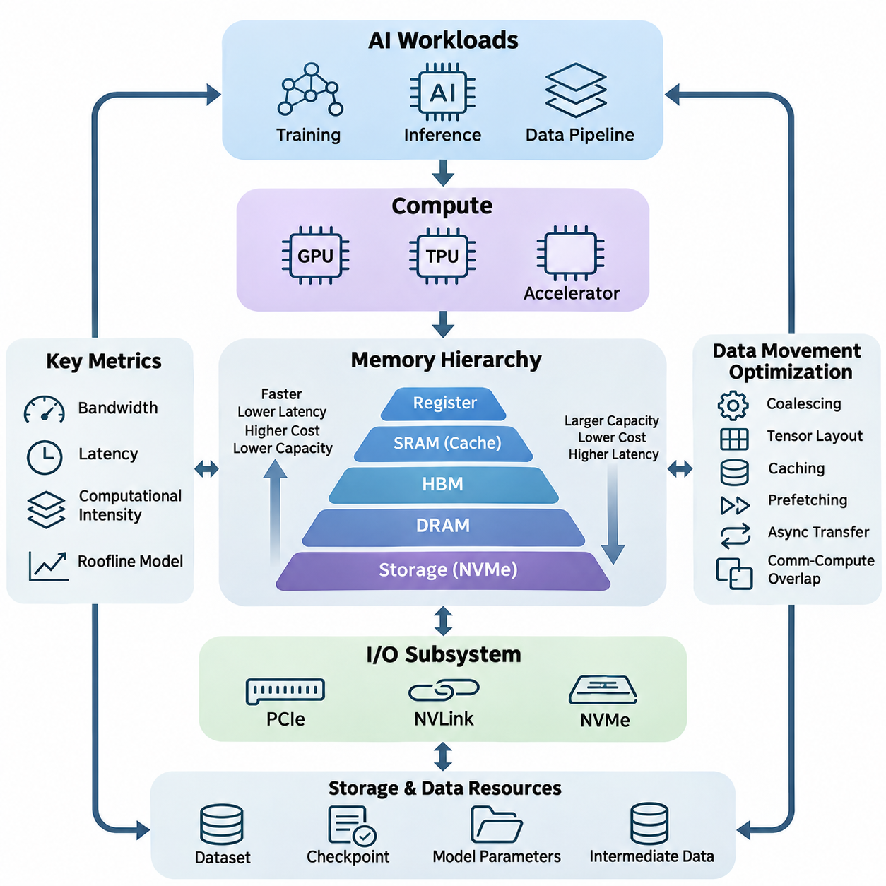
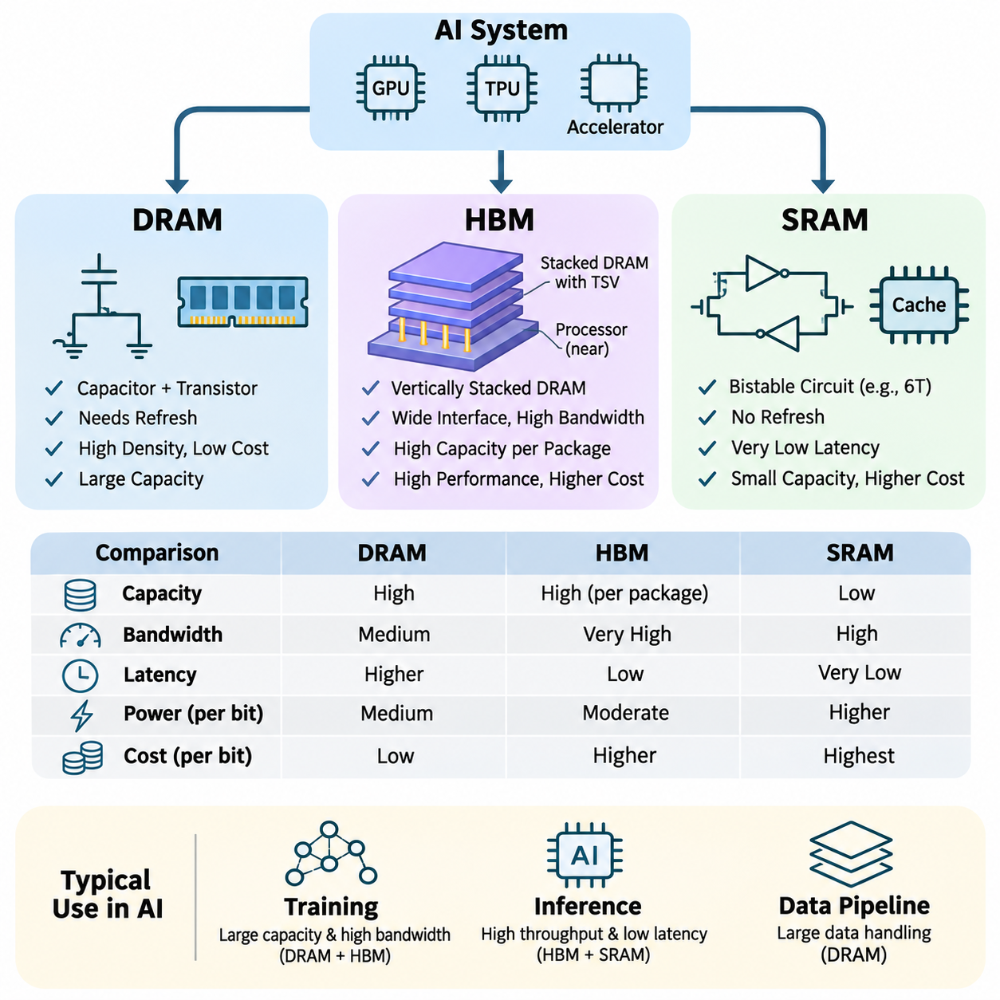
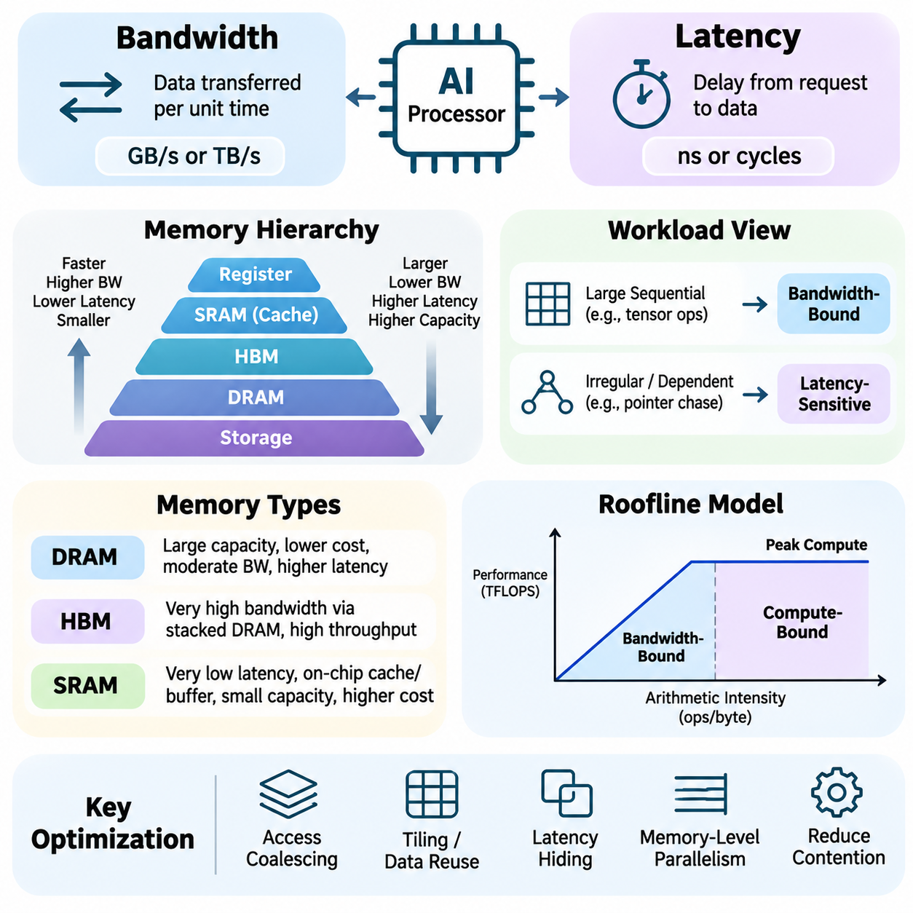
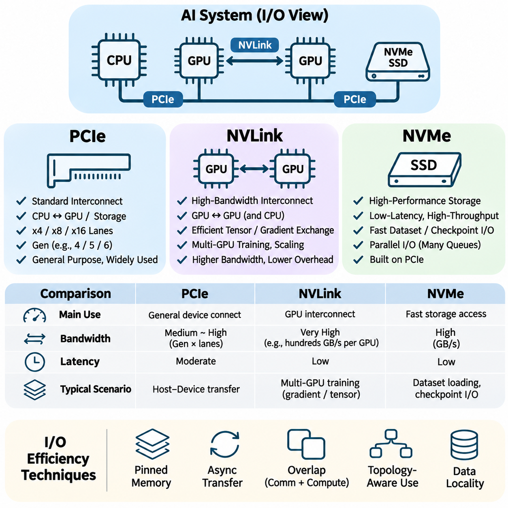
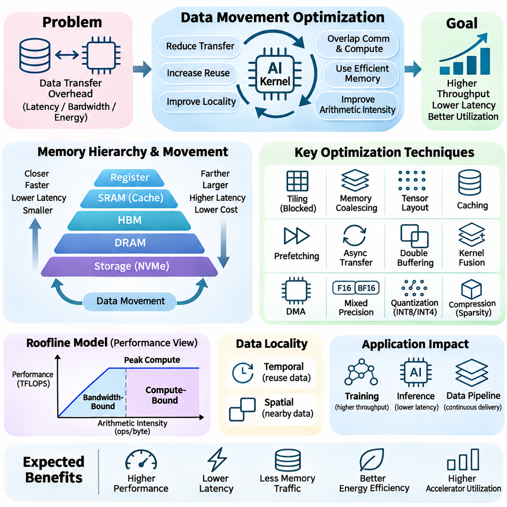
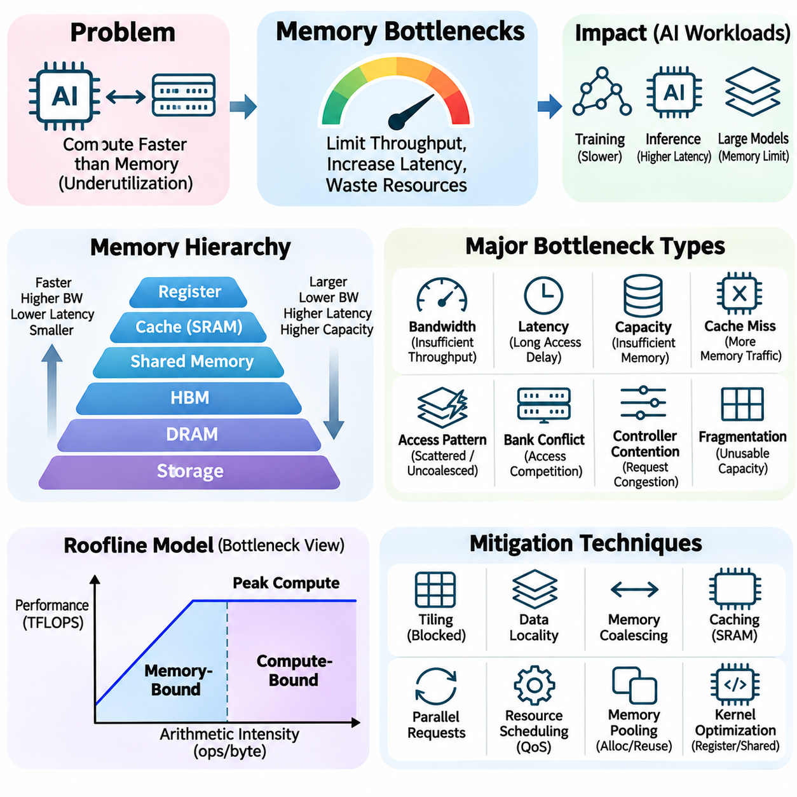
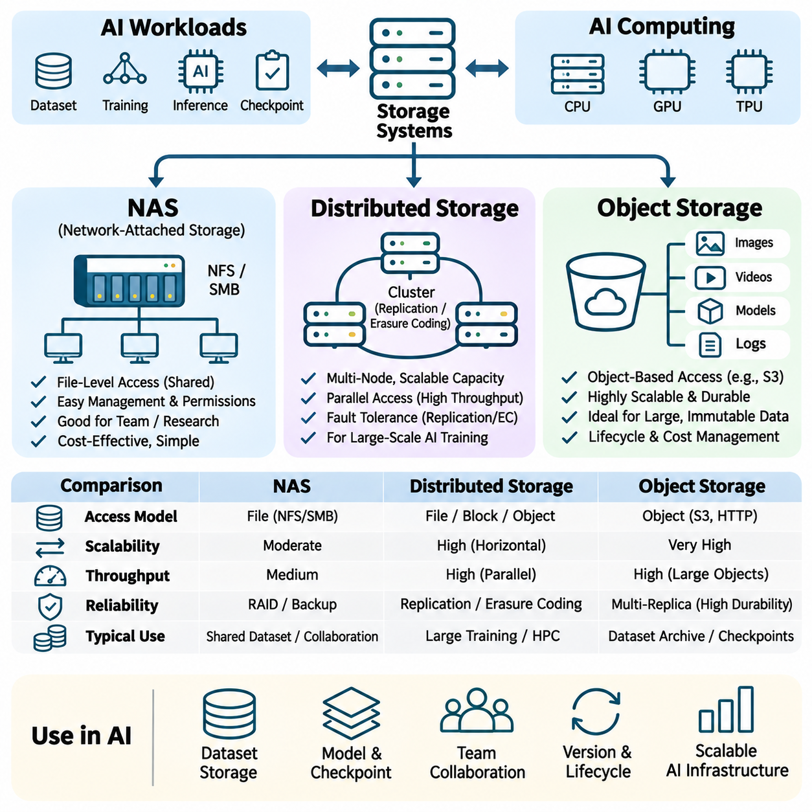
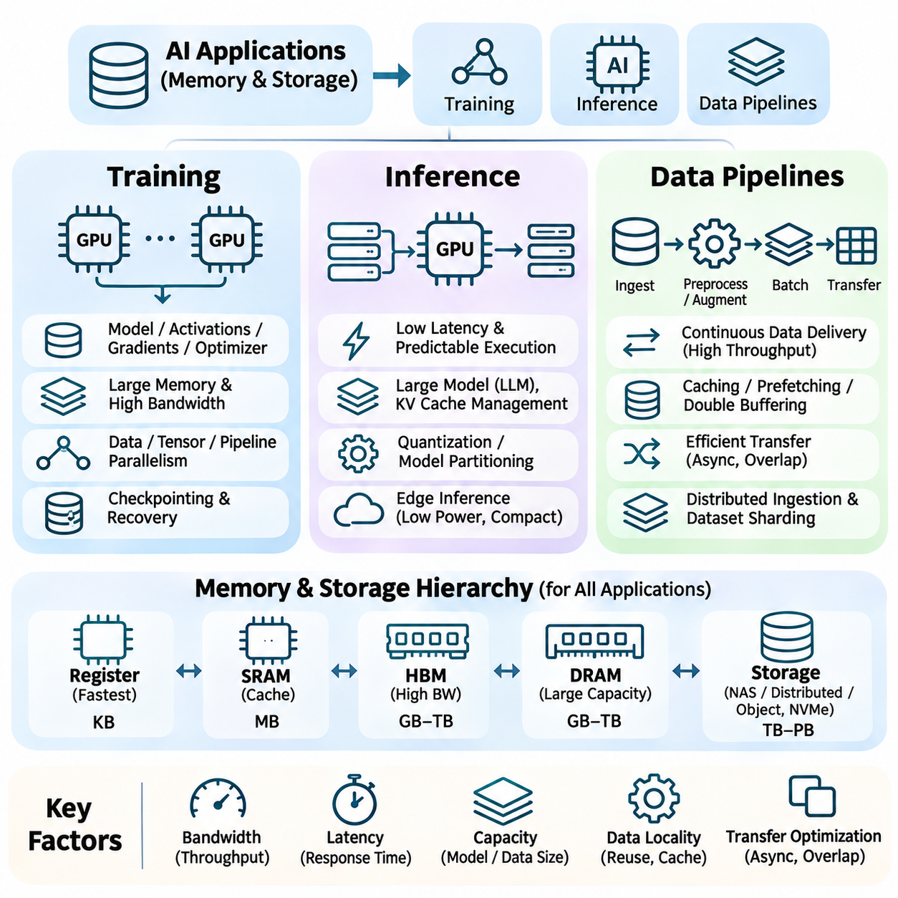

**Volume 39. Hardware for AI**


# 03. Memory and IO

## 03.00 Overview

{width="7.268055555555556in" height="7.268055555555556in"}

Memory and input/output (I/O) subsystems form the foundation of high-performance artificial intelligence hardware. Although processors such as GPUs, TPUs, and specialized accelerators execute mathematical operations, their effectiveness depends on how efficiently data reaches computational units. Memory capacity, bandwidth, access latency, and communication architecture collectively determine whether processing resources remain productive or become idle.

Modern AI workloads involve continuous movement of tensors, model parameters, intermediate activations, gradients, and training datasets. These data structures may occupy different levels of the hardware hierarchy, ranging from processor registers and on-chip caches to external memory and persistent storage. Efficient execution requires coordinating these resources so that data remains available at the appropriate location and time.

The memory hierarchy is designed to balance speed, capacity, cost, and energy consumption. Fast memory structures located near processing units typically provide limited capacity, while larger memory systems offer greater storage at higher access costs. AI hardware architectures exploit this hierarchy by retaining frequently accessed information close to computation and transferring less frequently used data through slower memory levels.

Dynamic Random Access Memory (DRAM) provides substantial working memory capacity for general-purpose computing and AI applications. It stores model parameters, input tensors, intermediate results, and application data during execution. Conventional DRAM technologies support large memory configurations, but their bandwidth and latency characteristics can constrain workloads involving intensive tensor operations and irregular memory access.

High Bandwidth Memory (HBM) addresses the growing demand for rapid data delivery in AI accelerators. By integrating stacked memory dies with wide interfaces and advanced packaging technologies, HBM provides substantially greater aggregate bandwidth than conventional memory interfaces. This architecture is particularly valuable for large-scale neural network training, transformer inference, and other workloads requiring frequent access to extensive parameter arrays.

Static Random Access Memory (SRAM) provides low-latency storage within processors and specialized accelerators. It commonly supports caches, local buffers, and temporary computational data. Although SRAM consumes more silicon area per stored bit than DRAM, its speed makes it essential for reducing expensive external memory transactions. Effective SRAM utilization improves data reuse and enables processing units to sustain high computational throughput.

Memory bandwidth describes the amount of data transferred between components per unit of time, whereas latency measures the delay associated with accessing information. These properties influence different aspects of AI execution. Bandwidth becomes critical when processing large tensors, while latency strongly affects dependent operations and irregular accesses. Understanding both characteristics is necessary for identifying performance limitations.

Computational intensity provides a useful relationship between arithmetic operations and memory traffic. Workloads performing many operations per transferred byte can effectively exploit accelerator compute resources, while workloads with limited data reuse frequently become bandwidth-bound. The roofline performance model illustrates this relationship by connecting arithmetic intensity, available memory bandwidth, and peak computational throughput.

Input/output subsystems connect processors, accelerators, memory devices, and storage resources into an integrated computing platform. Their performance determines how quickly datasets, model parameters, and intermediate results move between hardware components. As AI workloads expand across multiple accelerators and distributed systems, communication efficiency becomes increasingly important for maintaining scalability and avoiding unnecessary computational stalls.

Peripheral Component Interconnect Express (PCIe) provides a widely adopted high-speed interface for connecting GPUs, network adapters, storage controllers, and other devices. Its bandwidth depends on interface generation and lane configuration. In AI systems, PCIe supports host-to-device transfers and communication with peripheral resources, making its capabilities important when workloads repeatedly exchange information between CPUs and accelerators.

NVLink provides high-bandwidth communication between supported NVIDIA accelerators and, in certain platforms, compatible processors. It enables efficient exchange of tensors, gradients, and model states across interconnected computing devices. Compared with conventional peripheral communication paths, appropriately configured NVLink systems can reduce communication overhead and improve the effectiveness of multi-GPU training and inference workloads.

Non-Volatile Memory Express (NVMe) provides an efficient interface for accessing high-performance solid-state storage devices. NVMe storage supports rapid dataset loading, checkpoint retrieval, and intermediate data management. Although storage devices remain slower than accelerator memory, their throughput and parallel I/O capabilities can significantly influence end-to-end AI pipeline performance, especially when training requires continuous access to large datasets.

Data movement optimization focuses on minimizing unnecessary transfers between memory levels and computing devices. Techniques include memory access coalescing, tensor layout optimization, caching, prefetching, asynchronous transfers, and overlapping communication with computation. These methods reduce data transfer overhead while improving hardware utilization. Their effectiveness depends on workload characteristics, memory architecture, and execution scheduling.

Memory bottlenecks occur when computational resources cannot receive or exchange data quickly enough to maintain their potential processing rates. Common causes include insufficient bandwidth, excessive memory latency, limited device memory capacity, inefficient access patterns, and communication contention. Identifying the dominant bottleneck requires examining memory traffic, cache behavior, transfer utilization, and processor activity rather than relying solely on theoretical specifications.

Memory capacity also determines which AI models and workloads can execute directly on a given accelerator. Large neural networks require space for parameters, activations, temporary buffers, and, during training, gradients and optimizer states. When these requirements exceed available memory, systems may employ activation checkpointing, tensor partitioning, memory offloading, or reduced-precision representations to control resource consumption.

Persistent storage systems provide the foundation for managing training datasets, model checkpoints, experiment artifacts, and production data. Unlike volatile memory, storage retains information across system restarts and power interruptions. Storage architecture influences dataset accessibility, recovery performance, and operational reliability. AI infrastructure therefore requires coordinated planning across accelerator memory, system memory, local storage, and shared storage resources.

Network Attached Storage (NAS) enables multiple computing systems to access shared datasets and model artifacts through network connections. It simplifies centralized data management and supports collaborative AI development environments. However, effective performance depends on network throughput, storage controller capabilities, concurrent access patterns, and caching strategies. Poorly configured NAS infrastructure can restrict otherwise powerful training clusters.

Distributed storage systems divide or replicate information across multiple storage nodes to support scalability, availability, and parallel access. Such architectures are useful for large AI datasets and multi-node training environments. Their effectiveness depends on data placement, network topology, fault tolerance, and workload characteristics. Properly designed distributed storage can improve aggregate throughput while reducing dependence on individual storage devices.

Object storage organizes information as independently addressable objects with associated metadata. It is widely used for large datasets, model artifacts, backups, and cloud-based AI workflows. Object storage offers scalable capacity and flexible access mechanisms, although its latency and access semantics differ from those of local filesystems. AI pipelines often combine object storage with local caching to balance scalability and execution efficiency.

During neural network training, memory and I/O requirements extend beyond loading model parameters. Forward propagation generates activations, backward propagation produces gradients, and optimization updates model states. Distributed training additionally exchanges gradients, parameters, or activation tensors between devices. The resulting communication patterns can dominate execution time when model parallelism, data parallelism, and hardware topology are not carefully coordinated.

Inference workloads exhibit different memory characteristics depending on model architecture, batch size, and execution strategy. Large language models frequently require substantial bandwidth to retrieve model weights and maintain key-value caches. Real-time vision and robotics applications emphasize predictable latency and efficient buffering. Consequently, memory subsystem selection must reflect whether the primary objective is throughput, response time, capacity, or energy efficiency.

AI data pipelines connect acquisition, preprocessing, storage, transfer, and computation into a continuous execution workflow. Pipeline efficiency depends on balancing input preparation with accelerator consumption rates. Parallel data loading, pinned host memory, asynchronous transfers, and intelligent caching can reduce idle time. However, excessive buffering or uncontrolled concurrency may increase memory pressure and create additional contention.

Energy efficiency represents another important dimension of memory and I/O architecture. Moving information across memory hierarchies and communication links consumes power that may become significant relative to arithmetic operations. Reducing redundant transfers, increasing local data reuse, and selecting appropriate memory technologies can improve performance per watt. These considerations are especially important in edge AI systems operating under strict thermal and power constraints.

System-level memory optimization requires evaluating the interaction between processors, accelerators, communication interfaces, and storage devices. Improving one component does not guarantee higher application performance if another component remains the limiting factor. Balanced architectures therefore match memory capacity, bandwidth, communication topology, and storage throughput to the actual computational demands of the intended workload.

A comprehensive understanding of memory and I/O subsystems provides the basis for designing efficient AI hardware platforms. By examining DRAM, HBM, SRAM, communication interfaces, data movement strategies, bottlenecks, and storage architectures, engineers can identify practical performance constraints. These principles support scalable training infrastructure, responsive inference systems, and reliable data pipelines across cloud, enterprise, and edge environments.

메모리 및 입출력 하위 시스템(Memory and Input/Output Subsystems)은 고성능 인공지능 하드웨어(High-Performance AI Hardware)의 기반을 형성한다. GPU, TPU 및 특수 목적 가속기(Specialized Accelerators)와 같은 프로세서는 수학적 연산을 수행하지만, 실제 성능은 데이터가 연산 장치(Computational Units)에 얼마나 효율적으로 전달되는지에 따라 결정된다. 메모리 용량(Memory Capacity), 대역폭(Bandwidth), 접근 지연시간(Access Latency), 통신 아키텍처(Communication Architecture)는 연산 자원의 활용 효율을 결정하는 핵심 요소이다.

현대 인공지능 작업 부하(AI Workloads)에서는 텐서(Tensor), 모델 매개변수(Model Parameters), 중간 활성화 값(Intermediate Activations), 기울기(Gradients), 학습 데이터셋(Training Datasets)이 지속적으로 이동한다. 이러한 데이터 구조는 프로세서 레지스터(Processor Registers), 온칩 캐시(On-Chip Cache), 외부 메모리(External Memory), 영구 저장장치(Persistent Storage) 등 서로 다른 하드웨어 계층에 위치할 수 있다. 효율적인 실행을 위해서는 필요한 데이터가 적절한 위치와 시점에 제공되도록 자원을 조정해야 한다.

메모리 계층 구조(Memory Hierarchy)는 속도(Speed), 용량(Capacity), 비용(Cost), 에너지 소비(Energy Consumption) 사이의 균형을 고려하여 설계된다. 일반적으로 연산 장치에 가까운 고속 메모리는 용량이 제한적이지만, 대용량 메모리는 상대적으로 높은 접근 비용을 요구한다. 인공지능 하드웨어 아키텍처는 자주 접근하는 데이터를 연산 장치 가까이에 유지하고, 사용 빈도가 낮은 데이터는 상대적으로 느린 메모리 계층을 통해 전송함으로써 이러한 구조를 효율적으로 활용한다.

동적 랜덤 접근 메모리(Dynamic Random Access Memory, DRAM)는 범용 컴퓨팅(General-Purpose Computing)과 인공지능 응용 분야에서 상당한 작업 메모리 용량을 제공한다. DRAM은 실행 과정에서 모델 매개변수, 입력 텐서(Input Tensors), 중간 결과(Intermediate Results), 응용 데이터를 저장한다. 기존 DRAM 기술은 대용량 메모리 구성을 지원하지만, 대역폭과 지연시간 특성으로 인해 집약적인 텐서 연산이나 불규칙한 메모리 접근을 수행하는 작업에서 성능 제약이 발생할 수 있다.

고대역폭 메모리(High Bandwidth Memory, HBM)는 인공지능 가속기에서 증가하는 고속 데이터 전송 요구를 해결하기 위해 개발되었다. HBM은 적층형 메모리 다이(Stacked Memory Dies), 광폭 인터페이스(Wide Interfaces), 첨단 패키징 기술(Advanced Packaging Technologies)을 결합하여 기존 메모리 인터페이스보다 훨씬 높은 총대역폭(Aggregate Bandwidth)을 제공한다. 이러한 구조는 대규모 신경망 학습, 트랜스포머 추론(Transformer Inference), 대용량 매개변수 배열에 반복적으로 접근하는 작업에서 특히 유용하다.

정적 랜덤 접근 메모리(Static Random Access Memory, SRAM)는 프로세서와 특수 목적 가속기 내부에서 낮은 지연시간의 저장 공간을 제공한다. SRAM은 일반적으로 캐시(Cache), 로컬 버퍼(Local Buffers), 임시 연산 데이터(Temporary Computational Data)를 저장하는 데 사용된다. DRAM보다 비트당 실리콘 면적(Silicon Area)이 크지만, 빠른 접근 속도를 통해 외부 메모리 전송을 줄이는 데 필수적이다. SRAM을 효율적으로 활용하면 데이터 재사용(Data Reuse)이 증가하고 연산 장치의 높은 처리량을 유지할 수 있다.

메모리 대역폭(Memory Bandwidth)은 단위 시간 동안 구성 요소 사이에서 전송할 수 있는 데이터의 양을 의미하며, 지연시간(Latency)은 정보에 접근하는 데 발생하는 시간적 지연을 나타낸다. 두 특성은 인공지능 실행 성능에 서로 다른 영향을 미친다. 대규모 텐서 처리에서는 대역폭이 중요하지만, 의존성이 있는 연산(Dependent Operations)이나 불규칙한 메모리 접근에서는 지연시간이 성능에 큰 영향을 준다. 따라서 성능 제한 요소를 파악하려면 두 특성을 함께 분석해야 한다.

연산 집약도(Arithmetic Intensity)는 산술 연산량과 메모리 전송량 사이의 관계를 나타내는 중요한 지표이다. 전송되는 데이터의 바이트당 많은 연산을 수행하는 작업은 가속기의 연산 자원을 효과적으로 활용할 수 있지만, 데이터 재사용이 제한적인 작업은 메모리 대역폭에 의해 성능이 제한되는 경우가 많다. 루프라인 성능 모델(Roofline Performance Model)은 연산 집약도, 사용 가능한 메모리 대역폭, 최대 연산 처리량(Peak Computational Throughput)의 관계를 설명한다.

입출력 하위 시스템(Input/Output Subsystems)은 프로세서, 가속기, 메모리 장치, 저장장치를 하나의 통합 컴퓨팅 플랫폼(Integrated Computing Platform)으로 연결한다. 입출력 성능은 데이터셋, 모델 매개변수, 중간 결과가 하드웨어 구성 요소 사이에서 이동하는 속도를 결정한다. 인공지능 작업이 다중 가속기(Multiple Accelerators)와 분산 시스템(Distributed Systems)으로 확장됨에 따라 통신 효율성(Communication Efficiency)은 확장성을 유지하고 불필요한 연산 대기를 방지하는 핵심 요소가 된다.

주변장치 상호연결 익스프레스(Peripheral Component Interconnect Express, PCIe)는 GPU, 네트워크 어댑터(Network Adapters), 저장장치 컨트롤러(Storage Controllers) 및 기타 장치를 연결하는 데 널리 사용되는 고속 인터페이스이다. PCIe 대역폭은 인터페이스 세대(Interface Generation)와 레인 구성(Lane Configuration)에 따라 달라진다. 인공지능 시스템에서는 호스트와 장치 간 데이터 전송(Host-to-Device Transfers)을 지원하므로 CPU와 가속기 사이에서 정보 교환이 반복되는 작업의 성능에 중요한 영향을 미친다.

NVLink는 지원되는 NVIDIA 가속기와 일부 플랫폼의 호환 프로세서 사이에서 고대역폭 통신(High-Bandwidth Communication)을 제공한다. 이를 통해 상호 연결된 연산 장치 사이에서 텐서, 기울기, 모델 상태(Model States)를 효율적으로 교환할 수 있다. 적절하게 구성된 NVLink 시스템은 기존 주변장치 통신 경로보다 통신 오버헤드(Communication Overhead)를 줄이고 다중 GPU 학습 및 추론 작업의 효율성을 높일 수 있다.

비휘발성 메모리 익스프레스(Non-Volatile Memory Express, NVMe)는 고성능 솔리드 스테이트 저장장치(Solid-State Storage Devices)에 효율적으로 접근하기 위한 인터페이스이다. NVMe 저장장치는 데이터셋 로딩(Dataset Loading), 체크포인트 검색(Checkpoint Retrieval), 중간 데이터 관리(Intermediate Data Management)를 지원한다. 저장장치는 가속기 메모리보다 느리지만, 높은 처리량과 병렬 입출력(Parallel I/O) 기능은 대규모 데이터셋에 지속적으로 접근하는 학습 과정의 전체 성능에 상당한 영향을 줄 수 있다.

데이터 이동 최적화(Data Movement Optimization)는 메모리 계층과 연산 장치 사이에서 발생하는 불필요한 전송을 최소화하는 데 초점을 맞춘다. 주요 기술에는 메모리 접근 병합(Memory Access Coalescing), 텐서 배치 최적화(Tensor Layout Optimization), 캐싱(Caching), 사전 가져오기(Prefetching), 비동기 전송(Asynchronous Transfers), 통신과 연산의 중첩(Overlapping Communication with Computation)이 포함된다. 이러한 기술의 효과는 작업 특성, 메모리 아키텍처, 실행 스케줄링(Execution Scheduling)에 따라 달라진다.

메모리 병목현상(Memory Bottlenecks)은 연산 자원이 잠재적인 처리 성능을 유지할 만큼 빠르게 데이터를 공급받거나 교환하지 못할 때 발생한다. 주요 원인에는 부족한 대역폭, 과도한 메모리 지연시간, 제한된 장치 메모리 용량(Device Memory Capacity), 비효율적인 접근 패턴(Access Patterns), 통신 경합(Communication Contention)이 있다. 지배적인 병목현상을 식별하려면 이론적인 하드웨어 사양뿐 아니라 메모리 트래픽(Memory Traffic), 캐시 동작(Cache Behavior), 전송 활용률(Transfer Utilization), 프로세서 활동을 함께 분석해야 한다.

메모리 용량은 특정 가속기에서 직접 실행할 수 있는 인공지능 모델과 작업의 규모를 결정한다. 대규모 신경망은 매개변수, 활성화 값, 임시 버퍼(Temporary Buffers)를 저장할 공간이 필요하며, 학습 과정에서는 기울기와 최적화기 상태(Optimizer States)를 위한 추가 공간이 요구된다. 이러한 요구량이 가용 메모리를 초과하면 활성화 체크포인팅(Activation Checkpointing), 텐서 분할(Tensor Partitioning), 메모리 오프로딩(Memory Offloading), 저정밀도 표현(Reduced-Precision Representations)을 활용할 수 있다.

영구 저장 시스템(Persistent Storage Systems)은 학습 데이터셋, 모델 체크포인트(Model Checkpoints), 실험 산출물(Experiment Artifacts), 운영 데이터를 관리하는 기반을 제공한다. 휘발성 메모리(Volatile Memory)와 달리 저장장치는 시스템 재시작이나 전원 차단 이후에도 정보를 유지한다. 저장 아키텍처(Storage Architecture)는 데이터 접근성, 복구 성능, 운영 신뢰성에 영향을 미치므로 인공지능 인프라는 가속기 메모리, 시스템 메모리, 로컬 저장장치, 공유 저장장치를 통합적으로 계획해야 한다.

네트워크 연결 저장장치(Network Attached Storage, NAS)는 여러 컴퓨팅 시스템이 네트워크를 통해 공유 데이터셋과 모델 산출물에 접근할 수 있도록 한다. NAS는 중앙 집중식 데이터 관리(Centralized Data Management)를 단순화하고 협업형 인공지능 개발 환경을 지원한다. 그러나 실제 성능은 네트워크 처리량(Network Throughput), 저장장치 컨트롤러 성능, 동시 접근 패턴(Concurrent Access Patterns), 캐싱 전략(Caching Strategies)에 따라 달라진다. NAS 구성이 비효율적이면 강력한 학습 클러스터에서도 성능 제한이 발생할 수 있다.

분산 저장 시스템(Distributed Storage Systems)은 정보를 여러 저장 노드(Storage Nodes)에 분할하거나 복제하여 확장성(Scalability), 가용성(Availability), 병렬 접근(Parallel Access)을 지원한다. 이러한 구조는 대규모 인공지능 데이터셋과 다중 노드 학습(Multi-Node Training)에 유용하다. 성능은 데이터 배치(Data Placement), 네트워크 토폴로지(Network Topology), 장애 허용성(Fault Tolerance), 작업 특성에 따라 달라지며, 적절한 설계를 통해 총처리량을 향상하고 개별 저장장치에 대한 의존성을 줄일 수 있다.

객체 저장소(Object Storage)는 정보와 관련 메타데이터(Metadata)를 독립적으로 주소 지정할 수 있는 객체(Objects) 형태로 구성한다. 대규모 데이터셋, 모델 산출물, 백업(Backups), 클라우드 기반 인공지능 작업 흐름(Cloud-Based AI Workflows)에 널리 활용된다. 객체 저장소는 확장 가능한 용량과 유연한 접근 방식을 제공하지만, 지연시간과 접근 의미 체계(Access Semantics)는 로컬 파일 시스템(Local Filesystems)과 다르다. 따라서 인공지능 파이프라인에서는 확장성과 실행 효율성을 균형 있게 확보하기 위해 로컬 캐싱(Local Caching)을 결합하는 경우가 많다.

신경망 학습(Neural Network Training)에서 메모리와 입출력 요구사항은 모델 매개변수를 불러오는 작업에만 국한되지 않는다. 순전파(Forward Propagation)는 활성화 값을 생성하고, 역전파(Backward Propagation)는 기울기를 계산하며, 최적화(Optimization)는 모델 상태를 갱신한다. 분산 학습(Distributed Training)에서는 장치 간 기울기, 매개변수 또는 활성화 텐서의 교환이 추가로 발생한다. 모델 병렬화(Model Parallelism), 데이터 병렬화(Data Parallelism), 하드웨어 토폴로지(Hardware Topology)를 적절히 조정하지 않으면 통신 시간이 전체 실행 시간을 지배할 수 있다.

추론 작업(Inference Workloads)의 메모리 특성은 모델 아키텍처(Model Architecture), 배치 크기(Batch Size), 실행 전략(Execution Strategy)에 따라 달라진다. 대규모 언어 모델(Large Language Models, LLMs)은 모델 가중치(Model Weights)를 읽고 키-값 캐시(Key-Value Cache)를 유지하기 위해 상당한 메모리 대역폭을 요구한다. 반면 실시간 비전(Real-Time Vision)과 로보틱스(Robotics) 응용에서는 예측 가능한 지연시간과 효율적인 버퍼링(Buffering)이 중요하다. 따라서 메모리 시스템은 처리량, 응답시간, 용량, 에너지 효율성 중 주요 목표에 맞추어 선택해야 한다.

인공지능 데이터 파이프라인(AI Data Pipelines)은 데이터 수집(Data Acquisition), 전처리(Preprocessing), 저장(Storage), 전송(Transfer), 연산(Computation)을 연속적인 실행 과정으로 연결한다. 파이프라인 효율성은 입력 데이터 준비 속도와 가속기의 데이터 소비 속도를 균형 있게 유지하는 데 달려 있다. 병렬 데이터 로딩(Parallel Data Loading), 페이지 고정 호스트 메모리(Pinned Host Memory), 비동기 전송, 지능형 캐싱(Intelligent Caching)은 유휴 시간을 줄일 수 있다. 그러나 과도한 버퍼링이나 제어되지 않은 동시 실행은 메모리 압박(Memory Pressure)과 추가 경합을 발생시킬 수 있다.

에너지 효율성(Energy Efficiency)은 메모리 및 입출력 아키텍처에서 중요한 또 다른 평가 요소이다. 메모리 계층과 통신 링크(Communication Links)를 통해 정보를 이동시키는 과정에서는 전력이 소비되며, 이러한 소비량은 산술 연산 자체에 필요한 전력에 비해 상당한 비중을 차지할 수 있다. 중복 전송을 줄이고 로컬 데이터 재사용(Local Data Reuse)을 늘리며 적절한 메모리 기술을 선택하면 와트당 성능(Performance per Watt)을 향상할 수 있다. 이는 엄격한 전력 및 열 제약(Power and Thermal Constraints)을 가진 엣지 인공지능(Edge AI) 시스템에서 특히 중요하다.

시스템 수준 메모리 최적화(System-Level Memory Optimization)를 위해서는 프로세서, 가속기, 통신 인터페이스, 저장장치 사이의 상호작용을 종합적으로 평가해야 한다. 다른 구성 요소가 여전히 성능 제한 요소로 남아 있다면 특정 구성 요소 하나를 개선하더라도 전체 응용 성능이 향상된다는 보장은 없다. 따라서 균형 잡힌 아키텍처(Balanced Architecture)는 메모리 용량, 대역폭, 통신 토폴로지, 저장장치 처리량을 실제 작업의 연산 요구사항에 맞추어 설계해야 한다.

메모리 및 입출력 하위 시스템에 대한 종합적인 이해는 효율적인 인공지능 하드웨어 플랫폼(AI Hardware Platforms)을 설계하기 위한 기반이 된다. DRAM, HBM, SRAM, 통신 인터페이스, 데이터 이동 전략, 메모리 병목현상, 저장 아키텍처를 분석하면 실질적인 성능 제약을 식별할 수 있다. 이러한 원칙은 클라우드(Cloud), 기업 환경(Enterprise), 엣지 환경(Edge Environments) 전반에서 확장 가능한 학습 인프라(Scalable Training Infrastructure), 신속한 추론 시스템(Responsive Inference Systems), 신뢰성 높은 데이터 파이프라인(Reliable Data Pipelines)을 구현하는 데 활용된다.

## 03.01 Memory Types

{width="7.268055555555556in" height="7.268055555555556in"}

Memory technologies are fundamental components of artificial intelligence hardware because they determine how efficiently computational units access and manipulate data. Modern AI systems employ multiple memory types with different performance characteristics, including Dynamic Random Access Memory (DRAM), High Bandwidth Memory (HBM), and Static Random Access Memory (SRAM). Each technology addresses specific requirements involving capacity, bandwidth, latency, energy efficiency, and physical integration.

The selection of memory technology directly influences the performance of neural network training, inference, and data-intensive computation. Large models require substantial storage capacity for parameters and intermediate tensors, while high-throughput accelerators demand rapid data delivery. Memory architecture must therefore balance storage density, access speed, power consumption, manufacturing cost, and communication requirements across the complete computing system.

Dynamic Random Access Memory (DRAM) stores information using memory cells composed primarily of a capacitor and an access transistor. Each capacitor represents a binary value through its electrical charge, which gradually leaks over time. Consequently, DRAM requires periodic refresh operations to preserve stored information. This design provides high storage density and relatively low cost per bit, making DRAM suitable for large-capacity memory systems.

DRAM is widely used as system memory in CPUs, servers, workstations, and AI computing platforms. During model execution, it stores input datasets, model parameters, intermediate results, and application buffers. In GPU-based systems, specialized DRAM technologies such as GDDR provide substantial bandwidth for accelerator workloads. However, conventional system DRAM interfaces may become performance bottlenecks when computational demand exceeds available memory throughput.

The performance of DRAM depends on several architectural characteristics, including memory frequency, channel width, access timing, bank organization, and controller efficiency. Operations such as row activation, column access, precharging, and refresh introduce timing constraints. Memory controllers improve utilization through request scheduling, bank-level parallelism, and optimized access patterns, but irregular workloads can still experience significant latency and reduced effective bandwidth.

Modern DRAM implementations include DDR, LPDDR, and GDDR families, each optimized for different operating environments. DDR memory emphasizes general-purpose system performance and capacity, while LPDDR prioritizes reduced power consumption in mobile and embedded devices. GDDR targets high-bandwidth graphics and accelerator applications. These technologies share fundamental DRAM principles but differ in interface design, power characteristics, packaging, and achievable throughput.

High Bandwidth Memory (HBM) is an advanced DRAM technology designed to provide extremely high aggregate memory bandwidth through vertically stacked memory dies. Multiple DRAM layers are interconnected using through-silicon vias (TSVs), enabling dense vertical communication paths. HBM stacks are commonly integrated near processing dies using advanced packaging and interposer technologies, reducing communication distance and supporting exceptionally wide memory interfaces.

Unlike conventional memory architectures that primarily increase transfer rates through relatively narrow interfaces, HBM achieves high bandwidth by combining wide interfaces with parallel data transfers. This approach supports substantial throughput at comparatively moderate per-pin signaling rates. The architecture is especially advantageous for GPUs, AI accelerators, and high-performance computing systems that repeatedly process large tensors and require continuous memory access.

HBM generations have progressively improved bandwidth, capacity, power efficiency, and integration capabilities. Technologies such as HBM2, HBM2E, HBM3, and HBM3E support increasingly demanding accelerator workloads. Actual performance depends on the memory generation, number of stacks, interface configuration, and processor integration. These improvements enable larger models and higher computational utilization, although memory capacity and bandwidth remain finite resources.

Large language model training benefits significantly from HBM because transformer architectures repeatedly access model parameters, activations, gradients, and optimizer states. High memory bandwidth helps sustain matrix multiplication and attention workloads when external memory traffic is substantial. Nevertheless, accelerator performance also depends on computational intensity, cache efficiency, kernel implementation, and communication overhead, so increased HBM bandwidth does not automatically produce proportional application speedups.

HBM also introduces important engineering tradeoffs involving manufacturing complexity, packaging cost, thermal management, and supply constraints. Vertically stacked memory requires advanced fabrication and integration techniques, while concentrated heat generation complicates thermal design. Furthermore, HBM capacity is constrained by package configuration and available memory stacks. Engineers must therefore consider both performance benefits and practical system-level limitations when selecting HBM-based accelerators.

Static Random Access Memory (SRAM) stores information using bistable circuits, commonly implemented as six-transistor memory cells. Unlike DRAM, SRAM does not require periodic refresh while power remains available. Its circuit structure enables rapid access and predictable operation, making SRAM suitable for latency-sensitive storage. However, the larger number of transistors per bit increases silicon area and manufacturing cost compared with dense DRAM implementations.

SRAM is commonly integrated directly into CPUs, GPUs, TPUs, and specialized AI accelerators. It provides storage for processor caches, shared memory, local buffers, and specialized scratchpad structures. By placing frequently accessed data close to computational units, SRAM reduces the need for repeated transfers from external memory. This proximity improves execution efficiency, especially when workloads exhibit strong temporal or spatial data locality.

Cache hierarchies use SRAM to organize data according to access frequency and proximity to processing resources. Small caches located near execution units provide low access latency, while larger shared caches improve data reuse across computational blocks. Cache effectiveness depends on capacity, associativity, replacement policies, and workload behavior. Poor locality or frequent cache misses can increase external memory traffic and reduce overall accelerator utilization.

In AI accelerators, SRAM frequently supports tiled matrix multiplication, convolution, and attention computation. Large tensors are divided into smaller blocks that fit within local memory, allowing repeated operations before data is transferred elsewhere. This strategy increases arithmetic intensity and reduces expensive off-chip memory accesses. Efficient tiling and buffer management are therefore essential for exploiting SRAM capacity and sustaining accelerator throughput.

SRAM-based scratchpad memory differs from conventional hardware-managed caches because software or compiler-generated instructions may explicitly control data placement and movement. This approach provides predictable access behavior and enables carefully scheduled data reuse. Many specialized accelerators combine scratchpad structures with direct memory access engines and asynchronous transfers, allowing computation and data movement to overlap when dependencies and available resources permit.

The fundamental distinction among DRAM, HBM, and SRAM involves their balance of density, bandwidth, latency, and integration cost. Conventional DRAM provides economical capacity, HBM delivers high aggregate bandwidth through advanced packaging, and SRAM offers rapid on-chip access with limited density. These technologies are complementary rather than interchangeable, and modern AI systems combine them to construct effective memory hierarchies.

Memory access energy is another critical consideration because transferring data can consume substantial power relative to arithmetic computation. Accessing nearby SRAM generally requires less communication energy than retrieving equivalent data from distant memory resources, although actual consumption depends on circuit design and access conditions. HBM improves bandwidth and can offer favorable energy efficiency per transferred bit, while conventional DRAM remains attractive for economical capacity expansion.

Memory capacity requirements vary considerably between training and inference. Training must accommodate parameters, activations, gradients, optimizer states, and temporary workspaces, often requiring multiple times the storage used by model weights alone. Inference generally eliminates gradient and optimizer-state storage but may require substantial memory for batching and attention key-value caches. These differences influence the appropriate balance between DRAM capacity, HBM availability, and on-chip SRAM resources.

When model memory requirements exceed accelerator capacity, systems may employ tensor partitioning, activation checkpointing, parameter offloading, or reduced-precision representations. Such methods reduce immediate memory pressure but may introduce additional computation or communication. Offloading tensors from HBM to host DRAM, for example, increases available effective capacity while potentially introducing PCIe or other interconnect bottlenecks that affect training and inference performance.

Memory architecture also affects distributed AI systems in which multiple accelerators exchange model parameters, activations, or gradients. Local HBM bandwidth supports computation within individual devices, while interconnect bandwidth determines communication efficiency between devices. Host DRAM and storage systems provide additional capacity for datasets and checkpoint management. Effective distributed execution requires coordinated optimization across these memory and communication layers.

In edge AI and embedded systems, memory selection must account for power budgets, physical dimensions, thermal constraints, and workload predictability. LPDDR-based system memory often provides a practical balance of capacity and efficiency, while integrated SRAM supports low-latency processing. Dedicated accelerators may incorporate specialized local memory structures to minimize external transfers, enabling responsive inference without the power requirements of large data-center accelerators.

Memory performance evaluation should consider more than theoretical bandwidth specifications. Practical measurements include sustained throughput, access latency, cache hit rates, memory occupancy, power consumption, and application-level execution time. Profiling tools can reveal whether performance is limited by memory capacity, transfer efficiency, or computational resources. These measurements guide hardware selection and software optimization for specific AI workloads.

Future AI memory architectures are expected to emphasize higher bandwidth, improved packaging density, energy-efficient data movement, and closer integration between storage and computation. Emerging approaches such as three-dimensional integration, advanced chiplet packaging, and processing-in-memory seek to reduce communication overhead. However, their practical adoption depends on manufacturing feasibility, programmability, reliability, and economic considerations.

Understanding DRAM, HBM, and SRAM provides a foundation for designing balanced AI computing systems. DRAM supplies scalable working capacity, HBM supports bandwidth-intensive accelerator execution, and SRAM enables rapid local data reuse. Their coordinated integration determines how effectively processors transform theoretical computational capability into sustained application performance across training, inference, robotics, and large-scale AI infrastructure.

메모리 기술(Memory Technologies)은 연산 장치(Computational Units)가 데이터에 얼마나 효율적으로 접근하고 처리할 수 있는지를 결정하므로 인공지능 하드웨어(Artificial Intelligence Hardware)의 핵심 구성 요소이다. 현대 인공지능 시스템은 동적 랜덤 접근 메모리(Dynamic Random Access Memory, DRAM), 고대역폭 메모리(High Bandwidth Memory, HBM), 정적 랜덤 접근 메모리(Static Random Access Memory, SRAM) 등 서로 다른 성능 특성을 가진 여러 메모리 유형을 사용한다. 각 기술은 용량, 대역폭, 지연시간, 에너지 효율성, 물리적 통합에 관한 특정 요구사항을 충족한다.

메모리 기술의 선택은 신경망 학습(Neural Network Training), 추론(Inference), 데이터 집약적 연산(Data-Intensive Computation)의 성능에 직접적인 영향을 미친다. 대규모 모델은 매개변수(Parameters)와 중간 텐서(Intermediate Tensors)를 저장하기 위해 상당한 메모리 용량을 요구하며, 높은 처리량을 가진 가속기(High-Throughput Accelerators)는 빠른 데이터 공급을 필요로 한다. 따라서 메모리 아키텍처(Memory Architecture)는 전체 컴퓨팅 시스템에서 저장 밀도(Storage Density), 접근 속도(Access Speed), 전력 소비(Power Consumption), 제조 비용(Manufacturing Cost), 통신 요구사항(Communication Requirements) 사이의 균형을 유지해야 한다.

동적 랜덤 접근 메모리(Dynamic Random Access Memory, DRAM)는 주로 커패시터(Capacitor)와 접근 트랜지스터(Access Transistor)로 구성된 메모리 셀(Memory Cell)을 사용하여 정보를 저장한다. 각 커패시터는 전하(Electrical Charge)를 통해 이진 값(Binary Value)을 표현하며, 이 전하는 시간이 지나면서 점차 누설된다. 따라서 DRAM은 저장된 정보를 유지하기 위해 주기적인 재충전 동작(Refresh Operations)이 필요하다. 이러한 구조는 높은 저장 밀도와 상대적으로 낮은 비트당 비용(Cost per Bit)을 제공하므로 대용량 메모리 시스템에 적합하다.

DRAM은 CPU, 서버(Server), 워크스테이션(Workstation), 인공지능 컴퓨팅 플랫폼(AI Computing Platforms)에서 시스템 메모리(System Memory)로 널리 사용된다. 모델 실행 과정에서는 입력 데이터셋(Input Datasets), 모델 매개변수(Model Parameters), 중간 결과(Intermediate Results), 응용 프로그램 버퍼(Application Buffers)를 저장한다. GPU 기반 시스템에서는 GDDR과 같은 특수 DRAM 기술이 가속기 작업에 필요한 높은 대역폭을 제공한다. 그러나 기존 시스템 DRAM 인터페이스는 연산 요구량이 사용 가능한 메모리 처리량을 초과하면 성능 병목현상(Performance Bottlenecks)을 유발할 수 있다.

DRAM의 성능은 메모리 주파수(Memory Frequency), 채널 폭(Channel Width), 접근 타이밍(Access Timing), 뱅크 구성(Bank Organization), 컨트롤러 효율성(Controller Efficiency) 등 여러 아키텍처 특성에 따라 달라진다. 행 활성화(Row Activation), 열 접근(Column Access), 프리차징(Precharging), 재충전(Refresh)과 같은 동작에는 타이밍 제약(Timing Constraints)이 존재한다. 메모리 컨트롤러(Memory Controllers)는 요청 스케줄링(Request Scheduling), 뱅크 수준 병렬성(Bank-Level Parallelism), 최적화된 접근 패턴(Optimized Access Patterns)을 통해 활용률을 높이지만, 불규칙한 작업에서는 여전히 상당한 지연시간과 유효 대역폭(Effective Bandwidth)의 감소가 발생할 수 있다.

현대 DRAM 구현에는 DDR, LPDDR, GDDR 계열이 포함되며, 각각 서로 다른 운영 환경에 맞추어 최적화되어 있다. DDR 메모리는 범용 시스템 성능과 용량을 중시하고, LPDDR은 모바일 및 임베디드 장치(Mobile and Embedded Devices)에서 낮은 전력 소비를 우선시한다. GDDR은 그래픽 처리와 가속기 응용을 위한 고대역폭을 목표로 한다. 이러한 기술은 기본적인 DRAM 원리를 공유하지만 인터페이스 설계(Interface Design), 전력 특성(Power Characteristics), 패키징(Packaging), 달성 가능한 처리량(Achievable Throughput)에서 차이가 있다.

고대역폭 메모리(High Bandwidth Memory, HBM)는 수직으로 적층된 메모리 다이(Vertically Stacked Memory Dies)를 통해 매우 높은 총메모리 대역폭(Aggregate Memory Bandwidth)을 제공하도록 설계된 첨단 DRAM 기술이다. 여러 DRAM 계층은 실리콘 관통 전극(Through-Silicon Vias, TSVs)을 통해 상호 연결되어 고밀도의 수직 통신 경로(Vertical Communication Paths)를 형성한다. HBM 스택(HBM Stacks)은 일반적으로 첨단 패키징(Advanced Packaging)과 인터포저 기술(Interposer Technologies)을 사용하여 연산 다이(Processing Dies) 가까이에 통합되며, 이를 통해 통신 거리를 줄이고 매우 넓은 메모리 인터페이스를 지원한다.

기존 메모리 아키텍처가 상대적으로 좁은 인터페이스에서 전송 속도를 높이는 방식에 주로 의존하는 것과 달리, HBM은 넓은 인터페이스(Wide Interfaces)와 병렬 데이터 전송(Parallel Data Transfers)을 결합하여 높은 대역폭을 구현한다. 이러한 접근 방식은 핀당 신호 전송 속도(Per-Pin Signaling Rates)가 비교적 높지 않더라도 상당한 처리량을 제공한다. 이 구조는 대규모 텐서를 반복적으로 처리하고 지속적인 메모리 접근이 필요한 GPU, 인공지능 가속기(AI Accelerators), 고성능 컴퓨팅 시스템(High-Performance Computing Systems)에 특히 유리하다.

HBM은 세대가 발전하면서 대역폭, 용량, 전력 효율성(Power Efficiency), 통합 기능(Integration Capabilities)이 지속적으로 향상되었다. HBM2, HBM2E, HBM3, HBM3E와 같은 기술은 점점 더 높은 요구사항을 가진 가속기 작업을 지원한다. 실제 성능은 메모리 세대(Memory Generation), 스택 수(Number of Stacks), 인터페이스 구성(Interface Configuration), 프로세서 통합 방식(Processor Integration)에 따라 달라진다. 이러한 발전은 더 큰 모델과 높은 연산 활용률(Computational Utilization)을 가능하게 하지만, 메모리 용량과 대역폭은 여전히 유한한 자원이다.

대규모 언어 모델(Large Language Model, LLM) 학습은 HBM의 이점을 크게 활용할 수 있다. 트랜스포머 아키텍처(Transformer Architecture)는 모델 매개변수, 활성화 값(Activations), 기울기(Gradients), 최적화기 상태(Optimizer States)에 반복적으로 접근하기 때문이다. 높은 메모리 대역폭은 외부 메모리 트래픽(External Memory Traffic)이 많은 상황에서 행렬 곱셈(Matrix Multiplication)과 어텐션 연산(Attention Workloads)의 처리 성능을 유지하는 데 도움이 된다. 그러나 가속기 성능은 연산 집약도(Computational Intensity), 캐시 효율성(Cache Efficiency), 커널 구현(Kernel Implementation), 통신 오버헤드(Communication Overhead)에도 영향을 받으므로 HBM 대역폭 증가가 응용 성능의 비례적인 향상을 자동으로 보장하지는 않는다.

HBM은 제조 복잡성(Manufacturing Complexity), 패키징 비용(Packaging Cost), 열 관리(Thermal Management), 공급 제약(Supply Constraints)과 관련된 중요한 공학적 절충 관계(Engineering Tradeoffs)를 수반한다. 수직 적층 메모리(Vertically Stacked Memory)는 첨단 제조 및 통합 기술을 요구하며, 집중된 발열(Concentrated Heat Generation)은 열 설계를 복잡하게 만든다. 또한 HBM 용량은 패키지 구성(Package Configuration)과 사용 가능한 메모리 스택에 의해 제한된다. 따라서 엔지니어는 HBM 기반 가속기를 선택할 때 성능상의 이점과 실제 시스템 수준의 제약을 함께 고려해야 한다.

정적 랜덤 접근 메모리(Static Random Access Memory, SRAM)는 일반적으로 6개 트랜지스터로 구성된 메모리 셀(Six-Transistor Memory Cells)과 같은 쌍안정 회로(Bistable Circuits)를 사용하여 정보를 저장한다. DRAM과 달리 SRAM은 전원이 공급되는 동안 주기적인 재충전(Periodic Refresh)이 필요하지 않다. 이러한 회로 구조는 빠른 접근과 예측 가능한 동작(Predictable Operation)을 가능하게 하므로 지연시간에 민감한 저장장치(Latency-Sensitive Storage)에 적합하다. 그러나 비트당 트랜지스터 수가 많아 고밀도 DRAM보다 실리콘 면적과 제조 비용이 증가한다.

SRAM은 일반적으로 CPU, GPU, TPU 및 특수 목적 인공지능 가속기 내부에 직접 통합된다. SRAM은 프로세서 캐시(Processor Caches), 공유 메모리(Shared Memory), 로컬 버퍼(Local Buffers), 특수 스크래치패드 구조(Specialized Scratchpad Structures)를 위한 저장 공간을 제공한다. 자주 접근하는 데이터를 연산 장치 가까이에 배치함으로써 외부 메모리에서 반복적으로 데이터를 전송할 필요성을 줄인다. 이러한 근접성(Proximity)은 작업이 높은 시간적 또는 공간적 데이터 지역성(Temporal or Spatial Data Locality)을 보일 때 실행 효율성을 향상한다.

캐시 계층 구조(Cache Hierarchies)는 SRAM을 활용하여 데이터 접근 빈도와 연산 자원과의 거리에 따라 정보를 구성한다. 실행 장치(Execution Units) 가까이에 위치한 소형 캐시는 낮은 접근 지연시간을 제공하며, 더 큰 공유 캐시(Shared Caches)는 여러 연산 블록(Computational Blocks) 사이의 데이터 재사용을 향상한다. 캐시 효율성은 용량(Capacity), 연관도(Associativity), 교체 정책(Replacement Policies), 작업 특성(Workload Behavior)에 따라 달라진다. 데이터 지역성이 낮거나 캐시 미스(Cache Misses)가 자주 발생하면 외부 메모리 트래픽이 증가하고 전체 가속기 활용률이 감소할 수 있다.

인공지능 가속기에서 SRAM은 타일 기반 행렬 곱셈(Tiled Matrix Multiplication), 합성곱(Convolution), 어텐션 연산(Attention Computation)을 지원하는 데 자주 사용된다. 대규모 텐서는 로컬 메모리(Local Memory)에 들어갈 수 있는 작은 블록으로 분할되며, 다른 메모리 계층으로 데이터를 전송하기 전에 반복적인 연산을 수행할 수 있다. 이러한 전략은 연산 집약도(Arithmetic Intensity)를 높이고 비용이 큰 칩 외부 메모리 접근(Off-Chip Memory Accesses)을 줄인다. 따라서 효율적인 타일링(Tiling)과 버퍼 관리(Buffer Management)는 SRAM 용량을 활용하고 가속기의 처리량을 유지하는 데 필수적이다.

SRAM 기반 스크래치패드 메모리(SRAM-Based Scratchpad Memory)는 소프트웨어 또는 컴파일러가 생성한 명령어(Compiler-Generated Instructions)를 통해 데이터 배치와 이동을 명시적으로 제어할 수 있다는 점에서 기존 하드웨어 관리 캐시(Hardware-Managed Caches)와 다르다. 이러한 접근 방식은 예측 가능한 접근 동작과 정교하게 계획된 데이터 재사용을 가능하게 한다. 많은 특수 목적 가속기는 스크래치패드 구조를 직접 메모리 접근 엔진(Direct Memory Access Engines) 및 비동기 전송(Asynchronous Transfers)과 결합하여 데이터 의존성과 가용 자원이 허용하는 범위에서 연산과 데이터 이동을 중첩한다.

DRAM, HBM, SRAM의 근본적인 차이는 저장 밀도(Storage Density), 대역폭(Bandwidth), 지연시간(Latency), 통합 비용(Integration Cost) 사이의 균형에 있다. 기존 DRAM은 경제적인 대용량 저장 공간을 제공하고, HBM은 첨단 패키징을 통해 높은 총대역폭(Aggregate Bandwidth)을 제공하며, SRAM은 제한된 저장 밀도 대신 빠른 온칩 접근(On-Chip Access)을 제공한다. 이러한 기술은 서로 대체하는 관계가 아니라 상호 보완적인 관계이며, 현대 인공지능 시스템은 이들을 결합하여 효율적인 메모리 계층 구조(Memory Hierarchies)를 구성한다.

메모리 접근 에너지(Memory Access Energy) 역시 중요한 고려사항이다. 데이터 이동은 산술 연산(Arithmetic Computation)에 비해 상당한 전력을 소비할 수 있기 때문이다. 가까운 SRAM에 접근하는 작업은 일반적으로 먼 메모리 자원에서 동일한 데이터를 가져오는 것보다 통신 에너지(Communication Energy)를 적게 요구하지만, 실제 소비량은 회로 설계(Circuit Design)와 접근 조건(Access Conditions)에 따라 달라진다. HBM은 대역폭을 향상하고 전송 비트당 에너지 효율성(Energy Efficiency per Transferred Bit)에서 유리한 특성을 제공할 수 있으며, 기존 DRAM은 경제적인 용량 확장(Capacity Expansion)에 여전히 매력적인 선택이다.

메모리 용량 요구사항(Memory Capacity Requirements)은 학습과 추론 사이에서 상당한 차이를 보인다. 학습 과정에서는 매개변수, 활성화 값, 기울기, 최적화기 상태, 임시 작업 공간(Temporary Workspaces)을 저장해야 하므로 모델 가중치(Model Weights)만 저장할 때보다 몇 배의 메모리가 필요할 수 있다. 추론에서는 일반적으로 기울기와 최적화기 상태를 저장할 필요가 없지만, 배치 처리(Batching)와 어텐션 키-값 캐시(Attention Key-Value Caches)를 위해 상당한 메모리가 요구될 수 있다. 이러한 차이는 DRAM 용량, HBM 가용성, 온칩 SRAM 자원 사이의 적절한 균형을 결정하는 데 영향을 미친다.

모델의 메모리 요구량이 가속기 용량을 초과하면 텐서 분할(Tensor Partitioning), 활성화 체크포인팅(Activation Checkpointing), 매개변수 오프로딩(Parameter Offloading), 저정밀도 표현(Reduced-Precision Representations)과 같은 기술을 사용할 수 있다. 이러한 방법은 즉각적인 메모리 압박(Memory Pressure)을 줄이지만 추가 연산이나 통신을 발생시킬 수 있다. 예를 들어 HBM에서 호스트 DRAM(Host DRAM)으로 텐서를 오프로딩하면 사용 가능한 유효 용량(Effective Capacity)은 증가하지만, PCIe 또는 다른 상호연결 인터페이스(Interconnect Interfaces)에서 병목현상이 발생하여 학습 및 추론 성능에 영향을 줄 수 있다.

메모리 아키텍처는 여러 가속기가 모델 매개변수, 활성화 값 또는 기울기를 교환하는 분산 인공지능 시스템(Distributed AI Systems)에도 영향을 미친다. 로컬 HBM 대역폭(Local HBM Bandwidth)은 개별 장치 내부의 연산을 지원하며, 상호연결 대역폭(Interconnect Bandwidth)은 장치 간 통신 효율성을 결정한다. 호스트 DRAM과 저장 시스템(Storage Systems)은 데이터셋과 체크포인트 관리를 위한 추가 용량을 제공한다. 효율적인 분산 실행(Distributed Execution)을 위해서는 이러한 메모리 및 통신 계층 전반에 걸친 조정된 최적화가 필요하다.

엣지 인공지능(Edge AI)과 임베디드 시스템(Embedded Systems)에서는 메모리 선택 시 전력 예산(Power Budgets), 물리적 크기(Physical Dimensions), 열 제약(Thermal Constraints), 작업의 예측 가능성(Workload Predictability)을 고려해야 한다. LPDDR 기반 시스템 메모리는 용량과 효율성 사이에서 실용적인 균형을 제공하는 경우가 많으며, 통합 SRAM(Integrated SRAM)은 낮은 지연시간의 처리를 지원한다. 전용 가속기(Dedicated Accelerators)는 외부 데이터 전송을 최소화하기 위해 특수 로컬 메모리 구조(Specialized Local Memory Structures)를 포함할 수 있으며, 이를 통해 대규모 데이터센터 가속기의 전력 요구 없이 신속한 추론(Responsive Inference)을 수행할 수 있다.

메모리 성능 평가(Memory Performance Evaluation)는 이론적인 대역폭 사양(Theoretical Bandwidth Specifications)만으로 이루어져서는 안 된다. 실제 측정 지표에는 지속 처리량(Sustained Throughput), 접근 지연시간(Access Latency), 캐시 적중률(Cache Hit Rates), 메모리 점유율(Memory Occupancy), 전력 소비(Power Consumption), 응용 수준 실행시간(Application-Level Execution Time)이 포함된다. 프로파일링 도구(Profiling Tools)를 활용하면 성능이 메모리 용량, 전송 효율성(Transfer Efficiency), 연산 자원(Computational Resources) 중 어느 요소에 의해 제한되는지 파악할 수 있다. 이러한 측정 결과는 특정 인공지능 작업에 적합한 하드웨어 선택과 소프트웨어 최적화를 안내한다.

미래의 인공지능 메모리 아키텍처(Future AI Memory Architectures)는 더 높은 대역폭, 향상된 패키징 밀도(Packaging Density), 에너지 효율적인 데이터 이동(Energy-Efficient Data Movement), 저장장치와 연산 장치 사이의 긴밀한 통합에 중점을 둘 것으로 예상된다. 3차원 통합(Three-Dimensional Integration), 첨단 칩렛 패키징(Advanced Chiplet Packaging), 메모리 내 처리(Processing-in-Memory)와 같은 새로운 접근 방식은 통신 오버헤드를 줄이는 것을 목표로 한다. 그러나 실제 도입 여부는 제조 가능성(Manufacturing Feasibility), 프로그래밍 가능성(Programmability), 신뢰성(Reliability), 경제적 고려사항(Economic Considerations)에 따라 결정된다.

DRAM, HBM, SRAM에 대한 이해는 균형 잡힌 인공지능 컴퓨팅 시스템(Balanced AI Computing Systems)을 설계하기 위한 기반을 제공한다. DRAM은 확장 가능한 작업 메모리 용량(Scalable Working Capacity)을 제공하고, HBM은 대역폭 집약적인 가속기 실행(Bandwidth-Intensive Accelerator Execution)을 지원하며, SRAM은 빠른 로컬 데이터 재사용(Local Data Reuse)을 가능하게 한다. 이러한 기술의 조정된 통합(Coordinated Integration)은 학습, 추론, 로보틱스(Robotics), 대규모 인공지능 인프라(Large-Scale AI Infrastructure) 전반에서 프로세서의 이론적 연산 능력을 지속 가능한 실제 응용 성능(Sustained Application Performance)으로 얼마나 효과적으로 전환할 수 있는지를 결정한다.

## 03.02 Bandwidth and Latency

{width="7.268055555555556in" height="7.268055555555556in"}

Memory bandwidth and latency are fundamental performance characteristics that determine how efficiently artificial intelligence processors access and exchange data. Bandwidth represents the amount of information transferred per unit of time, while latency describes the delay between initiating a memory request and receiving the requested data. Although closely related, these properties influence computational performance differently and must be evaluated independently.

Memory bandwidth is commonly expressed in gigabytes per second (GB/s) or terabytes per second (TB/s). It depends on interface width, signaling frequency, transfer rate, and the number of active memory channels. Theoretical peak bandwidth represents the maximum transfer capability under ideal conditions, whereas effective bandwidth reflects actual application behavior, including protocol overhead, access patterns, and resource contention.

Memory latency is typically measured in nanoseconds or processor cycles and includes delays associated with request processing, address translation, memory access, and data delivery. Latency varies across registers, caches, external memory, and storage devices. Accessing nearby cache memory generally requires less time than retrieving information from external DRAM, making memory hierarchy organization essential for efficient execution.

Bandwidth and latency affect different workload characteristics. Large sequential tensor operations often depend on sustained bandwidth because they transfer substantial amounts of data. In contrast, operations involving pointer chasing, dependent memory accesses, or irregular data structures are frequently latency-sensitive. Consequently, two systems with similar theoretical bandwidth may exhibit substantially different performance on the same AI workload.

The memory hierarchy provides multiple storage levels with distinct bandwidth and latency characteristics. Registers offer extremely fast access to small quantities of data, while SRAM-based caches provide rapid access to frequently used information. DRAM supplies larger working capacity at higher latency, and persistent storage offers substantially greater capacity with slower access. Efficient AI execution depends on placing data appropriately throughout this hierarchy.

Dynamic Random Access Memory (DRAM) performance is influenced by channel configuration, bank organization, row-buffer behavior, and memory controller scheduling. Sequential or well-organized accesses can exploit burst transfers and parallel memory banks. Random accesses may trigger frequent row activations and precharge operations, increasing latency and reducing effective bandwidth. These effects become significant in irregular AI workloads.

High Bandwidth Memory (HBM) increases aggregate bandwidth through wide interfaces and vertically stacked DRAM structures. Its architecture supports the substantial data transfer requirements of modern GPUs and AI accelerators. However, higher bandwidth does not necessarily imply proportionally lower access latency. HBM primarily addresses throughput limitations, while latency-sensitive applications still depend on caching, scheduling, and access locality.

Static Random Access Memory (SRAM) plays a central role in reducing memory access latency. Integrated caches and scratchpad buffers retain frequently accessed tensors near computational units, avoiding repeated transfers from external memory. SRAM capacity is limited by silicon area and cost, making efficient allocation essential. Tiling, buffering, and data reuse strategies help maximize the performance benefits of these fast local storage structures.

The relationship between computation and memory traffic can be analyzed using arithmetic intensity, defined as the number of arithmetic operations performed per byte transferred. Workloads with low arithmetic intensity frequently encounter bandwidth limitations, while workloads with high arithmetic intensity can become compute-bound. This distinction helps determine whether optimization should focus on reducing data movement or improving arithmetic execution.

The roofline performance model describes the relationship between arithmetic intensity, memory bandwidth, and peak computational throughput. It establishes an upper performance bound based on available hardware resources. When arithmetic intensity is low, attainable performance is constrained by memory bandwidth. As arithmetic intensity increases, computational capability becomes the dominant limitation, assuming other architectural bottlenecks remain controlled.

Effective bandwidth depends strongly on memory access patterns. Contiguous accesses generally allow hardware to combine transactions efficiently, while scattered accesses may require additional memory requests. On GPUs, memory coalescing combines accesses from neighboring threads into efficient transactions when alignment and access patterns permit. Poorly organized tensor layouts can therefore reduce bandwidth utilization even when the underlying hardware provides substantial capacity.

Latency hiding is a critical technique in massively parallel processors. GPUs schedule multiple warps or thread groups so that other instructions can execute while some memory operations remain pending. This approach improves utilization without reducing the physical latency of individual memory accesses. Its effectiveness depends on available parallelism, register pressure, occupancy, instruction dependencies, and memory subsystem resources.

Memory-level parallelism allows multiple outstanding memory requests to overlap, improving throughput when individual accesses experience substantial delays. Modern processors and memory controllers exploit this capability through request queues, concurrent transactions, and bank-level parallelism. However, excessive concurrency can increase contention and queueing delays, making balanced scheduling important for predictable performance.

Cache locality significantly influences both bandwidth demand and effective access latency. Temporal locality occurs when recently accessed data is reused, while spatial locality arises when nearby memory locations are accessed together. AI kernels that exploit these properties can reduce external memory traffic and improve cache hit rates. Conversely, poor locality increases cache misses and places additional pressure on memory interfaces.

Tensor layout optimization improves memory efficiency by organizing data according to computational access patterns. Row-major, column-major, blocked, and tiled layouts provide different advantages depending on the operation. Matrix multiplication and convolution kernels often use tiled representations to increase local reuse. Appropriate alignment and contiguous memory access further improve transaction efficiency and reduce unnecessary data transfers.

Prefetching reduces observed memory stalls by requesting data before it is needed. Hardware prefetchers identify predictable access patterns, while software-controlled prefetching explicitly schedules future transfers. Asynchronous memory operations can overlap data movement with useful computation. However, inaccurate prefetching may waste bandwidth, occupy cache capacity, and increase contention, requiring careful evaluation of workload behavior.

Bandwidth limitations become particularly important during large language model inference. Model weights must be accessed repeatedly during token generation, and decoding with small batches can exhibit relatively low arithmetic intensity. Consequently, memory bandwidth often limits token generation throughput. Larger batches can improve weight reuse, although they also increase memory consumption and may affect request latency.

Attention mechanisms introduce additional memory considerations because key-value caches grow with sequence length and concurrent requests. Reading and updating these caches consumes memory bandwidth and storage capacity. Techniques such as grouped-query attention, cache quantization, and efficient attention kernels can reduce memory traffic. Their effectiveness depends on model architecture, sequence characteristics, and deployment requirements.

Neural network training generates extensive memory traffic through forward propagation, backward propagation, and optimizer updates. Activations, gradients, model parameters, and optimizer states must be accessed repeatedly. Mixed-precision computation can reduce the amount of transferred data, while activation checkpointing exchanges additional computation for lower memory consumption. These techniques influence both effective bandwidth requirements and overall training throughput.

Multi-GPU systems introduce communication bandwidth and latency beyond local device memory. Interconnects such as PCIe and NVLink transfer tensors, gradients, and model states between processors and accelerators. Collective communication operations may become significant bottlenecks during distributed training. Efficient implementations overlap communication with computation and minimize unnecessary synchronization, improving scalability across multiple devices.

Storage bandwidth and latency also influence end-to-end AI performance. NVMe devices provide high-throughput access to datasets and checkpoints, while network storage enables shared access across computing nodes. Nevertheless, storage access remains substantially slower than on-device memory operations. Data loading pipelines therefore use buffering, caching, parallel reads, and asynchronous transfers to prevent accelerators from waiting for input data.

Bandwidth and latency optimization must also consider energy consumption. Data movement across memory interfaces and communication links requires power, sometimes exceeding the energy required for arithmetic operations. Increasing data locality and reducing redundant transfers can improve performance per watt. These benefits are particularly important for embedded AI systems, autonomous robots, and edge accelerators operating under constrained power budgets.

Performance profiling provides the evidence required to distinguish bandwidth-bound, latency-bound, and compute-bound execution. Measurements include sustained memory throughput, cache hit rates, memory transaction efficiency, processor occupancy, and stall cycles. Tools such as NVIDIA Nsight Compute and system-level profilers reveal memory access behavior and execution limitations, allowing engineers to prioritize optimizations based on measured bottlenecks.

Understanding bandwidth and latency enables engineers to design balanced memory architectures and efficient AI software. High bandwidth supports large-scale tensor processing, while low latency benefits dependent and irregular operations. Caching, data reuse, memory-level parallelism, and communication scheduling connect these characteristics to practical performance. Their coordinated optimization improves training efficiency, inference responsiveness, and system scalability across modern AI platforms.

메모리 대역폭(Memory Bandwidth)과 지연시간(Latency)은 인공지능 프로세서(Artificial Intelligence Processors)가 데이터에 접근하고 교환하는 효율성을 결정하는 핵심 성능 특성이다. 대역폭은 단위 시간 동안 전송되는 정보의 양을 나타내며, 지연시간은 메모리 요청을 시작한 시점부터 요청한 데이터를 수신하기까지 발생하는 시간적 지연을 의미한다. 두 특성은 밀접하게 관련되어 있지만 연산 성능(Computational Performance)에 서로 다른 영향을 미치므로 독립적으로 평가해야 한다.

메모리 대역폭(Memory Bandwidth)은 일반적으로 초당 기가바이트(Gigabytes per Second, GB/s) 또는 초당 테라바이트(Terabytes per Second, TB/s)로 표현된다. 대역폭은 인터페이스 폭(Interface Width), 신호 주파수(Signaling Frequency), 전송 속도(Transfer Rate), 활성 메모리 채널(Active Memory Channels)의 수에 따라 달라진다. 이론적 최대 대역폭(Theoretical Peak Bandwidth)은 이상적인 조건에서 가능한 최대 전송 능력을 나타내지만, 유효 대역폭(Effective Bandwidth)은 프로토콜 오버헤드(Protocol Overhead), 접근 패턴(Access Patterns), 자원 경합(Resource Contention)을 포함한 실제 응용 프로그램의 동작을 반영한다.

메모리 지연시간(Memory Latency)은 일반적으로 나노초(Nanoseconds) 또는 프로세서 사이클(Processor Cycles)로 측정되며, 요청 처리(Request Processing), 주소 변환(Address Translation), 메모리 접근(Memory Access), 데이터 전달(Data Delivery)에 수반되는 지연을 포함한다. 지연시간은 레지스터(Registers), 캐시(Caches), 외부 메모리(External Memory), 저장장치(Storage Devices)에 따라 달라진다. 일반적으로 가까운 캐시 메모리에 접근하는 것이 외부 DRAM에서 정보를 가져오는 것보다 빠르므로 메모리 계층 구조(Memory Hierarchy)의 구성은 효율적인 실행에 필수적이다.

대역폭과 지연시간은 작업 부하(Workload)의 특성에 따라 서로 다른 영향을 미친다. 대규모 순차 텐서 연산(Sequential Tensor Operations)은 상당한 양의 데이터를 전송하므로 지속 대역폭(Sustained Bandwidth)에 의존하는 경우가 많다. 반면 포인터 추적(Pointer Chasing), 의존적 메모리 접근(Dependent Memory Accesses), 불규칙한 데이터 구조(Irregular Data Structures)를 사용하는 연산은 지연시간에 민감한 경우가 많다. 따라서 이론적 대역폭이 비슷한 두 시스템도 동일한 인공지능 작업에서 상당히 다른 성능을 보일 수 있다.

메모리 계층 구조(Memory Hierarchy)는 서로 다른 대역폭과 지연시간 특성을 가진 여러 저장 계층(Storage Levels)을 제공한다. 레지스터(Registers)는 소량의 데이터에 매우 빠르게 접근할 수 있으며, SRAM 기반 캐시(SRAM-Based Caches)는 자주 사용되는 정보에 대한 신속한 접근을 지원한다. DRAM은 더 큰 작업 메모리 용량(Working Memory Capacity)을 제공하지만 지연시간이 길고, 영구 저장장치(Persistent Storage)는 훨씬 큰 용량을 제공하는 대신 접근 속도가 느리다. 효율적인 인공지능 실행을 위해서는 데이터를 이러한 계층 전체에 적절하게 배치해야 한다.

동적 랜덤 접근 메모리(Dynamic Random Access Memory, DRAM)의 성능은 채널 구성(Channel Configuration), 뱅크 구성(Bank Organization), 행 버퍼 동작(Row-Buffer Behavior), 메모리 컨트롤러 스케줄링(Memory Controller Scheduling)에 영향을 받는다. 순차적이거나 체계적으로 구성된 접근은 버스트 전송(Burst Transfers)과 병렬 메모리 뱅크(Parallel Memory Banks)를 효과적으로 활용할 수 있다. 반면 무작위 접근(Random Accesses)은 빈번한 행 활성화(Row Activations)와 프리차지 동작(Precharge Operations)을 발생시켜 지연시간을 늘리고 유효 대역폭을 감소시킬 수 있다. 이러한 영향은 불규칙한 인공지능 작업에서 특히 중요하다.

고대역폭 메모리(High Bandwidth Memory, HBM)는 넓은 인터페이스(Wide Interfaces)와 수직 적층 DRAM 구조(Vertically Stacked DRAM Structures)를 통해 총대역폭(Aggregate Bandwidth)을 증가시킨다. 이러한 아키텍처는 현대 GPU와 인공지능 가속기(AI Accelerators)의 대규모 데이터 전송 요구사항을 지원한다. 그러나 높은 대역폭이 반드시 비례적으로 낮은 접근 지연시간(Access Latency)을 의미하는 것은 아니다. HBM은 주로 처리량 제한(Throughput Limitations)을 해결하며, 지연시간에 민감한 응용 프로그램은 여전히 캐싱(Caching), 스케줄링(Scheduling), 접근 지역성(Access Locality)에 의존한다.

정적 랜덤 접근 메모리(Static Random Access Memory, SRAM)는 메모리 접근 지연시간을 줄이는 데 핵심적인 역할을 한다. 통합 캐시(Integrated Caches)와 스크래치패드 버퍼(Scratchpad Buffers)는 자주 접근하는 텐서를 연산 장치(Computational Units) 가까이에 유지하여 외부 메모리에서 반복적으로 데이터를 전송하는 작업을 방지한다. SRAM 용량은 실리콘 면적(Silicon Area)과 비용(Cost)에 의해 제한되므로 효율적인 할당(Allocation)이 중요하다. 타일링(Tiling), 버퍼링(Buffering), 데이터 재사용(Data Reuse) 전략은 이러한 고속 로컬 저장 구조(Local Storage Structures)의 성능 이점을 극대화한다.

연산과 메모리 트래픽(Memory Traffic)의 관계는 전송된 바이트당 수행되는 산술 연산의 수로 정의되는 연산 집약도(Arithmetic Intensity)를 통해 분석할 수 있다. 연산 집약도가 낮은 작업은 메모리 대역폭 제한(Bandwidth Limitations)에 직면하는 경우가 많으며, 연산 집약도가 높은 작업은 연산 성능에 의해 제한되는 상태(Compute-Bound)가 될 수 있다. 이러한 구분은 최적화(Optimization)의 초점을 데이터 이동 감소(Reducing Data Movement)에 둘 것인지, 산술 연산 실행(Arithmetic Execution) 개선에 둘 것인지 결정하는 데 도움이 된다.

루프라인 성능 모델(Roofline Performance Model)은 연산 집약도(Arithmetic Intensity), 메모리 대역폭(Memory Bandwidth), 최대 연산 처리량(Peak Computational Throughput) 사이의 관계를 설명한다. 이 모델은 사용 가능한 하드웨어 자원을 기준으로 성능 상한(Upper Performance Bound)을 설정한다. 연산 집약도가 낮으면 달성 가능한 성능은 메모리 대역폭에 의해 제한된다. 반면 연산 집약도가 증가하면 다른 아키텍처 병목현상(Architectural Bottlenecks)이 적절히 제어된다는 조건에서 연산 능력(Computational Capability)이 지배적인 제한 요소가 된다.

유효 대역폭(Effective Bandwidth)은 메모리 접근 패턴(Memory Access Patterns)에 크게 의존한다. 연속적인 접근(Contiguous Accesses)은 일반적으로 하드웨어가 여러 접근을 효율적으로 결합할 수 있도록 하지만, 분산된 접근(Scattered Accesses)은 추가적인 메모리 요청을 요구할 수 있다. GPU에서는 메모리 접근 병합(Memory Coalescing)을 통해 정렬 조건(Alignment)과 접근 패턴이 허용하는 경우 인접한 스레드(Neighboring Threads)의 접근을 효율적인 트랜잭션(Transactions)으로 결합한다. 따라서 텐서 배치(Tensor Layouts)가 비효율적이면 하드웨어가 높은 대역폭을 제공하더라도 대역폭 활용률(Bandwidth Utilization)이 감소할 수 있다.

지연시간 은닉(Latency Hiding)은 대규모 병렬 프로세서(Massively Parallel Processors)에서 중요한 기술이다. GPU는 여러 워프(Warps) 또는 스레드 그룹(Thread Groups)을 스케줄링하여 일부 메모리 연산이 대기 중인 동안 다른 명령어가 실행되도록 한다. 이러한 접근 방식은 개별 메모리 접근의 물리적 지연시간(Physical Latency)을 줄이지 않으면서도 자원 활용률(Utilization)을 향상한다. 효과는 사용 가능한 병렬성(Available Parallelism), 레지스터 압박(Register Pressure), 점유율(Occupancy), 명령어 의존성(Instruction Dependencies), 메모리 하위 시스템 자원(Memory Subsystem Resources)에 따라 달라진다.

메모리 수준 병렬성(Memory-Level Parallelism)은 여러 미완료 메모리 요청(Outstanding Memory Requests)을 중첩하여 개별 접근에서 상당한 지연이 발생하더라도 전체 처리량을 향상할 수 있도록 한다. 현대 프로세서와 메모리 컨트롤러는 요청 대기열(Request Queues), 동시 트랜잭션(Concurrent Transactions), 뱅크 수준 병렬성(Bank-Level Parallelism)을 통해 이러한 기능을 활용한다. 그러나 과도한 동시성(Concurrency)은 경합(Contention)과 대기열 지연(Queueing Delays)을 증가시킬 수 있으므로 예측 가능한 성능을 위해 균형 잡힌 스케줄링(Balanced Scheduling)이 중요하다.

캐시 지역성(Cache Locality)은 대역폭 요구량과 유효 접근 지연시간(Effective Access Latency)에 상당한 영향을 미친다. 시간적 지역성(Temporal Locality)은 최근 접근한 데이터를 다시 사용하는 경우에 발생하며, 공간적 지역성(Spatial Locality)은 서로 가까운 메모리 위치에 연속적으로 접근할 때 나타난다. 이러한 특성을 활용하는 인공지능 커널(AI Kernels)은 외부 메모리 트래픽을 줄이고 캐시 적중률(Cache Hit Rates)을 높일 수 있다. 반대로 지역성이 낮으면 캐시 미스(Cache Misses)가 증가하고 메모리 인터페이스에 추가적인 부담이 발생한다.

텐서 배치 최적화(Tensor Layout Optimization)는 연산 접근 패턴(Computational Access Patterns)에 맞추어 데이터를 구성함으로써 메모리 효율성을 향상한다. 행 우선(Row-Major), 열 우선(Column-Major), 블록형(Blocked), 타일형(Tiled) 배치는 연산 종류에 따라 서로 다른 이점을 제공한다. 행렬 곱셈(Matrix Multiplication)과 합성곱 커널(Convolution Kernels)은 로컬 데이터 재사용(Local Data Reuse)을 증가시키기 위해 타일형 표현을 자주 사용한다. 적절한 메모리 정렬(Memory Alignment)과 연속적인 메모리 접근은 트랜잭션 효율성(Transaction Efficiency)을 높이고 불필요한 데이터 전송을 줄인다.

사전 가져오기(Prefetching)는 데이터가 실제로 필요해지기 전에 요청함으로써 관측되는 메모리 대기(Memory Stalls)를 줄인다. 하드웨어 프리페처(Hardware Prefetchers)는 예측 가능한 접근 패턴을 식별하며, 소프트웨어 제어 사전 가져오기(Software-Controlled Prefetching)는 향후 전송을 명시적으로 스케줄링한다. 비동기 메모리 연산(Asynchronous Memory Operations)은 데이터 이동과 유용한 연산을 중첩할 수 있다. 그러나 부정확한 사전 가져오기는 대역폭을 낭비하고 캐시 용량을 점유하며 경합을 증가시킬 수 있으므로 작업 특성에 대한 신중한 평가가 필요하다.

대역폭 제한(Bandwidth Limitations)은 대규모 언어 모델(Large Language Model, LLM) 추론에서 특히 중요하다. 토큰 생성(Token Generation) 과정에서는 모델 가중치(Model Weights)에 반복적으로 접근해야 하며, 작은 배치(Small Batches)를 사용하는 디코딩(Decoding)은 상대적으로 낮은 연산 집약도(Arithmetic Intensity)를 보일 수 있다. 따라서 메모리 대역폭이 토큰 생성 처리량(Token Generation Throughput)을 제한하는 경우가 많다. 배치 크기를 늘리면 가중치 재사용(Weight Reuse)을 향상할 수 있지만, 메모리 소비량이 증가하고 요청 지연시간(Request Latency)에 영향을 줄 수 있다.

어텐션 메커니즘(Attention Mechanisms)은 키-값 캐시(Key-Value Caches)가 시퀀스 길이(Sequence Length)와 동시 요청 수(Concurrent Requests)에 따라 증가하므로 추가적인 메모리 고려사항을 발생시킨다. 이러한 캐시를 읽고 갱신하는 작업은 메모리 대역폭과 저장 용량을 소비한다. 그룹화 질의 어텐션(Grouped-Query Attention), 캐시 양자화(Cache Quantization), 효율적인 어텐션 커널(Efficient Attention Kernels)과 같은 기술은 메모리 트래픽을 줄일 수 있다. 효과는 모델 아키텍처(Model Architecture), 시퀀스 특성(Sequence Characteristics), 배포 요구사항(Deployment Requirements)에 따라 달라진다.

신경망 학습(Neural Network Training)은 순전파(Forward Propagation), 역전파(Backward Propagation), 최적화기 갱신(Optimizer Updates)을 통해 광범위한 메모리 트래픽을 발생시킨다. 활성화 값(Activations), 기울기(Gradients), 모델 매개변수(Model Parameters), 최적화기 상태(Optimizer States)는 반복적으로 접근해야 한다. 혼합 정밀도 연산(Mixed-Precision Computation)은 전송되는 데이터의 양을 줄일 수 있으며, 활성화 체크포인팅(Activation Checkpointing)은 추가 연산을 수행하는 대신 메모리 소비량을 줄인다. 이러한 기술은 유효 대역폭 요구사항과 전체 학습 처리량(Training Throughput)에 모두 영향을 미친다.

다중 GPU 시스템(Multi-GPU Systems)에서는 로컬 장치 메모리(Local Device Memory) 외에도 통신 대역폭(Communication Bandwidth)과 지연시간이 중요한 요소가 된다. PCIe 및 NVLink와 같은 상호연결 인터페이스(Interconnects)는 프로세서와 가속기 사이에서 텐서, 기울기, 모델 상태(Model States)를 전송한다. 집합 통신 연산(Collective Communication Operations)은 분산 학습(Distributed Training)에서 중요한 병목현상이 될 수 있다. 효율적인 구현은 통신과 연산을 중첩하고 불필요한 동기화(Synchronization)를 최소화하여 여러 장치 사이의 확장성(Scalability)을 향상한다.

저장장치 대역폭(Storage Bandwidth)과 지연시간 역시 종단 간 인공지능 성능(End-to-End AI Performance)에 영향을 미친다. NVMe 장치는 데이터셋과 체크포인트(Checkpoint)에 대한 높은 처리량의 접근을 제공하며, 네트워크 저장장치(Network Storage)는 여러 컴퓨팅 노드(Computing Nodes) 사이의 공유 접근을 지원한다. 그러나 저장장치 접근은 장치 내부 메모리 연산(On-Device Memory Operations)보다 상당히 느리다. 따라서 데이터 로딩 파이프라인(Data Loading Pipelines)은 버퍼링(Buffering), 캐싱(Caching), 병렬 읽기(Parallel Reads), 비동기 전송(Asynchronous Transfers)을 활용하여 가속기가 입력 데이터를 기다리는 상황을 방지한다.

대역폭과 지연시간 최적화(Bandwidth and Latency Optimization)에서는 에너지 소비(Energy Consumption)도 고려해야 한다. 메모리 인터페이스와 통신 링크(Communication Links)를 통한 데이터 이동에는 전력이 필요하며, 때로는 산술 연산(Arithmetic Operations)에 필요한 에너지보다 더 많은 에너지를 소비할 수 있다. 데이터 지역성(Data Locality)을 높이고 중복 전송(Redundant Transfers)을 줄이면 와트당 성능(Performance per Watt)을 향상할 수 있다. 이러한 이점은 제한된 전력 예산(Power Budgets)으로 동작하는 임베디드 인공지능 시스템(Embedded AI Systems), 자율 로봇(Autonomous Robots), 엣지 가속기(Edge Accelerators)에서 특히 중요하다.

성능 프로파일링(Performance Profiling)은 대역폭 제한(Bandwidth-Bound), 지연시간 제한(Latency-Bound), 연산 성능 제한(Compute-Bound) 상태를 구분하는 데 필요한 실증적 근거를 제공한다. 주요 측정 항목에는 지속 메모리 처리량(Sustained Memory Throughput), 캐시 적중률(Cache Hit Rates), 메모리 트랜잭션 효율성(Memory Transaction Efficiency), 프로세서 점유율(Processor Occupancy), 정지 사이클(Stall Cycles)이 포함된다. NVIDIA Nsight Compute 및 시스템 수준 프로파일러(System-Level Profilers)와 같은 도구는 메모리 접근 동작과 실행 제약을 분석하여 엔지니어가 실제 측정된 병목현상을 기준으로 최적화 우선순위를 결정하도록 지원한다.

대역폭과 지연시간에 대한 이해는 엔지니어가 균형 잡힌 메모리 아키텍처(Balanced Memory Architectures)와 효율적인 인공지능 소프트웨어(Efficient AI Software)를 설계할 수 있도록 한다. 높은 대역폭은 대규모 텐서 처리(Large-Scale Tensor Processing)를 지원하고, 낮은 지연시간은 의존성이 있거나 불규칙한 연산(Dependent and Irregular Operations)에 유리하다. 캐싱(Caching), 데이터 재사용(Data Reuse), 메모리 수준 병렬성(Memory-Level Parallelism), 통신 스케줄링(Communication Scheduling)은 이러한 특성을 실제 성능으로 연결한다. 이들을 통합적으로 최적화하면 현대 인공지능 플랫폼 전반에서 학습 효율성(Training Efficiency), 추론 응답성(Inference Responsiveness), 시스템 확장성(System Scalability)을 향상할 수 있다.

## 03.03 IO Subsystems

{width="7.268055555555556in" height="7.268055555555556in"}

Input/output subsystems are essential components of modern artificial intelligence hardware because they determine how efficiently data moves between processors, accelerators, memory, and storage devices. High computational throughput alone cannot guarantee application performance when communication paths are insufficient. Technologies such as PCI Express (PCIe), NVIDIA NVLink, and Non-Volatile Memory Express (NVMe) address different aspects of data transfer and collectively support scalable AI computing architectures.

The design of an I/O subsystem involves bandwidth, latency, transaction efficiency, connectivity, and communication overhead. AI workloads frequently exchange large tensors, model parameters, gradients, and datasets across hardware boundaries. These transfers can consume substantial execution time, particularly when multiple accelerators operate concurrently. Efficient I/O architecture therefore requires coordination between physical interfaces, device controllers, memory management, and software execution.

PCI Express (PCIe) is a standardized high-speed interconnect widely used to connect CPUs with GPUs, network adapters, storage controllers, and specialized accelerators. It employs point-to-point serial communication links organized into configurable lane groups. Common configurations include x4, x8, and x16 connections, with larger lane counts providing greater aggregate bandwidth. PCIe serves as a fundamental expansion interface in servers, workstations, and AI computing platforms.

PCIe performance depends on interface generation, lane configuration, signaling efficiency, and transaction overhead. Successive generations increase the available data transfer rate, allowing faster communication between host processors and peripheral devices. However, theoretical link bandwidth differs from sustained application throughput because protocol headers, flow control, memory operations, and software behavior introduce additional overhead. Effective performance must therefore be measured under representative workloads.

In GPU-accelerated AI systems, PCIe commonly transfers input tensors, model data, and computational results between host memory and accelerator memory. These transfers may become bottlenecks when applications repeatedly move large datasets across the interface. Pinned host memory, asynchronous transfers, and overlapping communication with computation can improve efficiency. Nevertheless, their effectiveness depends on available bandwidth, device capabilities, and the scheduling of dependent operations.

PCIe communication also supports direct memory access mechanisms that reduce unnecessary CPU involvement in data transfers. Devices can exchange information through DMA engines while processors execute other instructions. Peer-to-peer communication may permit compatible devices to transfer data without routing payloads through host memory. Actual support depends on platform topology, firmware configuration, device compatibility, and system software, making hardware integration an important consideration.

PCIe topology significantly influences multi-accelerator performance. Devices may connect directly to CPU root complexes or through PCIe switches that distribute connectivity across several endpoints. Shared upstream links can introduce contention when multiple devices communicate simultaneously. Non-uniform memory access characteristics and processor socket placement may further affect transfer latency. Careful device placement and topology-aware scheduling help reduce unnecessary communication overhead.

NVIDIA NVLink is a high-bandwidth interconnect technology designed to improve communication among supported GPUs and, on compatible platforms, between CPUs and GPUs. Unlike general-purpose peripheral expansion interfaces, NVLink targets accelerator communication requirements. It provides high aggregate transfer bandwidth and supports efficient exchange of tensors and model states. Its capabilities and topology depend on the specific GPU generation and system architecture.

NVLink is particularly valuable in multi-GPU training, where accelerators frequently exchange gradients, activations, and distributed model parameters. Tensor parallelism and pipeline parallelism may require repeated communication between devices during neural network execution. Faster interconnects can reduce communication overhead and improve scaling efficiency. However, performance gains depend on communication patterns, message sizes, synchronization requirements, and the distribution of computational work.

NVSwitch extends NVLink-based connectivity by enabling high-bandwidth communication across larger groups of compatible GPUs. Switching fabrics provide additional paths between accelerators and can support more uniform connectivity than limited direct-link arrangements. This architecture is useful for large AI servers that distribute model computation across multiple devices. System bandwidth, routing behavior, and collective communication efficiency remain dependent on the specific implementation.

Collective communication libraries such as NVIDIA NCCL exploit available interconnects to implement operations including all-reduce, all-gather, reduce-scatter, and broadcast. These operations are central to distributed neural network training because model states and gradients must be synchronized or exchanged. Communication libraries select algorithms according to device topology and message characteristics, making interconnect-aware software optimization essential for efficient accelerator utilization.

NVLink does not eliminate the need for memory management or communication scheduling. Applications must still minimize redundant transfers, exploit data locality, and overlap communication with useful computation. Even high-bandwidth interconnects can become bottlenecks when model partitioning creates excessive synchronization. Effective parallel training therefore combines hardware connectivity with appropriate tensor placement, workload distribution, and communication-efficient algorithms.

Non-Volatile Memory Express (NVMe) is a storage interface protocol designed for efficient access to non-volatile memory devices, particularly solid-state drives. NVMe commonly operates over PCIe and provides a command architecture optimized for parallel storage operations. Unlike NVLink, which connects compatible computational devices, NVMe primarily manages communication between host systems and storage controllers. This distinction is important when designing integrated AI data pathways.

NVMe supports multiple submission and completion queues, allowing concurrent storage requests with relatively low command-processing overhead. Its architecture is well suited to modern SSDs capable of processing many operations in parallel. Performance depends on device controller capabilities, NAND flash characteristics, queue depth, access patterns, and PCIe connectivity. High sequential throughput and low access latency make NVMe valuable for demanding AI data pipelines.

During neural network training, NVMe storage provides rapid access to datasets, preprocessed samples, and model checkpoints. Large-scale experiments may continuously read image, video, audio, or multimodal data while periodically saving model states. Insufficient storage throughput can cause accelerator idle time when input pipelines cannot supply data quickly enough. Parallel loading, caching, and prefetching help coordinate storage access with GPU computation.

NVMe storage also supports memory offloading strategies when model states exceed accelerator memory capacity. Parameters, optimizer states, or intermediate data may be transferred between GPU memory, host DRAM, and SSD storage. Such approaches enable larger models to execute on constrained hardware but introduce additional I/O overhead. Their practical efficiency depends on transfer scheduling, storage bandwidth, memory hierarchy design, and the amount of computation available to hide delays.

NVMe over Fabrics (NVMe-oF) extends NVMe access across supported network transports, enabling remote storage resources to serve distributed computing environments. This approach can provide scalable storage connectivity while preserving aspects of the NVMe command model. However, network latency, congestion, transport configuration, and remote device performance influence effective throughput. Local NVMe and network-accessible storage therefore serve different performance and deployment requirements.

The interaction between PCIe, NVLink, and NVMe defines important communication paths within AI infrastructure. PCIe connects general-purpose processors and peripheral devices, NVLink accelerates communication among supported computing components, and NVMe provides efficient access to persistent storage. These technologies operate at different architectural levels and should not be treated as interchangeable. Their combined performance determines how effectively data reaches computational resources.

A typical AI training pipeline retrieves datasets from NVMe storage, processes them in host memory, and transfers prepared tensors to accelerator memory through available interconnects. GPUs execute neural network operations while exchanging distributed data through compatible high-speed links. Checkpoints and output artifacts eventually return to persistent storage. Bottlenecks at any stage can reduce overall throughput, even when individual components offer high theoretical performance.

I/O optimization requires examining end-to-end data movement rather than isolated interface specifications. Important techniques include asynchronous execution, transfer batching, pinned memory, direct device communication, topology-aware placement, and communication-computation overlap. Data compression and reduced-precision representations may further decrease transfer volume. However, optimization must preserve correctness and account for conversion overhead, synchronization, and resource contention.

Latency-sensitive AI applications impose additional requirements on I/O subsystems. Autonomous robots, industrial inspection platforms, and real-time perception systems must process incoming sensor data within predictable time limits. Excessive transfer delays can increase response time even when inference computation is fast. Appropriate buffering, local processing, prioritized communication, and reduced data movement help support deterministic or bounded-latency system behavior.

I/O performance evaluation should include sustained bandwidth, transaction latency, queue utilization, transfer concurrency, and system-level execution time. PCIe link utilization, GPU communication throughput, and NVMe storage metrics reveal different potential bottlenecks. Profiling tools and representative benchmarks help distinguish interface limitations from software inefficiencies. Measurements should reflect actual tensor sizes, storage access patterns, and concurrent workload conditions.

Energy consumption and thermal constraints also influence I/O subsystem design. High-speed signaling, switching fabrics, and storage controllers require electrical power and generate heat. Excessive communication can increase total system energy consumption without improving useful computation. Reducing redundant transfers and selecting appropriate connectivity can improve performance per watt. These considerations are especially important in dense AI servers and power-constrained edge platforms.

Scalable AI infrastructure requires coordinated planning of accelerator connectivity, host interfaces, storage throughput, and communication software. Adding more GPUs does not guarantee proportional performance improvements when shared PCIe links, network connections, or storage resources become saturated. Balanced system architecture must account for data movement across every layer. PCIe, NVLink, and NVMe together provide essential foundations for efficient training, responsive inference, and reliable AI deployment.

입출력 하위 시스템(Input/Output Subsystems)은 프로세서(Processors), 가속기(Accelerators), 메모리(Memory), 저장장치(Storage Devices) 사이에서 데이터가 얼마나 효율적으로 이동하는지를 결정하므로 현대 인공지능 하드웨어(Artificial Intelligence Hardware)의 핵심 구성 요소이다. 통신 경로(Communication Paths)가 충분하지 않으면 높은 연산 처리량(Computational Throughput)만으로 응용 프로그램의 성능을 보장할 수 없다. PCI 익스프레스(PCI Express, PCIe), NVIDIA NVLink, 비휘발성 메모리 익스프레스(Non-Volatile Memory Express, NVMe)와 같은 기술은 데이터 전송의 서로 다른 측면을 담당하며, 확장 가능한 인공지능 컴퓨팅 아키텍처(Scalable AI Computing Architectures)를 함께 지원한다.

입출력 하위 시스템의 설계에서는 대역폭(Bandwidth), 지연시간(Latency), 트랜잭션 효율성(Transaction Efficiency), 연결성(Connectivity), 통신 오버헤드(Communication Overhead)를 고려해야 한다. 인공지능 작업 부하(AI Workloads)는 하드웨어 구성 요소 사이에서 대규모 텐서(Tensors), 모델 매개변수(Model Parameters), 기울기(Gradients), 데이터셋(Datasets)을 빈번하게 교환한다. 이러한 전송은 특히 여러 가속기가 동시에 동작할 때 상당한 실행 시간을 소비할 수 있다. 따라서 효율적인 입출력 아키텍처는 물리적 인터페이스(Physical Interfaces), 장치 컨트롤러(Device Controllers), 메모리 관리(Memory Management), 소프트웨어 실행(Software Execution) 사이의 조정이 필요하다.

PCI 익스프레스(PCI Express, PCIe)는 CPU와 GPU, 네트워크 어댑터(Network Adapters), 저장장치 컨트롤러(Storage Controllers), 특수 목적 가속기(Specialized Accelerators)를 연결하는 데 널리 사용되는 표준화된 고속 상호연결 기술(Standardized High-Speed Interconnect)이다. PCIe는 구성 가능한 레인 그룹(Lane Groups)으로 조직된 점대점 직렬 통신 링크(Point-to-Point Serial Communication Links)를 사용한다. 일반적인 구성에는 x4, x8, x16 연결이 있으며, 레인 수가 많을수록 더 높은 총대역폭(Aggregate Bandwidth)을 제공한다. PCIe는 서버, 워크스테이션, 인공지능 컴퓨팅 플랫폼의 기본적인 확장 인터페이스(Expansion Interface) 역할을 한다.

PCIe 성능은 인터페이스 세대(Interface Generation), 레인 구성(Lane Configuration), 신호 효율성(Signaling Efficiency), 트랜잭션 오버헤드(Transaction Overhead)에 따라 달라진다. 새로운 세대가 도입될수록 사용 가능한 데이터 전송 속도가 증가하여 호스트 프로세서(Host Processors)와 주변장치(Peripheral Devices) 사이의 통신이 빨라진다. 그러나 프로토콜 헤더(Protocol Headers), 흐름 제어(Flow Control), 메모리 연산(Memory Operations), 소프트웨어 동작(Software Behavior)이 추가적인 오버헤드를 발생시키므로 이론적인 링크 대역폭(Theoretical Link Bandwidth)은 지속적인 응용 처리량(Sustained Application Throughput)과 차이가 있다. 따라서 실제 작업을 대표하는 조건에서 유효 성능을 측정해야 한다.

GPU 가속 인공지능 시스템(GPU-Accelerated AI Systems)에서 PCIe는 일반적으로 호스트 메모리(Host Memory)와 가속기 메모리(Accelerator Memory) 사이에서 입력 텐서(Input Tensors), 모델 데이터(Model Data), 연산 결과(Computational Results)를 전송한다. 응용 프로그램이 대규모 데이터셋을 인터페이스를 통해 반복적으로 이동시키면 이러한 전송이 병목현상(Bottlenecks)을 일으킬 수 있다. 페이지 고정 호스트 메모리(Pinned Host Memory), 비동기 전송(Asynchronous Transfers), 통신과 연산의 중첩(Overlapping Communication with Computation)은 효율성을 향상할 수 있다. 그러나 실제 효과는 사용 가능한 대역폭, 장치 기능(Device Capabilities), 의존적 연산(Dependent Operations)의 스케줄링에 따라 달라진다.

PCIe 통신은 데이터 전송 과정에서 불필요한 CPU 개입을 줄이는 직접 메모리 접근(Direct Memory Access, DMA) 메커니즘도 지원한다. 장치는 DMA 엔진(DMA Engines)을 통해 정보를 교환하는 동안 프로세서가 다른 명령어를 실행할 수 있다. 피어 투 피어 통신(Peer-to-Peer Communication)은 호환되는 장치 사이에서 데이터를 호스트 메모리를 경유하지 않고 전송하도록 지원할 수 있다. 실제 지원 여부는 플랫폼 토폴로지(Platform Topology), 펌웨어 구성(Firmware Configuration), 장치 호환성(Device Compatibility), 시스템 소프트웨어(System Software)에 따라 달라지므로 하드웨어 통합(Hardware Integration)이 중요한 고려사항이 된다.

PCIe 토폴로지(PCIe Topology)는 다중 가속기(Multi-Accelerator) 성능에 상당한 영향을 미친다. 장치는 CPU 루트 컴플렉스(CPU Root Complexes)에 직접 연결되거나 여러 엔드포인트(Endpoints)에 연결성을 분배하는 PCIe 스위치(PCIe Switches)를 통해 연결될 수 있다. 여러 장치가 동시에 통신하면 공유 업스트림 링크(Shared Upstream Links)에서 경합(Contention)이 발생할 수 있다. 비균일 메모리 접근(Non-Uniform Memory Access, NUMA) 특성과 프로세서 소켓 배치(Processor Socket Placement)도 전송 지연시간에 영향을 줄 수 있다. 신중한 장치 배치(Device Placement)와 토폴로지 인식 스케줄링(Topology-Aware Scheduling)은 불필요한 통신 오버헤드를 줄이는 데 도움이 된다.

NVIDIA NVLink는 지원되는 GPU 사이의 통신과 호환되는 플랫폼에서 CPU와 GPU 사이의 통신을 개선하도록 설계된 고대역폭 상호연결 기술(High-Bandwidth Interconnect Technology)이다. 범용 주변장치 확장 인터페이스(General-Purpose Peripheral Expansion Interfaces)와 달리 NVLink는 가속기 통신 요구사항(Accelerator Communication Requirements)에 초점을 맞춘다. 높은 총전송 대역폭(Aggregate Transfer Bandwidth)을 제공하며 텐서와 모델 상태(Model States)의 효율적인 교환을 지원한다. 구체적인 기능과 토폴로지는 GPU 세대(GPU Generation)와 시스템 아키텍처(System Architecture)에 따라 달라진다.

NVLink는 가속기가 기울기, 활성화 값(Activations), 분산된 모델 매개변수(Distributed Model Parameters)를 빈번하게 교환하는 다중 GPU 학습(Multi-GPU Training)에서 특히 유용하다. 텐서 병렬화(Tensor Parallelism)와 파이프라인 병렬화(Pipeline Parallelism)는 신경망 실행 과정에서 장치 간 반복적인 통신을 요구할 수 있다. 더 빠른 상호연결 인터페이스는 통신 오버헤드를 줄이고 확장 효율성(Scaling Efficiency)을 향상할 수 있다. 그러나 성능 향상은 통신 패턴(Communication Patterns), 메시지 크기(Message Sizes), 동기화 요구사항(Synchronization Requirements), 연산 작업 분배(Distribution of Computational Work)에 따라 달라진다.

NVSwitch는 더 큰 규모의 호환 GPU 그룹 사이에서 고대역폭 통신을 가능하게 함으로써 NVLink 기반 연결성(NVLink-Based Connectivity)을 확장한다. 스위칭 패브릭(Switching Fabrics)은 가속기 사이에 추가적인 통신 경로를 제공하며, 제한된 직접 링크 구성(Direct-Link Arrangements)보다 균일한 연결성을 지원할 수 있다. 이러한 아키텍처는 여러 장치에 모델 연산을 분산하는 대규모 인공지능 서버(Large AI Servers)에 유용하다. 시스템 대역폭(System Bandwidth), 라우팅 동작(Routing Behavior), 집합 통신 효율성(Collective Communication Efficiency)은 여전히 구체적인 구현 방식에 따라 달라진다.

NVIDIA NCCL과 같은 집합 통신 라이브러리(Collective Communication Libraries)는 사용 가능한 상호연결 인터페이스를 활용하여 전체 축약(All-Reduce), 전체 수집(All-Gather), 축약 분산(Reduce-Scatter), 브로드캐스트(Broadcast) 등의 연산을 구현한다. 이러한 연산은 모델 상태와 기울기를 동기화하거나 교환해야 하므로 분산 신경망 학습(Distributed Neural Network Training)의 핵심 요소이다. 통신 라이브러리는 장치 토폴로지(Device Topology)와 메시지 특성(Message Characteristics)에 따라 알고리즘을 선택하므로, 효율적인 가속기 활용을 위해 상호연결 인식 소프트웨어 최적화(Interconnect-Aware Software Optimization)가 필수적이다.

NVLink가 메모리 관리(Memory Management)나 통신 스케줄링(Communication Scheduling)의 필요성을 없애는 것은 아니다. 응용 프로그램은 여전히 중복 전송(Redundant Transfers)을 최소화하고 데이터 지역성(Data Locality)을 활용하며 유용한 연산과 통신을 중첩해야 한다. 고대역폭 상호연결 인터페이스에서도 모델 분할(Model Partitioning)이 과도한 동기화를 발생시키면 병목현상이 나타날 수 있다. 따라서 효율적인 병렬 학습(Parallel Training)은 하드웨어 연결성(Hardware Connectivity)과 적절한 텐서 배치(Tensor Placement), 작업 분배(Workload Distribution), 통신 효율적인 알고리즘(Communication-Efficient Algorithms)을 결합해야 한다.

비휘발성 메모리 익스프레스(Non-Volatile Memory Express, NVMe)는 특히 솔리드 스테이트 드라이브(Solid-State Drives, SSDs)와 같은 비휘발성 메모리 장치(Non-Volatile Memory Devices)에 효율적으로 접근하도록 설계된 저장장치 인터페이스 프로토콜(Storage Interface Protocol)이다. NVMe는 일반적으로 PCIe를 통해 동작하며 병렬 저장장치 연산(Parallel Storage Operations)에 최적화된 명령어 아키텍처(Command Architecture)를 제공한다. 호환되는 연산 장치를 연결하는 NVLink와 달리 NVMe는 주로 호스트 시스템(Host Systems)과 저장장치 컨트롤러(Storage Controllers) 사이의 통신을 관리한다. 이러한 차이는 통합 인공지능 데이터 경로(Integrated AI Data Pathways)를 설계할 때 중요하다.

NVMe는 여러 제출 대기열(Submission Queues)과 완료 대기열(Completion Queues)을 지원하여 비교적 낮은 명령어 처리 오버헤드(Command-Processing Overhead)로 동시 저장장치 요청(Concurrent Storage Requests)을 처리할 수 있다. 이러한 아키텍처는 많은 연산을 병렬로 처리할 수 있는 현대 SSD에 적합하다. 성능은 장치 컨트롤러 기능(Device Controller Capabilities), NAND 플래시 특성(NAND Flash Characteristics), 대기열 깊이(Queue Depth), 접근 패턴(Access Patterns), PCIe 연결성(PCIe Connectivity)에 따라 달라진다. 높은 순차 처리량(Sequential Throughput)과 낮은 접근 지연시간(Access Latency)은 NVMe를 고성능 인공지능 데이터 파이프라인(AI Data Pipelines)에 유용하게 만든다.

신경망 학습(Neural Network Training) 과정에서 NVMe 저장장치는 데이터셋, 전처리된 샘플(Preprocessed Samples), 모델 체크포인트(Model Checkpoints)에 대한 빠른 접근을 제공한다. 대규모 실험(Large-Scale Experiments)에서는 이미지, 비디오, 오디오, 멀티모달 데이터(Multimodal Data)를 지속적으로 읽는 동시에 모델 상태를 주기적으로 저장할 수 있다. 저장장치 처리량(Storage Throughput)이 부족하면 입력 파이프라인(Input Pipelines)이 데이터를 충분히 빠르게 공급하지 못해 가속기 유휴 시간(Accelerator Idle Time)이 발생할 수 있다. 병렬 로딩(Parallel Loading), 캐싱(Caching), 사전 가져오기(Prefetching)는 저장장치 접근과 GPU 연산을 조정하는 데 도움이 된다.

NVMe 저장장치는 모델 상태가 가속기 메모리 용량(Accelerator Memory Capacity)을 초과할 때 메모리 오프로딩 전략(Memory Offloading Strategies)도 지원한다. 매개변수, 최적화기 상태(Optimizer States), 중간 데이터(Intermediate Data)는 GPU 메모리, 호스트 DRAM, SSD 저장장치 사이에서 전송될 수 있다. 이러한 접근 방식은 제한된 하드웨어에서 더 큰 모델을 실행할 수 있도록 하지만 추가적인 입출력 오버헤드(I/O Overhead)를 발생시킨다. 실제 효율성은 전송 스케줄링(Transfer Scheduling), 저장장치 대역폭(Storage Bandwidth), 메모리 계층 구조 설계(Memory Hierarchy Design), 지연을 은닉할 수 있는 연산량에 따라 달라진다.

패브릭 기반 NVMe(NVMe over Fabrics, NVMe-oF)는 지원되는 네트워크 전송 기술(Network Transports)을 통해 NVMe 접근을 확장하여 원격 저장장치 자원(Remote Storage Resources)이 분산 컴퓨팅 환경(Distributed Computing Environments)에 서비스를 제공할 수 있도록 한다. 이러한 접근 방식은 NVMe 명령어 모델(Command Model)의 일부 특성을 유지하면서 확장 가능한 저장장치 연결성(Scalable Storage Connectivity)을 제공할 수 있다. 그러나 네트워크 지연시간(Network Latency), 혼잡(Congestion), 전송 구성(Transport Configuration), 원격 장치 성능(Remote Device Performance)이 유효 처리량(Effective Throughput)에 영향을 미친다. 따라서 로컬 NVMe와 네트워크 접근형 저장장치(Network-Accessible Storage)는 서로 다른 성능 및 배포 요구사항을 충족한다.

PCIe, NVLink, NVMe 사이의 상호작용은 인공지능 인프라(AI Infrastructure) 내부의 중요한 통신 경로(Communication Paths)를 형성한다. PCIe는 범용 프로세서(General-Purpose Processors)와 주변장치를 연결하고, NVLink는 지원되는 연산 구성 요소 사이의 통신을 가속하며, NVMe는 영구 저장장치(Persistent Storage)에 대한 효율적인 접근을 제공한다. 이러한 기술은 서로 다른 아키텍처 계층(Architectural Levels)에서 동작하므로 상호 대체 가능한 기술로 취급해서는 안 된다. 이들의 결합된 성능은 데이터가 연산 자원(Computational Resources)에 얼마나 효율적으로 도달하는지를 결정한다.

일반적인 인공지능 학습 파이프라인(AI Training Pipeline)은 NVMe 저장장치에서 데이터셋을 읽어 호스트 메모리에서 처리한 후, 사용 가능한 상호연결 인터페이스를 통해 준비된 텐서를 가속기 메모리로 전송한다. GPU는 신경망 연산(Neural Network Operations)을 실행하면서 호환되는 고속 링크(High-Speed Links)를 통해 분산 데이터를 교환한다. 체크포인트와 출력 산출물(Output Artifacts)은 최종적으로 영구 저장장치에 저장된다. 개별 구성 요소가 높은 이론적 성능을 제공하더라도 어느 한 단계에서 병목현상이 발생하면 전체 처리량(Overall Throughput)이 감소할 수 있다.

입출력 최적화(I/O Optimization)를 위해서는 개별 인터페이스 사양(Isolated Interface Specifications)보다 종단 간 데이터 이동(End-to-End Data Movement)을 분석해야 한다. 주요 기술에는 비동기 실행(Asynchronous Execution), 전송 배치 처리(Transfer Batching), 페이지 고정 메모리(Pinned Memory), 장치 간 직접 통신(Direct Device Communication), 토폴로지 인식 배치(Topology-Aware Placement), 통신과 연산의 중첩(Communication-Computation Overlap)이 포함된다. 데이터 압축(Data Compression)과 저정밀도 표현(Reduced-Precision Representations)은 전송량을 추가로 줄일 수 있다. 그러나 최적화 과정에서는 정확성(Correctness)을 유지하고 변환 오버헤드(Conversion Overhead), 동기화(Synchronization), 자원 경합(Resource Contention)을 고려해야 한다.

지연시간에 민감한 인공지능 응용 프로그램(Latency-Sensitive AI Applications)은 입출력 하위 시스템에 추가적인 요구사항을 부과한다. 자율 로봇(Autonomous Robots), 산업 검사 플랫폼(Industrial Inspection Platforms), 실시간 인식 시스템(Real-Time Perception Systems)은 입력되는 센서 데이터(Sensor Data)를 예측 가능한 시간 제한(Predictable Time Limits) 내에 처리해야 한다. 추론 연산(Inference Computation)이 빠르더라도 과도한 전송 지연(Transfer Delays)은 응답시간(Response Time)을 증가시킬 수 있다. 적절한 버퍼링(Buffering), 로컬 처리(Local Processing), 우선순위 기반 통신(Prioritized Communication), 데이터 이동 감소(Reduced Data Movement)는 결정적 또는 제한된 지연시간(Deterministic or Bounded-Latency)을 갖는 시스템 동작을 지원하는 데 도움이 된다.

입출력 성능 평가(I/O Performance Evaluation)에는 지속 대역폭(Sustained Bandwidth), 트랜잭션 지연시간(Transaction Latency), 대기열 활용률(Queue Utilization), 전송 동시성(Transfer Concurrency), 시스템 수준 실행시간(System-Level Execution Time)이 포함되어야 한다. PCIe 링크 활용률(PCIe Link Utilization), GPU 통신 처리량(GPU Communication Throughput), NVMe 저장장치 지표(NVMe Storage Metrics)는 서로 다른 잠재적 병목현상을 보여준다. 프로파일링 도구(Profiling Tools)와 대표적인 벤치마크(Representative Benchmarks)는 인터페이스 제한(Interface Limitations)과 소프트웨어 비효율성(Software Inefficiencies)을 구분하는 데 도움이 된다. 측정은 실제 텐서 크기(Tensor Sizes), 저장장치 접근 패턴(Storage Access Patterns), 동시 작업 조건(Concurrent Workload Conditions)을 반영해야 한다.

에너지 소비(Energy Consumption)와 열 제약(Thermal Constraints) 역시 입출력 하위 시스템 설계에 영향을 미친다. 고속 신호 전송(High-Speed Signaling), 스위칭 패브릭(Switching Fabrics), 저장장치 컨트롤러(Storage Controllers)는 전력을 소비하고 열을 발생시킨다. 과도한 통신은 유용한 연산(Useful Computation)을 증가시키지 않으면서 전체 시스템 에너지 소비량(Total System Energy Consumption)을 높일 수 있다. 중복 전송을 줄이고 적절한 연결 방식을 선택하면 와트당 성능(Performance per Watt)을 향상할 수 있다. 이러한 고려사항은 고밀도 인공지능 서버(Dense AI Servers)와 전력 제약이 있는 엣지 플랫폼(Power-Constrained Edge Platforms)에서 특히 중요하다.

확장 가능한 인공지능 인프라(Scalable AI Infrastructure)를 구축하려면 가속기 연결성(Accelerator Connectivity), 호스트 인터페이스(Host Interfaces), 저장장치 처리량(Storage Throughput), 통신 소프트웨어(Communication Software)를 통합적으로 계획해야 한다. 공유 PCIe 링크(Shared PCIe Links), 네트워크 연결(Network Connections), 저장장치 자원(Storage Resources)이 포화 상태에 도달하면 GPU 수를 늘리더라도 성능이 비례적으로 향상되지는 않는다. 균형 잡힌 시스템 아키텍처(Balanced System Architecture)는 모든 계층에서 발생하는 데이터 이동을 고려해야 한다. PCIe, NVLink, NVMe는 함께 효율적인 학습(Efficient Training), 신속한 추론(Responsive Inference), 신뢰성 높은 인공지능 배포(Reliable AI Deployment)를 위한 핵심 기반을 제공한다.

## 03.04 Data Movement Optimization [w/Code]

{width="7.268055555555556in" height="7.268055555555556in"}

Data movement optimization is a fundamental discipline in artificial intelligence hardware engineering because transferring information between memory levels often consumes substantial time and energy. Modern AI accelerators execute enormous numbers of arithmetic operations, yet their performance can remain limited by data delivery. Efficient system design therefore focuses on minimizing unnecessary transfers, maximizing data reuse, and coordinating communication with computation.

AI workloads continuously move model parameters, activations, gradients, and intermediate tensors across registers, caches, device memory, host memory, and storage systems. Each transfer introduces latency, consumes bandwidth, and requires electrical energy. The cost generally increases as data travels farther from computational units. Understanding these movement patterns is essential for identifying bottlenecks and selecting optimization strategies appropriate to specific neural network architectures.

Data locality provides the foundation for reducing memory traffic. Temporal locality occurs when previously accessed information is reused, while spatial locality describes accesses to nearby memory locations. AI kernels can exploit these properties by retaining frequently used tensors in registers, shared memory, or caches. Improving locality reduces repeated external memory transactions and allows computational resources to operate with fewer interruptions.

Tiling is a widely used optimization technique that divides large tensors into smaller blocks suitable for fast local memory. Matrix multiplication kernels, for example, load blocks of input matrices into shared memory and reuse them across multiple arithmetic operations. This approach reduces global memory traffic and increases arithmetic intensity. Tile dimensions must account for available memory capacity, register usage, hardware occupancy, and computational dependencies.

Memory coalescing improves GPU transfer efficiency by organizing neighboring thread accesses into contiguous memory transactions. When threads within a warp access appropriately aligned memory locations, hardware can combine requests and reduce transaction overhead. Scattered or poorly aligned accesses may require additional transactions, wasting bandwidth. Tensor layout and thread indexing must therefore be coordinated to exploit the memory interface effectively.

Tensor layout optimization determines how multidimensional data is arranged in physical memory. Row-major, column-major, blocked, and channel-oriented layouts produce different access patterns during computation. Convolution and attention kernels may benefit from specialized layouts that align with accelerator execution units. Selecting appropriate representations improves cache utilization, memory coalescing, and vectorized access while reducing unnecessary data rearrangement.

Caching reduces data movement by retaining frequently accessed information near processing elements. Hardware-managed caches automatically exploit locality, while software-controlled scratchpad memories allow explicit data placement. AI accelerators often combine both approaches to balance flexibility and predictable performance. Cache effectiveness depends on working-set size, replacement behavior, access patterns, and interference between concurrently executing kernels.

Prefetching anticipates future data requirements and initiates transfers before computation needs the information. Hardware prefetchers detect predictable access patterns, while software prefetching provides explicit scheduling control. When correctly timed, prefetching reduces visible memory stalls and improves processor utilization. Excessive or inaccurate prefetching can increase bandwidth consumption and cache pressure, making workload-aware tuning necessary.

Asynchronous data transfers allow communication to proceed while computational units execute independent operations. GPU programming frameworks provide streams, events, and asynchronous copy mechanisms to coordinate overlapping activities. Double buffering extends this concept by alternating between buffers used for computation and incoming data. Effective overlap requires sufficient hardware resources and careful management of synchronization and data dependencies.

Direct Memory Access (DMA) engines transfer data between memory regions or devices without requiring continuous CPU intervention. This capability supports efficient movement between host memory, accelerator memory, and peripheral devices. Pinned host memory can improve transfer predictability by preventing relevant memory pages from being relocated. However, excessive pinned allocation can reduce system flexibility and must be managed according to workload requirements.

Kernel fusion reduces intermediate data movement by combining multiple computational operations into a single execution unit. Without fusion, separate kernels may repeatedly write intermediate tensors to global memory and read them back. Fused operations can retain temporary results in registers or shared memory, reducing memory traffic and launch overhead. Fusion must nevertheless consider register pressure, synchronization requirements, and compiler limitations.

Arithmetic intensity measures the number of computational operations performed per byte transferred from memory. Increasing arithmetic intensity through tiling, fusion, and data reuse can shift workloads away from bandwidth limitations. The roofline performance model illustrates this relationship by comparing memory bandwidth with peak computational throughput. Optimization should target the dominant bottleneck rather than assuming every operation benefits equally from reduced transfers.

Mixed-precision computation decreases data movement by representing tensors with fewer bits. Formats such as FP16, BF16, and selected low-precision integer representations reduce storage requirements and transfer volume compared with FP32. Quantization can provide additional savings during inference. However, precision selection must account for numerical stability, model accuracy, accumulation behavior, and hardware support to avoid unacceptable computational errors.

Data compression can further reduce communication volume when transferring large tensors, checkpoints, or distributed model states. Lossless compression preserves exact information, while lossy techniques trade precision for reduced data size. Compression is beneficial when transfer savings exceed encoding and decoding overhead. Its effectiveness depends on tensor characteristics, available processing resources, and the bandwidth of the communication path.

Distributed AI training introduces substantial data movement between accelerators and computing nodes. Data parallelism requires gradient synchronization, while tensor and pipeline parallelism exchange model partitions or activations. Collective communication operations such as all-reduce and all-gather can dominate execution when interconnect bandwidth is insufficient. Communication-efficient algorithms and topology-aware placement help reduce these costs.

Communication scheduling is essential for overlapping distributed data transfers with useful computation. Gradient bucketing, asynchronous collective operations, and carefully ordered synchronization can reduce exposed communication time. However, dependencies between computational stages limit achievable overlap. Efficient distributed execution therefore requires coordinated optimization of model partitioning, communication algorithms, memory allocation, and accelerator scheduling.

Large language model inference presents distinctive data movement challenges because autoregressive decoding repeatedly accesses model weights and attention caches. Small-batch decoding can be memory-bandwidth-bound, while larger batches improve weight reuse at the expense of additional memory consumption. Efficient key-value cache management, grouped-query attention, and optimized decoding kernels reduce unnecessary transfers and improve throughput.

Attention optimization focuses on minimizing transfers of query, key, value, and intermediate attention tensors. Memory-efficient algorithms process attention in blocks and retain intermediate calculations in fast local memory. Techniques such as FlashAttention avoid materializing large attention matrices in external memory. These methods improve efficiency while requiring careful handling of numerical stability, masking, and sequence-dependent execution.

Data movement optimization also extends to storage and input pipelines. Training systems must continuously retrieve datasets from NVMe drives, network storage, or distributed repositories. Parallel data loading, preprocessing pipelines, caching, and asynchronous host-to-device transfers help maintain accelerator utilization. Poorly coordinated pipelines can leave powerful GPUs idle despite sufficient computational capacity.

Memory offloading enables models larger than available accelerator memory by transferring parameters, activations, or optimizer states to host DRAM or storage. Although offloading increases effective capacity, it introduces additional communication overhead. Intelligent scheduling and prefetching can partially hide these costs. The optimal strategy depends on memory constraints, interconnect bandwidth, computational intensity, and execution requirements.

Energy efficiency provides another motivation for minimizing data movement. Accessing distant memory and transferring information across high-speed interconnects can consume substantial energy relative to arithmetic operations. Local reuse, compact tensor representations, and reduced communication improve performance per watt. These benefits are especially important for edge AI devices, autonomous robots, and thermally constrained accelerator platforms.

Performance profiling identifies inefficient data movement through measurements of memory bandwidth, cache hit rates, transaction efficiency, transfer latency, and processor stalls. GPU profilers can reveal excessive global memory accesses, uncoalesced transactions, and insufficient communication overlap. Optimization should be guided by representative workloads and verified through end-to-end performance measurements rather than isolated theoretical improvements.

Effective data movement optimization requires cooperation between hardware architecture, compiler transformations, runtime scheduling, and application design. Techniques such as tiling, caching, fusion, asynchronous transfers, precision reduction, and communication-aware partitioning address complementary sources of overhead. Their coordinated application enables AI systems to transform available memory bandwidth and computational capability into sustained training and inference performance.

데이터 이동 최적화(Data Movement Optimization)는 메모리 계층(Memory Levels) 사이에서 정보를 전송하는 과정이 상당한 시간과 에너지를 소비하므로 인공지능 하드웨어 공학(Artificial Intelligence Hardware Engineering)의 핵심 분야이다. 현대 인공지능 가속기(AI Accelerators)는 막대한 수의 산술 연산(Arithmetic Operations)을 수행하지만, 실제 성능은 데이터 공급 속도(Data Delivery)에 의해 제한될 수 있다. 따라서 효율적인 시스템 설계(System Design)는 불필요한 전송을 최소화하고 데이터 재사용(Data Reuse)을 극대화하며 통신(Communication)과 연산(Computation)을 조정하는 데 중점을 둔다.

인공지능 작업 부하(AI Workloads)는 레지스터(Registers), 캐시(Caches), 장치 메모리(Device Memory), 호스트 메모리(Host Memory), 저장 시스템(Storage Systems) 사이에서 모델 매개변수(Model Parameters), 활성화 값(Activations), 기울기(Gradients), 중간 텐서(Intermediate Tensors)를 지속적으로 이동시킨다. 각 전송은 지연시간(Latency)을 발생시키고 대역폭(Bandwidth)을 소비하며 전기 에너지(Electrical Energy)를 필요로 한다. 일반적으로 데이터가 연산 장치(Computational Units)에서 멀리 이동할수록 전송 비용이 증가한다. 이러한 이동 패턴(Movement Patterns)을 이해하는 것은 병목현상(Bottlenecks)을 식별하고 특정 신경망 아키텍처(Neural Network Architectures)에 적합한 최적화 전략(Optimization Strategies)을 선택하는 데 필수적이다.

데이터 지역성(Data Locality)은 메모리 트래픽(Memory Traffic)을 줄이기 위한 기반을 제공한다. 시간적 지역성(Temporal Locality)은 이전에 접근한 정보를 다시 사용하는 경우에 발생하며, 공간적 지역성(Spatial Locality)은 서로 가까운 메모리 위치에 접근하는 특성을 나타낸다. 인공지능 커널(AI Kernels)은 자주 사용하는 텐서를 레지스터, 공유 메모리(Shared Memory), 캐시에 유지하여 이러한 특성을 활용할 수 있다. 지역성을 개선하면 반복적인 외부 메모리 트랜잭션(External Memory Transactions)이 감소하고 연산 자원(Computational Resources)이 중단 없이 동작할 수 있다.

타일링(Tiling)은 대규모 텐서를 빠른 로컬 메모리(Fast Local Memory)에 적합한 작은 블록으로 분할하는 널리 사용되는 최적화 기술이다. 예를 들어 행렬 곱셈 커널(Matrix Multiplication Kernels)은 입력 행렬(Input Matrices)의 블록을 공유 메모리에 적재하고 여러 산술 연산에서 반복적으로 사용한다. 이러한 접근 방식은 전역 메모리 트래픽(Global Memory Traffic)을 줄이고 연산 집약도(Arithmetic Intensity)를 높인다. 타일 크기(Tile Dimensions)는 사용 가능한 메모리 용량(Memory Capacity), 레지스터 사용량(Register Usage), 하드웨어 점유율(Hardware Occupancy), 연산 의존성(Computational Dependencies)을 고려하여 결정해야 한다.

메모리 접근 병합(Memory Coalescing)은 인접한 스레드(Neighboring Threads)의 메모리 접근을 연속적인 메모리 트랜잭션(Contiguous Memory Transactions)으로 구성하여 GPU 전송 효율성(Transfer Efficiency)을 향상한다. 하나의 워프(Warp)에 속한 스레드가 적절하게 정렬된 메모리 위치(Aligned Memory Locations)에 접근하면 하드웨어는 요청을 결합하여 트랜잭션 오버헤드(Transaction Overhead)를 줄일 수 있다. 분산되거나 정렬이 불량한 접근(Scattered or Poorly Aligned Accesses)은 추가 트랜잭션을 발생시켜 대역폭을 낭비할 수 있다. 따라서 메모리 인터페이스를 효과적으로 활용하려면 텐서 배치(Tensor Layout)와 스레드 인덱싱(Thread Indexing)을 조정해야 한다.

텐서 배치 최적화(Tensor Layout Optimization)는 다차원 데이터(Multidimensional Data)가 물리적 메모리(Physical Memory)에 배열되는 방식을 결정한다. 행 우선(Row-Major), 열 우선(Column-Major), 블록형(Blocked), 채널 지향(Channel-Oriented) 배치는 연산 과정에서 서로 다른 접근 패턴(Access Patterns)을 생성한다. 합성곱(Convolution)과 어텐션 커널(Attention Kernels)은 가속기 실행 장치(Accelerator Execution Units)에 적합한 특수 배치(Specialized Layouts)를 통해 성능을 향상할 수 있다. 적절한 데이터 표현(Data Representations)을 선택하면 캐시 활용률(Cache Utilization), 메모리 접근 병합, 벡터화 접근(Vectorized Access)이 개선되고 불필요한 데이터 재배열(Data Rearrangement)이 감소한다.

캐싱(Caching)은 자주 접근하는 정보를 처리 요소(Processing Elements) 가까이에 유지하여 데이터 이동을 줄인다. 하드웨어 관리 캐시(Hardware-Managed Caches)는 데이터 지역성을 자동으로 활용하며, 소프트웨어 제어 스크래치패드 메모리(Software-Controlled Scratchpad Memory)는 명시적인 데이터 배치(Explicit Data Placement)를 지원한다. 인공지능 가속기는 유연성(Flexibility)과 예측 가능한 성능(Predictable Performance) 사이의 균형을 위해 두 방식을 결합하는 경우가 많다. 캐시 효율성(Cache Effectiveness)은 작업 집합 크기(Working-Set Size), 교체 동작(Replacement Behavior), 접근 패턴, 동시에 실행되는 커널 사이의 간섭(Interference)에 따라 달라진다.

사전 가져오기(Prefetching)는 향후 필요한 데이터를 예측하고 연산에서 해당 정보가 필요해지기 전에 전송을 시작한다. 하드웨어 프리페처(Hardware Prefetchers)는 예측 가능한 접근 패턴을 감지하며, 소프트웨어 사전 가져오기(Software Prefetching)는 명시적인 스케줄링 제어(Scheduling Control)를 제공한다. 적절한 시점에 수행되는 사전 가져오기는 실제로 관측되는 메모리 대기(Memory Stalls)를 줄이고 프로세서 활용률(Processor Utilization)을 높인다. 그러나 과도하거나 부정확한 사전 가져오기는 대역폭 소비(Bandwidth Consumption)와 캐시 압박(Cache Pressure)을 증가시킬 수 있으므로 작업 특성을 고려한 조정(Workload-Aware Tuning)이 필요하다.

비동기 데이터 전송(Asynchronous Data Transfers)은 연산 장치가 독립적인 작업을 실행하는 동안 통신이 진행되도록 한다. GPU 프로그래밍 프레임워크(GPU Programming Frameworks)는 스트림(Streams), 이벤트(Events), 비동기 복사 메커니즘(Asynchronous Copy Mechanisms)을 제공하여 중첩되는 작업을 조정한다. 이중 버퍼링(Double Buffering)은 연산에 사용하는 버퍼와 새 데이터를 수신하는 버퍼를 번갈아 활용하여 이러한 개념을 확장한다. 효과적인 중첩(Overlap)을 위해서는 충분한 하드웨어 자원(Hardware Resources)과 동기화(Synchronization) 및 데이터 의존성(Data Dependencies)에 대한 신중한 관리가 필요하다.

직접 메모리 접근(Direct Memory Access, DMA) 엔진은 CPU가 지속적으로 개입하지 않아도 메모리 영역(Memory Regions)이나 장치 사이에서 데이터를 전송한다. 이러한 기능은 호스트 메모리, 가속기 메모리, 주변장치(Peripheral Devices) 사이의 효율적인 데이터 이동을 지원한다. 페이지 고정 호스트 메모리(Pinned Host Memory)는 관련 메모리 페이지(Memory Pages)가 다른 위치로 이동하지 않도록 하여 전송의 예측 가능성(Transfer Predictability)을 높일 수 있다. 그러나 과도한 페이지 고정 메모리 할당(Pinned Memory Allocation)은 시스템 유연성(System Flexibility)을 감소시킬 수 있으므로 작업 요구사항에 맞추어 관리해야 한다.

커널 융합(Kernel Fusion)은 여러 연산을 하나의 실행 단위(Execution Unit)로 결합하여 중간 데이터 이동(Intermediate Data Movement)을 줄인다. 융합하지 않은 경우 개별 커널은 중간 텐서(Intermediate Tensors)를 전역 메모리(Global Memory)에 반복적으로 기록하고 다시 읽어야 할 수 있다. 융합된 연산(Fused Operations)은 임시 결과(Temporary Results)를 레지스터나 공유 메모리에 유지하여 메모리 트래픽과 커널 실행 오버헤드(Kernel Launch Overhead)를 줄일 수 있다. 그러나 커널 융합에서는 레지스터 압박(Register Pressure), 동기화 요구사항(Synchronization Requirements), 컴파일러 제약(Compiler Limitations)을 고려해야 한다.

연산 집약도(Arithmetic Intensity)는 메모리에서 전송된 바이트당 수행되는 연산의 수를 측정한다. 타일링, 커널 융합, 데이터 재사용을 통해 연산 집약도를 높이면 작업이 대역폭 제한(Bandwidth Limitations)에서 벗어날 수 있다. 루프라인 성능 모델(Roofline Performance Model)은 메모리 대역폭(Memory Bandwidth)과 최대 연산 처리량(Peak Computational Throughput)을 비교하여 이러한 관계를 설명한다. 최적화는 모든 연산이 데이터 전송 감소로 동일한 이점을 얻는다고 가정하기보다 지배적인 병목현상(Dominant Bottleneck)을 해결하는 데 집중해야 한다.

혼합 정밀도 연산(Mixed-Precision Computation)은 텐서를 더 적은 비트 수(Fewer Bits)로 표현하여 데이터 이동량을 줄인다. FP16, BF16 및 일부 저정밀도 정수 표현(Low-Precision Integer Representations)은 FP32에 비해 저장 요구량(Storage Requirements)과 전송량(Transfer Volume)을 감소시킨다. 양자화(Quantization)는 추론 과정에서 추가적인 절감 효과를 제공할 수 있다. 그러나 허용할 수 없는 연산 오류(Computational Errors)를 방지하려면 정밀도 선택(Precision Selection) 시 수치적 안정성(Numerical Stability), 모델 정확도(Model Accuracy), 누산 동작(Accumulation Behavior), 하드웨어 지원(Hardware Support)을 고려해야 한다.

데이터 압축(Data Compression)은 대규모 텐서, 체크포인트(Checkpoints), 분산 모델 상태(Distributed Model States)를 전송할 때 통신량(Communication Volume)을 추가로 줄일 수 있다. 무손실 압축(Lossless Compression)은 정확한 정보를 보존하지만, 손실 압축(Lossy Compression)은 데이터 크기를 줄이는 대신 정밀도를 일부 희생한다. 압축은 전송량 감소로 얻는 이점이 인코딩(Encoding)과 디코딩(Decoding)의 오버헤드보다 클 때 유리하다. 실제 효과는 텐서 특성(Tensor Characteristics), 사용 가능한 처리 자원(Processing Resources), 통신 경로의 대역폭에 따라 달라진다.

분산 인공지능 학습(Distributed AI Training)은 가속기와 컴퓨팅 노드(Computing Nodes) 사이에서 상당한 데이터 이동을 발생시킨다. 데이터 병렬화(Data Parallelism)는 기울기 동기화(Gradient Synchronization)를 요구하며, 텐서 병렬화(Tensor Parallelism)와 파이프라인 병렬화(Pipeline Parallelism)는 모델 분할 데이터(Model Partitions) 또는 활성화 값을 교환한다. 전체 축약(All-Reduce)과 전체 수집(All-Gather) 같은 집합 통신 연산(Collective Communication Operations)은 상호연결 대역폭(Interconnect Bandwidth)이 부족하면 실행 시간을 지배할 수 있다. 통신 효율적인 알고리즘(Communication-Efficient Algorithms)과 토폴로지 인식 배치(Topology-Aware Placement)는 이러한 비용을 줄이는 데 도움이 된다.

통신 스케줄링(Communication Scheduling)은 분산 데이터 전송(Distributed Data Transfers)과 유용한 연산(Useful Computation)을 중첩하는 데 필수적이다. 기울기 버킷화(Gradient Bucketing), 비동기 집합 통신(Asynchronous Collective Operations), 신중하게 순서를 정한 동기화(Ordered Synchronization)는 실제로 드러나는 통신 시간(Exposed Communication Time)을 줄일 수 있다. 그러나 연산 단계 사이의 의존성(Dependencies)은 달성 가능한 중첩 수준을 제한한다. 따라서 효율적인 분산 실행(Distributed Execution)을 위해서는 모델 분할(Model Partitioning), 통신 알고리즘(Communication Algorithms), 메모리 할당(Memory Allocation), 가속기 스케줄링(Accelerator Scheduling)을 통합적으로 최적화해야 한다.

대규모 언어 모델(Large Language Model, LLM) 추론은 자기회귀 디코딩(Autoregressive Decoding)이 모델 가중치(Model Weights)와 어텐션 캐시(Attention Caches)에 반복적으로 접근하므로 독특한 데이터 이동 문제를 발생시킨다. 작은 배치 디코딩(Small-Batch Decoding)은 메모리 대역폭 제한(Memory-Bandwidth-Bound) 상태가 될 수 있으며, 큰 배치는 추가적인 메모리 소비를 대가로 가중치 재사용(Weight Reuse)을 개선한다. 효율적인 키-값 캐시 관리(Key-Value Cache Management), 그룹화 질의 어텐션(Grouped-Query Attention), 최적화된 디코딩 커널(Optimized Decoding Kernels)은 불필요한 전송을 줄이고 처리량을 향상한다.

어텐션 최적화(Attention Optimization)는 질의(Query), 키(Key), 값(Value), 중간 어텐션 텐서(Intermediate Attention Tensors)의 전송을 최소화하는 데 중점을 둔다. 메모리 효율적인 알고리즘(Memory-Efficient Algorithms)은 어텐션을 블록 단위로 처리하고 중간 계산 결과를 빠른 로컬 메모리에 유지한다. FlashAttention과 같은 기술은 대규모 어텐션 행렬(Attention Matrices)을 외부 메모리에 실체화(Materialization)하지 않도록 한다. 이러한 방법은 효율성을 높이지만 수치적 안정성(Numerical Stability), 마스킹(Masking), 시퀀스 의존적 실행(Sequence-Dependent Execution)을 신중하게 처리해야 한다.

데이터 이동 최적화는 저장장치(Storage)와 입력 파이프라인(Input Pipelines)에도 적용된다. 학습 시스템은 NVMe 드라이브(NVMe Drives), 네트워크 저장장치(Network Storage), 분산 저장소(Distributed Repositories)에서 데이터셋을 지속적으로 가져와야 한다. 병렬 데이터 로딩(Parallel Data Loading), 전처리 파이프라인(Preprocessing Pipelines), 캐싱, 비동기 호스트-장치 전송(Asynchronous Host-to-Device Transfers)은 가속기 활용률(Accelerator Utilization)을 유지하는 데 도움이 된다. 파이프라인의 조정이 부족하면 충분한 연산 능력(Computational Capacity)을 갖춘 강력한 GPU도 유휴 상태(Idle State)에 머무를 수 있다.

메모리 오프로딩(Memory Offloading)은 매개변수, 활성화 값 또는 최적화기 상태를 호스트 DRAM이나 저장장치로 전송하여 사용 가능한 가속기 메모리보다 큰 모델을 실행할 수 있도록 한다. 오프로딩은 유효 메모리 용량(Effective Memory Capacity)을 증가시키지만 추가적인 통신 오버헤드를 발생시킨다. 지능형 스케줄링(Intelligent Scheduling)과 사전 가져오기는 이러한 비용을 부분적으로 은닉할 수 있다. 최적의 전략은 메모리 제약(Memory Constraints), 상호연결 대역폭, 연산 집약도, 실행 요구사항(Execution Requirements)에 따라 달라진다.

에너지 효율성(Energy Efficiency)은 데이터 이동을 최소화해야 하는 또 다른 중요한 이유이다. 먼 메모리에 접근하고 고속 상호연결 인터페이스(High-Speed Interconnects)를 통해 정보를 전송하는 작업은 산술 연산에 비해 상당한 에너지를 소비할 수 있다. 로컬 데이터 재사용(Local Data Reuse), 압축된 텐서 표현(Compact Tensor Representations), 통신량 감소(Reduced Communication)는 와트당 성능(Performance per Watt)을 향상한다. 이러한 이점은 엣지 인공지능 장치(Edge AI Devices), 자율 로봇(Autonomous Robots), 열 제약이 있는 가속기 플랫폼(Thermally Constrained Accelerator Platforms)에서 특히 중요하다.

성능 프로파일링(Performance Profiling)은 메모리 대역폭, 캐시 적중률(Cache Hit Rates), 트랜잭션 효율성(Transaction Efficiency), 전송 지연시간(Transfer Latency), 프로세서 정지(Processor Stalls)를 측정하여 비효율적인 데이터 이동을 식별한다. GPU 프로파일러(GPU Profilers)는 과도한 전역 메모리 접근(Excessive Global Memory Accesses), 병합되지 않은 메모리 트랜잭션(Uncoalesced Transactions), 불충분한 통신 중첩(Insufficient Communication Overlap)을 분석할 수 있다. 최적화는 대표적인 작업 부하(Representative Workloads)를 기준으로 수행하고, 분리된 이론적 개선보다 종단 간 성능 측정(End-to-End Performance Measurements)을 통해 검증해야 한다.

효과적인 데이터 이동 최적화(Effective Data Movement Optimization)를 위해서는 하드웨어 아키텍처(Hardware Architecture), 컴파일러 변환(Compiler Transformations), 런타임 스케줄링(Runtime Scheduling), 응용 프로그램 설계(Application Design) 사이의 협력이 필요하다. 타일링(Tiling), 캐싱(Caching), 커널 융합(Kernel Fusion), 비동기 전송(Asynchronous Transfers), 정밀도 감소(Precision Reduction), 통신 인식 분할(Communication-Aware Partitioning)은 서로 보완적인 오버헤드 감소 방법이다. 이러한 기술을 통합적으로 적용하면 인공지능 시스템은 사용 가능한 메모리 대역폭과 연산 능력을 지속적인 학습 및 추론 성능(Sustained Training and Inference Performance)으로 전환할 수 있다.

## 03.05 Memory Bottlenecks

{width="7.268055555555556in" height="7.268055555555556in"}

Memory bottlenecks are critical performance limitations in artificial intelligence systems because computational units frequently process data faster than memory subsystems can supply it. Even powerful GPUs and specialized accelerators may remain underutilized when data access is inefficient. These bottlenecks arise from insufficient bandwidth, excessive latency, limited capacity, unfavorable access patterns, and contention among concurrent operations.

The memory hierarchy introduces multiple potential sources of performance degradation. Registers, caches, shared memory, high-bandwidth memory, system DRAM, and storage devices provide different combinations of capacity, bandwidth, and latency. Moving information between these levels requires time and energy. When frequently accessed data resides in slower memory, processors may spend substantial execution time waiting for transfers rather than performing useful computation.

Bandwidth bottlenecks occur when the required data transfer rate exceeds the sustainable throughput of a memory interface. Large tensor operations, embedding lookups, and neural network inference can generate substantial memory traffic. When bandwidth becomes saturated, increasing computational capability alone produces limited performance improvements. Effective optimization requires reducing transferred data, improving locality, or selecting memory architectures with greater available bandwidth.

Latency bottlenecks arise when individual memory requests take too long to complete, particularly when subsequent operations depend on their results. Irregular indexing, pointer chasing, and sparse data structures often exhibit this behavior. Unlike bandwidth-bound workloads, latency-sensitive operations may remain slow even when aggregate memory bandwidth is underutilized. Parallel request execution and improved caching can reduce exposed latency without changing physical memory timing.

Memory capacity limitations represent another major bottleneck in modern AI systems. Large neural networks require storage for parameters, activations, gradients, optimizer states, and temporary buffers. When these structures exceed available accelerator memory, applications may fail or require offloading to host DRAM or storage. Such transfers increase communication overhead and can significantly reduce execution throughput, especially when performed repeatedly during training.

Cache misses increase memory traffic by forcing processors to retrieve data from slower storage levels. Poor temporal locality prevents repeated use of recently accessed information, while weak spatial locality reduces the benefits of cache lines. Cache thrashing occurs when competing data repeatedly displaces useful cache contents. These conditions increase effective memory latency and reduce the efficiency of computational pipelines.

Memory access patterns strongly influence effective bandwidth. GPUs achieve high throughput when neighboring threads access contiguous, properly aligned memory locations. Scattered or uncoalesced accesses generate additional memory transactions and waste available bandwidth. Tensor layouts, indexing strategies, and thread organization must therefore be coordinated. Reorganizing data can improve performance even without changing the underlying arithmetic operations.

Bank conflicts create additional delays when multiple memory requests compete for the same internal memory bank. This problem can occur in shared memory and external DRAM, although the mechanisms differ. In GPU shared memory, unfavorable address mappings may serialize accesses that could otherwise execute concurrently. Padding, layout transformations, and conflict-aware indexing can reduce these delays and improve effective throughput.

Memory controller contention occurs when multiple computational units submit requests faster than the controller can schedule and service them. Request queues become congested, increasing waiting time and reducing predictability. Concurrent kernels, CPU processes, and accelerator workloads may compete for shared bandwidth. Quality-of-service policies, workload scheduling, and balanced resource allocation can help manage contention in multi-tenant systems.

Register pressure can indirectly create memory bottlenecks by limiting the number of active threads or forcing temporary values into local memory. Excessive register usage reduces GPU occupancy, potentially weakening latency hiding. Register spilling introduces additional memory transactions that increase traffic and execution time. Kernel optimization must therefore balance register allocation, instruction-level parallelism, and available thread concurrency.

Shared memory capacity also constrains accelerator execution. Large tiles and temporary buffers may exceed the available on-chip storage, requiring smaller processing blocks or additional global memory transfers. Conversely, allocating too much shared memory per thread block can reduce occupancy. Efficient kernel design balances tile dimensions, data reuse, register consumption, and hardware scheduling resources to maximize sustained throughput.

Memory fragmentation can reduce usable capacity even when total free memory appears sufficient. Repeated allocation and deallocation of tensors with different sizes may create fragmented address-space regions or allocator pools. This can lead to allocation failures, increased reserved memory, or inefficient reuse. Memory pooling, allocation planning, and tensor lifetime analysis help reduce fragmentation and improve application stability.

The roofline performance model provides a useful framework for identifying memory-bound computation. It relates achievable performance to arithmetic intensity, memory bandwidth, and peak computational throughput. Operations performing relatively few calculations per transferred byte are more likely to encounter bandwidth limitations. Increasing data reuse through tiling, caching, and kernel fusion can improve arithmetic intensity and shift execution toward computational limits.

Neural network training creates memory pressure through forward propagation, backward propagation, and optimizer updates. Activations must be retained or recomputed, gradients require storage, and optimizers may maintain multiple states for each parameter. Mixed-precision training, activation checkpointing, and optimizer-state partitioning can reduce memory requirements. However, these techniques may introduce additional computation, synchronization, or communication overhead.

Large language model inference frequently encounters memory bandwidth bottlenecks during autoregressive decoding. Model weights are accessed repeatedly for each generated token, while small batch sizes may provide limited computational reuse. Attention key-value caches introduce additional capacity and bandwidth requirements as sequence lengths increase. Quantization, continuous batching, and efficient cache management can improve utilization while introducing their own operational tradeoffs.

Attention operations can become memory-intensive when intermediate matrices and sequence-dependent tensors occupy substantial storage. Conventional implementations may repeatedly materialize large attention structures in external memory. Memory-efficient algorithms process data in tiles and avoid unnecessary intermediate writes. Approaches such as FlashAttention reduce high-bandwidth memory traffic while preserving the mathematical attention operation within supported numerical behavior.

Distributed AI systems introduce bottlenecks beyond individual device memory. Tensor transfers between GPUs, gradient synchronization, and model partition communication depend on interconnect bandwidth and latency. PCIe, NVLink, and network fabrics provide different communication capabilities. Poor topology awareness or excessive synchronization can leave accelerators waiting for remote data, reducing scaling efficiency despite sufficient local memory bandwidth.

Host-to-device transfers can become bottlenecks when input pipelines repeatedly copy large tensors across PCIe or other interconnects. Inefficient synchronization may prevent communication from overlapping with computation. Pinned host memory, asynchronous transfers, and double buffering can reduce exposed delays. However, transfer optimization must consider available link bandwidth, memory pressure, and dependencies between processing stages.

Storage-related memory bottlenecks arise when datasets or checkpoints cannot be delivered at the rate required by computational devices. NVMe drives, network-attached storage, and distributed storage systems have different throughput and latency characteristics. Small random reads, network congestion, and insufficient preprocessing capacity can stall accelerators. Parallel loading, caching, and prefetching help maintain consistent data availability.

Thermal and power constraints may indirectly limit memory performance. High-bandwidth memory and memory controllers consume energy and generate heat during sustained transfers. Under restrictive operating conditions, hardware may reduce operating frequencies to maintain safe temperatures or power limits. These effects can lower effective bandwidth and increase execution time. System-level optimization must therefore consider cooling capacity, power delivery, and sustained operating behavior.

Memory bottleneck diagnosis requires measurements that distinguish bandwidth saturation, latency stalls, capacity pressure, and inefficient access patterns. Profiling tools report memory throughput, cache hit rates, transaction efficiency, register spilling, occupancy, and stalled execution cycles. Comparing these metrics with application behavior helps identify dominant limitations. Optimization decisions should rely on measured evidence rather than theoretical hardware specifications alone.

Addressing memory bottlenecks requires coordinated improvements across algorithms, compilers, runtime systems, and hardware architecture. Tiling increases data reuse, kernel fusion reduces intermediate transfers, quantization lowers storage requirements, and asynchronous execution hides communication delays. Memory-aware scheduling and topology optimization further improve resource utilization. Each technique should be evaluated against its computational overhead and workload characteristics.

Effective memory optimization ultimately depends on balancing capacity, bandwidth, latency, locality, and concurrency. Eliminating one bottleneck may expose another limitation elsewhere in the execution pipeline. Consequently, engineers must evaluate complete application performance rather than isolated memory operations. Systematic profiling and iterative optimization enable AI platforms to achieve higher accelerator utilization, improved energy efficiency, and more predictable training and inference performance.

메모리 병목현상(Memory Bottlenecks)은 연산 장치(Computational Units)가 메모리 하위 시스템(Memory Subsystems)에서 데이터를 공급하는 속도보다 빠르게 처리하는 경우가 많기 때문에 인공지능 시스템(Artificial Intelligence Systems)의 성능을 제한하는 핵심 요인이다. 강력한 GPU와 특수 목적 가속기(Specialized Accelerators)도 데이터 접근(Data Access)이 비효율적이면 충분히 활용되지 못할 수 있다. 이러한 병목현상은 부족한 대역폭(Bandwidth), 과도한 지연시간(Latency), 제한된 용량(Capacity), 비효율적인 접근 패턴(Access Patterns), 동시 연산(Concurrent Operations) 사이의 경합(Contention)으로 인해 발생한다.

메모리 계층 구조(Memory Hierarchy)는 성능 저하(Performance Degradation)를 유발할 수 있는 여러 요인을 포함한다. 레지스터(Registers), 캐시(Caches), 공유 메모리(Shared Memory), 고대역폭 메모리(High-Bandwidth Memory, HBM), 시스템 DRAM(System DRAM), 저장장치(Storage Devices)는 용량, 대역폭, 지연시간의 서로 다른 조합을 제공한다. 이러한 계층 사이에서 정보를 이동하려면 시간과 에너지가 필요하다. 자주 접근하는 데이터가 느린 메모리에 존재하면 프로세서는 유용한 연산(Useful Computation)을 수행하는 대신 데이터 전송을 기다리는 데 상당한 실행 시간을 소비할 수 있다.

대역폭 병목현상(Bandwidth Bottlenecks)은 필요한 데이터 전송 속도(Required Data Transfer Rate)가 메모리 인터페이스(Memory Interface)의 지속 가능한 처리량(Sustainable Throughput)을 초과할 때 발생한다. 대규모 텐서 연산(Large Tensor Operations), 임베딩 조회(Embedding Lookups), 신경망 추론(Neural Network Inference)은 상당한 메모리 트래픽(Memory Traffic)을 발생시킬 수 있다. 대역폭이 포화 상태(Saturation)에 도달하면 연산 능력(Computational Capability)을 높이더라도 성능 향상은 제한적이다. 효과적인 최적화를 위해서는 전송 데이터량을 줄이고 데이터 지역성(Data Locality)을 개선하거나 더 높은 대역폭을 제공하는 메모리 아키텍처(Memory Architectures)를 선택해야 한다.

지연시간 병목현상(Latency Bottlenecks)은 개별 메모리 요청(Memory Requests)을 완료하는 데 지나치게 오랜 시간이 걸릴 때 발생하며, 특히 후속 연산(Subsequent Operations)이 해당 요청의 결과에 의존하는 경우 문제가 심각해진다. 불규칙한 인덱싱(Irregular Indexing), 포인터 추적(Pointer Chasing), 희소 데이터 구조(Sparse Data Structures)는 이러한 특성을 자주 나타낸다. 대역폭 제한 작업(Bandwidth-Bound Workloads)과 달리 지연시간에 민감한 연산(Latency-Sensitive Operations)은 전체 메모리 대역폭이 충분히 활용되지 않는 상황에서도 느리게 실행될 수 있다. 병렬 요청 실행(Parallel Request Execution)과 캐싱 개선(Improved Caching)은 물리적인 메모리 타이밍(Physical Memory Timing)을 변경하지 않고도 실제로 드러나는 지연시간(Exposed Latency)을 줄일 수 있다.

메모리 용량 제한(Memory Capacity Limitations)은 현대 인공지능 시스템의 또 다른 주요 병목현상이다. 대규모 신경망(Large Neural Networks)은 매개변수(Parameters), 활성화 값(Activations), 기울기(Gradients), 최적화기 상태(Optimizer States), 임시 버퍼(Temporary Buffers)를 저장할 공간이 필요하다. 이러한 데이터 구조가 사용 가능한 가속기 메모리(Accelerator Memory)를 초과하면 응용 프로그램이 실행되지 않거나 호스트 DRAM 또는 저장장치로 오프로딩(Offloading)해야 할 수 있다. 이러한 전송은 통신 오버헤드(Communication Overhead)를 증가시키며, 특히 학습 과정에서 반복적으로 수행되면 실행 처리량(Execution Throughput)을 크게 감소시킬 수 있다.

캐시 미스(Cache Misses)는 프로세서가 더 느린 저장 계층(Storage Levels)에서 데이터를 가져오도록 만들어 메모리 트래픽을 증가시킨다. 시간적 지역성(Temporal Locality)이 부족하면 최근에 접근한 정보를 반복적으로 활용하기 어렵고, 공간적 지역성(Spatial Locality)이 낮으면 캐시 라인(Cache Lines)의 이점이 감소한다. 캐시 스래싱(Cache Thrashing)은 서로 경쟁하는 데이터가 유용한 캐시 내용을 반복적으로 밀어낼 때 발생한다. 이러한 조건은 유효 메모리 지연시간(Effective Memory Latency)을 증가시키고 연산 파이프라인(Computational Pipelines)의 효율성을 떨어뜨린다.

메모리 접근 패턴(Memory Access Patterns)은 유효 대역폭(Effective Bandwidth)에 큰 영향을 미친다. GPU는 인접한 스레드(Neighboring Threads)가 연속적이고 적절하게 정렬된 메모리 위치(Contiguous and Properly Aligned Memory Locations)에 접근할 때 높은 처리량을 달성한다. 분산되거나 병합되지 않은 접근(Scattered or Uncoalesced Accesses)은 추가적인 메모리 트랜잭션(Memory Transactions)을 발생시켜 사용 가능한 대역폭을 낭비한다. 따라서 텐서 배치(Tensor Layouts), 인덱싱 전략(Indexing Strategies), 스레드 구성(Thread Organization)을 조정해야 한다. 데이터 재구성(Data Reorganization)은 기본적인 산술 연산(Arithmetic Operations)을 변경하지 않고도 성능을 개선할 수 있다.

메모리 뱅크 충돌(Bank Conflicts)은 여러 메모리 요청이 동일한 내부 메모리 뱅크(Internal Memory Bank)를 사용하려고 경쟁할 때 추가적인 지연을 발생시킨다. 이러한 문제는 공유 메모리와 외부 DRAM(External DRAM)에서 모두 발생할 수 있지만 구체적인 메커니즘은 서로 다르다. GPU 공유 메모리에서는 비효율적인 주소 매핑(Address Mapping)으로 인해 동시에 실행할 수 있는 접근이 직렬화(Serialization)될 수 있다. 패딩(Padding), 데이터 배치 변환(Layout Transformations), 충돌 인식 인덱싱(Conflict-Aware Indexing)은 이러한 지연을 줄이고 유효 처리량을 향상할 수 있다.

메모리 컨트롤러 경합(Memory Controller Contention)은 여러 연산 장치가 메모리 컨트롤러(Memory Controller)의 요청 스케줄링 및 처리 능력을 초과하는 속도로 요청을 제출할 때 발생한다. 요청 대기열(Request Queues)이 혼잡해지면서 대기시간(Waiting Time)이 증가하고 예측 가능성(Predictability)이 감소한다. 동시에 실행되는 커널(Concurrent Kernels), CPU 프로세스(CPU Processes), 가속기 작업 부하(Accelerator Workloads)는 공유 대역폭(Shared Bandwidth)을 두고 경쟁할 수 있다. 서비스 품질 정책(Quality-of-Service Policies), 작업 스케줄링(Workload Scheduling), 균형 잡힌 자원 할당(Balanced Resource Allocation)은 다중 테넌트 시스템(Multi-Tenant Systems)에서 이러한 경합을 관리하는 데 도움이 된다.

레지스터 압박(Register Pressure)은 활성 스레드(Active Threads)의 수를 제한하거나 임시 값을 로컬 메모리(Local Memory)로 이동시키면서 간접적으로 메모리 병목현상을 발생시킬 수 있다. 과도한 레지스터 사용(Register Usage)은 GPU 점유율(GPU Occupancy)을 감소시켜 지연시간 은닉(Latency Hiding) 능력을 약화시킬 수 있다. 레지스터 스필링(Register Spilling)은 추가적인 메모리 트랜잭션을 발생시켜 메모리 트래픽과 실행 시간을 증가시킨다. 따라서 커널 최적화(Kernel Optimization)는 레지스터 할당(Register Allocation), 명령어 수준 병렬성(Instruction-Level Parallelism), 사용 가능한 스레드 동시성(Thread Concurrency) 사이의 균형을 고려해야 한다.

공유 메모리 용량(Shared Memory Capacity)도 가속기 실행을 제한한다. 대규모 타일(Large Tiles)과 임시 버퍼가 사용 가능한 온칩 저장공간(On-Chip Storage)을 초과하면 더 작은 처리 블록(Processing Blocks)을 사용하거나 추가적인 전역 메모리 전송(Global Memory Transfers)이 필요하다. 반대로 스레드 블록(Thread Block)당 너무 많은 공유 메모리를 할당하면 점유율이 감소할 수 있다. 효율적인 커널 설계(Kernel Design)는 타일 크기(Tile Dimensions), 데이터 재사용(Data Reuse), 레지스터 소비(Register Consumption), 하드웨어 스케줄링 자원(Hardware Scheduling Resources)의 균형을 통해 지속 처리량(Sustained Throughput)을 극대화한다.

메모리 단편화(Memory Fragmentation)는 전체 여유 메모리(Total Free Memory)가 충분해 보이더라도 실제 사용 가능한 용량(Usable Capacity)을 감소시킬 수 있다. 크기가 서로 다른 텐서를 반복적으로 할당하고 해제하면 주소 공간(Address Space)이나 메모리 할당자 풀(Allocator Pools)에 단편화된 영역(Fragmented Regions)이 형성될 수 있다. 이로 인해 메모리 할당 실패(Allocation Failures), 예약 메모리(Reserved Memory) 증가, 비효율적인 재사용(Inefficient Reuse)이 발생할 수 있다. 메모리 풀링(Memory Pooling), 할당 계획(Allocation Planning), 텐서 수명 분석(Tensor Lifetime Analysis)은 단편화를 줄이고 응용 프로그램 안정성(Application Stability)을 향상하는 데 도움이 된다.

루프라인 성능 모델(Roofline Performance Model)은 메모리 제한 연산(Memory-Bound Computation)을 식별하는 데 유용한 분석 체계를 제공한다. 이 모델은 달성 가능한 성능(Achievable Performance)을 연산 집약도(Arithmetic Intensity), 메모리 대역폭(Memory Bandwidth), 최대 연산 처리량(Peak Computational Throughput)과 연관시킨다. 전송된 바이트당 상대적으로 적은 연산을 수행하는 작업은 대역폭 제한에 직면할 가능성이 높다. 타일링(Tiling), 캐싱(Caching), 커널 융합(Kernel Fusion)을 통해 데이터 재사용을 증가시키면 연산 집약도가 높아지고 실행 성능이 연산 능력의 한계(Computational Limits)에 가까워질 수 있다.

신경망 학습(Neural Network Training)은 순전파(Forward Propagation), 역전파(Backward Propagation), 최적화기 갱신(Optimizer Updates)을 통해 메모리 압박(Memory Pressure)을 발생시킨다. 활성화 값은 저장하거나 재계산해야 하고, 기울기는 저장공간이 필요하며, 최적화기는 각 매개변수에 대해 여러 상태를 유지할 수 있다. 혼합 정밀도 학습(Mixed-Precision Training), 활성화 체크포인팅(Activation Checkpointing), 최적화기 상태 분할(Optimizer-State Partitioning)은 메모리 요구량을 줄일 수 있다. 그러나 이러한 기술은 추가적인 연산(Computation), 동기화(Synchronization), 통신 오버헤드를 발생시킬 수 있다.

대규모 언어 모델(Large Language Model, LLM) 추론은 자기회귀 디코딩(Autoregressive Decoding) 과정에서 메모리 대역폭 병목현상을 자주 경험한다. 생성되는 각 토큰(Token)에 대해 모델 가중치(Model Weights)에 반복적으로 접근하며, 작은 배치 크기(Small Batch Sizes)는 연산 재사용(Computational Reuse)의 기회를 제한할 수 있다. 어텐션 키-값 캐시(Attention Key-Value Caches)는 시퀀스 길이(Sequence Lengths)가 증가함에 따라 추가적인 용량과 대역폭을 요구한다. 양자화(Quantization), 연속 배치 처리(Continuous Batching), 효율적인 캐시 관리(Efficient Cache Management)는 활용률을 개선할 수 있지만 각각 고유한 운영상 절충관계(Operational Tradeoffs)를 수반한다.

어텐션 연산(Attention Operations)은 중간 행렬(Intermediate Matrices)과 시퀀스 의존적 텐서(Sequence-Dependent Tensors)가 상당한 저장공간을 차지할 때 메모리 집약적(Memory-Intensive)이 될 수 있다. 기존 구현(Conventional Implementations)은 대규모 어텐션 구조(Attention Structures)를 외부 메모리에 반복적으로 실체화(Materialization)할 수 있다. 메모리 효율적인 알고리즘(Memory-Efficient Algorithms)은 데이터를 타일 단위로 처리하고 불필요한 중간 기록(Intermediate Writes)을 방지한다. FlashAttention과 같은 접근 방식은 지원되는 수치적 동작(Numerical Behavior) 범위에서 수학적 어텐션 연산(Mathematical Attention Operation)을 유지하면서 고대역폭 메모리 트래픽(High-Bandwidth Memory Traffic)을 줄인다.

분산 인공지능 시스템(Distributed AI Systems)은 개별 장치 메모리(Device Memory)를 넘어서는 병목현상을 발생시킨다. GPU 사이의 텐서 전송(Tensor Transfers), 기울기 동기화(Gradient Synchronization), 모델 분할 통신(Model Partition Communication)은 상호연결 대역폭(Interconnect Bandwidth)과 지연시간에 의존한다. PCIe, NVLink, 네트워크 패브릭(Network Fabrics)은 서로 다른 통신 능력(Communication Capabilities)을 제공한다. 토폴로지 인식(Topology Awareness)이 부족하거나 동기화가 과도하면 충분한 로컬 메모리 대역폭(Local Memory Bandwidth)이 확보되어 있더라도 가속기가 원격 데이터(Remote Data)를 기다리게 되어 확장 효율성(Scaling Efficiency)이 감소할 수 있다.

호스트-장치 전송(Host-to-Device Transfers)은 입력 파이프라인(Input Pipelines)이 PCIe 또는 다른 상호연결 인터페이스를 통해 대규모 텐서를 반복적으로 복사할 때 병목현상이 될 수 있다. 비효율적인 동기화(Inefficient Synchronization)는 통신과 연산의 중첩(Overlapping Communication with Computation)을 방해할 수 있다. 페이지 고정 호스트 메모리(Pinned Host Memory), 비동기 전송(Asynchronous Transfers), 이중 버퍼링(Double Buffering)은 실제로 드러나는 지연(Exposed Delays)을 줄일 수 있다. 그러나 전송 최적화(Transfer Optimization)에서는 사용 가능한 링크 대역폭(Link Bandwidth), 메모리 압박, 처리 단계 사이의 의존성(Dependencies)을 고려해야 한다.

저장장치 관련 메모리 병목현상(Storage-Related Memory Bottlenecks)은 데이터셋이나 체크포인트를 연산 장치가 요구하는 속도로 공급하지 못할 때 발생한다. NVMe 드라이브(NVMe Drives), 네트워크 연결 저장장치(Network-Attached Storage, NAS), 분산 저장 시스템(Distributed Storage Systems)은 서로 다른 처리량(Throughput)과 지연시간 특성(Latency Characteristics)을 갖는다. 작은 크기의 무작위 읽기(Small Random Reads), 네트워크 혼잡(Network Congestion), 부족한 전처리 능력(Preprocessing Capacity)은 가속기 실행을 지연시킬 수 있다. 병렬 로딩(Parallel Loading), 캐싱, 사전 가져오기(Prefetching)는 일관된 데이터 가용성(Data Availability)을 유지하는 데 도움이 된다.

열 및 전력 제약(Thermal and Power Constraints)은 메모리 성능을 간접적으로 제한할 수 있다. 고대역폭 메모리와 메모리 컨트롤러는 지속적인 데이터 전송 과정에서 에너지를 소비하고 열을 발생시킨다. 제한적인 동작 조건(Restrictive Operating Conditions)에서는 하드웨어가 안전한 온도나 전력 한계(Power Limits)를 유지하기 위해 동작 주파수(Operating Frequencies)를 낮출 수 있다. 이러한 현상은 유효 대역폭을 감소시키고 실행 시간을 증가시킬 수 있다. 따라서 시스템 수준 최적화(System-Level Optimization)에서는 냉각 용량(Cooling Capacity), 전력 공급(Power Delivery), 지속적인 동작 특성(Sustained Operating Behavior)을 고려해야 한다.

메모리 병목현상 진단(Memory Bottleneck Diagnosis)을 위해서는 대역폭 포화(Bandwidth Saturation), 지연시간으로 인한 정지(Latency Stalls), 용량 압박(Capacity Pressure), 비효율적인 접근 패턴(Inefficient Access Patterns)을 구분할 수 있는 측정이 필요하다. 프로파일링 도구(Profiling Tools)는 메모리 처리량(Memory Throughput), 캐시 적중률(Cache Hit Rates), 트랜잭션 효율성(Transaction Efficiency), 레지스터 스필링(Register Spilling), 점유율(Occupancy), 정지된 실행 사이클(Stalled Execution Cycles)을 보고한다. 이러한 지표를 응용 프로그램 동작(Application Behavior)과 비교하면 지배적인 제한 요인(Dominant Limitations)을 식별하는 데 도움이 된다. 최적화 결정은 이론적인 하드웨어 사양(Theoretical Hardware Specifications)만이 아니라 측정된 근거(Measured Evidence)에 기반해야 한다.

메모리 병목현상을 해결하려면 알고리즘(Algorithms), 컴파일러(Compilers), 런타임 시스템(Runtime Systems), 하드웨어 아키텍처(Hardware Architecture) 전반에 걸친 통합적인 개선이 필요하다. 타일링은 데이터 재사용을 증가시키고, 커널 융합은 중간 데이터 전송(Intermediate Transfers)을 줄이며, 양자화는 저장 요구량(Storage Requirements)을 낮추고, 비동기 실행(Asynchronous Execution)은 통신 지연(Communication Delays)을 은닉한다. 메모리 인식 스케줄링(Memory-Aware Scheduling)과 토폴로지 최적화(Topology Optimization)는 자원 활용률(Resource Utilization)을 추가로 개선한다. 각 기술은 연산 오버헤드(Computational Overhead)와 작업 부하 특성(Workload Characteristics)을 고려하여 평가해야 한다.

효과적인 메모리 최적화(Effective Memory Optimization)는 궁극적으로 용량(Capacity), 대역폭(Bandwidth), 지연시간(Latency), 지역성(Locality), 동시성(Concurrency) 사이의 균형에 달려 있다. 하나의 병목현상을 제거하면 실행 파이프라인(Execution Pipeline)의 다른 위치에 존재하던 제한 요인이 드러날 수 있다. 따라서 엔지니어는 개별 메모리 연산(Isolated Memory Operations)이 아니라 전체 응용 프로그램 성능(Complete Application Performance)을 평가해야 한다. 체계적인 프로파일링(Systematic Profiling)과 반복적 최적화(Iterative Optimization)를 통해 인공지능 플랫폼은 더 높은 가속기 활용률(Accelerator Utilization), 향상된 에너지 효율성(Energy Efficiency), 더욱 예측 가능한 학습 및 추론 성능(Training and Inference Performance)을 달성할 수 있다.

## 03.06 Storage Systems

{width="7.268055555555556in" height="7.268055555555556in"}

Storage systems are fundamental components of artificial intelligence infrastructure because they provide persistent access to datasets, model parameters, checkpoints, and experimental results. Modern AI workloads generate and consume enormous volumes of information, making storage performance essential to computational efficiency. Network-attached storage, distributed storage, and object storage offer different approaches to capacity expansion, data sharing, reliability, and access management.

AI storage architecture must balance capacity, throughput, latency, availability, durability, and operational cost. Training pipelines often require sustained sequential reads, while data preprocessing and metadata operations may generate numerous small random accesses. Checkpointing introduces large write operations that can temporarily compete with dataset loading. Selecting an appropriate storage system therefore requires understanding workload characteristics rather than relying exclusively on advertised capacity or peak bandwidth.

Network-attached storage (NAS) provides file-level access to shared storage resources over a network. NAS systems typically expose directories and files through protocols such as Network File System (NFS) or Server Message Block (SMB). Multiple computing nodes can access common datasets without maintaining independent local copies. This architecture simplifies centralized administration, permissions, backups, and collaborative workflows in AI research environments.

NAS performance depends on storage media, controller capabilities, network bandwidth, filesystem behavior, and concurrent client activity. SSD-based arrays can provide low access latency, while HDD-based configurations offer economical capacity for large archives. However, shared network links and metadata services may become bottlenecks under heavy parallel access. Effective deployment requires appropriate caching, network provisioning, and workload-aware storage configuration.

In AI training environments, NAS commonly stores source datasets, annotations, experiment configurations, and model artifacts. Researchers can maintain consistent dataset versions across multiple workstations and GPU servers. Centralized storage reduces duplication and simplifies collaboration, but simultaneous training jobs may compete for throughput. Local caching or dataset staging onto NVMe drives can reduce repeated network transfers and improve accelerator utilization.

NAS reliability is supported through redundant disks, protected network connections, monitoring, and backup procedures. RAID configurations can tolerate certain hardware failures, but they do not replace independent backups or protect against every form of corruption. Snapshots provide useful recovery points for accidental modifications. Storage administrators must also consider filesystem permissions, access auditing, capacity forecasting, and recovery time requirements.

Distributed storage systems spread information across multiple storage nodes to provide scalable capacity, parallel access, and fault tolerance. Rather than depending on a single storage appliance, distributed architectures coordinate data placement and retrieval across a cluster. Systems may expose file, block, or object interfaces depending on their design. Their effectiveness depends on data distribution, replication policies, network topology, and metadata coordination.

Data replication improves availability by maintaining multiple copies across independent storage nodes. Erasure coding provides an alternative that divides information into data and parity fragments, allowing recovery from certain failures with lower storage overhead than full replication. These methods involve tradeoffs among capacity efficiency, repair traffic, access latency, and computational cost. Protection policies should reflect workload importance and expected failure conditions.

Distributed filesystems enable multiple compute nodes to access shared datasets through a unified namespace. Parallel filesystem architectures can distribute data across storage servers, allowing concurrent reads and writes from large computing clusters. This capability is valuable when many GPUs require high aggregate input throughput. However, metadata contention, network congestion, and poorly balanced data placement can reduce scaling efficiency.

Data locality is particularly important in distributed storage. When computational tasks execute near the nodes holding required information, network traffic and transfer latency can decrease. Scheduling systems may use locality information to select execution locations or stage frequently accessed datasets. AI workloads with repeated epochs can benefit from persistent caches. Nevertheless, locality optimization must remain compatible with load balancing and fault tolerance.

Distributed storage introduces consistency and coordination challenges because multiple nodes may access or modify shared information concurrently. Different systems provide different guarantees for visibility, ordering, and durability of updates. Strong consistency simplifies certain workflows but can increase coordination requirements. AI pipelines must understand these semantics, especially when publishing dataset versions, sharing checkpoints, or coordinating concurrent writers.

Object storage organizes information into independently addressable objects associated with identifiers and metadata. Unlike conventional filesystems, object interfaces generally access complete objects through API operations rather than ordinary block-level file modifications. Services commonly provide HTTP-based interfaces, including Amazon S3-compatible APIs. This model supports scalable storage of datasets, checkpoints, logs, and long-lived AI artifacts.

Object storage is particularly effective for large collections of immutable or infrequently modified data. Image archives, video datasets, pretrained model weights, and experiment outputs can be organized through object identifiers and logical prefixes. Metadata and access policies support discovery, lifecycle management, and controlled sharing. However, applications requiring frequent small in-place updates may be better served by filesystems or databases.

Object storage performance depends on request concurrency, object size, network throughput, and service architecture. Large objects can achieve efficient sequential transfers, while numerous small objects may introduce significant request overhead. AI data pipelines often combine samples into larger containers or shards to reduce transaction counts. Parallel downloads, caching, and prefetching further improve throughput when sufficient network capacity is available.

Cloud object storage provides flexible capacity expansion without requiring users to manage physical storage hardware. Organizations can retain large datasets and checkpoints while allocating computational resources independently. Storage classes and lifecycle policies help manage costs according to access frequency. However, request charges, retrieval delays, and data transfer fees must be considered when designing repeated training workflows or cross-region pipelines.

The choice between NAS, distributed storage, and object storage depends on application requirements and operational scale. NAS offers convenient shared filesystem access, distributed storage provides horizontal scalability and fault tolerance, and object storage emphasizes durable object-based access. These categories can overlap because some distributed platforms expose multiple interfaces. Architectural decisions should focus on actual consistency, performance, and management characteristics.

Hybrid storage architectures combine local NVMe devices, shared NAS resources, distributed storage clusters, and object repositories. Frequently accessed training samples may reside on local SSDs, while authoritative datasets remain in shared storage. Object storage can preserve historical checkpoints and archived experiments. Coordinating these layers reduces unnecessary transfers and helps balance performance, capacity, reliability, and infrastructure cost.

Dataset organization strongly affects storage efficiency. Millions of small files can create substantial metadata overhead and increase the number of storage requests. Sharded dataset formats group samples into larger sequentially accessible units, improving throughput for many training pipelines. However, excessively large shards can reduce random access flexibility and complicate workload distribution. Shard sizing should reflect access patterns and parallel worker counts.

Checkpoint management is another important storage consideration. Large neural network training jobs periodically save model parameters, optimizer states, and execution metadata to support recovery. Checkpoint writes can temporarily saturate storage bandwidth and interrupt training. Asynchronous checkpointing, incremental techniques, and coordinated write scheduling can reduce disruption. Recovery procedures must verify completeness and compatibility before restoring execution.

Data integrity and security are essential across all storage architectures. Checksums and integrity verification help detect corruption, while encryption protects information during transfer and at rest. Access controls restrict unauthorized modification or disclosure of datasets and model artifacts. Versioning and immutable retention policies can support reproducibility and recovery. Security mechanisms must be integrated without introducing unacceptable performance overhead.

Storage monitoring should measure sustained throughput, operation latency, request concurrency, capacity utilization, error rates, and recovery behavior. NAS systems require attention to controller and network saturation, while distributed clusters need visibility into node health and data placement. Object storage monitoring emphasizes request patterns and transfer efficiency. Representative benchmarks should reproduce actual AI access behavior rather than isolated peak-performance conditions.

Energy efficiency and total cost of ownership influence storage architecture decisions. High-performance SSDs provide rapid access but may cost more per unit of capacity than HDD-based systems. Replication increases resilience while consuming additional storage and power. Cloud services reduce hardware management responsibilities but introduce recurring service charges. Lifecycle policies and tiered storage help align resource consumption with practical data value.

Effective AI storage engineering requires coordinated planning across storage hardware, network infrastructure, data formats, caching mechanisms, and application pipelines. NAS, distributed storage, and object storage each address different operational requirements and can complement one another within a unified architecture. Their appropriate integration enables reliable dataset management, efficient model training, scalable experimentation, and sustainable long-term AI infrastructure.

저장 시스템(Storage Systems)은 데이터셋(Datasets), 모델 매개변수(Model Parameters), 체크포인트(Checkpoints), 실험 결과(Experimental Results)에 대한 영구적인 접근을 제공하므로 인공지능 인프라(Artificial Intelligence Infrastructure)의 핵심 구성 요소이다. 현대 인공지능 작업 부하(AI Workloads)는 방대한 양의 정보를 생성하고 소비하기 때문에 저장장치 성능(Storage Performance)은 연산 효율성(Computational Efficiency)에 필수적이다. 네트워크 연결 저장장치(Network-Attached Storage, NAS), 분산 저장장치(Distributed Storage), 객체 저장장치(Object Storage)는 용량 확장(Capacity Expansion), 데이터 공유(Data Sharing), 신뢰성(Reliability), 접근 관리(Access Management)에 대해 서로 다른 접근 방식을 제공한다.

인공지능 저장장치 아키텍처(AI Storage Architecture)는 용량(Capacity), 처리량(Throughput), 지연시간(Latency), 가용성(Availability), 내구성(Durability), 운영 비용(Operational Cost) 사이의 균형을 유지해야 한다. 학습 파이프라인(Training Pipelines)은 지속적인 순차 읽기(Sustained Sequential Reads)를 요구하는 경우가 많지만, 데이터 전처리(Data Preprocessing)와 메타데이터 연산(Metadata Operations)은 수많은 소규모 무작위 접근(Small Random Accesses)을 발생시킬 수 있다. 체크포인팅(Checkpointing)은 데이터셋 로딩(Dataset Loading)과 일시적으로 경쟁할 수 있는 대규모 쓰기 연산(Large Write Operations)을 발생시킨다. 따라서 적절한 저장 시스템을 선택하려면 광고된 용량이나 최대 대역폭(Peak Bandwidth)에만 의존하지 않고 작업 부하 특성(Workload Characteristics)을 이해해야 한다.

네트워크 연결 저장장치(Network-Attached Storage, NAS)는 네트워크를 통해 공유 저장 자원(Shared Storage Resources)에 파일 수준 접근(File-Level Access)을 제공한다. NAS 시스템은 일반적으로 네트워크 파일 시스템(Network File System, NFS)이나 서버 메시지 블록(Server Message Block, SMB)과 같은 프로토콜을 통해 디렉터리(Directories)와 파일(Files)을 제공한다. 여러 컴퓨팅 노드(Computing Nodes)는 독립적인 로컬 복사본(Local Copies)을 유지하지 않고도 공통 데이터셋(Common Datasets)에 접근할 수 있다. 이러한 아키텍처는 인공지능 연구 환경(AI Research Environments)에서 중앙 집중식 관리(Centralized Administration), 권한 관리(Permissions), 백업(Backups), 협업 작업 흐름(Collaborative Workflows)을 단순화한다.

NAS 성능은 저장 매체(Storage Media), 컨트롤러 성능(Controller Capabilities), 네트워크 대역폭(Network Bandwidth), 파일 시스템 동작(Filesystem Behavior), 동시 클라이언트 활동(Concurrent Client Activity)에 따라 달라진다. SSD 기반 배열(SSD-Based Arrays)은 낮은 접근 지연시간(Access Latency)을 제공할 수 있으며, HDD 기반 구성(HDD-Based Configurations)은 대규모 아카이브(Large Archives)에 경제적인 용량을 제공한다. 그러나 공유 네트워크 링크(Shared Network Links)와 메타데이터 서비스(Metadata Services)는 높은 병렬 접근(Parallel Access) 상황에서 병목현상(Bottlenecks)이 될 수 있다. 효과적인 배포(Deployment)를 위해서는 적절한 캐싱(Caching), 네트워크 자원 확보(Network Provisioning), 작업 부하 인식 저장장치 구성(Workload-Aware Storage Configuration)이 필요하다.

인공지능 학습 환경(AI Training Environments)에서 NAS는 일반적으로 원본 데이터셋(Source Datasets), 주석 데이터(Annotations), 실험 구성(Experiment Configurations), 모델 산출물(Model Artifacts)을 저장한다. 연구자는 여러 워크스테이션(Workstations)과 GPU 서버(GPU Servers)에서 일관된 데이터셋 버전(Dataset Versions)을 유지할 수 있다. 중앙 집중식 저장장치(Centralized Storage)는 데이터 중복(Duplication)을 줄이고 협업을 단순화하지만, 동시에 실행되는 학습 작업(Training Jobs)은 처리량을 두고 경쟁할 수 있다. 로컬 캐싱(Local Caching)이나 NVMe 드라이브(NVMe Drives)로의 데이터셋 사전 배치(Dataset Staging)는 반복적인 네트워크 전송(Network Transfers)을 줄이고 가속기 활용률(Accelerator Utilization)을 향상할 수 있다.

NAS의 신뢰성(Reliability)은 중복 디스크(Redundant Disks), 보호된 네트워크 연결(Protected Network Connections), 모니터링(Monitoring), 백업 절차(Backup Procedures)를 통해 확보된다. RAID 구성(RAID Configurations)은 특정 하드웨어 장애(Hardware Failures)를 견딜 수 있지만, 독립적인 백업(Independent Backups)을 대체하거나 모든 형태의 데이터 손상(Data Corruption)을 방지하지는 못한다. 스냅샷(Snapshots)은 실수로 데이터를 수정했을 때 유용한 복구 지점(Recovery Points)을 제공한다. 저장장치 관리자는 파일 시스템 권한(Filesystem Permissions), 접근 감사(Access Auditing), 용량 예측(Capacity Forecasting), 복구 시간 요구사항(Recovery Time Requirements)도 고려해야 한다.

분산 저장 시스템(Distributed Storage Systems)은 정보를 여러 저장 노드(Storage Nodes)에 분산하여 확장 가능한 용량(Scalable Capacity), 병렬 접근(Parallel Access), 장애 허용성(Fault Tolerance)을 제공한다. 단일 저장장치 어플라이언스(Storage Appliance)에 의존하는 대신 분산 아키텍처(Distributed Architectures)는 클러스터(Cluster) 전체에서 데이터 배치(Data Placement)와 검색(Retrieval)을 조정한다. 시스템은 설계 방식에 따라 파일(File), 블록(Block), 객체(Object) 인터페이스를 제공할 수 있다. 실제 효율성은 데이터 분산(Data Distribution), 복제 정책(Replication Policies), 네트워크 토폴로지(Network Topology), 메타데이터 조정(Metadata Coordination)에 따라 달라진다.

데이터 복제(Data Replication)는 독립적인 저장 노드에 여러 복사본(Multiple Copies)을 유지하여 가용성(Availability)을 향상한다. 삭제 코딩(Erasure Coding)은 정보를 데이터 조각(Data Fragments)과 패리티 조각(Parity Fragments)으로 분할하는 대안으로, 전체 복제(Full Replication)보다 적은 저장공간 오버헤드(Storage Overhead)로 특정 장애에서 데이터를 복구할 수 있도록 한다. 이러한 방법은 용량 효율성(Capacity Efficiency), 복구 트래픽(Repair Traffic), 접근 지연시간(Access Latency), 연산 비용(Computational Cost) 사이의 절충관계(Tradeoffs)를 수반한다. 데이터 보호 정책(Protection Policies)은 작업 부하의 중요도(Workload Importance)와 예상되는 장애 조건(Expected Failure Conditions)을 반영해야 한다.

분산 파일 시스템(Distributed Filesystems)은 여러 연산 노드(Compute Nodes)가 통합된 이름 공간(Unified Namespace)을 통해 공유 데이터셋에 접근하도록 한다. 병렬 파일 시스템 아키텍처(Parallel Filesystem Architectures)는 데이터를 여러 저장 서버(Storage Servers)에 분산하여 대규모 컴퓨팅 클러스터(Computing Clusters)에서 동시 읽기와 쓰기(Concurrent Reads and Writes)를 지원할 수 있다. 이러한 기능은 다수의 GPU가 높은 총입력 처리량(Aggregate Input Throughput)을 요구할 때 유용하다. 그러나 메타데이터 경합(Metadata Contention), 네트워크 혼잡(Network Congestion), 불균형한 데이터 배치(Poorly Balanced Data Placement)는 확장 효율성(Scaling Efficiency)을 감소시킬 수 있다.

데이터 지역성(Data Locality)은 분산 저장장치에서 특히 중요하다. 필요한 정보를 보유한 노드 가까이에서 연산 작업(Computational Tasks)을 실행하면 네트워크 트래픽(Network Traffic)과 전송 지연시간(Transfer Latency)을 줄일 수 있다. 스케줄링 시스템(Scheduling Systems)은 지역성 정보(Locality Information)를 활용하여 실행 위치(Execution Locations)를 선택하거나 자주 접근하는 데이터셋을 사전 배치할 수 있다. 반복적인 에포크(Epochs)를 수행하는 인공지능 작업 부하는 영구 캐시(Persistent Caches)의 이점을 얻을 수 있다. 그러나 지역성 최적화(Locality Optimization)는 부하 분산(Load Balancing) 및 장애 허용성과 양립해야 한다.

분산 저장장치는 여러 노드가 공유 정보(Shared Information)에 동시에 접근하거나 수정할 수 있기 때문에 일관성(Consistency)과 조정(Coordination) 문제를 발생시킨다. 서로 다른 시스템은 갱신 내용의 가시성(Visibility), 순서(Ordering), 내구성(Durability)에 대해 서로 다른 보장(Guarantees)을 제공한다. 강한 일관성(Strong Consistency)은 특정 작업 흐름을 단순화하지만 조정 요구사항(Coordination Requirements)을 증가시킬 수 있다. 인공지능 파이프라인은 특히 데이터셋 버전(Dataset Versions)을 게시하거나 체크포인트를 공유하거나 동시 작성자(Concurrent Writers)를 조정할 때 이러한 의미론적 특성(Semantics)을 이해해야 한다.

객체 저장장치(Object Storage)는 식별자(Identifiers)와 메타데이터(Metadata)가 연결된 독립적으로 주소를 지정할 수 있는 객체(Independently Addressable Objects)로 정보를 구성한다. 기존 파일 시스템(Conventional Filesystems)과 달리 객체 인터페이스(Object Interfaces)는 일반적으로 일반적인 블록 수준 파일 수정(Block-Level File Modifications) 대신 API 연산(API Operations)을 통해 전체 객체에 접근한다. 서비스는 Amazon S3 호환 API(Amazon S3-Compatible APIs)를 포함한 HTTP 기반 인터페이스(HTTP-Based Interfaces)를 제공하는 경우가 많다. 이러한 모델은 데이터셋, 체크포인트, 로그(Logs), 장기 보관 인공지능 산출물(Long-Lived AI Artifacts)의 확장 가능한 저장을 지원한다.

객체 저장장치는 변경되지 않거나 자주 수정되지 않는 대규모 데이터 모음(Large Collections of Immutable or Infrequently Modified Data)에 특히 효과적이다. 이미지 아카이브(Image Archives), 비디오 데이터셋(Video Datasets), 사전 학습된 모델 가중치(Pretrained Model Weights), 실험 출력(Experiment Outputs)은 객체 식별자(Object Identifiers)와 논리적 접두어(Logical Prefixes)를 통해 구성할 수 있다. 메타데이터와 접근 정책(Access Policies)은 데이터 검색(Discovery), 수명주기 관리(Lifecycle Management), 통제된 공유(Controlled Sharing)를 지원한다. 그러나 작은 데이터의 빈번한 제자리 수정(Frequent Small In-Place Updates)이 필요한 응용 프로그램은 파일 시스템이나 데이터베이스(Databases)가 더 적합할 수 있다.

객체 저장장치 성능(Object Storage Performance)은 요청 동시성(Request Concurrency), 객체 크기(Object Size), 네트워크 처리량(Network Throughput), 서비스 아키텍처(Service Architecture)에 따라 달라진다. 큰 객체(Large Objects)는 효율적인 순차 전송(Sequential Transfers)을 달성할 수 있지만, 수많은 작은 객체(Small Objects)는 상당한 요청 오버헤드(Request Overhead)를 발생시킬 수 있다. 인공지능 데이터 파이프라인은 트랜잭션 수(Transaction Counts)를 줄이기 위해 여러 샘플을 더 큰 컨테이너(Containers)나 샤드(Shards)로 결합하는 경우가 많다. 충분한 네트워크 용량(Network Capacity)이 확보되면 병렬 다운로드(Parallel Downloads), 캐싱, 사전 가져오기(Prefetching)를 통해 처리량을 추가로 향상할 수 있다.

클라우드 객체 저장장치(Cloud Object Storage)는 사용자가 물리적인 저장장치 하드웨어(Physical Storage Hardware)를 직접 관리하지 않고도 유연하게 용량을 확장할 수 있도록 한다. 조직은 연산 자원(Computational Resources)을 독립적으로 할당하면서 대규모 데이터셋과 체크포인트를 보관할 수 있다. 저장장치 등급(Storage Classes)과 수명주기 정책(Lifecycle Policies)은 접근 빈도(Access Frequency)에 따라 비용을 관리하는 데 도움이 된다. 그러나 반복적인 학습 작업 흐름(Repeated Training Workflows)이나 지역 간 파이프라인(Cross-Region Pipelines)을 설계할 때는 요청 요금(Request Charges), 검색 지연(Retrieval Delays), 데이터 전송 요금(Data Transfer Fees)을 고려해야 한다.

NAS, 분산 저장장치, 객체 저장장치 사이의 선택은 응용 프로그램 요구사항(Application Requirements)과 운영 규모(Operational Scale)에 따라 달라진다. NAS는 편리한 공유 파일 시스템 접근(Shared Filesystem Access)을 제공하고, 분산 저장장치는 수평적 확장성(Horizontal Scalability)과 장애 허용성(Fault Tolerance)을 제공하며, 객체 저장장치는 내구성이 높은 객체 기반 접근(Durable Object-Based Access)을 강조한다. 일부 분산 플랫폼(Distributed Platforms)은 여러 인터페이스를 제공하므로 이러한 범주는 서로 겹칠 수 있다. 아키텍처 결정(Architectural Decisions)은 실제 일관성, 성능, 관리 특성(Management Characteristics)에 중점을 두어야 한다.

하이브리드 저장장치 아키텍처(Hybrid Storage Architectures)는 로컬 NVMe 장치(Local NVMe Devices), 공유 NAS 자원(Shared NAS Resources), 분산 저장장치 클러스터(Distributed Storage Clusters), 객체 저장소(Object Repositories)를 결합한다. 자주 접근하는 학습 샘플(Training Samples)은 로컬 SSD에 저장하고, 기준이 되는 원본 데이터셋(Authoritative Datasets)은 공유 저장장치에 유지할 수 있다. 객체 저장장치는 과거 체크포인트(Historical Checkpoints)와 보관된 실험(Archived Experiments)을 보존할 수 있다. 이러한 계층을 조정하면 불필요한 전송을 줄이고 성능, 용량, 신뢰성, 인프라 비용(Infrastructure Cost) 사이의 균형을 유지하는 데 도움이 된다.

데이터셋 구성(Dataset Organization)은 저장장치 효율성(Storage Efficiency)에 큰 영향을 미친다. 수백만 개의 작은 파일(Millions of Small Files)은 상당한 메타데이터 오버헤드(Metadata Overhead)를 발생시키고 저장장치 요청(Storage Requests) 수를 증가시킬 수 있다. 샤딩된 데이터셋 형식(Sharded Dataset Formats)은 샘플을 더 큰 순차 접근 단위(Sequentially Accessible Units)로 묶어 여러 학습 파이프라인의 처리량을 향상한다. 그러나 지나치게 큰 샤드(Excessively Large Shards)는 무작위 접근 유연성(Random Access Flexibility)을 감소시키고 작업 부하 분산(Workload Distribution)을 복잡하게 만들 수 있다. 샤드 크기(Shard Sizing)는 접근 패턴과 병렬 작업자 수(Parallel Worker Counts)를 반영해야 한다.

체크포인트 관리(Checkpoint Management)는 저장장치 설계에서 또 다른 중요한 고려사항이다. 대규모 신경망 학습 작업(Large Neural Network Training Jobs)은 복구를 지원하기 위해 모델 매개변수, 최적화기 상태(Optimizer States), 실행 메타데이터(Execution Metadata)를 주기적으로 저장한다. 체크포인트 쓰기(Checkpoint Writes)는 저장장치 대역폭(Storage Bandwidth)을 일시적으로 포화시키고 학습을 중단시킬 수 있다. 비동기 체크포인팅(Asynchronous Checkpointing), 증분 기법(Incremental Techniques), 조정된 쓰기 스케줄링(Coordinated Write Scheduling)은 이러한 영향을 줄일 수 있다. 복구 절차(Recovery Procedures)는 실행을 복원하기 전에 완전성(Completeness)과 호환성(Compatibility)을 검증해야 한다.

데이터 무결성(Data Integrity)과 보안(Security)은 모든 저장장치 아키텍처에서 필수적이다. 체크섬(Checksums)과 무결성 검증(Integrity Verification)은 데이터 손상을 탐지하는 데 도움이 되며, 암호화(Encryption)는 전송 중(In Transit)과 저장 상태(At Rest)의 정보를 보호한다. 접근 제어(Access Controls)는 데이터셋과 모델 산출물에 대한 무단 수정(Unauthorized Modification)이나 공개(Disclosure)를 제한한다. 버전 관리(Versioning)와 변경 불가능한 보존 정책(Immutable Retention Policies)은 재현성(Reproducibility)과 복구(Recovery)를 지원할 수 있다. 보안 메커니즘(Security Mechanisms)은 허용할 수 없는 성능 오버헤드(Performance Overhead)를 발생시키지 않도록 통합해야 한다.

저장장치 모니터링(Storage Monitoring)은 지속 처리량(Sustained Throughput), 연산 지연시간(Operation Latency), 요청 동시성(Request Concurrency), 용량 활용률(Capacity Utilization), 오류율(Error Rates), 복구 동작(Recovery Behavior)을 측정해야 한다. NAS 시스템은 컨트롤러 및 네트워크 포화(Controller and Network Saturation)에 주의해야 하며, 분산 클러스터(Distributed Clusters)는 노드 상태(Node Health)와 데이터 배치(Data Placement)에 대한 가시성(Visibility)이 필요하다. 객체 저장장치 모니터링은 요청 패턴(Request Patterns)과 전송 효율성(Transfer Efficiency)을 강조한다. 대표적인 벤치마크(Representative Benchmarks)는 분리된 최대 성능 조건(Isolated Peak-Performance Conditions)이 아니라 실제 인공지능 접근 동작(Actual AI Access Behavior)을 재현해야 한다.

에너지 효율성(Energy Efficiency)과 총소유비용(Total Cost of Ownership, TCO)은 저장장치 아키텍처 결정(Storage Architecture Decisions)에 영향을 미친다. 고성능 SSD(High-Performance SSDs)는 빠른 접근을 제공하지만 HDD 기반 시스템(HDD-Based Systems)보다 단위 용량당 비용(Cost per Unit of Capacity)이 높을 수 있다. 데이터 복제(Replication)는 복원력(Resilience)을 높이는 동시에 추가적인 저장공간과 전력을 소비한다. 클라우드 서비스(Cloud Services)는 하드웨어 관리 책임(Hardware Management Responsibilities)을 줄이지만 반복적인 서비스 요금(Recurring Service Charges)을 발생시킨다. 수명주기 정책(Lifecycle Policies)과 계층형 저장장치(Tiered Storage)는 자원 소비(Resource Consumption)를 데이터의 실제 가치(Practical Data Value)에 맞추는 데 도움이 된다.

효과적인 인공지능 저장장치 공학(Effective AI Storage Engineering)을 위해서는 저장장치 하드웨어(Storage Hardware), 네트워크 인프라(Network Infrastructure), 데이터 형식(Data Formats), 캐싱 메커니즘(Caching Mechanisms), 응용 프로그램 파이프라인(Application Pipelines)을 통합적으로 계획해야 한다. NAS, 분산 저장장치, 객체 저장장치는 각각 서로 다른 운영 요구사항(Operational Requirements)을 해결하며 통합 아키텍처(Unified Architecture) 내에서 상호 보완적으로 활용될 수 있다. 이러한 기술을 적절하게 통합하면 신뢰성 높은 데이터셋 관리(Reliable Dataset Management), 효율적인 모델 학습(Efficient Model Training), 확장 가능한 실험(Scalable Experimentation), 지속 가능한 장기 인공지능 인프라(Sustainable Long-Term AI Infrastructure)를 구현할 수 있다.

## 03.07 Applications

{width="7.268055555555556in" height="7.268055555555556in"}

Memory and storage architecture directly influence the performance of artificial intelligence applications across training, inference, and data processing pipelines. Although these workloads share common hardware resources, their access patterns and performance requirements differ substantially. Training emphasizes sustained throughput and large memory capacity, inference often prioritizes latency and predictable execution, while data pipelines focus on continuous information delivery.

AI training requires coordinated movement of datasets, model parameters, activations, gradients, and optimizer states across multiple memory levels. During forward propagation, input tensors and weights are accessed to calculate intermediate representations. Backward propagation introduces additional memory traffic as gradients are computed and propagated through the network. Efficient training therefore depends on balancing computational throughput with memory bandwidth and capacity.

Large neural networks place considerable pressure on accelerator memory because training must retain information required for gradient computation. Model parameters, intermediate activations, gradients, and optimizer states may collectively exceed available GPU memory. Mixed-precision training, activation checkpointing, and optimizer-state partitioning reduce memory consumption. These techniques enable larger models but introduce tradeoffs involving numerical behavior, recomputation, and communication overhead.

Data parallel training distributes model replicas across multiple accelerators while dividing input batches among them. Each accelerator computes local gradients, which must subsequently be synchronized to maintain consistent model updates. Collective communication operations such as all-reduce generate substantial inter-device traffic. High-bandwidth interconnects and communication-computation overlap improve scalability when synchronization costs become significant.

Tensor parallelism partitions individual neural network operations across multiple GPUs, requiring intermediate tensor exchanges during execution. Pipeline parallelism distributes model layers among accelerators and transfers activations between stages. Both approaches reduce per-device memory requirements but introduce communication dependencies. Efficient partitioning must balance memory capacity, interconnect bandwidth, computational load, and synchronization frequency.

Training storage systems must supply data quickly enough to prevent accelerator starvation. Large image, video, audio, and multimodal datasets may reside on NAS, distributed filesystems, or object storage services. Local NVMe caches and parallel data loaders reduce repeated remote accesses. Data sharding, prefetching, and asynchronous transfers further improve throughput by coordinating storage operations with computational execution.

Checkpointing protects long-running training jobs against interruptions and hardware failures. Model parameters, optimizer states, and execution metadata must be periodically written to persistent storage. Large checkpoints can temporarily saturate storage bandwidth and delay computation. Asynchronous checkpointing, distributed writing, and incremental storage strategies reduce disruption while maintaining recoverability and experiment reproducibility.

Inference applications have different memory requirements because model parameters are generally reused without storing training gradients or optimizer states. Nevertheless, large models can still exceed available accelerator memory, requiring quantization, model partitioning, or selective offloading. Inference performance depends on weight access patterns, activation storage, batch size, and available bandwidth. The optimal configuration varies with model architecture and service requirements.

Real-time inference emphasizes predictable latency rather than maximum aggregate throughput alone. Autonomous robotics, industrial inspection, and interactive AI services must deliver results within defined response windows. Memory contention, host-device transfers, and storage access can introduce unpredictable delays. Keeping critical data close to computation, minimizing synchronization, and controlling concurrent workloads help improve responsiveness and execution consistency.

Large language model inference introduces distinct memory traffic during autoregressive token generation. Each decoding step accesses model weights and maintains attention key-value caches that grow with sequence length. Small batches may be limited by memory bandwidth, while larger batches increase weight reuse but consume additional memory. Continuous batching, quantization, and efficient cache allocation help balance throughput, latency, and capacity.

Inference serving systems often process requests with different sequence lengths, priorities, and computational requirements. Dynamic batching improves accelerator utilization by grouping compatible requests, while request scheduling manages latency constraints. Memory fragmentation and inefficient cache allocation can reduce serving capacity. Paged attention and memory pooling improve key-value cache management, allowing more concurrent requests within available memory.

Edge inference introduces additional constraints involving power consumption, thermal limits, and physical memory capacity. Embedded GPUs and dedicated neural accelerators must process sensor data with limited resources. Compact model representations, efficient tensor layouts, and reduced memory transfers improve performance per watt. Local inference also reduces dependence on network connectivity, although remote systems may remain useful for training and model updates.

Data pipelines connect storage infrastructure with computational workloads through ingestion, decoding, preprocessing, augmentation, batching, and transfer operations. Each stage consumes processing resources and introduces potential delays. If data preparation cannot match accelerator demand, training or inference devices remain idle. Pipeline engineering therefore focuses on sustained delivery rates, balanced parallelism, memory management, and efficient coordination between stages.

Dataset ingestion retrieves information from local disks, network storage, distributed filesystems, or cloud object repositories. Access characteristics vary according to file size, storage protocol, network conditions, and request concurrency. Numerous small files can generate substantial metadata overhead, while large sequential objects often transfer more efficiently. Sharded formats and concurrent readers help reduce access costs and improve throughput.

Preprocessing transforms raw information into representations suitable for neural network execution. Image decoding, resizing, normalization, tokenization, and feature extraction may execute on CPUs, GPUs, or dedicated hardware. Poorly balanced preprocessing can become the dominant pipeline bottleneck. Parallel execution, vectorized operations, and selective accelerator offloading improve efficiency when their transfer and scheduling costs remain justified.

Data augmentation increases training diversity by applying controlled transformations to input samples. Random cropping, geometric transformations, color adjustments, and other operations can increase computational and memory requirements. Performing augmentation dynamically reduces the need to store every transformed sample but introduces additional processing overhead. Efficient implementations balance dataset variability, processing cost, and accelerator utilization.

Caching and prefetching reduce repeated storage access and help maintain continuous data delivery. Frequently used samples may be retained in system DRAM or local NVMe storage, while upcoming batches are prepared asynchronously. Double buffering allows one batch to undergo computation while another is loaded. Cache capacity, replacement policies, and prefetch depth must be tuned to workload access patterns and available resources.

Host-to-device transfers represent a critical boundary between data pipelines and accelerator execution. Pinned memory and asynchronous copy operations can reduce transfer overhead and enable communication-computation overlap. However, excessive buffering consumes host memory, and poorly synchronized transfers can eliminate expected benefits. Efficient implementations coordinate batch preparation, transfer completion, and kernel execution without introducing unnecessary stalls.

Distributed data pipelines must provide consistent and appropriately partitioned input across multiple training workers. Dataset sharding reduces redundant reads and supports scalable parallel processing. Deterministic sampling and controlled randomization help preserve reproducibility across epochs. Worker failures, uneven shard sizes, and storage contention can disrupt throughput, requiring careful scheduling, monitoring, and recovery mechanisms.

Data integrity and version control are essential for reliable AI applications. Training datasets, preprocessing configurations, model checkpoints, and inference artifacts should remain traceable across experiments and deployments. Checksums, immutable dataset versions, and access controls reduce risks associated with corruption or unintended modification. Reliable metadata management supports reproducibility, auditing, and controlled model updates.

Performance evaluation must distinguish computation bottlenecks from memory, storage, and communication limitations. Training metrics include accelerator utilization, samples processed per second, memory occupancy, and synchronization overhead. Inference measurements emphasize latency distributions, request throughput, and memory consumption. Pipeline profiling examines loading time, preprocessing delays, cache effectiveness, and sustained input bandwidth.

Cost and energy efficiency depend on coordinating memory capacity, storage performance, and computational resources. Oversized storage systems waste infrastructure investment, while insufficient bandwidth leaves expensive accelerators underutilized. Local caching, data compression, workload scheduling, and tiered storage can improve resource efficiency. Deployment decisions should consider total system throughput and operating cost rather than isolated hardware specifications.

Effective AI applications require integrated optimization across training, inference, and data pipelines. Training benefits from scalable memory and distributed communication, inference requires efficient weight access and predictable latency, and data pipelines must continuously supply prepared information. Coordinating memory hierarchies, storage systems, interconnects, and execution software enables reliable performance, efficient resource utilization, and scalable AI deployment.

메모리 및 저장장치 아키텍처(Memory and Storage Architecture)는 학습(Training), 추론(Inference), 데이터 처리 파이프라인(Data Processing Pipelines) 전반에 걸쳐 인공지능 응용 프로그램(Artificial Intelligence Applications)의 성능에 직접적인 영향을 미친다. 이러한 작업 부하(Workloads)는 공통 하드웨어 자원(Hardware Resources)을 사용하지만, 데이터 접근 패턴(Access Patterns)과 성능 요구사항(Performance Requirements)은 상당히 다르다. 학습은 지속적인 처리량(Sustained Throughput)과 대용량 메모리(Large Memory Capacity)를 강조하고, 추론은 지연시간(Latency)과 예측 가능한 실행(Predictable Execution)을 우선시하는 경우가 많으며, 데이터 파이프라인은 지속적인 정보 공급(Continuous Information Delivery)에 중점을 둔다.

인공지능 학습(AI Training)은 여러 메모리 계층(Memory Levels) 사이에서 데이터셋(Datasets), 모델 매개변수(Model Parameters), 활성화 값(Activations), 기울기(Gradients), 최적화기 상태(Optimizer States)를 조정하여 이동시켜야 한다. 순전파(Forward Propagation) 과정에서는 입력 텐서(Input Tensors)와 가중치(Weights)에 접근하여 중간 표현(Intermediate Representations)을 계산한다. 역전파(Backward Propagation)는 기울기를 계산하고 신경망을 통해 전파하면서 추가적인 메모리 트래픽(Memory Traffic)을 발생시킨다. 따라서 효율적인 학습은 연산 처리량(Computational Throughput)과 메모리 대역폭(Memory Bandwidth) 및 용량(Capacity) 사이의 균형에 달려 있다.

대규모 신경망(Large Neural Networks)은 기울기 계산(Gradient Computation)에 필요한 정보를 학습 중에 유지해야 하므로 가속기 메모리(Accelerator Memory)에 상당한 부담을 준다. 모델 매개변수, 중간 활성화 값(Intermediate Activations), 기울기, 최적화기 상태가 차지하는 공간은 사용 가능한 GPU 메모리(GPU Memory)를 초과할 수 있다. 혼합 정밀도 학습(Mixed-Precision Training), 활성화 체크포인팅(Activation Checkpointing), 최적화기 상태 분할(Optimizer-State Partitioning)은 메모리 소비량(Memory Consumption)을 줄인다. 이러한 기술은 더 큰 모델의 학습을 가능하게 하지만 수치적 동작(Numerical Behavior), 재계산(Recomputation), 통신 오버헤드(Communication Overhead) 사이의 절충관계(Tradeoffs)를 수반한다.

데이터 병렬 학습(Data Parallel Training)은 입력 배치(Input Batches)를 여러 가속기에 분배하면서 모델 복제본(Model Replicas)을 각 장치에 배치한다. 각 가속기는 로컬 기울기(Local Gradients)를 계산하며, 이후 일관된 모델 갱신(Consistent Model Updates)을 유지하기 위해 기울기를 동기화해야 한다. 전체 축약(All-Reduce)과 같은 집합 통신 연산(Collective Communication Operations)은 상당한 장치 간 트래픽(Inter-Device Traffic)을 발생시킨다. 동기화 비용(Synchronization Costs)이 커지는 경우 고대역폭 상호연결 인터페이스(High-Bandwidth Interconnects)와 통신-연산 중첩(Communication-Computation Overlap)은 확장성(Scalability)을 향상한다.

텐서 병렬화(Tensor Parallelism)는 개별 신경망 연산(Neural Network Operations)을 여러 GPU에 분할하여 실행 중 중간 텐서 교환(Intermediate Tensor Exchanges)을 요구한다. 파이프라인 병렬화(Pipeline Parallelism)는 모델 계층(Model Layers)을 여러 가속기에 분산하고 단계 사이에서 활성화 값을 전송한다. 두 방식 모두 장치당 메모리 요구량(Per-Device Memory Requirements)을 줄이지만 통신 의존성(Communication Dependencies)을 발생시킨다. 효율적인 분할(Partitioning)을 위해서는 메모리 용량, 상호연결 대역폭(Interconnect Bandwidth), 연산 부하(Computational Load), 동기화 빈도(Synchronization Frequency) 사이의 균형을 고려해야 한다.

학습 저장 시스템(Training Storage Systems)은 가속기의 데이터 공급 부족(Accelerator Starvation)을 방지할 수 있을 만큼 빠르게 데이터를 제공해야 한다. 대규모 이미지, 비디오, 오디오, 멀티모달 데이터셋(Multimodal Datasets)은 네트워크 연결 저장장치(Network-Attached Storage, NAS), 분산 파일 시스템(Distributed Filesystems), 객체 저장장치 서비스(Object Storage Services)에 저장될 수 있다. 로컬 NVMe 캐시(Local NVMe Caches)와 병렬 데이터 로더(Parallel Data Loaders)는 반복적인 원격 접근(Remote Accesses)을 줄인다. 데이터 샤딩(Data Sharding), 사전 가져오기(Prefetching), 비동기 전송(Asynchronous Transfers)은 저장장치 연산(Storage Operations)과 연산 실행(Computational Execution)을 조정하여 처리량을 추가로 향상한다.

체크포인팅(Checkpointing)은 장시간 실행되는 학습 작업(Long-Running Training Jobs)을 중단이나 하드웨어 장애(Hardware Failures)로부터 보호한다. 모델 매개변수, 최적화기 상태, 실행 메타데이터(Execution Metadata)는 영구 저장장치(Persistent Storage)에 주기적으로 기록되어야 한다. 대규모 체크포인트(Large Checkpoints)는 저장장치 대역폭(Storage Bandwidth)을 일시적으로 포화시키고 연산을 지연시킬 수 있다. 비동기 체크포인팅(Asynchronous Checkpointing), 분산 쓰기(Distributed Writing), 증분 저장 전략(Incremental Storage Strategies)은 복구 가능성(Recoverability)과 실험 재현성(Experiment Reproducibility)을 유지하면서 이러한 영향을 줄인다.

추론 응용 프로그램(Inference Applications)은 일반적으로 학습 기울기(Training Gradients)나 최적화기 상태를 저장하지 않고 모델 매개변수를 재사용하므로 학습과는 다른 메모리 요구사항(Memory Requirements)을 갖는다. 그러나 대규모 모델은 여전히 사용 가능한 가속기 메모리를 초과할 수 있으며, 양자화(Quantization), 모델 분할(Model Partitioning), 선택적 오프로딩(Selective Offloading)이 필요할 수 있다. 추론 성능(Inference Performance)은 가중치 접근 패턴(Weight Access Patterns), 활성화 값 저장(Activation Storage), 배치 크기(Batch Size), 사용 가능한 대역폭(Available Bandwidth)에 따라 달라진다. 최적의 구성(Optimal Configuration)은 모델 아키텍처(Model Architecture)와 서비스 요구사항(Service Requirements)에 따라 달라진다.

실시간 추론(Real-Time Inference)은 최대 총처리량(Maximum Aggregate Throughput)뿐 아니라 예측 가능한 지연시간(Predictable Latency)을 강조한다. 자율 로봇(Autonomous Robotics), 산업 검사(Industrial Inspection), 대화형 인공지능 서비스(Interactive AI Services)는 정해진 응답시간 범위(Response Windows) 내에 결과를 제공해야 한다. 메모리 경합(Memory Contention), 호스트-장치 전송(Host-Device Transfers), 저장장치 접근(Storage Access)은 예측하기 어려운 지연을 발생시킬 수 있다. 핵심 데이터(Critical Data)를 연산 장치 가까이에 유지하고 동기화(Synchronization)를 최소화하며 동시 작업 부하(Concurrent Workloads)를 제어하면 응답성(Responsiveness)과 실행 일관성(Execution Consistency)을 향상할 수 있다.

대규모 언어 모델(Large Language Model, LLM) 추론은 자기회귀 토큰 생성(Autoregressive Token Generation) 과정에서 독특한 메모리 트래픽(Memory Traffic)을 발생시킨다. 각 디코딩 단계(Decoding Step)는 모델 가중치(Model Weights)에 접근하고 시퀀스 길이(Sequence Length)에 따라 증가하는 어텐션 키-값 캐시(Attention Key-Value Caches)를 유지한다. 작은 배치(Small Batches)는 메모리 대역폭에 의해 제한될 수 있지만, 큰 배치(Larger Batches)는 가중치 재사용(Weight Reuse)을 증가시키는 대신 추가적인 메모리를 소비한다. 연속 배치 처리(Continuous Batching), 양자화, 효율적인 캐시 할당(Efficient Cache Allocation)은 처리량, 지연시간, 용량 사이의 균형을 유지하는 데 도움이 된다.

추론 서빙 시스템(Inference Serving Systems)은 서로 다른 시퀀스 길이, 우선순위(Priorities), 연산 요구사항(Computational Requirements)을 가진 요청(Requests)을 처리하는 경우가 많다. 동적 배치 처리(Dynamic Batching)는 호환되는 요청을 그룹화하여 가속기 활용률(Accelerator Utilization)을 높이며, 요청 스케줄링(Request Scheduling)은 지연시간 제약(Latency Constraints)을 관리한다. 메모리 단편화(Memory Fragmentation)와 비효율적인 캐시 할당(Inefficient Cache Allocation)은 서빙 용량(Serving Capacity)을 감소시킬 수 있다. 페이지드 어텐션(Paged Attention)과 메모리 풀링(Memory Pooling)은 키-값 캐시 관리(Key-Value Cache Management)를 개선하여 사용 가능한 메모리 내에서 더 많은 동시 요청(Concurrent Requests)을 처리할 수 있도록 한다.

엣지 추론(Edge Inference)은 전력 소비(Power Consumption), 열 한계(Thermal Limits), 물리적 메모리 용량(Physical Memory Capacity)에 관한 추가적인 제약을 수반한다. 임베디드 GPU(Embedded GPUs)와 전용 신경망 가속기(Dedicated Neural Accelerators)는 제한된 자원으로 센서 데이터(Sensor Data)를 처리해야 한다. 경량 모델 표현(Compact Model Representations), 효율적인 텐서 배치(Efficient Tensor Layouts), 메모리 전송 감소(Reduced Memory Transfers)는 와트당 성능(Performance per Watt)을 향상한다. 로컬 추론(Local Inference)은 네트워크 연결성(Network Connectivity)에 대한 의존도도 낮추지만, 원격 시스템(Remote Systems)은 학습과 모델 갱신(Model Updates)에 여전히 유용할 수 있다.

데이터 파이프라인(Data Pipelines)은 데이터 수집(Ingestion), 디코딩(Decoding), 전처리(Preprocessing), 데이터 증강(Augmentation), 배치 구성(Batching), 전송 연산(Transfer Operations)을 통해 저장장치 인프라(Storage Infrastructure)와 연산 작업 부하(Computational Workloads)를 연결한다. 각 단계는 처리 자원(Processing Resources)을 소비하고 잠재적인 지연(Potential Delays)을 발생시킨다. 데이터 준비(Data Preparation)가 가속기의 요구 속도를 따라가지 못하면 학습 또는 추론 장치가 유휴 상태(Idle State)에 머무르게 된다. 따라서 파이프라인 공학(Pipeline Engineering)은 지속적인 데이터 공급 속도(Sustained Delivery Rates), 균형 잡힌 병렬성(Balanced Parallelism), 메모리 관리(Memory Management), 단계 간 효율적인 조정(Efficient Coordination)에 중점을 둔다.

데이터셋 수집(Dataset Ingestion)은 로컬 디스크(Local Disks), 네트워크 저장장치(Network Storage), 분산 파일 시스템, 클라우드 객체 저장소(Cloud Object Repositories)에서 정보를 가져온다. 접근 특성(Access Characteristics)은 파일 크기(File Size), 저장장치 프로토콜(Storage Protocol), 네트워크 상태(Network Conditions), 요청 동시성(Request Concurrency)에 따라 달라진다. 수많은 작은 파일(Numerous Small Files)은 상당한 메타데이터 오버헤드(Metadata Overhead)를 발생시킬 수 있지만, 큰 순차 객체(Large Sequential Objects)는 일반적으로 더 효율적으로 전송된다. 샤딩된 형식(Sharded Formats)과 동시 읽기 작업자(Concurrent Readers)는 접근 비용(Access Costs)을 줄이고 처리량을 향상하는 데 도움이 된다.

전처리(Preprocessing)는 원시 정보(Raw Information)를 신경망 실행(Neural Network Execution)에 적합한 표현(Representations)으로 변환한다. 이미지 디코딩(Image Decoding), 크기 조정(Resizing), 정규화(Normalization), 토큰화(Tokenization), 특징 추출(Feature Extraction)은 CPU, GPU 또는 전용 하드웨어(Dedicated Hardware)에서 실행될 수 있다. 전처리 작업의 균형이 적절하지 않으면 전체 파이프라인의 주요 병목현상(Dominant Pipeline Bottleneck)이 될 수 있다. 병렬 실행(Parallel Execution), 벡터화 연산(Vectorized Operations), 선택적 가속기 오프로딩(Selective Accelerator Offloading)은 전송 및 스케줄링 비용(Transfer and Scheduling Costs)이 정당화되는 경우 효율성을 향상한다.

데이터 증강(Data Augmentation)은 입력 샘플(Input Samples)에 제어된 변환(Controlled Transformations)을 적용하여 학습 데이터의 다양성(Training Diversity)을 높인다. 무작위 자르기(Random Cropping), 기하학적 변환(Geometric Transformations), 색상 조정(Color Adjustments) 등의 연산은 연산 및 메모리 요구량(Computational and Memory Requirements)을 증가시킬 수 있다. 동적 데이터 증강(Dynamic Augmentation)은 변환된 모든 샘플을 저장할 필요성을 줄이지만 추가적인 처리 오버헤드(Processing Overhead)를 발생시킨다. 효율적인 구현(Efficient Implementations)은 데이터셋 다양성(Dataset Variability), 처리 비용(Processing Cost), 가속기 활용률 사이의 균형을 고려한다.

캐싱(Caching)과 사전 가져오기(Prefetching)는 반복적인 저장장치 접근(Repeated Storage Access)을 줄이고 지속적인 데이터 공급(Continuous Data Delivery)을 유지하는 데 도움이 된다. 자주 사용하는 샘플은 시스템 DRAM(System DRAM)이나 로컬 NVMe 저장장치(Local NVMe Storage)에 유지할 수 있으며, 다음 배치(Upcoming Batches)는 비동기적으로 준비할 수 있다. 이중 버퍼링(Double Buffering)은 하나의 배치가 연산되는 동안 다른 배치를 로딩할 수 있도록 한다. 캐시 용량(Cache Capacity), 교체 정책(Replacement Policies), 사전 가져오기 깊이(Prefetch Depth)는 작업 부하의 접근 패턴(Workload Access Patterns)과 사용 가능한 자원(Available Resources)에 맞게 조정해야 한다.

호스트-장치 전송(Host-to-Device Transfers)은 데이터 파이프라인과 가속기 실행(Accelerator Execution) 사이의 중요한 경계이다. 페이지 고정 메모리(Pinned Memory)와 비동기 복사 연산(Asynchronous Copy Operations)은 전송 오버헤드(Transfer Overhead)를 줄이고 통신-연산 중첩(Communication-Computation Overlap)을 가능하게 할 수 있다. 그러나 과도한 버퍼링(Excessive Buffering)은 호스트 메모리(Host Memory)를 소비하며, 동기화가 부적절한 전송(Poorly Synchronized Transfers)은 예상했던 이점을 없앨 수 있다. 효율적인 구현은 불필요한 정지(Stalls)를 발생시키지 않으면서 배치 준비(Batch Preparation), 전송 완료(Transfer Completion), 커널 실행(Kernel Execution)을 조정한다.

분산 데이터 파이프라인(Distributed Data Pipelines)은 여러 학습 작업자(Training Workers)에 일관되고 적절하게 분할된 입력(Appropriately Partitioned Input)을 제공해야 한다. 데이터셋 샤딩(Dataset Sharding)은 중복 읽기(Redundant Reads)를 줄이고 확장 가능한 병렬 처리(Scalable Parallel Processing)를 지원한다. 결정적 샘플링(Deterministic Sampling)과 제어된 무작위화(Controlled Randomization)는 에포크(Epochs) 전반에 걸친 재현성(Reproducibility)을 유지하는 데 도움이 된다. 작업자 장애(Worker Failures), 불균형한 샤드 크기(Uneven Shard Sizes), 저장장치 경합(Storage Contention)은 처리량을 방해할 수 있으므로 신중한 스케줄링(Scheduling), 모니터링(Monitoring), 복구 메커니즘(Recovery Mechanisms)이 필요하다.

데이터 무결성(Data Integrity)과 버전 관리(Version Control)는 신뢰성 높은 인공지능 응용 프로그램(Reliable AI Applications)에 필수적이다. 학습 데이터셋, 전처리 구성(Preprocessing Configurations), 모델 체크포인트(Model Checkpoints), 추론 산출물(Inference Artifacts)은 실험과 배포(Deployments) 전반에서 추적 가능성(Traceability)을 유지해야 한다. 체크섬(Checksums), 변경 불가능한 데이터셋 버전(Immutable Dataset Versions), 접근 제어(Access Controls)는 데이터 손상(Corruption)이나 의도하지 않은 수정(Unintended Modification)과 관련된 위험을 줄인다. 신뢰성 높은 메타데이터 관리(Reliable Metadata Management)는 재현성, 감사(Auditing), 통제된 모델 갱신(Controlled Model Updates)을 지원한다.

성능 평가(Performance Evaluation)는 연산 병목현상(Computation Bottlenecks)과 메모리, 저장장치, 통신 제한(Memory, Storage, and Communication Limitations)을 구분해야 한다. 학습 지표(Training Metrics)에는 가속기 활용률, 초당 처리 샘플 수(Samples Processed per Second), 메모리 점유량(Memory Occupancy), 동기화 오버헤드(Synchronization Overhead)가 포함된다. 추론 측정(Inference Measurements)은 지연시간 분포(Latency Distributions), 요청 처리량(Request Throughput), 메모리 소비량(Memory Consumption)을 강조한다. 파이프라인 프로파일링(Pipeline Profiling)은 로딩 시간(Loading Time), 전처리 지연(Preprocessing Delays), 캐시 효율성(Cache Effectiveness), 지속적인 입력 대역폭(Sustained Input Bandwidth)을 분석한다.

비용 및 에너지 효율성(Cost and Energy Efficiency)은 메모리 용량, 저장장치 성능, 연산 자원을 얼마나 적절하게 조정하는지에 따라 달라진다. 지나치게 큰 저장 시스템(Oversized Storage Systems)은 인프라 투자(Infrastructure Investment)를 낭비하지만, 부족한 대역폭은 고가의 가속기(Expensive Accelerators)를 충분히 활용하지 못하게 만든다. 로컬 캐싱(Local Caching), 데이터 압축(Data Compression), 작업 부하 스케줄링(Workload Scheduling), 계층형 저장장치(Tiered Storage)는 자원 효율성(Resource Efficiency)을 향상할 수 있다. 배포 결정(Deployment Decisions)은 개별 하드웨어 사양(Isolated Hardware Specifications)보다 전체 시스템 처리량(Total System Throughput)과 운영 비용(Operating Cost)을 고려해야 한다.

효과적인 인공지능 응용 프로그램(Effective AI Applications)을 구현하려면 학습, 추론, 데이터 파이프라인 전반에 걸친 통합 최적화(Integrated Optimization)가 필요하다. 학습은 확장 가능한 메모리(Scalable Memory)와 분산 통신(Distributed Communication)의 이점을 활용하고, 추론은 효율적인 가중치 접근(Efficient Weight Access)과 예측 가능한 지연시간을 요구하며, 데이터 파이프라인은 준비된 정보를 지속적으로 공급해야 한다. 메모리 계층 구조(Memory Hierarchies), 저장 시스템(Storage Systems), 상호연결 인터페이스(Interconnects), 실행 소프트웨어(Execution Software)를 조정하면 신뢰성 높은 성능(Reliable Performance), 효율적인 자원 활용(Efficient Resource Utilization), 확장 가능한 인공지능 배포(Scalable AI Deployment)를 달성할 수 있다.
