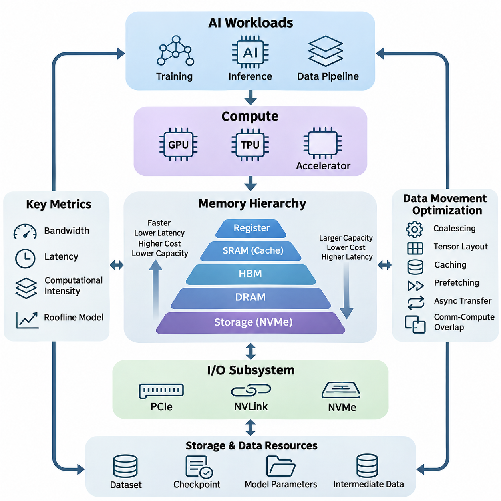
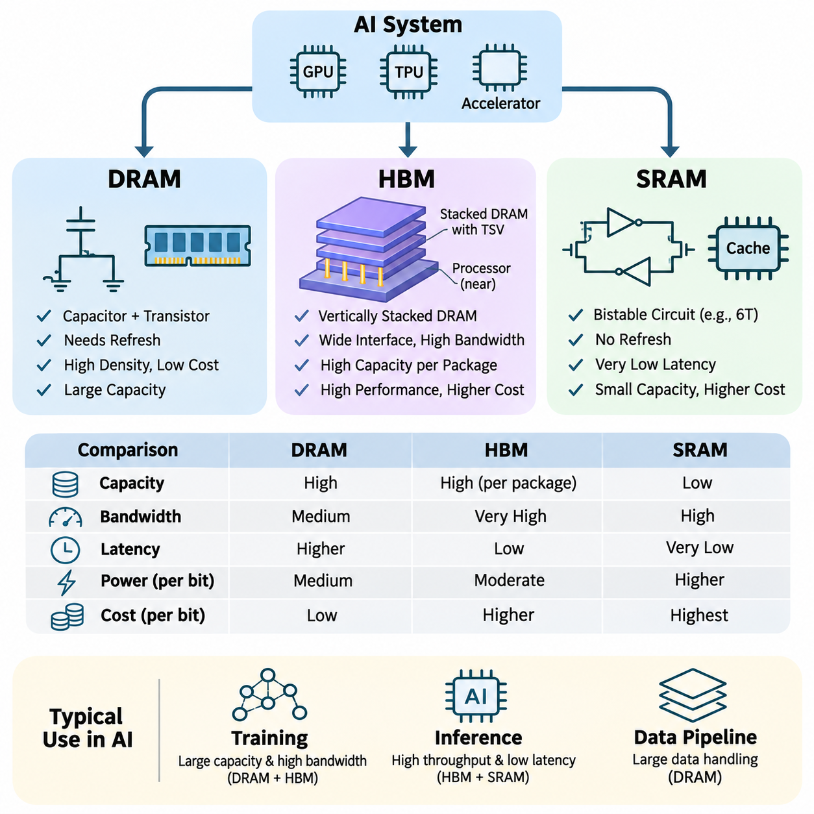
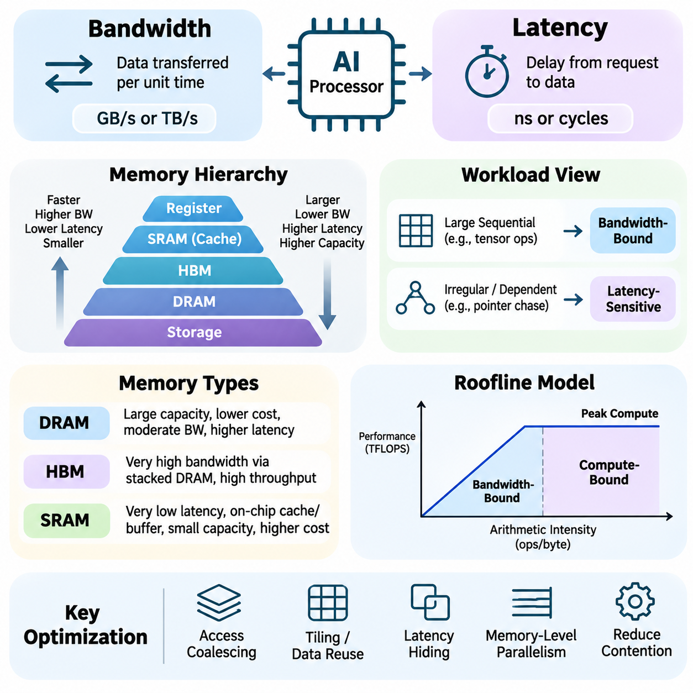
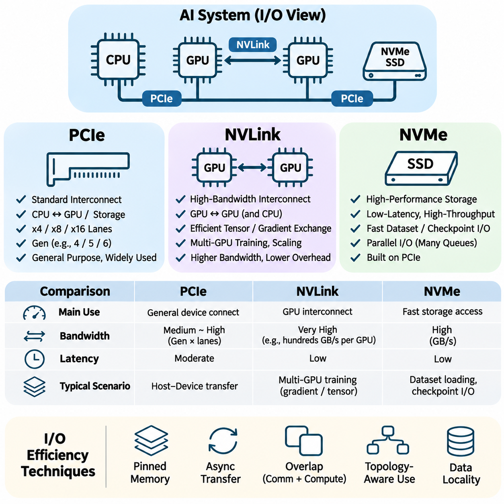
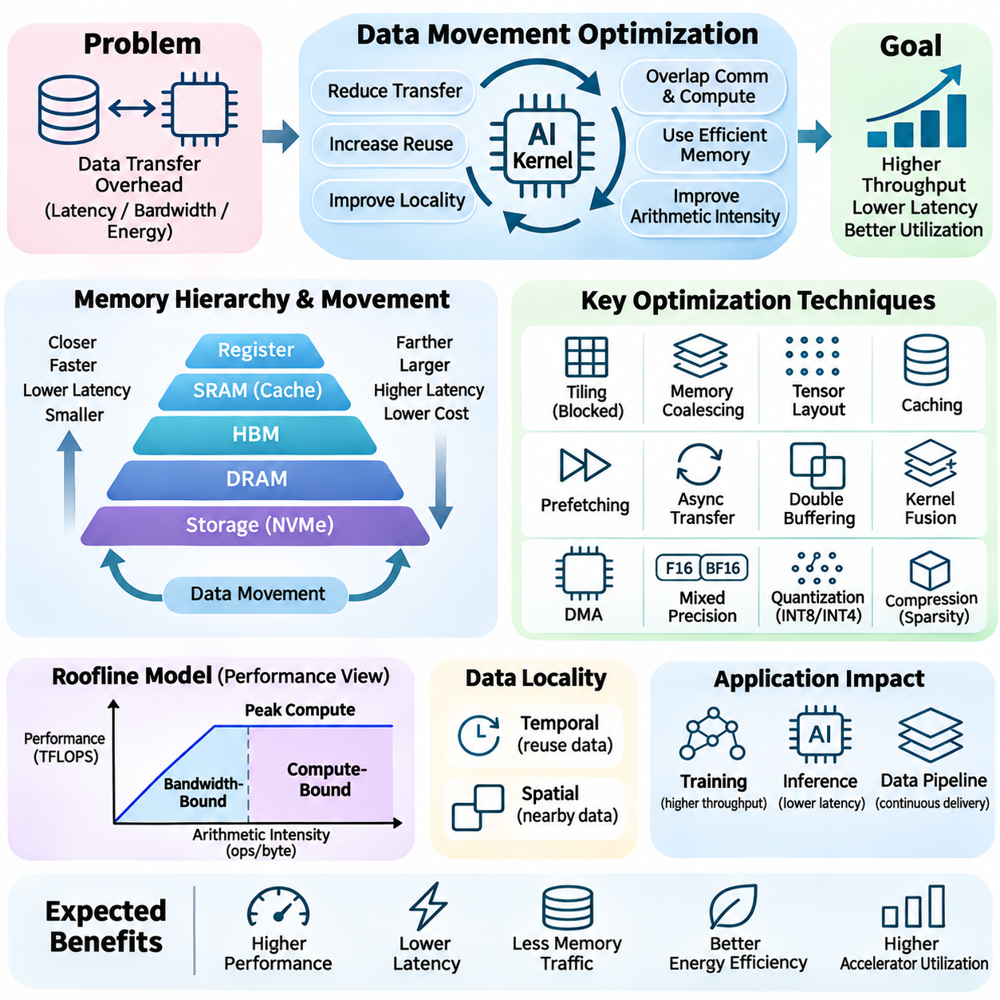
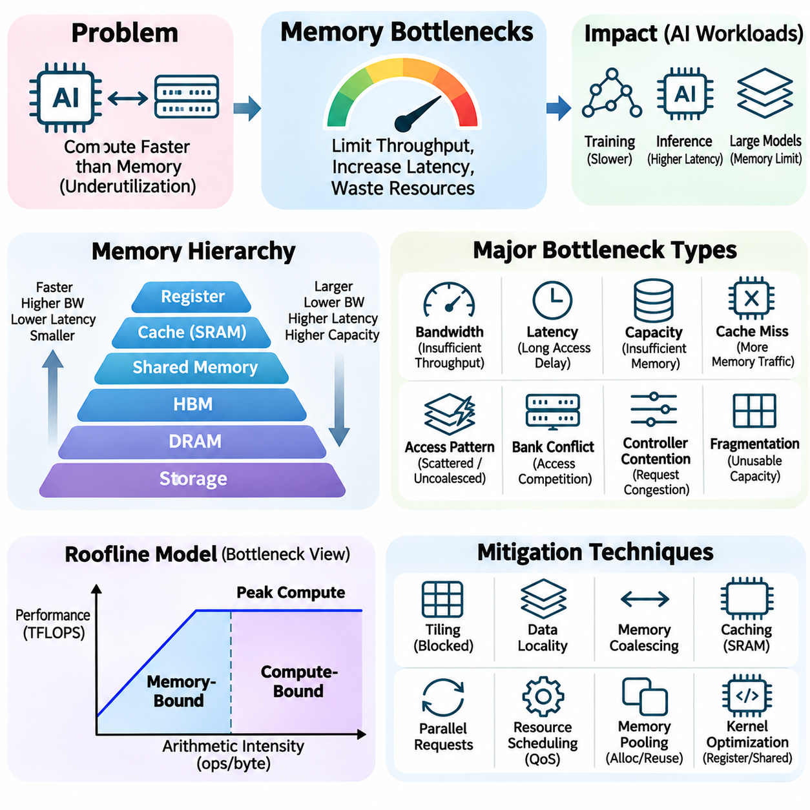
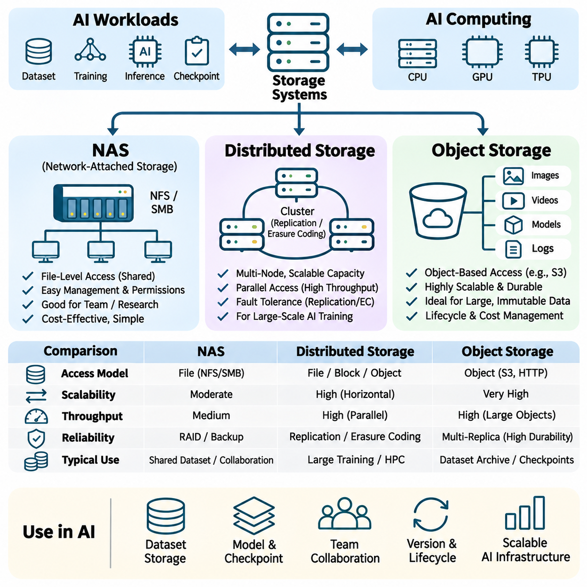
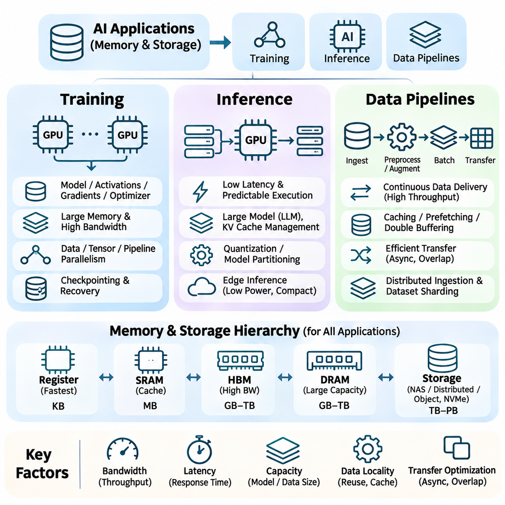

**Volume 39. Hardware for AI**

# 03. Memory and IO

## 03.00 Overview

{width="7.268055555555556in" height="7.268055555555556in"}

Memory and input/output (I/O) subsystems form the foundation of high-performance artificial intelligence hardware. Although processors such as GPUs, TPUs, and specialized accelerators execute mathematical operations, their effectiveness depends on how efficiently data reaches computational units. Memory capacity, bandwidth, access latency, and communication architecture collectively determine whether processing resources remain productive or become idle.

Modern AI workloads involve continuous movement of tensors, model parameters, intermediate activations, gradients, and training datasets. These data structures may occupy different levels of the hardware hierarchy, ranging from processor registers and on-chip caches to external memory and persistent storage. Efficient execution requires coordinating these resources so that data remains available at the appropriate location and time.

The memory hierarchy is designed to balance speed, capacity, cost, and energy consumption. Fast memory structures located near processing units typically provide limited capacity, while larger memory systems offer greater storage at higher access costs. AI hardware architectures exploit this hierarchy by retaining frequently accessed information close to computation and transferring less frequently used data through slower memory levels.

Dynamic Random Access Memory (DRAM) provides substantial working memory capacity for general-purpose computing and AI applications. It stores model parameters, input tensors, intermediate results, and application data during execution. Conventional DRAM technologies support large memory configurations, but their bandwidth and latency characteristics can constrain workloads involving intensive tensor operations and irregular memory access.

High Bandwidth Memory (HBM) addresses the growing demand for rapid data delivery in AI accelerators. By integrating stacked memory dies with wide interfaces and advanced packaging technologies, HBM provides substantially greater aggregate bandwidth than conventional memory interfaces. This architecture is particularly valuable for large-scale neural network training, transformer inference, and other workloads requiring frequent access to extensive parameter arrays.

Static Random Access Memory (SRAM) provides low-latency storage within processors and specialized accelerators. It commonly supports caches, local buffers, and temporary computational data. Although SRAM consumes more silicon area per stored bit than DRAM, its speed makes it essential for reducing expensive external memory transactions. Effective SRAM utilization improves data reuse and enables processing units to sustain high computational throughput.

Memory bandwidth describes the amount of data transferred between components per unit of time, whereas latency measures the delay associated with accessing information. These properties influence different aspects of AI execution. Bandwidth becomes critical when processing large tensors, while latency strongly affects dependent operations and irregular accesses. Understanding both characteristics is necessary for identifying performance limitations.

Computational intensity provides a useful relationship between arithmetic operations and memory traffic. Workloads performing many operations per transferred byte can effectively exploit accelerator compute resources, while workloads with limited data reuse frequently become bandwidth-bound. The roofline performance model illustrates this relationship by connecting arithmetic intensity, available memory bandwidth, and peak computational throughput.

Input/output subsystems connect processors, accelerators, memory devices, and storage resources into an integrated computing platform. Their performance determines how quickly datasets, model parameters, and intermediate results move between hardware components. As AI workloads expand across multiple accelerators and distributed systems, communication efficiency becomes increasingly important for maintaining scalability and avoiding unnecessary computational stalls.

Peripheral Component Interconnect Express (PCIe) provides a widely adopted high-speed interface for connecting GPUs, network adapters, storage controllers, and other devices. Its bandwidth depends on interface generation and lane configuration. In AI systems, PCIe supports host-to-device transfers and communication with peripheral resources, making its capabilities important when workloads repeatedly exchange information between CPUs and accelerators.

NVLink provides high-bandwidth communication between supported NVIDIA accelerators and, in certain platforms, compatible processors. It enables efficient exchange of tensors, gradients, and model states across interconnected computing devices. Compared with conventional peripheral communication paths, appropriately configured NVLink systems can reduce communication overhead and improve the effectiveness of multi-GPU training and inference workloads.

Non-Volatile Memory Express (NVMe) provides an efficient interface for accessing high-performance solid-state storage devices. NVMe storage supports rapid dataset loading, checkpoint retrieval, and intermediate data management. Although storage devices remain slower than accelerator memory, their throughput and parallel I/O capabilities can significantly influence end-to-end AI pipeline performance, especially when training requires continuous access to large datasets.

Data movement optimization focuses on minimizing unnecessary transfers between memory levels and computing devices. Techniques include memory access coalescing, tensor layout optimization, caching, prefetching, asynchronous transfers, and overlapping communication with computation. These methods reduce data transfer overhead while improving hardware utilization. Their effectiveness depends on workload characteristics, memory architecture, and execution scheduling.

Memory bottlenecks occur when computational resources cannot receive or exchange data quickly enough to maintain their potential processing rates. Common causes include insufficient bandwidth, excessive memory latency, limited device memory capacity, inefficient access patterns, and communication contention. Identifying the dominant bottleneck requires examining memory traffic, cache behavior, transfer utilization, and processor activity rather than relying solely on theoretical specifications.

Memory capacity also determines which AI models and workloads can execute directly on a given accelerator. Large neural networks require space for parameters, activations, temporary buffers, and, during training, gradients and optimizer states. When these requirements exceed available memory, systems may employ activation checkpointing, tensor partitioning, memory offloading, or reduced-precision representations to control resource consumption.

Persistent storage systems provide the foundation for managing training datasets, model checkpoints, experiment artifacts, and production data. Unlike volatile memory, storage retains information across system restarts and power interruptions. Storage architecture influences dataset accessibility, recovery performance, and operational reliability. AI infrastructure therefore requires coordinated planning across accelerator memory, system memory, local storage, and shared storage resources.

Network Attached Storage (NAS) enables multiple computing systems to access shared datasets and model artifacts through network connections. It simplifies centralized data management and supports collaborative AI development environments. However, effective performance depends on network throughput, storage controller capabilities, concurrent access patterns, and caching strategies. Poorly configured NAS infrastructure can restrict otherwise powerful training clusters.

Distributed storage systems divide or replicate information across multiple storage nodes to support scalability, availability, and parallel access. Such architectures are useful for large AI datasets and multi-node training environments. Their effectiveness depends on data placement, network topology, fault tolerance, and workload characteristics. Properly designed distributed storage can improve aggregate throughput while reducing dependence on individual storage devices.

Object storage organizes information as independently addressable objects with associated metadata. It is widely used for large datasets, model artifacts, backups, and cloud-based AI workflows. Object storage offers scalable capacity and flexible access mechanisms, although its latency and access semantics differ from those of local filesystems. AI pipelines often combine object storage with local caching to balance scalability and execution efficiency.

During neural network training, memory and I/O requirements extend beyond loading model parameters. Forward propagation generates activations, backward propagation produces gradients, and optimization updates model states. Distributed training additionally exchanges gradients, parameters, or activation tensors between devices. The resulting communication patterns can dominate execution time when model parallelism, data parallelism, and hardware topology are not carefully coordinated.

Inference workloads exhibit different memory characteristics depending on model architecture, batch size, and execution strategy. Large language models frequently require substantial bandwidth to retrieve model weights and maintain key-value caches. Real-time vision and robotics applications emphasize predictable latency and efficient buffering. Consequently, memory subsystem selection must reflect whether the primary objective is throughput, response time, capacity, or energy efficiency.

AI data pipelines connect acquisition, preprocessing, storage, transfer, and computation into a continuous execution workflow. Pipeline efficiency depends on balancing input preparation with accelerator consumption rates. Parallel data loading, pinned host memory, asynchronous transfers, and intelligent caching can reduce idle time. However, excessive buffering or uncontrolled concurrency may increase memory pressure and create additional contention.

Energy efficiency represents another important dimension of memory and I/O architecture. Moving information across memory hierarchies and communication links consumes power that may become significant relative to arithmetic operations. Reducing redundant transfers, increasing local data reuse, and selecting appropriate memory technologies can improve performance per watt. These considerations are especially important in edge AI systems operating under strict thermal and power constraints.

System-level memory optimization requires evaluating the interaction between processors, accelerators, communication interfaces, and storage devices. Improving one component does not guarantee higher application performance if another component remains the limiting factor. Balanced architectures therefore match memory capacity, bandwidth, communication topology, and storage throughput to the actual computational demands of the intended workload.

A comprehensive understanding of memory and I/O subsystems provides the basis for designing efficient AI hardware platforms. By examining DRAM, HBM, SRAM, communication interfaces, data movement strategies, bottlenecks, and storage architectures, engineers can identify practical performance constraints. These principles support scalable training infrastructure, responsive inference systems, and reliable data pipelines across cloud, enterprise, and edge environments.

## 03.01 Memory Types

{width="7.268055555555556in" height="7.268055555555556in"}

Memory technologies are fundamental components of artificial intelligence hardware because they determine how efficiently computational units access and manipulate data. Modern AI systems employ multiple memory types with different performance characteristics, including Dynamic Random Access Memory (DRAM), High Bandwidth Memory (HBM), and Static Random Access Memory (SRAM). Each technology addresses specific requirements involving capacity, bandwidth, latency, energy efficiency, and physical integration.

The selection of memory technology directly influences the performance of neural network training, inference, and data-intensive computation. Large models require substantial storage capacity for parameters and intermediate tensors, while high-throughput accelerators demand rapid data delivery. Memory architecture must therefore balance storage density, access speed, power consumption, manufacturing cost, and communication requirements across the complete computing system.

Dynamic Random Access Memory (DRAM) stores information using memory cells composed primarily of a capacitor and an access transistor. Each capacitor represents a binary value through its electrical charge, which gradually leaks over time. Consequently, DRAM requires periodic refresh operations to preserve stored information. This design provides high storage density and relatively low cost per bit, making DRAM suitable for large-capacity memory systems.

DRAM is widely used as system memory in CPUs, servers, workstations, and AI computing platforms. During model execution, it stores input datasets, model parameters, intermediate results, and application buffers. In GPU-based systems, specialized DRAM technologies such as GDDR provide substantial bandwidth for accelerator workloads. However, conventional system DRAM interfaces may become performance bottlenecks when computational demand exceeds available memory throughput.

The performance of DRAM depends on several architectural characteristics, including memory frequency, channel width, access timing, bank organization, and controller efficiency. Operations such as row activation, column access, precharging, and refresh introduce timing constraints. Memory controllers improve utilization through request scheduling, bank-level parallelism, and optimized access patterns, but irregular workloads can still experience significant latency and reduced effective bandwidth.

Modern DRAM implementations include DDR, LPDDR, and GDDR families, each optimized for different operating environments. DDR memory emphasizes general-purpose system performance and capacity, while LPDDR prioritizes reduced power consumption in mobile and embedded devices. GDDR targets high-bandwidth graphics and accelerator applications. These technologies share fundamental DRAM principles but differ in interface design, power characteristics, packaging, and achievable throughput.

High Bandwidth Memory (HBM) is an advanced DRAM technology designed to provide extremely high aggregate memory bandwidth through vertically stacked memory dies. Multiple DRAM layers are interconnected using through-silicon vias (TSVs), enabling dense vertical communication paths. HBM stacks are commonly integrated near processing dies using advanced packaging and interposer technologies, reducing communication distance and supporting exceptionally wide memory interfaces.

Unlike conventional memory architectures that primarily increase transfer rates through relatively narrow interfaces, HBM achieves high bandwidth by combining wide interfaces with parallel data transfers. This approach supports substantial throughput at comparatively moderate per-pin signaling rates. The architecture is especially advantageous for GPUs, AI accelerators, and high-performance computing systems that repeatedly process large tensors and require continuous memory access.

HBM generations have progressively improved bandwidth, capacity, power efficiency, and integration capabilities. Technologies such as HBM2, HBM2E, HBM3, and HBM3E support increasingly demanding accelerator workloads. Actual performance depends on the memory generation, number of stacks, interface configuration, and processor integration. These improvements enable larger models and higher computational utilization, although memory capacity and bandwidth remain finite resources.

Large language model training benefits significantly from HBM because transformer architectures repeatedly access model parameters, activations, gradients, and optimizer states. High memory bandwidth helps sustain matrix multiplication and attention workloads when external memory traffic is substantial. Nevertheless, accelerator performance also depends on computational intensity, cache efficiency, kernel implementation, and communication overhead, so increased HBM bandwidth does not automatically produce proportional application speedups.

HBM also introduces important engineering tradeoffs involving manufacturing complexity, packaging cost, thermal management, and supply constraints. Vertically stacked memory requires advanced fabrication and integration techniques, while concentrated heat generation complicates thermal design. Furthermore, HBM capacity is constrained by package configuration and available memory stacks. Engineers must therefore consider both performance benefits and practical system-level limitations when selecting HBM-based accelerators.

Static Random Access Memory (SRAM) stores information using bistable circuits, commonly implemented as six-transistor memory cells. Unlike DRAM, SRAM does not require periodic refresh while power remains available. Its circuit structure enables rapid access and predictable operation, making SRAM suitable for latency-sensitive storage. However, the larger number of transistors per bit increases silicon area and manufacturing cost compared with dense DRAM implementations.

SRAM is commonly integrated directly into CPUs, GPUs, TPUs, and specialized AI accelerators. It provides storage for processor caches, shared memory, local buffers, and specialized scratchpad structures. By placing frequently accessed data close to computational units, SRAM reduces the need for repeated transfers from external memory. This proximity improves execution efficiency, especially when workloads exhibit strong temporal or spatial data locality.

Cache hierarchies use SRAM to organize data according to access frequency and proximity to processing resources. Small caches located near execution units provide low access latency, while larger shared caches improve data reuse across computational blocks. Cache effectiveness depends on capacity, associativity, replacement policies, and workload behavior. Poor locality or frequent cache misses can increase external memory traffic and reduce overall accelerator utilization.

In AI accelerators, SRAM frequently supports tiled matrix multiplication, convolution, and attention computation. Large tensors are divided into smaller blocks that fit within local memory, allowing repeated operations before data is transferred elsewhere. This strategy increases arithmetic intensity and reduces expensive off-chip memory accesses. Efficient tiling and buffer management are therefore essential for exploiting SRAM capacity and sustaining accelerator throughput.

SRAM-based scratchpad memory differs from conventional hardware-managed caches because software or compiler-generated instructions may explicitly control data placement and movement. This approach provides predictable access behavior and enables carefully scheduled data reuse. Many specialized accelerators combine scratchpad structures with direct memory access engines and asynchronous transfers, allowing computation and data movement to overlap when dependencies and available resources permit.

The fundamental distinction among DRAM, HBM, and SRAM involves their balance of density, bandwidth, latency, and integration cost. Conventional DRAM provides economical capacity, HBM delivers high aggregate bandwidth through advanced packaging, and SRAM offers rapid on-chip access with limited density. These technologies are complementary rather than interchangeable, and modern AI systems combine them to construct effective memory hierarchies.

Memory access energy is another critical consideration because transferring data can consume substantial power relative to arithmetic computation. Accessing nearby SRAM generally requires less communication energy than retrieving equivalent data from distant memory resources, although actual consumption depends on circuit design and access conditions. HBM improves bandwidth and can offer favorable energy efficiency per transferred bit, while conventional DRAM remains attractive for economical capacity expansion.

Memory capacity requirements vary considerably between training and inference. Training must accommodate parameters, activations, gradients, optimizer states, and temporary workspaces, often requiring multiple times the storage used by model weights alone. Inference generally eliminates gradient and optimizer-state storage but may require substantial memory for batching and attention key-value caches. These differences influence the appropriate balance between DRAM capacity, HBM availability, and on-chip SRAM resources.

When model memory requirements exceed accelerator capacity, systems may employ tensor partitioning, activation checkpointing, parameter offloading, or reduced-precision representations. Such methods reduce immediate memory pressure but may introduce additional computation or communication. Offloading tensors from HBM to host DRAM, for example, increases available effective capacity while potentially introducing PCIe or other interconnect bottlenecks that affect training and inference performance.

Memory architecture also affects distributed AI systems in which multiple accelerators exchange model parameters, activations, or gradients. Local HBM bandwidth supports computation within individual devices, while interconnect bandwidth determines communication efficiency between devices. Host DRAM and storage systems provide additional capacity for datasets and checkpoint management. Effective distributed execution requires coordinated optimization across these memory and communication layers.

In edge AI and embedded systems, memory selection must account for power budgets, physical dimensions, thermal constraints, and workload predictability. LPDDR-based system memory often provides a practical balance of capacity and efficiency, while integrated SRAM supports low-latency processing. Dedicated accelerators may incorporate specialized local memory structures to minimize external transfers, enabling responsive inference without the power requirements of large data-center accelerators.

Memory performance evaluation should consider more than theoretical bandwidth specifications. Practical measurements include sustained throughput, access latency, cache hit rates, memory occupancy, power consumption, and application-level execution time. Profiling tools can reveal whether performance is limited by memory capacity, transfer efficiency, or computational resources. These measurements guide hardware selection and software optimization for specific AI workloads.

Future AI memory architectures are expected to emphasize higher bandwidth, improved packaging density, energy-efficient data movement, and closer integration between storage and computation. Emerging approaches such as three-dimensional integration, advanced chiplet packaging, and processing-in-memory seek to reduce communication overhead. However, their practical adoption depends on manufacturing feasibility, programmability, reliability, and economic considerations.

Understanding DRAM, HBM, and SRAM provides a foundation for designing balanced AI computing systems. DRAM supplies scalable working capacity, HBM supports bandwidth-intensive accelerator execution, and SRAM enables rapid local data reuse. Their coordinated integration determines how effectively processors transform theoretical computational capability into sustained application performance across training, inference, robotics, and large-scale AI infrastructure.

## 03.02 Bandwidth and Latency

{width="7.268055555555556in" height="7.268055555555556in"}

Memory bandwidth and latency are fundamental performance characteristics that determine how efficiently artificial intelligence processors access and exchange data. Bandwidth represents the amount of information transferred per unit of time, while latency describes the delay between initiating a memory request and receiving the requested data. Although closely related, these properties influence computational performance differently and must be evaluated independently.

Memory bandwidth is commonly expressed in gigabytes per second (GB/s) or terabytes per second (TB/s). It depends on interface width, signaling frequency, transfer rate, and the number of active memory channels. Theoretical peak bandwidth represents the maximum transfer capability under ideal conditions, whereas effective bandwidth reflects actual application behavior, including protocol overhead, access patterns, and resource contention.

Memory latency is typically measured in nanoseconds or processor cycles and includes delays associated with request processing, address translation, memory access, and data delivery. Latency varies across registers, caches, external memory, and storage devices. Accessing nearby cache memory generally requires less time than retrieving information from external DRAM, making memory hierarchy organization essential for efficient execution.

Bandwidth and latency affect different workload characteristics. Large sequential tensor operations often depend on sustained bandwidth because they transfer substantial amounts of data. In contrast, operations involving pointer chasing, dependent memory accesses, or irregular data structures are frequently latency-sensitive. Consequently, two systems with similar theoretical bandwidth may exhibit substantially different performance on the same AI workload.

The memory hierarchy provides multiple storage levels with distinct bandwidth and latency characteristics. Registers offer extremely fast access to small quantities of data, while SRAM-based caches provide rapid access to frequently used information. DRAM supplies larger working capacity at higher latency, and persistent storage offers substantially greater capacity with slower access. Efficient AI execution depends on placing data appropriately throughout this hierarchy.

Dynamic Random Access Memory (DRAM) performance is influenced by channel configuration, bank organization, row-buffer behavior, and memory controller scheduling. Sequential or well-organized accesses can exploit burst transfers and parallel memory banks. Random accesses may trigger frequent row activations and precharge operations, increasing latency and reducing effective bandwidth. These effects become significant in irregular AI workloads.

High Bandwidth Memory (HBM) increases aggregate bandwidth through wide interfaces and vertically stacked DRAM structures. Its architecture supports the substantial data transfer requirements of modern GPUs and AI accelerators. However, higher bandwidth does not necessarily imply proportionally lower access latency. HBM primarily addresses throughput limitations, while latency-sensitive applications still depend on caching, scheduling, and access locality.

Static Random Access Memory (SRAM) plays a central role in reducing memory access latency. Integrated caches and scratchpad buffers retain frequently accessed tensors near computational units, avoiding repeated transfers from external memory. SRAM capacity is limited by silicon area and cost, making efficient allocation essential. Tiling, buffering, and data reuse strategies help maximize the performance benefits of these fast local storage structures.

The relationship between computation and memory traffic can be analyzed using arithmetic intensity, defined as the number of arithmetic operations performed per byte transferred. Workloads with low arithmetic intensity frequently encounter bandwidth limitations, while workloads with high arithmetic intensity can become compute-bound. This distinction helps determine whether optimization should focus on reducing data movement or improving arithmetic execution.

The roofline performance model describes the relationship between arithmetic intensity, memory bandwidth, and peak computational throughput. It establishes an upper performance bound based on available hardware resources. When arithmetic intensity is low, attainable performance is constrained by memory bandwidth. As arithmetic intensity increases, computational capability becomes the dominant limitation, assuming other architectural bottlenecks remain controlled.

Effective bandwidth depends strongly on memory access patterns. Contiguous accesses generally allow hardware to combine transactions efficiently, while scattered accesses may require additional memory requests. On GPUs, memory coalescing combines accesses from neighboring threads into efficient transactions when alignment and access patterns permit. Poorly organized tensor layouts can therefore reduce bandwidth utilization even when the underlying hardware provides substantial capacity.

Latency hiding is a critical technique in massively parallel processors. GPUs schedule multiple warps or thread groups so that other instructions can execute while some memory operations remain pending. This approach improves utilization without reducing the physical latency of individual memory accesses. Its effectiveness depends on available parallelism, register pressure, occupancy, instruction dependencies, and memory subsystem resources.

Memory-level parallelism allows multiple outstanding memory requests to overlap, improving throughput when individual accesses experience substantial delays. Modern processors and memory controllers exploit this capability through request queues, concurrent transactions, and bank-level parallelism. However, excessive concurrency can increase contention and queueing delays, making balanced scheduling important for predictable performance.

Cache locality significantly influences both bandwidth demand and effective access latency. Temporal locality occurs when recently accessed data is reused, while spatial locality arises when nearby memory locations are accessed together. AI kernels that exploit these properties can reduce external memory traffic and improve cache hit rates. Conversely, poor locality increases cache misses and places additional pressure on memory interfaces.

Tensor layout optimization improves memory efficiency by organizing data according to computational access patterns. Row-major, column-major, blocked, and tiled layouts provide different advantages depending on the operation. Matrix multiplication and convolution kernels often use tiled representations to increase local reuse. Appropriate alignment and contiguous memory access further improve transaction efficiency and reduce unnecessary data transfers.

Prefetching reduces observed memory stalls by requesting data before it is needed. Hardware prefetchers identify predictable access patterns, while software-controlled prefetching explicitly schedules future transfers. Asynchronous memory operations can overlap data movement with useful computation. However, inaccurate prefetching may waste bandwidth, occupy cache capacity, and increase contention, requiring careful evaluation of workload behavior.

Bandwidth limitations become particularly important during large language model inference. Model weights must be accessed repeatedly during token generation, and decoding with small batches can exhibit relatively low arithmetic intensity. Consequently, memory bandwidth often limits token generation throughput. Larger batches can improve weight reuse, although they also increase memory consumption and may affect request latency.

Attention mechanisms introduce additional memory considerations because key-value caches grow with sequence length and concurrent requests. Reading and updating these caches consumes memory bandwidth and storage capacity. Techniques such as grouped-query attention, cache quantization, and efficient attention kernels can reduce memory traffic. Their effectiveness depends on model architecture, sequence characteristics, and deployment requirements.

Neural network training generates extensive memory traffic through forward propagation, backward propagation, and optimizer updates. Activations, gradients, model parameters, and optimizer states must be accessed repeatedly. Mixed-precision computation can reduce the amount of transferred data, while activation checkpointing exchanges additional computation for lower memory consumption. These techniques influence both effective bandwidth requirements and overall training throughput.

Multi-GPU systems introduce communication bandwidth and latency beyond local device memory. Interconnects such as PCIe and NVLink transfer tensors, gradients, and model states between processors and accelerators. Collective communication operations may become significant bottlenecks during distributed training. Efficient implementations overlap communication with computation and minimize unnecessary synchronization, improving scalability across multiple devices.

Storage bandwidth and latency also influence end-to-end AI performance. NVMe devices provide high-throughput access to datasets and checkpoints, while network storage enables shared access across computing nodes. Nevertheless, storage access remains substantially slower than on-device memory operations. Data loading pipelines therefore use buffering, caching, parallel reads, and asynchronous transfers to prevent accelerators from waiting for input data.

Bandwidth and latency optimization must also consider energy consumption. Data movement across memory interfaces and communication links requires power, sometimes exceeding the energy required for arithmetic operations. Increasing data locality and reducing redundant transfers can improve performance per watt. These benefits are particularly important for embedded AI systems, autonomous robots, and edge accelerators operating under constrained power budgets.

Performance profiling provides the evidence required to distinguish bandwidth-bound, latency-bound, and compute-bound execution. Measurements include sustained memory throughput, cache hit rates, memory transaction efficiency, processor occupancy, and stall cycles. Tools such as NVIDIA Nsight Compute and system-level profilers reveal memory access behavior and execution limitations, allowing engineers to prioritize optimizations based on measured bottlenecks.

Understanding bandwidth and latency enables engineers to design balanced memory architectures and efficient AI software. High bandwidth supports large-scale tensor processing, while low latency benefits dependent and irregular operations. Caching, data reuse, memory-level parallelism, and communication scheduling connect these characteristics to practical performance. Their coordinated optimization improves training efficiency, inference responsiveness, and system scalability across modern AI platforms.

## 03.03 IO Subsystems

{width="7.268055555555556in" height="7.268055555555556in"}

Input/output subsystems are essential components of modern artificial intelligence hardware because they determine how efficiently data moves between processors, accelerators, memory, and storage devices. High computational throughput alone cannot guarantee application performance when communication paths are insufficient. Technologies such as PCI Express (PCIe), NVIDIA NVLink, and Non-Volatile Memory Express (NVMe) address different aspects of data transfer and collectively support scalable AI computing architectures.

The design of an I/O subsystem involves bandwidth, latency, transaction efficiency, connectivity, and communication overhead. AI workloads frequently exchange large tensors, model parameters, gradients, and datasets across hardware boundaries. These transfers can consume substantial execution time, particularly when multiple accelerators operate concurrently. Efficient I/O architecture therefore requires coordination between physical interfaces, device controllers, memory management, and software execution.

PCI Express (PCIe) is a standardized high-speed interconnect widely used to connect CPUs with GPUs, network adapters, storage controllers, and specialized accelerators. It employs point-to-point serial communication links organized into configurable lane groups. Common configurations include x4, x8, and x16 connections, with larger lane counts providing greater aggregate bandwidth. PCIe serves as a fundamental expansion interface in servers, workstations, and AI computing platforms.

PCIe performance depends on interface generation, lane configuration, signaling efficiency, and transaction overhead. Successive generations increase the available data transfer rate, allowing faster communication between host processors and peripheral devices. However, theoretical link bandwidth differs from sustained application throughput because protocol headers, flow control, memory operations, and software behavior introduce additional overhead. Effective performance must therefore be measured under representative workloads.

In GPU-accelerated AI systems, PCIe commonly transfers input tensors, model data, and computational results between host memory and accelerator memory. These transfers may become bottlenecks when applications repeatedly move large datasets across the interface. Pinned host memory, asynchronous transfers, and overlapping communication with computation can improve efficiency. Nevertheless, their effectiveness depends on available bandwidth, device capabilities, and the scheduling of dependent operations.

PCIe communication also supports direct memory access mechanisms that reduce unnecessary CPU involvement in data transfers. Devices can exchange information through DMA engines while processors execute other instructions. Peer-to-peer communication may permit compatible devices to transfer data without routing payloads through host memory. Actual support depends on platform topology, firmware configuration, device compatibility, and system software, making hardware integration an important consideration.

PCIe topology significantly influences multi-accelerator performance. Devices may connect directly to CPU root complexes or through PCIe switches that distribute connectivity across several endpoints. Shared upstream links can introduce contention when multiple devices communicate simultaneously. Non-uniform memory access characteristics and processor socket placement may further affect transfer latency. Careful device placement and topology-aware scheduling help reduce unnecessary communication overhead.

NVIDIA NVLink is a high-bandwidth interconnect technology designed to improve communication among supported GPUs and, on compatible platforms, between CPUs and GPUs. Unlike general-purpose peripheral expansion interfaces, NVLink targets accelerator communication requirements. It provides high aggregate transfer bandwidth and supports efficient exchange of tensors and model states. Its capabilities and topology depend on the specific GPU generation and system architecture.

NVLink is particularly valuable in multi-GPU training, where accelerators frequently exchange gradients, activations, and distributed model parameters. Tensor parallelism and pipeline parallelism may require repeated communication between devices during neural network execution. Faster interconnects can reduce communication overhead and improve scaling efficiency. However, performance gains depend on communication patterns, message sizes, synchronization requirements, and the distribution of computational work.

NVSwitch extends NVLink-based connectivity by enabling high-bandwidth communication across larger groups of compatible GPUs. Switching fabrics provide additional paths between accelerators and can support more uniform connectivity than limited direct-link arrangements. This architecture is useful for large AI servers that distribute model computation across multiple devices. System bandwidth, routing behavior, and collective communication efficiency remain dependent on the specific implementation.

Collective communication libraries such as NVIDIA NCCL exploit available interconnects to implement operations including all-reduce, all-gather, reduce-scatter, and broadcast. These operations are central to distributed neural network training because model states and gradients must be synchronized or exchanged. Communication libraries select algorithms according to device topology and message characteristics, making interconnect-aware software optimization essential for efficient accelerator utilization.

NVLink does not eliminate the need for memory management or communication scheduling. Applications must still minimize redundant transfers, exploit data locality, and overlap communication with useful computation. Even high-bandwidth interconnects can become bottlenecks when model partitioning creates excessive synchronization. Effective parallel training therefore combines hardware connectivity with appropriate tensor placement, workload distribution, and communication-efficient algorithms.

Non-Volatile Memory Express (NVMe) is a storage interface protocol designed for efficient access to non-volatile memory devices, particularly solid-state drives. NVMe commonly operates over PCIe and provides a command architecture optimized for parallel storage operations. Unlike NVLink, which connects compatible computational devices, NVMe primarily manages communication between host systems and storage controllers. This distinction is important when designing integrated AI data pathways.

NVMe supports multiple submission and completion queues, allowing concurrent storage requests with relatively low command-processing overhead. Its architecture is well suited to modern SSDs capable of processing many operations in parallel. Performance depends on device controller capabilities, NAND flash characteristics, queue depth, access patterns, and PCIe connectivity. High sequential throughput and low access latency make NVMe valuable for demanding AI data pipelines.

During neural network training, NVMe storage provides rapid access to datasets, preprocessed samples, and model checkpoints. Large-scale experiments may continuously read image, video, audio, or multimodal data while periodically saving model states. Insufficient storage throughput can cause accelerator idle time when input pipelines cannot supply data quickly enough. Parallel loading, caching, and prefetching help coordinate storage access with GPU computation.

NVMe storage also supports memory offloading strategies when model states exceed accelerator memory capacity. Parameters, optimizer states, or intermediate data may be transferred between GPU memory, host DRAM, and SSD storage. Such approaches enable larger models to execute on constrained hardware but introduce additional I/O overhead. Their practical efficiency depends on transfer scheduling, storage bandwidth, memory hierarchy design, and the amount of computation available to hide delays.

NVMe over Fabrics (NVMe-oF) extends NVMe access across supported network transports, enabling remote storage resources to serve distributed computing environments. This approach can provide scalable storage connectivity while preserving aspects of the NVMe command model. However, network latency, congestion, transport configuration, and remote device performance influence effective throughput. Local NVMe and network-accessible storage therefore serve different performance and deployment requirements.

The interaction between PCIe, NVLink, and NVMe defines important communication paths within AI infrastructure. PCIe connects general-purpose processors and peripheral devices, NVLink accelerates communication among supported computing components, and NVMe provides efficient access to persistent storage. These technologies operate at different architectural levels and should not be treated as interchangeable. Their combined performance determines how effectively data reaches computational resources.

A typical AI training pipeline retrieves datasets from NVMe storage, processes them in host memory, and transfers prepared tensors to accelerator memory through available interconnects. GPUs execute neural network operations while exchanging distributed data through compatible high-speed links. Checkpoints and output artifacts eventually return to persistent storage. Bottlenecks at any stage can reduce overall throughput, even when individual components offer high theoretical performance.

I/O optimization requires examining end-to-end data movement rather than isolated interface specifications. Important techniques include asynchronous execution, transfer batching, pinned memory, direct device communication, topology-aware placement, and communication-computation overlap. Data compression and reduced-precision representations may further decrease transfer volume. However, optimization must preserve correctness and account for conversion overhead, synchronization, and resource contention.

Latency-sensitive AI applications impose additional requirements on I/O subsystems. Autonomous robots, industrial inspection platforms, and real-time perception systems must process incoming sensor data within predictable time limits. Excessive transfer delays can increase response time even when inference computation is fast. Appropriate buffering, local processing, prioritized communication, and reduced data movement help support deterministic or bounded-latency system behavior.

I/O performance evaluation should include sustained bandwidth, transaction latency, queue utilization, transfer concurrency, and system-level execution time. PCIe link utilization, GPU communication throughput, and NVMe storage metrics reveal different potential bottlenecks. Profiling tools and representative benchmarks help distinguish interface limitations from software inefficiencies. Measurements should reflect actual tensor sizes, storage access patterns, and concurrent workload conditions.

Energy consumption and thermal constraints also influence I/O subsystem design. High-speed signaling, switching fabrics, and storage controllers require electrical power and generate heat. Excessive communication can increase total system energy consumption without improving useful computation. Reducing redundant transfers and selecting appropriate connectivity can improve performance per watt. These considerations are especially important in dense AI servers and power-constrained edge platforms.

Scalable AI infrastructure requires coordinated planning of accelerator connectivity, host interfaces, storage throughput, and communication software. Adding more GPUs does not guarantee proportional performance improvements when shared PCIe links, network connections, or storage resources become saturated. Balanced system architecture must account for data movement across every layer. PCIe, NVLink, and NVMe together provide essential foundations for efficient training, responsive inference, and reliable AI deployment.

## 03.04 Data Movement Optimization [w/Code]

{width="7.268055555555556in" height="7.268055555555556in"}

Data movement optimization is a fundamental discipline in artificial intelligence hardware engineering because transferring information between memory levels often consumes substantial time and energy. Modern AI accelerators execute enormous numbers of arithmetic operations, yet their performance can remain limited by data delivery. Efficient system design therefore focuses on minimizing unnecessary transfers, maximizing data reuse, and coordinating communication with computation.

AI workloads continuously move model parameters, activations, gradients, and intermediate tensors across registers, caches, device memory, host memory, and storage systems. Each transfer introduces latency, consumes bandwidth, and requires electrical energy. The cost generally increases as data travels farther from computational units. Understanding these movement patterns is essential for identifying bottlenecks and selecting optimization strategies appropriate to specific neural network architectures.

Data locality provides the foundation for reducing memory traffic. Temporal locality occurs when previously accessed information is reused, while spatial locality describes accesses to nearby memory locations. AI kernels can exploit these properties by retaining frequently used tensors in registers, shared memory, or caches. Improving locality reduces repeated external memory transactions and allows computational resources to operate with fewer interruptions.

Tiling is a widely used optimization technique that divides large tensors into smaller blocks suitable for fast local memory. Matrix multiplication kernels, for example, load blocks of input matrices into shared memory and reuse them across multiple arithmetic operations. This approach reduces global memory traffic and increases arithmetic intensity. Tile dimensions must account for available memory capacity, register usage, hardware occupancy, and computational dependencies.

Memory coalescing improves GPU transfer efficiency by organizing neighboring thread accesses into contiguous memory transactions. When threads within a warp access appropriately aligned memory locations, hardware can combine requests and reduce transaction overhead. Scattered or poorly aligned accesses may require additional transactions, wasting bandwidth. Tensor layout and thread indexing must therefore be coordinated to exploit the memory interface effectively.

Tensor layout optimization determines how multidimensional data is arranged in physical memory. Row-major, column-major, blocked, and channel-oriented layouts produce different access patterns during computation. Convolution and attention kernels may benefit from specialized layouts that align with accelerator execution units. Selecting appropriate representations improves cache utilization, memory coalescing, and vectorized access while reducing unnecessary data rearrangement.

Caching reduces data movement by retaining frequently accessed information near processing elements. Hardware-managed caches automatically exploit locality, while software-controlled scratchpad memories allow explicit data placement. AI accelerators often combine both approaches to balance flexibility and predictable performance. Cache effectiveness depends on working-set size, replacement behavior, access patterns, and interference between concurrently executing kernels.

Prefetching anticipates future data requirements and initiates transfers before computation needs the information. Hardware prefetchers detect predictable access patterns, while software prefetching provides explicit scheduling control. When correctly timed, prefetching reduces visible memory stalls and improves processor utilization. Excessive or inaccurate prefetching can increase bandwidth consumption and cache pressure, making workload-aware tuning necessary.

Asynchronous data transfers allow communication to proceed while computational units execute independent operations. GPU programming frameworks provide streams, events, and asynchronous copy mechanisms to coordinate overlapping activities. Double buffering extends this concept by alternating between buffers used for computation and incoming data. Effective overlap requires sufficient hardware resources and careful management of synchronization and data dependencies.

Direct Memory Access (DMA) engines transfer data between memory regions or devices without requiring continuous CPU intervention. This capability supports efficient movement between host memory, accelerator memory, and peripheral devices. Pinned host memory can improve transfer predictability by preventing relevant memory pages from being relocated. However, excessive pinned allocation can reduce system flexibility and must be managed according to workload requirements.

Kernel fusion reduces intermediate data movement by combining multiple computational operations into a single execution unit. Without fusion, separate kernels may repeatedly write intermediate tensors to global memory and read them back. Fused operations can retain temporary results in registers or shared memory, reducing memory traffic and launch overhead. Fusion must nevertheless consider register pressure, synchronization requirements, and compiler limitations.

Arithmetic intensity measures the number of computational operations performed per byte transferred from memory. Increasing arithmetic intensity through tiling, fusion, and data reuse can shift workloads away from bandwidth limitations. The roofline performance model illustrates this relationship by comparing memory bandwidth with peak computational throughput. Optimization should target the dominant bottleneck rather than assuming every operation benefits equally from reduced transfers.

Mixed-precision computation decreases data movement by representing tensors with fewer bits. Formats such as FP16, BF16, and selected low-precision integer representations reduce storage requirements and transfer volume compared with FP32. Quantization can provide additional savings during inference. However, precision selection must account for numerical stability, model accuracy, accumulation behavior, and hardware support to avoid unacceptable computational errors.

Data compression can further reduce communication volume when transferring large tensors, checkpoints, or distributed model states. Lossless compression preserves exact information, while lossy techniques trade precision for reduced data size. Compression is beneficial when transfer savings exceed encoding and decoding overhead. Its effectiveness depends on tensor characteristics, available processing resources, and the bandwidth of the communication path.

Distributed AI training introduces substantial data movement between accelerators and computing nodes. Data parallelism requires gradient synchronization, while tensor and pipeline parallelism exchange model partitions or activations. Collective communication operations such as all-reduce and all-gather can dominate execution when interconnect bandwidth is insufficient. Communication-efficient algorithms and topology-aware placement help reduce these costs.

Communication scheduling is essential for overlapping distributed data transfers with useful computation. Gradient bucketing, asynchronous collective operations, and carefully ordered synchronization can reduce exposed communication time. However, dependencies between computational stages limit achievable overlap. Efficient distributed execution therefore requires coordinated optimization of model partitioning, communication algorithms, memory allocation, and accelerator scheduling.

Large language model inference presents distinctive data movement challenges because autoregressive decoding repeatedly accesses model weights and attention caches. Small-batch decoding can be memory-bandwidth-bound, while larger batches improve weight reuse at the expense of additional memory consumption. Efficient key-value cache management, grouped-query attention, and optimized decoding kernels reduce unnecessary transfers and improve throughput.

Attention optimization focuses on minimizing transfers of query, key, value, and intermediate attention tensors. Memory-efficient algorithms process attention in blocks and retain intermediate calculations in fast local memory. Techniques such as FlashAttention avoid materializing large attention matrices in external memory. These methods improve efficiency while requiring careful handling of numerical stability, masking, and sequence-dependent execution.

Data movement optimization also extends to storage and input pipelines. Training systems must continuously retrieve datasets from NVMe drives, network storage, or distributed repositories. Parallel data loading, preprocessing pipelines, caching, and asynchronous host-to-device transfers help maintain accelerator utilization. Poorly coordinated pipelines can leave powerful GPUs idle despite sufficient computational capacity.

Memory offloading enables models larger than available accelerator memory by transferring parameters, activations, or optimizer states to host DRAM or storage. Although offloading increases effective capacity, it introduces additional communication overhead. Intelligent scheduling and prefetching can partially hide these costs. The optimal strategy depends on memory constraints, interconnect bandwidth, computational intensity, and execution requirements.

Energy efficiency provides another motivation for minimizing data movement. Accessing distant memory and transferring information across high-speed interconnects can consume substantial energy relative to arithmetic operations. Local reuse, compact tensor representations, and reduced communication improve performance per watt. These benefits are especially important for edge AI devices, autonomous robots, and thermally constrained accelerator platforms.

Performance profiling identifies inefficient data movement through measurements of memory bandwidth, cache hit rates, transaction efficiency, transfer latency, and processor stalls. GPU profilers can reveal excessive global memory accesses, uncoalesced transactions, and insufficient communication overlap. Optimization should be guided by representative workloads and verified through end-to-end performance measurements rather than isolated theoretical improvements.

Effective data movement optimization requires cooperation between hardware architecture, compiler transformations, runtime scheduling, and application design. Techniques such as tiling, caching, fusion, asynchronous transfers, precision reduction, and communication-aware partitioning address complementary sources of overhead. Their coordinated application enables AI systems to transform available memory bandwidth and computational capability into sustained training and inference performance.

## 03.05 Memory Bottlenecks

{width="7.268055555555556in" height="7.268055555555556in"}

Memory bottlenecks are critical performance limitations in artificial intelligence systems because computational units frequently process data faster than memory subsystems can supply it. Even powerful GPUs and specialized accelerators may remain underutilized when data access is inefficient. These bottlenecks arise from insufficient bandwidth, excessive latency, limited capacity, unfavorable access patterns, and contention among concurrent operations.

The memory hierarchy introduces multiple potential sources of performance degradation. Registers, caches, shared memory, high-bandwidth memory, system DRAM, and storage devices provide different combinations of capacity, bandwidth, and latency. Moving information between these levels requires time and energy. When frequently accessed data resides in slower memory, processors may spend substantial execution time waiting for transfers rather than performing useful computation.

Bandwidth bottlenecks occur when the required data transfer rate exceeds the sustainable throughput of a memory interface. Large tensor operations, embedding lookups, and neural network inference can generate substantial memory traffic. When bandwidth becomes saturated, increasing computational capability alone produces limited performance improvements. Effective optimization requires reducing transferred data, improving locality, or selecting memory architectures with greater available bandwidth.

Latency bottlenecks arise when individual memory requests take too long to complete, particularly when subsequent operations depend on their results. Irregular indexing, pointer chasing, and sparse data structures often exhibit this behavior. Unlike bandwidth-bound workloads, latency-sensitive operations may remain slow even when aggregate memory bandwidth is underutilized. Parallel request execution and improved caching can reduce exposed latency without changing physical memory timing.

Memory capacity limitations represent another major bottleneck in modern AI systems. Large neural networks require storage for parameters, activations, gradients, optimizer states, and temporary buffers. When these structures exceed available accelerator memory, applications may fail or require offloading to host DRAM or storage. Such transfers increase communication overhead and can significantly reduce execution throughput, especially when performed repeatedly during training.

Cache misses increase memory traffic by forcing processors to retrieve data from slower storage levels. Poor temporal locality prevents repeated use of recently accessed information, while weak spatial locality reduces the benefits of cache lines. Cache thrashing occurs when competing data repeatedly displaces useful cache contents. These conditions increase effective memory latency and reduce the efficiency of computational pipelines.

Memory access patterns strongly influence effective bandwidth. GPUs achieve high throughput when neighboring threads access contiguous, properly aligned memory locations. Scattered or uncoalesced accesses generate additional memory transactions and waste available bandwidth. Tensor layouts, indexing strategies, and thread organization must therefore be coordinated. Reorganizing data can improve performance even without changing the underlying arithmetic operations.

Bank conflicts create additional delays when multiple memory requests compete for the same internal memory bank. This problem can occur in shared memory and external DRAM, although the mechanisms differ. In GPU shared memory, unfavorable address mappings may serialize accesses that could otherwise execute concurrently. Padding, layout transformations, and conflict-aware indexing can reduce these delays and improve effective throughput.

Memory controller contention occurs when multiple computational units submit requests faster than the controller can schedule and service them. Request queues become congested, increasing waiting time and reducing predictability. Concurrent kernels, CPU processes, and accelerator workloads may compete for shared bandwidth. Quality-of-service policies, workload scheduling, and balanced resource allocation can help manage contention in multi-tenant systems.

Register pressure can indirectly create memory bottlenecks by limiting the number of active threads or forcing temporary values into local memory. Excessive register usage reduces GPU occupancy, potentially weakening latency hiding. Register spilling introduces additional memory transactions that increase traffic and execution time. Kernel optimization must therefore balance register allocation, instruction-level parallelism, and available thread concurrency.

Shared memory capacity also constrains accelerator execution. Large tiles and temporary buffers may exceed the available on-chip storage, requiring smaller processing blocks or additional global memory transfers. Conversely, allocating too much shared memory per thread block can reduce occupancy. Efficient kernel design balances tile dimensions, data reuse, register consumption, and hardware scheduling resources to maximize sustained throughput.

Memory fragmentation can reduce usable capacity even when total free memory appears sufficient. Repeated allocation and deallocation of tensors with different sizes may create fragmented address-space regions or allocator pools. This can lead to allocation failures, increased reserved memory, or inefficient reuse. Memory pooling, allocation planning, and tensor lifetime analysis help reduce fragmentation and improve application stability.

The roofline performance model provides a useful framework for identifying memory-bound computation. It relates achievable performance to arithmetic intensity, memory bandwidth, and peak computational throughput. Operations performing relatively few calculations per transferred byte are more likely to encounter bandwidth limitations. Increasing data reuse through tiling, caching, and kernel fusion can improve arithmetic intensity and shift execution toward computational limits.

Neural network training creates memory pressure through forward propagation, backward propagation, and optimizer updates. Activations must be retained or recomputed, gradients require storage, and optimizers may maintain multiple states for each parameter. Mixed-precision training, activation checkpointing, and optimizer-state partitioning can reduce memory requirements. However, these techniques may introduce additional computation, synchronization, or communication overhead.

Large language model inference frequently encounters memory bandwidth bottlenecks during autoregressive decoding. Model weights are accessed repeatedly for each generated token, while small batch sizes may provide limited computational reuse. Attention key-value caches introduce additional capacity and bandwidth requirements as sequence lengths increase. Quantization, continuous batching, and efficient cache management can improve utilization while introducing their own operational tradeoffs.

Attention operations can become memory-intensive when intermediate matrices and sequence-dependent tensors occupy substantial storage. Conventional implementations may repeatedly materialize large attention structures in external memory. Memory-efficient algorithms process data in tiles and avoid unnecessary intermediate writes. Approaches such as FlashAttention reduce high-bandwidth memory traffic while preserving the mathematical attention operation within supported numerical behavior.

Distributed AI systems introduce bottlenecks beyond individual device memory. Tensor transfers between GPUs, gradient synchronization, and model partition communication depend on interconnect bandwidth and latency. PCIe, NVLink, and network fabrics provide different communication capabilities. Poor topology awareness or excessive synchronization can leave accelerators waiting for remote data, reducing scaling efficiency despite sufficient local memory bandwidth.

Host-to-device transfers can become bottlenecks when input pipelines repeatedly copy large tensors across PCIe or other interconnects. Inefficient synchronization may prevent communication from overlapping with computation. Pinned host memory, asynchronous transfers, and double buffering can reduce exposed delays. However, transfer optimization must consider available link bandwidth, memory pressure, and dependencies between processing stages.

Storage-related memory bottlenecks arise when datasets or checkpoints cannot be delivered at the rate required by computational devices. NVMe drives, network-attached storage, and distributed storage systems have different throughput and latency characteristics. Small random reads, network congestion, and insufficient preprocessing capacity can stall accelerators. Parallel loading, caching, and prefetching help maintain consistent data availability.

Thermal and power constraints may indirectly limit memory performance. High-bandwidth memory and memory controllers consume energy and generate heat during sustained transfers. Under restrictive operating conditions, hardware may reduce operating frequencies to maintain safe temperatures or power limits. These effects can lower effective bandwidth and increase execution time. System-level optimization must therefore consider cooling capacity, power delivery, and sustained operating behavior.

Memory bottleneck diagnosis requires measurements that distinguish bandwidth saturation, latency stalls, capacity pressure, and inefficient access patterns. Profiling tools report memory throughput, cache hit rates, transaction efficiency, register spilling, occupancy, and stalled execution cycles. Comparing these metrics with application behavior helps identify dominant limitations. Optimization decisions should rely on measured evidence rather than theoretical hardware specifications alone.

Addressing memory bottlenecks requires coordinated improvements across algorithms, compilers, runtime systems, and hardware architecture. Tiling increases data reuse, kernel fusion reduces intermediate transfers, quantization lowers storage requirements, and asynchronous execution hides communication delays. Memory-aware scheduling and topology optimization further improve resource utilization. Each technique should be evaluated against its computational overhead and workload characteristics.

Effective memory optimization ultimately depends on balancing capacity, bandwidth, latency, locality, and concurrency. Eliminating one bottleneck may expose another limitation elsewhere in the execution pipeline. Consequently, engineers must evaluate complete application performance rather than isolated memory operations. Systematic profiling and iterative optimization enable AI platforms to achieve higher accelerator utilization, improved energy efficiency, and more predictable training and inference performance.

## 03.06 Storage Systems

{width="7.268055555555556in" height="7.268055555555556in"}

Storage systems are fundamental components of artificial intelligence infrastructure because they provide persistent access to datasets, model parameters, checkpoints, and experimental results. Modern AI workloads generate and consume enormous volumes of information, making storage performance essential to computational efficiency. Network-attached storage, distributed storage, and object storage offer different approaches to capacity expansion, data sharing, reliability, and access management.

AI storage architecture must balance capacity, throughput, latency, availability, durability, and operational cost. Training pipelines often require sustained sequential reads, while data preprocessing and metadata operations may generate numerous small random accesses. Checkpointing introduces large write operations that can temporarily compete with dataset loading. Selecting an appropriate storage system therefore requires understanding workload characteristics rather than relying exclusively on advertised capacity or peak bandwidth.

Network-attached storage (NAS) provides file-level access to shared storage resources over a network. NAS systems typically expose directories and files through protocols such as Network File System (NFS) or Server Message Block (SMB). Multiple computing nodes can access common datasets without maintaining independent local copies. This architecture simplifies centralized administration, permissions, backups, and collaborative workflows in AI research environments.

NAS performance depends on storage media, controller capabilities, network bandwidth, filesystem behavior, and concurrent client activity. SSD-based arrays can provide low access latency, while HDD-based configurations offer economical capacity for large archives. However, shared network links and metadata services may become bottlenecks under heavy parallel access. Effective deployment requires appropriate caching, network provisioning, and workload-aware storage configuration.

In AI training environments, NAS commonly stores source datasets, annotations, experiment configurations, and model artifacts. Researchers can maintain consistent dataset versions across multiple workstations and GPU servers. Centralized storage reduces duplication and simplifies collaboration, but simultaneous training jobs may compete for throughput. Local caching or dataset staging onto NVMe drives can reduce repeated network transfers and improve accelerator utilization.

NAS reliability is supported through redundant disks, protected network connections, monitoring, and backup procedures. RAID configurations can tolerate certain hardware failures, but they do not replace independent backups or protect against every form of corruption. Snapshots provide useful recovery points for accidental modifications. Storage administrators must also consider filesystem permissions, access auditing, capacity forecasting, and recovery time requirements.

Distributed storage systems spread information across multiple storage nodes to provide scalable capacity, parallel access, and fault tolerance. Rather than depending on a single storage appliance, distributed architectures coordinate data placement and retrieval across a cluster. Systems may expose file, block, or object interfaces depending on their design. Their effectiveness depends on data distribution, replication policies, network topology, and metadata coordination.

Data replication improves availability by maintaining multiple copies across independent storage nodes. Erasure coding provides an alternative that divides information into data and parity fragments, allowing recovery from certain failures with lower storage overhead than full replication. These methods involve tradeoffs among capacity efficiency, repair traffic, access latency, and computational cost. Protection policies should reflect workload importance and expected failure conditions.

Distributed filesystems enable multiple compute nodes to access shared datasets through a unified namespace. Parallel filesystem architectures can distribute data across storage servers, allowing concurrent reads and writes from large computing clusters. This capability is valuable when many GPUs require high aggregate input throughput. However, metadata contention, network congestion, and poorly balanced data placement can reduce scaling efficiency.

Data locality is particularly important in distributed storage. When computational tasks execute near the nodes holding required information, network traffic and transfer latency can decrease. Scheduling systems may use locality information to select execution locations or stage frequently accessed datasets. AI workloads with repeated epochs can benefit from persistent caches. Nevertheless, locality optimization must remain compatible with load balancing and fault tolerance.

Distributed storage introduces consistency and coordination challenges because multiple nodes may access or modify shared information concurrently. Different systems provide different guarantees for visibility, ordering, and durability of updates. Strong consistency simplifies certain workflows but can increase coordination requirements. AI pipelines must understand these semantics, especially when publishing dataset versions, sharing checkpoints, or coordinating concurrent writers.

Object storage organizes information into independently addressable objects associated with identifiers and metadata. Unlike conventional filesystems, object interfaces generally access complete objects through API operations rather than ordinary block-level file modifications. Services commonly provide HTTP-based interfaces, including Amazon S3-compatible APIs. This model supports scalable storage of datasets, checkpoints, logs, and long-lived AI artifacts.

Object storage is particularly effective for large collections of immutable or infrequently modified data. Image archives, video datasets, pretrained model weights, and experiment outputs can be organized through object identifiers and logical prefixes. Metadata and access policies support discovery, lifecycle management, and controlled sharing. However, applications requiring frequent small in-place updates may be better served by filesystems or databases.

Object storage performance depends on request concurrency, object size, network throughput, and service architecture. Large objects can achieve efficient sequential transfers, while numerous small objects may introduce significant request overhead. AI data pipelines often combine samples into larger containers or shards to reduce transaction counts. Parallel downloads, caching, and prefetching further improve throughput when sufficient network capacity is available.

Cloud object storage provides flexible capacity expansion without requiring users to manage physical storage hardware. Organizations can retain large datasets and checkpoints while allocating computational resources independently. Storage classes and lifecycle policies help manage costs according to access frequency. However, request charges, retrieval delays, and data transfer fees must be considered when designing repeated training workflows or cross-region pipelines.

The choice between NAS, distributed storage, and object storage depends on application requirements and operational scale. NAS offers convenient shared filesystem access, distributed storage provides horizontal scalability and fault tolerance, and object storage emphasizes durable object-based access. These categories can overlap because some distributed platforms expose multiple interfaces. Architectural decisions should focus on actual consistency, performance, and management characteristics.

Hybrid storage architectures combine local NVMe devices, shared NAS resources, distributed storage clusters, and object repositories. Frequently accessed training samples may reside on local SSDs, while authoritative datasets remain in shared storage. Object storage can preserve historical checkpoints and archived experiments. Coordinating these layers reduces unnecessary transfers and helps balance performance, capacity, reliability, and infrastructure cost.

Dataset organization strongly affects storage efficiency. Millions of small files can create substantial metadata overhead and increase the number of storage requests. Sharded dataset formats group samples into larger sequentially accessible units, improving throughput for many training pipelines. However, excessively large shards can reduce random access flexibility and complicate workload distribution. Shard sizing should reflect access patterns and parallel worker counts.

Checkpoint management is another important storage consideration. Large neural network training jobs periodically save model parameters, optimizer states, and execution metadata to support recovery. Checkpoint writes can temporarily saturate storage bandwidth and interrupt training. Asynchronous checkpointing, incremental techniques, and coordinated write scheduling can reduce disruption. Recovery procedures must verify completeness and compatibility before restoring execution.

Data integrity and security are essential across all storage architectures. Checksums and integrity verification help detect corruption, while encryption protects information during transfer and at rest. Access controls restrict unauthorized modification or disclosure of datasets and model artifacts. Versioning and immutable retention policies can support reproducibility and recovery. Security mechanisms must be integrated without introducing unacceptable performance overhead.

Storage monitoring should measure sustained throughput, operation latency, request concurrency, capacity utilization, error rates, and recovery behavior. NAS systems require attention to controller and network saturation, while distributed clusters need visibility into node health and data placement. Object storage monitoring emphasizes request patterns and transfer efficiency. Representative benchmarks should reproduce actual AI access behavior rather than isolated peak-performance conditions.

Energy efficiency and total cost of ownership influence storage architecture decisions. High-performance SSDs provide rapid access but may cost more per unit of capacity than HDD-based systems. Replication increases resilience while consuming additional storage and power. Cloud services reduce hardware management responsibilities but introduce recurring service charges. Lifecycle policies and tiered storage help align resource consumption with practical data value.

Effective AI storage engineering requires coordinated planning across storage hardware, network infrastructure, data formats, caching mechanisms, and application pipelines. NAS, distributed storage, and object storage each address different operational requirements and can complement one another within a unified architecture. Their appropriate integration enables reliable dataset management, efficient model training, scalable experimentation, and sustainable long-term AI infrastructure.

## 03.07 Applications

{width="7.268055555555556in" height="7.268055555555556in"}

Memory and storage architecture directly influence the performance of artificial intelligence applications across training, inference, and data processing pipelines. Although these workloads share common hardware resources, their access patterns and performance requirements differ substantially. Training emphasizes sustained throughput and large memory capacity, inference often prioritizes latency and predictable execution, while data pipelines focus on continuous information delivery.

AI training requires coordinated movement of datasets, model parameters, activations, gradients, and optimizer states across multiple memory levels. During forward propagation, input tensors and weights are accessed to calculate intermediate representations. Backward propagation introduces additional memory traffic as gradients are computed and propagated through the network. Efficient training therefore depends on balancing computational throughput with memory bandwidth and capacity.

Large neural networks place considerable pressure on accelerator memory because training must retain information required for gradient computation. Model parameters, intermediate activations, gradients, and optimizer states may collectively exceed available GPU memory. Mixed-precision training, activation checkpointing, and optimizer-state partitioning reduce memory consumption. These techniques enable larger models but introduce tradeoffs involving numerical behavior, recomputation, and communication overhead.

Data parallel training distributes model replicas across multiple accelerators while dividing input batches among them. Each accelerator computes local gradients, which must subsequently be synchronized to maintain consistent model updates. Collective communication operations such as all-reduce generate substantial inter-device traffic. High-bandwidth interconnects and communication-computation overlap improve scalability when synchronization costs become significant.

Tensor parallelism partitions individual neural network operations across multiple GPUs, requiring intermediate tensor exchanges during execution. Pipeline parallelism distributes model layers among accelerators and transfers activations between stages. Both approaches reduce per-device memory requirements but introduce communication dependencies. Efficient partitioning must balance memory capacity, interconnect bandwidth, computational load, and synchronization frequency.

Training storage systems must supply data quickly enough to prevent accelerator starvation. Large image, video, audio, and multimodal datasets may reside on NAS, distributed filesystems, or object storage services. Local NVMe caches and parallel data loaders reduce repeated remote accesses. Data sharding, prefetching, and asynchronous transfers further improve throughput by coordinating storage operations with computational execution.

Checkpointing protects long-running training jobs against interruptions and hardware failures. Model parameters, optimizer states, and execution metadata must be periodically written to persistent storage. Large checkpoints can temporarily saturate storage bandwidth and delay computation. Asynchronous checkpointing, distributed writing, and incremental storage strategies reduce disruption while maintaining recoverability and experiment reproducibility.

Inference applications have different memory requirements because model parameters are generally reused without storing training gradients or optimizer states. Nevertheless, large models can still exceed available accelerator memory, requiring quantization, model partitioning, or selective offloading. Inference performance depends on weight access patterns, activation storage, batch size, and available bandwidth. The optimal configuration varies with model architecture and service requirements.

Real-time inference emphasizes predictable latency rather than maximum aggregate throughput alone. Autonomous robotics, industrial inspection, and interactive AI services must deliver results within defined response windows. Memory contention, host-device transfers, and storage access can introduce unpredictable delays. Keeping critical data close to computation, minimizing synchronization, and controlling concurrent workloads help improve responsiveness and execution consistency.

Large language model inference introduces distinct memory traffic during autoregressive token generation. Each decoding step accesses model weights and maintains attention key-value caches that grow with sequence length. Small batches may be limited by memory bandwidth, while larger batches increase weight reuse but consume additional memory. Continuous batching, quantization, and efficient cache allocation help balance throughput, latency, and capacity.

Inference serving systems often process requests with different sequence lengths, priorities, and computational requirements. Dynamic batching improves accelerator utilization by grouping compatible requests, while request scheduling manages latency constraints. Memory fragmentation and inefficient cache allocation can reduce serving capacity. Paged attention and memory pooling improve key-value cache management, allowing more concurrent requests within available memory.

Edge inference introduces additional constraints involving power consumption, thermal limits, and physical memory capacity. Embedded GPUs and dedicated neural accelerators must process sensor data with limited resources. Compact model representations, efficient tensor layouts, and reduced memory transfers improve performance per watt. Local inference also reduces dependence on network connectivity, although remote systems may remain useful for training and model updates.

Data pipelines connect storage infrastructure with computational workloads through ingestion, decoding, preprocessing, augmentation, batching, and transfer operations. Each stage consumes processing resources and introduces potential delays. If data preparation cannot match accelerator demand, training or inference devices remain idle. Pipeline engineering therefore focuses on sustained delivery rates, balanced parallelism, memory management, and efficient coordination between stages.

Dataset ingestion retrieves information from local disks, network storage, distributed filesystems, or cloud object repositories. Access characteristics vary according to file size, storage protocol, network conditions, and request concurrency. Numerous small files can generate substantial metadata overhead, while large sequential objects often transfer more efficiently. Sharded formats and concurrent readers help reduce access costs and improve throughput.

Preprocessing transforms raw information into representations suitable for neural network execution. Image decoding, resizing, normalization, tokenization, and feature extraction may execute on CPUs, GPUs, or dedicated hardware. Poorly balanced preprocessing can become the dominant pipeline bottleneck. Parallel execution, vectorized operations, and selective accelerator offloading improve efficiency when their transfer and scheduling costs remain justified.

Data augmentation increases training diversity by applying controlled transformations to input samples. Random cropping, geometric transformations, color adjustments, and other operations can increase computational and memory requirements. Performing augmentation dynamically reduces the need to store every transformed sample but introduces additional processing overhead. Efficient implementations balance dataset variability, processing cost, and accelerator utilization.

Caching and prefetching reduce repeated storage access and help maintain continuous data delivery. Frequently used samples may be retained in system DRAM or local NVMe storage, while upcoming batches are prepared asynchronously. Double buffering allows one batch to undergo computation while another is loaded. Cache capacity, replacement policies, and prefetch depth must be tuned to workload access patterns and available resources.

Host-to-device transfers represent a critical boundary between data pipelines and accelerator execution. Pinned memory and asynchronous copy operations can reduce transfer overhead and enable communication-computation overlap. However, excessive buffering consumes host memory, and poorly synchronized transfers can eliminate expected benefits. Efficient implementations coordinate batch preparation, transfer completion, and kernel execution without introducing unnecessary stalls.

Distributed data pipelines must provide consistent and appropriately partitioned input across multiple training workers. Dataset sharding reduces redundant reads and supports scalable parallel processing. Deterministic sampling and controlled randomization help preserve reproducibility across epochs. Worker failures, uneven shard sizes, and storage contention can disrupt throughput, requiring careful scheduling, monitoring, and recovery mechanisms.

Data integrity and version control are essential for reliable AI applications. Training datasets, preprocessing configurations, model checkpoints, and inference artifacts should remain traceable across experiments and deployments. Checksums, immutable dataset versions, and access controls reduce risks associated with corruption or unintended modification. Reliable metadata management supports reproducibility, auditing, and controlled model updates.

Performance evaluation must distinguish computation bottlenecks from memory, storage, and communication limitations. Training metrics include accelerator utilization, samples processed per second, memory occupancy, and synchronization overhead. Inference measurements emphasize latency distributions, request throughput, and memory consumption. Pipeline profiling examines loading time, preprocessing delays, cache effectiveness, and sustained input bandwidth.

Cost and energy efficiency depend on coordinating memory capacity, storage performance, and computational resources. Oversized storage systems waste infrastructure investment, while insufficient bandwidth leaves expensive accelerators underutilized. Local caching, data compression, workload scheduling, and tiered storage can improve resource efficiency. Deployment decisions should consider total system throughput and operating cost rather than isolated hardware specifications.

Effective AI applications require integrated optimization across training, inference, and data pipelines. Training benefits from scalable memory and distributed communication, inference requires efficient weight access and predictable latency, and data pipelines must continuously supply prepared information. Coordinating memory hierarchies, storage systems, interconnects, and execution software enables reliable performance, efficient resource utilization, and scalable AI deployment.
