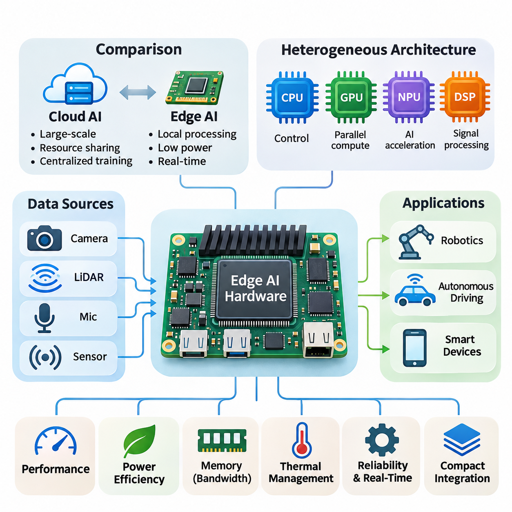
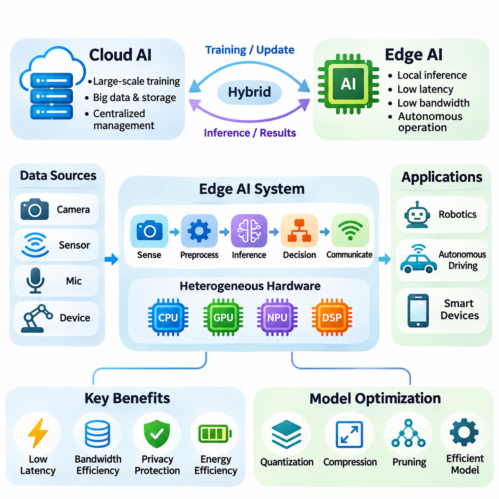
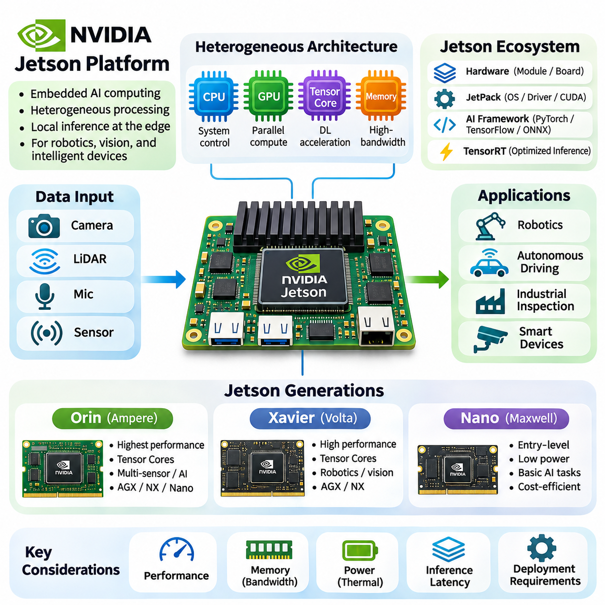
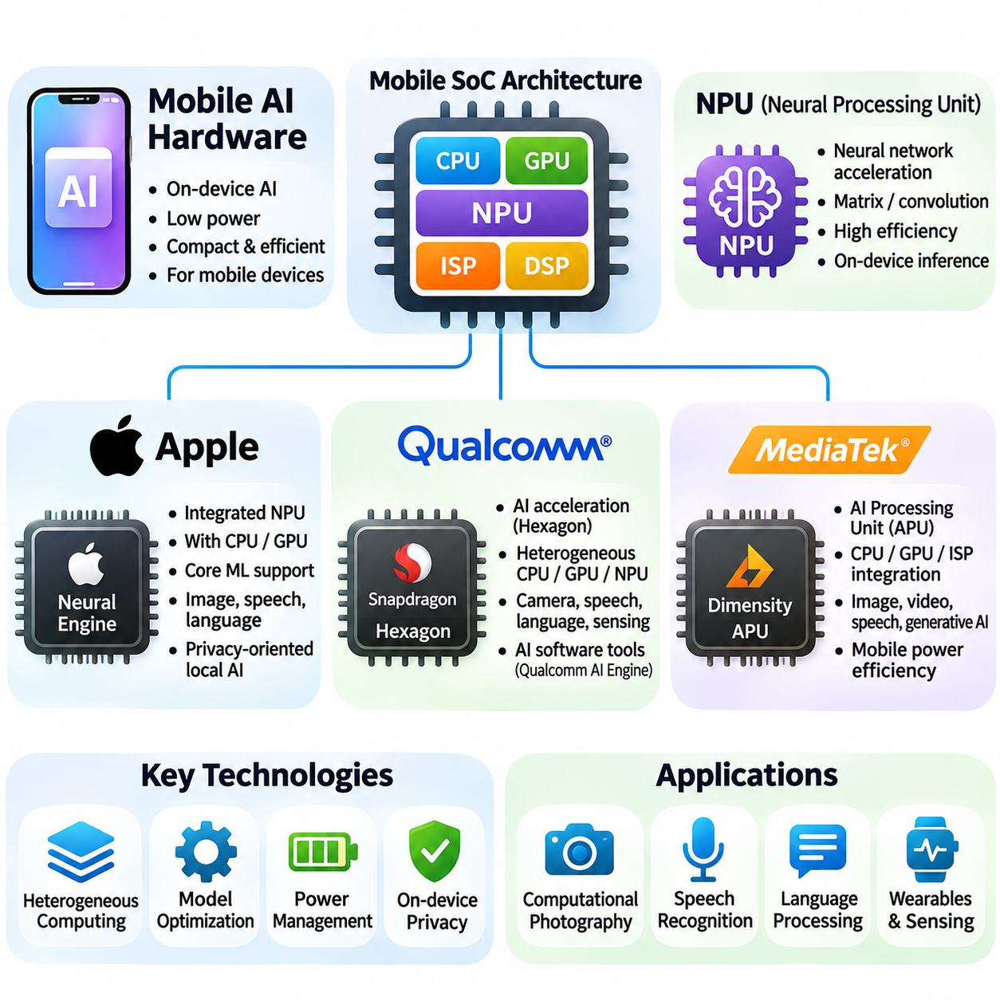
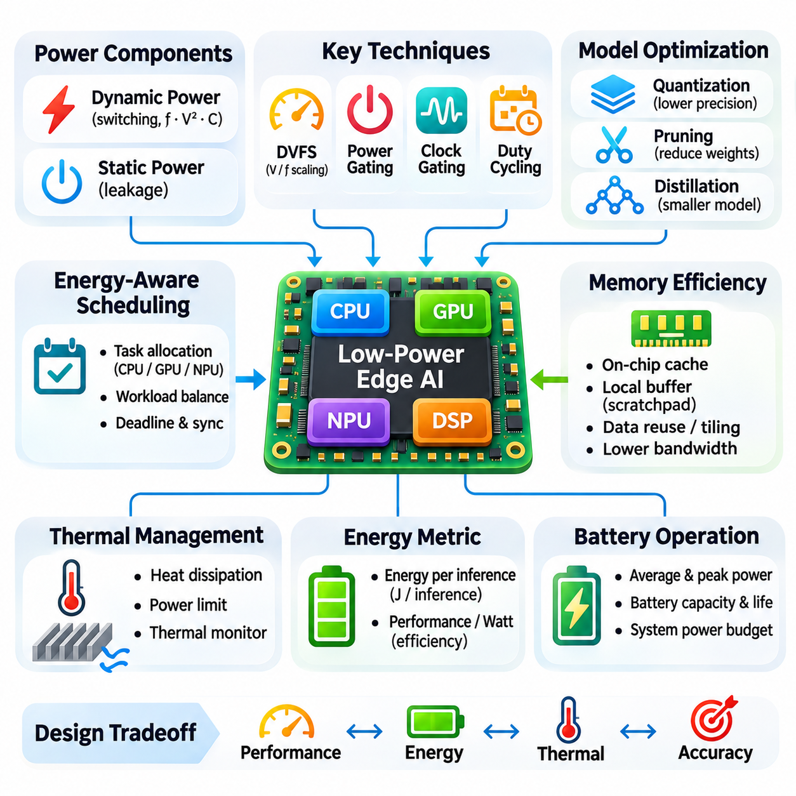
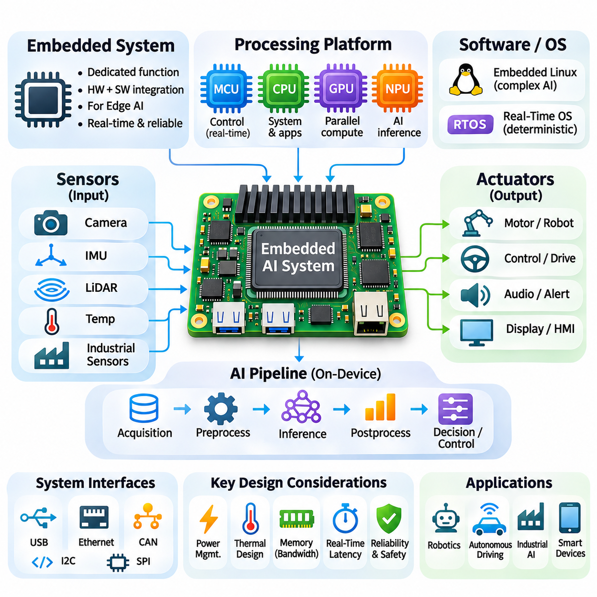
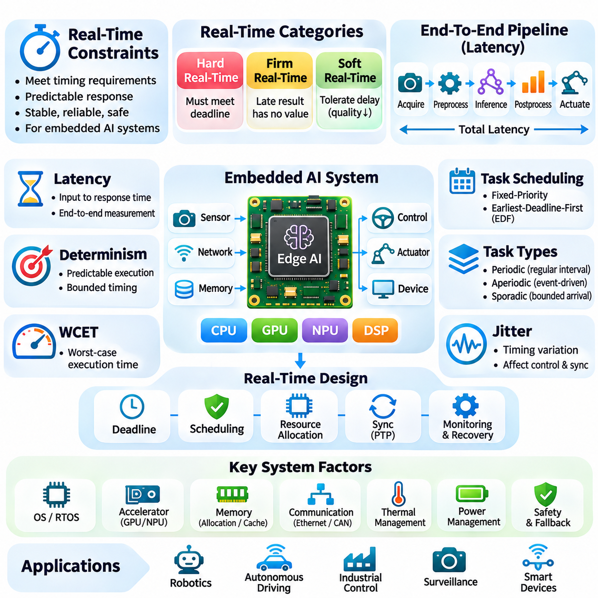
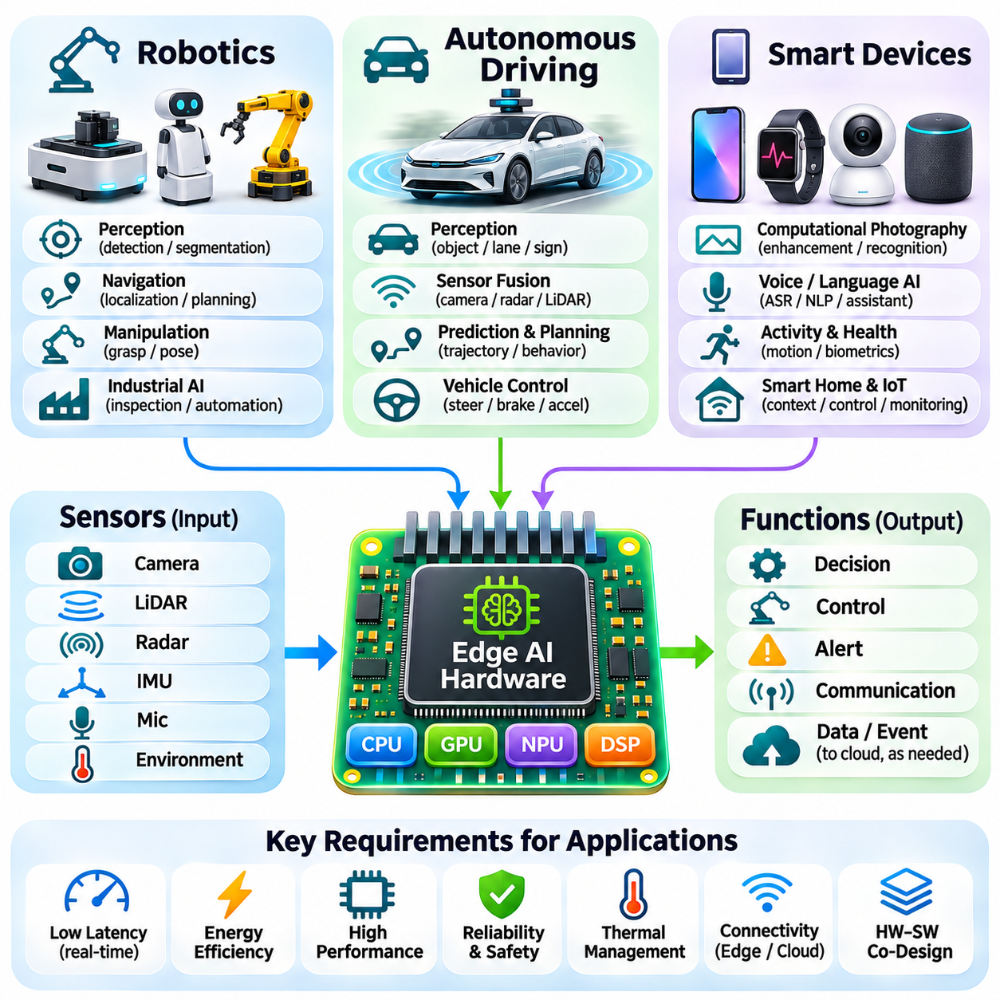

**Volume 39. Hardware for AI**

# 04. Edge AI Hardware

## 04.00 Overview

{width="7.268055555555556in" height="7.268055555555556in"}

Edge AI hardware represents a specialized computing infrastructure designed to execute artificial intelligence workloads directly on devices located near data sources. Unlike centralized cloud systems, edge platforms process information locally, reducing communication latency, network dependency, and unnecessary data transmission. Their architecture emphasizes efficient inference, compact integration, and reliable operation under constrained resources.

The growing adoption of intelligent robots, autonomous vehicles, industrial sensors, and smart devices has accelerated demand for dedicated edge computing hardware. These applications require continuous perception, decision-making, and control without depending entirely on remote servers. Edge AI therefore combines computational acceleration with energy efficiency, environmental adaptability, and predictable response times.

Edge AI architecture integrates heterogeneous processing components, including central processing units, graphics processing units, neural processing units, and dedicated digital signal processors. Each component handles workloads according to its computational characteristics. CPUs coordinate system operations, GPUs accelerate parallel calculations, and NPUs execute neural network operations with optimized energy consumption.

The distinction between cloud AI and edge AI extends beyond physical deployment locations. Cloud infrastructure prioritizes large-scale computational capacity, resource sharing, and centralized model management. Edge hardware prioritizes local responsiveness, limited power consumption, and autonomous execution. Hybrid architectures combine both approaches by performing time-sensitive inference locally while retaining centralized training and management capabilities.

A fundamental challenge in edge AI development is balancing computational performance against energy consumption. Embedded processors operate within strict thermal and electrical limits, making unrestricted computational scaling impractical. Hardware designers must optimize processing architectures, memory access patterns, operating frequencies, and accelerator utilization to achieve acceptable inference performance within available power budgets.

Memory architecture strongly influences the efficiency of edge AI systems. Neural networks require storage for model parameters, intermediate activations, sensor buffers, and runtime data structures. Limited memory capacity can restrict model complexity, while insufficient bandwidth creates computational bottlenecks. Efficient memory allocation, data reuse, compression, and reduced-precision arithmetic help overcome these limitations.

NVIDIA Jetson platforms provide representative examples of heterogeneous edge AI computing architectures. These systems integrate ARM-based CPUs, NVIDIA GPUs, memory subsystems, and specialized acceleration capabilities within compact modules. Their software ecosystem supports accelerated inference, computer vision, and robotic applications, making them suitable for embedded systems requiring substantial parallel processing capabilities.

The Jetson Orin family illustrates the progression toward increasingly capable embedded AI acceleration. Its architecture combines GPU computing, CPU processing, and dedicated acceleration resources to support demanding inference workloads. Depending on the module configuration, these capabilities enable applications involving multiple cameras, object detection, segmentation, localization, and autonomous navigation.

Earlier Jetson generations, including Xavier and Nano, demonstrate different performance and deployment characteristics. Xavier platforms support relatively demanding embedded perception and robotic workloads, while the original Nano platform targets more modest computational requirements. Comparing these generations reveals how processor architecture, memory bandwidth, acceleration capabilities, and power envelopes influence practical system selection.

Mobile AI hardware represents another important category of edge computing technology. Smartphone and tablet processors increasingly integrate dedicated neural acceleration engines alongside general-purpose CPUs and GPUs. These integrated architectures enable image enhancement, speech recognition, language processing, and contextual intelligence while maintaining battery efficiency and compact physical dimensions.

Apple Neural Engine technology exemplifies specialized neural processing integrated into mobile system-on-chip architectures. Qualcomm mobile platforms similarly combine heterogeneous processing resources with dedicated AI acceleration, while MediaTek integrates neural processing capabilities into its mobile chipsets. Although their implementations differ, these platforms share the objective of accelerating AI workloads within tightly constrained energy budgets.

Low-power design is essential because edge devices frequently operate from batteries, limited electrical supplies, or passive cooling systems. Dynamic voltage and frequency scaling adjusts processor operation according to workload demand. Power gating disables inactive hardware components, while workload scheduling distributes computational tasks efficiently. These mechanisms reduce energy consumption without necessarily sacrificing application responsiveness.

Thermal management directly affects computational stability and sustained inference performance. High processing loads generate heat that must be dissipated through heat sinks, airflow, conduction paths, or other cooling mechanisms. When thermal limits are exceeded, processors may reduce operating frequencies to protect hardware. Consequently, sustained performance under realistic environmental conditions is often more meaningful than short-duration peak throughput.

Embedded AI systems combine processing hardware with sensors, communication interfaces, storage devices, and control electronics. Cameras, LiDAR sensors, inertial measurement units, and industrial interfaces provide real-world observations. Embedded processors transform these signals into actionable information through preprocessing, neural inference, and decision logic, creating integrated perception and control pipelines.

Real-time constraints distinguish many edge AI applications from conventional computing workloads. Autonomous machines must respond to environmental changes within defined timing limits, and delayed inference can compromise operational performance. Engineers therefore evaluate not only average inference latency but also worst-case execution time, scheduling jitter, communication delays, and end-to-end processing deadlines.

Real-time AI performance depends on coordinated hardware and software execution. Sensor acquisition, data preprocessing, accelerator scheduling, inference, and actuator communication must operate within a predictable pipeline. Hardware acceleration reduces computational delays, but operating-system scheduling and memory contention can introduce variability. Deterministic system design requires careful resource allocation and timing analysis.

Model optimization plays an important role in adapting neural networks to embedded hardware. Quantization reduces numerical precision and memory requirements, while pruning removes selected parameters or computational structures. Knowledge distillation transfers useful behavior from larger models into smaller architectures. These techniques can improve deployment efficiency, although their effects on accuracy and latency must be measured.

Hardware-aware optimization extends beyond reducing neural network parameter counts. A theoretically compact model may execute inefficiently when its operations are poorly supported by the target accelerator. Kernel availability, tensor dimensions, memory alignment, and operator fusion influence actual execution speed. Effective deployment therefore requires evaluating models using the specific hardware and runtime environment intended for production.

Robotics provides a demanding application domain for edge AI hardware because intelligent machines continuously interact with dynamic physical environments. Mobile robots process camera streams, depth measurements, localization estimates, and navigation commands while maintaining responsive control. Embedded accelerators support perception and planning workloads, allowing robots to operate with reduced dependence on external computing infrastructure.

Autonomous driving systems require substantial computational resources for perception, sensor fusion, localization, trajectory prediction, and motion planning. Edge computing platforms process these workloads close to vehicle sensors to minimize communication delays. Their design must account for sustained computational demand, functional safety requirements, environmental conditions, and dependable operation during network interruptions.

Smart devices demonstrate how edge AI can deliver intelligence within smaller hardware footprints. Security cameras perform local object detection, wearable devices analyze sensor measurements, and industrial monitoring systems identify abnormal operating conditions. Local inference can reduce bandwidth consumption and improve responsiveness while supporting privacy objectives by limiting unnecessary transmission of sensitive data.

Security and reliability are essential considerations for edge hardware deployed outside controlled data centers. Devices may operate in physically accessible locations and communicate through potentially untrusted networks. Secure boot, hardware-backed key storage, encrypted communication, and authenticated software updates help protect deployed systems. Watchdog mechanisms and recovery procedures further support dependable long-term operation.

Selecting suitable edge AI hardware requires evaluating application workloads rather than relying exclusively on advertised accelerator performance. Engineers must consider model compatibility, sustained inference throughput, memory capacity, power consumption, thermal behavior, interface availability, and software support. Total system cost also includes integration effort, maintenance requirements, deployment complexity, and expected operational lifetime.

The evolution of edge AI hardware reflects a broader transition toward distributed intelligence. Improvements in semiconductor integration, specialized accelerators, memory efficiency, and software optimization enable increasingly sophisticated models to operate directly on embedded devices. Future systems will emphasize coordinated heterogeneous computing, energy-aware execution, and closer integration between perception, reasoning, and physical interaction.

Understanding edge AI hardware requires a system-level perspective connecting processor architecture, memory organization, power management, embedded integration, and real-time execution. These elements determine whether an AI model can operate effectively outside centralized computing environments. Their coordinated design establishes the foundation for scalable, responsive, and reliable intelligent systems across robotics, transportation, industry, and consumer technology.

## 04.01 Edge AI Concept

{width="7.268055555555556in" height="7.268055555555556in"}

Edge Artificial Intelligence, commonly referred to as Edge AI, describes the execution of artificial intelligence algorithms directly on computing devices located near the sources of data generation. Instead of transmitting every observation to centralized cloud infrastructure, edge systems perform inference locally. This approach reduces communication latency, limits network traffic, and enables intelligent applications to operate independently of continuous internet connectivity.

The fundamental principle of Edge AI is to move computational intelligence closer to the physical environment where information is collected and decisions are executed. Cameras, industrial sensors, autonomous robots, and mobile devices generate continuous streams of data requiring immediate interpretation. By processing these streams locally, Edge AI transforms raw observations into actionable information without relying on remote processing for every decision.

Traditional cloud-based artificial intelligence architectures concentrate computational resources within centralized data centers. These environments provide substantial processing capacity, scalable storage, and extensive model training infrastructure. However, transmitting sensor data across networks introduces communication delays, bandwidth requirements, and potential service interruptions. Edge AI addresses these limitations by distributing inference capabilities across geographically dispersed devices.

Edge AI does not necessarily replace cloud computing but establishes a complementary computing model. Cloud platforms remain valuable for large-scale training, model development, centralized monitoring, and long-term data analysis. Edge devices execute deployed models and respond to immediate environmental conditions. This division of responsibilities creates hybrid architectures that combine centralized computational resources with decentralized operational intelligence.

An Edge AI system typically integrates sensing, preprocessing, inference, decision-making, and communication into a coordinated processing pipeline. Sensors acquire environmental information, while preprocessing components transform raw measurements into suitable model inputs. Neural network accelerators execute inference operations, and application logic interprets the results. Communication interfaces exchange selected information with external systems when necessary.

The placement of intelligence within a distributed computing architecture significantly influences application performance. Processing data directly on a device minimizes network-dependent delays, while nearby edge gateways can aggregate information from multiple sensors. Regional edge servers provide additional computational capacity without requiring distant cloud access. These deployment levels offer different tradeoffs involving latency, power consumption, scalability, and management complexity.

Latency reduction is one of the most important motivations for adopting Edge AI. Applications involving robotic navigation, collision avoidance, industrial inspection, and interactive interfaces often require rapid responses to changing conditions. Network transmission introduces additional delays that may vary with congestion and connectivity. Local inference eliminates the need for a network round trip during time-critical processing, although computation and scheduling delays remain.

Bandwidth efficiency provides another significant advantage of local intelligence. High-resolution cameras, depth sensors, and industrial monitoring equipment can generate substantial volumes of continuous data. Transmitting every measurement to remote infrastructure may be expensive or impractical. Edge AI allows devices to extract meaningful features, detect relevant events, and transmit compact results instead of complete raw data streams.

Privacy considerations also influence the adoption of Edge AI architectures. Personal images, audio recordings, biometric measurements, and industrial information may contain sensitive content. Processing such information locally can reduce unnecessary transmission and external exposure. However, local execution does not automatically guarantee privacy, because secure storage, access control, encryption, and responsible data management remain essential.

Energy efficiency is a central design consideration because many edge devices operate under strict power constraints. Battery-powered sensors, mobile robots, and embedded controllers cannot continuously consume the energy available to large data-center systems. Edge AI hardware therefore employs specialized accelerators, low-precision arithmetic, efficient memory access, and adaptive power management to deliver useful computational performance within limited energy budgets.

The computational architecture of Edge AI commonly combines general-purpose processors with specialized acceleration hardware. CPUs manage operating systems, application logic, and device coordination, while GPUs accelerate highly parallel numerical operations. Neural Processing Units execute supported neural network workloads using energy-efficient data paths. Digital Signal Processors handle signal-oriented computations, creating heterogeneous platforms optimized for diverse processing requirements.

Hardware selection depends strongly on the computational characteristics of the deployed AI model. Convolutional neural networks require efficient spatial operations, while transformer architectures depend heavily on matrix multiplication and memory movement. Object detection, speech recognition, and sensor fusion introduce different processing demands. Consequently, accelerator capability must be evaluated alongside memory capacity, bandwidth, supported operators, and runtime compatibility.

Model optimization enables increasingly sophisticated artificial intelligence applications to operate on resource-constrained hardware. Quantization reduces numerical precision, pruning removes selected model structures, and knowledge distillation transfers useful behavior into smaller networks. These techniques can reduce storage requirements and computational complexity. Their effectiveness depends on hardware support, implementation quality, and acceptable changes in predictive accuracy.

Real-time execution introduces requirements beyond conventional inference throughput. A system may process many frames per second while occasionally producing unacceptable response delays. Applications involving physical control must therefore consider worst-case latency, scheduling jitter, sensor synchronization, and end-to-end deadlines. Edge AI systems should distinguish average computational performance from the timing guarantees required for dependable operation.

Reliability becomes particularly important when intelligent devices operate in environments with intermittent connectivity. Autonomous machines may encounter network outages, wireless interference, or unavailable cloud services. Local inference enables continued execution of essential functions when remote resources are inaccessible. Nevertheless, reliable autonomy also requires appropriate fault detection, recovery mechanisms, safe operating states, and validated control behavior.

Edge AI architectures can support multiple levels of computational distribution. Lightweight sensors may execute simple classification models, while nearby gateways perform more demanding aggregation and inference. Embedded computing modules can process multimodal information directly within robots or industrial equipment. Cloud services may coordinate model updates and fleet-wide analytics, establishing a hierarchical system that allocates workloads according to operational requirements.

The distinction between inference and training is especially important in Edge AI deployment. Large-scale model training typically requires substantial computational resources, memory capacity, and extensive datasets. Many edge systems therefore receive models trained on centralized infrastructure and execute only inference locally. Certain platforms support incremental adaptation or on-device learning, but these capabilities introduce additional computational, energy, security, and model-management requirements.

Software infrastructure connects AI models with the underlying hardware and operating environment. Frameworks such as PyTorch and TensorFlow support model development, while deployment runtimes such as ONNX Runtime and TensorRT can accelerate supported inference workloads. Hardware drivers, operating systems, and device interfaces complete the execution environment. Compatibility across these layers determines whether theoretical hardware performance can be realized in practice.

Edge AI also changes the engineering requirements of model deployment and maintenance. Devices may operate across different hardware revisions, software versions, and environmental conditions. Remote updates must preserve system availability and protect against unauthorized modifications. Model versioning, deployment validation, performance monitoring, and rollback mechanisms help maintain consistent behavior across distributed installations.

Robotics illustrates the practical importance of combining local intelligence with physical interaction. Autonomous mobile robots continuously interpret camera images, range measurements, and localization information while generating navigation decisions. Edge processors support perception, obstacle recognition, and planning without requiring continuous cloud communication. Their effectiveness depends on coordinated sensor processing, computational scheduling, and integration with reliable motion-control systems.

Autonomous driving represents another demanding application because vehicles must interpret complex environments while maintaining predictable response times. Local computing systems process information from cameras, radar, LiDAR, and other sensors to support perception and planning. High computational throughput is necessary, but functional safety, redundancy, thermal management, and fault tolerance are equally important considerations for dependable vehicle operation.

Industrial Edge AI enables intelligent monitoring and automated decision support near production equipment. Vision systems can identify manufacturing defects, embedded sensors can detect abnormal machine behavior, and local controllers can respond to changing operating conditions. Processing information close to industrial machinery reduces dependence on external communication infrastructure and supports integration with existing automation and supervisory systems.

Smart consumer devices demonstrate the broader accessibility of Edge AI. Smartphones execute image enhancement and speech recognition, wearable devices interpret physiological sensor signals, and smart cameras recognize objects or events. Dedicated mobile accelerators make these functions practical within compact devices. Local processing can improve responsiveness and reduce network usage while allowing selected services to operate without continuous connectivity.

The economic value of Edge AI depends on more than hardware acquisition costs. Local processing may reduce cloud inference charges, network transmission expenses, and infrastructure dependencies. However, distributed devices introduce maintenance, security, software-update, and lifecycle-management costs. Effective system design therefore evaluates total cost of ownership alongside inference performance, energy consumption, deployment scale, and operational reliability.

Edge AI represents a fundamental shift from exclusively centralized artificial intelligence toward distributed, context-aware computing. Its purpose is not simply to execute smaller models on embedded processors, but to place computational capabilities where they provide the greatest operational value. By coordinating hardware acceleration, efficient inference, communication, and dependable execution, Edge AI establishes the foundation for responsive intelligent systems operating throughout the physical world.

## 04.02 Jetson Platform

{width="7.268055555555556in" height="7.268055555555556in"}

The NVIDIA Jetson platform is a family of embedded computing systems designed to accelerate artificial intelligence workloads at the edge. By integrating ARM-based CPUs, NVIDIA GPUs, memory controllers, and multimedia processing engines, Jetson modules provide heterogeneous computing capabilities within compact hardware. Their architecture supports local inference, sensor processing, and autonomous operation without requiring continuous access to cloud infrastructure.

Jetson platforms are particularly suitable for applications that combine computer vision, machine learning, and physical interaction. Autonomous robots, industrial inspection systems, intelligent cameras, and mobile machines frequently require simultaneous processing of multiple sensor streams. Jetson hardware enables these workloads through GPU acceleration, efficient memory architectures, and software integration with established AI development frameworks.

The Jetson ecosystem combines hardware modules, carrier boards, operating systems, development libraries, and deployment tools. JetPack provides a software development environment containing platform drivers, CUDA components, and supported acceleration libraries. Developers can integrate frameworks such as PyTorch, TensorFlow, and ONNX Runtime, subject to platform compatibility, while TensorRT optimizes supported neural network inference workloads.

Jetson modules differ in computational capability, memory capacity, accelerator architecture, and power requirements. Selecting a suitable platform requires evaluating actual application workloads rather than relying exclusively on advertised theoretical performance. Inference latency, sustained throughput, memory bandwidth, thermal limitations, interface availability, and software support collectively determine whether a module can satisfy deployment requirements.

The Jetson Orin family represents a significant advancement in NVIDIA embedded AI computing. Built around the Ampere GPU architecture, Orin integrates CUDA cores and Tensor Cores to accelerate parallel numerical operations and neural network inference. Its heterogeneous architecture combines GPU processing with ARM CPU resources and dedicated acceleration engines, supporting demanding workloads involving perception, sensor fusion, and autonomous decision-making.

Jetson Orin modules are available in configurations designed for different computational and power requirements. Jetson AGX Orin targets demanding embedded applications, while Jetson Orin NX provides substantial acceleration within a smaller module footprint. Jetson Orin Nano addresses more constrained deployment environments. These configurations allow developers to balance processing capacity, memory resources, physical dimensions, and energy consumption.

The Orin architecture is particularly effective for deep learning workloads involving convolutional neural networks, transformer-based perception models, and parallel image processing. Tensor Cores accelerate supported matrix operations, while CUDA cores execute general GPU workloads. Performance depends on numerical precision, memory access efficiency, kernel implementation, and the availability of optimized inference operators within the selected runtime environment.

Memory capacity and bandwidth are critical considerations when deploying complex models on Jetson Orin. Neural network parameters, intermediate activations, camera buffers, and application processes compete for shared system memory. Large vision models and multimodal processing pipelines can consume substantial resources. Efficient buffer management, reduced-precision inference, and careful allocation of computational workloads help maintain predictable execution performance.

Jetson Orin supports robotic applications requiring multiple concurrent processing pipelines. A mobile robot may execute object detection, semantic segmentation, localization, mapping, and navigation while receiving data from cameras and range sensors. GPU acceleration enables demanding perception operations, while CPU resources coordinate system logic and communication. Safety-critical motion control may require independent controllers and validated real-time mechanisms.

Power and thermal management remain essential even on high-performance Orin modules. Sustained GPU utilization generates heat that must be dissipated through appropriate cooling systems. Available power modes influence processor frequencies, accelerator utilization, and achievable throughput. Developers should therefore measure performance under representative operating temperatures and sustained workloads rather than assuming that peak accelerator specifications reflect continuous deployment capability.

The Jetson Xavier generation established an earlier foundation for high-performance embedded AI computing. Xavier modules combine ARM-based CPU processing with GPUs based on the NVIDIA Volta architecture. Their design incorporates Tensor Core acceleration and specialized multimedia capabilities, enabling neural network inference, computer vision, and sensor processing within embedded power envelopes suitable for intelligent machines.

Jetson AGX Xavier was developed for demanding robotics and autonomous machine applications, while Jetson Xavier NX provided a more compact implementation. Both platforms support heterogeneous execution involving CPU, GPU, and dedicated processing resources. Their architectural capabilities enable object recognition, image segmentation, depth processing, and robotic perception, although performance and memory limitations differ between module configurations.

The Volta-based GPU architecture in Xavier introduced Tensor Core capabilities into NVIDIA embedded AI platforms. These specialized processing units accelerate supported matrix operations commonly used in deep learning. Compared with conventional CPU execution, optimized GPU inference can substantially improve throughput for parallel workloads. Actual acceleration depends on model structure, numerical precision, memory behavior, and software implementation.

Xavier platforms illustrate the importance of balancing computational capability against deployment constraints. Embedded robotics systems must accommodate processor modules, sensor interfaces, communication hardware, storage, and cooling components within limited physical space. Xavier modules provide an integrated computing foundation, but successful deployment still requires evaluating sustained performance, electrical compatibility, thermal behavior, and available software maintenance support.

The transition from Xavier to Orin reflects improvements in GPU architecture, computational throughput, memory subsystem capabilities, and accelerator efficiency. Orin generally provides greater capacity for demanding neural network workloads, while Xavier remains relevant for existing deployments and applications with compatible performance requirements. Migration between generations requires verification of software dependencies, carrier-board compatibility, power requirements, and application behavior.

The original Jetson Nano platform introduced accessible GPU-accelerated computing for lightweight embedded AI development. It combines ARM CPU cores with a Maxwell-based NVIDIA GPU, providing parallel processing capabilities within a relatively modest power envelope. Nano became useful for educational projects, intelligent cameras, entry-level robotics, and experimentation with compact neural network models.

Jetson Nano demonstrates how embedded GPU computing can support practical inference without requiring data-center hardware. Applications such as image classification, basic object detection, and simple visual tracking can execute locally when models are appropriately optimized. However, limited memory capacity, computational throughput, and accelerator features constrain its suitability for larger neural networks and demanding simultaneous processing tasks.

Unlike Xavier and Orin, the original Jetson Nano GPU does not include Tensor Cores. Consequently, its neural network acceleration relies on conventional CUDA execution and other supported optimization mechanisms. This architectural distinction influences the performance of matrix-intensive workloads. Developers must carefully select model architectures, input resolutions, and inference runtimes to achieve acceptable latency and memory consumption.

The original Jetson Nano and Jetson Orin Nano should not be treated as equivalent hardware generations. Although their names share the Nano designation, Orin Nano uses a newer Ampere-based architecture with substantially different acceleration capabilities. Their software environments, performance characteristics, and deployment requirements also differ. Hardware comparisons must therefore identify the exact module generation and configuration.

Across the Nano, Xavier, and Orin generations, NVIDIA Jetson demonstrates the evolution of embedded AI from lightweight GPU inference toward increasingly sophisticated heterogeneous computing. Each generation introduces different balances among processing performance, accelerator specialization, memory resources, and power consumption. Understanding these architectural differences helps engineers match hardware capabilities to realistic application requirements.

Software compatibility is a major consideration when maintaining or upgrading Jetson-based systems. Different hardware generations support different JetPack and Linux software environments, and not every framework version or acceleration library is available across all platforms. Applications developed for one generation may require dependency changes, model conversion, kernel adjustments, or driver updates before operating correctly on another.

Deployment optimization should consider the complete inference pipeline rather than isolated neural network execution. Camera acquisition, image preprocessing, memory transfers, inference, postprocessing, and communication all contribute to end-to-end latency. Hardware acceleration provides the greatest benefit when unnecessary data movement is minimized and pipeline stages are coordinated. Profiling tools help identify computational bottlenecks and resource contention.

Jetson platform selection ultimately requires a system-level evaluation of performance, reliability, energy consumption, software lifecycle, and integration complexity. Orin is generally appropriate for demanding modern edge AI workloads, Xavier can support established embedded applications, and the original Nano remains useful for lightweight or legacy projects. Matching these capabilities to application constraints establishes a practical foundation for reliable edge intelligence.

## 04.03 Mobile AI Hardware

{width="7.268055555555556in" height="7.268055555555556in"}

Mobile AI hardware refers to specialized computing architectures that execute artificial intelligence workloads within smartphones, tablets, wearable devices, and other compact electronic systems. Unlike data-center accelerators, mobile processors must operate under strict limitations involving power consumption, thermal dissipation, physical dimensions, and battery capacity. Their designs emphasize efficient inference, heterogeneous processing, and continuous interaction with sensors and applications.

Modern mobile AI platforms commonly integrate CPUs, GPUs, neural processing units, image signal processors, and digital signal processors into a single system-on-chip architecture. Each processing component supports different computational requirements. CPUs coordinate operating systems and application logic, GPUs accelerate parallel workloads, and dedicated neural accelerators execute supported machine learning operations with improved energy efficiency.

The neural processing unit, or NPU, is a central component of contemporary mobile AI hardware. NPUs accelerate mathematical operations commonly used in neural networks, including matrix multiplication, convolution, and tensor transformations. Specialized arithmetic units, local memory structures, and optimized data movement reduce computational overhead. However, actual performance depends on model architecture, supported operators, numerical precision, and software integration.

Apple develops tightly integrated mobile computing platforms that combine proprietary processors, operating systems, and machine learning frameworks. Its Neural Engine provides dedicated acceleration for supported neural network operations within Apple silicon. By coordinating hardware capabilities with system software, Apple enables applications involving image understanding, speech processing, language interpretation, and computational photography while maintaining mobile energy constraints.

The Apple Neural Engine operates alongside CPU and GPU resources rather than replacing them. Different machine learning operations may execute on different processing units depending on model structure and framework support. Apple\'s Core ML framework provides model deployment capabilities and can select available compute resources according to configuration and compatibility. This heterogeneous execution model allows applications to balance performance, efficiency, and implementation requirements.

Core ML plays an important role in connecting trained neural networks with Apple\'s mobile hardware. Models developed using common machine learning frameworks can be converted into supported Core ML representations for deployment. Optimization may involve numerical precision reduction, model compression, and compatible operator selection. Developers must evaluate actual device behavior because Neural Engine utilization and acceleration depend on hardware generation and model characteristics.

Apple\'s integrated hardware and software architecture also supports privacy-oriented local processing. Applications can perform selected image, audio, and language inference tasks without transmitting every input to remote servers. This approach can reduce network dependency and unnecessary data exposure. Nevertheless, local execution requires secure application design, appropriate data handling, and careful management of permissions and stored information.

Qualcomm develops mobile computing platforms that integrate heterogeneous processing resources for artificial intelligence workloads. Snapdragon systems-on-chip combine CPU, GPU, and specialized AI acceleration components, including Hexagon processing technology. These resources support computational photography, speech recognition, language processing, and contextual sensing. Their organization emphasizes balancing inference performance with power efficiency and application responsiveness.

Qualcomm\'s Hexagon architecture supports accelerated execution of suitable signal-processing and neural network workloads. Depending on the processor generation, its capabilities include vector processing, tensor acceleration, and specialized memory mechanisms. These features improve efficiency for supported operations by reducing unnecessary data transfers and using hardware optimized for parallel computation. Performance varies significantly across Snapdragon product generations.

The Qualcomm AI software ecosystem provides development and deployment mechanisms for supported Snapdragon hardware. Tools such as the Qualcomm AI Engine Direct SDK and Qualcomm Neural Processing SDK have supported neural network execution on available acceleration resources, subject to platform and version compatibility. Developers must consider model conversion, operator coverage, numerical formats, and runtime behavior when selecting an execution pathway.

Qualcomm platforms are particularly relevant to mobile applications requiring continuous sensor interpretation. Camera pipelines combine image signal processing with neural inference to support scene understanding, image enhancement, and object recognition. Audio systems use efficient processing for speech and acoustic tasks, while contextual applications interpret motion and environmental signals. Workload distribution across hardware components influences both battery consumption and response latency.

MediaTek provides another major family of mobile system-on-chip architectures integrating dedicated AI acceleration capabilities. Its Dimensity platforms combine CPU, GPU, image processing, and neural acceleration resources for smartphones and connected devices. MediaTek\'s AI Processing Unit technology supports supported neural network workloads within mobile power budgets. The exact accelerator organization and capabilities depend on the chipset generation.

MediaTek\'s AI processing architecture targets workloads such as computational photography, object detection, image segmentation, speech processing, and selected language-model operations. Dedicated acceleration hardware can improve execution efficiency compared with relying entirely on general-purpose processors. However, benefits depend on operator compatibility, memory bandwidth, numerical precision, and runtime optimization. Benchmark results should therefore reflect representative models and actual device conditions.

MediaTek provides software tools and execution interfaces for deploying AI models on supported platforms. Its NeuroPilot ecosystem has included development tools and runtime support for utilizing available neural acceleration resources. Integration with supported machine learning frameworks enables developers to prepare models for mobile inference. Hardware compatibility, driver availability, and supported software versions remain important considerations throughout deployment.

Apple, Qualcomm, and MediaTek share the objective of accelerating neural network inference within tightly constrained mobile environments, but their ecosystems differ in hardware organization and software accessibility. Apple emphasizes integrated control across silicon and operating systems, while Qualcomm and MediaTek support diverse device manufacturers and configurations. These differences influence optimization strategies, deployment portability, and available acceleration interfaces.

Comparing mobile neural accelerators requires more than examining advertised operations per second. Peak throughput measurements may assume specific numerical formats, tensor dimensions, and idealized execution conditions. Real applications include preprocessing, memory transfers, operator scheduling, and postprocessing. Meaningful evaluation therefore considers end-to-end latency, sustained performance, energy per inference, memory consumption, and compatibility with representative neural networks.

Memory architecture strongly influences mobile AI performance because processors and accelerators often share limited system memory resources. Neural network weights, intermediate activations, image buffers, and application data compete for available capacity and bandwidth. Excessive data movement increases energy consumption and latency. Efficient memory scheduling, operator fusion, tensor reuse, and reduced-precision representations can improve execution efficiency when supported by the platform.

Thermal constraints create additional challenges for sustained mobile inference. Smartphones and compact devices have limited cooling capacity, so prolonged accelerator utilization may increase internal temperatures. Thermal management mechanisms can reduce operating frequencies or redistribute workloads to maintain safe conditions. Consequently, short-duration benchmark results may not represent sustained application performance, particularly during continuous camera processing or complex multimodal inference.

Quantization is widely used to adapt neural networks to mobile AI accelerators. Reduced-precision formats can decrease memory requirements, improve data movement efficiency, and enable specialized arithmetic execution. However, supported formats and acceleration characteristics vary between hardware generations. Developers should validate model accuracy after conversion and measure actual latency improvements rather than assuming that lower numerical precision always produces faster execution.

Mobile AI workloads increasingly include transformer architectures and multimodal models in addition to conventional convolutional networks. Attention operations, matrix multiplication, and key-value cache management introduce significant memory and computational requirements. Efficient deployment depends on model size, sequence length, supported operators, and available memory capacity. Smaller models and optimized inference runtimes can make selected language and multimodal tasks practical on mobile devices.

Software portability remains challenging because different mobile chipsets expose distinct accelerator capabilities and execution interfaces. A neural network that performs efficiently on one device may execute differently on another. Framework abstractions and standardized model representations can simplify deployment, but they do not eliminate hardware-specific optimization requirements. Testing across representative devices is necessary to establish reliable performance and consistent application behavior.

Security and privacy are important considerations when mobile devices execute AI models using personal or sensitive information. Secure operating systems, application isolation, protected storage, and controlled model access help reduce exposure. Local inference can limit unnecessary transmission of raw data, but it does not automatically prevent unauthorized access or misuse. Responsible mobile AI deployment requires coordinated protection across hardware, software, and data management.

Mobile AI hardware continues to evolve toward greater accelerator specialization, improved memory efficiency, and more sophisticated on-device intelligence. Apple Neural Engine, Qualcomm Hexagon technologies, and MediaTek AI processing platforms illustrate different approaches to integrating machine learning acceleration into compact systems. Their practical value depends on matching model requirements with hardware capabilities, software support, energy constraints, and reliable real-world execution.

## 04.04 Low Power Design

{width="7.268055555555556in" height="7.268055555555556in"}

Low-power design is a fundamental requirement for edge AI hardware operating under limited energy and thermal resources. Unlike data-center systems, embedded devices often depend on batteries, compact power supplies, or passive cooling mechanisms. Their architectures must deliver sufficient inference performance while minimizing electrical consumption. Effective low-power design combines processor selection, workload optimization, memory efficiency, and intelligent power management.

Power consumption in digital computing systems consists primarily of dynamic and static components. Dynamic power arises from transistor switching activity and depends on operating frequency, supply voltage, and effective circuit capacitance. Static power results mainly from leakage currents that persist even when circuits are inactive. Understanding these mechanisms allows engineers to identify opportunities for reducing energy consumption without unnecessarily sacrificing computational performance.

Dynamic voltage and frequency scaling, commonly called DVFS, adjusts processor operating conditions according to workload requirements. Reducing clock frequency and supply voltage can lower dynamic power consumption, although execution time may increase. Modern embedded processors apply DVFS across CPU, GPU, and accelerator domains. Effective control policies balance computational deadlines, thermal conditions, and energy efficiency rather than simply minimizing operating frequency.

Power gating reduces leakage consumption by disconnecting inactive circuit blocks from their power supplies. Clock gating prevents unnecessary switching activity by disabling clock signals to unused components. These techniques are particularly valuable in heterogeneous systems containing multiple processing engines. However, transitioning between active and inactive states introduces latency and energy overhead, making workload-aware scheduling essential for effective power savings.

Energy efficiency must be evaluated in relation to completed computational work rather than instantaneous power alone. A processor operating at higher power may finish an inference task quickly and return to an idle state, potentially consuming less total energy. Conversely, low-frequency execution may extend processing duration and increase leakage losses. Energy per inference provides a useful metric for comparing configurations under equivalent accuracy and workload conditions.

Hardware specialization is an important strategy for reducing the energy cost of neural network inference. Dedicated neural processing units implement common operations such as convolution and matrix multiplication using optimized arithmetic structures. Compared with general-purpose execution, specialized data paths can reduce instruction overhead and unnecessary memory movement. Their effectiveness depends on model compatibility, utilization, and supported numerical formats.

Memory access frequently consumes substantial energy in AI workloads, particularly when large tensors move repeatedly between processing units and external memory. On-chip caches, scratchpad memories, and local buffers can reduce expensive off-chip transfers. Data reuse strategies retain frequently accessed values near computational units. Efficient tiling and memory scheduling improve locality while reducing bandwidth demand and energy consumption.

Numerical precision strongly influences hardware energy efficiency. Quantization converts model parameters and activations into lower-precision representations, such as supported integer formats. Smaller numerical values reduce memory storage and data movement requirements while enabling efficient arithmetic execution. However, quantization must preserve acceptable model accuracy, and its benefits depend on whether the target accelerator efficiently supports the selected precision.

Model compression provides another mechanism for reducing computational and memory requirements. Pruning removes selected weights or structures, while knowledge distillation transfers useful behavior from larger models into smaller networks. Structured compression can simplify execution when supported by the hardware and runtime. Unstructured sparsity may provide limited practical acceleration unless specialized kernels or processing units can exploit the resulting patterns.

Workload scheduling influences power consumption in systems containing CPUs, GPUs, NPUs, and digital signal processors. Different processing engines may execute the same operation with substantially different energy costs. Assigning tasks according to computational characteristics can improve overall efficiency. Scheduling decisions must also consider data transfer overhead, synchronization requirements, execution deadlines, and the cost of activating additional hardware components.

Thermal management is closely connected to low-power design because electrical energy consumed by processors is largely converted into heat. Compact embedded systems have limited heat dissipation capacity, especially when passive cooling is required. Excessive temperatures can trigger frequency reduction and degrade sustained inference throughput. Effective designs coordinate power limits, cooling structures, workload distribution, and thermal monitoring to maintain reliable operation.

Battery-powered edge devices require careful management of both average consumption and short-duration power peaks. Neural inference, wireless communication, sensor acquisition, and actuator operation may produce overlapping power demands. Battery capacity alone does not determine operating duration because conversion losses, discharge characteristics, and environmental temperature also matter. Power budgeting must therefore consider complete system behavior under representative operating conditions.

Duty cycling is especially effective for applications that do not require continuous high-performance inference. Sensors and processors can remain in low-power states until periodic sampling or event detection activates additional computation. Always-on low-power controllers may monitor simple signals and wake more capable accelerators when necessary. This hierarchical approach reduces average energy consumption while preserving responsiveness to important events.

Event-driven processing further improves efficiency by avoiding unnecessary computation on redundant sensor data. Instead of executing complex neural networks continuously, systems may use lightweight detectors to identify meaningful changes. More demanding inference is activated only when relevant conditions occur. This strategy is useful for intelligent cameras, environmental monitoring, wearable devices, and industrial sensing systems with intermittent activity.

Communication energy must also be considered when designing distributed edge AI systems. Transmitting raw images, audio streams, or sensor measurements can consume substantial power, particularly over wireless networks. Local inference may reduce communication requirements by transmitting classifications, compressed features, or event summaries. However, the optimal balance depends on inference complexity, network characteristics, transmission frequency, and available energy resources.

Low-power software optimization complements hardware-level techniques by reducing unnecessary operations and improving resource utilization. Operator fusion, efficient kernel selection, asynchronous execution, and minimized memory allocation can reduce execution overhead. Runtime systems should avoid excessive synchronization and repeated data conversions. Profiling both computational latency and power consumption helps determine whether optimizations deliver measurable energy savings.

Real-time requirements impose additional constraints on energy optimization. Lowering processor frequency or placing accelerators into sleep states may reduce power but increase response latency. Autonomous robots and safety-related systems must satisfy timing deadlines even under changing workloads. Power management policies should therefore maintain sufficient computational headroom and distinguish critical processing tasks from operations that can tolerate delayed execution.

Low-power design also requires careful selection of peripheral components and supporting electronics. Cameras, storage devices, wireless modules, voltage regulators, and interface controllers contribute to total system consumption. Efficient power conversion and selective peripheral shutdown can produce meaningful savings. Evaluating only the AI accelerator may underestimate actual energy requirements, especially in sensor-rich embedded platforms.

Performance measurement should distinguish peak power, average power, idle consumption, and energy per completed task. Representative benchmarks must include preprocessing, inference, postprocessing, communication, and relevant sensor activity. Thermal stabilization is important because short measurements may not reveal sustained operating behavior. Accurate evaluation requires repeatable workloads, appropriate instrumentation, and clearly defined system boundaries.

Low-power design ultimately involves coordinated optimization across algorithms, software, hardware, and operating conditions. No single technique guarantees minimum energy consumption for every workload. Effective edge AI systems combine specialized acceleration, efficient memory movement, adaptive scheduling, thermal control, and application-aware power policies. This integrated approach enables dependable intelligent computation within the energy constraints of embedded and mobile environments.

## 04.05 Embedded Systems

{width="7.268055555555556in" height="7.268055555555556in"}

Embedded systems are specialized computing platforms designed to perform defined functions within larger electronic or mechanical devices. Unlike general-purpose computers, they integrate processing hardware, memory, interfaces, and control software around specific operational requirements. In edge AI applications, embedded systems extend traditional control functions by incorporating local perception, neural network inference, and intelligent decision-making.

The architecture of an embedded AI system combines computational processing with direct interaction with the physical environment. Sensors acquire measurements, processors interpret incoming information, and actuators execute control commands. These functions operate through coordinated hardware and software components. The resulting system must balance computational capability, deterministic behavior, energy consumption, reliability, and physical integration constraints.

Embedded computing platforms commonly employ microcontrollers, microprocessors, system-on-chip devices, and specialized AI accelerators. Microcontrollers provide efficient control of peripheral devices and time-sensitive operations, while application processors support complex operating systems and computational workloads. Neural processing units and embedded GPUs accelerate machine learning inference, allowing intelligent functions to coexist with conventional control tasks.

System-on-chip architectures integrate multiple processing resources and peripheral controllers into compact semiconductor devices. CPUs execute application logic, GPUs process parallel workloads, and dedicated accelerators perform supported neural network operations. Integrated memory controllers, communication interfaces, and multimedia engines reduce external component requirements. Such integration improves compactness and can simplify power distribution and system-level communication.

Memory organization is particularly important in embedded AI systems because available capacity and bandwidth are often limited. Program instructions, operating system services, model parameters, intermediate activations, and sensor buffers compete for shared resources. Cache hierarchies, local memory, and external DRAM must be coordinated to avoid performance bottlenecks. Efficient allocation and predictable memory access support stable inference and control execution.

Embedded operating systems provide scheduling, resource management, device access, and communication services. Lightweight real-time operating systems are frequently used for microcontroller-based control, while embedded Linux supports more complex AI software environments. Operating system selection depends on timing requirements, memory capacity, driver availability, and application complexity. Some systems combine Linux processors with separate real-time controllers.

Real-time behavior is a fundamental consideration when embedded systems interact with physical processes. Control loops must respond to sensor measurements and generate outputs within defined timing constraints. AI inference can introduce variable execution latency, particularly when accelerators share memory and processing resources. Reliable designs separate hard real-time responsibilities from less predictable workloads and verify end-to-end response characteristics.

Hardware interfaces connect embedded processors with sensors, actuators, storage devices, and external controllers. Common interfaces include I2C, SPI, UART, USB, Ethernet, CAN, and PCI Express. Each interface provides different bandwidth, latency, electrical, and communication characteristics. Selecting appropriate connections requires evaluating data rates, timing requirements, cable length, electromagnetic interference, and integration complexity.

Sensor integration transforms embedded computing platforms into systems capable of environmental perception. Cameras provide visual information, inertial sensors measure motion, and range sensors estimate surrounding geometry. Industrial sensors supply temperature, pressure, vibration, or position measurements. Synchronization and calibration are essential when combining multiple sensor streams, because timing errors and inconsistent coordinate systems can degrade inference accuracy.

Embedded AI pipelines typically include data acquisition, preprocessing, model inference, postprocessing, and application-level decisions. Raw sensor information is converted into suitable numerical representations before entering neural networks. Inference outputs are interpreted according to application requirements and may trigger control actions or communication events. Efficient pipeline implementation minimizes unnecessary copying, synchronization delays, and resource contention.

Hardware acceleration enables embedded systems to execute computationally demanding AI models within constrained environments. GPUs provide flexible parallel processing, while NPUs and dedicated accelerators optimize supported neural network operations. Their practical performance depends on operator compatibility, memory bandwidth, numerical precision, and runtime implementation. Heterogeneous scheduling distributes workloads across available engines according to performance and energy requirements.

Power management is essential because embedded devices may operate from batteries, industrial power supplies, or energy-limited installations. Dynamic voltage and frequency scaling, clock gating, and selective peripheral shutdown can reduce unnecessary consumption. However, aggressive power reduction may increase inference latency or interfere with control deadlines. Effective policies account for processing demand, operating temperature, and system safety requirements.

Thermal design influences both sustained computational performance and hardware reliability. Embedded AI processors can generate substantial heat during continuous inference, particularly when executing multiple vision models. Heat sinks, conductive enclosures, airflow, and thermal interface materials provide mechanisms for heat dissipation. Engineers must evaluate performance under realistic ambient temperatures and account for frequency throttling during prolonged operation.

Reliability engineering addresses the possibility of hardware faults, software failures, communication interruptions, and unexpected operating conditions. Watchdog timers detect stalled processes, while health monitoring identifies abnormal temperatures, voltages, or resource usage. Recovery mechanisms may restart individual services or transition the system into a defined safe state. Critical functions should not depend exclusively on successful neural network inference.

Functional safety requirements become especially important when embedded AI controls physical motion or interacts with people. A neural network may provide perception or classification results, but safety-related actions often require independently validated control mechanisms. Emergency stopping, actuator limits, fault detection, and safety communication must be designed according to the application risk. AI functionality should complement rather than replace established safety engineering practices.

Security is another essential aspect of embedded system architecture because deployed devices may operate outside protected computing environments. Secure boot verifies authorized software, encryption protects stored and transmitted information, and access controls restrict privileged operations. Signed updates and protected credentials reduce exposure to unauthorized modifications. Security mechanisms must also consider constrained hardware resources and long operational lifetimes.

Software deployment involves integrating trained AI models with hardware-specific drivers, inference runtimes, and application services. Frameworks such as TensorFlow Lite, ONNX Runtime, and TensorRT support selected embedded deployment scenarios. Model conversion, quantization, and operator optimization can improve efficiency. Compatibility testing is necessary because accelerator support and available software versions vary across processor families and operating environments.

Embedded AI development also requires systematic testing and performance measurement. Engineers evaluate inference latency, processing throughput, memory utilization, energy consumption, and thermal behavior under representative workloads. Hardware-in-the-loop testing connects software execution with physical devices and simulated operating conditions. Long-duration tests reveal intermittent faults, memory leaks, timing instability, and environmental sensitivity that short benchmarks may overlook.

Robotics demonstrates the importance of integrating embedded AI with sensing and control. Autonomous mobile robots process camera images, LiDAR measurements, and localization information while coordinating navigation and actuator commands. Embedded GPUs or NPUs accelerate perception, while dedicated controllers manage motor control and safety functions. Reliable operation depends on synchronized sensing, predictable communication, and coordinated computational scheduling.

Industrial automation applies embedded AI to equipment monitoring, visual inspection, predictive maintenance, and intelligent control support. Local processors analyze sensor streams close to machinery, reducing dependence on remote infrastructure. Integration with programmable logic controllers, industrial networks, and supervisory systems enables AI outputs to support existing automation processes. Environmental robustness and lifecycle maintenance are important deployment considerations.

Embedded systems also support intelligent cameras, medical instruments, agricultural machines, and connected consumer devices. Their requirements vary widely in processing complexity, power consumption, operating environment, and regulatory constraints. Some applications prioritize continuous low-power monitoring, while others require intensive multimodal inference. A successful design begins by translating application requirements into measurable hardware and software specifications.

Hardware-software co-design improves embedded AI efficiency by considering model architecture and physical computing resources together. Neural network structures should match supported accelerator operations, memory limits, and execution deadlines. Software scheduling must accommodate sensor acquisition, communication, and control tasks. Evaluating these interactions early reduces integration risks and prevents performance problems that cannot be resolved through model optimization alone.

Embedded AI systems ultimately provide the computational foundation for intelligent devices operating directly in the physical world. Their effectiveness depends on coordinated design across processors, memory, interfaces, operating systems, inference software, and control mechanisms. By combining efficient acceleration with reliable execution, security, and real-time integration, embedded platforms enable practical autonomous and context-aware applications beyond centralized computing infrastructure.

## 04.06 Real Time Constraints

{width="7.268055555555556in" height="7.268055555555556in"}

Real-time constraints define the timing requirements that embedded AI systems must satisfy while interacting with dynamic physical environments. Unlike conventional computing workloads, real-time applications are evaluated not only by the correctness of their results but also by when those results become available. Autonomous robots, industrial controllers, and intelligent sensors require predictable response times to maintain stable, reliable, and safe operation.

Real-time systems are commonly classified into hard, firm, and soft real-time categories. Hard real-time tasks must meet every specified deadline because a violation may cause unacceptable consequences. Firm real-time tasks lose their value when results arrive too late, while soft real-time applications tolerate occasional delays with reduced service quality. This classification determines scheduling policies, verification methods, and acceptable execution variability.

Latency represents the elapsed time between an input event and the corresponding system response. In embedded AI pipelines, total latency includes sensor acquisition, data transfer, preprocessing, neural inference, postprocessing, and actuator communication. Optimizing inference alone may provide limited benefits when other stages dominate execution time. End-to-end latency measurement is therefore essential for evaluating real-time system performance.

Determinism describes the degree to which execution timing remains predictable under defined operating conditions. A system may achieve excellent average inference speed while experiencing occasional delays caused by memory contention, operating system scheduling, or accelerator synchronization. Such variability can undermine real-time guarantees. Reliable implementations prioritize bounded execution behavior and predictable resource allocation over average throughput alone.

Worst-case execution time, or WCET, represents an upper bound on the duration required to complete a task under specified assumptions. WCET analysis helps determine whether computational workloads can meet their deadlines. Neural network inference complicates this analysis because hardware accelerators, caches, and shared memory introduce timing variability. Practical verification combines analytical bounds, controlled measurements, and conservative operating assumptions.

Task scheduling determines how processing resources are allocated among concurrent activities. Fixed-priority scheduling assigns priorities according to predefined policies, while earliest-deadline-first scheduling dynamically prioritizes tasks with approaching deadlines. Their suitability depends on processor architecture, task characteristics, and system assumptions. Scheduling analysis must account for execution time, release patterns, blocking delays, and interference.

Periodic tasks execute at regular intervals and are common in sensor sampling and feedback control. A motor controller may require updates at a substantially higher frequency than a visual perception model. Aperiodic tasks respond to irregular events, while sporadic tasks have bounded arrival characteristics. Coordinating these workloads requires careful prioritization so that computationally intensive inference does not interrupt critical control operations.

Jitter refers to variation in the timing of task execution, sensor sampling, or communication events. Even when average latency is acceptable, excessive jitter can reduce control stability and synchronization accuracy. Sources include interrupt handling, thread scheduling, memory allocation, and network congestion. Reducing jitter requires disciplined software design, appropriate scheduling policies, and measurement under representative system loads.

Operating system selection strongly influences real-time behavior. Real-time operating systems provide mechanisms for priority scheduling, bounded interrupt response, and controlled resource management. Embedded Linux can support demanding AI workloads, while real-time kernel configurations improve scheduling responsiveness. However, a real-time kernel alone does not guarantee deterministic inference when device drivers and accelerators introduce unpredictable delays.

Hardware accelerators improve computational throughput but create additional scheduling challenges. GPUs and NPUs often execute operations asynchronously and share memory bandwidth with CPUs and peripheral devices. Kernel launch overhead, command queues, and synchronization points contribute to response latency. Real-time integration requires evaluating accelerator contention, execution predictability, and the effects of simultaneous workloads.

Memory management is another important source of timing variability. Dynamic allocation, page faults, cache misses, and memory swapping can introduce unpredictable delays. Real-time applications may preallocate buffers, lock critical memory pages, and minimize allocation during time-sensitive execution. Cache behavior and shared memory bandwidth must also be considered because concurrent AI workloads can interfere with control tasks.

Communication deadlines become critical when embedded AI components exchange information across distributed controllers. Ethernet, CAN, and industrial communication networks exhibit different latency and arbitration characteristics. Network congestion, packet retransmission, and synchronization errors can delay sensor information or actuator commands. Reliable designs establish communication budgets and select protocols appropriate to the required timing guarantees.

Time synchronization enables distributed sensors and processors to interpret events within a consistent temporal reference. Camera frames, inertial measurements, and range observations must be associated with accurate timestamps to support sensor fusion. Protocols such as Precision Time Protocol can coordinate clocks across compatible networked devices. Synchronization quality directly affects state estimation, localization, and control accuracy.

Control systems impose timing requirements because feedback decisions depend on the age and consistency of sensor information. Delayed perception updates can cause controllers to react to outdated environmental conditions. In autonomous robotics, navigation and obstacle avoidance must account for sensing latency and vehicle motion during computation. Designers therefore evaluate the complete perception-to-action delay rather than treating inference as an isolated process.

Deadline misses require explicit handling rather than assuming that every inference operation will finish on time. Systems may discard stale results, reuse validated estimates, reduce computational workload, or activate fallback control strategies. Safety-critical functions should maintain independently verified protective mechanisms. Graceful degradation allows an embedded AI system to preserve essential behavior when computational demand exceeds available resources.

Adaptive inference offers a method for balancing accuracy and timing constraints. A system may select smaller models, lower image resolutions, or reduced processing frequencies when computational resources become limited. Early-exit networks and conditional execution can reduce average workload for suitable inputs. However, adaptation policies must preserve required accuracy and provide predictable behavior under worst-case operating conditions.

Power management interacts with real-time performance because voltage scaling, frequency reduction, and sleep-state transitions affect execution timing. Energy-saving policies may introduce wake-up latency or reduce available computational capacity. Thermal throttling can further increase inference duration during sustained operation. Real-time designs must validate deadlines across supported power states, thermal conditions, and workload combinations.

Performance isolation reduces interference between critical control functions and computationally intensive AI applications. Dedicated processor cores, priority-aware scheduling, memory bandwidth management, and separate microcontrollers can protect essential tasks. Partitioning also simplifies fault containment and verification. The appropriate architecture depends on whether the system requires strict timing guarantees or can tolerate occasional processing delays.

Real-time testing must evaluate more than average frames per second or mean inference latency. Engineers measure worst-observed latency, latency distributions, deadline-miss rates, jitter, and sustained behavior under stress. Representative tests include simultaneous sensor acquisition, communication traffic, thermal loading, and competing computational tasks. Measurements provide evidence of performance but do not alone establish formal worst-case guarantees.

Hardware-in-the-loop testing helps validate timing behavior when embedded AI interacts with physical control systems. Simulated sensors and controlled fault injection expose the system to repeatable operating conditions. Engineers can examine deadline violations, communication interruptions, and delayed perception updates without immediately risking physical equipment. These tests complement analytical scheduling verification and long-duration deployment evaluation.

System-level real-time design requires explicit allocation of latency budgets across acquisition, computation, communication, and actuation. Each subsystem must satisfy its assigned timing requirements while accommodating interference and uncertainty. Monitoring mechanisms should detect deadline violations and trigger appropriate recovery actions. This approach connects algorithmic performance with operational reliability and measurable engineering constraints.

Real-time constraints ultimately determine whether embedded AI can support dependable interaction with the physical world. High computational throughput is insufficient when responses arrive unpredictably or after critical deadlines. Effective architectures combine deterministic control, bounded communication, efficient inference, workload isolation, and systematic verification. Coordinated timing management enables intelligent edge devices to operate reliably under changing environmental and computational conditions.

## 04.07 Applications

{width="7.268055555555556in" height="7.268055555555556in"}

Edge AI hardware enables intelligent applications to process sensor information and make decisions directly within physical devices. Robotics, autonomous driving, and smart devices represent major application domains where local inference provides practical advantages. These systems require different combinations of computational performance, energy efficiency, response latency, and reliability. Their architectures must match AI processing capabilities with environmental and operational constraints.

Robotics integrates perception, planning, and control to enable machines to interact with dynamic environments. Embedded AI processors interpret camera images, LiDAR measurements, depth maps, and other sensor information to identify objects and estimate surrounding conditions. Local inference reduces dependence on remote computing infrastructure. This capability is essential when robots must continue operating despite limited network connectivity or unpredictable communication delays.

Autonomous mobile robots use edge AI to support navigation, obstacle detection, localization, and environmental understanding. Visual recognition models identify relevant objects, while geometric processing estimates free space and potential collision risks. Sensor fusion combines complementary measurements to improve robustness. These functions operate alongside motion planning and control systems that translate perception results into safe movement commands.

Robotic manipulation introduces additional requirements involving object recognition, pose estimation, grasp planning, and motion coordination. Embedded vision systems analyze object geometry and spatial relationships before generating manipulation targets. Neural networks may estimate grasp configurations or classify task conditions. Successful execution requires coordination between AI inference, robot kinematics, trajectory generation, and feedback control.

Industrial robots increasingly incorporate embedded AI for inspection, assembly assistance, and adaptive automation. Cameras and specialized sensors capture information about manufactured components, while local models detect defects or estimate object positions. Edge processing can reduce communication overhead and support rapid responses to production changes. Integration with industrial controllers allows AI outputs to complement established automation workflows.

Service robots operate in environments containing people, furniture, and changing obstacles. Their perception systems must recognize navigable areas and respond to unexpected conditions. Embedded accelerators support object detection, semantic segmentation, and selected human-aware navigation functions. However, reliable operation also requires independent safety mechanisms, predictable control timing, and appropriate handling of uncertain perception results.

Power and thermal limitations strongly influence robotic AI architecture. Mobile robots must allocate energy among propulsion, sensing, communication, and onboard computation. Continuous inference can increase processor temperature and reduce sustained performance. Engineers therefore select models and accelerators according to practical workload requirements. Efficient scheduling and adaptive inference help maintain perception capability without unnecessarily reducing operating endurance.

Autonomous driving represents another demanding application of edge AI hardware because vehicles must interpret complex environments while moving at significant speeds. Cameras, radar, LiDAR, and positioning sensors provide complementary observations of surrounding traffic and road conditions. Embedded computing platforms process these signals to support perception and driving decisions. Local processing is necessary because essential driving functions cannot depend on continuous cloud connectivity.

Vehicle perception systems use neural networks to detect road users, recognize traffic signs, identify lane boundaries, and interpret drivable space. Temporal processing combines observations across successive frames to estimate motion and track surrounding objects. Sensor fusion improves environmental understanding by integrating measurements with different strengths and limitations. Reliable operation requires careful calibration, synchronization, and uncertainty estimation.

Autonomous driving platforms coordinate perception with localization, prediction, planning, and vehicle control. Perception models identify relevant objects, while prediction components estimate possible future movements. Planning algorithms evaluate feasible trajectories under road and traffic constraints. Control systems translate selected trajectories into steering, braking, and acceleration commands. These stages require coordinated execution and carefully managed end-to-end latency.

Real-time constraints are particularly important in autonomous driving because delayed information can affect vehicle behavior. Processing deadlines depend on vehicle speed, sensing range, environmental complexity, and control requirements. High average inference throughput does not guarantee predictable response times. Automotive computing systems must account for worst-case delays, scheduling interference, thermal conditions, and communication timing across distributed controllers.

Automotive AI hardware must also satisfy demanding reliability and safety requirements. Processing units operate under vibration, temperature variation, electrical disturbances, and extended service conditions. Safety engineering separates critical protective functions from potentially uncertain AI outputs. Fault monitoring, redundancy, and controlled fallback behavior help manage failures. Functional safety and intended-functionality assessments remain essential parts of vehicle system development.

Energy efficiency influences autonomous driving even when vehicles provide larger electrical power budgets than portable devices. Continuous operation of cameras, accelerators, memory systems, and communication interfaces can create substantial thermal loads. Electric vehicles must also consider the effect of auxiliary computing consumption on available energy. Hardware specialization, efficient data movement, and workload-aware power management improve overall system efficiency.

Smart devices form a broad application category that includes smartphones, wearable electronics, intelligent cameras, household appliances, and connected sensors. These products integrate AI capabilities into compact platforms with limited processing resources and power budgets. Local inference enables personalized functions, environmental awareness, and immediate responses. Application requirements determine whether processing occurs continuously, periodically, or in response to specific events.

Smartphones use dedicated neural accelerators to support computational photography, speech recognition, language processing, and intelligent user interfaces. Image processing pipelines combine camera sensors, image signal processors, and neural networks to improve visual results. Audio applications perform selected recognition and enhancement tasks locally. Efficient hardware-software integration allows these capabilities to operate within strict battery and thermal limitations.

Wearable devices apply edge AI to motion interpretation, activity recognition, physiological signal analysis, and contextual assistance. Their small batteries and limited cooling capacity require exceptionally efficient processing. Lightweight models and event-driven execution reduce unnecessary computation. Sensor sampling strategies must balance information quality with energy consumption. Local processing can also reduce the transmission of sensitive measurements to external services.

Intelligent cameras use embedded AI to detect objects, classify events, and analyze visual scenes near the point of data acquisition. Applications include industrial inspection, traffic observation, facility monitoring, and automated access systems. Local inference reduces the need to transmit continuous high-resolution video streams. Event-based communication can further reduce bandwidth consumption while allowing relevant information to reach supervisory systems.

Smart home devices incorporate AI for voice interaction, occupancy awareness, appliance control, and environmental monitoring. Embedded processors interpret microphone signals, camera observations, or distributed sensor measurements. Low-power controllers can monitor simple conditions and activate more capable processing engines when necessary. This hierarchical architecture supports responsive functionality while limiting unnecessary energy consumption.

Connectivity remains important even when smart devices perform inference locally. Edge systems may communicate with gateways, mobile applications, or cloud platforms for configuration, updates, analytics, and coordination. Hybrid architectures distribute processing according to latency, privacy, computational demand, and network availability. Critical local functions should remain appropriately operational when external connectivity becomes unavailable.

Security and privacy requirements apply across robotics, autonomous driving, and smart devices. Embedded platforms must protect software integrity, communication channels, stored information, and device credentials. Secure boot, authenticated updates, encryption, and access controls reduce exposure to unauthorized modifications. Local AI processing can limit unnecessary data transmission, but comprehensive protection requires secure design throughout the system lifecycle.

Application-specific evaluation is essential because identical AI accelerators can perform differently under distinct operating conditions. Robotics emphasizes coordinated perception and control, autonomous driving requires predictable high-reliability processing, and smart devices prioritize compact integration and energy efficiency. Benchmarks should include representative sensor pipelines, memory usage, sustained latency, thermal behavior, and actual power consumption rather than isolated peak throughput.

Hardware-software co-design provides a common engineering foundation across these application domains. Model architecture, accelerator capabilities, sensor interfaces, operating systems, and communication mechanisms must be considered together. Efficient implementation requires balancing accuracy, latency, power consumption, and reliability. Early system-level evaluation reduces integration risks and supports the development of practical intelligent devices.

Edge AI applications ultimately demonstrate how embedded computing transforms sensor data into useful actions within physical environments. Robotics requires adaptive interaction, autonomous driving demands reliable environmental interpretation, and smart devices provide context-aware functionality. Although their operational constraints differ, all benefit from efficient local inference and coordinated system design. These principles establish the foundation for scalable, dependable, and energy-aware intelligent systems.
