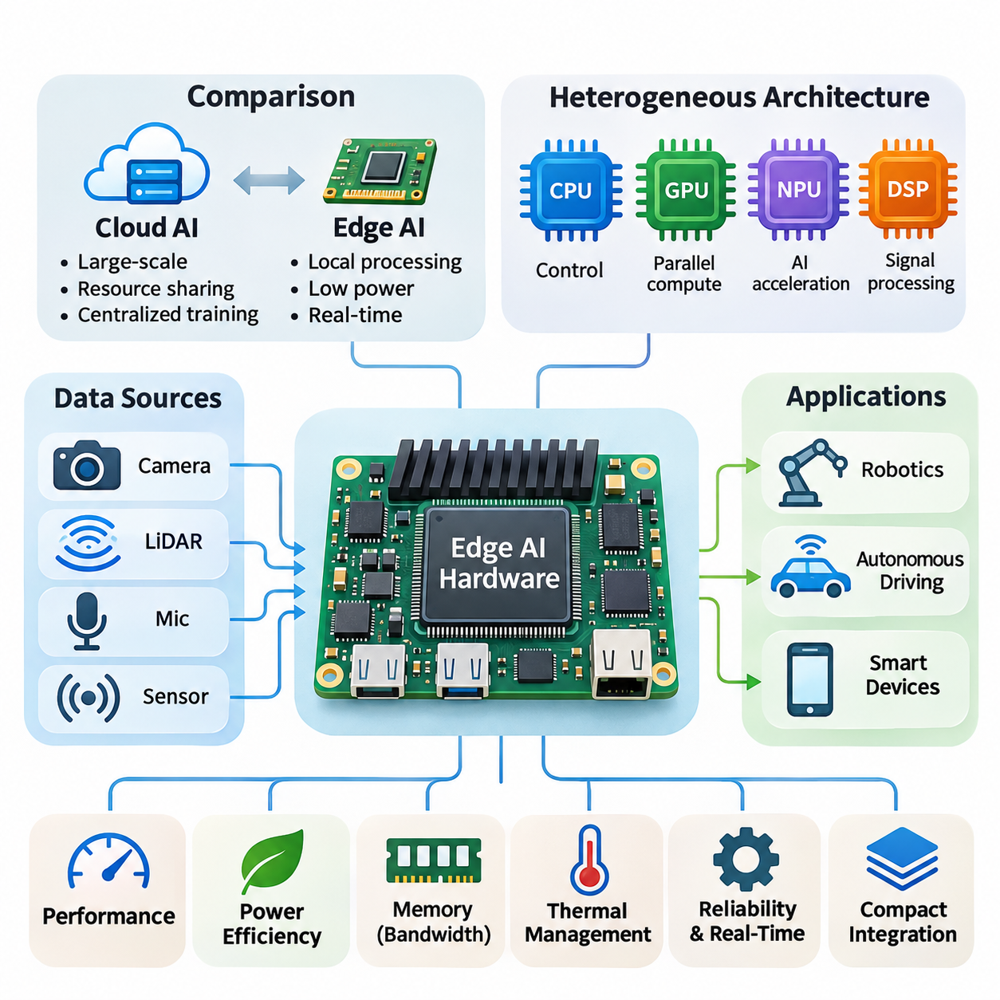
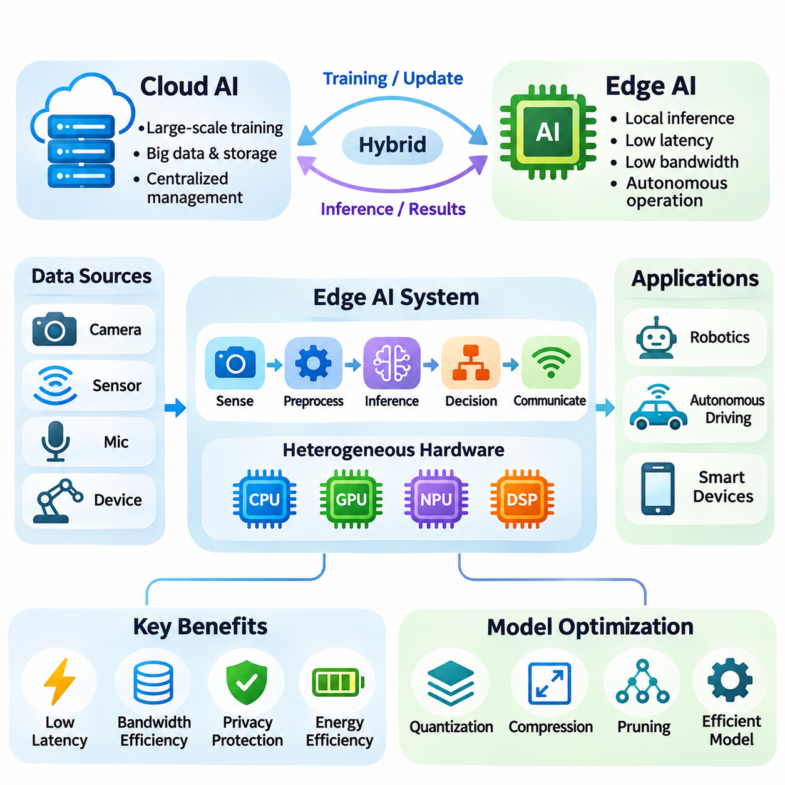
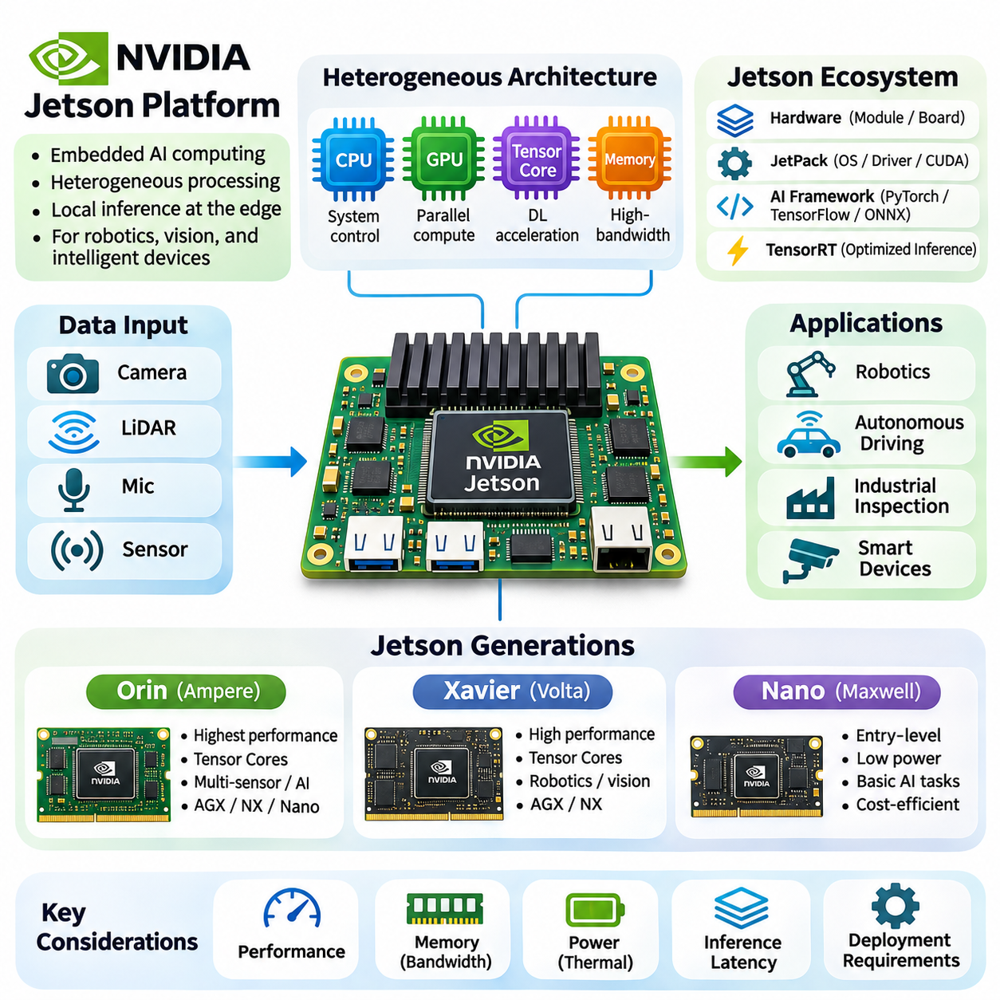
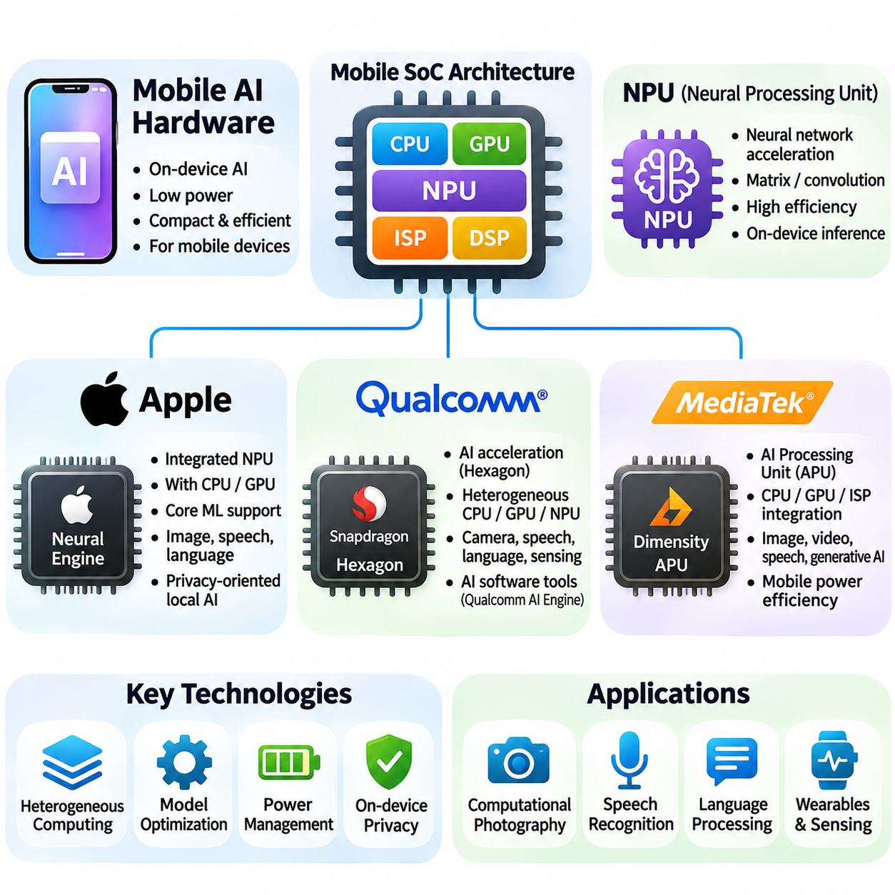
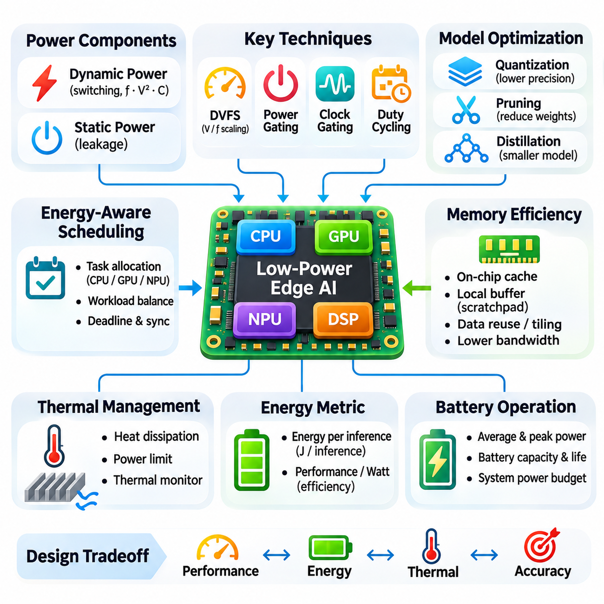
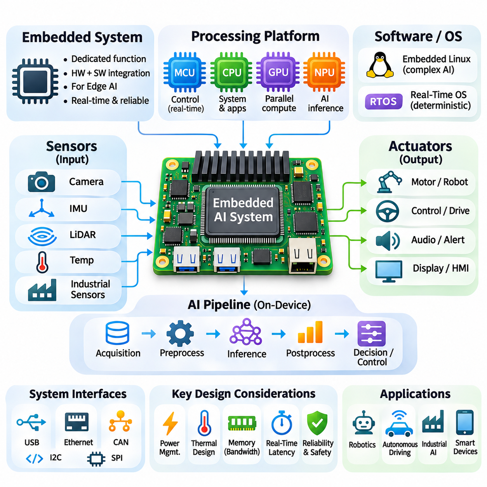
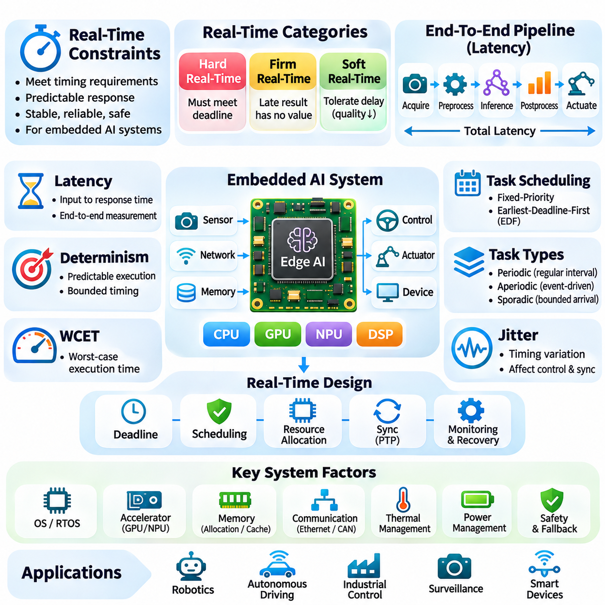
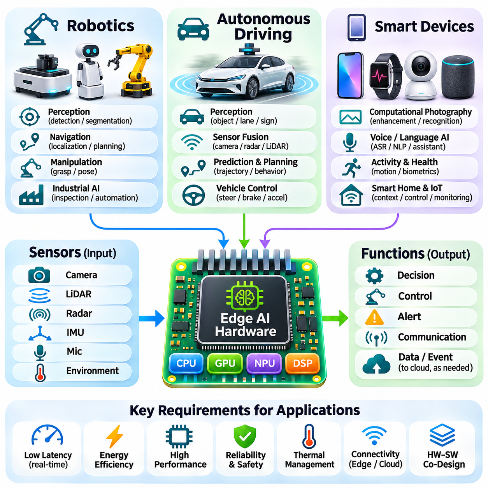

**Volume 39. Hardware for AI**

# 04. Edge AI Hardware

## 04.00 Overview

{width="7.268055555555556in" height="7.268055555555556in"}

엣지 인공지능 하드웨어(Edge AI Hardware)는 데이터 소스(Data Source) 가까이에 위치한 장치에서 인공지능 작업 부하(AI Workload)를 직접 실행하도록 설계된 특수 컴퓨팅 인프라(Computing Infrastructure)를 의미한다. 중앙 집중식 클라우드 시스템(Cloud System)과 달리 엣지 플랫폼(Edge Platform)은 정보를 로컬(Local)에서 처리하여 통신 지연 시간(Communication Latency), 네트워크 의존성(Network Dependency), 불필요한 데이터 전송을 줄인다. 이러한 아키텍처(Architecture)는 효율적인 추론(Inference), 소형 시스템 통합(Compact Integration), 제한된 자원 환경에서의 안정적인 운영을 강조한다.

지능형 로봇(Intelligent Robot), 자율주행차(Autonomous Vehicle), 산업용 센서(Industrial Sensor), 스마트 기기(Smart Device)의 도입이 확대되면서 전용 엣지 컴퓨팅 하드웨어(Edge Computing Hardware)에 대한 수요가 증가하고 있다. 이러한 응용 분야에서는 원격 서버(Remote Server)에 전적으로 의존하지 않고 지속적인 인식(Perception), 의사결정(Decision-Making), 제어(Control)를 수행해야 한다. 따라서 엣지 인공지능(Edge AI)은 연산 가속(Computational Acceleration), 에너지 효율(Energy Efficiency), 환경 적응성(Environmental Adaptability), 예측 가능한 응답 시간(Predictable Response Time)을 결합한다.

엣지 인공지능 아키텍처(Edge AI Architecture)는 중앙처리장치(Central Processing Unit, CPU), 그래픽처리장치(Graphics Processing Unit, GPU), 신경망처리장치(Neural Processing Unit, NPU), 전용 디지털 신호처리장치(Digital Signal Processor, DSP)를 포함하는 이종 처리 구성요소(Heterogeneous Processing Components)를 통합한다. 각 구성요소는 고유한 연산 특성에 따라 작업을 처리한다. CPU는 시스템 운영을 조정하고, GPU는 병렬 연산(Parallel Computation)을 가속하며, NPU는 에너지 소비를 최적화하면서 신경망 연산(Neural Network Operation)을 실행한다.

클라우드 인공지능(Cloud AI)과 엣지 인공지능(Edge AI)의 차이는 단순한 물리적 배치 위치를 넘어선다. 클라우드 인프라(Cloud Infrastructure)는 대규모 연산 능력, 자원 공유(Resource Sharing), 중앙 집중식 모델 관리(Centralized Model Management)를 우선시한다. 반면 엣지 하드웨어(Edge Hardware)는 로컬 응답성(Local Responsiveness), 제한된 전력 소비, 자율 실행(Autonomous Execution)을 중시한다. 하이브리드 아키텍처(Hybrid Architecture)는 시간에 민감한 추론을 로컬에서 수행하면서 중앙 집중식 학습(Training)과 관리 기능을 유지하여 두 접근 방식을 결합한다.

엣지 인공지능 개발(Edge AI Development)의 핵심 과제는 연산 성능(Computational Performance)과 에너지 소비(Energy Consumption) 사이의 균형을 확보하는 것이다. 임베디드 프로세서(Embedded Processor)는 엄격한 열적·전기적 제약 조건에서 동작하므로 무제한적인 연산 확장은 현실적으로 어렵다. 하드웨어 설계자는 제한된 전력 예산(Power Budget) 내에서 적절한 추론 성능을 확보하기 위해 처리 아키텍처, 메모리 접근 패턴(Memory Access Pattern), 동작 주파수(Operating Frequency), 가속기 활용률(Accelerator Utilization)을 최적화해야 한다.

메모리 아키텍처(Memory Architecture)는 엣지 인공지능 시스템의 효율성에 큰 영향을 미친다. 신경망(Neural Network)은 모델 매개변수(Model Parameter), 중간 활성화 값(Intermediate Activation), 센서 버퍼(Sensor Buffer), 런타임 데이터 구조(Runtime Data Structure)를 저장할 공간이 필요하다. 제한된 메모리 용량은 모델 복잡도를 제약하고, 부족한 대역폭(Bandwidth)은 연산 병목 현상(Computational Bottleneck)을 발생시킨다. 효율적인 메모리 할당(Memory Allocation), 데이터 재사용(Data Reuse), 압축(Compression), 저정밀도 연산(Reduced-Precision Arithmetic)은 이러한 한계를 극복하는 데 기여한다.

엔비디아 젯슨 플랫폼(NVIDIA Jetson Platform)은 이종 엣지 인공지능 컴퓨팅 아키텍처(Heterogeneous Edge AI Computing Architecture)의 대표적인 사례이다. 이 시스템은 ARM 기반 CPU, NVIDIA GPU, 메모리 하위 시스템(Memory Subsystem), 특수 가속 기능(Specialized Acceleration Capability)을 소형 모듈(Compact Module)에 통합한다. 소프트웨어 생태계(Software Ecosystem)는 가속 추론(Accelerated Inference), 컴퓨터 비전(Computer Vision), 로봇 응용(Robotic Application)을 지원하므로 높은 병렬 처리 능력이 필요한 임베디드 시스템에 적합하다.

젯슨 오린 제품군(Jetson Orin Family)은 점점 더 높은 성능을 제공하는 임베디드 인공지능 가속 기술의 발전을 보여준다. 이 아키텍처는 GPU 컴퓨팅(GPU Computing), CPU 처리(CPU Processing), 전용 가속 자원(Dedicated Acceleration Resource)을 결합하여 높은 연산량이 필요한 추론 작업을 지원한다. 모듈 구성(Module Configuration)에 따라 다중 카메라(Multiple Camera), 객체 탐지(Object Detection), 분할(Segmentation), 위치 추정(Localization), 자율 내비게이션(Autonomous Navigation)을 포함하는 응용 분야에 활용할 수 있다.

젯슨 자비에(Jetson Xavier)와 젯슨 나노(Jetson Nano)를 포함한 이전 세대 플랫폼은 서로 다른 성능 및 배포 특성(Deployment Characteristics)을 보여준다. 자비에 플랫폼은 비교적 높은 연산 성능이 필요한 임베디드 인식(Embedded Perception)과 로봇 작업을 지원하며, 초기 나노 플랫폼은 상대적으로 낮은 연산 요구사항을 대상으로 한다. 이러한 세대별 비교는 프로세서 아키텍처(Processor Architecture), 메모리 대역폭(Memory Bandwidth), 가속 기능, 전력 범위(Power Envelope)가 실제 시스템 선정에 미치는 영향을 보여준다.

모바일 인공지능 하드웨어(Mobile AI Hardware)는 엣지 컴퓨팅 기술의 또 다른 중요한 범주이다. 스마트폰과 태블릿 프로세서(Smartphone and Tablet Processor)는 범용 CPU와 GPU 외에도 전용 신경망 가속 엔진(Neural Acceleration Engine)을 점점 더 많이 통합하고 있다. 이러한 통합 아키텍처(Integrated Architecture)는 배터리 효율(Battery Efficiency)과 소형 물리적 구조를 유지하면서 이미지 향상(Image Enhancement), 음성 인식(Speech Recognition), 언어 처리(Language Processing), 상황 인지 지능(Contextual Intelligence)을 구현한다.

애플 뉴럴 엔진(Apple Neural Engine)은 모바일 시스템 온 칩(System-on-Chip, SoC) 아키텍처에 통합된 특수 신경망 처리 기술의 사례이다. 퀄컴(Qualcomm)의 모바일 플랫폼 역시 전용 인공지능 가속 기능과 이종 처리 자원(Heterogeneous Processing Resource)을 결합하며, 미디어텍(MediaTek)은 모바일 칩셋(Mobile Chipset)에 신경망 처리 기능을 통합한다. 구현 방식에는 차이가 있지만, 이들 플랫폼은 엄격하게 제한된 에너지 예산 내에서 인공지능 작업을 가속한다는 공통 목표를 가진다.

저전력 설계(Low-Power Design)는 엣지 장치가 배터리, 제한된 전원 공급 장치(Power Supply), 수동 냉각 시스템(Passive Cooling System)으로 동작하는 경우가 많기 때문에 필수적이다. 동적 전압 및 주파수 조절(Dynamic Voltage and Frequency Scaling, DVFS)은 작업 부하에 따라 프로세서 동작을 조정한다. 전력 게이팅(Power Gating)은 비활성 하드웨어 구성요소를 차단하고, 작업 부하 스케줄링(Workload Scheduling)은 연산 작업을 효율적으로 분배한다. 이러한 기술은 응용 시스템의 응답성을 반드시 희생하지 않으면서 에너지 소비를 줄인다.

열 관리(Thermal Management)는 연산 안정성(Computational Stability)과 지속 추론 성능(Sustained Inference Performance)에 직접적인 영향을 미친다. 높은 처리 부하는 열을 발생시키며, 이를 방열판(Heat Sink), 공기 흐름(Airflow), 열전도 경로(Thermal Conduction Path), 기타 냉각 장치(Cooling Mechanism)를 통해 배출해야 한다. 열적 한계(Thermal Limit)를 초과하면 프로세서는 하드웨어를 보호하기 위해 동작 주파수를 낮출 수 있다. 따라서 실제 환경에서의 지속 성능(Sustained Performance)은 단시간의 최대 처리량(Peak Throughput)보다 중요한 평가 기준이 되는 경우가 많다.

임베디드 인공지능 시스템(Embedded AI System)은 처리 하드웨어(Processing Hardware), 센서(Sensor), 통신 인터페이스(Communication Interface), 저장 장치(Storage Device), 제어 전자장치(Control Electronics)를 결합한다. 카메라(Camera), 라이다(LiDAR), 관성측정장치(Inertial Measurement Unit, IMU), 산업용 인터페이스(Industrial Interface)는 실제 환경의 관측 정보를 제공한다. 임베디드 프로세서는 전처리(Preprocessing), 신경망 추론(Neural Inference), 의사결정 로직(Decision Logic)을 통해 이러한 신호를 실행 가능한 정보로 변환하여 통합된 인식 및 제어 파이프라인(Perception and Control Pipeline)을 구성한다.

실시간 제약 조건(Real-Time Constraints)은 많은 엣지 인공지능 응용 분야를 일반적인 컴퓨팅 작업과 구별하는 중요한 특징이다. 자율 시스템(Autonomous System)은 정해진 시간 제한 내에서 환경 변화에 대응해야 하며, 추론 지연(Inference Delay)은 운영 성능을 저하시킬 수 있다. 따라서 엔지니어는 평균 추론 지연 시간(Average Inference Latency)뿐 아니라 최악 실행 시간(Worst-Case Execution Time), 스케줄링 지터(Scheduling Jitter), 통신 지연(Communication Delay), 종단 간 처리 마감 시간(End-to-End Processing Deadline)을 함께 평가한다.

실시간 인공지능 성능(Real-Time AI Performance)은 하드웨어와 소프트웨어의 조정된 실행에 의존한다. 센서 데이터 획득(Sensor Acquisition), 데이터 전처리(Data Preprocessing), 가속기 스케줄링(Accelerator Scheduling), 추론(Inference), 액추에이터 통신(Actuator Communication)은 예측 가능한 파이프라인(Predictable Pipeline) 내에서 동작해야 한다. 하드웨어 가속(Hardware Acceleration)은 연산 지연을 줄이지만, 운영체제 스케줄링(Operating-System Scheduling)과 메모리 경합(Memory Contention)은 실행 시간의 변동성을 발생시킬 수 있다. 결정론적 시스템 설계(Deterministic System Design)를 위해서는 신중한 자원 할당(Resource Allocation)과 타이밍 분석(Timing Analysis)이 필요하다.

모델 최적화(Model Optimization)는 신경망을 임베디드 하드웨어에 적합하게 조정하는 데 중요한 역할을 한다. 양자화(Quantization)는 수치 정밀도(Numerical Precision)와 메모리 요구량을 줄이며, 가지치기(Pruning)는 선택된 매개변수 또는 연산 구조를 제거한다. 지식 증류(Knowledge Distillation)는 대규모 모델의 유용한 동작 특성을 더 작은 아키텍처로 전달한다. 이러한 기술은 배포 효율(Deployment Efficiency)을 개선할 수 있지만, 정확도(Accuracy)와 지연 시간(Latency)에 미치는 영향은 반드시 측정해야 한다.

하드웨어 인식 최적화(Hardware-Aware Optimization)는 단순히 신경망 매개변수 수를 줄이는 수준을 넘어선다. 이론적으로 작은 모델이라도 대상 가속기(Target Accelerator)가 연산을 효율적으로 지원하지 않으면 실행 성능이 낮아질 수 있다. 커널 가용성(Kernel Availability), 텐서 차원(Tensor Dimension), 메모리 정렬(Memory Alignment), 연산자 융합(Operator Fusion)은 실제 실행 속도에 영향을 준다. 따라서 효과적인 배포를 위해서는 운영 환경에서 사용할 특정 하드웨어와 런타임 환경(Runtime Environment)을 기준으로 모델을 평가해야 한다.

로봇공학(Robotics)은 지능형 기계가 동적인 물리적 환경(Dynamic Physical Environment)과 지속적으로 상호작용하기 때문에 엣지 인공지능 하드웨어에 높은 요구사항을 부과하는 응용 분야이다. 모바일 로봇(Mobile Robot)은 카메라 스트림(Camera Stream), 깊이 측정값(Depth Measurement), 위치 추정 결과(Localization Estimate), 내비게이션 명령(Navigation Command)을 처리하면서 신속한 제어 응답을 유지해야 한다. 임베디드 가속기(Embedded Accelerator)는 인식과 계획(Planning) 작업을 지원하여 외부 컴퓨팅 인프라에 대한 의존도를 낮춘 상태에서도 로봇이 동작할 수 있도록 한다.

자율주행 시스템(Autonomous Driving System)은 인식(Perception), 센서 융합(Sensor Fusion), 위치 추정(Localization), 궤적 예측(Trajectory Prediction), 동작 계획(Motion Planning)을 수행하기 위해 상당한 연산 자원을 필요로 한다. 엣지 컴퓨팅 플랫폼은 통신 지연을 최소화하기 위해 차량 센서 가까이에서 이러한 작업을 처리한다. 시스템 설계에서는 지속적인 연산 요구량(Sustained Computational Demand), 기능 안전 요구사항(Functional Safety Requirements), 환경 조건(Environmental Conditions), 네트워크 중단 상황에서의 신뢰성 있는 동작을 고려해야 한다.

스마트 기기(Smart Device)는 엣지 인공지능이 작은 하드웨어 공간에서도 지능형 기능을 제공할 수 있음을 보여준다. 보안 카메라(Security Camera)는 로컬 객체 탐지(Local Object Detection)를 수행하고, 웨어러블 기기(Wearable Device)는 센서 측정값을 분석하며, 산업용 모니터링 시스템(Industrial Monitoring System)은 비정상적인 동작 상태를 식별한다. 로컬 추론(Local Inference)은 대역폭 소비를 줄이고 응답성을 향상시키며, 민감한 데이터(Sensitive Data)의 불필요한 전송을 제한하여 개인정보 보호(Privacy Protection) 목표를 지원할 수 있다.

보안(Security)과 신뢰성(Reliability)은 통제된 데이터센터(Data Center) 외부에 배포되는 엣지 하드웨어에서 필수적인 고려사항이다. 장치는 물리적으로 접근 가능한 위치에서 동작하거나 신뢰할 수 없는 네트워크(Untrusted Network)를 통해 통신할 수 있다. 보안 부팅(Secure Boot), 하드웨어 기반 키 저장소(Hardware-Backed Key Storage), 암호화 통신(Encrypted Communication), 인증된 소프트웨어 업데이트(Authenticated Software Update)는 배포된 시스템을 보호하는 데 도움이 된다. 감시 타이머(Watchdog Mechanism)와 복구 절차(Recovery Procedure)는 장기간 안정적인 운영을 추가로 지원한다.

적절한 엣지 인공지능 하드웨어를 선정하려면 가속기의 공표된 성능 수치(Advertised Accelerator Performance)에만 의존하지 않고 실제 응용 작업 부하(Application Workload)를 평가해야 한다. 엔지니어는 모델 호환성(Model Compatibility), 지속 추론 처리량(Sustained Inference Throughput), 메모리 용량(Memory Capacity), 전력 소비(Power Consumption), 열적 특성(Thermal Behavior), 인터페이스 가용성(Interface Availability), 소프트웨어 지원(Software Support)을 고려해야 한다. 총 시스템 비용(Total System Cost)에는 통합 작업(Integration Effort), 유지보수 요구사항(Maintenance Requirements), 배포 복잡도(Deployment Complexity), 예상 운영 수명(Expected Operational Lifetime)도 포함된다.

엣지 인공지능 하드웨어의 발전은 분산 지능(Distributed Intelligence)으로의 광범위한 전환을 반영한다. 반도체 집적(Semiconductor Integration), 특수 가속기(Specialized Accelerator), 메모리 효율(Memory Efficiency), 소프트웨어 최적화(Software Optimization)의 발전으로 더욱 정교한 모델을 임베디드 장치에서 직접 실행할 수 있게 되었다. 미래 시스템은 조정된 이종 컴퓨팅(Coordinated Heterogeneous Computing), 에너지 인식 실행(Energy-Aware Execution), 인식·추론·물리적 상호작용(Perception, Reasoning, and Physical Interaction) 사이의 긴밀한 통합을 강조할 것이다.

엣지 인공지능 하드웨어를 이해하려면 프로세서 아키텍처(Processor Architecture), 메모리 구성(Memory Organization), 전력 관리(Power Management), 임베디드 통합(Embedded Integration), 실시간 실행(Real-Time Execution)을 연결하는 시스템 수준의 관점(System-Level Perspective)이 필요하다. 이러한 요소는 인공지능 모델이 중앙 집중식 컴퓨팅 환경 밖에서도 효과적으로 동작할 수 있는지를 결정한다. 각 요소의 조화로운 설계는 로봇공학(Robotics), 운송(Transportation), 산업(Industry), 소비자 기술(Consumer Technology) 전반에서 확장 가능하고(Scalable), 응답성이 높으며(Responsive), 신뢰할 수 있는(Reliable) 지능형 시스템의 기반을 형성한다.

## 04.01 Edge AI Concept

{width="7.268055555555556in" height="7.268055555555556in"}

일반적으로 엣지 인공지능(Edge Artificial Intelligence, Edge AI)이라고 불리는 기술은 데이터가 생성되는 위치와 가까운 컴퓨팅 장치(Computing Device)에서 인공지능 알고리즘(Artificial Intelligence Algorithm)을 직접 실행하는 방식을 의미한다. 모든 관측 데이터를 중앙 집중식 클라우드 인프라(Centralized Cloud Infrastructure)로 전송하는 대신, 엣지 시스템(Edge System)은 로컬 추론(Local Inference)을 수행한다. 이러한 접근 방식은 통신 지연 시간(Communication Latency)을 줄이고, 네트워크 트래픽(Network Traffic)을 제한하며, 지속적인 인터넷 연결 없이도 지능형 응용 시스템(Intelligent Application)이 동작할 수 있도록 한다.

엣지 인공지능(Edge AI)의 기본 원리는 정보가 수집되고 의사결정이 실행되는 물리적 환경(Physical Environment)에 연산 지능(Computational Intelligence)을 더욱 가깝게 배치하는 것이다. 카메라(Camera), 산업용 센서(Industrial Sensor), 자율 로봇(Autonomous Robot), 모바일 장치(Mobile Device)는 즉각적인 해석이 필요한 연속적인 데이터 스트림(Data Stream)을 생성한다. 엣지 인공지능은 이러한 데이터를 로컬에서 처리함으로써 모든 의사결정에 원격 처리(Remote Processing)를 요구하지 않고 원시 관측 데이터(Raw Observation)를 실행 가능한 정보(Actionable Information)로 변환한다.

전통적인 클라우드 기반 인공지능 아키텍처(Cloud-Based AI Architecture)는 중앙 집중식 데이터센터(Centralized Data Center)에 연산 자원(Computational Resource)을 집중시킨다. 이러한 환경은 높은 처리 능력(Processing Capacity), 확장 가능한 저장 공간(Scalable Storage), 대규모 모델 학습 인프라(Model Training Infrastructure)를 제공한다. 그러나 센서 데이터를 네트워크를 통해 전송하면 통신 지연, 대역폭 요구사항(Bandwidth Requirement), 잠재적인 서비스 중단(Service Interruption)이 발생한다. 엣지 인공지능은 지리적으로 분산된 장치에 추론 기능(Inference Capability)을 배치하여 이러한 한계를 해결한다.

엣지 인공지능(Edge AI)은 반드시 클라우드 컴퓨팅(Cloud Computing)을 대체하는 것이 아니라 상호 보완적인 컴퓨팅 모델(Complementary Computing Model)을 형성한다. 클라우드 플랫폼(Cloud Platform)은 대규모 학습(Large-Scale Training), 모델 개발(Model Development), 중앙 집중식 모니터링(Centralized Monitoring), 장기 데이터 분석(Long-Term Data Analysis)에 여전히 중요한 역할을 한다. 엣지 장치는 배포된 모델(Deployed Model)을 실행하고 즉각적인 환경 변화에 대응한다. 이러한 역할 분담은 중앙 집중식 연산 자원과 분산형 운영 지능(Decentralized Operational Intelligence)을 결합하는 하이브리드 아키텍처(Hybrid Architecture)를 형성한다.

엣지 인공지능 시스템(Edge AI System)은 일반적으로 센싱(Sensing), 전처리(Preprocessing), 추론(Inference), 의사결정(Decision-Making), 통신(Communication)을 하나의 조정된 처리 파이프라인(Processing Pipeline)으로 통합한다. 센서는 환경 정보를 획득하고, 전처리 구성요소는 원시 측정값(Raw Measurement)을 적절한 모델 입력(Model Input)으로 변환한다. 신경망 가속기(Neural Network Accelerator)는 추론 연산을 실행하며, 응용 로직(Application Logic)은 결과를 해석한다. 통신 인터페이스(Communication Interface)는 필요한 경우 선택된 정보를 외부 시스템과 교환한다.

분산 컴퓨팅 아키텍처(Distributed Computing Architecture)에서 지능을 배치하는 위치는 응용 시스템의 성능에 상당한 영향을 미친다. 장치에서 데이터를 직접 처리하면 네트워크 의존적인 지연을 최소화할 수 있으며, 인접한 엣지 게이트웨이(Edge Gateway)는 여러 센서의 정보를 집계할 수 있다. 지역 엣지 서버(Regional Edge Server)는 원거리 클라우드에 접근하지 않고도 추가적인 연산 능력을 제공한다. 이러한 배포 계층(Deployment Level)은 지연 시간, 전력 소비, 확장성(Scalability), 관리 복잡도(Management Complexity) 사이에서 서로 다른 절충 관계(Tradeoff)를 제공한다.

지연 시간 감소(Latency Reduction)는 엣지 인공지능(Edge AI)을 도입하는 가장 중요한 동기 중 하나이다. 로봇 내비게이션(Robotic Navigation), 충돌 회피(Collision Avoidance), 산업 검사(Industrial Inspection), 대화형 인터페이스(Interactive Interface)와 같은 응용 분야에서는 변화하는 환경에 빠르게 대응해야 한다. 네트워크 전송(Network Transmission)은 혼잡도(Congestion)와 연결 상태(Connectivity)에 따라 달라질 수 있는 추가 지연을 발생시킨다. 로컬 추론(Local Inference)은 시간에 민감한 처리 과정에서 네트워크 왕복 통신(Network Round Trip)의 필요성을 제거하지만, 연산 지연(Computation Delay)과 스케줄링 지연(Scheduling Delay)은 여전히 존재한다.

대역폭 효율(Bandwidth Efficiency)은 로컬 지능(Local Intelligence)의 또 다른 중요한 장점이다. 고해상도 카메라(High-Resolution Camera), 깊이 센서(Depth Sensor), 산업용 모니터링 장비(Industrial Monitoring Equipment)는 지속적으로 상당한 양의 데이터를 생성할 수 있다. 모든 측정값을 원격 인프라(Remote Infrastructure)로 전송하는 것은 비용이 높거나 현실적으로 불가능할 수 있다. 엣지 인공지능은 장치가 의미 있는 특징(Meaningful Feature)을 추출하고, 관련 이벤트(Relevant Event)를 탐지하며, 전체 원시 데이터 스트림 대신 압축된 결과(Compact Result)를 전송하도록 한다.

개인정보 보호(Privacy) 역시 엣지 인공지능 아키텍처(Edge AI Architecture)의 도입에 영향을 미치는 중요한 요소이다. 개인 이미지(Personal Image), 음성 녹음(Audio Recording), 생체 측정값(Biometric Measurement), 산업 정보(Industrial Information)에는 민감한 내용이 포함될 수 있다. 이러한 정보를 로컬에서 처리하면 불필요한 전송과 외부 노출(External Exposure)을 줄일 수 있다. 그러나 로컬 실행(Local Execution)이 개인정보 보호를 자동으로 보장하는 것은 아니며, 안전한 저장(Secure Storage), 접근 제어(Access Control), 암호화(Encryption), 책임 있는 데이터 관리(Responsible Data Management)는 여전히 필수적이다.

에너지 효율(Energy Efficiency)은 많은 엣지 장치가 엄격한 전력 제약 조건(Power Constraint)에서 동작하기 때문에 핵심적인 설계 고려사항이다. 배터리 구동 센서(Battery-Powered Sensor), 모바일 로봇(Mobile Robot), 임베디드 제어기(Embedded Controller)는 대규모 데이터센터 시스템에서 사용할 수 있는 수준의 에너지를 지속적으로 소비할 수 없다. 따라서 엣지 인공지능 하드웨어(Edge AI Hardware)는 특수 가속기(Specialized Accelerator), 저정밀도 연산(Low-Precision Arithmetic), 효율적인 메모리 접근(Efficient Memory Access), 적응형 전력 관리(Adaptive Power Management)를 활용하여 제한된 에너지 예산(Energy Budget) 내에서 유용한 연산 성능을 제공한다.

엣지 인공지능의 연산 아키텍처(Computational Architecture)는 일반적으로 범용 프로세서(General-Purpose Processor)와 특수 가속 하드웨어(Specialized Acceleration Hardware)를 결합한다. 중앙처리장치(Central Processing Unit, CPU)는 운영체제(Operating System), 응용 로직(Application Logic), 장치 간 조정(Device Coordination)을 관리하고, 그래픽처리장치(Graphics Processing Unit, GPU)는 높은 병렬성을 가진 수치 연산(Numerical Operation)을 가속한다. 신경망처리장치(Neural Processing Unit, NPU)는 에너지 효율적인 데이터 경로(Data Path)를 이용하여 지원되는 신경망 작업을 실행한다. 디지털 신호처리장치(Digital Signal Processor, DSP)는 신호 중심 연산(Signal-Oriented Computation)을 처리하여 다양한 처리 요구사항에 최적화된 이종 플랫폼(Heterogeneous Platform)을 형성한다.

하드웨어 선정(Hardware Selection)은 배포된 인공지능 모델(AI Model)의 연산 특성(Computational Characteristics)에 크게 의존한다. 합성곱 신경망(Convolutional Neural Network, CNN)은 효율적인 공간 연산(Spatial Operation)을 필요로 하는 반면, 트랜스포머 아키텍처(Transformer Architecture)는 행렬 곱셈(Matrix Multiplication)과 메모리 데이터 이동(Memory Movement)에 크게 의존한다. 객체 탐지(Object Detection), 음성 인식(Speech Recognition), 센서 융합(Sensor Fusion)은 서로 다른 처리 요구사항을 발생시킨다. 따라서 가속기 성능(Accelerator Capability)은 메모리 용량(Memory Capacity), 대역폭(Bandwidth), 지원 연산자(Supported Operator), 런타임 호환성(Runtime Compatibility)과 함께 평가해야 한다.

모델 최적화(Model Optimization)는 점점 더 정교한 인공지능 응용 시스템이 자원 제약 하드웨어(Resource-Constrained Hardware)에서 동작할 수 있도록 한다. 양자화(Quantization)는 수치 정밀도(Numerical Precision)를 줄이고, 가지치기(Pruning)는 선택된 모델 구조(Model Structure)를 제거하며, 지식 증류(Knowledge Distillation)는 유용한 동작 특성을 더 작은 신경망으로 전달한다. 이러한 기술은 저장 공간 요구사항(Storage Requirement)과 연산 복잡도(Computational Complexity)를 줄일 수 있다. 효과는 하드웨어 지원(Hardware Support), 구현 품질(Implementation Quality), 예측 정확도(Predictive Accuracy)의 허용 가능한 변화 범위에 따라 달라진다.

실시간 실행(Real-Time Execution)은 일반적인 추론 처리량(Inference Throughput)을 넘어서는 요구사항을 발생시킨다. 시스템이 초당 많은 프레임(Frame)을 처리하더라도 간헐적으로 허용할 수 없는 응답 지연(Response Delay)이 발생할 수 있다. 따라서 물리적 제어(Physical Control)를 수행하는 응용 시스템은 최악 지연 시간(Worst-Case Latency), 스케줄링 지터(Scheduling Jitter), 센서 동기화(Sensor Synchronization), 종단 간 마감 시간(End-to-End Deadline)을 고려해야 한다. 엣지 인공지능 시스템은 평균 연산 성능(Average Computational Performance)과 신뢰할 수 있는 동작에 필요한 시간적 보장(Timing Guarantee)을 구분해야 한다.

신뢰성(Reliability)은 지능형 장치가 간헐적인 연결 환경(Intermittent Connectivity)에서 동작할 때 특히 중요하다. 자율 기계(Autonomous Machine)는 네트워크 장애(Network Outage), 무선 간섭(Wireless Interference), 클라우드 서비스 중단(Cloud Service Unavailability)에 직면할 수 있다. 로컬 추론(Local Inference)은 원격 자원을 사용할 수 없는 상황에서도 필수 기능(Essential Function)을 계속 실행하도록 한다. 그러나 신뢰할 수 있는 자율성(Reliable Autonomy)을 확보하려면 적절한 고장 탐지(Fault Detection), 복구 메커니즘(Recovery Mechanism), 안전 동작 상태(Safe Operating State), 검증된 제어 동작(Validated Control Behavior)도 필요하다.

엣지 인공지능 아키텍처(Edge AI Architecture)는 여러 수준의 연산 분산(Computational Distribution)을 지원할 수 있다. 경량 센서(Lightweight Sensor)는 간단한 분류 모델(Classification Model)을 실행하고, 인접한 게이트웨이(Gateway)는 더 복잡한 데이터 집계(Data Aggregation)와 추론을 수행할 수 있다. 임베디드 컴퓨팅 모듈(Embedded Computing Module)은 로봇이나 산업 장비 내부에서 다중 모달 정보(Multimodal Information)를 직접 처리할 수 있다. 클라우드 서비스(Cloud Service)는 모델 업데이트(Model Update)와 전체 장치군 분석(Fleet-Wide Analytics)을 조정하여 운영 요구사항에 따라 작업을 할당하는 계층적 시스템(Hierarchical System)을 형성한다.

추론(Inference)과 학습(Training)의 구분은 엣지 인공지능 배포(Edge AI Deployment)에서 특히 중요하다. 대규모 모델 학습(Large-Scale Model Training)은 일반적으로 상당한 연산 자원, 메모리 용량, 광범위한 데이터셋(Dataset)을 필요로 한다. 따라서 많은 엣지 시스템은 중앙 집중식 인프라에서 학습된 모델을 전달받아 로컬에서 추론만 실행한다. 일부 플랫폼은 점진적 적응(Incremental Adaptation)이나 온디바이스 학습(On-Device Learning)을 지원하지만, 이러한 기능은 추가적인 연산, 에너지, 보안, 모델 관리(Model Management) 요구사항을 발생시킨다.

소프트웨어 인프라(Software Infrastructure)는 인공지능 모델을 기본 하드웨어(Underlying Hardware) 및 운영 환경(Operating Environment)과 연결한다. 파이토치(PyTorch)와 텐서플로(TensorFlow) 같은 프레임워크(Framework)는 모델 개발을 지원하며, ONNX 런타임(ONNX Runtime)과 텐서RT(TensorRT) 같은 배포 런타임(Deployment Runtime)은 지원되는 추론 작업을 가속할 수 있다. 하드웨어 드라이버(Hardware Driver), 운영체제(Operating System), 장치 인터페이스(Device Interface)는 실행 환경(Execution Environment)을 완성한다. 이러한 계층 사이의 호환성(Compatibility)은 이론적인 하드웨어 성능이 실제로 구현될 수 있는지를 결정한다.

엣지 인공지능은 모델 배포(Model Deployment)와 유지보수(Maintenance)의 엔지니어링 요구사항도 변화시킨다. 장치는 서로 다른 하드웨어 개정판(Hardware Revision), 소프트웨어 버전(Software Version), 환경 조건(Environmental Condition)에서 동작할 수 있다. 원격 업데이트(Remote Update)는 시스템 가용성(System Availability)을 유지하고 승인되지 않은 변경(Unauthorized Modification)을 방지해야 한다. 모델 버전 관리(Model Versioning), 배포 검증(Deployment Validation), 성능 모니터링(Performance Monitoring), 롤백 메커니즘(Rollback Mechanism)은 분산된 설치 환경(Distributed Installation)에서 일관된 동작을 유지하는 데 도움이 된다.

로봇공학(Robotics)은 로컬 지능(Local Intelligence)과 물리적 상호작용(Physical Interaction)을 결합하는 것이 얼마나 중요한지를 보여준다. 자율이동로봇(Autonomous Mobile Robot, AMR)은 카메라 이미지(Camera Image), 거리 측정값(Range Measurement), 위치 추정 정보(Localization Information)를 지속적으로 해석하면서 내비게이션 의사결정(Navigation Decision)을 생성한다. 엣지 프로세서(Edge Processor)는 지속적인 클라우드 통신 없이도 인식(Perception), 장애물 인식(Obstacle Recognition), 경로 계획(Planning)을 지원한다. 이러한 시스템의 효과는 조정된 센서 처리(Coordinated Sensor Processing), 연산 스케줄링(Computational Scheduling), 신뢰할 수 있는 운동 제어 시스템(Motion-Control System)과의 통합에 달려 있다.

자율주행(Autonomous Driving)은 차량이 예측 가능한 응답 시간(Predictable Response Time)을 유지하면서 복잡한 환경을 해석해야 하므로 높은 요구사항을 가진 또 다른 응용 분야이다. 로컬 컴퓨팅 시스템(Local Computing System)은 카메라, 레이더(Radar), 라이다(LiDAR), 기타 센서의 정보를 처리하여 인식과 계획을 지원한다. 높은 연산 처리량(Computational Throughput)이 필요하지만, 기능 안전(Functional Safety), 이중화(Redundancy), 열 관리(Thermal Management), 결함 허용성(Fault Tolerance) 역시 신뢰할 수 있는 차량 동작을 위한 중요한 고려사항이다.

산업용 엣지 인공지능(Industrial Edge AI)은 생산 장비(Production Equipment) 가까이에서 지능형 모니터링(Intelligent Monitoring)과 자동화된 의사결정 지원(Automated Decision Support)을 가능하게 한다. 비전 시스템(Vision System)은 제조 결함(Manufacturing Defect)을 식별하고, 임베디드 센서는 비정상적인 기계 동작(Abnormal Machine Behavior)을 탐지하며, 로컬 제어기(Local Controller)는 변화하는 운영 조건에 대응할 수 있다. 산업 장비 가까이에서 정보를 처리하면 외부 통신 인프라(External Communication Infrastructure)에 대한 의존도를 낮추고 기존 자동화 및 감독 시스템(Automation and Supervisory System)과의 통합을 지원한다.

스마트 소비자 기기(Smart Consumer Device)는 엣지 인공지능의 폭넓은 활용 가능성을 보여준다. 스마트폰(Smartphone)은 이미지 향상(Image Enhancement)과 음성 인식(Speech Recognition)을 실행하고, 웨어러블 기기(Wearable Device)는 생리학적 센서 신호(Physiological Sensor Signal)를 해석하며, 스마트 카메라(Smart Camera)는 객체나 이벤트를 인식한다. 전용 모바일 가속기(Dedicated Mobile Accelerator)는 이러한 기능을 소형 장치에서 실용적으로 구현할 수 있도록 한다. 로컬 처리는 응답성을 개선하고 네트워크 사용량(Network Usage)을 줄이며, 일부 서비스가 지속적인 연결 없이 동작할 수 있도록 한다.

엣지 인공지능의 경제적 가치(Economic Value)는 하드웨어 구매 비용(Hardware Acquisition Cost)만으로 결정되지 않는다. 로컬 처리는 클라우드 추론 비용(Cloud Inference Charge), 네트워크 전송 비용(Network Transmission Expense), 인프라 의존성(Infrastructure Dependency)을 줄일 수 있다. 그러나 분산 장치(Distributed Device)는 유지보수, 보안, 소프트웨어 업데이트, 수명주기 관리(Lifecycle Management) 비용을 추가로 발생시킨다. 따라서 효과적인 시스템 설계(System Design)는 추론 성능(Inference Performance), 에너지 소비(Energy Consumption), 배포 규모(Deployment Scale), 운영 신뢰성(Operational Reliability)과 함께 총소유비용(Total Cost of Ownership, TCO)을 평가해야 한다.

엣지 인공지능(Edge AI)은 중앙 집중식 인공지능(Centralized Artificial Intelligence)에만 의존하는 방식에서 분산형 상황 인식 컴퓨팅(Distributed Context-Aware Computing)으로 전환하는 근본적인 변화를 나타낸다. 그 목적은 단순히 임베디드 프로세서(Embedded Processor)에서 더 작은 모델을 실행하는 것이 아니라, 가장 높은 운영 가치를 제공할 수 있는 위치에 연산 능력(Computational Capability)을 배치하는 것이다. 하드웨어 가속(Hardware Acceleration), 효율적인 추론(Efficient Inference), 통신(Communication), 신뢰할 수 있는 실행(Dependable Execution)을 조정함으로써 엣지 인공지능은 물리적 세계(Physical World) 전반에서 동작하는 응답성 높은 지능형 시스템(Responsive Intelligent System)의 기반을 형성한다.

## 04.02 Jetson Platform

{width="7.268055555555556in" height="7.268055555555556in"}

엔비디아 젯슨 플랫폼(NVIDIA Jetson Platform)은 엣지 환경(Edge Environment)에서 인공지능 작업 부하(Artificial Intelligence Workload)를 가속하도록 설계된 임베디드 컴퓨팅 시스템(Embedded Computing System) 제품군이다. ARM 기반 중앙처리장치(CPU), 엔비디아 그래픽처리장치(NVIDIA GPU), 메모리 제어기(Memory Controller), 멀티미디어 처리 엔진(Multimedia Processing Engine)을 통합하여 소형 하드웨어에서 이종 컴퓨팅(Heterogeneous Computing) 기능을 제공한다. 이러한 아키텍처는 클라우드 인프라(Cloud Infrastructure)에 지속적으로 접근하지 않고도 로컬 추론(Local Inference), 센서 처리(Sensor Processing), 자율 동작(Autonomous Operation)을 지원한다.

젯슨 플랫폼(Jetson Platform)은 컴퓨터 비전(Computer Vision), 기계학습(Machine Learning), 물리적 상호작용(Physical Interaction)을 결합하는 응용 분야에 특히 적합하다. 자율 로봇(Autonomous Robot), 산업 검사 시스템(Industrial Inspection System), 지능형 카메라(Intelligent Camera), 이동형 기계(Mobile Machine)는 여러 센서 데이터 스트림(Sensor Data Stream)을 동시에 처리해야 하는 경우가 많다. 젯슨 하드웨어는 GPU 가속(GPU Acceleration), 효율적인 메모리 아키텍처(Memory Architecture), 기존 인공지능 개발 프레임워크(AI Development Framework)와의 소프트웨어 통합(Software Integration)을 통해 이러한 작업을 지원한다.

젯슨 생태계(Jetson Ecosystem)는 하드웨어 모듈(Hardware Module), 캐리어 보드(Carrier Board), 운영체제(Operating System), 개발 라이브러리(Development Library), 배포 도구(Deployment Tool)를 결합한다. 젯팩(JetPack)은 플랫폼 드라이버(Platform Driver), 쿠다(CUDA) 구성요소, 지원되는 가속 라이브러리(Acceleration Library)를 포함하는 소프트웨어 개발 환경(Software Development Environment)을 제공한다. 개발자는 플랫폼 호환성(Platform Compatibility)에 따라 파이토치(PyTorch), 텐서플로(TensorFlow), ONNX 런타임(ONNX Runtime) 등의 프레임워크를 통합할 수 있으며, 텐서RT(TensorRT)는 지원되는 신경망 추론 작업(Neural Network Inference Workload)을 최적화한다.

젯슨 모듈(Jetson Module)은 연산 능력(Computational Capability), 메모리 용량(Memory Capacity), 가속기 아키텍처(Accelerator Architecture), 전력 요구사항(Power Requirement)에서 차이가 있다. 적절한 플랫폼을 선정하려면 이론적으로 발표된 성능 수치에만 의존하지 않고 실제 응용 작업 부하(Application Workload)를 평가해야 한다. 추론 지연 시간(Inference Latency), 지속 처리량(Sustained Throughput), 메모리 대역폭(Memory Bandwidth), 열적 한계(Thermal Limitation), 인터페이스 가용성(Interface Availability), 소프트웨어 지원(Software Support)이 모듈의 배포 요구사항(Deployment Requirement) 충족 여부를 결정한다.

젯슨 오린 제품군(Jetson Orin Family)은 엔비디아 임베디드 인공지능 컴퓨팅(NVIDIA Embedded AI Computing)의 중요한 발전을 나타낸다. 암페어 GPU 아키텍처(Ampere GPU Architecture)를 기반으로 하는 오린(Orin)은 쿠다 코어(CUDA Core)와 텐서 코어(Tensor Core)를 통합하여 병렬 수치 연산(Parallel Numerical Operation)과 신경망 추론(Neural Network Inference)을 가속한다. 이종 아키텍처(Heterogeneous Architecture)는 GPU 처리, ARM CPU 자원, 전용 가속 엔진(Dedicated Acceleration Engine)을 결합하여 인식(Perception), 센서 융합(Sensor Fusion), 자율 의사결정(Autonomous Decision-Making)과 같은 높은 연산 요구사항을 지원한다.

젯슨 오린 모듈(Jetson Orin Module)은 서로 다른 연산 및 전력 요구사항에 대응하도록 다양한 구성(Configuration)으로 제공된다. 젯슨 AGX 오린(Jetson AGX Orin)은 높은 성능이 필요한 임베디드 응용 분야를 대상으로 하며, 젯슨 오린 NX(Jetson Orin NX)는 더 작은 모듈 크기(Module Footprint)에서 상당한 가속 성능을 제공한다. 젯슨 오린 나노(Jetson Orin Nano)는 자원 제약이 더 큰 배포 환경을 대상으로 한다. 이러한 구성은 개발자가 처리 능력(Processing Capacity), 메모리 자원(Memory Resource), 물리적 크기(Physical Dimension), 에너지 소비(Energy Consumption) 사이에서 균형을 조정할 수 있도록 한다.

오린 아키텍처(Orin Architecture)는 합성곱 신경망(Convolutional Neural Network, CNN), 트랜스포머 기반 인식 모델(Transformer-Based Perception Model), 병렬 이미지 처리(Parallel Image Processing)를 포함하는 딥러닝 작업 부하(Deep Learning Workload)에 특히 효과적이다. 텐서 코어(Tensor Core)는 지원되는 행렬 연산(Matrix Operation)을 가속하며, 쿠다 코어(CUDA Core)는 범용 GPU 작업을 실행한다. 실제 성능은 수치 정밀도(Numerical Precision), 메모리 접근 효율(Memory Access Efficiency), 커널 구현(Kernel Implementation), 선택한 런타임 환경(Runtime Environment)에서 최적화된 추론 연산자(Optimized Inference Operator)의 지원 여부에 따라 달라진다.

메모리 용량(Memory Capacity)과 대역폭(Bandwidth)은 젯슨 오린(Jetson Orin)에 복잡한 모델을 배포할 때 중요한 고려사항이다. 신경망 매개변수(Neural Network Parameter), 중간 활성화 값(Intermediate Activation), 카메라 버퍼(Camera Buffer), 응용 프로세스(Application Process)는 공유 시스템 메모리(Shared System Memory)를 사용하기 위해 경쟁한다. 대규모 비전 모델(Large Vision Model)과 다중 모달 처리 파이프라인(Multimodal Processing Pipeline)은 상당한 자원을 소비할 수 있다. 효율적인 버퍼 관리(Buffer Management), 저정밀도 추론(Reduced-Precision Inference), 신중한 연산 작업 할당(Computational Workload Allocation)은 예측 가능한 실행 성능(Predictable Execution Performance)을 유지하는 데 도움이 된다.

젯슨 오린(Jetson Orin)은 여러 처리 파이프라인(Processing Pipeline)을 동시에 실행해야 하는 로봇 응용 분야를 지원한다. 모바일 로봇(Mobile Robot)은 카메라와 거리 센서(Range Sensor)의 데이터를 수신하면서 객체 탐지(Object Detection), 의미론적 분할(Semantic Segmentation), 위치 추정(Localization), 지도 작성(Mapping), 내비게이션(Navigation)을 실행할 수 있다. GPU 가속은 높은 연산량이 필요한 인식 작업을 지원하고, CPU 자원은 시스템 로직(System Logic)과 통신(Communication)을 조정한다. 안전 필수 운동 제어(Safety-Critical Motion Control)에는 독립적인 제어기(Independent Controller)와 검증된 실시간 메커니즘(Validated Real-Time Mechanism)이 필요할 수 있다.

전력 및 열 관리(Power and Thermal Management)는 고성능 오린 모듈(High-Performance Orin Module)에서도 필수적이다. 지속적인 GPU 활용(Sustained GPU Utilization)은 열을 발생시키므로 적절한 냉각 시스템(Cooling System)을 통해 이를 방출해야 한다. 사용 가능한 전력 모드(Power Mode)는 프로세서 주파수(Processor Frequency), 가속기 활용률(Accelerator Utilization), 달성 가능한 처리량(Achievable Throughput)에 영향을 미친다. 따라서 개발자는 최대 가속기 사양(Peak Accelerator Specification)이 지속적인 배포 성능을 나타낸다고 가정하기보다 실제 운영 온도(Operating Temperature)와 지속 작업 부하(Sustained Workload)를 반영한 조건에서 성능을 측정해야 한다.

젯슨 자비에 세대(Jetson Xavier Generation)는 고성능 임베디드 인공지능 컴퓨팅(High-Performance Embedded AI Computing)의 초기 기반을 확립하였다. 자비에 모듈(Xavier Module)은 ARM 기반 CPU 처리와 엔비디아 볼타 아키텍처(NVIDIA Volta Architecture) 기반 GPU를 결합한다. 이러한 설계는 텐서 코어 가속(Tensor Core Acceleration)과 특수 멀티미디어 기능(Specialized Multimedia Capability)을 통합하여 지능형 기계(Intelligent Machine)에 적합한 임베디드 전력 범위(Embedded Power Envelope) 내에서 신경망 추론, 컴퓨터 비전, 센서 처리를 가능하게 한다.

젯슨 AGX 자비에(Jetson AGX Xavier)는 높은 연산 성능이 필요한 로봇공학(Robotics)과 자율 기계(Autonomous Machine) 응용 분야를 위해 개발되었으며, 젯슨 자비에 NX(Jetson Xavier NX)는 더욱 소형화된 구현을 제공한다. 두 플랫폼 모두 CPU, GPU, 전용 처리 자원(Dedicated Processing Resource)을 활용하는 이종 실행(Heterogeneous Execution)을 지원한다. 이러한 아키텍처 기능은 객체 인식(Object Recognition), 이미지 분할(Image Segmentation), 깊이 처리(Depth Processing), 로봇 인식(Robotic Perception)을 가능하게 하지만, 성능과 메모리 제약(Memory Limitation)은 모듈 구성에 따라 달라진다.

자비에(Xavier)의 볼타 기반 GPU 아키텍처(Volta-Based GPU Architecture)는 엔비디아 임베디드 인공지능 플랫폼에 텐서 코어(Tensor Core) 기능을 도입하였다. 이러한 특수 처리 장치(Specialized Processing Unit)는 딥러닝(Deep Learning)에서 일반적으로 사용되는 지원 행렬 연산(Matrix Operation)을 가속한다. 최적화된 GPU 추론(Optimized GPU Inference)은 기존 CPU 실행과 비교하여 병렬 작업 부하(Parallel Workload)의 처리량을 상당히 개선할 수 있다. 실제 가속 효과는 모델 구조(Model Structure), 수치 정밀도(Numerical Precision), 메모리 동작(Memory Behavior), 소프트웨어 구현(Software Implementation)에 따라 달라진다.

자비에 플랫폼(Xavier Platform)은 연산 능력(Computational Capability)과 배포 제약 조건(Deployment Constraint) 사이의 균형이 중요하다는 사실을 보여준다. 임베디드 로봇 시스템(Embedded Robotic System)은 제한된 물리적 공간(Physical Space) 안에 프로세서 모듈(Processor Module), 센서 인터페이스(Sensor Interface), 통신 하드웨어(Communication Hardware), 저장 장치(Storage Device), 냉각 구성요소(Cooling Component)를 수용해야 한다. 자비에 모듈은 통합 컴퓨팅 기반(Integrated Computing Foundation)을 제공하지만, 성공적인 배포를 위해서는 지속 성능(Sustained Performance), 전기적 호환성(Electrical Compatibility), 열적 특성(Thermal Behavior), 소프트웨어 유지보수 지원(Software Maintenance Support)을 평가해야 한다.

자비에(Xavier)에서 오린(Orin)으로의 전환은 GPU 아키텍처(GPU Architecture), 연산 처리량(Computational Throughput), 메모리 하위 시스템(Memory Subsystem), 가속기 효율(Accelerator Efficiency)의 발전을 반영한다. 오린은 일반적으로 높은 연산량이 필요한 신경망 작업에 더 큰 처리 능력을 제공하는 반면, 자비에는 기존 배포 시스템(Existing Deployment)과 성능 요구사항을 충족하는 응용 분야에서 여전히 활용될 수 있다. 세대 간 마이그레이션(Migration)을 수행하려면 소프트웨어 의존성(Software Dependency), 캐리어 보드 호환성(Carrier-Board Compatibility), 전력 요구사항(Power Requirement), 응용 동작(Application Behavior)을 검증해야 한다.

초기 젯슨 나노 플랫폼(Original Jetson Nano Platform)은 경량 임베디드 인공지능 개발(Lightweight Embedded AI Development)을 위한 접근성 높은 GPU 가속 컴퓨팅(GPU-Accelerated Computing)을 제공하였다. ARM CPU 코어(ARM CPU Core)와 맥스웰 기반 엔비디아 GPU(Maxwell-Based NVIDIA GPU)를 결합하여 비교적 낮은 전력 범위(Power Envelope)에서 병렬 처리(Parallel Processing) 기능을 제공한다. 나노(Nano)는 교육용 프로젝트(Educational Project), 지능형 카메라(Intelligent Camera), 입문용 로봇공학(Entry-Level Robotics), 소형 신경망 모델(Compact Neural Network Model) 실험에 유용하게 활용되었다.

젯슨 나노(Jetson Nano)는 데이터센터 하드웨어(Data-Center Hardware) 없이도 임베디드 GPU 컴퓨팅(Embedded GPU Computing)을 통해 실용적인 추론을 수행할 수 있음을 보여준다. 이미지 분류(Image Classification), 기본 객체 탐지(Basic Object Detection), 단순 시각 추적(Simple Visual Tracking)과 같은 응용 시스템은 모델이 적절하게 최적화된 경우 로컬에서 실행할 수 있다. 그러나 제한된 메모리 용량(Memory Capacity), 연산 처리량(Computational Throughput), 가속기 기능(Accelerator Feature)은 대규모 신경망과 높은 동시 처리 요구사항을 가진 작업에 적용하는 데 제약이 된다.

자비에(Xavier)와 오린(Orin)과 달리 초기 젯슨 나노(Original Jetson Nano)의 GPU에는 텐서 코어(Tensor Core)가 포함되어 있지 않다. 따라서 신경망 가속(Neural Network Acceleration)은 일반적인 쿠다 실행(CUDA Execution)과 기타 지원되는 최적화 메커니즘(Optimization Mechanism)에 의존한다. 이러한 아키텍처 차이(Architectural Difference)는 행렬 연산 중심 작업 부하(Matrix-Intensive Workload)의 성능에 영향을 미친다. 개발자는 허용 가능한 지연 시간(Latency)과 메모리 소비(Memory Consumption)를 달성하기 위해 모델 아키텍처(Model Architecture), 입력 해상도(Input Resolution), 추론 런타임(Inference Runtime)을 신중하게 선택해야 한다.

초기 젯슨 나노(Original Jetson Nano)와 젯슨 오린 나노(Jetson Orin Nano)를 동일한 하드웨어 세대(Hardware Generation)로 취급해서는 안 된다. 두 제품 모두 나노(Nano)라는 명칭을 사용하지만, 오린 나노는 상당히 다른 가속 기능(Acceleration Capability)을 제공하는 최신 암페어 기반 아키텍처(Ampere-Based Architecture)를 사용한다. 소프트웨어 환경(Software Environment), 성능 특성(Performance Characteristics), 배포 요구사항(Deployment Requirement)도 서로 다르다. 따라서 하드웨어 비교(Hardware Comparison)에서는 정확한 모듈 세대(Module Generation)와 구성(Configuration)을 명시해야 한다.

나노(Nano), 자비에(Xavier), 오린(Orin) 세대 전반에 걸쳐 엔비디아 젯슨(NVIDIA Jetson)은 경량 GPU 추론(Lightweight GPU Inference)에서 점점 더 정교한 이종 컴퓨팅(Heterogeneous Computing)으로 발전하는 임베디드 인공지능(Embedded AI)의 변화를 보여준다. 각 세대는 처리 성능(Processing Performance), 가속기 특화(Accelerator Specialization), 메모리 자원(Memory Resource), 전력 소비(Power Consumption) 사이에서 서로 다른 균형을 제공한다. 이러한 아키텍처 차이를 이해하면 엔지니어가 하드웨어 성능을 현실적인 응용 요구사항(Application Requirement)에 맞게 선택하는 데 도움이 된다.

소프트웨어 호환성(Software Compatibility)은 젯슨 기반 시스템(Jetson-Based System)을 유지보수하거나 업그레이드할 때 중요한 고려사항이다. 하드웨어 세대마다 지원되는 젯팩(JetPack)과 리눅스 소프트웨어 환경(Linux Software Environment)이 다르며, 모든 프레임워크 버전(Framework Version)이나 가속 라이브러리(Acceleration Library)가 모든 플랫폼에서 제공되는 것은 아니다. 한 세대에서 개발된 응용 프로그램(Application)은 다른 세대에서 올바르게 동작하기 전에 의존성 변경(Dependency Change), 모델 변환(Model Conversion), 커널 조정(Kernel Adjustment), 드라이버 업데이트(Driver Update)가 필요할 수 있다.

배포 최적화(Deployment Optimization)는 개별 신경망 실행(Isolated Neural Network Execution)이 아니라 전체 추론 파이프라인(Complete Inference Pipeline)을 고려해야 한다. 카메라 데이터 획득(Camera Acquisition), 이미지 전처리(Image Preprocessing), 메모리 전송(Memory Transfer), 추론(Inference), 후처리(Postprocessing), 통신(Communication)은 모두 종단 간 지연 시간(End-to-End Latency)에 영향을 미친다. 불필요한 데이터 이동(Data Movement)을 최소화하고 파이프라인 단계(Pipeline Stage)를 조정할 때 하드웨어 가속(Hardware Acceleration)의 효과가 극대화된다. 프로파일링 도구(Profiling Tool)는 연산 병목 현상(Computational Bottleneck)과 자원 경합(Resource Contention)을 식별하는 데 도움이 된다.

젯슨 플랫폼 선정(Jetson Platform Selection)은 궁극적으로 성능(Performance), 신뢰성(Reliability), 에너지 소비(Energy Consumption), 소프트웨어 수명주기(Software Lifecycle), 통합 복잡도(Integration Complexity)에 대한 시스템 수준 평가(System-Level Evaluation)를 필요로 한다. 오린(Orin)은 일반적으로 높은 성능이 필요한 최신 엣지 인공지능 작업에 적합하며, 자비에(Xavier)는 기존 임베디드 응용 시스템(Established Embedded Application)을 지원할 수 있고, 초기 나노(Original Nano)는 경량 또는 레거시 프로젝트(Legacy Project)에 여전히 유용하다. 이러한 하드웨어 기능을 응용 시스템의 제약 조건(Application Constraint)에 맞게 선택하는 것이 신뢰할 수 있는 엣지 지능(Reliable Edge Intelligence)을 구현하기 위한 실질적인 기반이 된다.

## 04.03 Mobile AI Hardware

{width="7.268055555555556in" height="7.268055555555556in"}

모바일 인공지능 하드웨어(Mobile AI Hardware)는 스마트폰(Smartphone), 태블릿(Tablet), 웨어러블 기기(Wearable Device), 기타 소형 전자 시스템(Compact Electronic System)에서 인공지능 작업 부하(Artificial Intelligence Workload)를 실행하는 특수 컴퓨팅 아키텍처(Specialized Computing Architecture)를 의미한다. 데이터센터 가속기(Data-Center Accelerator)와 달리 모바일 프로세서(Mobile Processor)는 전력 소비(Power Consumption), 열 방출(Thermal Dissipation), 물리적 크기(Physical Dimension), 배터리 용량(Battery Capacity)에 관한 엄격한 제약 조건에서 동작해야 한다. 이러한 설계는 효율적인 추론(Efficient Inference), 이종 처리(Heterogeneous Processing), 센서 및 응용 프로그램과의 지속적인 상호작용(Continuous Interaction)을 강조한다.

최신 모바일 인공지능 플랫폼(Mobile AI Platform)은 일반적으로 중앙처리장치(Central Processing Unit, CPU), 그래픽처리장치(Graphics Processing Unit, GPU), 신경망처리장치(Neural Processing Unit, NPU), 이미지 신호처리장치(Image Signal Processor, ISP), 디지털 신호처리장치(Digital Signal Processor, DSP)를 단일 시스템 온 칩(System-on-Chip, SoC) 아키텍처에 통합한다. 각 처리 구성요소(Processing Component)는 서로 다른 연산 요구사항(Computational Requirement)을 지원한다. CPU는 운영체제(Operating System)와 응용 로직(Application Logic)을 조정하고, GPU는 병렬 작업 부하(Parallel Workload)를 가속하며, 전용 신경망 가속기(Dedicated Neural Accelerator)는 에너지 효율(Energy Efficiency)을 개선하면서 지원되는 기계학습 연산(Machine Learning Operation)을 실행한다.

신경망처리장치(Neural Processing Unit, NPU)는 현대 모바일 인공지능 하드웨어(Modern Mobile AI Hardware)의 핵심 구성요소이다. NPU는 행렬 곱셈(Matrix Multiplication), 합성곱(Convolution), 텐서 변환(Tensor Transformation)을 포함하여 신경망(Neural Network)에서 일반적으로 사용되는 수학적 연산을 가속한다. 특수 산술 연산 장치(Specialized Arithmetic Unit), 로컬 메모리 구조(Local Memory Structure), 최적화된 데이터 이동(Optimized Data Movement)은 연산 오버헤드(Computational Overhead)를 줄인다. 그러나 실제 성능은 모델 아키텍처(Model Architecture), 지원 연산자(Supported Operator), 수치 정밀도(Numerical Precision), 소프트웨어 통합(Software Integration)에 따라 달라진다.

애플(Apple)은 독자적인 프로세서(Proprietary Processor), 운영체제(Operating System), 기계학습 프레임워크(Machine Learning Framework)를 결합한 긴밀하게 통합된 모바일 컴퓨팅 플랫폼(Mobile Computing Platform)을 개발한다. 애플 뉴럴 엔진(Apple Neural Engine)은 애플 실리콘(Apple Silicon) 내부에서 지원되는 신경망 연산(Neural Network Operation)에 전용 가속(Dedicated Acceleration)을 제공한다. 애플은 하드웨어 기능(Hardware Capability)과 시스템 소프트웨어(System Software)를 조정함으로써 모바일 에너지 제약 조건(Mobile Energy Constraint)을 유지하면서 이미지 이해(Image Understanding), 음성 처리(Speech Processing), 언어 해석(Language Interpretation), 계산 사진학(Computational Photography)을 포함하는 응용 기능을 구현한다.

애플 뉴럴 엔진(Apple Neural Engine)은 CPU와 GPU 자원을 대체하는 것이 아니라 이들과 함께 동작한다. 기계학습 연산(Machine Learning Operation)은 모델 구조(Model Structure)와 프레임워크 지원(Framework Support)에 따라 서로 다른 처리 장치(Processing Unit)에서 실행될 수 있다. 애플의 코어 ML(Core ML) 프레임워크는 모델 배포(Model Deployment) 기능을 제공하며, 구성(Configuration)과 호환성(Compatibility)에 따라 사용 가능한 연산 자원(Compute Resource)을 선택할 수 있다. 이러한 이종 실행 모델(Heterogeneous Execution Model)은 응용 프로그램이 성능(Performance), 효율(Efficiency), 구현 요구사항(Implementation Requirement) 사이에서 균형을 유지하도록 한다.

코어 ML(Core ML)은 학습된 신경망(Trained Neural Network)을 애플 모바일 하드웨어(Apple Mobile Hardware)와 연결하는 데 중요한 역할을 한다. 일반적인 기계학습 프레임워크(Machine Learning Framework)를 사용하여 개발된 모델은 배포를 위해 지원되는 코어 ML 표현 형식(Core ML Representation)으로 변환할 수 있다. 최적화(Optimization)에는 수치 정밀도 감소(Numerical Precision Reduction), 모델 압축(Model Compression), 호환 가능한 연산자 선택(Compatible Operator Selection)이 포함될 수 있다. 뉴럴 엔진 활용률(Neural Engine Utilization)과 가속 성능(Acceleration Performance)은 하드웨어 세대(Hardware Generation)와 모델 특성(Model Characteristics)에 따라 달라지므로 개발자는 실제 장치의 동작을 평가해야 한다.

애플의 통합 하드웨어 및 소프트웨어 아키텍처(Integrated Hardware and Software Architecture)는 개인정보 보호 중심의 로컬 처리(Privacy-Oriented Local Processing)도 지원한다. 응용 프로그램은 모든 입력 데이터를 원격 서버(Remote Server)로 전송하지 않고도 선택된 이미지, 오디오, 언어 추론 작업(Inference Task)을 수행할 수 있다. 이러한 접근 방식은 네트워크 의존성(Network Dependency)과 불필요한 데이터 노출(Data Exposure)을 줄일 수 있다. 그러나 로컬 실행(Local Execution)에는 안전한 응용 프로그램 설계(Secure Application Design), 적절한 데이터 처리(Data Handling), 접근 권한(Permission) 및 저장 정보(Stored Information)에 대한 신중한 관리가 필요하다.

퀄컴(Qualcomm)은 인공지능 작업 부하(Artificial Intelligence Workload)를 처리하기 위해 이종 처리 자원(Heterogeneous Processing Resource)을 통합한 모바일 컴퓨팅 플랫폼(Mobile Computing Platform)을 개발한다. 스냅드래곤 시스템 온 칩(Snapdragon System-on-Chip)은 CPU, GPU, 헥사곤 처리 기술(Hexagon Processing Technology)을 포함한 특수 인공지능 가속 구성요소(Specialized AI Acceleration Component)를 결합한다. 이러한 자원은 계산 사진학(Computational Photography), 음성 인식(Speech Recognition), 언어 처리(Language Processing), 상황 인식 센싱(Contextual Sensing)을 지원한다. 이 구조는 추론 성능(Inference Performance), 전력 효율(Power Efficiency), 응용 프로그램 응답성(Application Responsiveness) 사이의 균형을 강조한다.

퀄컴의 헥사곤 아키텍처(Qualcomm Hexagon Architecture)는 적합한 신호 처리(Signal Processing)와 신경망 작업 부하(Neural Network Workload)의 가속 실행(Accelerated Execution)을 지원한다. 프로세서 세대(Processor Generation)에 따라 벡터 처리(Vector Processing), 텐서 가속(Tensor Acceleration), 특수 메모리 메커니즘(Specialized Memory Mechanism)을 포함한다. 이러한 기능은 불필요한 데이터 전송(Data Transfer)을 줄이고 병렬 연산(Parallel Computation)에 최적화된 하드웨어를 활용하여 지원 연산(Supported Operation)의 효율을 개선한다. 성능은 스냅드래곤 제품 세대(Snapdragon Product Generation)에 따라 상당한 차이를 보인다.

퀄컴 인공지능 소프트웨어 생태계(Qualcomm AI Software Ecosystem)는 지원되는 스냅드래곤 하드웨어(Snapdragon Hardware)를 위한 개발 및 배포 메커니즘(Development and Deployment Mechanism)을 제공한다. 퀄컴 AI 엔진 다이렉트 SDK(Qualcomm AI Engine Direct SDK)와 퀄컴 신경망 처리 SDK(Qualcomm Neural Processing SDK) 같은 도구는 플랫폼 및 버전 호환성(Platform and Version Compatibility)에 따라 사용 가능한 가속 자원(Acceleration Resource)에서 신경망 실행(Neural Network Execution)을 지원해 왔다. 개발자는 실행 경로(Execution Pathway)를 선택할 때 모델 변환(Model Conversion), 연산자 지원 범위(Operator Coverage), 수치 형식(Numerical Format), 런타임 동작(Runtime Behavior)을 고려해야 한다.

퀄컴 플랫폼(Qualcomm Platform)은 지속적인 센서 해석(Continuous Sensor Interpretation)이 필요한 모바일 응용 분야에서 특히 중요하다. 카메라 파이프라인(Camera Pipeline)은 이미지 신호 처리(Image Signal Processing)와 신경망 추론(Neural Inference)을 결합하여 장면 이해(Scene Understanding), 이미지 향상(Image Enhancement), 객체 인식(Object Recognition)을 지원한다. 오디오 시스템(Audio System)은 음성 및 음향 작업(Speech and Acoustic Task)에 효율적인 처리를 사용하며, 상황 인식 응용 프로그램(Contextual Application)은 움직임과 환경 신호(Motion and Environmental Signal)를 해석한다. 하드웨어 구성요소 간 작업 부하 분배(Workload Distribution)는 배터리 소비(Battery Consumption)와 응답 지연 시간(Response Latency)에 모두 영향을 미친다.

미디어텍(MediaTek)은 전용 인공지능 가속 기능(Dedicated AI Acceleration Capability)을 통합한 또 다른 주요 모바일 시스템 온 칩(Mobile System-on-Chip) 아키텍처 제품군을 제공한다. 디멘시티 플랫폼(Dimensity Platform)은 스마트폰과 연결형 장치(Connected Device)를 위해 CPU, GPU, 이미지 처리(Image Processing), 신경망 가속 자원(Neural Acceleration Resource)을 결합한다. 미디어텍의 인공지능처리장치(AI Processing Unit, APU) 기술은 모바일 전력 예산(Mobile Power Budget) 내에서 지원되는 신경망 작업을 처리한다. 정확한 가속기 구성(Accelerator Organization)과 기능은 칩셋 세대(Chipset Generation)에 따라 달라진다.

미디어텍의 인공지능 처리 아키텍처(MediaTek AI Processing Architecture)는 계산 사진학(Computational Photography), 객체 탐지(Object Detection), 이미지 분할(Image Segmentation), 음성 처리(Speech Processing), 일부 언어 모델 연산(Language-Model Operation)을 대상으로 한다. 전용 가속 하드웨어(Dedicated Acceleration Hardware)는 범용 프로세서(General-Purpose Processor)에만 의존하는 방식보다 실행 효율(Execution Efficiency)을 개선할 수 있다. 그러나 이러한 이점은 연산자 호환성(Operator Compatibility), 메모리 대역폭(Memory Bandwidth), 수치 정밀도(Numerical Precision), 런타임 최적화(Runtime Optimization)에 따라 달라진다. 따라서 벤치마크 결과(Benchmark Result)는 대표적인 모델(Representative Model)과 실제 장치 조건(Actual Device Condition)을 반영해야 한다.

미디어텍(MediaTek)은 지원되는 플랫폼에 인공지능 모델(AI Model)을 배포하기 위한 소프트웨어 도구(Software Tool)와 실행 인터페이스(Execution Interface)를 제공한다. 뉴로파일럿 생태계(NeuroPilot Ecosystem)는 사용 가능한 신경망 가속 자원(Neural Acceleration Resource)을 활용하기 위한 개발 도구(Development Tool)와 런타임 지원(Runtime Support)을 포함해 왔다. 지원되는 기계학습 프레임워크(Machine Learning Framework)와의 통합을 통해 개발자는 모바일 추론(Mobile Inference)을 위한 모델을 준비할 수 있다. 하드웨어 호환성(Hardware Compatibility), 드라이버 가용성(Driver Availability), 지원 소프트웨어 버전(Supported Software Version)은 배포 전 과정에서 중요한 고려사항이다.

애플(Apple), 퀄컴(Qualcomm), 미디어텍(MediaTek)은 모두 엄격한 제약 조건을 가진 모바일 환경(Mobile Environment)에서 신경망 추론(Neural Network Inference)을 가속한다는 공통 목표를 가지고 있지만, 하드웨어 구성(Hardware Organization)과 소프트웨어 생태계(Software Ecosystem)는 서로 다르다. 애플은 반도체(Silicon)와 운영체제(Operating System) 전반에 걸친 통합 제어(Integrated Control)를 강조하는 반면, 퀄컴과 미디어텍은 다양한 장치 제조업체(Device Manufacturer)와 하드웨어 구성(Configuration)을 지원한다. 이러한 차이는 최적화 전략(Optimization Strategy), 배포 이식성(Deployment Portability), 사용 가능한 가속 인터페이스(Acceleration Interface)에 영향을 미친다.

모바일 신경망 가속기(Mobile Neural Accelerator)를 비교하려면 발표된 초당 연산 횟수(Operations Per Second)만 검토해서는 충분하지 않다. 최대 처리량(Peak Throughput)은 특정 수치 형식(Numerical Format), 텐서 차원(Tensor Dimension), 이상적인 실행 조건(Idealized Execution Condition)을 가정하여 측정될 수 있다. 실제 응용 프로그램에는 전처리(Preprocessing), 메모리 전송(Memory Transfer), 연산자 스케줄링(Operator Scheduling), 후처리(Postprocessing)가 포함된다. 따라서 의미 있는 평가는 종단 간 지연 시간(End-to-End Latency), 지속 성능(Sustained Performance), 추론당 에너지 소비(Energy Per Inference), 메모리 소비(Memory Consumption), 대표 신경망(Representative Neural Network)과의 호환성을 고려해야 한다.

모바일 인공지능 성능(Mobile AI Performance)은 프로세서와 가속기가 제한된 시스템 메모리 자원(System Memory Resource)을 공유하는 경우가 많기 때문에 메모리 아키텍처(Memory Architecture)의 영향을 크게 받는다. 신경망 가중치(Neural Network Weight), 중간 활성화 값(Intermediate Activation), 이미지 버퍼(Image Buffer), 응용 데이터(Application Data)는 사용 가능한 메모리 용량과 대역폭을 두고 경쟁한다. 과도한 데이터 이동(Data Movement)은 에너지 소비와 지연 시간을 증가시킨다. 효율적인 메모리 스케줄링(Memory Scheduling), 연산자 융합(Operator Fusion), 텐서 재사용(Tensor Reuse), 저정밀도 표현(Reduced-Precision Representation)은 플랫폼에서 지원되는 경우 실행 효율을 개선할 수 있다.

열적 제약 조건(Thermal Constraint)은 지속적인 모바일 추론(Sustained Mobile Inference)에 추가적인 어려움을 발생시킨다. 스마트폰과 소형 장치는 냉각 능력(Cooling Capacity)이 제한되어 있으므로 장시간 가속기를 사용하면 내부 온도(Internal Temperature)가 상승할 수 있다. 열 관리 메커니즘(Thermal Management Mechanism)은 안전한 상태를 유지하기 위해 동작 주파수(Operating Frequency)를 낮추거나 작업 부하를 재분배할 수 있다. 따라서 단시간 벤치마크 결과(Short-Duration Benchmark Result)는 특히 지속적인 카메라 처리(Continuous Camera Processing)나 복잡한 다중 모달 추론(Multimodal Inference)에서 장시간 응용 성능(Sustained Application Performance)을 정확하게 나타내지 못할 수 있다.

양자화(Quantization)는 신경망(Neural Network)을 모바일 인공지능 가속기(Mobile AI Accelerator)에 맞게 조정하기 위해 널리 사용된다. 저정밀도 형식(Reduced-Precision Format)은 메모리 요구량(Memory Requirement)을 줄이고 데이터 이동 효율(Data Movement Efficiency)을 개선하며 특수 산술 연산(Specialized Arithmetic Execution)을 가능하게 한다. 그러나 지원되는 형식(Supported Format)과 가속 특성(Acceleration Characteristic)은 하드웨어 세대(Hardware Generation)에 따라 달라진다. 개발자는 모델 변환(Model Conversion) 이후 정확도(Model Accuracy)를 검증하고, 낮은 수치 정밀도가 항상 더 빠른 실행을 제공한다고 가정하기보다 실제 지연 시간 개선(Latency Improvement)을 측정해야 한다.

모바일 인공지능 작업 부하(Mobile AI Workload)는 기존 합성곱 신경망(Convolutional Neural Network) 외에도 트랜스포머 아키텍처(Transformer Architecture)와 다중 모달 모델(Multimodal Model)을 점점 더 많이 포함하고 있다. 어텐션 연산(Attention Operation), 행렬 곱셈(Matrix Multiplication), 키-값 캐시 관리(Key-Value Cache Management)는 상당한 메모리 및 연산 요구사항을 발생시킨다. 효율적인 배포(Deployment)는 모델 크기(Model Size), 시퀀스 길이(Sequence Length), 지원 연산자(Supported Operator), 사용 가능한 메모리 용량(Memory Capacity)에 따라 달라진다. 소형 모델(Smaller Model)과 최적화된 추론 런타임(Optimized Inference Runtime)은 일부 언어 및 다중 모달 작업을 모바일 장치에서 실용적으로 실행할 수 있도록 한다.

서로 다른 모바일 칩셋(Mobile Chipset)이 고유한 가속기 기능(Accelerator Capability)과 실행 인터페이스(Execution Interface)를 제공하기 때문에 소프트웨어 이식성(Software Portability)은 여전히 중요한 과제이다. 특정 장치에서 효율적으로 실행되는 신경망(Neural Network)이 다른 장치에서는 다르게 동작할 수 있다. 프레임워크 추상화(Framework Abstraction)와 표준화된 모델 표현(Standardized Model Representation)은 배포를 단순화할 수 있지만, 하드웨어별 최적화 요구사항(Hardware-Specific Optimization Requirement)을 완전히 제거하지는 못한다. 신뢰할 수 있는 성능(Reliable Performance)과 일관된 응용 동작(Consistent Application Behavior)을 확보하려면 대표 장치(Representative Device) 전반에 걸친 테스트가 필요하다.

보안(Security)과 개인정보 보호(Privacy)는 모바일 장치가 개인 정보(Personal Information) 또는 민감한 정보(Sensitive Information)를 이용하여 인공지능 모델을 실행할 때 중요한 고려사항이다. 안전한 운영체제(Secure Operating System), 응용 프로그램 격리(Application Isolation), 보호된 저장소(Protected Storage), 통제된 모델 접근(Controlled Model Access)은 정보 노출을 줄이는 데 도움이 된다. 로컬 추론(Local Inference)은 원시 데이터(Raw Data)의 불필요한 전송을 제한할 수 있지만, 무단 접근(Unauthorized Access)이나 오용(Misuse)을 자동으로 방지하지는 않는다. 책임 있는 모바일 인공지능 배포(Responsible Mobile AI Deployment)를 위해서는 하드웨어, 소프트웨어, 데이터 관리(Data Management) 전반에 걸친 조정된 보호 체계(Coordinated Protection)가 필요하다.

모바일 인공지능 하드웨어(Mobile AI Hardware)는 더욱 높은 수준의 가속기 특화(Accelerator Specialization), 향상된 메모리 효율(Memory Efficiency), 정교한 온디바이스 지능(On-Device Intelligence)을 향해 지속적으로 발전하고 있다. 애플 뉴럴 엔진(Apple Neural Engine), 퀄컴 헥사곤 기술(Qualcomm Hexagon Technologies), 미디어텍 인공지능 처리 플랫폼(MediaTek AI Processing Platform)은 소형 시스템(Compact System)에 기계학습 가속(Machine Learning Acceleration)을 통합하는 서로 다른 접근 방식을 보여준다. 이러한 기술의 실질적인 가치는 모델 요구사항(Model Requirement)을 하드웨어 기능(Hardware Capability), 소프트웨어 지원(Software Support), 에너지 제약(Energy Constraint), 실제 환경에서의 신뢰할 수 있는 실행(Reliable Real-World Execution)과 적절하게 일치시키는 데 달려 있다.

## 04.04 Low Power Design

{width="7.268055555555556in" height="7.268055555555556in"}

저전력 설계(Low-Power Design)는 제한된 에너지 및 열 자원(Energy and Thermal Resources) 환경에서 동작하는 엣지 인공지능 하드웨어(Edge AI Hardware)의 기본적인 요구사항이다. 데이터센터 시스템(Data-Center System)과 달리 임베디드 장치(Embedded Device)는 배터리(Battery), 소형 전원 공급 장치(Compact Power Supply), 수동 냉각 메커니즘(Passive Cooling Mechanism)에 의존하는 경우가 많다. 이러한 아키텍처는 전력 소비(Electrical Consumption)를 최소화하면서 충분한 추론 성능(Inference Performance)을 제공해야 한다. 효과적인 저전력 설계는 프로세서 선정(Processor Selection), 작업 부하 최적화(Workload Optimization), 메모리 효율(Memory Efficiency), 지능형 전력 관리(Intelligent Power Management)를 결합한다.

디지털 컴퓨팅 시스템(Digital Computing System)의 전력 소비(Power Consumption)는 주로 동적 전력(Dynamic Power)과 정적 전력(Static Power)으로 구성된다. 동적 전력은 트랜지스터 스위칭 활동(Transistor Switching Activity)에서 발생하며 동작 주파수(Operating Frequency), 공급 전압(Supply Voltage), 유효 회로 정전용량(Effective Circuit Capacitance)에 따라 달라진다. 정적 전력은 회로가 비활성 상태일 때에도 지속되는 누설 전류(Leakage Current)에서 주로 발생한다. 이러한 메커니즘을 이해하면 엔지니어는 연산 성능(Computational Performance)을 불필요하게 희생하지 않으면서 에너지 소비를 줄일 수 있는 기회를 식별할 수 있다.

일반적으로 DVFS라고 하는 동적 전압 및 주파수 조절(Dynamic Voltage and Frequency Scaling, DVFS)은 작업 부하 요구사항(Workload Requirement)에 따라 프로세서 동작 조건(Processor Operating Condition)을 조정한다. 클록 주파수(Clock Frequency)와 공급 전압을 낮추면 동적 전력 소비를 줄일 수 있지만 실행 시간(Execution Time)이 증가할 수 있다. 최신 임베디드 프로세서(Embedded Processor)는 CPU, GPU, 가속기 영역(Accelerator Domain)에 걸쳐 DVFS를 적용한다. 효과적인 제어 정책(Control Policy)은 단순히 동작 주파수를 최소화하는 것이 아니라 연산 마감 시간(Computational Deadline), 열적 조건(Thermal Condition), 에너지 효율(Energy Efficiency) 사이의 균형을 유지한다.

전력 게이팅(Power Gating)은 비활성 회로 블록(Inactive Circuit Block)을 전원 공급 장치(Power Supply)에서 분리하여 누설 전력 소비(Leakage Power Consumption)를 줄인다. 클록 게이팅(Clock Gating)은 사용하지 않는 구성요소에 대한 클록 신호(Clock Signal)를 차단하여 불필요한 스위칭 활동(Switching Activity)을 방지한다. 이러한 기술은 여러 처리 엔진(Processing Engine)을 포함하는 이종 시스템(Heterogeneous System)에서 특히 유용하다. 그러나 활성 상태(Active State)와 비활성 상태(Inactive State) 사이의 전환에는 지연 시간(Latency)과 에너지 오버헤드(Energy Overhead)가 발생하므로 효과적인 전력 절감을 위해서는 작업 부하 인식 스케줄링(Workload-Aware Scheduling)이 필수적이다.

에너지 효율(Energy Efficiency)은 순간적인 전력(Instantaneous Power)만이 아니라 완료된 연산 작업(Completed Computational Work)을 기준으로 평가해야 한다. 더 높은 전력으로 동작하는 프로세서(Processor)가 추론 작업(Inference Task)을 빠르게 완료하고 유휴 상태(Idle State)로 복귀하면 전체 에너지 소비(Total Energy Consumption)가 오히려 감소할 수 있다. 반대로 낮은 주파수에서 실행하면 처리 시간(Processing Duration)이 길어지고 누설 손실(Leakage Loss)이 증가할 수 있다. 추론당 에너지(Energy Per Inference)는 동일한 정확도(Accuracy)와 작업 부하 조건에서 서로 다른 구성을 비교하는 데 유용한 지표(Metric)를 제공한다.

하드웨어 특화(Hardware Specialization)는 신경망 추론(Neural Network Inference)의 에너지 비용(Energy Cost)을 줄이는 중요한 전략이다. 전용 신경망처리장치(Dedicated Neural Processing Unit, NPU)는 합성곱(Convolution)과 행렬 곱셈(Matrix Multiplication) 같은 일반적인 연산을 최적화된 산술 구조(Optimized Arithmetic Structure)로 구현한다. 범용 실행(General-Purpose Execution)과 비교하면 특수 데이터 경로(Specialized Data Path)는 명령어 오버헤드(Instruction Overhead)와 불필요한 메모리 이동(Memory Movement)을 줄일 수 있다. 이러한 기술의 효과는 모델 호환성(Model Compatibility), 활용률(Utilization), 지원되는 수치 형식(Numerical Format)에 따라 달라진다.

메모리 접근(Memory Access)은 인공지능 작업 부하(AI Workload)에서 상당한 에너지를 소비하는 경우가 많으며, 특히 대규모 텐서(Large Tensor)가 처리 장치(Processing Unit)와 외부 메모리(External Memory) 사이에서 반복적으로 이동할 때 더욱 그렇다. 온칩 캐시(On-Chip Cache), 스크래치패드 메모리(Scratchpad Memory), 로컬 버퍼(Local Buffer)는 에너지 비용이 높은 오프칩 전송(Off-Chip Transfer)을 줄일 수 있다. 데이터 재사용 전략(Data Reuse Strategy)은 자주 접근하는 값을 연산 장치(Computational Unit) 가까이에 유지한다. 효율적인 타일링(Tiling)과 메모리 스케줄링(Memory Scheduling)은 데이터 지역성(Data Locality)을 개선하면서 대역폭 요구량(Bandwidth Demand)과 에너지 소비를 줄인다.

수치 정밀도(Numerical Precision)는 하드웨어 에너지 효율(Hardware Energy Efficiency)에 큰 영향을 미친다. 양자화(Quantization)는 모델 매개변수(Model Parameter)와 활성화 값(Activation)을 지원되는 정수 형식(Integer Format)과 같은 저정밀도 표현(Lower-Precision Representation)으로 변환한다. 더 작은 수치 표현은 메모리 저장 공간(Memory Storage)과 데이터 이동 요구량(Data Movement Requirement)을 줄이면서 효율적인 산술 연산(Arithmetic Execution)을 가능하게 한다. 그러나 양자화는 허용 가능한 모델 정확도(Model Accuracy)를 유지해야 하며, 그 효과는 대상 가속기(Target Accelerator)가 선택된 정밀도를 효율적으로 지원하는지에 따라 달라진다.

모델 압축(Model Compression)은 연산 및 메모리 요구사항(Computational and Memory Requirements)을 줄이는 또 다른 방법이다. 가지치기(Pruning)는 선택된 가중치(Weight)나 구조(Structure)를 제거하고, 지식 증류(Knowledge Distillation)는 대규모 모델(Larger Model)의 유용한 동작 특성을 더 작은 신경망(Smaller Network)으로 전달한다. 구조적 압축(Structured Compression)은 하드웨어와 런타임(Runtime)이 지원하는 경우 실행을 단순화할 수 있다. 비구조적 희소성(Unstructured Sparsity)은 특수 커널(Specialized Kernel)이나 처리 장치가 생성된 희소 패턴(Sparse Pattern)을 활용할 수 없다면 실제 가속 효과가 제한적일 수 있다.

작업 부하 스케줄링(Workload Scheduling)은 CPU, GPU, NPU, 디지털 신호처리장치(Digital Signal Processor, DSP)를 포함하는 시스템의 전력 소비에 영향을 미친다. 서로 다른 처리 엔진(Processing Engine)은 동일한 연산을 수행하더라도 에너지 비용(Energy Cost)이 크게 다를 수 있다. 연산 특성(Computational Characteristics)에 따라 작업을 할당하면 전체 효율(Overall Efficiency)을 개선할 수 있다. 스케줄링 결정(Scheduling Decision)에서는 데이터 전송 오버헤드(Data Transfer Overhead), 동기화 요구사항(Synchronization Requirement), 실행 마감 시간(Execution Deadline), 추가 하드웨어 구성요소를 활성화하는 비용도 고려해야 한다.

열 관리(Thermal Management)는 프로세서가 소비하는 전기 에너지(Electrical Energy)의 대부분이 열(Heat)로 변환되기 때문에 저전력 설계와 밀접하게 연결된다. 소형 임베디드 시스템(Compact Embedded System)은 특히 수동 냉각(Passive Cooling)이 필요한 경우 방열 능력(Heat Dissipation Capacity)이 제한적이다. 과도한 온도(Excessive Temperature)는 주파수 감소(Frequency Reduction)를 유발하고 지속 추론 처리량(Sustained Inference Throughput)을 저하시킬 수 있다. 효과적인 설계는 전력 제한(Power Limit), 냉각 구조(Cooling Structure), 작업 부하 분배(Workload Distribution), 열 모니터링(Thermal Monitoring)을 조정하여 신뢰할 수 있는 동작을 유지한다.

배터리 구동 엣지 장치(Battery-Powered Edge Device)는 평균 전력 소비(Average Power Consumption)와 단시간 최대 전력(Power Peak)을 모두 신중하게 관리해야 한다. 신경망 추론(Neural Inference), 무선 통신(Wireless Communication), 센서 데이터 획득(Sensor Acquisition), 액추에이터 동작(Actuator Operation)은 동시에 전력을 요구할 수 있다. 배터리 용량(Battery Capacity)만으로 동작 시간(Operating Duration)이 결정되는 것은 아니며, 전력 변환 손실(Conversion Loss), 방전 특성(Discharge Characteristics), 환경 온도(Environmental Temperature)도 영향을 미친다. 따라서 전력 예산 수립(Power Budgeting)은 대표적인 운영 조건(Representative Operating Condition)에서 전체 시스템 동작을 고려해야 한다.

듀티 사이클링(Duty Cycling)은 지속적인 고성능 추론(Continuous High-Performance Inference)이 필요하지 않은 응용 분야에서 특히 효과적이다. 센서와 프로세서는 주기적 샘플링(Periodic Sampling)이나 이벤트 탐지(Event Detection)가 추가 연산을 활성화할 때까지 저전력 상태(Low-Power State)를 유지할 수 있다. 상시 동작 저전력 제어기(Always-On Low-Power Controller)는 단순한 신호를 감시하고 필요한 경우 더 높은 성능의 가속기(Accelerator)를 깨울 수 있다. 이러한 계층적 접근 방식(Hierarchical Approach)은 중요한 이벤트에 대한 응답성(Responsiveness)을 유지하면서 평균 에너지 소비(Average Energy Consumption)를 줄인다.

이벤트 기반 처리(Event-Driven Processing)는 중복된 센서 데이터(Redundant Sensor Data)에 대한 불필요한 연산을 방지하여 효율을 더욱 개선한다. 복잡한 신경망(Complex Neural Network)을 지속적으로 실행하는 대신 경량 탐지기(Lightweight Detector)를 사용하여 의미 있는 변화(Meaningful Change)를 식별할 수 있다. 더 높은 연산량이 필요한 추론(Demanding Inference)은 관련 조건이 발생한 경우에만 활성화된다. 이러한 전략은 지능형 카메라(Intelligent Camera), 환경 모니터링(Environmental Monitoring), 웨어러블 기기(Wearable Device), 간헐적인 활동(Intermittent Activity)이 발생하는 산업용 센싱 시스템(Industrial Sensing System)에 유용하다.

분산형 엣지 인공지능 시스템(Distributed Edge AI System)을 설계할 때는 통신 에너지(Communication Energy)도 고려해야 한다. 원시 이미지(Raw Image), 오디오 스트림(Audio Stream), 센서 측정값(Sensor Measurement)을 전송하는 과정은 특히 무선 네트워크(Wireless Network)에서 상당한 전력을 소비할 수 있다. 로컬 추론(Local Inference)은 분류 결과(Classification Result), 압축된 특징(Compressed Feature), 이벤트 요약(Event Summary)을 전송하여 통신 요구량(Communication Requirement)을 줄일 수 있다. 그러나 최적의 균형(Optimal Balance)은 추론 복잡도(Inference Complexity), 네트워크 특성(Network Characteristics), 전송 빈도(Transmission Frequency), 사용 가능한 에너지 자원(Energy Resource)에 따라 달라진다.

저전력 소프트웨어 최적화(Low-Power Software Optimization)는 불필요한 연산을 줄이고 자원 활용률(Resource Utilization)을 개선하여 하드웨어 수준의 기술을 보완한다. 연산자 융합(Operator Fusion), 효율적인 커널 선택(Efficient Kernel Selection), 비동기 실행(Asynchronous Execution), 메모리 할당 최소화(Minimized Memory Allocation)는 실행 오버헤드(Execution Overhead)를 줄일 수 있다. 런타임 시스템(Runtime System)은 과도한 동기화(Excessive Synchronization)와 반복적인 데이터 변환(Repeated Data Conversion)을 피해야 한다. 연산 지연 시간(Computational Latency)과 전력 소비를 함께 프로파일링(Profiling)하면 최적화가 측정 가능한 에너지 절감(Measurable Energy Saving)을 제공하는지 확인할 수 있다.

실시간 요구사항(Real-Time Requirement)은 에너지 최적화(Energy Optimization)에 추가적인 제약을 부과한다. 프로세서 주파수(Processor Frequency)를 낮추거나 가속기를 절전 상태(Sleep State)로 전환하면 전력 소비를 줄일 수 있지만 응답 지연 시간(Response Latency)이 증가할 수 있다. 자율 로봇(Autonomous Robot)과 안전 관련 시스템(Safety-Related System)은 변화하는 작업 부하에서도 시간적 마감 조건(Timing Deadline)을 충족해야 한다. 따라서 전력 관리 정책(Power Management Policy)은 충분한 연산 여유(Computational Headroom)를 유지하고, 필수 처리 작업(Critical Processing Task)과 지연 실행을 허용할 수 있는 작업을 구분해야 한다.

저전력 설계(Low-Power Design)는 주변장치(Peripheral Component)와 지원 전자회로(Supporting Electronics)의 신중한 선정도 필요로 한다. 카메라(Camera), 저장 장치(Storage Device), 무선 모듈(Wireless Module), 전압 조정기(Voltage Regulator), 인터페이스 제어기(Interface Controller)는 전체 시스템 전력 소비(Total System Power Consumption)에 기여한다. 효율적인 전력 변환(Efficient Power Conversion)과 선택적 주변장치 차단(Selective Peripheral Shutdown)은 의미 있는 전력 절감 효과를 제공할 수 있다. 인공지능 가속기(AI Accelerator)만 평가하면 특히 센서가 많은 임베디드 플랫폼(Sensor-Rich Embedded Platform)에서 실제 에너지 요구량(Actual Energy Requirement)을 과소평가할 수 있다.

성능 측정(Performance Measurement)에서는 최대 전력(Peak Power), 평균 전력(Average Power), 유휴 전력 소비(Idle Power Consumption), 완료된 작업당 에너지(Energy Per Completed Task)를 구분해야 한다. 대표적인 벤치마크(Representative Benchmark)에는 전처리(Preprocessing), 추론(Inference), 후처리(Postprocessing), 통신(Communication), 관련 센서 동작(Sensor Activity)이 포함되어야 한다. 단시간 측정(Short Measurement)에서는 지속적인 운영 특성(Sustained Operating Behavior)이 드러나지 않을 수 있으므로 열적 안정화(Thermal Stabilization)가 중요하다. 정확한 평가를 위해서는 반복 가능한 작업 부하(Repeatable Workload), 적절한 측정 장비(Appropriate Instrumentation), 명확하게 정의된 시스템 경계(System Boundary)가 필요하다.

저전력 설계(Low-Power Design)는 궁극적으로 알고리즘(Algorithm), 소프트웨어(Software), 하드웨어(Hardware), 운영 조건(Operating Condition) 전반에 걸친 조정된 최적화(Coordinated Optimization)를 포함한다. 어떤 단일 기술도 모든 작업 부하에서 최소 에너지 소비(Minimum Energy Consumption)를 보장하지는 않는다. 효과적인 엣지 인공지능 시스템(Edge AI System)은 특수 가속(Specialized Acceleration), 효율적인 메모리 이동(Efficient Memory Movement), 적응형 스케줄링(Adaptive Scheduling), 열 제어(Thermal Control), 응용 인식 전력 정책(Application-Aware Power Policy)을 결합한다. 이러한 통합적 접근 방식(Integrated Approach)은 임베디드 및 모바일 환경(Embedded and Mobile Environment)의 에너지 제약 조건 내에서 신뢰할 수 있는 지능형 연산(Dependable Intelligent Computation)을 가능하게 한다.

## 04.05 Embedded Systems

{width="7.268055555555556in" height="7.268055555555556in"}

임베디드 시스템(Embedded System)은 대규모 전자 장치(Electronic Device) 또는 기계 장치(Mechanical Device) 내부에서 정의된 기능을 수행하도록 설계된 특수 컴퓨팅 플랫폼(Specialized Computing Platform)이다. 범용 컴퓨터(General-Purpose Computer)와 달리 임베디드 시스템은 특정 운영 요구사항(Operational Requirement)을 중심으로 처리 하드웨어(Processing Hardware), 메모리(Memory), 인터페이스(Interface), 제어 소프트웨어(Control Software)를 통합한다. 엣지 인공지능(Edge AI) 응용 분야에서 임베디드 시스템은 로컬 인지(Local Perception), 신경망 추론(Neural Network Inference), 지능형 의사결정(Intelligent Decision-Making)을 통합하여 기존 제어 기능(Traditional Control Function)을 확장한다.

임베디드 인공지능 시스템(Embedded AI System)의 아키텍처(Architecture)는 연산 처리(Computational Processing)와 물리적 환경(Physical Environment)과의 직접적인 상호작용을 결합한다. 센서(Sensor)는 측정값(Measurement)을 수집하고, 프로세서(Processor)는 입력 정보를 해석하며, 액추에이터(Actuator)는 제어 명령(Control Command)을 실행한다. 이러한 기능은 조정된 하드웨어 및 소프트웨어 구성요소(Coordinated Hardware and Software Component)를 통해 동작한다. 결과적으로 시스템은 연산 능력(Computational Capability), 결정적 동작(Deterministic Behavior), 에너지 소비(Energy Consumption), 신뢰성(Reliability), 물리적 통합 제약 조건(Physical Integration Constraint) 사이의 균형을 유지해야 한다.

임베디드 컴퓨팅 플랫폼(Embedded Computing Platform)은 일반적으로 마이크로컨트롤러(Microcontroller), 마이크로프로세서(Microprocessor), 시스템 온 칩(System-on-Chip, SoC), 특수 인공지능 가속기(Specialized AI Accelerator)를 사용한다. 마이크로컨트롤러는 주변장치(Peripheral Device)의 효율적인 제어와 시간 민감형 작업(Time-Sensitive Operation)을 지원하며, 응용 프로세서(Application Processor)는 복잡한 운영체제(Operating System)와 연산 작업 부하(Computational Workload)를 처리한다. 신경망처리장치(Neural Processing Unit, NPU)와 임베디드 그래픽처리장치(Embedded Graphics Processing Unit, GPU)는 기계학습 추론(Machine Learning Inference)을 가속하여 지능형 기능(Intelligent Function)이 기존 제어 작업(Conventional Control Task)과 함께 동작할 수 있도록 한다.

시스템 온 칩(System-on-Chip, SoC) 아키텍처는 여러 처리 자원(Processing Resource)과 주변장치 제어기(Peripheral Controller)를 소형 반도체 장치(Compact Semiconductor Device)에 통합한다. 중앙처리장치(Central Processing Unit, CPU)는 응용 로직(Application Logic)을 실행하고, GPU는 병렬 작업 부하(Parallel Workload)를 처리하며, 전용 가속기(Dedicated Accelerator)는 지원되는 신경망 연산(Neural Network Operation)을 수행한다. 통합 메모리 제어기(Integrated Memory Controller), 통신 인터페이스(Communication Interface), 멀티미디어 엔진(Multimedia Engine)은 외부 구성요소(External Component)에 대한 요구를 줄인다. 이러한 통합은 소형화(Compactness)를 개선하고 전력 분배(Power Distribution)와 시스템 수준 통신(System-Level Communication)을 단순화할 수 있다.

임베디드 인공지능 시스템(Embedded AI System)에서는 사용 가능한 메모리 용량(Memory Capacity)과 대역폭(Bandwidth)이 제한되는 경우가 많으므로 메모리 구성(Memory Organization)이 특히 중요하다. 프로그램 명령어(Program Instruction), 운영체제 서비스(Operating System Service), 모델 매개변수(Model Parameter), 중간 활성화 값(Intermediate Activation), 센서 버퍼(Sensor Buffer)는 공유 자원(Shared Resource)을 두고 경쟁한다. 성능 병목 현상(Performance Bottleneck)을 방지하려면 캐시 계층 구조(Cache Hierarchy), 로컬 메모리(Local Memory), 외부 동적 임의 접근 메모리(External Dynamic Random Access Memory, DRAM)를 조정해야 한다. 효율적인 메모리 할당(Memory Allocation)과 예측 가능한 메모리 접근(Predictable Memory Access)은 안정적인 추론 및 제어 실행(Stable Inference and Control Execution)을 지원한다.

임베디드 운영체제(Embedded Operating System)는 스케줄링(Scheduling), 자원 관리(Resource Management), 장치 접근(Device Access), 통신 서비스(Communication Service)를 제공한다. 경량 실시간 운영체제(Lightweight Real-Time Operating System, RTOS)는 마이크로컨트롤러 기반 제어(Microcontroller-Based Control)에 자주 사용되며, 임베디드 리눅스(Embedded Linux)는 더욱 복잡한 인공지능 소프트웨어 환경(AI Software Environment)을 지원한다. 운영체제 선정(Operating System Selection)은 시간적 요구사항(Timing Requirement), 메모리 용량(Memory Capacity), 드라이버 가용성(Driver Availability), 응용 프로그램 복잡도(Application Complexity)에 따라 결정된다. 일부 시스템은 리눅스 프로세서(Linux Processor)와 별도의 실시간 제어기(Real-Time Controller)를 결합한다.

실시간 동작(Real-Time Behavior)은 임베디드 시스템이 물리적 프로세스(Physical Process)와 상호작용할 때 기본적인 고려사항이다. 제어 루프(Control Loop)는 센서 측정값(Sensor Measurement)에 응답하고 정의된 시간 제약 조건(Timing Constraint) 내에서 출력(Output)을 생성해야 한다. 인공지능 추론(AI Inference)은 특히 가속기가 메모리와 처리 자원(Processing Resource)을 공유할 때 가변적인 실행 지연 시간(Variable Execution Latency)을 발생시킬 수 있다. 신뢰할 수 있는 설계(Reliable Design)는 엄격한 실시간 책임(Hard Real-Time Responsibility)을 예측 가능성이 낮은 작업 부하(Less Predictable Workload)와 분리하고 종단 간 응답 특성(End-to-End Response Characteristic)을 검증한다.

하드웨어 인터페이스(Hardware Interface)는 임베디드 프로세서(Embedded Processor)를 센서(Sensor), 액추에이터(Actuator), 저장 장치(Storage Device), 외부 제어기(External Controller)와 연결한다. 일반적인 인터페이스에는 I2C(Inter-Integrated Circuit), SPI(Serial Peripheral Interface), UART(Universal Asynchronous Receiver-Transmitter), USB(Universal Serial Bus), 이더넷(Ethernet), CAN(Controller Area Network), PCI 익스프레스(PCI Express)가 포함된다. 각 인터페이스는 서로 다른 대역폭(Bandwidth), 지연 시간(Latency), 전기적 특성(Electrical Characteristic), 통신 특성(Communication Characteristic)을 제공한다. 적절한 연결 방식을 선택하려면 데이터 전송률(Data Rate), 시간적 요구사항(Timing Requirement), 케이블 길이(Cable Length), 전자기 간섭(Electromagnetic Interference), 통합 복잡도(Integration Complexity)를 평가해야 한다.

센서 통합(Sensor Integration)은 임베디드 컴퓨팅 플랫폼(Embedded Computing Platform)을 환경 인지(Environmental Perception)가 가능한 시스템으로 전환한다. 카메라(Camera)는 시각 정보(Visual Information)를 제공하고, 관성 센서(Inertial Sensor)는 움직임(Motion)을 측정하며, 거리 센서(Range Sensor)는 주변 기하 구조(Surrounding Geometry)를 추정한다. 산업용 센서(Industrial Sensor)는 온도(Temperature), 압력(Pressure), 진동(Vibration), 위치(Position) 측정값을 제공한다. 여러 센서 스트림(Sensor Stream)을 결합할 때는 동기화(Synchronization)와 보정(Calibration)이 필수적이며, 시간 오차(Timing Error)와 일관되지 않은 좌표계(Inconsistent Coordinate System)는 추론 정확도(Inference Accuracy)를 저하시킬 수 있다.

임베디드 인공지능 파이프라인(Embedded AI Pipeline)은 일반적으로 데이터 획득(Data Acquisition), 전처리(Preprocessing), 모델 추론(Model Inference), 후처리(Postprocessing), 응용 수준 의사결정(Application-Level Decision)을 포함한다. 원시 센서 정보(Raw Sensor Information)는 신경망(Neural Network)에 입력되기 전에 적절한 수치 표현(Numerical Representation)으로 변환된다. 추론 출력(Inference Output)은 응용 요구사항(Application Requirement)에 따라 해석되며 제어 동작(Control Action)이나 통신 이벤트(Communication Event)를 발생시킬 수 있다. 효율적인 파이프라인 구현(Pipeline Implementation)은 불필요한 데이터 복사(Data Copying), 동기화 지연(Synchronization Delay), 자원 경합(Resource Contention)을 최소화한다.

하드웨어 가속(Hardware Acceleration)은 임베디드 시스템이 제약된 환경(Constrained Environment)에서 높은 연산량이 필요한 인공지능 모델(AI Model)을 실행할 수 있도록 한다. GPU는 유연한 병렬 처리(Flexible Parallel Processing)를 제공하며, NPU와 전용 가속기(Dedicated Accelerator)는 지원되는 신경망 연산(Neural Network Operation)을 최적화한다. 실제 성능(Practical Performance)은 연산자 호환성(Operator Compatibility), 메모리 대역폭(Memory Bandwidth), 수치 정밀도(Numerical Precision), 런타임 구현(Runtime Implementation)에 따라 달라진다. 이종 스케줄링(Heterogeneous Scheduling)은 성능 및 에너지 요구사항(Performance and Energy Requirement)에 따라 사용 가능한 처리 엔진(Processing Engine)에 작업 부하를 분배한다.

임베디드 장치(Embedded Device)는 배터리(Battery), 산업용 전원 공급 장치(Industrial Power Supply), 에너지 제한 설비(Energy-Limited Installation)에서 동작할 수 있으므로 전력 관리(Power Management)가 필수적이다. 동적 전압 및 주파수 조절(Dynamic Voltage and Frequency Scaling, DVFS), 클록 게이팅(Clock Gating), 선택적 주변장치 차단(Selective Peripheral Shutdown)은 불필요한 전력 소비를 줄일 수 있다. 그러나 지나치게 공격적인 전력 절감(Aggressive Power Reduction)은 추론 지연 시간(Inference Latency)을 증가시키거나 제어 마감 시간(Control Deadline)을 방해할 수 있다. 효과적인 정책(Effective Policy)은 처리 요구량(Processing Demand), 동작 온도(Operating Temperature), 시스템 안전 요구사항(System Safety Requirement)을 고려한다.

열 설계(Thermal Design)는 지속적인 연산 성능(Sustained Computational Performance)과 하드웨어 신뢰성(Hardware Reliability)에 모두 영향을 미친다. 임베디드 인공지능 프로세서(Embedded AI Processor)는 특히 여러 비전 모델(Vision Model)을 실행할 때 연속 추론(Continuous Inference) 과정에서 상당한 열을 발생시킬 수 있다. 방열판(Heat Sink), 열전도성 외함(Conductive Enclosure), 공기 흐름(Airflow), 열 인터페이스 재료(Thermal Interface Material)는 열 방출(Heat Dissipation)을 위한 수단을 제공한다. 엔지니어는 실제 주변 온도(Ambient Temperature)에서 성능을 평가하고 장시간 동작 중 발생하는 주파수 스로틀링(Frequency Throttling)을 고려해야 한다.

신뢰성 공학(Reliability Engineering)은 하드웨어 결함(Hardware Fault), 소프트웨어 장애(Software Failure), 통신 중단(Communication Interruption), 예상하지 못한 동작 조건(Unexpected Operating Condition)의 가능성을 다룬다. 워치독 타이머(Watchdog Timer)는 정지된 프로세스(Stalled Process)를 탐지하며, 상태 모니터링(Health Monitoring)은 비정상적인 온도, 전압, 자원 사용량(Resource Usage)을 식별한다. 복구 메커니즘(Recovery Mechanism)은 개별 서비스를 재시작하거나 시스템을 정의된 안전 상태(Safe State)로 전환할 수 있다. 핵심 기능(Critical Function)은 신경망 추론의 성공 여부에만 의존해서는 안 된다.

기능 안전(Functional Safety) 요구사항은 임베디드 인공지능이 물리적 움직임(Physical Motion)을 제어하거나 사람과 상호작용할 때 특히 중요해진다. 신경망(Neural Network)은 인지 결과(Perception Result)나 분류 결과(Classification Result)를 제공할 수 있지만, 안전 관련 동작(Safety-Related Action)에는 독립적으로 검증된 제어 메커니즘(Independently Validated Control Mechanism)이 필요한 경우가 많다. 비상 정지(Emergency Stopping), 액추에이터 제한(Actuator Limit), 결함 탐지(Fault Detection), 안전 통신(Safety Communication)은 응용 분야의 위험도(Application Risk)에 따라 설계해야 한다. 인공지능 기능(AI Functionality)은 확립된 안전 공학 관행(Safety Engineering Practice)을 대체하기보다 보완해야 한다.

배포된 장치(Deployed Device)는 보호된 컴퓨팅 환경(Protected Computing Environment) 밖에서 동작할 수 있으므로 보안(Security)은 임베디드 시스템 아키텍처(Embedded System Architecture)의 또 다른 필수 요소이다. 보안 부팅(Secure Boot)은 승인된 소프트웨어(Authorized Software)를 검증하고, 암호화(Encryption)는 저장 및 전송되는 정보(Stored and Transmitted Information)를 보호하며, 접근 제어(Access Control)는 특권 작업(Privileged Operation)을 제한한다. 서명된 업데이트(Signed Update)와 보호된 자격 증명(Protected Credential)은 무단 변경(Unauthorized Modification)에 대한 노출을 줄인다. 보안 메커니즘(Security Mechanism)은 제한된 하드웨어 자원(Constrained Hardware Resource)과 긴 운영 수명(Long Operational Lifetime)도 고려해야 한다.

소프트웨어 배포(Software Deployment)는 학습된 인공지능 모델(Trained AI Model)을 하드웨어 전용 드라이버(Hardware-Specific Driver), 추론 런타임(Inference Runtime), 응용 서비스(Application Service)와 통합하는 과정이다. 텐서플로 라이트(TensorFlow Lite), ONNX 런타임(ONNX Runtime), 텐서RT(TensorRT)와 같은 프레임워크(Framework)는 일부 임베디드 배포 시나리오(Embedded Deployment Scenario)를 지원한다. 모델 변환(Model Conversion), 양자화(Quantization), 연산자 최적화(Operator Optimization)는 효율을 개선할 수 있다. 가속기 지원(Accelerator Support)과 사용 가능한 소프트웨어 버전(Software Version)은 프로세서 제품군(Processor Family)과 운영 환경(Operating Environment)에 따라 달라지므로 호환성 테스트(Compatibility Testing)가 필요하다.

임베디드 인공지능 개발(Embedded AI Development)에는 체계적인 테스트(Systematic Testing)와 성능 측정(Performance Measurement)도 필요하다. 엔지니어는 대표적인 작업 부하(Representative Workload)에서 추론 지연 시간(Inference Latency), 처리량(Processing Throughput), 메모리 활용률(Memory Utilization), 에너지 소비(Energy Consumption), 열적 동작(Thermal Behavior)을 평가한다. 하드웨어 인 더 루프 테스트(Hardware-in-the-Loop Testing, HIL Testing)는 소프트웨어 실행(Software Execution)을 실제 장치(Physical Device) 및 시뮬레이션된 동작 조건(Simulated Operating Condition)과 연결한다. 장시간 테스트(Long-Duration Test)는 단시간 벤치마크(Short Benchmark)에서 발견하기 어려운 간헐적 결함(Intermittent Fault), 메모리 누수(Memory Leak), 시간적 불안정성(Timing Instability), 환경 민감성(Environmental Sensitivity)을 드러낸다.

로보틱스(Robotics)는 임베디드 인공지능(Embedded AI)을 센싱(Sensing) 및 제어(Control)와 통합하는 중요성을 보여준다. 자율이동로봇(Autonomous Mobile Robot, AMR)은 카메라 이미지(Camera Image), 라이다 측정값(LiDAR Measurement), 위치 추정 정보(Localization Information)를 처리하면서 내비게이션(Navigation)과 액추에이터 명령(Actuator Command)을 조정한다. 임베디드 GPU 또는 NPU는 환경 인지(Perception)를 가속하고, 전용 제어기(Dedicated Controller)는 모터 제어(Motor Control)와 안전 기능(Safety Function)을 관리한다. 신뢰할 수 있는 동작은 동기화된 센싱(Synchronized Sensing), 예측 가능한 통신(Predictable Communication), 조정된 연산 스케줄링(Coordinated Computational Scheduling)에 달려 있다.

산업 자동화(Industrial Automation)는 설비 모니터링(Equipment Monitoring), 시각 검사(Visual Inspection), 예지 보전(Predictive Maintenance), 지능형 제어 지원(Intelligent Control Support)에 임베디드 인공지능을 적용한다. 로컬 프로세서(Local Processor)는 기계 설비 가까이에서 센서 스트림(Sensor Stream)을 분석하여 원격 인프라(Remote Infrastructure)에 대한 의존성을 줄인다. 프로그래머블 로직 컨트롤러(Programmable Logic Controller, PLC), 산업용 네트워크(Industrial Network), 감시 시스템(Supervisory System)과의 통합은 인공지능 출력(AI Output)이 기존 자동화 프로세스(Existing Automation Process)를 지원하도록 한다. 환경적 견고성(Environmental Robustness)과 수명주기 유지관리(Lifecycle Maintenance)는 중요한 배포 고려사항(Deployment Consideration)이다.

임베디드 시스템(Embedded System)은 지능형 카메라(Intelligent Camera), 의료 기기(Medical Instrument), 농업 기계(Agricultural Machine), 연결형 소비자 장치(Connected Consumer Device)도 지원한다. 이러한 시스템의 요구사항은 연산 복잡도(Processing Complexity), 전력 소비(Power Consumption), 운영 환경(Operating Environment), 규제 제약 조건(Regulatory Constraint)에 따라 크게 달라진다. 일부 응용 분야는 지속적인 저전력 모니터링(Continuous Low-Power Monitoring)을 우선시하는 반면, 다른 분야는 높은 연산량의 다중 모달 추론(Intensive Multimodal Inference)을 필요로 한다. 성공적인 설계는 응용 요구사항(Application Requirement)을 측정 가능한 하드웨어 및 소프트웨어 사양(Measurable Hardware and Software Specification)으로 변환하는 것에서 시작된다.

하드웨어-소프트웨어 공동 설계(Hardware-Software Co-Design)는 모델 아키텍처(Model Architecture)와 물리적 컴퓨팅 자원(Physical Computing Resource)을 함께 고려하여 임베디드 인공지능 효율(Embedded AI Efficiency)을 개선한다. 신경망 구조(Neural Network Structure)는 지원되는 가속기 연산(Accelerator Operation), 메모리 제한(Memory Limit), 실행 마감 시간(Execution Deadline)에 부합해야 한다. 소프트웨어 스케줄링(Software Scheduling)은 센서 데이터 획득(Sensor Acquisition), 통신(Communication), 제어 작업(Control Task)을 수용해야 한다. 이러한 상호작용(Interaction)을 초기 단계에서 평가하면 통합 위험(Integration Risk)을 줄이고 모델 최적화(Model Optimization)만으로 해결할 수 없는 성능 문제(Performance Problem)를 방지할 수 있다.

임베디드 인공지능 시스템(Embedded AI System)은 궁극적으로 물리적 세계(Physical World)에서 직접 동작하는 지능형 장치(Intelligent Device)를 위한 연산 기반(Computational Foundation)을 제공한다. 그 효과는 프로세서(Processor), 메모리(Memory), 인터페이스(Interface), 운영체제(Operating System), 추론 소프트웨어(Inference Software), 제어 메커니즘(Control Mechanism) 전반에 걸친 조정된 설계(Coordinated Design)에 달려 있다. 효율적인 가속(Efficient Acceleration)을 신뢰할 수 있는 실행(Reliable Execution), 보안(Security), 실시간 통합(Real-Time Integration)과 결합함으로써 임베디드 플랫폼(Embedded Platform)은 중앙집중형 컴퓨팅 인프라(Centralized Computing Infrastructure)를 넘어 실용적인 자율 응용 시스템(Autonomous Application)과 상황 인식 응용 시스템(Context-Aware Application)을 구현할 수 있도록 한다.

## 04.06 Real Time Constraints

{width="7.268055555555556in" height="7.268055555555556in"}

실시간 제약 조건(Real-Time Constraints)은 임베디드 인공지능 시스템(Embedded AI System)이 동적으로 변화하는 물리적 환경(Dynamic Physical Environment)과 상호작용하면서 충족해야 하는 시간적 요구사항(Timing Requirements)을 정의한다. 일반적인 컴퓨팅 작업 부하(Computing Workload)와 달리 실시간 응용 시스템(Real-Time Application)은 결과의 정확성(Correctness)뿐만 아니라 해당 결과가 언제 제공되는지에 따라서도 평가된다. 자율 로봇(Autonomous Robot), 산업용 제어기(Industrial Controller), 지능형 센서(Intelligent Sensor)는 안정적이고 신뢰할 수 있으며 안전한 동작을 유지하기 위해 예측 가능한 응답 시간(Predictable Response Time)을 필요로 한다.

실시간 시스템(Real-Time System)은 일반적으로 경성 실시간(Hard Real-Time), 확정 실시간(Firm Real-Time), 연성 실시간(Soft Real-Time)으로 분류된다. 경성 실시간 작업(Hard Real-Time Task)은 마감 시간(Deadline)을 위반하면 허용할 수 없는 결과가 발생할 수 있으므로 지정된 모든 마감 시간을 충족해야 한다. 확정 실시간 작업(Firm Real-Time Task)은 결과가 너무 늦게 도착하면 그 가치가 사라지며, 연성 실시간 응용 시스템(Soft Real-Time Application)은 서비스 품질(Service Quality)이 저하되는 조건에서 간헐적인 지연을 허용한다. 이러한 분류는 스케줄링 정책(Scheduling Policy), 검증 방법(Verification Method), 허용 가능한 실행 변동성(Execution Variability)을 결정한다.

지연 시간(Latency)은 입력 이벤트(Input Event)가 발생한 시점부터 이에 대응하는 시스템 응답(System Response)이 생성될 때까지 경과한 시간을 의미한다. 임베디드 인공지능 파이프라인(Embedded AI Pipeline)에서 전체 지연 시간(Total Latency)은 센서 데이터 획득(Sensor Acquisition), 데이터 전송(Data Transfer), 전처리(Preprocessing), 신경망 추론(Neural Inference), 후처리(Postprocessing), 액추에이터 통신(Actuator Communication)을 포함한다. 다른 단계가 실행 시간을 지배하는 경우 추론만 최적화해도 얻을 수 있는 이점은 제한적일 수 있다. 따라서 종단 간 지연 시간 측정(End-to-End Latency Measurement)은 실시간 시스템 성능(Real-Time System Performance)을 평가하는 데 필수적이다.

결정성(Determinism)은 정의된 운영 조건(Operating Condition)에서 실행 시점과 소요 시간이 얼마나 예측 가능하게 유지되는지를 나타낸다. 시스템이 우수한 평균 추론 속도(Average Inference Speed)를 달성하더라도 메모리 경합(Memory Contention), 운영체제 스케줄링(Operating System Scheduling), 가속기 동기화(Accelerator Synchronization)로 인해 간헐적인 지연이 발생할 수 있다. 이러한 변동성(Variability)은 실시간 보장(Real-Time Guarantee)을 약화시킬 수 있다. 신뢰할 수 있는 구현(Reliable Implementation)은 평균 처리량(Average Throughput)만을 추구하기보다 상한이 정해진 실행 동작(Bounded Execution Behavior)과 예측 가능한 자원 할당(Predictable Resource Allocation)을 우선시한다.

최악 실행 시간(Worst-Case Execution Time, WCET)은 지정된 가정(Assumption) 아래에서 작업을 완료하는 데 필요한 시간의 상한(Upper Bound)을 의미한다. WCET 분석(WCET Analysis)은 연산 작업 부하(Computational Workload)가 마감 시간을 충족할 수 있는지 판단하는 데 도움이 된다. 신경망 추론(Neural Network Inference)은 하드웨어 가속기(Hardware Accelerator), 캐시(Cache), 공유 메모리(Shared Memory)가 시간적 변동성(Timing Variability)을 발생시키므로 이러한 분석을 복잡하게 만든다. 실질적인 검증(Practical Verification)은 분석적 상한(Analytical Bound), 통제된 측정(Controlled Measurement), 보수적인 운영 가정(Conservative Operating Assumption)을 결합한다.

작업 스케줄링(Task Scheduling)은 동시 실행 활동(Concurrent Activity) 사이에 처리 자원(Processing Resource)을 어떻게 할당할지 결정한다. 고정 우선순위 스케줄링(Fixed-Priority Scheduling)은 사전에 정의된 정책에 따라 우선순위를 할당하며, 가장 이른 마감 시간 우선 스케줄링(Earliest-Deadline-First Scheduling, EDF)은 마감 시간이 가까운 작업을 동적으로 우선 처리한다. 이러한 방식의 적합성은 프로세서 아키텍처(Processor Architecture), 작업 특성(Task Characteristics), 시스템 가정(System Assumption)에 따라 달라진다. 스케줄링 분석(Scheduling Analysis)은 실행 시간(Execution Time), 작업 발생 패턴(Release Pattern), 블로킹 지연(Blocking Delay), 간섭(Interference)을 고려해야 한다.

주기적 작업(Periodic Task)은 일정한 간격으로 실행되며 센서 샘플링(Sensor Sampling)과 피드백 제어(Feedback Control)에서 일반적으로 사용된다. 모터 제어기(Motor Controller)는 시각 인지 모델(Visual Perception Model)보다 훨씬 높은 주파수(Frequency)로 갱신해야 할 수 있다. 비주기적 작업(Aperiodic Task)은 불규칙한 이벤트(Irregular Event)에 응답하며, 산발적 작업(Sporadic Task)은 발생 특성(Arrival Characteristics)에 정의된 한계가 있다. 이러한 작업 부하를 조정하려면 연산량이 많은 추론(Computationally Intensive Inference)이 핵심 제어 작업(Critical Control Operation)을 방해하지 않도록 우선순위를 신중하게 설정해야 한다.

지터(Jitter)는 작업 실행(Task Execution), 센서 샘플링(Sensor Sampling), 통신 이벤트(Communication Event)의 발생 시점에서 나타나는 시간적 변동(Timing Variation)을 의미한다. 평균 지연 시간(Average Latency)이 허용 가능한 수준이더라도 과도한 지터(Excessive Jitter)는 제어 안정성(Control Stability)과 동기화 정확도(Synchronization Accuracy)를 저하시킬 수 있다. 주요 원인에는 인터럽트 처리(Interrupt Handling), 스레드 스케줄링(Thread Scheduling), 메모리 할당(Memory Allocation), 네트워크 혼잡(Network Congestion)이 포함된다. 지터를 줄이려면 체계적인 소프트웨어 설계(Disciplined Software Design), 적절한 스케줄링 정책(Scheduling Policy), 대표적인 시스템 부하(Representative System Load)에서의 측정이 필요하다.

운영체제 선택(Operating System Selection)은 실시간 동작(Real-Time Behavior)에 큰 영향을 미친다. 실시간 운영체제(Real-Time Operating System, RTOS)는 우선순위 스케줄링(Priority Scheduling), 상한이 정해진 인터럽트 응답(Bounded Interrupt Response), 통제된 자원 관리(Controlled Resource Management)를 위한 메커니즘을 제공한다. 임베디드 리눅스(Embedded Linux)는 높은 연산 요구량의 인공지능 작업 부하(AI Workload)를 지원할 수 있으며, 실시간 커널 구성(Real-Time Kernel Configuration)은 스케줄링 응답성(Scheduling Responsiveness)을 개선한다. 그러나 실시간 커널만으로는 장치 드라이버(Device Driver)와 가속기(Accelerator)가 예측할 수 없는 지연을 발생시키는 상황에서 결정적 추론(Deterministic Inference)을 보장할 수 없다.

하드웨어 가속기(Hardware Accelerator)는 연산 처리량(Computational Throughput)을 개선하지만 추가적인 스케줄링 문제(Scheduling Challenge)를 발생시킨다. GPU와 NPU는 연산을 비동기적으로 실행(Asynchronous Execution)하는 경우가 많으며, CPU 및 주변장치(Peripheral Device)와 메모리 대역폭(Memory Bandwidth)을 공유한다. 커널 실행 오버헤드(Kernel Launch Overhead), 명령 대기열(Command Queue), 동기화 지점(Synchronization Point)은 응답 지연 시간(Response Latency)에 영향을 미친다. 실시간 통합(Real-Time Integration)을 위해서는 가속기 경합(Accelerator Contention), 실행 예측 가능성(Execution Predictability), 동시 작업 부하(Simultaneous Workload)의 영향을 평가해야 한다.

메모리 관리(Memory Management)는 시간적 변동성(Timing Variability)을 발생시키는 또 다른 중요한 요인이다. 동적 메모리 할당(Dynamic Memory Allocation), 페이지 폴트(Page Fault), 캐시 미스(Cache Miss), 메모리 스와핑(Memory Swapping)은 예측하기 어려운 지연을 유발할 수 있다. 실시간 응용 프로그램(Real-Time Application)은 버퍼(Buffer)를 사전 할당하고, 핵심 메모리 페이지(Critical Memory Page)를 고정하며, 시간 민감형 실행(Time-Sensitive Execution) 중 메모리 할당을 최소화할 수 있다. 동시 실행되는 인공지능 작업 부하(Concurrent AI Workload)가 제어 작업(Control Task)에 간섭할 수 있으므로 캐시 동작(Cache Behavior)과 공유 메모리 대역폭(Shared Memory Bandwidth)도 고려해야 한다.

임베디드 인공지능 구성요소(Embedded AI Component)가 분산 제어기(Distributed Controller) 사이에서 정보를 교환할 때 통신 마감 시간(Communication Deadline)은 매우 중요해진다. 이더넷(Ethernet), CAN(Controller Area Network), 산업용 통신 네트워크(Industrial Communication Network)는 서로 다른 지연 시간(Latency)과 중재 특성(Arbitration Characteristics)을 가진다. 네트워크 혼잡(Network Congestion), 패킷 재전송(Packet Retransmission), 동기화 오류(Synchronization Error)는 센서 정보(Sensor Information)나 액추에이터 명령(Actuator Command)을 지연시킬 수 있다. 신뢰할 수 있는 설계(Reliable Design)는 통신 시간 예산(Communication Budget)을 설정하고 요구되는 시간적 보장(Timing Guarantee)에 적합한 프로토콜(Protocol)을 선택한다.

시간 동기화(Time Synchronization)는 분산 센서(Distributed Sensor)와 프로세서(Processor)가 일관된 시간 기준(Temporal Reference) 내에서 이벤트를 해석할 수 있도록 한다. 카메라 프레임(Camera Frame), 관성 측정값(Inertial Measurement), 거리 관측값(Range Observation)은 센서 융합(Sensor Fusion)을 지원하기 위해 정확한 타임스탬프(Timestamp)와 연결되어야 한다. 정밀 시간 프로토콜(Precision Time Protocol, PTP)과 같은 프로토콜은 호환 가능한 네트워크 장치(Networked Device) 사이에서 시계를 동기화할 수 있다. 동기화 품질(Synchronization Quality)은 상태 추정(State Estimation), 위치 추정(Localization), 제어 정확도(Control Accuracy)에 직접적인 영향을 미친다.

제어 시스템(Control System)은 피드백 의사결정(Feedback Decision)이 센서 정보(Sensor Information)의 경과 시간과 일관성에 의존하므로 시간적 요구사항(Timing Requirement)을 가진다. 지연된 인지 갱신(Delayed Perception Update)은 제어기(Controller)가 오래된 환경 조건(Outdated Environmental Condition)에 반응하도록 만들 수 있다. 자율 로보틱스(Autonomous Robotics)에서 내비게이션(Navigation)과 장애물 회피(Obstacle Avoidance)는 센싱 지연(Sensing Latency)과 연산 중 차량 움직임(Vehicle Motion)을 고려해야 한다. 따라서 설계자는 추론을 독립적인 프로세스(Isolated Process)로 취급하기보다 인지에서 동작까지의 전체 지연 시간(Perception-to-Action Delay)을 평가한다.

마감 시간 위반(Deadline Miss)은 모든 추론 연산(Inference Operation)이 제시간에 완료된다고 가정하기보다 명시적으로 처리해야 한다. 시스템은 오래된 결과(Stale Result)를 폐기하거나, 검증된 추정값(Validated Estimate)을 재사용하거나, 연산 작업 부하(Computational Workload)를 줄이거나, 대체 제어 전략(Fallback Control Strategy)을 활성화할 수 있다. 안전 필수 기능(Safety-Critical Function)은 독립적으로 검증된 보호 메커니즘(Independently Verified Protective Mechanism)을 유지해야 한다. 점진적 성능 저하(Graceful Degradation)는 연산 요구량(Computational Demand)이 사용 가능한 자원(Available Resource)을 초과할 때에도 임베디드 인공지능 시스템이 필수적인 동작(Essential Behavior)을 유지하도록 한다.

적응형 추론(Adaptive Inference)은 정확도(Accuracy)와 시간적 제약 조건(Timing Constraint) 사이의 균형을 유지하는 방법을 제공한다. 시스템은 연산 자원(Computational Resource)이 제한될 때 더 작은 모델(Smaller Model), 낮은 이미지 해상도(Lower Image Resolution), 감소된 처리 주파수(Reduced Processing Frequency)를 선택할 수 있다. 조기 종료 신경망(Early-Exit Network)과 조건부 실행(Conditional Execution)은 적합한 입력에 대해 평균 작업 부하(Average Workload)를 줄일 수 있다. 그러나 적응 정책(Adaptation Policy)은 요구되는 정확도를 유지하고 최악의 운영 조건(Worst-Case Operating Condition)에서도 예측 가능한 동작을 제공해야 한다.

전력 관리(Power Management)는 전압 조절(Voltage Scaling), 주파수 감소(Frequency Reduction), 절전 상태 전환(Sleep-State Transition)이 실행 시간(Execution Timing)에 영향을 미치므로 실시간 성능(Real-Time Performance)과 상호작용한다. 에너지 절감 정책(Energy-Saving Policy)은 절전 해제 지연 시간(Wake-Up Latency)을 발생시키거나 사용 가능한 연산 능력(Computational Capacity)을 감소시킬 수 있다. 열 스로틀링(Thermal Throttling)은 지속적인 동작(Sustained Operation) 중 추론 시간(Inference Duration)을 더욱 증가시킬 수 있다. 실시간 설계(Real-Time Design)는 지원되는 전력 상태(Power State), 열적 조건(Thermal Condition), 작업 부하 조합(Workload Combination) 전반에서 마감 시간 충족 여부를 검증해야 한다.

성능 격리(Performance Isolation)는 핵심 제어 기능(Critical Control Function)과 연산량이 많은 인공지능 응용 프로그램(Computationally Intensive AI Application) 사이의 간섭을 줄인다. 전용 프로세서 코어(Dedicated Processor Core), 우선순위 인식 스케줄링(Priority-Aware Scheduling), 메모리 대역폭 관리(Memory Bandwidth Management), 별도 마이크로컨트롤러(Separate Microcontroller)는 필수 작업(Essential Task)을 보호할 수 있다. 분할(Partitioning)은 결함 격리(Fault Containment)와 검증(Verification)도 단순화한다. 적절한 아키텍처(Architecture)는 시스템이 엄격한 시간적 보장(Strict Timing Guarantee)을 요구하는지, 간헐적인 처리 지연(Occasional Processing Delay)을 허용할 수 있는지에 따라 달라진다.

실시간 테스트(Real-Time Testing)는 평균 초당 프레임 수(Average Frames Per Second, FPS)나 평균 추론 지연 시간(Mean Inference Latency) 이상의 요소를 평가해야 한다. 엔지니어는 관측된 최대 지연 시간(Worst-Observed Latency), 지연 시간 분포(Latency Distribution), 마감 시간 위반율(Deadline-Miss Rate), 지터(Jitter), 부하 상태에서의 지속 동작(Sustained Behavior)을 측정한다. 대표적인 테스트(Representative Test)에는 동시 센서 데이터 획득(Simultaneous Sensor Acquisition), 통신 트래픽(Communication Traffic), 열 부하(Thermal Loading), 경쟁 연산 작업(Competing Computational Task)이 포함된다. 측정 결과는 성능에 관한 근거를 제공하지만, 측정만으로 형식적인 최악 조건 보장(Formal Worst-Case Guarantee)이 확립되지는 않는다.

하드웨어 인 더 루프 테스트(Hardware-in-the-Loop Testing, HIL Testing)는 임베디드 인공지능(Embedded AI)이 물리적 제어 시스템(Physical Control System)과 상호작용할 때 시간적 동작(Timing Behavior)을 검증하는 데 도움이 된다. 시뮬레이션 센서(Simulated Sensor)와 통제된 결함 주입(Controlled Fault Injection)은 시스템에 반복 가능한 운영 조건(Repeatable Operating Condition)을 제공한다. 엔지니어는 실제 장비(Physical Equipment)를 즉시 위험에 노출하지 않고도 마감 시간 위반(Deadline Violation), 통신 중단(Communication Interruption), 지연된 인지 갱신(Delayed Perception Update)을 조사할 수 있다. 이러한 테스트는 분석적 스케줄링 검증(Analytical Scheduling Verification)과 장시간 배포 평가(Long-Duration Deployment Evaluation)를 보완한다.

시스템 수준 실시간 설계(System-Level Real-Time Design)는 데이터 획득(Acquisition), 연산(Computation), 통신(Communication), 액추에이터 동작(Actuation) 전반에 걸쳐 지연 시간 예산(Latency Budget)을 명시적으로 할당해야 한다. 각 하위 시스템(Subsystem)은 간섭(Interference)과 불확실성(Uncertainty)을 고려하면서 할당된 시간적 요구사항(Timing Requirement)을 충족해야 한다. 모니터링 메커니즘(Monitoring Mechanism)은 마감 시간 위반(Deadline Violation)을 탐지하고 적절한 복구 동작(Recovery Action)을 실행해야 한다. 이러한 접근 방식은 알고리즘 성능(Algorithmic Performance)을 운영 신뢰성(Operational Reliability) 및 측정 가능한 공학적 제약 조건(Measurable Engineering Constraint)과 연결한다.

실시간 제약 조건(Real-Time Constraints)은 궁극적으로 임베디드 인공지능(Embedded AI)이 물리적 세계(Physical World)와 신뢰할 수 있는 상호작용(Dependable Interaction)을 지원할 수 있는지를 결정한다. 높은 연산 처리량(High Computational Throughput)도 응답이 예측할 수 없는 시점에 도착하거나 중요한 마감 시간(Critical Deadline)을 넘긴다면 충분하지 않다. 효과적인 아키텍처(Effective Architecture)는 결정적 제어(Deterministic Control), 상한이 정해진 통신(Bounded Communication), 효율적인 추론(Efficient Inference), 작업 부하 격리(Workload Isolation), 체계적인 검증(Systematic Verification)을 결합한다. 조정된 시간 관리(Coordinated Timing Management)는 지능형 엣지 장치(Intelligent Edge Device)가 변화하는 환경 및 연산 조건(Environmental and Computational Condition)에서도 신뢰할 수 있게 동작하도록 한다.

## 04.07 Applications

{width="7.268055555555556in" height="7.268055555555556in"}

엣지 인공지능 하드웨어(Edge AI Hardware)는 지능형 응용 시스템(Intelligent Application)이 물리적 장치(Physical Device) 내부에서 센서 정보(Sensor Information)를 직접 처리하고 의사결정(Decision-Making)을 수행할 수 있도록 한다. 로보틱스(Robotics), 자율주행(Autonomous Driving), 스마트 장치(Smart Device)는 로컬 추론(Local Inference)이 실질적인 이점을 제공하는 주요 응용 분야(Application Domain)이다. 이러한 시스템은 연산 성능(Computational Performance), 에너지 효율(Energy Efficiency), 응답 지연 시간(Response Latency), 신뢰성(Reliability)에 대해 서로 다른 조합의 요구사항을 가진다. 따라서 시스템 아키텍처(System Architecture)는 인공지능 처리 능력(AI Processing Capability)을 환경적 및 운영적 제약 조건(Environmental and Operational Constraint)에 맞게 설계해야 한다.

로보틱스(Robotics)는 기계가 동적으로 변화하는 환경(Dynamic Environment)과 상호작용할 수 있도록 인지(Perception), 계획(Planning), 제어(Control)를 통합한다. 임베디드 인공지능 프로세서(Embedded AI Processor)는 카메라 이미지(Camera Image), 라이다 측정값(LiDAR Measurement), 깊이 맵(Depth Map), 기타 센서 정보를 해석하여 객체(Object)를 식별하고 주변 환경 상태(Surrounding Condition)를 추정한다. 로컬 추론(Local Inference)은 원격 컴퓨팅 인프라(Remote Computing Infrastructure)에 대한 의존성을 줄인다. 이러한 기능은 네트워크 연결(Network Connectivity)이 제한되거나 통신 지연(Communication Delay)을 예측하기 어려운 상황에서도 로봇이 지속적으로 동작해야 할 때 필수적이다.

자율이동로봇(Autonomous Mobile Robot, AMR)은 내비게이션(Navigation), 장애물 탐지(Obstacle Detection), 위치 추정(Localization), 환경 이해(Environmental Understanding)를 지원하기 위해 엣지 인공지능(Edge AI)을 사용한다. 시각 인식 모델(Visual Recognition Model)은 관련 객체를 식별하고, 기하학적 처리(Geometric Processing)는 이동 가능한 자유 공간(Free Space)과 잠재적인 충돌 위험(Potential Collision Risk)을 추정한다. 센서 융합(Sensor Fusion)은 상호 보완적인 측정값을 결합하여 강건성(Robustness)을 개선한다. 이러한 기능은 인지 결과를 안전한 이동 명령(Safe Movement Command)으로 변환하는 동작 계획(Motion Planning) 및 제어 시스템(Control System)과 함께 실행된다.

로봇 조작(Robotic Manipulation)은 객체 인식(Object Recognition), 자세 추정(Pose Estimation), 파지 계획(Grasp Planning), 동작 조정(Motion Coordination)과 관련된 추가적인 요구사항을 발생시킨다. 임베디드 비전 시스템(Embedded Vision System)은 조작 목표(Manipulation Target)를 생성하기 전에 객체의 기하학적 구조(Object Geometry)와 공간적 관계(Spatial Relationship)를 분석한다. 신경망(Neural Network)은 파지 구성(Grasp Configuration)을 추정하거나 작업 조건(Task Condition)을 분류할 수 있다. 성공적인 실행을 위해서는 인공지능 추론(AI Inference), 로봇 운동학(Robot Kinematics), 궤적 생성(Trajectory Generation), 피드백 제어(Feedback Control) 사이의 조정이 필요하다.

산업용 로봇(Industrial Robot)은 검사(Inspection), 조립 지원(Assembly Assistance), 적응형 자동화(Adaptive Automation)를 위해 임베디드 인공지능(Embedded AI)을 점점 더 많이 통합하고 있다. 카메라(Camera)와 특수 센서(Specialized Sensor)는 제조 부품(Manufactured Component)에 관한 정보를 획득하며, 로컬 모델(Local Model)은 결함(Defect)을 탐지하거나 객체 위치(Object Position)를 추정한다. 엣지 처리(Edge Processing)는 통신 오버헤드(Communication Overhead)를 줄이고 생산 변화(Production Change)에 대한 빠른 대응을 지원할 수 있다. 산업용 제어기(Industrial Controller)와의 통합을 통해 인공지능 출력(AI Output)은 기존 자동화 작업 흐름(Established Automation Workflow)을 보완할 수 있다.

서비스 로봇(Service Robot)은 사람, 가구, 변화하는 장애물(Changing Obstacle)이 존재하는 환경에서 동작한다. 이러한 로봇의 인지 시스템(Perception System)은 이동 가능한 영역(Navigable Area)을 인식하고 예상하지 못한 상황(Unexpected Condition)에 대응해야 한다. 임베디드 가속기(Embedded Accelerator)는 객체 탐지(Object Detection), 의미론적 분할(Semantic Segmentation), 일부 인간 인식 내비게이션 기능(Human-Aware Navigation Function)을 지원한다. 그러나 신뢰할 수 있는 동작을 위해서는 독립적인 안전 메커니즘(Independent Safety Mechanism), 예측 가능한 제어 타이밍(Predictable Control Timing), 불확실한 인지 결과(Uncertain Perception Result)에 대한 적절한 처리도 필요하다.

전력 및 열적 제한(Power and Thermal Limitation)은 로봇 인공지능 아키텍처(Robotic AI Architecture)에 큰 영향을 미친다. 이동로봇(Mobile Robot)은 추진(Propulsion), 센싱(Sensing), 통신(Communication), 온보드 연산(Onboard Computation) 사이에 에너지를 배분해야 한다. 지속적인 추론(Continuous Inference)은 프로세서 온도(Processor Temperature)를 상승시키고 지속 성능(Sustained Performance)을 저하시킬 수 있다. 따라서 엔지니어는 실제 작업 부하 요구사항(Practical Workload Requirement)에 따라 모델과 가속기를 선택한다. 효율적인 스케줄링(Efficient Scheduling)과 적응형 추론(Adaptive Inference)은 운용 지속 시간(Operating Endurance)을 불필요하게 감소시키지 않으면서 인지 기능(Perception Capability)을 유지하도록 돕는다.

자율주행(Autonomous Driving)은 차량이 상당한 속도로 이동하면서 복잡한 환경(Complex Environment)을 해석해야 하므로 엣지 인공지능 하드웨어(Edge AI Hardware)에 높은 요구사항을 부과하는 또 다른 응용 분야이다. 카메라(Camera), 레이더(Radar), 라이다(LiDAR), 위치 측정 센서(Positioning Sensor)는 주변 교통 상황(Surrounding Traffic)과 도로 상태(Road Condition)에 대한 상호 보완적인 관측값(Observation)을 제공한다. 임베디드 컴퓨팅 플랫폼(Embedded Computing Platform)은 이러한 신호를 처리하여 환경 인지(Perception)와 주행 의사결정(Driving Decision)을 지원한다. 핵심 주행 기능(Essential Driving Function)은 지속적인 클라우드 연결(Cloud Connectivity)에 의존할 수 없으므로 로컬 처리(Local Processing)가 필요하다.

차량 인지 시스템(Vehicle Perception System)은 신경망(Neural Network)을 사용하여 도로 이용자(Road User)를 탐지하고, 교통 표지판(Traffic Sign)을 인식하며, 차선 경계(Lane Boundary)를 식별하고, 주행 가능 공간(Drivable Space)을 해석한다. 시간적 처리(Temporal Processing)는 연속된 프레임(Successive Frame)의 관측값을 결합하여 움직임(Motion)을 추정하고 주변 객체(Surrounding Object)를 추적한다. 센서 융합(Sensor Fusion)은 서로 다른 장점과 한계를 가진 측정값을 통합하여 환경 이해(Environmental Understanding)를 개선한다. 신뢰할 수 있는 동작을 위해서는 신중한 보정(Calibration), 동기화(Synchronization), 불확실성 추정(Uncertainty Estimation)이 필요하다.

자율주행 플랫폼(Autonomous Driving Platform)은 인지(Perception)를 위치 추정(Localization), 예측(Prediction), 계획(Planning), 차량 제어(Vehicle Control)와 조정한다. 인지 모델(Perception Model)은 관련 객체를 식별하고, 예측 구성요소(Prediction Component)는 가능한 미래 움직임(Future Movement)을 추정한다. 계획 알고리즘(Planning Algorithm)은 도로 및 교통 제약 조건(Road and Traffic Constraint) 아래에서 실행 가능한 궤적(Feasible Trajectory)을 평가한다. 제어 시스템(Control System)은 선택된 궤적을 조향(Steering), 제동(Braking), 가속(Acceleration) 명령으로 변환한다. 이러한 단계에는 조정된 실행(Coordinated Execution)과 신중하게 관리되는 종단 간 지연 시간(End-to-End Latency)이 필요하다.

실시간 제약 조건(Real-Time Constraint)은 지연된 정보(Delayed Information)가 차량 동작(Vehicle Behavior)에 영향을 미칠 수 있으므로 자율주행에서 특히 중요하다. 처리 마감 시간(Processing Deadline)은 차량 속도(Vehicle Speed), 센싱 거리(Sensing Range), 환경 복잡도(Environmental Complexity), 제어 요구사항(Control Requirement)에 따라 달라진다. 높은 평균 추론 처리량(Average Inference Throughput)이 예측 가능한 응답 시간(Predictable Response Time)을 보장하지는 않는다. 차량용 컴퓨팅 시스템(Automotive Computing System)은 분산 제어기(Distributed Controller) 전반에서 최악 조건 지연(Worst-Case Delay), 스케줄링 간섭(Scheduling Interference), 열적 조건(Thermal Condition), 통신 타이밍(Communication Timing)을 고려해야 한다.

차량용 인공지능 하드웨어(Automotive AI Hardware)는 높은 수준의 신뢰성(Reliability)과 안전 요구사항(Safety Requirement)도 충족해야 한다. 처리 장치(Processing Unit)는 진동(Vibration), 온도 변화(Temperature Variation), 전기적 교란(Electrical Disturbance), 장기간 사용 조건(Extended Service Condition)에서 동작한다. 안전 공학(Safety Engineering)은 핵심 보호 기능(Critical Protective Function)을 불확실성이 존재할 수 있는 인공지능 출력(AI Output)과 분리한다. 결함 모니터링(Fault Monitoring), 중복성(Redundancy), 통제된 대체 동작(Controlled Fallback Behavior)은 장애를 관리하는 데 도움이 된다. 기능 안전(Functional Safety)과 의도된 기능의 안전성(Safety of the Intended Functionality)에 대한 평가는 차량 시스템 개발(Vehicle System Development)의 필수적인 부분이다.

차량이 휴대용 장치(Portable Device)보다 더 큰 전력 예산(Electrical Power Budget)을 제공하더라도 에너지 효율(Energy Efficiency)은 자율주행에 영향을 미친다. 카메라(Camera), 가속기(Accelerator), 메모리 시스템(Memory System), 통신 인터페이스(Communication Interface)의 지속적인 동작은 상당한 열 부하(Thermal Load)를 발생시킬 수 있다. 전기자동차(Electric Vehicle)는 보조 컴퓨팅 장치(Auxiliary Computing Device)의 전력 소비가 사용 가능한 에너지(Available Energy)에 미치는 영향도 고려해야 한다. 하드웨어 특화(Hardware Specialization), 효율적인 데이터 이동(Efficient Data Movement), 작업 부하 인식 전력 관리(Workload-Aware Power Management)는 전체 시스템 효율(Overall System Efficiency)을 개선한다.

스마트 장치(Smart Device)는 스마트폰(Smartphone), 웨어러블 전자기기(Wearable Electronics), 지능형 카메라(Intelligent Camera), 가전제품(Household Appliance), 연결형 센서(Connected Sensor)를 포함하는 광범위한 응용 분야이다. 이러한 제품은 제한된 처리 자원(Processing Resource)과 전력 예산(Power Budget)을 가진 소형 플랫폼(Compact Platform)에 인공지능 기능(AI Capability)을 통합한다. 로컬 추론(Local Inference)은 개인화 기능(Personalized Function), 환경 인식(Environmental Awareness), 즉각적인 응답(Immediate Response)을 가능하게 한다. 응용 요구사항(Application Requirement)은 처리가 지속적(Continuous), 주기적(Periodic), 특정 이벤트 기반(Event-Driven) 중 어떤 방식으로 수행되는지를 결정한다.

스마트폰(Smartphone)은 전용 신경망 가속기(Dedicated Neural Accelerator)를 사용하여 계산 사진학(Computational Photography), 음성 인식(Speech Recognition), 언어 처리(Language Processing), 지능형 사용자 인터페이스(Intelligent User Interface)를 지원한다. 이미지 처리 파이프라인(Image Processing Pipeline)은 카메라 센서(Camera Sensor), 이미지 신호처리장치(Image Signal Processor, ISP), 신경망(Neural Network)을 결합하여 시각적 결과(Visual Result)를 개선한다. 오디오 응용 프로그램(Audio Application)은 일부 인식 및 향상 작업(Recognition and Enhancement Task)을 로컬에서 수행한다. 효율적인 하드웨어-소프트웨어 통합(Hardware-Software Integration)은 엄격한 배터리 및 열적 제한(Battery and Thermal Limitation) 내에서 이러한 기능이 동작하도록 한다.

웨어러블 장치(Wearable Device)는 움직임 해석(Motion Interpretation), 활동 인식(Activity Recognition), 생리학적 신호 분석(Physiological Signal Analysis), 상황 인식 지원(Contextual Assistance)에 엣지 인공지능(Edge AI)을 적용한다. 소형 배터리(Small Battery)와 제한된 냉각 능력(Limited Cooling Capacity)은 매우 효율적인 처리를 요구한다. 경량 모델(Lightweight Model)과 이벤트 기반 실행(Event-Driven Execution)은 불필요한 연산을 줄인다. 센서 샘플링 전략(Sensor Sampling Strategy)은 정보 품질(Information Quality)과 에너지 소비(Energy Consumption) 사이의 균형을 유지해야 한다. 로컬 처리(Local Processing)는 민감한 측정값(Sensitive Measurement)이 외부 서비스(External Service)로 전송되는 양도 줄일 수 있다.

지능형 카메라(Intelligent Camera)는 임베디드 인공지능(Embedded AI)을 사용하여 데이터 획득 지점(Data Acquisition Point) 가까이에서 객체(Object)를 탐지하고, 이벤트(Event)를 분류하며, 시각적 장면(Visual Scene)을 분석한다. 응용 분야에는 산업 검사(Industrial Inspection), 교통 관측(Traffic Observation), 시설 모니터링(Facility Monitoring), 자동 출입 시스템(Automated Access System)이 포함된다. 로컬 추론(Local Inference)은 연속적인 고해상도 비디오 스트림(High-Resolution Video Stream)을 전송할 필요성을 줄인다. 이벤트 기반 통신(Event-Based Communication)은 관련 정보가 상위 감시 시스템(Supervisory System)에 전달되도록 하면서 대역폭 소비(Bandwidth Consumption)를 더욱 줄일 수 있다.

스마트 홈 장치(Smart Home Device)는 음성 상호작용(Voice Interaction), 재실 인식(Occupancy Awareness), 가전제품 제어(Appliance Control), 환경 모니터링(Environmental Monitoring)을 위해 인공지능을 통합한다. 임베디드 프로세서(Embedded Processor)는 마이크 신호(Microphone Signal), 카메라 관측값(Camera Observation), 분산 센서 측정값(Distributed Sensor Measurement)을 해석한다. 저전력 제어기(Low-Power Controller)는 단순한 조건을 감시하고 필요한 경우 더 높은 성능의 처리 엔진(Processing Engine)을 활성화할 수 있다. 이러한 계층적 아키텍처(Hierarchical Architecture)는 불필요한 에너지 소비를 제한하면서 응답성이 높은 기능(Responsive Functionality)을 지원한다.

스마트 장치(Smart Device)가 로컬에서 추론(Inference)을 수행하더라도 연결성(Connectivity)은 여전히 중요하다. 엣지 시스템(Edge System)은 구성(Configuration), 업데이트(Update), 분석(Analytics), 조정(Coordination)을 위해 게이트웨이(Gateway), 모바일 응용 프로그램(Mobile Application), 클라우드 플랫폼(Cloud Platform)과 통신할 수 있다. 하이브리드 아키텍처(Hybrid Architecture)는 지연 시간(Latency), 개인정보 보호(Privacy), 연산 요구량(Computational Demand), 네트워크 가용성(Network Availability)에 따라 처리를 분배한다. 핵심 로컬 기능(Critical Local Function)은 외부 연결(External Connectivity)을 사용할 수 없는 경우에도 적절하게 동작할 수 있어야 한다.

보안(Security)과 개인정보 보호(Privacy) 요구사항은 로보틱스(Robotics), 자율주행(Autonomous Driving), 스마트 장치(Smart Device) 전반에 적용된다. 임베디드 플랫폼(Embedded Platform)은 소프트웨어 무결성(Software Integrity), 통신 채널(Communication Channel), 저장 정보(Stored Information), 장치 자격 증명(Device Credential)을 보호해야 한다. 보안 부팅(Secure Boot), 인증된 업데이트(Authenticated Update), 암호화(Encryption), 접근 제어(Access Control)는 무단 변경(Unauthorized Modification)에 대한 노출을 줄인다. 로컬 인공지능 처리(Local AI Processing)는 불필요한 데이터 전송(Data Transmission)을 제한할 수 있지만, 포괄적인 보호(Comprehensive Protection)를 위해서는 시스템 수명주기(System Lifecycle) 전반에 걸친 보안 설계(Secure Design)가 필요하다.

동일한 인공지능 가속기(AI Accelerator)라도 서로 다른 운영 조건(Operating Condition)에서는 성능이 다르게 나타날 수 있으므로 응용 분야별 평가(Application-Specific Evaluation)가 필수적이다. 로보틱스(Robotics)는 조정된 인지 및 제어(Coordinated Perception and Control)를 강조하고, 자율주행(Autonomous Driving)은 예측 가능한 고신뢰성 처리(Predictable High-Reliability Processing)를 요구하며, 스마트 장치(Smart Device)는 소형 통합(Compact Integration)과 에너지 효율(Energy Efficiency)을 우선시한다. 벤치마크(Benchmark)는 분리된 최대 처리량(Peak Throughput)만이 아니라 대표적인 센서 파이프라인(Representative Sensor Pipeline), 메모리 사용량(Memory Usage), 지속 지연 시간(Sustained Latency), 열적 동작(Thermal Behavior), 실제 전력 소비(Actual Power Consumption)를 포함해야 한다.

하드웨어-소프트웨어 공동 설계(Hardware-Software Co-Design)는 이러한 응용 분야 전반에 걸쳐 공통적인 공학적 기반(Engineering Foundation)을 제공한다. 모델 아키텍처(Model Architecture), 가속기 기능(Accelerator Capability), 센서 인터페이스(Sensor Interface), 운영체제(Operating System), 통신 메커니즘(Communication Mechanism)을 함께 고려해야 한다. 효율적인 구현(Efficient Implementation)을 위해서는 정확도(Accuracy), 지연 시간(Latency), 전력 소비(Power Consumption), 신뢰성(Reliability) 사이의 균형을 유지해야 한다. 초기 시스템 수준 평가(Early System-Level Evaluation)는 통합 위험(Integration Risk)을 줄이고 실용적인 지능형 장치(Intelligent Device)의 개발을 지원한다.

엣지 인공지능 응용 시스템(Edge AI Application)은 궁극적으로 임베디드 컴퓨팅(Embedded Computing)이 물리적 환경(Physical Environment)에서 센서 데이터(Sensor Data)를 유용한 동작(Useful Action)으로 변환하는 방식을 보여준다. 로보틱스(Robotics)는 적응형 상호작용(Adaptive Interaction)을 요구하고, 자율주행(Autonomous Driving)은 신뢰할 수 있는 환경 해석(Reliable Environmental Interpretation)을 필요로 하며, 스마트 장치(Smart Device)는 상황 인식 기능(Context-Aware Functionality)을 제공한다. 운영 제약 조건(Operational Constraint)은 서로 다르지만, 모든 분야는 효율적인 로컬 추론(Efficient Local Inference)과 조정된 시스템 설계(Coordinated System Design)의 이점을 얻는다. 이러한 원칙은 확장 가능하고(Scalable), 신뢰할 수 있으며(Dependable), 에너지 효율을 고려한(Energy-Aware) 지능형 시스템(Intelligent System)을 위한 기반을 형성한다.
