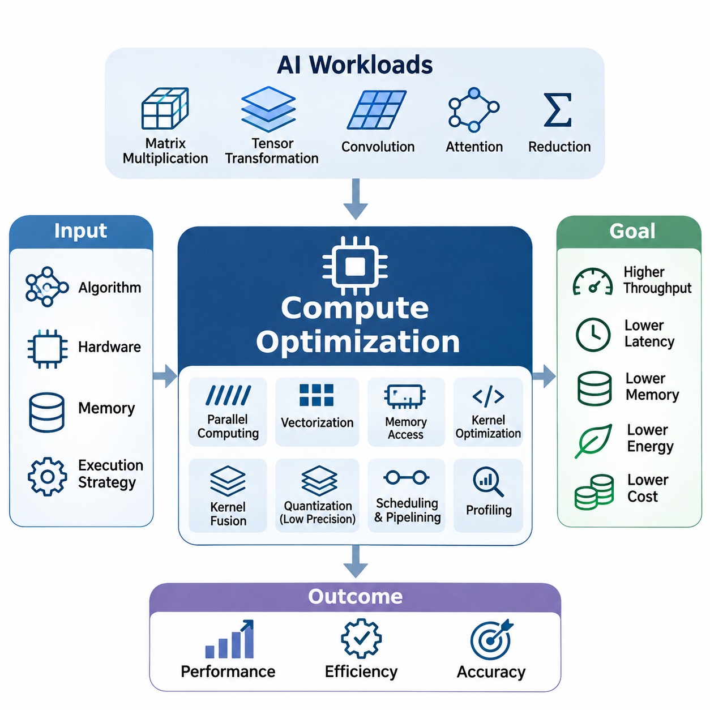
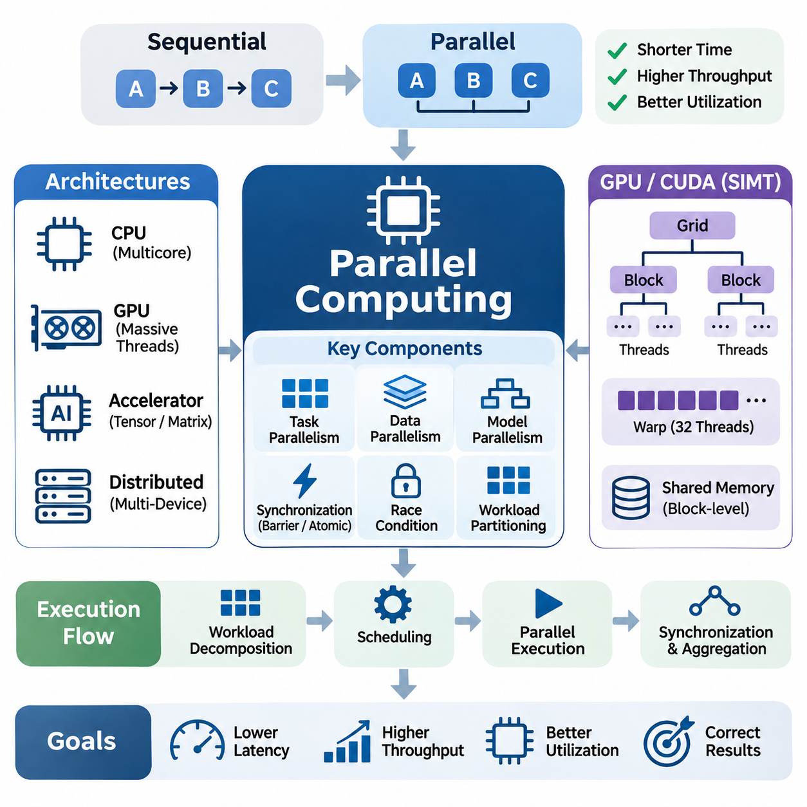
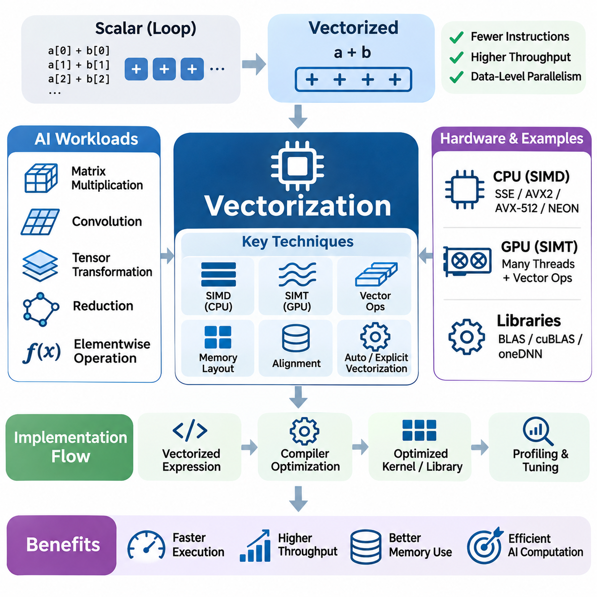
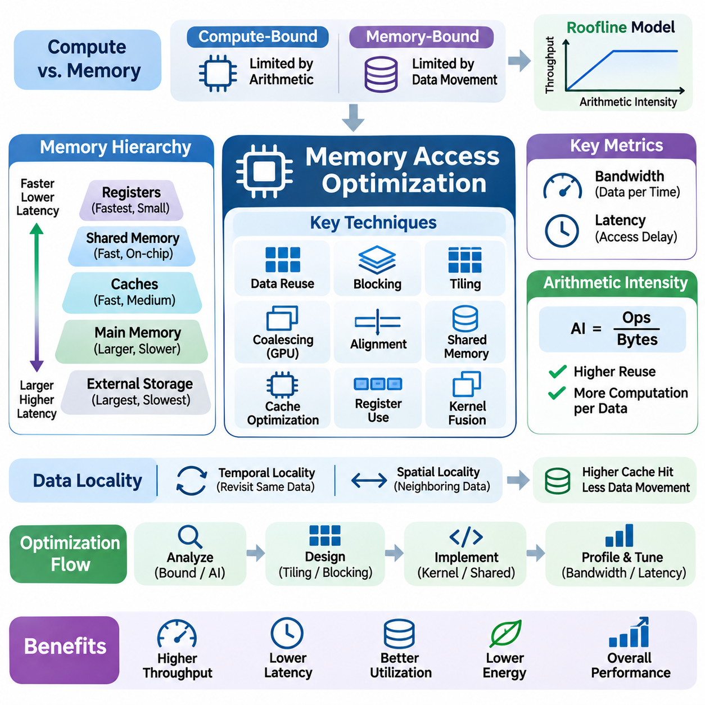
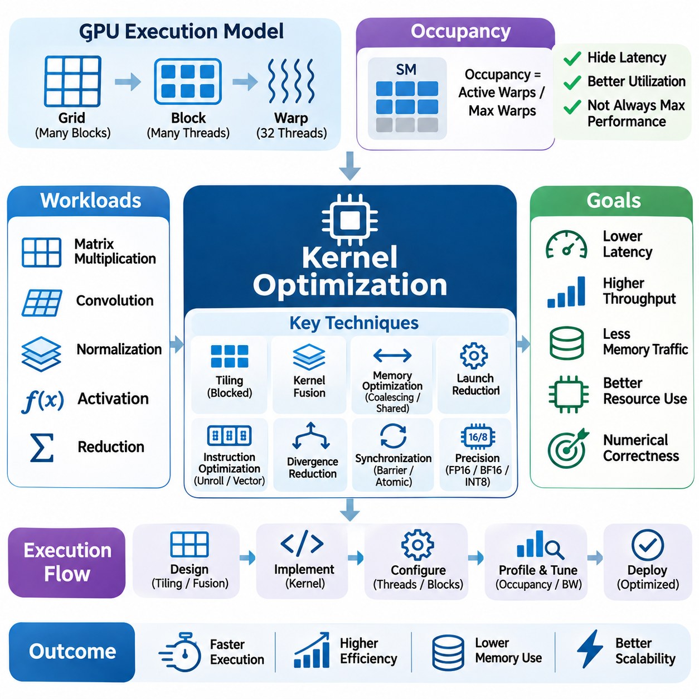
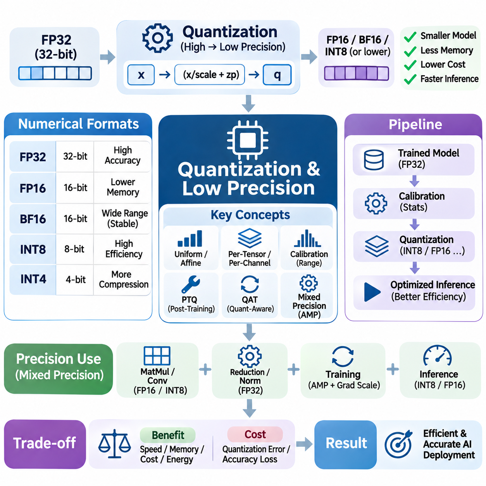
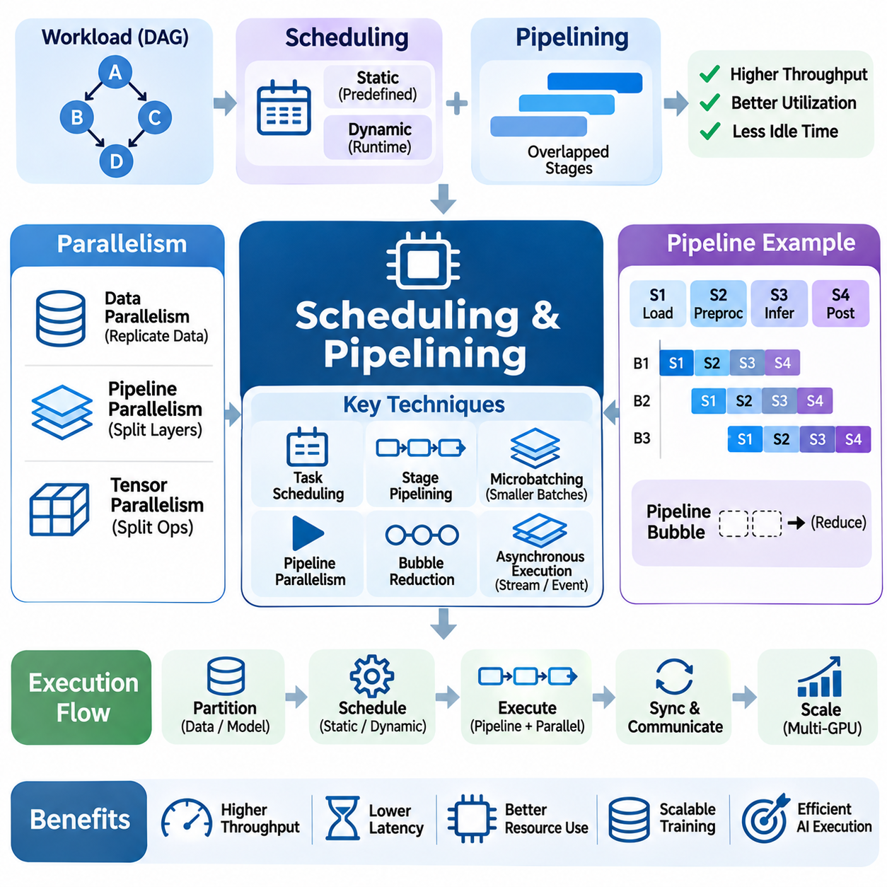
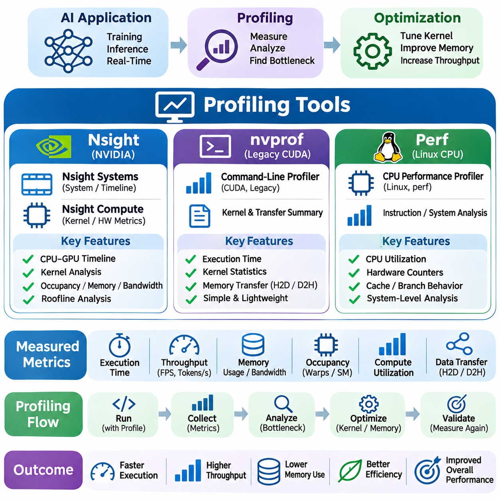
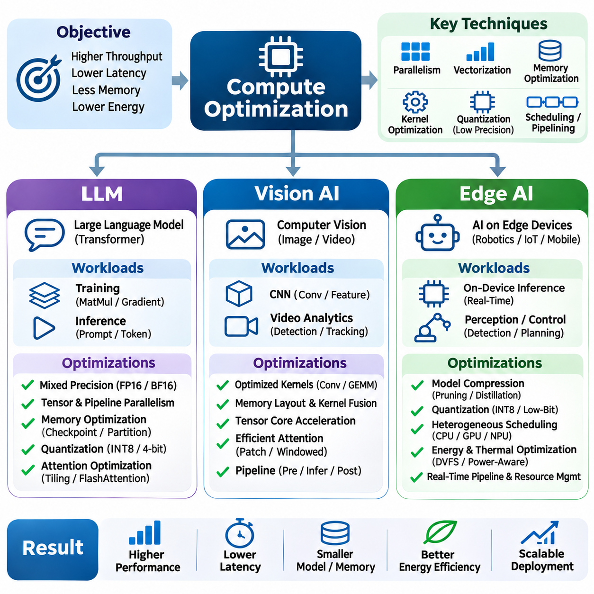

**Volume 39. Hardware for AI**

# 05. Compute Optimization

## 05.00 Overview

{width="7.268055555555556in" height="7.268055555555556in"}

Compute optimization is a fundamental discipline in artificial intelligence hardware engineering that aims to maximize computational efficiency while minimizing execution time, memory consumption, energy usage, and operational cost. As AI models increase in complexity, achieving high performance requires more than powerful processors. Effective optimization depends on coordinating algorithms, hardware architecture, memory systems, and execution strategies to utilize available resources efficiently.

Modern AI workloads involve extensive matrix multiplication, tensor transformations, convolution operations, attention mechanisms, and numerical reductions. These operations exhibit different computational characteristics and place varying demands on processors and memory subsystems. Compute optimization identifies these characteristics and selects appropriate execution methods to improve throughput, reduce latency, and maintain numerical accuracy across diverse hardware platforms.

The performance of AI computation is influenced by the interaction between computational capacity and data movement. Although GPUs and specialized accelerators provide substantial arithmetic throughput, their execution units may remain underutilized when memory access is inefficient. Consequently, optimization must address both computation and communication, ensuring that data reaches processing elements at sufficient speed while avoiding unnecessary transfers and synchronization.

Parallel computing provides one of the most important foundations for efficient AI execution. By dividing computational workloads into independent or partially independent tasks, multiple processing elements can operate simultaneously. GPUs implement massive parallelism through thousands of concurrent threads, while multicore CPUs and specialized accelerators employ different execution models. The effectiveness of parallelism depends on workload decomposition, synchronization overhead, and resource utilization.

Data parallelism distributes independent data elements across processing units, making it particularly effective for tensor operations and batched neural network computations. Task parallelism allows different computational stages to execute concurrently when dependencies permit. However, excessive synchronization, uneven workload distribution, and communication overhead can reduce expected speedups. Efficient parallel execution therefore requires careful coordination between computation granularity and hardware capabilities.

Vectorization improves computational efficiency by processing multiple data elements through a single instruction or coordinated execution mechanism. Modern CPUs provide SIMD instruction sets, while GPUs employ SIMT execution and specialized matrix-processing units. Vectorized operations reduce instruction overhead and increase arithmetic throughput when data layouts and execution patterns are compatible. Their effectiveness depends on alignment, instruction support, and memory accessibility.

Efficient vectorization requires algorithms to expose regular computational patterns that can be mapped onto hardware execution units. Operations involving contiguous arrays, dense matrices, and predictable control flow generally benefit from vectorized execution. Conversely, irregular indexing, frequent branching, and complex dependencies can limit efficiency. Compiler transformations, tensor libraries, and specialized kernels help convert high-level mathematical expressions into hardware-efficient operations.

Memory access optimization is essential because data movement frequently consumes more time and energy than arithmetic operations. Modern processors employ hierarchical memory systems containing registers, caches, shared memory, and external memory. Each level provides different capacity, bandwidth, and latency characteristics. Efficient implementations maximize data reuse within faster memory levels while minimizing expensive transfers to slower storage locations.

Memory access patterns strongly influence GPU performance because neighboring threads can often combine their accesses into efficient memory transactions. Coalesced access, cache-aware data layouts, tiling, and shared-memory reuse reduce redundant transfers and improve effective bandwidth. Poorly organized memory access can generate excessive transactions, causing execution units to wait for data even when sufficient arithmetic capacity is available.

Kernel optimization focuses on improving the execution efficiency of individual computational operations. A kernel represents a function executed on an accelerator, typically across many parallel threads. Its performance depends on thread organization, memory access, register allocation, instruction selection, and synchronization behavior. Optimized kernels attempt to balance parallel occupancy, computational intensity, and resource consumption without introducing unnecessary overhead.

Kernel fusion combines multiple compatible operations into fewer execution stages, reducing intermediate memory transfers and kernel-launch overhead. For example, combining arithmetic transformations with activation functions can eliminate temporary tensor storage. However, excessive fusion may increase register pressure, reduce occupancy, or complicate scheduling. Effective fusion therefore requires evaluating the complete execution pattern rather than assuming that fewer kernels always produce better performance.

Quantization and low-precision computation provide additional opportunities for improving AI efficiency. Traditional numerical workloads frequently use 32-bit floating-point representations, while many neural network operations can tolerate lower precision. Formats such as FP16, BF16, INT8, and selected lower-bit representations reduce storage requirements and may increase computational throughput when supported by suitable hardware and optimized execution libraries.

The benefits of reduced precision extend beyond arithmetic performance because smaller numerical representations decrease memory bandwidth requirements and model storage consumption. However, quantization introduces approximation errors that can affect prediction accuracy and numerical stability. Calibration, quantization-aware training, mixed-precision execution, and selective higher-precision accumulation help balance efficiency with computational reliability across different AI architectures.

Scheduling and pipelining coordinate computational activities to minimize idle periods and improve resource utilization. Scheduling determines when operations execute and which hardware resources they occupy, while pipelining overlaps different processing stages. AI workloads often involve data loading, preprocessing, host-to-device transfers, accelerator computation, and output processing. Coordinating these stages can improve throughput by reducing unnecessary waiting.

Asynchronous execution enables independent operations to proceed concurrently when hardware and software dependencies permit. GPU streams, double buffering, and overlapping computation with data transfers can improve utilization in suitable workloads. Nevertheless, overlapping activities does not automatically guarantee better performance. Resource contention, synchronization requirements, and limited transfer bandwidth may constrain achievable improvements and must be evaluated through measurement.

Performance profiling provides the empirical foundation for identifying computational bottlenecks and validating optimization strategies. Profiling tools collect information about execution time, kernel activity, memory transactions, processor utilization, and synchronization behavior. NVIDIA Nsight provides detailed GPU performance analysis, while legacy nvprof workflows and Linux perf offer additional perspectives on hardware and software execution characteristics.

Optimization guided by profiling begins with establishing a reproducible baseline and identifying the dominant contributors to execution time. Engineers distinguish compute-bound workloads from memory-bound workloads and investigate whether inefficiencies originate from arithmetic throughput, data movement, synchronization, or launch overhead. This measurement-driven approach prevents unnecessary modifications and directs engineering effort toward improvements with demonstrable performance benefits.

The roofline model provides a useful conceptual framework for understanding computational limitations. It relates achievable performance to arithmetic intensity, defined as the number of arithmetic operations performed per unit of data transferred. Workloads with low arithmetic intensity are often constrained by memory bandwidth, while sufficiently compute-intensive workloads may approach processor throughput limits. This distinction helps determine whether to prioritize data reuse or arithmetic optimization.

Compute optimization also requires understanding tradeoffs among throughput, latency, energy consumption, and numerical precision. A configuration that maximizes batch throughput may increase individual request latency, while aggressive parallel execution can raise power consumption. Similarly, lower precision may improve speed but require additional accuracy validation. The appropriate optimization objective therefore depends on application requirements rather than a single universal performance metric.

Large language models introduce substantial optimization challenges because transformer architectures combine matrix multiplication, attention computation, normalization, and memory-intensive data access. Training emphasizes high-throughput tensor computation and efficient gradient processing, while autoregressive inference introduces sequential dependencies and key-value cache management. Optimization strategies must accommodate these different execution characteristics and their associated memory requirements.

Vision AI workloads involve convolutional networks, vision transformers, feature extraction, and image-processing pipelines. Their performance depends on tensor dimensions, memory layouts, batch sizes, and accelerator-specific execution capabilities. Optimized convolution algorithms, fused operations, mixed precision, and efficient preprocessing can improve performance. Real-time vision applications additionally require predictable latency and consistent processing rates across changing input conditions.

Edge AI systems operate under particularly restrictive computational, memory, power, and thermal constraints. Embedded GPUs, neural processing units, and specialized accelerators must execute models efficiently without relying on abundant external resources. Techniques such as quantization, memory reuse, workload scheduling, and hardware-aware kernel selection help support practical inference while preserving acceptable accuracy and responsiveness.

In robotics and autonomous systems, compute optimization directly influences perception, localization, planning, and control performance. Multiple sensor streams and AI models may compete for limited processing resources while operating under real-time deadlines. Optimizing individual kernels is insufficient when the overall system suffers from scheduling conflicts or data-transfer delays. End-to-end optimization must consider execution priorities, timing dependencies, and system-level reliability.

Energy efficiency has become an increasingly important objective as AI infrastructure expands across data centers and embedded devices. Higher computational throughput does not necessarily imply lower energy consumption, particularly when processors operate at elevated frequencies or experience inefficient utilization. Performance-per-watt analysis evaluates useful computational output relative to energy expenditure, encouraging optimization strategies that balance execution speed with sustainable operation.

Hardware characteristics determine which optimization techniques are most effective. GPU architectures emphasize throughput-oriented parallel execution, CPUs provide flexible control and vector processing, and specialized accelerators prioritize selected tensor operations. Differences in memory hierarchy, instruction support, interconnect bandwidth, and execution scheduling influence achievable performance. Hardware-aware optimization aligns computational workloads with these architectural strengths and limitations.

Ultimately, compute optimization is an iterative engineering process that combines algorithmic understanding, architectural knowledge, implementation techniques, and experimental evaluation. Parallel computing, vectorization, memory optimization, kernel tuning, reduced precision, scheduling, and profiling form an interconnected framework. Their coordinated application enables AI systems to deliver higher performance, improved resource efficiency, and more predictable operation across cloud, data-center, and edge environments.

## 05.01 Parallel Computing [w/Code]

{width="7.268055555555556in" height="7.268055555555556in"}

Parallel computing is a fundamental technique for accelerating artificial intelligence workloads by executing multiple computational tasks simultaneously across available processing resources. Unlike sequential computing, where operations execute one after another, parallel computing distributes independent operations among multiple cores, threads, or accelerators. Its primary objective is to reduce execution time, increase throughput, and improve hardware utilization while preserving computational correctness.

Modern AI applications contain extensive opportunities for parallel execution because neural network operations frequently involve large tensors, matrices, and independent data elements. Matrix multiplication, convolution, attention computation, and gradient calculations can be decomposed into smaller operations executed concurrently. However, the achievable acceleration depends on data dependencies, workload characteristics, communication overhead, and the architecture of the underlying hardware.

Parallel computing architectures include multicore CPUs, graphics processing units, tensor accelerators, and distributed computing systems. CPUs typically provide relatively sophisticated control logic and flexible execution capabilities, while GPUs emphasize massive throughput through numerous lightweight threads. Specialized accelerators optimize selected computational patterns, such as matrix multiplication, using dedicated processing arrays and carefully organized data movement.

The distinction between task parallelism and data parallelism is essential for understanding parallel execution strategies. Task parallelism assigns different computational operations to separate processing resources, allowing independent stages to progress concurrently. Data parallelism applies similar operations to different portions of a dataset or tensor. Both approaches can be combined to exploit parallelism across multiple levels of an AI computation pipeline.

Data parallelism is particularly effective for neural network training because individual samples within a minibatch can often be processed independently during forward and backward computation. Each processing device calculates intermediate activations and gradients using its assigned data partition. In distributed training, gradients are subsequently synchronized or aggregated to maintain consistent model parameters across participating devices.

Model parallelism distributes different portions of a neural network across multiple processors or accelerators when the model cannot fit efficiently within a single device. Tensor parallelism divides individual tensor operations across processing units, while pipeline parallelism assigns different model layers to separate devices. These approaches increase computational capacity but introduce communication dependencies and synchronization requirements that influence overall performance.

GPU parallel computing commonly follows the single-instruction, multiple-thread execution model, known as SIMT. Threads are organized into groups that execute instructions under coordinated scheduling. In NVIDIA CUDA architectures, threads form blocks, and blocks form grids. This hierarchy allows programmers to express large-scale parallel workloads while enabling hardware schedulers to distribute execution across streaming multiprocessors.

Within NVIDIA GPUs, threads are scheduled in groups called warps, traditionally containing 32 threads. Threads within a warp execute under a common instruction scheduling mechanism, although individual threads may follow different control paths. Divergent branches can reduce execution efficiency because different execution paths may require separate instruction execution. Consequently, algorithms with regular control flow often achieve higher parallel efficiency.

Thread blocks provide a mechanism for organizing cooperating threads that share execution resources and synchronization capabilities. Threads within a CUDA block can exchange data through shared memory and coordinate using block-level synchronization primitives. The appropriate block size depends on register requirements, shared-memory consumption, kernel characteristics, and hardware limitations. Poor configuration can reduce occupancy or introduce unnecessary scheduling overhead.

Parallel occupancy describes the proportion of available execution capacity represented by active warps on a streaming multiprocessor. Higher occupancy can help hide memory and instruction latency by allowing the scheduler to execute other ready warps. However, maximum occupancy does not necessarily produce maximum performance. Register pressure, instruction-level parallelism, memory bandwidth, and computational intensity must also be considered when optimizing execution configurations.

Synchronization is necessary whenever parallel tasks share data or depend on results produced by other tasks. Barriers ensure that participating threads reach designated execution points before continuing, while atomic operations protect shared updates from conflicting accesses. Excessive synchronization can serialize execution and reduce scalability. Efficient parallel algorithms therefore minimize synchronization frequency and organize dependencies to preserve concurrency.

Race conditions occur when multiple threads access shared data without sufficient coordination and at least one access modifies that data. Such conditions can produce nondeterministic results, incorrect calculations, or unstable behavior. Parallel programming requires careful management of shared memory, atomic operations, and execution ordering. Correctness verification is especially important because concurrency errors may appear only under particular workloads or scheduling conditions.

Workload partitioning determines how computational tasks are divided among available processing resources. Static partitioning assigns work before execution, whereas dynamic scheduling distributes tasks according to runtime availability. Uniform workloads often benefit from predictable static assignments, while irregular workloads may require adaptive strategies. Effective partitioning reduces idle processing time and prevents individual devices from becoming performance bottlenecks.

Load balancing is closely related to workload partitioning because uneven computational assignments can leave some processors idle while others remain busy. This problem becomes significant in sparse computation, variable-length sequence processing, and heterogeneous AI workloads. Dynamic work queues, adaptive scheduling, and workload-aware partitioning can improve resource utilization, although their coordination overhead must be evaluated carefully.

Parallel scalability describes how computational performance changes as additional processing resources are introduced. Strong scaling measures execution-time improvement for a fixed problem size, while weak scaling evaluates performance as both workload size and processing resources increase proportionally. These measurements reveal whether an algorithm benefits from additional hardware or becomes constrained by communication, synchronization, and sequential execution components.

Amdahl\'s law explains the theoretical limitation imposed by the sequential portion of a computation. If a fraction of an application cannot be parallelized, increasing the number of processors eventually produces diminishing returns. For a parallelizable fraction p and N processors, the idealized speedup is 1 / ((1 - p) + p / N). This relationship emphasizes the importance of reducing sequential bottlenecks before expanding computational resources.

Gustafson\'s law provides a complementary perspective by considering workloads that increase in size as additional processing resources become available. Under suitable assumptions, larger problems can exploit more processors effectively even when fixed-size speedup is limited. This perspective is particularly relevant to large-scale AI training, where increasing model dimensions, dataset sizes, or batch sizes can create additional opportunities for parallel computation.

Communication overhead becomes increasingly important when parallel execution spans multiple GPUs or computing nodes. Devices must exchange gradients, activations, model parameters, or intermediate results through communication interfaces. PCIe, NVLink, and high-performance network interconnects provide different bandwidth and latency characteristics. Communication-efficient algorithms minimize unnecessary transfers and overlap communication with computation whenever dependencies permit.

Collective communication operations are widely used in distributed AI systems to coordinate information among multiple devices. All-reduce aggregates values and distributes the result to participating processors, while all-gather and reduce-scatter support distributed tensor operations. Their performance depends on message size, communication topology, and implementation algorithms. Efficient collective communication is essential for maintaining high accelerator utilization.

Asynchronous parallel execution allows independent operations to progress without waiting for unrelated tasks to complete. GPU streams, asynchronous memory transfers, and event-based synchronization provide mechanisms for overlapping compatible activities. Such overlap can improve throughput when sufficient execution and transfer resources are available. Nevertheless, uncontrolled concurrency may introduce resource contention and complicate dependency management.

Memory hierarchy strongly influences parallel computing performance because concurrent threads generate substantial data-access demands. Registers, shared memory, caches, and global memory provide different latency and bandwidth characteristics. Efficient parallel kernels exploit data locality, coalesced memory access, and shared-memory reuse. Without these techniques, increasing thread concurrency may amplify memory contention rather than improve computational throughput.

Parallel reduction operations illustrate the importance of algorithm structure in concurrent execution. Summation, maximum selection, normalization statistics, and gradient aggregation require combining values from multiple threads. Tree-based reductions reduce the number of sequential combination stages compared with straightforward serial accumulation. However, synchronization, memory access, and floating-point operation ordering can influence both performance and numerical reproducibility.

Parallel computing also introduces challenges related to numerical determinism and floating-point precision. Floating-point addition is not strictly associative, meaning different reduction orders can produce slightly different results. Concurrent execution may therefore generate numerical variations across devices or repeated runs. Reproducible AI experiments require controlled execution settings, deterministic algorithms where available, and appropriate numerical tolerance during validation.

Performance evaluation of parallel implementations requires measuring more than theoretical processor utilization. Important metrics include execution latency, throughput, scaling efficiency, synchronization overhead, memory bandwidth, and energy consumption. Profiling tools such as NVIDIA Nsight Systems, Nsight Compute, and Linux perf help identify scheduling inefficiencies and computational bottlenecks. Measurements should use representative workloads and consistent experimental conditions.

In large language models, parallel computing accelerates attention operations, feedforward networks, embedding transformations, and gradient computation. Training large models frequently combines data, tensor, and pipeline parallelism across accelerator clusters. Inference systems also exploit parallel execution through batched requests and optimized matrix operations. However, autoregressive token generation introduces sequential dependencies that constrain available parallelism.

Vision AI systems benefit from parallel processing because convolution, image transformations, feature extraction, and tensor operations contain substantial data-level concurrency. GPU acceleration enables high-throughput image classification, object detection, and segmentation. In real-time robotics, parallel execution can support simultaneous perception and planning tasks, provided that scheduling policies preserve latency requirements and avoid interference with critical control operations.

Ultimately, effective parallel computing requires balancing concurrency, communication, synchronization, memory efficiency, and hardware utilization. Increasing the number of threads or processors does not automatically improve performance, particularly when workloads contain dependencies or limited computational intensity. Successful optimization combines architecture-aware workload decomposition, efficient execution scheduling, rigorous correctness validation, and measurement-driven refinement to achieve scalable AI computation.

## 05.02 Vectorization [w/Code]

{width="7.268055555555556in" height="7.268055555555556in"}

Vectorization is a fundamental compute optimization technique that transforms operations on individual data elements into operations that process multiple elements simultaneously. By exploiting data-level parallelism, vectorization reduces instruction overhead and improves computational throughput. It plays a critical role in artificial intelligence workloads involving matrix multiplication, tensor transformations, convolution, numerical reductions, and large-scale scientific computation.

Traditional scalar execution processes individual values through separate arithmetic instructions, even when the same operation must be repeated across large arrays. Vectorized execution groups compatible operations into wider instructions or parallel tensor operations. This approach allows processors to perform more useful computation per instruction, provided that the data layout, instruction set, and memory access patterns support efficient parallel processing.

Modern CPUs implement vectorization primarily through single-instruction, multiple-data architectures, commonly known as SIMD. Instruction extensions such as SSE, AVX2, AVX-512, and ARM NEON allow one instruction to operate on multiple numerical elements. The number of elements processed simultaneously depends on vector register width, data precision, and hardware capabilities. Wider vectors can improve throughput when sufficient data parallelism exists.

GPU vectorization operates differently from conventional CPU SIMD because GPUs primarily employ single-instruction, multiple-thread execution. Groups of threads execute coordinated instructions across separate data elements, enabling large-scale data parallelism. Although GPU execution is commonly described through SIMT, individual threads may also use vectorized memory operations or specialized instructions. Understanding these distinctions is important when mapping algorithms onto different hardware architectures.

Vectorization is particularly effective for elementwise tensor operations, where the same mathematical transformation is applied independently to many elements. Operations such as addition, multiplication, activation functions, and normalization components can often be expressed without explicit scalar loops. Frameworks such as NumPy, PyTorch, and TensorFlow provide vectorized interfaces that delegate execution to optimized numerical libraries and accelerator kernels.

Replacing explicit loops with vectorized expressions can reduce interpreter overhead in high-level programming languages. For example, applying an arithmetic operation to an entire NumPy array generally avoids repeated Python-level instruction dispatch. However, vectorized expressions may create temporary arrays and additional memory transfers. Consequently, efficient implementations must consider both computational acceleration and the memory costs associated with intermediate results.

Matrix multiplication demonstrates the importance of vectorization in artificial intelligence. Dense matrix operations expose substantial data parallelism and can exploit SIMD instructions, GPU execution units, and specialized matrix accelerators. Optimized libraries such as BLAS, cuBLAS, and oneDNN organize computation around hardware-efficient operations. Their implementations combine vectorization, blocking, data reuse, and instruction scheduling to achieve high throughput.

Vectorization efficiency depends strongly on memory layout because processing units must obtain data at sufficient speed. Contiguous arrays generally support efficient sequential memory access, while strided or irregular layouts may require additional address calculations and data rearrangement. Row-major and column-major representations influence which dimensions can be traversed efficiently. Selecting an appropriate layout can substantially improve effective memory bandwidth.

Memory alignment is another important consideration because vector instructions frequently operate most efficiently on data stored at suitable address boundaries. Aligned loads and stores can simplify memory transactions, although modern processors often support unaligned accesses. The actual performance penalty depends on processor architecture, cache-line boundaries, and memory access patterns. Alignment should therefore be evaluated through profiling rather than treated as an absolute requirement.

Automatic vectorization allows compilers to transform suitable scalar loops into SIMD instructions without requiring explicit vector programming. Compilers analyze loop dependencies, memory access patterns, aliasing possibilities, and instruction availability before applying transformations. Simple loops with independent iterations are generally easier to vectorize. Complex control flow, uncertain pointer relationships, and loop-carried dependencies can prevent or restrict automatic vectorization.

Compiler optimization settings influence whether vectorization is enabled and which instruction sets are targeted. Architecture-specific compilation options can expose additional SIMD capabilities, while optimization reports help identify successfully vectorized loops. However, aggressive transformations may alter floating-point evaluation order or introduce compatibility constraints. Developers should validate numerical behavior and ensure that generated binaries match the capabilities of deployment hardware.

Explicit vectorization provides greater control when compiler-generated instructions do not achieve the desired performance. SIMD intrinsics allow programmers to express operations using architecture-specific vector types and instructions. This approach can improve performance in carefully optimized kernels but increases implementation complexity and reduces portability. Maintaining scalar or alternative architecture implementations may be necessary for compatibility across different processor families.

Loop unrolling is frequently combined with vectorization to reduce branch overhead and expose additional instruction-level parallelism. By processing multiple iterations within one expanded loop body, the compiler may schedule independent operations more efficiently. However, excessive unrolling increases code size and register requirements. Effective optimization balances instruction throughput, register pressure, cache behavior, and the processor\'s ability to execute instructions concurrently.

Loop interchange changes the order of nested loop execution to improve memory locality and expose vectorizable dimensions. In multidimensional tensor operations, the innermost loop should often traverse contiguous data whenever dependencies permit. Loop tiling divides large computations into smaller blocks that fit more effectively within caches or local memory. These transformations improve vectorization by combining regular access patterns with greater data reuse.

Conditional operations can complicate vectorization because different data elements may require different execution paths. Predication and masked vector instructions allow selected elements to participate in an operation without requiring conventional scalar branching. Nevertheless, masked execution may perform unnecessary work or suffer reduced efficiency when only a small fraction of vector lanes are active. Algorithm restructuring can sometimes improve performance by reducing irregular control flow.

Reduction operations present additional challenges because multiple input values contribute to a shared output. Summation, maximum selection, dot products, and statistical calculations require combining intermediate results. Vectorized reductions typically accumulate partial values across vector lanes before combining them into a final result. Their performance depends on instruction support, memory bandwidth, accumulation strategies, and the numerical precision required by the application.

Floating-point vectorization requires attention to numerical stability because arithmetic transformations can change operation ordering. Floating-point addition is not strictly associative, so vectorized reductions may produce results that differ slightly from scalar implementations. Fused multiply-add instructions can also change rounding behavior by combining multiplication and addition into one operation. Numerical validation should use appropriate tolerances while preserving application-specific accuracy requirements.

Mixed-precision computation extends vectorization by allowing more numerical elements to occupy a fixed-width register or processing unit. Lower-precision formats such as FP16, BF16, and INT8 can increase arithmetic throughput and reduce memory traffic when hardware provides suitable instructions. However, numerical range, accumulation precision, and quantization error must be considered. Lower precision should be selected according to workload characteristics and accuracy constraints.

Tensor Cores and similar matrix acceleration units extend the principles of data-parallel execution beyond conventional SIMD instructions. These units perform structured matrix operations using specialized hardware datapaths and supported numerical formats. Their efficiency depends on matrix dimensions, memory layouts, alignment constraints, and data preparation. High-level libraries often select appropriate accelerated implementations automatically when operation shapes and hardware capabilities permit.

Vectorization can become memory-bound when arithmetic operations are inexpensive relative to the amount of data transferred. Elementwise addition, for example, performs relatively little computation for each input and output element. Increasing vector width may provide limited benefits once memory bandwidth becomes saturated. Arithmetic intensity and roofline analysis help determine whether further instruction-level optimization can improve performance or whether data movement must be reduced.

Kernel fusion can improve vectorized workloads by combining consecutive operations and eliminating unnecessary intermediate arrays. Instead of separately reading and writing tensors for each transformation, a fused kernel may perform several calculations while values remain in registers. This approach reduces memory traffic and execution overhead. However, excessive fusion may increase register pressure or limit parallel scheduling, requiring careful performance evaluation.

Vectorization strategies differ between training and inference workloads. Training often processes large batches and substantial tensor dimensions, providing opportunities for high-throughput vector operations. Inference may involve smaller batches, irregular sequence lengths, or latency-sensitive execution. Consequently, the most efficient vector width, kernel configuration, and batching strategy can vary according to operational requirements and hardware characteristics.

Large language models rely extensively on vectorized computation for embedding transformations, attention projections, feedforward networks, and normalization operations. Matrix multiplication dominates many compute-intensive stages, while elementwise operations and memory-intensive transformations require efficient data movement. During autoregressive inference, small matrix dimensions and sequential token dependencies may reduce hardware utilization. Specialized kernels and batching strategies help address these limitations.

Vision AI applications benefit from vectorization across convolution, image preprocessing, feature extraction, and tensor normalization. Operations involving large image arrays frequently expose regular memory access and substantial data parallelism. Efficient implementations combine SIMD instructions, GPU parallelism, and optimized convolution libraries. Real-time vision systems must additionally balance throughput improvements with predictable latency and memory consumption.

Edge AI platforms impose additional constraints because embedded processors have limited memory bandwidth, power budgets, and thermal capacity. Vectorization can improve energy efficiency by completing more arithmetic operations per instruction, although actual benefits depend on hardware utilization and memory behavior. ARM SIMD extensions, embedded GPU kernels, and dedicated neural accelerators provide different optimization opportunities. Hardware-aware implementations are essential for practical deployment.

Performance profiling is necessary to determine whether vectorization produces meaningful acceleration. Useful measurements include execution latency, throughput, vector instruction utilization, cache behavior, memory bandwidth, and processor occupancy. Compiler reports, hardware performance counters, and specialized profiling tools can reveal missed vectorization opportunities. Comparisons should use representative input sizes and account for compilation overhead, memory allocation, and data-transfer costs.

Ultimately, vectorization is most effective when algorithms expose independent operations, regular memory access, and sufficient computational work to utilize available execution units. Its benefits emerge through coordinated optimization of instruction selection, data layout, compiler transformations, memory reuse, and numerical precision. By integrating vectorization with parallel computing and hardware-aware kernel design, AI systems can achieve higher throughput, lower execution overhead, and more efficient utilization of computational resources.

## 05.03 Memory Access Optimization [w/Code]

{width="7.268055555555556in" height="7.268055555555556in"}

Memory access optimization is a fundamental aspect of AI compute engineering because moving data often consumes more time and energy than performing arithmetic operations. Modern processors provide enormous computational throughput, but their execution units can remain idle when data is unavailable. Efficient memory access therefore requires minimizing unnecessary transfers, maximizing data reuse, and organizing computation around the characteristics of the memory hierarchy.

Modern computing systems employ hierarchical memory architectures containing registers, caches, shared memory, main memory, and external storage. Each level offers different capacity, bandwidth, latency, and energy characteristics. Registers provide extremely fast access but limited capacity, while external memory offers greater storage at higher access costs. Memory optimization aims to retain frequently accessed data in faster levels and reduce expensive movement between memory regions.

Memory bandwidth represents the amount of data that can be transferred within a given period, while memory latency measures the delay associated with completing an access request. These characteristics influence performance differently depending on workload behavior. Streaming tensor operations frequently depend on bandwidth, whereas irregular memory accesses may be sensitive to latency. Understanding both limitations is essential for selecting appropriate optimization strategies.

The distinction between compute-bound and memory-bound workloads provides an important foundation for performance analysis. Compute-bound operations are primarily limited by arithmetic execution capacity, while memory-bound operations are constrained by data delivery. The roofline model relates attainable computational throughput to arithmetic intensity and available memory bandwidth. This framework helps determine whether optimization should prioritize arithmetic efficiency or reduced data movement.

Arithmetic intensity measures the number of arithmetic operations performed per byte transferred between processing units and memory. Matrix multiplication can achieve relatively high arithmetic intensity when data is reused effectively, while simple elementwise operations often perform little computation per transferred byte. Increasing data reuse through blocking, fusion, and local storage can shift workloads toward higher computational efficiency without changing their mathematical results.

Data locality is a central principle of memory optimization because recently accessed or nearby data is often required again. Temporal locality refers to reusing the same data within a short period, while spatial locality involves accessing neighboring memory locations. Cache hierarchies exploit these patterns to reduce access to slower memory. Algorithms that preserve locality generally achieve higher effective bandwidth and lower memory access overhead.

Contiguous memory access improves efficiency by allowing processors to retrieve useful data through predictable memory transactions. Sequential traversal of arrays often benefits from cache-line utilization and hardware prefetching. In contrast, irregular indexing and large memory strides can generate additional transactions and reduce cache effectiveness. Data structures and loop ordering should therefore be designed to match the physical organization of stored information.

GPU memory coalescing is particularly important because groups of threads frequently access memory simultaneously. When neighboring threads access suitably arranged addresses, hardware can combine their requests into fewer memory transactions. Scattered access patterns may require additional transactions, reducing effective bandwidth. Efficient GPU kernels organize thread indexing and tensor layouts to maximize coalesced global-memory access whenever practical.

Memory alignment influences how efficiently data can be loaded and stored through processor memory interfaces. Properly aligned addresses can simplify vector loads, cache transactions, and accelerator memory operations. However, modern hardware often supports unaligned accesses, and performance penalties vary with access boundaries and architecture. Alignment decisions should be guided by hardware requirements and measured behavior rather than universal assumptions.

Cache optimization attempts to maximize useful data reuse within limited on-chip storage. CPU caches typically exploit hardware-managed replacement policies, while GPU architectures combine hardware-managed caches with explicitly managed shared memory. Cache blocking divides large computations into smaller regions that fit more effectively within available cache capacity. This approach reduces repeated transfers from external memory and improves arithmetic unit utilization.

Tiling is widely used in matrix multiplication, convolution, and tensor processing to improve locality and reuse. Instead of processing entire matrices through repeated external-memory accesses, tiled algorithms load smaller blocks into fast storage and perform multiple operations on them. Tile dimensions must balance reuse, parallelism, register consumption, and shared-memory capacity. Excessively large tiles can reduce occupancy, while small tiles may fail to exploit reuse opportunities.

Shared memory provides programmable low-latency storage within GPU streaming multiprocessors and enables cooperation among threads in a block. Threads can load reusable data from global memory, exchange intermediate values, and synchronize before further computation. Proper shared-memory management reduces redundant external accesses. However, bank conflicts, synchronization overhead, and limited capacity can diminish the benefits of shared-memory optimization.

Registers offer the fastest storage for frequently used intermediate values and are essential for efficient kernel execution. Keeping temporary calculations in registers avoids repeated memory accesses and supports instruction-level parallelism. Nevertheless, excessive register usage can reduce the number of active threads or cause register spilling into slower memory. Effective kernel design balances register reuse with occupancy and overall execution efficiency.

Loop transformations can significantly improve memory access behavior without changing the underlying algorithm. Loop interchange reorganizes iteration order to traverse contiguous dimensions, while loop tiling increases reuse within cache-sized regions. Loop fusion combines compatible operations to eliminate intermediate memory transfers. These transformations must preserve dependencies and account for compiler behavior, numerical precision, and hardware execution characteristics.

Tensor memory layout affects both computational efficiency and compatibility with optimized accelerator kernels. Row-major and column-major arrangements determine which dimensions are contiguous, while layouts such as NCHW and NHWC influence convolution execution. Different processors and libraries may prefer different representations. Layout conversion can improve kernel performance but introduces additional memory traffic, making end-to-end evaluation necessary.

Memory allocation and buffer management also influence AI system performance. Repeated allocation of temporary tensors can introduce overhead, increase fragmentation, and complicate memory scheduling. Memory pools and reusable buffers reduce allocation frequency and support predictable execution. In dynamic workloads, careful buffer lifetime management enables storage reuse while preventing invalid accesses or unintended modification of data.

Kernel fusion reduces memory traffic by combining multiple compatible operations into a single execution stage. For example, integrating bias addition and activation with a matrix operation may eliminate intermediate tensor writes. Fusion is especially beneficial for memory-bound workloads involving simple transformations. However, excessive fusion can increase register pressure, complicate scheduling, and reduce parallel occupancy, so its effectiveness must be verified experimentally.

Asynchronous memory transfers allow computation and data movement to overlap when hardware resources and execution dependencies permit. GPU streams, pinned host memory, and double buffering can reduce waiting between processing stages. Prefetching prepares data before it is needed, while pipelining coordinates transfers and computation. These techniques improve throughput only when sufficient bandwidth and independent work exist to support meaningful overlap.

Host-to-device communication can become a major bottleneck when AI applications repeatedly transfer tensors between CPUs and accelerators. PCIe and other interconnects provide finite bandwidth and introduce transfer latency. Minimizing unnecessary transfers, batching communication, and retaining intermediate results on accelerators can reduce overhead. End-to-end optimization must consider communication costs rather than evaluating accelerator kernel execution in isolation.

Large language models introduce substantial memory optimization challenges because model parameters, intermediate activations, and attention caches occupy significant storage. During autoregressive inference, key-value caches grow with sequence length and consume memory bandwidth during attention computation. Techniques such as cache-aware attention, efficient memory allocation, and reduced-precision storage can improve capacity and throughput while preserving acceptable numerical behavior.

Attention optimization demonstrates the importance of minimizing intermediate data movement. Conventional implementations may materialize large attention matrices, increasing memory traffic and temporary storage requirements. Tiled attention algorithms, including FlashAttention-style approaches, improve efficiency by reorganizing computation around on-chip memory reuse. Their benefits depend on sequence dimensions, hardware capabilities, and implementation details rather than simply reducing arithmetic operations.

Vision AI workloads require efficient movement of image tensors, feature maps, and convolution intermediates. Convolution kernels exploit spatial locality and reuse of input features and filter weights. Image preprocessing and format conversion can also contribute substantial memory traffic. Optimizing the complete pipeline requires coordinating tensor layouts, batching strategies, fused transformations, and accelerator execution to minimize redundant transfers.

Edge AI platforms face particularly strict memory constraints because embedded processors share limited bandwidth and storage across perception, planning, and control workloads. Integrated CPU-GPU architectures may reduce certain transfer requirements through shared physical memory, although synchronization and cache management remain important. Efficient buffering, quantization, and workload scheduling help maintain predictable latency under constrained power and thermal budgets.

Memory access optimization must also consider correctness and synchronization in concurrent execution. Multiple threads accessing shared buffers can create race conditions when updates are not properly coordinated. Memory barriers, atomic operations, and synchronization primitives establish necessary ordering guarantees. Excessive synchronization, however, can serialize execution and reduce throughput. Efficient implementations preserve correctness while minimizing unnecessary coordination.

Performance profiling provides the evidence needed to identify memory bottlenecks and validate improvements. NVIDIA Nsight Compute, Nsight Systems, and CPU profiling tools expose memory throughput, cache behavior, transaction efficiency, and execution stalls. Measurements should distinguish theoretical bandwidth from achieved bandwidth and account for workload size, cache effects, and transfer overhead. Optimization decisions should follow reproducible measurements rather than assumptions.

Ultimately, memory access optimization integrates data locality, coalescing, alignment, caching, tiling, buffer reuse, and asynchronous execution into a coordinated engineering strategy. The most effective implementations reduce unnecessary data movement while maintaining sufficient parallelism and numerical correctness. As AI workloads continue to grow, memory-efficient computation becomes essential for achieving scalable throughput, predictable latency, and sustainable energy efficiency across computing platforms.

## 05.04 Kernel Optimization [w/Code]

{width="7.268055555555556in" height="7.268055555555556in"}

Kernel optimization is a fundamental technique for improving the execution efficiency of artificial intelligence workloads on GPUs and specialized accelerators. A kernel is a computational function executed across processing elements to perform operations such as matrix multiplication, convolution, normalization, and tensor transformation. Optimization aims to reduce latency, increase throughput, minimize memory traffic, and utilize hardware resources effectively.

Kernel performance depends on the interaction between arithmetic instructions, memory access, thread scheduling, and hardware execution resources. Even mathematically identical implementations can exhibit substantially different execution times because their data layouts and instruction sequences differ. Effective optimization therefore requires understanding both the computational algorithm and the architectural characteristics of the target processor.

GPU kernels execute through groups of parallel threads organized into blocks and grids. On NVIDIA architectures, thread blocks are scheduled across streaming multiprocessors, while warps provide the basic unit of thread scheduling. Kernel configuration determines how work is distributed among execution resources. Appropriate thread-block dimensions improve utilization, whereas poorly chosen configurations can increase overhead and reduce parallel efficiency.

Occupancy describes the proportion of available warp execution capacity occupied by active warps on a streaming multiprocessor. Sufficient occupancy helps hide memory latency by allowing ready warps to execute while others wait. However, maximizing occupancy does not necessarily maximize performance. Register consumption, shared-memory allocation, instruction dependencies, and arithmetic intensity must be balanced against the number of concurrently active threads.

Memory access optimization is essential because inefficient data movement can dominate kernel execution time. Coalesced global-memory accesses combine requests from neighboring threads into efficient memory transactions. Shared memory enables data reuse within thread blocks, while registers retain frequently accessed intermediate values. Effective kernels minimize redundant transfers and organize memory access patterns around hardware transaction characteristics.

Tiling improves kernel efficiency by dividing large computational problems into smaller blocks that exploit fast local storage. Matrix multiplication kernels commonly load tiles of input matrices into shared memory and reuse them across multiple arithmetic operations. Tile dimensions influence memory traffic, register pressure, synchronization, and occupancy. Selecting appropriate tile sizes requires balancing computational reuse with available hardware resources.

Kernel fusion combines compatible computational operations into a single execution stage, reducing intermediate tensor storage and launch overhead. For example, bias addition, activation, and normalization components may be fused with surrounding tensor operations when dependencies permit. Fusion can substantially improve memory-bound workloads. Nevertheless, excessive fusion may increase register usage, complicate scheduling, and reduce execution parallelism.

Kernel launch overhead becomes important when applications execute many small operations. Each launch introduces scheduling and dispatch costs that may be significant relative to the computation itself. Combining operations, reducing unnecessary synchronization, and using suitable execution mechanisms can lower this overhead. For small neural networks or latency-sensitive inference, launch efficiency may influence performance as strongly as arithmetic throughput.

Instruction-level optimization focuses on reducing unnecessary operations and improving the utilization of execution pipelines. Compilers can eliminate redundant calculations, simplify expressions, and schedule independent instructions. Developers may further improve performance through loop unrolling, vectorized memory operations, and specialized arithmetic instructions. However, increased instruction complexity can raise register pressure and instruction-cache demands.

Warp divergence occurs when threads within a warp follow different control-flow paths. Divergent execution can require separate processing of alternative branches, reducing effective parallelism. Kernels with regular control flow generally achieve better execution efficiency. Predication, branch restructuring, and workload grouping can mitigate divergence, although these techniques must be evaluated against additional computation and memory movement.

Synchronization ensures correctness when cooperating threads exchange data or depend on shared intermediate results. Barriers coordinate execution within supported thread groups, while atomic operations protect concurrent updates. Excessive synchronization can serialize portions of a kernel and reduce throughput. Efficient implementations minimize coordination while preserving memory visibility, execution ordering, and numerical correctness.

Reduction kernels illustrate the importance of synchronization and communication efficiency. Operations such as summation, maximum selection, and normalization statistics combine values across many threads. Hierarchical reductions use warp-level operations, shared memory, and staged aggregation to reduce coordination costs. Their performance depends on input dimensions, memory bandwidth, numerical precision, and the organization of participating threads.

Precision selection can significantly influence kernel performance because modern accelerators support specialized low-precision arithmetic. FP16, BF16, INT8, and other supported formats may increase throughput while reducing memory requirements. Tensor Cores accelerate suitable matrix operations using dedicated hardware. However, accumulation precision, numerical stability, and model accuracy must be validated before adopting lower-precision execution.

Kernel specialization adapts implementation details to specific tensor dimensions, data types, memory layouts, and hardware architectures. A kernel optimized for large matrices may perform poorly on small or irregular shapes. Shape-specific implementations can select different tile sizes, thread configurations, and instruction sequences. Specialization improves performance but increases compilation, testing, and maintenance complexity.

Autotuning automates the search for efficient kernel configurations by evaluating candidate implementations on target hardware. Parameters may include block dimensions, tile sizes, warp counts, pipeline stages, and memory strategies. Frameworks such as Triton support programmable GPU kernels and configuration exploration. Reliable autotuning requires representative inputs, controlled measurements, and safeguards against selecting configurations that perform poorly on unseen workloads.

Asynchronous execution can improve kernel throughput by overlapping memory transfers and computation when hardware dependencies permit. Double buffering allows one data tile to be processed while another is prepared. Hardware-supported asynchronous copies can reduce stalls in suitable kernels. Nevertheless, overlapping operations introduces synchronization requirements and resource competition, so performance improvements depend on pipeline design and workload characteristics.

Convolution kernels require careful optimization because performance varies with filter dimensions, input shapes, strides, and memory layouts. Implementations may use direct convolution, transformed algorithms, or matrix-multiplication-based approaches. Libraries such as cuDNN select optimized algorithms according to workload characteristics. Kernel selection must consider workspace memory, numerical behavior, and execution latency alongside theoretical throughput.

Attention kernels introduce additional challenges because transformer models combine matrix multiplication, normalization, masking, and substantial intermediate data movement. Tiled attention implementations can reduce external-memory traffic by reusing data in on-chip storage. FlashAttention-style algorithms illustrate how reorganizing computation can improve efficiency without changing the intended attention calculation. Performance remains dependent on sequence length, head dimensions, and hardware capabilities.

Kernel optimization for large language model inference must address different execution phases. Prompt processing often provides substantial matrix parallelism, while autoregressive token generation may involve smaller operations and memory-intensive key-value cache access. Specialized kernels, operator fusion, and efficient batching can reduce latency. Optimization must consider both individual token latency and aggregate request throughput.

Vision AI applications rely on optimized kernels for convolution, feature extraction, image resizing, normalization, and detection postprocessing. Real-time systems require consistent latency across varying image sizes and scene complexity. Kernel fusion and efficient memory layouts can reduce intermediate transfers, while appropriate scheduling prevents resource contention. End-to-end performance depends on preprocessing and postprocessing as well as neural network execution.

Edge AI kernel optimization operates under constrained memory capacity, power consumption, and thermal budgets. Embedded GPUs and neural accelerators may support fewer concurrent operations or different precision formats than data-center hardware. Efficient kernels minimize memory traffic and unnecessary computation while maintaining predictable latency. Hardware-specific optimization is especially important when perception and control workloads share limited processing resources.

Performance profiling provides the empirical foundation for kernel optimization. NVIDIA Nsight Compute exposes instruction activity, memory throughput, occupancy, and execution stalls, while Nsight Systems reveals kernel scheduling and system-level interactions. Profiling identifies whether a kernel is compute-bound, memory-bound, or limited by synchronization and launch overhead. Optimization should begin with measurable bottlenecks rather than assumptions about hardware behavior.

Benchmarking kernel implementations requires reproducible execution conditions and representative workloads. GPU timing must account for asynchronous execution, warm-up behavior, compilation overhead, and measurement variability. Comparisons should evaluate latency distributions and throughput across relevant tensor shapes. A configuration that performs well in isolated microbenchmarks may not provide equivalent benefits within a complete AI application.

Kernel correctness must remain a primary requirement throughout optimization. Parallel execution can introduce race conditions, invalid memory accesses, and nondeterministic numerical results. Lower precision and reordered floating-point operations may produce acceptable differences or unacceptable accuracy degradation. Validation should combine reference comparisons, numerical tolerance checks, memory-safety testing, and application-level evaluation.

Ultimately, kernel optimization integrates thread organization, memory locality, tiling, fusion, instruction scheduling, precision selection, and profiling into an iterative engineering process. No single configuration is optimal for every workload or hardware platform. Successful implementations balance arithmetic throughput, memory efficiency, parallel occupancy, and numerical reliability while improving measurable end-to-end performance across training, inference, and real-time AI systems.

## 05.05 Quantization and Low Precision

{width="7.268055555555556in" height="7.268055555555556in"}

Quantization and low-precision computation are essential techniques for improving the efficiency of artificial intelligence systems by reducing the numerical precision used to represent and process data. Conventional neural networks often employ FP32 arithmetic, which provides broad numerical range and accuracy but requires substantial memory and computational resources. Lower-precision formats can reduce storage requirements, memory bandwidth consumption, and execution costs when supported by suitable hardware.

Quantization converts numerical values from higher-precision representations into lower-bit-width formats while attempting to preserve the information required for model accuracy. A common approach maps floating-point weights and activations into integer representations using scaling factors and zero points. This transformation reduces the amount of data transferred during inference and enables efficient integer arithmetic. However, quantization introduces approximation errors that must be evaluated against application requirements.

Numerical formats differ in their precision, dynamic range, storage requirements, and hardware compatibility. FP32 provides a conventional baseline, while FP16 reduces storage and can accelerate supported operations. BF16 retains an exponent range similar to FP32 but offers fewer mantissa bits. INT8 and lower-bit integer formats provide additional compression opportunities, although their effectiveness depends on quantization methods and accelerator capabilities.

Floating-point formats represent values through sign, exponent, and significand components. Reducing significand precision increases rounding error, while reducing exponent width restricts the representable numerical range. FP16 can experience overflow or underflow in sensitive computations, whereas BF16 offers a wider range with lower precision. Format selection must therefore consider both numerical stability and the distribution of values encountered during execution.

Uniform quantization maps continuous numerical values into discrete levels separated by approximately constant intervals. Affine quantization uses scale and zero-point parameters to represent asymmetric ranges, while symmetric quantization typically centers the representable range around zero. These approaches differ in implementation complexity and arithmetic efficiency. Appropriate parameter selection is critical for minimizing quantization error across weights and activations.

Per-tensor quantization applies a shared scaling configuration to an entire tensor, providing simple implementation and low metadata overhead. Per-channel quantization assigns separate scales to individual channels, improving accuracy when their numerical distributions differ. Group-wise quantization offers an intermediate approach by sharing parameters across smaller groups. Finer granularity can reduce approximation error but increases metadata storage and processing complexity.

Post-training quantization converts a previously trained model into a lower-precision representation without repeating the complete training process. Calibration data is often used to estimate activation ranges and select quantization parameters. This approach can significantly reduce deployment cost and implementation effort. Nevertheless, accuracy degradation may occur when activation distributions contain outliers or when sensitive layers cannot tolerate reduced precision.

Quantization-aware training incorporates simulated quantization effects during model optimization so that network parameters adapt to reduced numerical precision. Fake-quantization operations approximate rounding and clipping behavior while retaining trainable floating-point parameters. This process can improve accuracy compared with post-training quantization, particularly at low bit widths. However, it requires additional training resources and careful convergence monitoring.

Calibration determines suitable quantization ranges from representative activation statistics. Simple methods use observed minimum and maximum values, while alternative approaches employ percentile clipping or distribution-based optimization. Outliers can expand quantization ranges and reduce resolution for typical values. Calibration datasets should reflect deployment conditions because inaccurate activation statistics may cause significant inference degradation.

Quantization error arises from rounding, clipping, and the limited number of representable values. Rounding introduces small deviations within the selected range, while clipping discards values outside that range. Error propagation through successive neural network layers can amplify these differences. Sensitivity analysis helps identify layers requiring higher precision, alternative scaling strategies, or additional optimization to preserve model behavior.

Mixed-precision execution combines numerical formats according to the requirements of individual operations. Matrix multiplication and convolution may use FP16, BF16, or INT8, while reductions, normalization, and accumulation may require higher precision. Maintaining FP32 accumulators can improve numerical stability even when operands use lower precision. Effective mixed-precision design balances arithmetic throughput, memory efficiency, and application-specific accuracy constraints.

Automatic mixed precision allows supported frameworks to select suitable numerical formats for different operations during training or inference. In PyTorch, automatic casting mechanisms can accelerate eligible computations while retaining higher precision for sensitive operations. Gradient scaling may be required for FP16 training to prevent small gradients from underflowing. BF16 often reduces this particular risk because of its wider exponent range, although numerical validation remains necessary.

Low-precision arithmetic is particularly effective when accelerators provide dedicated execution units. NVIDIA Tensor Cores and comparable matrix engines accelerate supported matrix operations using specialized numerical formats. The achievable performance depends on tensor dimensions, alignment, memory layouts, and kernel implementations. Reduced precision does not guarantee acceleration when format conversion, unsupported operations, or memory bottlenecks dominate execution.

Integer quantization can reduce inference memory requirements substantially by representing weights and activations with fewer bits. INT8 inference commonly uses integer multiplication with wider accumulation to limit numerical overflow and preserve useful precision. Quantization parameters may be applied during input conversion and output rescaling. Hardware support determines whether these operations execute efficiently or introduce additional conversion overhead.

Weight-only quantization reduces model parameter storage while retaining activations in floating-point formats. This approach is useful for large language models because parameter movement often dominates autoregressive inference. Four-bit weight representations can substantially reduce memory capacity requirements, although dequantization and specialized kernels introduce additional costs. Actual speed improvements depend on batch size, hardware support, and implementation quality.

Activation quantization is more challenging because activation distributions can vary across inputs, layers, and sequence positions. Dynamic quantization estimates scaling parameters during execution, while static quantization relies on previously calibrated values. Dynamic approaches adapt to changing distributions but introduce runtime overhead. Static approaches offer predictable execution costs but may lose accuracy when deployment inputs differ from calibration data.

Extremely low-bit quantization, including INT4 and binary representations, offers substantial compression potential but introduces greater numerical approximation. Specialized training procedures, group-wise scaling, and selective high-precision computation can mitigate accuracy degradation. However, theoretical reductions in storage do not always translate into proportional speed improvements. Efficient execution requires hardware and kernels designed for the selected representation.

Large language models present distinctive quantization challenges because attention projections, feedforward layers, embeddings, and output layers exhibit different numerical sensitivities. Methods such as GPTQ, AWQ, and SmoothQuant address quantization through different optimization strategies. Their effectiveness varies with model architecture, calibration data, and hardware implementation. Evaluation must consider perplexity, downstream task accuracy, and generation quality.

Quantization also affects key-value caches used during autoregressive language generation. Reduced-precision cache storage can increase the number of supported tokens or concurrent requests within a fixed memory budget. However, quantization error in cached attention states may influence long-context generation quality. Cache precision should be evaluated alongside sequence length, attention behavior, memory bandwidth, and overall inference latency.

Vision AI models benefit from quantization because convolutional networks frequently perform large numbers of repetitive arithmetic operations. INT8 execution can improve throughput on supported accelerators while reducing feature-map and weight storage. Object detection, segmentation, and classification systems may exhibit different sensitivity to precision reduction. Accuracy validation should therefore include task-specific metrics rather than relying exclusively on aggregate numerical error.

Edge AI systems benefit from low-precision computation because embedded platforms operate under strict memory, power, and thermal constraints. Quantized models can reduce memory traffic and improve energy efficiency when neural processing units or embedded GPUs provide appropriate support. However, unsupported operators may require fallback execution or repeated format conversion. Deployment optimization must evaluate the complete processing pipeline and its latency requirements.

Quantization-aware kernel optimization is necessary to translate reduced numerical precision into practical acceleration. Efficient kernels combine packed data representations, vectorized instructions, suitable accumulation formats, and minimized conversion overhead. Memory alignment and tensor layouts influence how effectively low-bit values are loaded and processed. Kernel specialization can improve performance for particular tensor shapes and accelerator architectures.

Model compression through quantization should be distinguished from other techniques such as pruning, distillation, and low-rank approximation. Quantization primarily reduces numerical representation costs, while pruning removes parameters and distillation transfers behavior into smaller models. These approaches can be combined, but their interactions may affect accuracy and hardware efficiency. Compression strategies should be selected according to deployment objectives and available execution support.

Performance evaluation must measure both numerical quality and system-level efficiency. Relevant metrics include model size, memory consumption, inference latency, throughput, energy usage, and task accuracy. Comparisons should account for calibration overhead, format conversion, batch size, and hardware-specific kernel behavior. A quantized model is beneficial only when its efficiency improvements justify any reduction in reliability or predictive performance.

Ultimately, quantization and low-precision computation enable AI systems to process larger models and workloads within constrained computational resources. Their effectiveness depends on numerical representation, calibration quality, hardware acceleration, kernel implementation, and application requirements. By combining mixed precision, quantization-aware optimization, and rigorous validation, developers can improve throughput and energy efficiency while maintaining acceptable model accuracy.

## 05.06 Scheduling and Pipelining

{width="7.268055555555556in" height="7.268055555555556in"}

Scheduling and pipelining are essential compute optimization techniques that coordinate the execution of operations across processors, accelerators, and memory systems. Scheduling determines when and where computational tasks execute, while pipelining organizes work into overlapping stages. Together, these techniques reduce idle time, improve resource utilization, and increase throughput without necessarily changing the mathematical operations performed by an AI model.

Modern AI workloads consist of interconnected operations with different computational costs, memory requirements, and execution dependencies. Matrix multiplication, normalization, data transfers, and synchronization may compete for hardware resources. Efficient scheduling identifies which operations can execute concurrently and which must wait for preceding results. The objective is to minimize unnecessary delays while preserving correct execution order.

Task scheduling begins with understanding the dependency graph of a computational workload. Each node represents an operation, while directed edges indicate data or control dependencies. Independent operations may execute in parallel, whereas dependent operations must respect ordering constraints. Critical-path analysis identifies sequences that determine minimum execution latency. Optimizing these paths often provides greater benefits than accelerating operations outside them.

Static scheduling determines execution order before runtime using known workload characteristics and hardware capabilities. It is effective when tensor shapes, execution patterns, and resource requirements remain predictable. Dynamic scheduling makes decisions during execution based on task availability and system conditions. Although dynamic approaches improve adaptability, they introduce scheduling overhead and may produce less predictable execution timing.

Pipelining divides computation into stages that can process different data items simultaneously. For example, data loading, preprocessing, inference, and postprocessing can operate on separate batches at the same time. Once the pipeline reaches steady state, overall throughput depends primarily on the slowest stage rather than the sum of all stage durations. However, individual requests still experience latency across the complete processing path.

Pipeline efficiency depends on balancing the computational workload across stages. If one stage requires substantially more time than others, upstream stages may accumulate waiting data while downstream resources remain underutilized. This imbalance reduces effective throughput and increases queueing latency. Stage partitioning, resource allocation, and workload redistribution help prevent bottlenecks and maintain consistent processing rates.

Pipeline depth influences the tradeoff between throughput, latency, and resource consumption. Deeper pipelines can increase overlap between operations but require additional buffers and synchronization. They may also increase the time required to fill and drain the pipeline. Shallow pipelines use fewer resources but expose less concurrency. Selecting an appropriate depth requires considering workload size, dependency structure, and latency constraints.

Microbatching divides large batches into smaller units that can move through pipeline stages independently. This technique is widely used in distributed neural network training and accelerator execution. Different microbatches can occupy different processing stages concurrently, improving device utilization. However, microbatch size influences memory consumption, communication frequency, numerical behavior, and the amount of pipeline idle time.

Pipeline parallelism distributes consecutive portions of a neural network across multiple processing devices. Each device executes assigned layers while transferring intermediate activations to the next stage. This approach enables training models that exceed the memory capacity of a single accelerator. Its efficiency depends on balanced layer partitioning, communication bandwidth, microbatch scheduling, and the reduction of pipeline bubbles.

Pipeline bubbles are intervals during which processing stages remain idle because required inputs have not arrived or dependent work has not completed. They commonly occur during pipeline startup, shutdown, or synchronization. Increasing the number of microbatches can reduce their relative overhead, although it introduces other costs. Scheduling strategies must balance bubble reduction against memory requirements and communication complexity.

Distributed training combines pipeline parallelism with data parallelism and tensor parallelism to scale large models. Data parallelism replicates model computations across devices, while tensor parallelism partitions individual operations. Coordinating these strategies requires careful scheduling of forward passes, backward passes, gradient communication, and optimizer updates. Poor coordination can produce communication stalls that offset computational gains.

GPU scheduling involves organizing kernels, memory transfers, and synchronization across available execution resources. CUDA streams allow independent operations to be submitted in separate ordered sequences, potentially enabling overlap. Actual concurrency depends on hardware capabilities, resource availability, and dependencies. Efficient stream scheduling avoids unnecessary synchronization while ensuring that consumers do not execute before required data becomes available.

Asynchronous execution improves utilization by allowing the host processor to submit accelerator work without waiting for every operation to finish. Events and synchronization primitives coordinate dependencies between execution streams. This approach can overlap computation with data movement and independent kernels. Nevertheless, excessive asynchronous submissions or poorly managed dependencies may increase contention and complicate debugging.

Double buffering is a practical pipelining technique that uses separate buffers for data preparation and computation. While one buffer supplies data to a processing stage, another buffer receives the next input. After synchronization, their roles are exchanged. This organization can hide transfer latency and maintain continuous execution. Its effectiveness depends on sufficient bandwidth, buffer capacity, and predictable processing dependencies.

Prefetching anticipates future data requirements and initiates transfers before the corresponding computation begins. CPU caches, GPU memory systems, and software-controlled pipelines can support different forms of prefetching. Accurate prefetching reduces waiting time, while excessive or incorrect prefetching wastes bandwidth and storage capacity. Effective implementations coordinate transfer timing with consumption patterns and available memory resources.

Instruction scheduling operates at a finer granularity by arranging processor instructions to reduce pipeline stalls and exploit execution parallelism. Compilers analyze dependencies and available functional units to reorder compatible operations. Loop unrolling can expose additional independent instructions, while software pipelining overlaps instructions from successive loop iterations. These optimizations must respect data hazards, register capacity, and architectural constraints.

Kernel scheduling affects AI performance because accelerators execute many operations with different sizes and resource demands. Small kernels may suffer from launch overhead, while large kernels can monopolize execution resources. Kernel fusion reduces launch frequency, whereas concurrent execution may improve utilization when workloads leave complementary resources available. Scheduling decisions should consider occupancy, memory bandwidth, and execution priorities.

Inference serving introduces scheduling challenges because requests arrive dynamically and may differ in sequence length, computational complexity, and latency requirements. Request batching improves accelerator utilization but can increase waiting time. Continuous batching allows active requests to be grouped and updated during generation. Effective serving schedulers balance throughput, time to first token, inter-token latency, and fairness across users.

Large language model inference separates prompt processing and autoregressive token generation into phases with different resource characteristics. Prefill operations often benefit from high computational parallelism, while decoding frequently depends on memory bandwidth and cache access. Scheduling these phases together can create interference. Phase-aware scheduling and workload separation can improve resource allocation when supported by the serving architecture.

Real-time AI systems require scheduling strategies that prioritize predictable latency rather than maximum average throughput. Autonomous robots, industrial inspection systems, and safety-critical controllers must process sensor inputs and produce decisions within defined deadlines. Priority-based scheduling and bounded execution queues help maintain responsiveness. However, GPU execution and shared resource contention can complicate strict timing guarantees.

Heterogeneous computing systems distribute workloads across CPUs, GPUs, neural processing units, and specialized accelerators. Scheduling must consider device capabilities, transfer costs, memory accessibility, and execution dependencies. Operations should be assigned according to their computational characteristics rather than raw processor speed alone. Excessive movement between devices can eliminate the benefits of parallel execution.

Queue management is important because incoming work may exceed available processing capacity. Unbounded queues increase memory consumption and latency, while aggressive admission limits may reduce throughput. Backpressure mechanisms regulate upstream production when downstream stages become saturated. Adaptive scheduling can adjust batching and concurrency according to observed queue lengths, resource utilization, and service-level requirements.

Scheduling policies must also consider fairness and resource isolation when multiple applications share accelerators. High-priority workloads may require reserved capacity, while background tasks can use remaining resources. Without appropriate controls, memory-intensive operations or long-running kernels may delay latency-sensitive tasks. Isolation mechanisms, priority management, and workload-aware admission policies help reduce interference.

Performance evaluation should measure scheduling and pipeline behavior across the complete execution system. Relevant metrics include throughput, end-to-end latency, stage utilization, queueing delay, synchronization overhead, and pipeline bubble time. Profiling tools can reveal idle intervals, transfer overlap, and communication stalls. Representative workload traces are necessary because isolated kernel benchmarks may conceal system-level scheduling inefficiencies.

Ultimately, scheduling and pipelining transform available computational capacity into sustained application performance by coordinating dependencies, execution stages, and hardware resources. Effective designs balance concurrency, communication, buffering, and latency requirements while preserving correctness. Through careful workload partitioning, asynchronous execution, adaptive scheduling, and continuous profiling, AI systems can achieve higher throughput and more predictable operation.

## 05.07 Profiling Tools [w/Code]

{width="7.268055555555556in" height="7.268055555555556in"}

Profiling tools are essential for understanding how artificial intelligence workloads utilize processors, memory systems, and accelerators. They measure execution time, hardware activity, resource consumption, and performance bottlenecks. Rather than relying on theoretical estimates, profiling provides empirical evidence for optimization decisions. Effective analysis connects low-level measurements with application-level latency, throughput, and computational efficiency.

AI performance profiling typically operates at several levels, including system execution, kernel behavior, and processor instruction activity. System-level analysis identifies scheduling delays, synchronization overhead, and data transfers. Kernel-level profiling examines memory transactions, occupancy, and arithmetic utilization. Instruction-level measurements reveal pipeline stalls and cache behavior. Combining these perspectives helps identify the actual causes of inefficient execution.

NVIDIA Nsight provides a collection of profiling and debugging tools designed for GPU-accelerated applications. Nsight Systems focuses on system-wide execution timelines, while Nsight Compute analyzes individual CUDA kernels in greater detail. These tools complement each other by connecting application scheduling behavior with hardware execution characteristics. Their combined use supports systematic optimization of training, inference, and real-time AI workloads.

Nsight Systems visualizes CPU activity, CUDA kernel launches, GPU execution, memory transfers, and synchronization events along a unified timeline. Developers can identify gaps between operations, unnecessary device synchronization, and limited overlap between computation and communication. The timeline also reveals interactions among execution streams and host threads. Such information is valuable when optimizing asynchronous execution and multi-stage processing pipelines.

Nsight Compute provides detailed performance measurements for CUDA kernels, including instruction throughput, memory bandwidth, occupancy, and execution stalls. Hardware performance counters expose how effectively streaming multiprocessors and memory subsystems are utilized. Developers can compare observed behavior with architectural limits. This analysis helps determine whether optimization should target arithmetic operations, memory access, or parallel execution configuration.

GPU occupancy analysis evaluates the relationship between active warps and available execution capacity. Nsight Compute can reveal occupancy limitations caused by register usage, shared-memory allocation, or thread-block configuration. Low occupancy may reduce latency hiding, although high occupancy does not always guarantee maximum performance. Profiling must therefore relate occupancy measurements to achieved throughput, instruction dependencies, and memory behavior.

Memory profiling examines global-memory traffic, cache utilization, memory transaction efficiency, and bandwidth consumption. Inefficient access patterns may generate unnecessary transactions and reduce effective throughput. Nsight Compute helps identify whether kernels are limited by memory bandwidth or data access latency. These measurements guide techniques such as coalesced access, tiling, shared-memory reuse, and improved tensor layouts.

Compute utilization metrics reveal whether arithmetic execution units are operating efficiently. Matrix multiplication and convolution kernels may benefit from Tensor Core acceleration when numerical formats and tensor dimensions are compatible. Profiling can expose insufficient instruction throughput, pipeline stalls, or poorly configured kernels. Optimization decisions should distinguish genuine compute limitations from memory bottlenecks that prevent arithmetic units from remaining busy.

Roofline analysis provides a conceptual framework for interpreting kernel performance through arithmetic intensity and hardware limits. Arithmetic intensity represents computational operations performed per unit of transferred data. Kernels with low intensity are commonly memory-bound, while sufficiently high intensity may become compute-bound. Nsight Compute supports roofline-oriented analysis, helping developers identify whether additional data reuse or arithmetic optimization offers greater potential.

Kernel launch overhead can dominate workloads containing many small operations. Nsight Systems reveals the intervals between host-side submission and GPU execution, along with gaps caused by scheduling and synchronization. Kernel fusion, CUDA Graphs, and improved batching may reduce overhead in suitable applications. However, these optimizations should be evaluated against increased resource usage and potential changes in execution flexibility.

Nsight profiling is especially useful for analyzing overlap between computation and communication. GPU applications often transfer data between host and device memory while executing kernels. Separate CUDA streams and asynchronous transfers can improve utilization when dependencies and hardware resources permit. Timeline inspection reveals whether transfers genuinely overlap with computation or remain serialized because of synchronization or resource constraints.

The NVIDIA nvprof utility historically provided command-line profiling for CUDA applications. It reported kernel execution times, memory transfer activity, and selected hardware performance metrics. Its relatively simple interface made it useful for identifying expensive kernels and comparing optimization results. However, nvprof belongs to the legacy CUDA profiling ecosystem and has been superseded by Nsight Systems and Nsight Compute on modern supported platforms.

Legacy nvprof workflows commonly collected execution summaries to identify kernels responsible for the largest portions of GPU processing time. Developers could examine kernel duration, invocation counts, and memory transfer costs before performing deeper analysis. Although useful for older CUDA environments, nvprof lacks support for many newer GPU architectures. Modern development should generally use Nsight tools while retaining nvprof knowledge for historical projects.

Linux perf is a system-level profiling utility that analyzes CPU execution through hardware performance counters and operating-system events. It can measure processor cycles, retired instructions, cache misses, branch behavior, and scheduling activity when supported by the platform. Unlike CUDA-specific profilers, perf primarily investigates host-side performance. It is particularly valuable for understanding CPU bottlenecks surrounding GPU-accelerated AI workloads.

Perf can identify expensive CPU functions through statistical sampling and call-stack analysis. Sampling records execution locations periodically, allowing developers to estimate where processing time is spent. Call graphs reveal relationships among application functions, runtime libraries, and operating-system components. This information helps diagnose inefficient preprocessing, excessive memory allocation, synchronization overhead, and CPU-side inference operations.

Hardware counters collected through perf provide insight into instruction execution and memory hierarchy behavior. Cycles and instructions can support analysis of instructions per cycle, while cache-miss and branch-miss measurements reveal potential inefficiencies. Counter availability and interpretation depend on processor architecture and system permissions. Reliable conclusions require understanding event definitions, measurement multiplexing, and workload variability.

Perf also supports analysis of operating-system scheduling and context-switch behavior. AI applications may experience delays from thread contention, CPU oversubscription, or excessive synchronization. Monitoring scheduling events helps distinguish computational bottlenecks from operating-system interference. This is especially important when data loading, preprocessing, and accelerator orchestration compete for limited CPU resources.

Combining Nsight and perf provides a broader view of heterogeneous AI execution. Nsight identifies GPU kernel behavior and accelerator scheduling, while perf investigates CPU instructions, memory access, and operating-system activity. Correlating observations can reveal whether slow GPU utilization originates from inefficient kernels or insufficient host-side data preparation. Cross-tool analysis prevents optimization efforts from focusing exclusively on the accelerator.

Profiling distributed AI systems introduces additional complexity because computation, communication, and synchronization span multiple devices and processes. GPU traces can reveal local execution stalls, while CPU and network measurements help identify communication delays. Collective operations, gradient synchronization, and pipeline transfers may dominate scaling behavior. Effective analysis requires coordinated timestamps, representative workloads, and careful interpretation of distributed dependencies.

Real-time AI applications require profiling methods that examine latency variability rather than average execution time alone. Robotics, industrial vision, and autonomous systems often operate under strict processing deadlines. Profiling should measure end-to-end latency, worst-case observations, queueing delays, and resource contention. System traces help identify unpredictable pauses that may remain invisible in isolated kernel benchmarks.

Profiling overhead can influence the behavior being measured. Hardware counter collection, execution tracing, and instrumentation may increase runtime or alter scheduling characteristics. Some GPU metrics require replaying kernels or collecting data across multiple profiling passes. Developers should separate lightweight timing measurements from detailed diagnostic sessions. Results must be interpreted with awareness of profiler-induced perturbations.

Reliable profiling requires controlled experimental conditions and reproducible workloads. GPU warm-up, compilation caches, power management, thermal conditions, and concurrent applications can affect measurements. Repeated trials help distinguish genuine improvements from random variation. Profiling configurations should document hardware, software versions, input shapes, batch sizes, and numerical formats to support meaningful comparisons.

Optimization should follow an iterative process of measurement, diagnosis, modification, and validation. Initial profiling identifies the most significant bottlenecks, while targeted changes address specific inefficiencies. Subsequent measurements determine whether improvements translate into lower latency or higher throughput. Changes that improve isolated kernel metrics but degrade complete application performance should be reconsidered.

Ultimately, Nsight, nvprof, and perf represent complementary approaches to performance investigation across GPU and CPU environments. Nsight provides modern accelerator-focused analysis, nvprof supports understanding of legacy CUDA workflows, and perf exposes host processor and operating-system behavior. Their appropriate use enables evidence-based optimization of memory access, kernel execution, scheduling, and complete AI processing pipelines.

## 05.08 Applications

{width="7.268055555555556in" height="7.268055555555556in"}

Compute optimization plays a central role in deploying artificial intelligence applications across large language models, vision systems, and edge devices. Although these applications share fundamental operations such as matrix multiplication and tensor transformation, their performance requirements differ substantially. Effective optimization must consider computational intensity, memory bandwidth, latency constraints, energy consumption, and the characteristics of the underlying hardware.

Large language models require extensive computational resources because transformer architectures repeatedly execute attention mechanisms and feedforward networks. Training involves large matrix operations, gradient calculations, and parameter updates across multiple accelerators. Inference introduces different challenges associated with token generation and memory access. Optimization strategies must therefore distinguish training throughput from inference latency and serving efficiency.

LLM training benefits from mixed-precision arithmetic, optimized matrix multiplication, and distributed execution. FP16 and BF16 reduce memory consumption while enabling specialized accelerator instructions. Tensor parallelism distributes large operations across devices, while pipeline parallelism partitions model layers. Efficient scheduling and communication overlap are essential because synchronization and data transfers can otherwise limit scaling performance.

Memory optimization is particularly important for large language models because model parameters, gradients, optimizer states, and intermediate activations consume substantial capacity. Activation checkpointing reduces stored intermediate results by recomputing selected values during backward propagation. Optimizer state partitioning and memory-efficient attention further reduce requirements. These methods exchange additional computation or communication for improved memory scalability.

LLM inference commonly separates prompt processing from autoregressive token generation. Prompt processing provides substantial parallel computation, whereas token generation often becomes limited by memory bandwidth and key-value cache access. Continuous batching improves accelerator utilization by coordinating requests with different generation lengths. Efficient serving systems balance time to first token, token generation latency, throughput, and available memory.

Quantization enables larger language models to operate within limited accelerator memory. INT8 and four-bit weight representations reduce parameter storage and memory traffic, while mixed-precision execution preserves accuracy in sensitive operations. Quantized attention caches can further reduce memory consumption during long-context generation. However, actual acceleration depends on dequantization overhead, specialized kernels, and hardware support.

Attention optimization is critical because transformer workloads involve substantial intermediate data movement. Tiled attention algorithms improve data locality by processing blocks within fast on-chip memory. FlashAttention-style implementations reduce external-memory traffic while preserving the intended attention computation. Their effectiveness depends on sequence length, attention head dimensions, numerical formats, and accelerator architecture.

Vision AI systems process images and video through operations such as convolution, feature extraction, normalization, and tensor resizing. Their performance requirements vary across classification, detection, segmentation, and tracking. High-resolution inputs increase computational and memory demands, while real-time applications impose strict latency constraints. Optimization must address the complete vision pipeline rather than neural network execution alone.

Convolutional neural networks benefit from optimized kernels, efficient memory layouts, and specialized matrix engines. Tensor Core acceleration can improve throughput when tensor dimensions and numerical formats are compatible. Kernel fusion reduces intermediate memory transfers by combining suitable operations. Nevertheless, performance depends on filter dimensions, feature-map sizes, batch configuration, and the selected convolution algorithm.

Transformer-based vision models introduce attention operations that may scale poorly with image resolution. Patch-based representations reduce spatial complexity, while windowed attention limits interactions to local regions. Efficient attention kernels and hierarchical feature processing help control computational requirements. Model architecture and kernel implementation must be optimized together to achieve practical improvements in throughput and memory efficiency.

Video analytics introduces temporal processing requirements beyond individual image inference. Object detection, multi-object tracking, activity recognition, and event analysis must coordinate information across frames. Frame sampling, asynchronous preprocessing, and batched inference can reduce computational load. However, aggressive frame reduction may decrease tracking stability or cause important events to be missed.

Real-time vision systems must optimize preprocessing and postprocessing alongside model inference. Image decoding, resizing, color conversion, non-maximum suppression, and tracking can consume significant processing time. CPU-GPU transfers may introduce additional delays when memory movement is poorly organized. Pipeline scheduling and profiling help identify whether the dominant bottleneck occurs inside the neural network or elsewhere.

Edge AI extends compute optimization to devices with constrained memory, power, cooling, and processing capacity. Embedded GPUs, neural processing units, and dedicated accelerators often provide specialized execution capabilities but support fewer resources than data-center systems. Models must be adapted to available hardware while maintaining acceptable accuracy and predictable latency. Energy efficiency becomes a primary optimization objective.

Quantization is especially valuable for edge deployment because low-bit representations reduce model size and memory bandwidth consumption. INT8 inference is widely supported by embedded accelerators, although operator compatibility varies across platforms. Mixed-precision execution can preserve accuracy in sensitive layers. Quantization-aware training may improve performance when post-training conversion produces unacceptable accuracy degradation.

Model compression complements quantization through pruning, knowledge distillation, and architectural simplification. Pruning removes selected parameters or structures, while distillation transfers learned behavior into smaller models. Lightweight architectures reduce arithmetic operations and intermediate memory requirements. However, theoretical parameter reductions do not guarantee faster execution unless kernels and hardware efficiently support the resulting model structure.

Edge robotics requires simultaneous execution of perception, localization, planning, and control workloads. Camera processing, sensor fusion, object detection, and navigation may compete for shared computational resources. Scheduling must prioritize time-sensitive operations while preventing background inference from delaying control tasks. Predictable execution is often more important than maximizing average accelerator throughput.

Heterogeneous edge systems distribute computation among CPUs, GPUs, and neural accelerators according to operation characteristics. CPUs handle orchestration and control logic, while accelerators process parallel neural computations. Efficient deployment minimizes unnecessary device transfers and synchronization. Operator placement should account for execution latency, memory accessibility, accelerator compatibility, and power consumption.

Thermal and power constraints can substantially influence sustained edge performance. High accelerator utilization may trigger thermal throttling, reducing clock frequencies and increasing latency. Dynamic voltage and frequency scaling changes the relationship between throughput and energy consumption. Optimization should therefore measure sustained execution under realistic environmental conditions rather than relying exclusively on short-duration benchmarks.

Profiling tools provide the evidence required to optimize LLM, Vision AI, and Edge AI workloads. Nsight Systems reveals scheduling and transfer behavior, while Nsight Compute identifies GPU kernel limitations. CPU profiling tools such as perf expose preprocessing and operating-system overhead. Measurements should include latency distributions, memory usage, throughput, and power consumption where relevant.

Ultimately, application-oriented compute optimization requires matching algorithms, numerical formats, memory strategies, and scheduling policies to deployment objectives. LLM systems emphasize model scalability and token throughput, Vision AI emphasizes efficient spatial and temporal processing, and Edge AI prioritizes predictable latency and energy efficiency. Successful designs integrate hardware-aware optimization with rigorous end-to-end validation.
