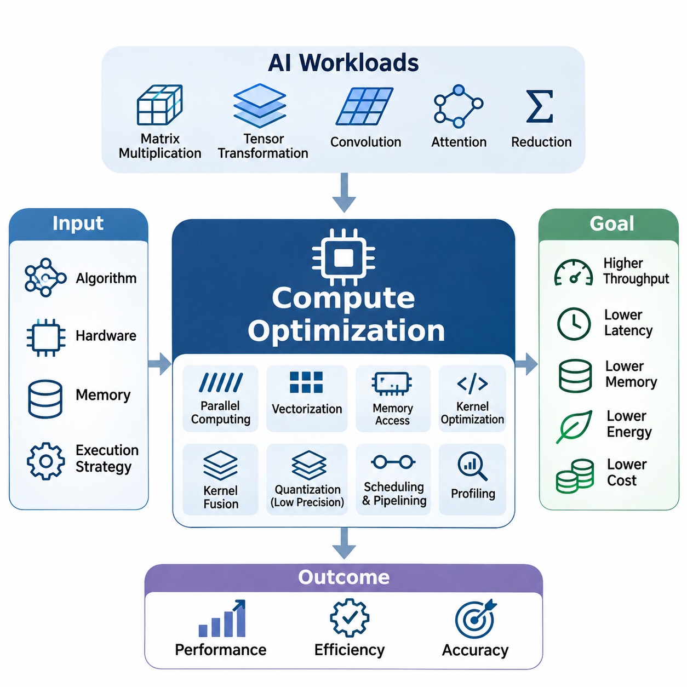
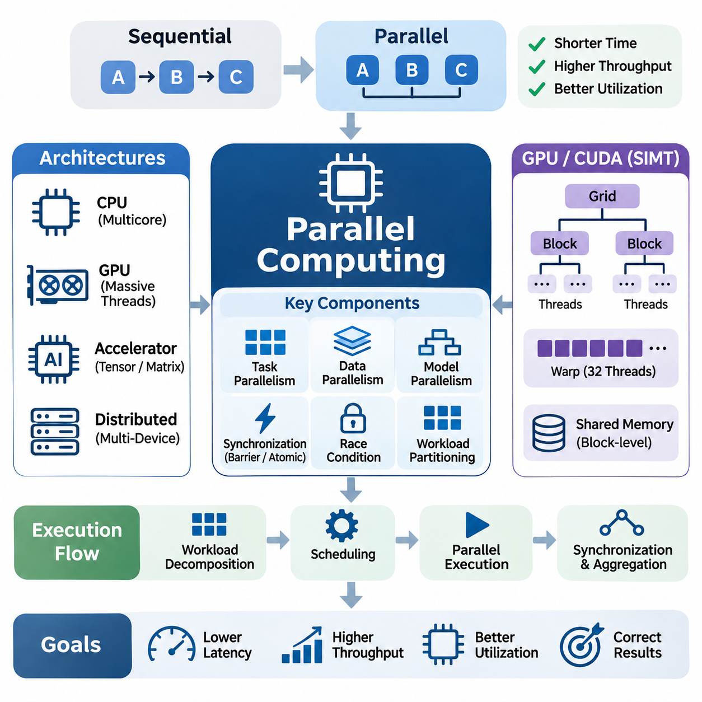
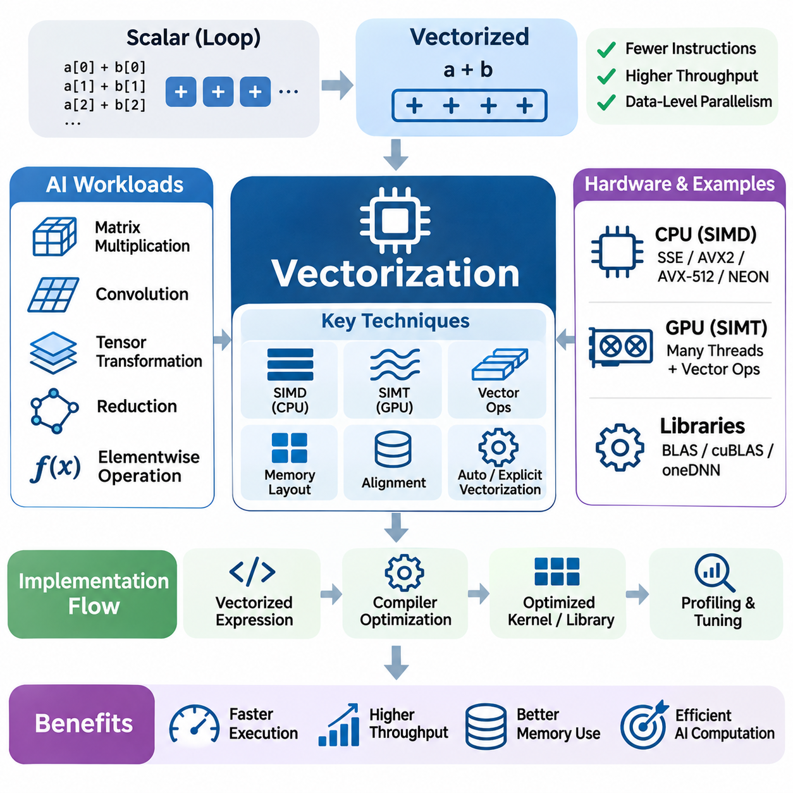
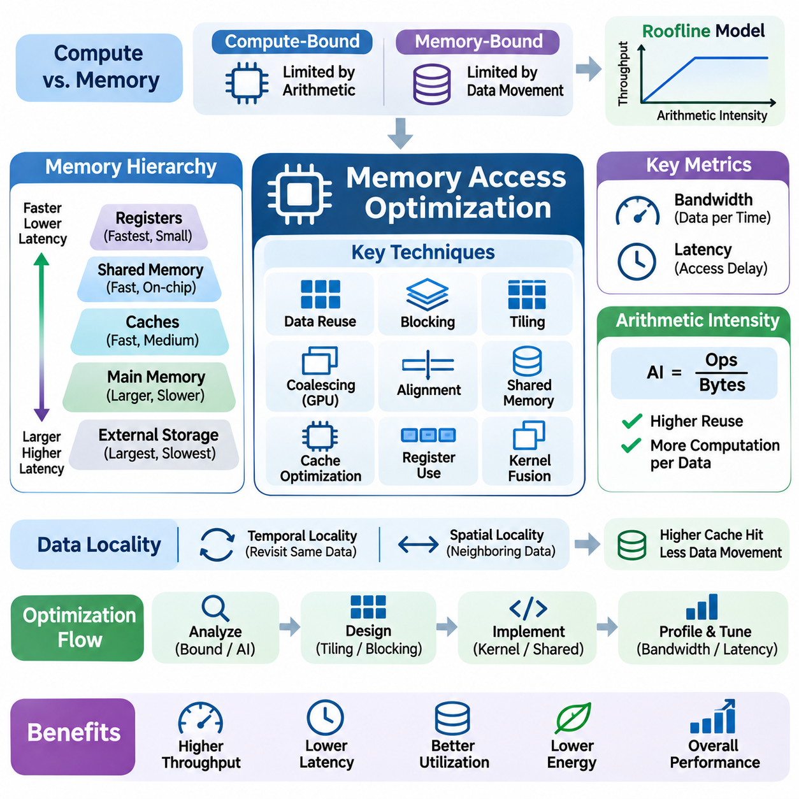
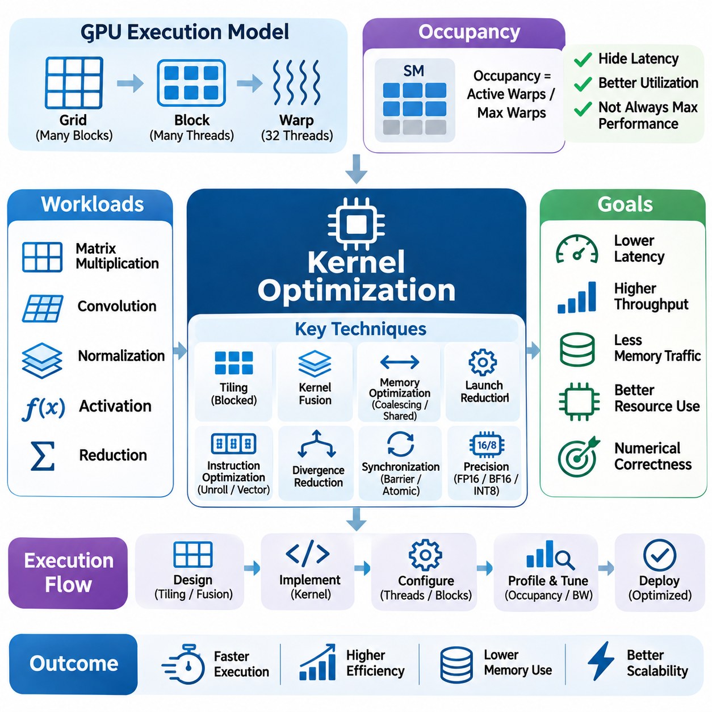
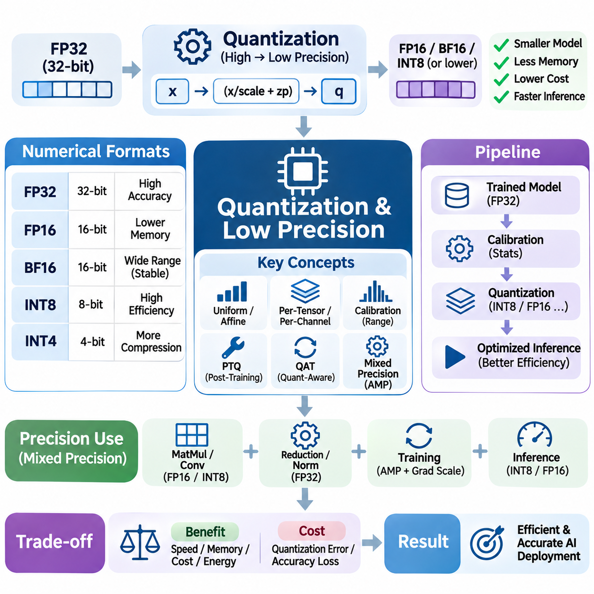
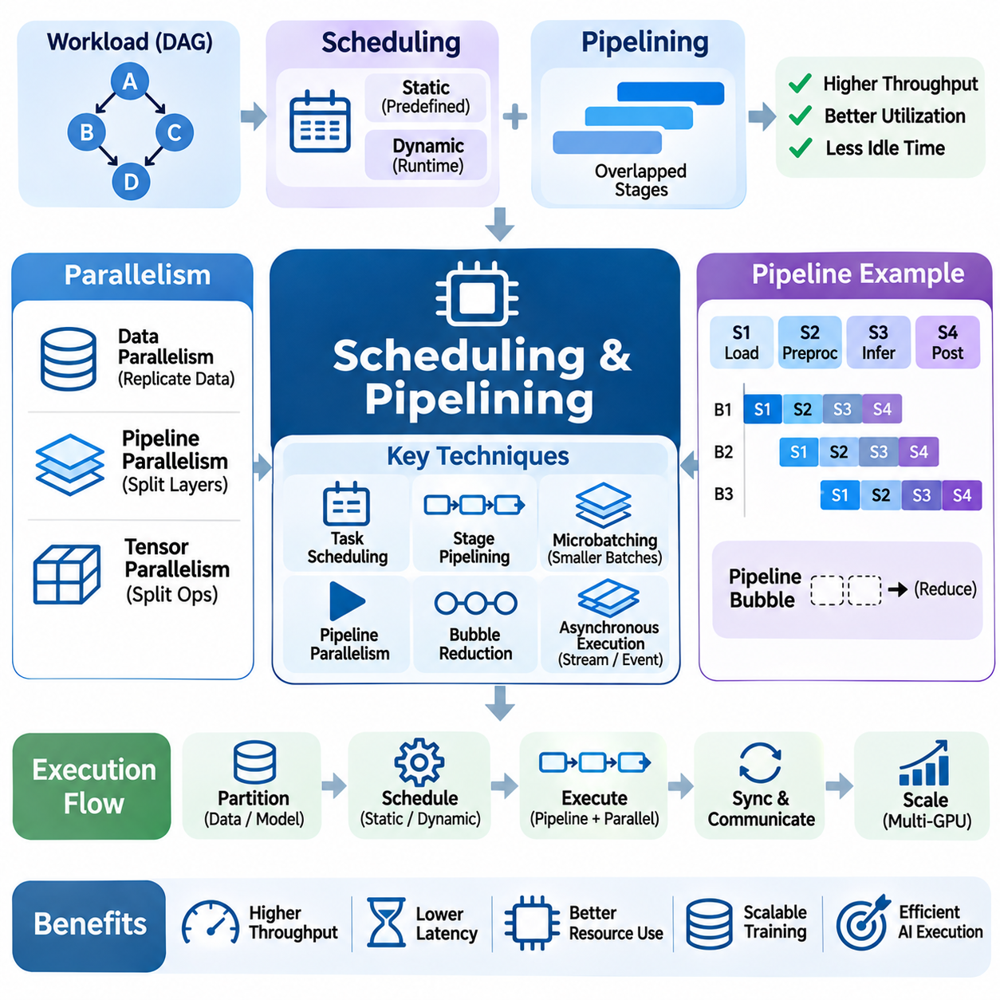
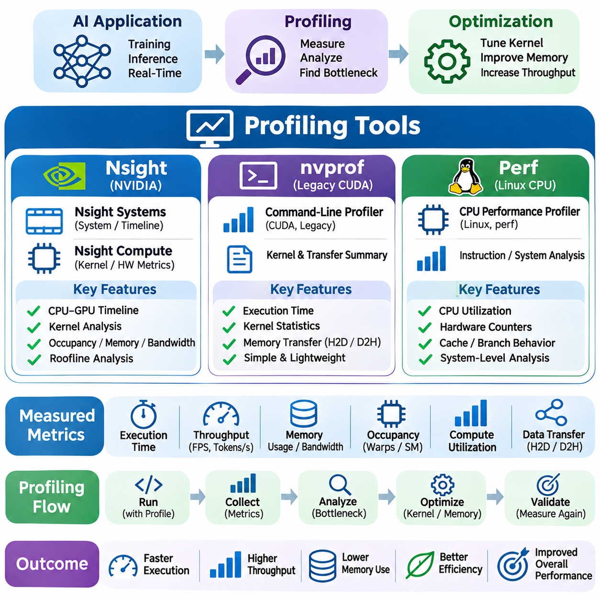
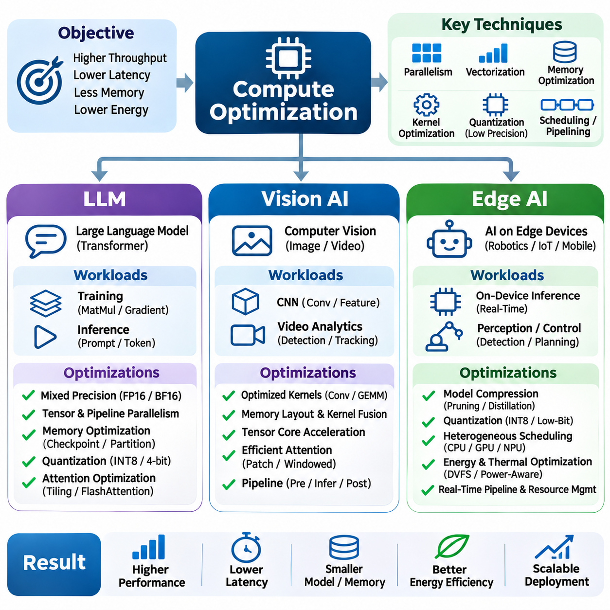

**Volume 39. Hardware for AI**

# 05. Compute Optimization

## 05.00 Overview

{width="7.268055555555556in" height="7.268055555555556in"}

연산 최적화(Compute Optimization)는 인공지능 하드웨어 공학(AI Hardware Engineering)의 핵심 분야로, 실행 시간(Execution Time), 메모리 사용량(Memory Consumption), 에너지 소비(Energy Consumption), 운영 비용(Operational Cost)을 최소화하면서 연산 효율성(Computational Efficiency)을 극대화하는 것을 목표로 한다. 인공지능 모델(AI Model)의 복잡성이 증가함에 따라 높은 성능을 달성하기 위해서는 강력한 프로세서(Processor)만으로는 충분하지 않다. 효과적인 최적화는 알고리즘(Algorithm), 하드웨어 아키텍처(Hardware Architecture), 메모리 시스템(Memory System), 실행 전략(Execution Strategy)을 유기적으로 조정하여 가용 자원을 효율적으로 활용하는 데 달려 있다.

현대 인공지능 작업 부하(AI Workload)는 대규모 행렬 곱셈(Matrix Multiplication), 텐서 변환(Tensor Transformation), 합성곱 연산(Convolution Operation), 어텐션 메커니즘(Attention Mechanism), 수치 축약 연산(Numerical Reduction)을 포함한다. 이러한 연산은 서로 다른 계산 특성을 가지며 프로세서와 메모리 하위 시스템(Memory Subsystem)에 다양한 요구사항을 부과한다. 연산 최적화는 이러한 특성을 분석하고 적절한 실행 방법을 선택하여 처리량(Throughput)을 향상시키고 지연 시간(Latency)을 줄이며 다양한 하드웨어 플랫폼(Hardware Platform)에서 수치 정확도(Numerical Accuracy)를 유지하도록 한다.

인공지능 연산 성능은 계산 능력(Computational Capacity)과 데이터 이동(Data Movement)의 상호작용에 의해 결정된다. 그래픽 처리 장치(GPU)와 특수 목적 가속기(Specialized Accelerator)는 높은 산술 처리량(Arithmetic Throughput)을 제공하지만, 메모리 접근(Memory Access)이 비효율적이면 연산 장치(Execution Unit)의 활용률이 낮아질 수 있다. 따라서 최적화는 계산과 통신(Communication)을 동시에 고려해야 하며, 불필요한 데이터 전송(Data Transfer)과 동기화(Synchronization)를 방지하면서 처리 요소(Processing Element)에 충분한 속도로 데이터를 공급해야 한다.

병렬 컴퓨팅(Parallel Computing)은 효율적인 인공지능 실행을 위한 가장 중요한 기반 중 하나이다. 계산 작업을 독립적이거나 부분적으로 독립적인 작업(Task)으로 분할하면 여러 처리 요소가 동시에 연산을 수행할 수 있다. GPU는 수천 개의 동시 실행 스레드(Concurrent Thread)를 통해 대규모 병렬성(Massive Parallelism)을 구현하며, 다중 코어 CPU(Multicore CPU)와 특수 목적 가속기는 서로 다른 실행 모델(Execution Model)을 사용한다. 병렬 처리의 효과는 작업 부하 분할(Workload Decomposition), 동기화 오버헤드(Synchronization Overhead), 자원 활용률(Resource Utilization)에 따라 달라진다.

데이터 병렬성(Data Parallelism)은 독립적인 데이터 요소를 여러 처리 장치에 분산하므로 텐서 연산(Tensor Operation)과 배치 기반 신경망 연산(Batched Neural Network Computation)에 특히 효과적이다. 작업 병렬성(Task Parallelism)은 의존성(Dependency)이 허용하는 경우 서로 다른 계산 단계를 동시에 실행할 수 있도록 한다. 그러나 과도한 동기화, 불균등한 작업 부하 분산(Workload Distribution), 통신 오버헤드(Communication Overhead)는 예상되는 성능 향상을 감소시킬 수 있다. 따라서 효율적인 병렬 실행을 위해서는 연산 단위의 크기(Computation Granularity)와 하드웨어 성능을 신중하게 조정해야 한다.

벡터화(Vectorization)는 단일 명령어(Single Instruction) 또는 조정된 실행 메커니즘(Coordinated Execution Mechanism)을 통해 여러 데이터 요소를 처리함으로써 연산 효율성을 향상시킨다. 현대 CPU는 단일 명령어 다중 데이터(SIMD) 명령어 집합(Instruction Set)을 제공하며, GPU는 단일 명령어 다중 스레드(SIMT) 실행과 특수 행렬 처리 장치(Matrix Processing Unit)를 활용한다. 벡터화된 연산(Vectorized Operation)은 데이터 배치(Data Layout)와 실행 패턴(Execution Pattern)이 적합할 때 명령어 오버헤드(Instruction Overhead)를 줄이고 산술 처리량을 증가시킨다. 그 효과는 메모리 정렬(Alignment), 명령어 지원(Instruction Support), 메모리 접근성(Memory Accessibility)에 따라 달라진다.

효율적인 벡터화를 위해서는 알고리즘이 하드웨어 실행 장치에 대응할 수 있는 규칙적인 계산 패턴(Regular Computational Pattern)을 제공해야 한다. 연속 배열(Contiguous Array), 밀집 행렬(Dense Matrix), 예측 가능한 제어 흐름(Control Flow)을 사용하는 연산은 일반적으로 벡터화의 이점을 얻는다. 반면 불규칙한 인덱싱(Irregular Indexing), 빈번한 분기(Branching), 복잡한 의존성은 효율성을 제한할 수 있다. 컴파일러 변환(Compiler Transformation), 텐서 라이브러리(Tensor Library), 특수 커널(Specialized Kernel)은 고수준 수학 표현을 하드웨어에 적합한 연산으로 변환하는 데 기여한다.

메모리 접근 최적화(Memory Access Optimization)는 데이터 이동이 산술 연산보다 더 많은 시간과 에너지를 소비하는 경우가 많기 때문에 필수적이다. 현대 프로세서는 레지스터(Register), 캐시(Cache), 공유 메모리(Shared Memory), 외부 메모리(External Memory)로 구성된 계층적 메모리 시스템(Memory Hierarchy)을 사용한다. 각 계층은 서로 다른 용량(Capacity), 대역폭(Bandwidth), 지연 시간 특성을 제공한다. 효율적인 구현은 빠른 메모리 계층에서 데이터 재사용(Data Reuse)을 극대화하고 느린 저장 공간으로의 데이터 전송을 최소화한다.

메모리 접근 패턴(Memory Access Pattern)은 인접한 GPU 스레드가 여러 접근 요청을 효율적인 메모리 트랜잭션(Memory Transaction)으로 결합할 수 있기 때문에 GPU 성능에 큰 영향을 미친다. 병합 메모리 접근(Coalesced Memory Access), 캐시 인식 데이터 배치(Cache-Aware Data Layout), 타일링(Tiling), 공유 메모리 재사용(Shared Memory Reuse)은 중복 전송을 줄이고 유효 메모리 대역폭(Effective Memory Bandwidth)을 향상시킨다. 비효율적인 메모리 접근은 과도한 트랜잭션을 발생시켜 충분한 산술 처리 능력이 존재하더라도 연산 장치가 데이터를 기다리게 만든다.

커널 최적화(Kernel Optimization)는 개별 계산 연산의 실행 효율성을 향상시키는 데 초점을 맞춘다. 커널(Kernel)은 일반적으로 다수의 병렬 스레드에서 실행되는 가속기 함수(Accelerator Function)를 의미한다. 커널 성능은 스레드 구성(Thread Organization), 메모리 접근, 레지스터 할당(Register Allocation), 명령어 선택(Instruction Selection), 동기화 동작(Synchronization Behavior)에 따라 결정된다. 최적화된 커널은 불필요한 오버헤드를 발생시키지 않으면서 병렬 점유율(Occupancy), 연산 집약도(Computational Intensity), 자원 소비(Resource Consumption)의 균형을 추구한다.

커널 융합(Kernel Fusion)은 호환 가능한 여러 연산을 더 적은 실행 단계로 결합하여 중간 메모리 전송(Intermediate Memory Transfer)과 커널 실행 오버헤드(Kernel Launch Overhead)를 감소시킨다. 예를 들어 산술 변환(Arithmetic Transformation)과 활성화 함수(Activation Function)를 결합하면 임시 텐서 저장(Temporary Tensor Storage)을 제거할 수 있다. 그러나 과도한 융합은 레지스터 압박(Register Pressure)을 증가시키고 점유율을 감소시키거나 스케줄링(Scheduling)을 복잡하게 만들 수 있다. 따라서 효과적인 융합을 위해서는 단순히 커널 개수를 줄이는 것보다 전체 실행 패턴을 평가해야 한다.

양자화(Quantization)와 저정밀도 연산(Low-Precision Computation)은 인공지능 효율성을 향상시키는 추가적인 방법을 제공한다. 전통적인 수치 계산은 주로 32비트 부동소수점(FP32) 표현을 사용하지만, 많은 신경망 연산은 더 낮은 정밀도를 허용할 수 있다. FP16, BF16, INT8 및 일부 저비트 표현(Lower-Bit Representation)은 저장 공간 요구량을 줄이며, 적절한 하드웨어와 최적화된 실행 라이브러리(Execution Library)가 지원되는 경우 연산 처리량을 증가시킬 수 있다.

저정밀도 연산의 장점은 산술 성능을 넘어선다. 더 작은 수치 표현은 메모리 대역폭 요구량과 모델 저장 공간(Model Storage Consumption)을 감소시킨다. 그러나 양자화는 예측 정확도(Prediction Accuracy)와 수치 안정성(Numerical Stability)에 영향을 줄 수 있는 근사 오차(Approximation Error)를 발생시킨다. 보정(Calibration), 양자화 인식 학습(Quantization-Aware Training), 혼합 정밀도 실행(Mixed-Precision Execution), 선택적 고정밀도 누산(Selective Higher-Precision Accumulation)은 다양한 인공지능 아키텍처에서 효율성과 계산 신뢰성(Computational Reliability)의 균형을 유지하도록 한다.

스케줄링(Scheduling)과 파이프라이닝(Pipelining)은 계산 활동을 조정하여 유휴 시간(Idle Period)을 최소화하고 자원 활용률을 향상시킨다. 스케줄링은 연산이 언제 실행되고 어떤 하드웨어 자원을 사용하는지 결정하며, 파이프라이닝은 서로 다른 처리 단계(Processing Stage)를 중첩한다. 인공지능 작업 부하는 데이터 로딩(Data Loading), 전처리(Preprocessing), 호스트-장치 데이터 전송(Host-to-Device Transfer), 가속기 연산(Accelerator Computation), 출력 처리(Output Processing)를 포함하는 경우가 많다. 이러한 단계를 조정하면 불필요한 대기 시간을 줄여 처리량을 향상시킬 수 있다.

비동기 실행(Asynchronous Execution)은 하드웨어와 소프트웨어 의존성이 허용하는 경우 독립적인 연산을 동시에 진행할 수 있도록 한다. GPU 스트림(GPU Stream), 이중 버퍼링(Double Buffering), 계산과 데이터 전송의 중첩(Computation-Transfer Overlap)은 적합한 작업 부하에서 활용률을 높일 수 있다. 그러나 활동을 중첩한다고 해서 반드시 성능이 향상되는 것은 아니다. 자원 경합(Resource Contention), 동기화 요구사항(Synchronization Requirement), 제한된 전송 대역폭(Transfer Bandwidth)이 성능 향상을 제약할 수 있으므로 측정을 통한 평가가 필요하다.

성능 프로파일링(Performance Profiling)은 계산 병목 현상(Computational Bottleneck)을 식별하고 최적화 전략을 검증하기 위한 실증적 기반(Empirical Foundation)을 제공한다. 프로파일링 도구(Profiling Tool)는 실행 시간, 커널 활동(Kernel Activity), 메모리 트랜잭션, 프로세서 활용률(Processor Utilization), 동기화 동작에 관한 정보를 수집한다. NVIDIA Nsight는 상세한 GPU 성능 분석을 제공하며, 기존 nvprof 작업 흐름과 Linux perf는 하드웨어 및 소프트웨어 실행 특성을 분석하는 추가적인 관점을 제공한다.

프로파일링 기반 최적화(Profiling-Guided Optimization)는 재현 가능한 기준 성능(Reproducible Baseline)을 설정하고 전체 실행 시간에 가장 크게 기여하는 요소를 식별하는 것에서 시작한다. 엔지니어는 연산 제한 작업 부하(Compute-Bound Workload)와 메모리 제한 작업 부하(Memory-Bound Workload)를 구분하고, 비효율성이 산술 처리량, 데이터 이동, 동기화 또는 실행 오버헤드에서 발생하는지 조사한다. 이러한 측정 기반 접근법(Measurement-Driven Approach)은 불필요한 수정을 방지하고 검증 가능한 성능 개선에 엔지니어링 노력을 집중하도록 한다.

루프라인 모델(Roofline Model)은 계산 성능의 한계를 이해하기 위한 유용한 개념적 프레임워크(Conceptual Framework)를 제공한다. 이 모델은 달성 가능한 성능(Achievable Performance)을 데이터 전송량당 산술 연산 횟수로 정의되는 산술 집약도(Arithmetic Intensity)와 연결한다. 산술 집약도가 낮은 작업 부하는 주로 메모리 대역폭에 의해 제한되며, 충분히 높은 연산 집약도를 가진 작업 부하는 프로세서 처리량의 한계에 접근할 수 있다. 이러한 구분은 데이터 재사용과 산술 연산 최적화 중 어느 부분에 우선순위를 두어야 하는지 결정하는 데 도움이 된다.

연산 최적화는 처리량, 지연 시간, 에너지 소비, 수치 정밀도(Numerical Precision) 사이의 절충 관계(Tradeoff)를 이해해야 한다. 배치 처리량(Batch Throughput)을 극대화하는 설정은 개별 요청 지연 시간(Request Latency)을 증가시킬 수 있으며, 공격적인 병렬 실행(Aggressive Parallel Execution)은 전력 소비(Power Consumption)를 높일 수 있다. 마찬가지로 낮은 정밀도는 실행 속도를 개선할 수 있지만 추가적인 정확도 검증(Accuracy Validation)이 필요할 수 있다. 따라서 적절한 최적화 목표(Optimization Objective)는 단일한 보편적 성능 지표보다 응용 분야의 요구사항에 따라 결정된다.

대규모 언어 모델(LLM)은 트랜스포머 아키텍처(Transformer Architecture)가 행렬 곱셈, 어텐션 연산(Attention Computation), 정규화(Normalization), 메모리 집약적 데이터 접근(Memory-Intensive Data Access)을 결합하기 때문에 상당한 최적화 과제를 제시한다. 학습(Training)은 높은 처리량의 텐서 계산과 효율적인 기울기 처리(Gradient Processing)를 강조하는 반면, 자기회귀 추론(Autoregressive Inference)은 순차적 의존성(Sequential Dependency)과 키-값 캐시 관리(Key-Value Cache Management)를 수반한다. 최적화 전략은 이러한 서로 다른 실행 특성과 관련 메모리 요구사항을 모두 고려해야 한다.

비전 인공지능(Vision AI) 작업 부하는 합성곱 신경망(CNN), 비전 트랜스포머(Vision Transformer), 특징 추출(Feature Extraction), 영상 처리 파이프라인(Image Processing Pipeline)을 포함한다. 성능은 텐서 차원(Tensor Dimension), 메모리 배치(Memory Layout), 배치 크기(Batch Size), 가속기별 실행 능력(Accelerator-Specific Execution Capability)에 따라 달라진다. 최적화된 합성곱 알고리즘(Convolution Algorithm), 융합 연산(Fused Operation), 혼합 정밀도(Mixed Precision), 효율적인 전처리는 성능을 개선할 수 있다. 실시간 비전 응용(Real-Time Vision Application)은 변화하는 입력 조건에서도 예측 가능한 지연 시간과 일관된 처리 속도를 추가로 요구한다.

엣지 인공지능(Edge AI) 시스템은 연산 능력, 메모리, 전력, 열 관리(Thermal Management) 측면에서 특히 엄격한 제약 조건을 가진다. 임베디드 GPU(Embedded GPU), 신경망 처리 장치(NPU), 특수 목적 가속기는 풍부한 외부 자원에 의존하지 않고 모델을 효율적으로 실행해야 한다. 양자화, 메모리 재사용, 작업 부하 스케줄링(Workload Scheduling), 하드웨어 인식 커널 선택(Hardware-Aware Kernel Selection)과 같은 기술은 허용 가능한 정확도와 응답성(Responsiveness)을 유지하면서 실용적인 추론(Inference)을 지원한다.

로보틱스(Robotics)와 자율 시스템(Autonomous System)에서 연산 최적화는 인식(Perception), 위치 추정(Localization), 경로 계획(Planning), 제어(Control) 성능에 직접적인 영향을 미친다. 여러 센서 데이터 스트림(Sensor Data Stream)과 인공지능 모델이 실시간 마감 시간(Real-Time Deadline)을 충족해야 하는 상황에서 제한된 처리 자원을 두고 경쟁할 수 있다. 전체 시스템이 스케줄링 충돌(Scheduling Conflict)이나 데이터 전송 지연(Data Transfer Delay)을 겪는다면 개별 커널의 최적화만으로는 충분하지 않다. 종단 간 최적화(End-to-End Optimization)는 실행 우선순위(Execution Priority), 시간적 의존성(Timing Dependency), 시스템 수준 신뢰성(System-Level Reliability)을 함께 고려해야 한다.

에너지 효율성(Energy Efficiency)은 인공지능 인프라(AI Infrastructure)가 데이터센터(Data Center)와 임베디드 장치(Embedded Device) 전반으로 확장됨에 따라 점점 더 중요한 최적화 목표가 되고 있다. 높은 연산 처리량이 반드시 낮은 에너지 소비를 의미하는 것은 아니며, 특히 프로세서가 높은 동작 주파수(Operating Frequency)로 실행되거나 자원을 비효율적으로 사용하는 경우 더욱 그렇다. 와트당 성능(Performance per Watt) 분석은 에너지 소비 대비 유효 계산 결과를 평가하여 실행 속도와 지속 가능한 운영(Sustainable Operation)의 균형을 추구하도록 한다.

하드웨어 특성(Hardware Characteristics)은 어떤 최적화 기술이 가장 효과적인지를 결정한다. GPU 아키텍처(GPU Architecture)는 처리량 중심 병렬 실행(Throughput-Oriented Parallel Execution)을 강조하고, CPU는 유연한 제어와 벡터 처리(Vector Processing)를 제공하며, 특수 목적 가속기는 선택된 텐서 연산을 우선적으로 처리한다. 메모리 계층, 명령어 지원, 상호 연결 대역폭(Interconnect Bandwidth), 실행 스케줄링의 차이는 달성 가능한 성능에 영향을 미친다. 하드웨어 인식 최적화(Hardware-Aware Optimization)는 계산 작업 부하를 이러한 아키텍처의 강점과 제약 조건에 맞추어 조정한다.

궁극적으로 연산 최적화는 알고리즘에 대한 이해(Algorithmic Understanding), 아키텍처 지식(Architectural Knowledge), 구현 기술(Implementation Technique), 실험적 평가(Experimental Evaluation)를 결합하는 반복적 엔지니어링 프로세스(Iterative Engineering Process)이다. 병렬 컴퓨팅, 벡터화, 메모리 최적화(Memory Optimization), 커널 튜닝(Kernel Tuning), 저정밀도 연산, 스케줄링, 프로파일링은 상호 연결된 최적화 프레임워크(Optimization Framework)를 형성한다. 이러한 기술을 통합적으로 적용하면 클라우드(Cloud), 데이터센터, 엣지 환경 전반에서 인공지능 시스템의 성능과 자원 효율성을 높이고 더욱 예측 가능한 운영을 실현할 수 있다.

## 05.01 Parallel Computing [w/Code]

{width="7.268055555555556in" height="7.268055555555556in"}

병렬 컴퓨팅(Parallel Computing)은 사용 가능한 처리 자원(Processing Resource) 전반에서 여러 계산 작업(Computational Task)을 동시에 실행하여 인공지능 작업 부하(AI Workload)를 가속하는 핵심 기술이다. 연산이 순차적으로 실행되는 순차 컴퓨팅(Sequential Computing)과 달리, 병렬 컴퓨팅은 독립적인 연산을 여러 코어(Core), 스레드(Thread), 가속기(Accelerator)에 분산한다. 주요 목적은 계산의 정확성(Computational Correctness)을 유지하면서 실행 시간(Execution Time)을 단축하고 처리량(Throughput)과 하드웨어 활용률(Hardware Utilization)을 향상시키는 것이다.

현대 인공지능 응용 프로그램(AI Application)은 신경망 연산(Neural Network Operation)이 대규모 텐서(Tensor), 행렬(Matrix), 독립적인 데이터 요소(Data Element)를 자주 포함하기 때문에 병렬 실행(Parallel Execution)을 활용할 기회가 많다. 행렬 곱셈(Matrix Multiplication), 합성곱(Convolution), 어텐션 연산(Attention Computation), 기울기 계산(Gradient Calculation)은 동시에 실행할 수 있는 작은 연산으로 분할할 수 있다. 그러나 실제 가속 효과는 데이터 의존성(Data Dependency), 작업 부하 특성(Workload Characteristics), 통신 오버헤드(Communication Overhead), 하드웨어 아키텍처(Hardware Architecture)에 따라 달라진다.

병렬 컴퓨팅 아키텍처(Parallel Computing Architecture)에는 다중 코어 중앙처리장치(Multicore CPU), 그래픽 처리 장치(GPU), 텐서 가속기(Tensor Accelerator), 분산 컴퓨팅 시스템(Distributed Computing System)이 포함된다. CPU는 일반적으로 정교한 제어 논리(Control Logic)와 유연한 실행 기능(Execution Capability)을 제공하는 반면, GPU는 수많은 경량 스레드(Lightweight Thread)를 통해 대규모 처리량(Massive Throughput)을 강조한다. 특수 목적 가속기(Specialized Accelerator)는 전용 처리 배열(Processing Array)과 체계적으로 구성된 데이터 이동(Data Movement)을 활용하여 행렬 곱셈과 같은 특정 계산 패턴(Computational Pattern)을 최적화한다.

작업 병렬성(Task Parallelism)과 데이터 병렬성(Data Parallelism)의 차이를 이해하는 것은 병렬 실행 전략(Parallel Execution Strategy)을 파악하는 데 필수적이다. 작업 병렬성은 서로 다른 계산 연산을 별도의 처리 자원에 할당하여 독립적인 처리 단계(Processing Stage)가 동시에 진행되도록 한다. 데이터 병렬성은 데이터셋(Dataset)이나 텐서의 서로 다른 부분에 동일하거나 유사한 연산을 적용한다. 두 접근법은 결합하여 인공지능 계산 파이프라인(AI Computation Pipeline)의 여러 계층에서 병렬성을 활용할 수 있다.

데이터 병렬성은 미니배치(Minibatch) 내 개별 샘플(Sample)을 순전파(Forward Computation)와 역전파(Backward Computation) 과정에서 대부분 독립적으로 처리할 수 있기 때문에 신경망 학습(Neural Network Training)에 특히 효과적이다. 각 처리 장치(Processing Device)는 할당된 데이터 분할(Data Partition)을 사용하여 중간 활성화 값(Intermediate Activation)과 기울기(Gradient)를 계산한다. 분산 학습(Distributed Training)에서는 참여 장치 간 모델 매개변수(Model Parameter)의 일관성을 유지하기 위해 기울기를 동기화(Synchronization)하거나 집계(Aggregation)한다.

모델 병렬성(Model Parallelism)은 신경망 모델이 단일 장치에 효율적으로 배치되지 못하는 경우 모델의 서로 다른 부분을 여러 프로세서나 가속기에 분산한다. 텐서 병렬성(Tensor Parallelism)은 개별 텐서 연산을 여러 처리 장치에 분할하며, 파이프라인 병렬성(Pipeline Parallelism)은 서로 다른 모델 계층(Model Layer)을 별도의 장치에 할당한다. 이러한 접근법은 계산 용량(Computational Capacity)을 확장하지만, 전체 성능에 영향을 미치는 통신 의존성(Communication Dependency)과 동기화 요구사항(Synchronization Requirement)을 발생시킨다.

GPU 병렬 컴퓨팅은 일반적으로 단일 명령어 다중 스레드(Single Instruction, Multiple Threads, SIMT) 실행 모델(Execution Model)을 따른다. 스레드는 조정된 스케줄링(Coordinated Scheduling)에 따라 명령어를 실행하는 그룹으로 구성된다. NVIDIA CUDA 아키텍처(CUDA Architecture)에서는 스레드가 블록(Block)을 구성하고 블록이 그리드(Grid)를 형성한다. 이러한 계층 구조(Hierarchical Structure)는 프로그래머가 대규모 병렬 작업 부하를 표현할 수 있도록 하면서 하드웨어 스케줄러(Hardware Scheduler)가 여러 스트리밍 멀티프로세서(Streaming Multiprocessor)에 실행 작업을 분산하도록 한다.

NVIDIA GPU 내부에서 스레드는 전통적으로 32개의 스레드로 구성되는 워프(Warp)라는 그룹 단위로 스케줄링된다. 워프 내 스레드는 공통 명령어 스케줄링 메커니즘(Instruction Scheduling Mechanism)에 따라 실행되지만, 개별 스레드는 서로 다른 제어 경로(Control Path)를 따를 수 있다. 분기 발산(Branch Divergence)은 서로 다른 실행 경로를 별도로 처리해야 할 수 있으므로 실행 효율성을 감소시킨다. 따라서 규칙적인 제어 흐름(Control Flow)을 가진 알고리즘이 일반적으로 더 높은 병렬 효율성(Parallel Efficiency)을 달성한다.

스레드 블록(Thread Block)은 실행 자원(Execution Resource)과 동기화 기능(Synchronization Capability)을 공유하는 협력 스레드(Cooperating Thread)를 구성하는 메커니즘을 제공한다. CUDA 블록 내부의 스레드는 공유 메모리(Shared Memory)를 통해 데이터를 교환하고 블록 수준 동기화 기본 연산(Block-Level Synchronization Primitive)을 사용하여 실행을 조정할 수 있다. 적절한 블록 크기(Block Size)는 레지스터 요구량(Register Requirement), 공유 메모리 사용량(Shared Memory Consumption), 커널 특성(Kernel Characteristics), 하드웨어 제한(Hardware Limitation)에 따라 결정된다. 부적절한 설정은 점유율(Occupancy)을 감소시키거나 불필요한 스케줄링 오버헤드(Scheduling Overhead)를 발생시킬 수 있다.

병렬 점유율(Parallel Occupancy)은 스트리밍 멀티프로세서에서 활성 워프(Active Warp)가 차지하는 가용 실행 용량(Available Execution Capacity)의 비율을 나타낸다. 높은 점유율은 스케줄러가 다른 준비된 워프(Ready Warp)를 실행하도록 하여 메모리 및 명령어 지연 시간(Instruction Latency)을 숨기는 데 도움이 된다. 그러나 최대 점유율(Maximum Occupancy)이 반드시 최대 성능(Maximum Performance)을 의미하지는 않는다. 실행 설정(Execution Configuration)을 최적화할 때는 레지스터 압박(Register Pressure), 명령어 수준 병렬성(Instruction-Level Parallelism), 메모리 대역폭(Memory Bandwidth), 연산 집약도(Computational Intensity)도 함께 고려해야 한다.

동기화(Synchronization)는 병렬 작업이 데이터를 공유하거나 다른 작업에서 생성된 결과에 의존하는 경우 필요하다. 배리어(Barrier)는 참여 스레드가 지정된 실행 지점(Execution Point)에 도달한 후 다음 단계로 진행하도록 보장하며, 원자적 연산(Atomic Operation)은 공유 데이터 갱신(Shared Update) 과정에서 충돌하는 접근을 보호한다. 과도한 동기화는 실행을 직렬화(Serialization)하여 확장성(Scalability)을 감소시킬 수 있다. 따라서 효율적인 병렬 알고리즘(Parallel Algorithm)은 동기화 빈도를 최소화하고 동시성(Concurrency)을 유지하도록 의존성을 구성한다.

경쟁 상태(Race Condition)는 여러 스레드가 충분한 조정 없이 공유 데이터(Shared Data)에 접근하고 그중 하나 이상의 접근이 데이터를 수정할 때 발생한다. 이러한 상태는 비결정적 결과(Nondeterministic Result), 잘못된 계산(Incorrect Calculation), 불안정한 동작(Unstable Behavior)을 초래할 수 있다. 병렬 프로그래밍(Parallel Programming)에서는 공유 메모리, 원자적 연산, 실행 순서(Execution Ordering)를 신중하게 관리해야 한다. 동시성 오류(Concurrency Error)는 특정 작업 부하나 스케줄링 조건에서만 나타날 수 있으므로 정확성 검증(Correctness Verification)이 특히 중요하다.

작업 부하 분할(Workload Partitioning)은 계산 작업을 사용 가능한 처리 자원에 어떻게 나누어 할당할지 결정한다. 정적 분할(Static Partitioning)은 실행 전에 작업을 할당하는 반면, 동적 스케줄링(Dynamic Scheduling)은 실행 중 자원의 가용 상태(Runtime Availability)에 따라 작업을 분배한다. 균일한 작업 부하(Uniform Workload)는 예측 가능한 정적 할당(Static Assignment)의 이점을 얻는 경우가 많지만, 불규칙한 작업 부하(Irregular Workload)는 적응형 전략(Adaptive Strategy)이 필요할 수 있다. 효과적인 분할은 처리 장치의 유휴 시간(Idle Time)을 줄이고 특정 장치가 성능 병목 현상(Performance Bottleneck)이 되는 것을 방지한다.

부하 분산(Load Balancing)은 불균등한 계산 할당(Computational Assignment)으로 인해 일부 프로세서가 유휴 상태에 있는 동안 다른 프로세서는 계속 작업하는 상황을 방지한다는 점에서 작업 부하 분할과 밀접하게 관련된다. 이러한 문제는 희소 연산(Sparse Computation), 가변 길이 시퀀스 처리(Variable-Length Sequence Processing), 이기종 인공지능 작업 부하(Heterogeneous AI Workload)에서 중요해진다. 동적 작업 대기열(Dynamic Work Queue), 적응형 스케줄링(Adaptive Scheduling), 작업 부하 인식 분할(Workload-Aware Partitioning)은 자원 활용률을 개선할 수 있지만 조정 오버헤드(Coordination Overhead)를 신중하게 평가해야 한다.

병렬 확장성(Parallel Scalability)은 추가적인 처리 자원(Processing Resource)이 도입될 때 계산 성능이 어떻게 변화하는지를 설명한다. 강한 확장성(Strong Scaling)은 고정된 문제 크기(Fixed Problem Size)에 대한 실행 시간 개선을 측정하며, 약한 확장성(Weak Scaling)은 작업 부하 크기와 처리 자원이 비례하여 증가할 때의 성능을 평가한다. 이러한 측정은 알고리즘이 추가 하드웨어의 이점을 얻는지, 아니면 통신, 동기화, 순차 실행 구성 요소(Sequential Execution Component)에 의해 제한되는지를 보여준다.

암달의 법칙(Amdahl\'s Law)은 계산에서 순차적으로 실행해야 하는 부분(Sequential Portion)이 부과하는 이론적 한계를 설명한다. 응용 프로그램의 일부를 병렬화할 수 없다면 프로세서 수를 늘리더라도 결국 성능 향상 폭이 감소한다. 병렬화 가능한 비율(Parallelizable Fraction)을 p, 프로세서 수를 N이라고 할 때 이상적인 가속비(Idealized Speedup)는 1 / ((1 - p) + p / N)으로 표현된다. 이 관계는 계산 자원을 확장하기 전에 순차적 병목 현상(Sequential Bottleneck)을 줄이는 것이 중요함을 강조한다.

구스타프슨의 법칙(Gustafson\'s Law)은 추가적인 처리 자원이 제공됨에 따라 작업 부하 크기가 증가하는 상황을 고려하여 보완적인 관점을 제시한다. 적절한 가정하에서 더 큰 문제는 고정 크기 문제의 가속비가 제한되더라도 더 많은 프로세서를 효과적으로 활용할 수 있다. 이러한 관점은 모델 차원(Model Dimension), 데이터셋 크기(Dataset Size), 배치 크기(Batch Size)의 증가가 추가적인 병렬 계산 기회를 만들어 내는 대규모 인공지능 학습(Large-Scale AI Training)에서 특히 중요하다.

통신 오버헤드(Communication Overhead)는 병렬 실행이 여러 GPU 또는 컴퓨팅 노드(Computing Node)로 확장될수록 더욱 중요해진다. 장치들은 통신 인터페이스(Communication Interface)를 통해 기울기, 활성화 값(Activation), 모델 매개변수, 중간 결과(Intermediate Result)를 교환해야 한다. PCIe, NVLink, 고성능 네트워크 상호 연결(High-Performance Network Interconnect)은 서로 다른 대역폭과 지연 시간 특성을 제공한다. 통신 효율적인 알고리즘(Communication-Efficient Algorithm)은 불필요한 데이터 전송을 최소화하고 의존성이 허용하는 경우 통신과 계산을 중첩한다.

집합 통신 연산(Collective Communication Operation)은 여러 장치 간 정보를 조정하기 위해 분산 인공지능 시스템(Distributed AI System)에서 널리 사용된다. 전체 축약(All-Reduce)은 값을 집계하고 그 결과를 참여 프로세서에 배포하며, 전체 수집(All-Gather)과 축약 분산(Reduce-Scatter)은 분산 텐서 연산(Distributed Tensor Operation)을 지원한다. 이러한 연산의 성능은 메시지 크기(Message Size), 통신 토폴로지(Communication Topology), 구현 알고리즘(Implementation Algorithm)에 따라 달라진다. 효율적인 집합 통신은 높은 가속기 활용률(Accelerator Utilization)을 유지하는 데 필수적이다.

비동기 병렬 실행(Asynchronous Parallel Execution)은 독립적인 연산이 관련 없는 작업의 완료를 기다리지 않고 진행되도록 한다. GPU 스트림(GPU Stream), 비동기 메모리 전송(Asynchronous Memory Transfer), 이벤트 기반 동기화(Event-Based Synchronization)는 호환 가능한 작업을 중첩하는 메커니즘을 제공한다. 이러한 중첩 실행(Overlapping Execution)은 충분한 실행 자원과 전송 자원(Transfer Resource)이 제공되는 경우 처리량을 향상시킬 수 있다. 그러나 제어되지 않은 동시 실행(Uncontrolled Concurrency)은 자원 경합(Resource Contention)을 발생시키고 의존성 관리(Dependency Management)를 복잡하게 만들 수 있다.

메모리 계층 구조(Memory Hierarchy)는 동시 실행 스레드(Concurrent Thread)가 상당한 데이터 접근 요구(Data Access Demand)를 발생시키기 때문에 병렬 컴퓨팅 성능에 큰 영향을 미친다. 레지스터(Register), 공유 메모리, 캐시(Cache), 전역 메모리(Global Memory)는 서로 다른 지연 시간과 대역폭 특성을 제공한다. 효율적인 병렬 커널(Parallel Kernel)은 데이터 지역성(Data Locality), 병합 메모리 접근(Coalesced Memory Access), 공유 메모리 재사용(Shared-Memory Reuse)을 활용한다. 이러한 기술이 없으면 스레드 동시성을 증가시키더라도 계산 처리량이 향상되기보다 메모리 경합(Memory Contention)이 심화될 수 있다.

병렬 축약 연산(Parallel Reduction Operation)은 동시 실행에서 알고리즘 구조(Algorithm Structure)가 얼마나 중요한지를 보여준다. 합계 계산(Summation), 최댓값 선택(Maximum Selection), 정규화 통계(Normalization Statistics), 기울기 집계(Gradient Aggregation)는 여러 스레드의 값을 결합해야 한다. 트리 기반 축약(Tree-Based Reduction)은 단순한 순차 누산(Serial Accumulation)과 비교하여 순차적 결합 단계(Sequential Combination Stage)의 수를 줄인다. 그러나 동기화, 메모리 접근, 부동소수점 연산 순서(Floating-Point Operation Ordering)는 성능과 수치 재현성(Numerical Reproducibility)에 모두 영향을 미칠 수 있다.

병렬 컴퓨팅은 수치 결정성(Numerical Determinism)과 부동소수점 정밀도(Floating-Point Precision)에 관련된 문제도 발생시킨다. 부동소수점 덧셈(Floating-Point Addition)은 엄밀한 결합법칙(Associative Law)을 만족하지 않으므로 축약 순서(Reduction Order)가 달라지면 결과에도 미세한 차이가 발생할 수 있다. 따라서 동시 실행은 장치 간 또는 반복 실행 간 수치적 변동(Numerical Variation)을 만들어 낼 수 있다. 재현 가능한 인공지능 실험(Reproducible AI Experiment)을 위해서는 제어된 실행 설정(Controlled Execution Setting), 사용 가능한 경우 결정적 알고리즘(Deterministic Algorithm), 검증 과정에서 적절한 수치 허용 오차(Numerical Tolerance)가 필요하다.

병렬 구현(Parallel Implementation)의 성능 평가(Performance Evaluation)는 이론적인 프로세서 활용률(Theoretical Processor Utilization) 이상의 지표를 측정해야 한다. 중요한 지표에는 실행 지연 시간(Execution Latency), 처리량, 확장 효율성(Scaling Efficiency), 동기화 오버헤드(Synchronization Overhead), 메모리 대역폭, 에너지 소비(Energy Consumption)가 포함된다. NVIDIA Nsight Systems, Nsight Compute, Linux perf와 같은 프로파일링 도구(Profiling Tool)는 스케줄링 비효율성(Scheduling Inefficiency)과 계산 병목 현상을 식별하는 데 도움이 된다. 측정은 대표적인 작업 부하(Representative Workload)와 일관된 실험 조건(Consistent Experimental Condition)에서 수행해야 한다.

대규모 언어 모델(LLM)에서 병렬 컴퓨팅은 어텐션 연산(Attention Operation), 피드포워드 네트워크(Feedforward Network), 임베딩 변환(Embedding Transformation), 기울기 계산을 가속한다. 대규모 모델 학습은 가속기 클러스터(Accelerator Cluster) 전반에서 데이터 병렬성, 텐서 병렬성, 파이프라인 병렬성을 결합하는 경우가 많다. 추론 시스템(Inference System)도 배치 요청(Batched Request)과 최적화된 행렬 연산(Optimized Matrix Operation)을 통해 병렬 실행을 활용한다. 그러나 자기회귀 토큰 생성(Autoregressive Token Generation)은 활용 가능한 병렬성을 제한하는 순차적 의존성(Sequential Dependency)을 발생시킨다.

비전 인공지능(Vision AI) 시스템은 합성곱, 영상 변환(Image Transformation), 특징 추출(Feature Extraction), 텐서 연산에 상당한 데이터 수준 동시성(Data-Level Concurrency)이 존재하기 때문에 병렬 처리(Parallel Processing)의 이점을 얻는다. GPU 가속(GPU Acceleration)은 높은 처리량의 영상 분류(Image Classification), 객체 탐지(Object Detection), 분할(Segmentation)을 가능하게 한다. 실시간 로보틱스(Real-Time Robotics)에서는 스케줄링 정책(Scheduling Policy)이 지연 시간 요구사항(Latency Requirement)을 유지하고 핵심 제어 연산(Critical Control Operation)과의 간섭을 방지하는 조건에서 병렬 실행이 인식(Perception)과 계획(Planning) 작업의 동시 처리를 지원할 수 있다.

궁극적으로 효과적인 병렬 컴퓨팅은 동시성, 통신, 동기화, 메모리 효율성(Memory Efficiency), 하드웨어 활용률 사이의 균형을 요구한다. 스레드나 프로세서 수를 늘린다고 해서 성능이 자동으로 향상되는 것은 아니며, 특히 작업 부하에 의존성이 존재하거나 연산 집약도가 제한적인 경우 더욱 그렇다. 성공적인 최적화는 아키텍처 인식 작업 부하 분할(Architecture-Aware Workload Decomposition), 효율적인 실행 스케줄링(Execution Scheduling), 엄격한 정확성 검증(Correctness Validation), 측정 기반 개선(Measurement-Driven Refinement)을 결합하여 확장 가능한 인공지능 연산(Scalable AI Computation)을 실현한다.

## 05.02 Vectorization [w/Code]

{width="7.268055555555556in" height="7.268055555555556in"}

벡터화(Vectorization)는 개별 데이터 요소(Data Element)에 대한 연산을 여러 요소를 동시에 처리하는 연산으로 변환하는 핵심적인 연산 최적화(Compute Optimization) 기술이다. 벡터화는 데이터 수준 병렬성(Data-Level Parallelism)을 활용하여 명령어 오버헤드(Instruction Overhead)를 줄이고 연산 처리량(Computational Throughput)을 향상시킨다. 이 기술은 행렬 곱셈(Matrix Multiplication), 텐서 변환(Tensor Transformation), 합성곱(Convolution), 수치 축약 연산(Numerical Reduction), 대규모 과학 계산(Scientific Computation)을 포함하는 인공지능 작업 부하(AI Workload)에서 중요한 역할을 한다.

전통적인 스칼라 실행(Scalar Execution)은 동일한 연산을 대규모 배열(Array)에 반복적으로 적용해야 하는 경우에도 개별 값을 별도의 산술 명령어(Arithmetic Instruction)로 처리한다. 벡터화 실행(Vectorized Execution)은 호환 가능한 연산을 더 넓은 명령어(Wider Instruction) 또는 병렬 텐서 연산(Parallel Tensor Operation)으로 묶는다. 이러한 접근법은 데이터 배치(Data Layout), 명령어 집합(Instruction Set), 메모리 접근 패턴(Memory Access Pattern)이 효율적인 병렬 처리를 지원하는 경우 명령어당 유효 연산량(Useful Computation per Instruction)을 증가시킨다.

현대 중앙처리장치(CPU)는 주로 단일 명령어 다중 데이터(Single Instruction, Multiple Data, SIMD) 아키텍처를 통해 벡터화를 구현한다. SSE, AVX2, AVX-512, ARM NEON과 같은 명령어 확장(Instruction Extension)을 사용하면 하나의 명령어로 여러 수치 요소(Numerical Element)를 처리할 수 있다. 동시에 처리할 수 있는 요소의 수는 벡터 레지스터 폭(Vector Register Width), 데이터 정밀도(Data Precision), 하드웨어 성능(Hardware Capability)에 따라 달라진다. 충분한 데이터 병렬성이 존재하면 더 넓은 벡터(Wider Vector)를 통해 처리량을 향상시킬 수 있다.

GPU 벡터화(GPU Vectorization)는 GPU가 주로 단일 명령어 다중 스레드(Single Instruction, Multiple Threads, SIMT) 실행 방식을 사용한다는 점에서 전통적인 CPU SIMD와 차이가 있다. 스레드 그룹(Thread Group)은 서로 다른 데이터 요소에 대해 조정된 명령어를 실행하여 대규모 데이터 병렬성을 구현한다. GPU 실행은 일반적으로 SIMT로 설명되지만, 개별 스레드도 벡터화된 메모리 연산(Vectorized Memory Operation)이나 특수 명령어(Specialized Instruction)를 사용할 수 있다. 이러한 차이를 이해하는 것은 알고리즘을 서로 다른 하드웨어 아키텍처(Hardware Architecture)에 적절하게 매핑(Mapping)하는 데 중요하다.

벡터화는 동일한 수학적 변환(Mathematical Transformation)을 여러 요소에 독립적으로 적용하는 요소별 텐서 연산(Elementwise Tensor Operation)에 특히 효과적이다. 덧셈(Addition), 곱셈(Multiplication), 활성화 함수(Activation Function), 정규화 구성 연산(Normalization Component) 등은 명시적인 스칼라 반복문(Scalar Loop) 없이 표현할 수 있다. NumPy, PyTorch, TensorFlow와 같은 프레임워크(Framework)는 최적화된 수치 라이브러리(Numerical Library)와 가속기 커널(Accelerator Kernel)에 실행을 위임하는 벡터화 인터페이스(Vectorized Interface)를 제공한다.

명시적인 반복문(Explicit Loop)을 벡터화 표현식(Vectorized Expression)으로 대체하면 고수준 프로그래밍 언어(High-Level Programming Language)의 인터프리터 오버헤드(Interpreter Overhead)를 줄일 수 있다. 예를 들어 전체 NumPy 배열에 산술 연산을 적용하면 일반적으로 Python 수준의 반복적인 명령어 전달(Python-Level Instruction Dispatch)을 피할 수 있다. 그러나 벡터화 표현식은 임시 배열(Temporary Array)과 추가적인 메모리 전송(Memory Transfer)을 발생시킬 수 있다. 따라서 효율적인 구현에서는 연산 가속뿐 아니라 중간 결과(Intermediate Result)와 관련된 메모리 비용(Memory Cost)도 고려해야 한다.

행렬 곱셈은 인공지능에서 벡터화의 중요성을 보여주는 대표적인 사례이다. 밀집 행렬 연산(Dense Matrix Operation)은 상당한 데이터 병렬성을 제공하며 SIMD 명령어, GPU 실행 장치(GPU Execution Unit), 특수 행렬 가속기(Matrix Accelerator)를 활용할 수 있다. BLAS, cuBLAS, oneDNN과 같은 최적화 라이브러리(Optimized Library)는 하드웨어에 효율적인 연산을 중심으로 계산을 구성한다. 이러한 구현은 벡터화, 블로킹(Blocking), 데이터 재사용(Data Reuse), 명령어 스케줄링(Instruction Scheduling)을 결합하여 높은 처리량을 달성한다.

벡터화 효율성(Vectorization Efficiency)은 처리 장치가 충분한 속도로 데이터를 확보해야 하므로 메모리 배치(Memory Layout)에 크게 의존한다. 연속 배열(Contiguous Array)은 일반적으로 효율적인 순차 메모리 접근(Sequential Memory Access)을 지원하지만, 스트라이드 접근(Strided Access)이나 불규칙한 메모리 배치(Irregular Layout)는 추가적인 주소 계산(Address Calculation)과 데이터 재배열(Data Rearrangement)을 요구할 수 있다. 행 우선(Row-Major) 및 열 우선(Column-Major) 표현 방식은 어떤 차원(Dimension)을 효율적으로 순회할 수 있는지에 영향을 미친다. 적절한 메모리 배치를 선택하면 유효 메모리 대역폭(Effective Memory Bandwidth)을 크게 향상시킬 수 있다.

메모리 정렬(Memory Alignment) 역시 중요한 고려사항이다. 벡터 명령어(Vector Instruction)는 적절한 주소 경계(Address Boundary)에 저장된 데이터를 처리할 때 가장 효율적으로 동작하는 경우가 많기 때문이다. 정렬된 로드 및 저장(Aligned Load and Store)은 메모리 트랜잭션(Memory Transaction)을 단순화할 수 있지만, 현대 프로세서(Processor)는 일반적으로 비정렬 접근(Unaligned Access)도 지원한다. 실제 성능 저하는 프로세서 아키텍처(Processor Architecture), 캐시 라인 경계(Cache-Line Boundary), 메모리 접근 패턴에 따라 달라진다. 따라서 메모리 정렬은 절대적인 요구사항으로 간주하기보다 프로파일링(Profiling)을 통해 평가해야 한다.

자동 벡터화(Automatic Vectorization)는 컴파일러(Compiler)가 명시적인 벡터 프로그래밍(Vector Programming) 없이 적합한 스칼라 반복문을 SIMD 명령어로 변환하도록 한다. 컴파일러는 변환을 적용하기 전에 반복문 의존성(Loop Dependency), 메모리 접근 패턴, 별칭 가능성(Aliasing Possibility), 명령어 지원 여부(Instruction Availability)를 분석한다. 반복 간 독립성(Iteration Independence)이 있는 단순 반복문은 일반적으로 벡터화하기 쉽다. 복잡한 제어 흐름(Control Flow), 불확실한 포인터 관계(Pointer Relationship), 반복 간 의존성(Loop-Carried Dependency)은 자동 벡터화를 방해하거나 제한할 수 있다.

컴파일러 최적화 설정(Compiler Optimization Setting)은 벡터화 활성화 여부와 대상 명령어 집합(Target Instruction Set)에 영향을 미친다. 아키텍처별 컴파일 옵션(Architecture-Specific Compilation Option)은 추가적인 SIMD 기능을 활용하도록 하며, 최적화 보고서(Optimization Report)는 성공적으로 벡터화된 반복문을 식별하는 데 도움이 된다. 그러나 공격적인 변환(Aggressive Transformation)은 부동소수점 평가 순서(Floating-Point Evaluation Order)를 변경하거나 호환성 제약(Compatibility Constraint)을 발생시킬 수 있다. 개발자는 수치적 동작(Numerical Behavior)을 검증하고 생성된 실행 파일(Binary)이 배포 하드웨어(Deployment Hardware)의 기능과 일치하는지 확인해야 한다.

명시적 벡터화(Explicit Vectorization)는 컴파일러가 생성한 명령어가 원하는 성능을 달성하지 못할 때 더 높은 수준의 제어 기능을 제공한다. SIMD 내장 함수(SIMD Intrinsic)를 사용하면 프로그래머가 아키텍처별 벡터 자료형(Vector Type)과 명령어를 직접 표현할 수 있다. 이러한 접근법은 세밀하게 최적화된 커널(Optimized Kernel)의 성능을 향상시킬 수 있지만 구현 복잡성(Implementation Complexity)을 증가시키고 이식성(Portability)을 감소시킨다. 서로 다른 프로세서 계열(Processor Family) 간 호환성을 유지하기 위해 스칼라 구현(Scalar Implementation)이나 대체 아키텍처 구현(Alternative Architecture Implementation)이 필요할 수 있다.

반복문 펼치기(Loop Unrolling)는 분기 오버헤드(Branch Overhead)를 줄이고 추가적인 명령어 수준 병렬성(Instruction-Level Parallelism)을 확보하기 위해 벡터화와 함께 사용되는 경우가 많다. 하나의 확장된 반복문 본문(Expanded Loop Body)에서 여러 반복을 처리하면 컴파일러가 독립적인 연산을 더욱 효율적으로 스케줄링할 수 있다. 그러나 과도한 반복문 펼치기는 코드 크기(Code Size)와 레지스터 요구량(Register Requirement)을 증가시킨다. 효과적인 최적화는 명령어 처리량(Instruction Throughput), 레지스터 압박(Register Pressure), 캐시 동작(Cache Behavior), 프로세서의 동시 명령어 실행 능력(Concurrent Instruction Execution Capability) 사이의 균형을 유지해야 한다.

반복문 교환(Loop Interchange)은 중첩 반복문(Nested Loop)의 실행 순서를 변경하여 메모리 지역성(Memory Locality)을 향상시키고 벡터화 가능한 차원(Vectorizable Dimension)을 노출한다. 다차원 텐서 연산(Multidimensional Tensor Operation)에서는 의존성이 허용하는 경우 가장 안쪽 반복문(Innermost Loop)이 연속된 데이터를 순회하도록 구성하는 것이 일반적으로 유리하다. 반복문 타일링(Loop Tiling)은 대규모 계산을 캐시(Cache)나 로컬 메모리(Local Memory)에 더 효과적으로 배치할 수 있는 작은 블록(Block)으로 분할한다. 이러한 변환은 규칙적인 접근 패턴(Regular Access Pattern)과 높은 데이터 재사용을 결합하여 벡터화 효율성을 향상시킨다.

조건부 연산(Conditional Operation)은 서로 다른 데이터 요소가 서로 다른 실행 경로(Execution Path)를 요구할 수 있기 때문에 벡터화를 복잡하게 만든다. 조건부 실행(Predication)과 마스크 벡터 명령어(Masked Vector Instruction)는 전통적인 스칼라 분기(Scalar Branching) 없이 선택된 요소만 연산에 참여하도록 한다. 그러나 활성 벡터 레인(Active Vector Lane)의 비율이 낮으면 마스크 실행(Masked Execution)이 불필요한 연산을 수행하거나 효율성이 감소할 수 있다. 알고리즘 재구성(Algorithm Restructuring)을 통해 불규칙한 제어 흐름을 줄이면 성능이 향상되는 경우도 있다.

축약 연산(Reduction Operation)은 여러 입력값이 하나의 공유 출력(Shared Output)에 기여하기 때문에 추가적인 최적화 과제를 제시한다. 합계 계산(Summation), 최댓값 선택(Maximum Selection), 내적(Dot Product), 통계 계산(Statistical Calculation)은 중간 결과를 결합해야 한다. 벡터화된 축약 연산(Vectorized Reduction)은 일반적으로 여러 벡터 레인(Vector Lane)에 걸쳐 부분 결과(Partial Result)를 누산한 후 최종 결과로 결합한다. 성능은 명령어 지원(Instruction Support), 메모리 대역폭(Memory Bandwidth), 누산 전략(Accumulation Strategy), 응용 프로그램에서 요구하는 수치 정밀도(Numerical Precision)에 따라 달라진다.

부동소수점 벡터화(Floating-Point Vectorization)는 산술 변환(Arithmetic Transformation)이 연산 순서(Operation Ordering)를 변경할 수 있으므로 수치 안정성(Numerical Stability)에 주의해야 한다. 부동소수점 덧셈(Floating-Point Addition)은 엄밀한 결합법칙(Associative Law)을 만족하지 않으므로 벡터화된 축약 연산은 스칼라 구현과 약간 다른 결과를 생성할 수 있다. 융합 곱셈-덧셈 명령어(Fused Multiply-Add Instruction) 역시 곱셈과 덧셈을 하나의 연산으로 결합하여 반올림 동작(Rounding Behavior)을 변경할 수 있다. 수치 검증(Numerical Validation)은 응용 분야별 정확도 요구사항(Accuracy Requirement)을 유지하면서 적절한 허용 오차(Tolerance)를 사용해야 한다.

혼합 정밀도 연산(Mixed-Precision Computation)은 고정된 폭의 레지스터(Fixed-Width Register)나 처리 장치에 더 많은 수치 요소를 배치할 수 있도록 하여 벡터화를 확장한다. FP16, BF16, INT8과 같은 저정밀도 형식(Low-Precision Format)은 하드웨어가 적절한 명령어를 제공하는 경우 산술 처리량(Arithmetic Throughput)을 증가시키고 메모리 트래픽(Memory Traffic)을 줄일 수 있다. 그러나 수치 표현 범위(Numerical Range), 누산 정밀도(Accumulation Precision), 양자화 오차(Quantization Error)를 고려해야 한다. 저정밀도는 작업 부하 특성과 정확도 제약(Accuracy Constraint)에 따라 선택해야 한다.

텐서 코어(Tensor Core)와 유사한 행렬 가속 장치(Matrix Acceleration Unit)는 기존 SIMD 명령어를 넘어 데이터 병렬 실행(Data-Parallel Execution)의 원리를 확장한다. 이러한 장치는 특수 하드웨어 데이터 경로(Specialized Hardware Datapath)와 지원되는 수치 형식(Numerical Format)을 사용하여 구조화된 행렬 연산(Structured Matrix Operation)을 수행한다. 효율성은 행렬 차원(Matrix Dimension), 메모리 배치, 정렬 제약(Alignment Constraint), 데이터 준비(Data Preparation)에 따라 달라진다. 고수준 라이브러리(High-Level Library)는 연산 형태(Operation Shape)와 하드웨어 기능이 허용하는 경우 적절한 가속 구현(Accelerated Implementation)을 자동으로 선택하는 경우가 많다.

산술 연산이 전송되는 데이터 양에 비해 적은 경우 벡터화는 메모리 제한 상태(Memory-Bound State)에 도달할 수 있다. 예를 들어 요소별 덧셈(Elementwise Addition)은 각 입력 및 출력 요소에 대해 상대적으로 적은 계산만 수행한다. 메모리 대역폭이 포화(Saturation)되면 벡터 폭(Vector Width)을 늘려도 성능 향상은 제한적일 수 있다. 산술 집약도(Arithmetic Intensity)와 루프라인 분석(Roofline Analysis)은 추가적인 명령어 수준 최적화(Instruction-Level Optimization)가 성능을 개선할 수 있는지, 아니면 데이터 이동을 줄여야 하는지 판단하는 데 도움이 된다.

커널 융합(Kernel Fusion)은 연속된 연산을 결합하고 불필요한 중간 배열(Intermediate Array)을 제거하여 벡터화된 작업 부하의 성능을 개선할 수 있다. 각 변환 단계마다 텐서를 별도로 읽고 쓰는 대신, 융합 커널(Fused Kernel)은 값이 레지스터(Register)에 남아 있는 동안 여러 계산을 수행할 수 있다. 이러한 접근법은 메모리 트래픽과 실행 오버헤드(Execution Overhead)를 감소시킨다. 그러나 과도한 융합은 레지스터 압박을 증가시키거나 병렬 스케줄링(Parallel Scheduling)을 제한할 수 있으므로 신중한 성능 평가(Performance Evaluation)가 필요하다.

벡터화 전략(Vectorization Strategy)은 학습(Training)과 추론(Inference) 작업 부하에 따라 달라진다. 학습은 일반적으로 대규모 배치(Large Batch)와 상당한 텐서 차원을 처리하므로 높은 처리량의 벡터 연산(Vector Operation)을 활용할 기회가 많다. 반면 추론은 작은 배치(Small Batch), 불규칙한 시퀀스 길이(Irregular Sequence Length), 지연 시간에 민감한 실행(Latency-Sensitive Execution)을 포함할 수 있다. 따라서 가장 효율적인 벡터 폭, 커널 구성(Kernel Configuration), 배치 처리 전략(Batching Strategy)은 운영 요구사항(Operational Requirement)과 하드웨어 특성(Hardware Characteristics)에 따라 달라질 수 있다.

대규모 언어 모델(LLM)은 임베딩 변환(Embedding Transformation), 어텐션 투영(Attention Projection), 피드포워드 네트워크(Feedforward Network), 정규화 연산(Normalization Operation)에 벡터화된 계산(Vectorized Computation)을 광범위하게 활용한다. 행렬 곱셈은 많은 연산 집약적 단계(Compute-Intensive Stage)에서 핵심적인 비중을 차지하며, 요소별 연산과 메모리 집약적 변환(Memory-Intensive Transformation)은 효율적인 데이터 이동을 요구한다. 자기회귀 추론(Autoregressive Inference)에서는 작은 행렬 차원과 순차적 토큰 의존성(Sequential Token Dependency)이 하드웨어 활용률을 감소시킬 수 있다. 특수 커널과 배치 처리 전략은 이러한 제약을 완화하는 데 도움이 된다.

비전 인공지능(Vision AI) 응용 프로그램은 합성곱, 영상 전처리(Image Preprocessing), 특징 추출(Feature Extraction), 텐서 정규화(Tensor Normalization) 전반에서 벡터화의 이점을 얻는다. 대규모 영상 배열(Image Array)을 처리하는 연산은 규칙적인 메모리 접근과 상당한 데이터 병렬성을 제공하는 경우가 많다. 효율적인 구현은 SIMD 명령어, GPU 병렬성(GPU Parallelism), 최적화된 합성곱 라이브러리(Optimized Convolution Library)를 결합한다. 실시간 비전 시스템(Real-Time Vision System)은 처리량 향상과 함께 예측 가능한 지연 시간(Predictable Latency) 및 메모리 사용량(Memory Consumption)의 균형을 추가로 고려해야 한다.

엣지 인공지능(Edge AI) 플랫폼은 임베디드 프로세서(Embedded Processor)의 메모리 대역폭, 전력 예산(Power Budget), 열 용량(Thermal Capacity)이 제한되어 있기 때문에 추가적인 제약을 가진다. 벡터화는 명령어당 더 많은 산술 연산을 완료하여 에너지 효율성(Energy Efficiency)을 향상시킬 수 있지만, 실제 효과는 하드웨어 활용률과 메모리 동작에 따라 달라진다. ARM SIMD 확장(ARM SIMD Extension), 임베디드 GPU 커널(Embedded GPU Kernel), 전용 신경망 가속기(Dedicated Neural Accelerator)는 서로 다른 최적화 기회를 제공한다. 실용적인 배포(Practical Deployment)를 위해서는 하드웨어 인식 구현(Hardware-Aware Implementation)이 필수적이다.

성능 프로파일링(Performance Profiling)은 벡터화가 의미 있는 가속 효과를 제공하는지 판단하기 위해 필요하다. 유용한 측정 지표(Measurement Metric)에는 실행 지연 시간(Execution Latency), 처리량, 벡터 명령어 활용률(Vector Instruction Utilization), 캐시 동작(Cache Behavior), 메모리 대역폭, 프로세서 점유율(Processor Occupancy)이 포함된다. 컴파일러 보고서(Compiler Report), 하드웨어 성능 카운터(Hardware Performance Counter), 특수 프로파일링 도구(Specialized Profiling Tool)는 벡터화가 적용되지 않은 최적화 기회(Missed Vectorization Opportunity)를 식별할 수 있다. 성능 비교는 대표적인 입력 크기(Representative Input Size)를 사용하고 컴파일 오버헤드(Compilation Overhead), 메모리 할당(Memory Allocation), 데이터 전송 비용(Data-Transfer Cost)을 고려해야 한다.

궁극적으로 벡터화는 알고리즘이 독립적인 연산(Independent Operation), 규칙적인 메모리 접근(Regular Memory Access), 사용 가능한 실행 장치(Execution Unit)를 충분히 활용할 수 있는 계산 작업을 제공할 때 가장 효과적이다. 벡터화의 이점은 명령어 선택(Instruction Selection), 데이터 배치, 컴파일러 변환(Compiler Transformation), 메모리 재사용(Memory Reuse), 수치 정밀도를 통합적으로 최적화할 때 나타난다. 벡터화를 병렬 컴퓨팅(Parallel Computing) 및 하드웨어 인식 커널 설계(Hardware-Aware Kernel Design)와 결합하면 인공지능 시스템은 더 높은 처리량, 낮은 실행 오버헤드, 효율적인 연산 자원 활용(Computational Resource Utilization)을 달성할 수 있다.

## 05.03 Memory Access Optimization [w/Code]

{width="7.268055555555556in" height="7.268055555555556in"}

메모리 접근 최적화(Memory Access Optimization)는 데이터 이동(Data Movement)이 산술 연산(Arithmetic Operation)보다 더 많은 시간과 에너지를 소비하는 경우가 많기 때문에 인공지능 연산 공학(AI Compute Engineering)의 핵심 요소이다. 현대 프로세서(Processor)는 매우 높은 연산 처리량(Computational Throughput)을 제공하지만, 필요한 데이터를 확보하지 못하면 실행 장치(Execution Unit)가 유휴 상태(Idle State)에 머무를 수 있다. 따라서 효율적인 메모리 접근을 위해서는 불필요한 데이터 전송(Data Transfer)을 최소화하고, 데이터 재사용(Data Reuse)을 극대화하며, 메모리 계층 구조(Memory Hierarchy)의 특성에 맞게 연산을 구성해야 한다.

현대 컴퓨팅 시스템(Computing System)은 레지스터(Register), 캐시(Cache), 공유 메모리(Shared Memory), 주기억장치(Main Memory), 외부 저장장치(External Storage)로 구성된 계층적 메모리 아키텍처(Hierarchical Memory Architecture)를 사용한다. 각 계층은 서로 다른 용량(Capacity), 대역폭(Bandwidth), 지연 시간(Latency), 에너지 특성(Energy Characteristics)을 제공한다. 레지스터는 매우 빠른 접근 속도를 제공하지만 용량이 제한적이며, 외부 메모리(External Memory)는 더 큰 저장 공간을 제공하는 대신 접근 비용(Access Cost)이 높다. 메모리 최적화(Memory Optimization)는 자주 접근하는 데이터를 빠른 메모리 계층에 유지하고 메모리 영역 간 비용이 높은 데이터 이동을 줄이는 것을 목표로 한다.

메모리 대역폭(Memory Bandwidth)은 일정 시간 동안 전송할 수 있는 데이터의 양을 나타내며, 메모리 지연 시간(Memory Latency)은 메모리 접근 요청(Access Request)이 완료되는 데 필요한 지연을 측정한다. 이러한 특성은 작업 부하(Workload)의 동작에 따라 성능에 서로 다른 영향을 미친다. 스트리밍 텐서 연산(Streaming Tensor Operation)은 주로 대역폭에 의존하는 반면, 불규칙한 메모리 접근(Irregular Memory Access)은 지연 시간에 민감할 수 있다. 두 가지 제약을 모두 이해하는 것은 적절한 최적화 전략(Optimization Strategy)을 선택하는 데 필수적이다.

연산 제한 작업 부하(Compute-Bound Workload)와 메모리 제한 작업 부하(Memory-Bound Workload)의 구분은 성능 분석(Performance Analysis)의 중요한 기반을 제공한다. 연산 제한 작업은 주로 산술 실행 능력(Arithmetic Execution Capacity)에 의해 제한되며, 메모리 제한 작업은 데이터 공급 능력(Data Delivery)에 의해 제약을 받는다. 루프라인 모델(Roofline Model)은 달성 가능한 연산 처리량(Attainable Computational Throughput)을 산술 집약도(Arithmetic Intensity) 및 가용 메모리 대역폭(Available Memory Bandwidth)과 연결한다. 이러한 프레임워크(Framework)는 최적화에서 산술 효율성(Arithmetic Efficiency)을 우선할지, 데이터 이동 감소를 우선할지 결정하는 데 도움이 된다.

산술 집약도(Arithmetic Intensity)는 처리 장치(Processing Unit)와 메모리 사이에서 전송되는 바이트(Byte)당 수행되는 산술 연산 횟수를 측정한다. 행렬 곱셈(Matrix Multiplication)은 데이터를 효과적으로 재사용할 경우 상대적으로 높은 산술 집약도를 달성할 수 있지만, 단순한 요소별 연산(Elementwise Operation)은 전송되는 바이트당 수행하는 계산량이 적은 경우가 많다. 블로킹(Blocking), 융합(Fusion), 로컬 저장소(Local Storage)를 통해 데이터 재사용을 증가시키면 수학적 결과(Mathematical Result)를 변경하지 않으면서 작업 부하를 더 높은 연산 효율성(Computational Efficiency)으로 이동시킬 수 있다.

데이터 지역성(Data Locality)은 최근 접근했거나 인접한 데이터가 다시 필요해지는 경우가 많기 때문에 메모리 최적화의 핵심 원리이다. 시간적 지역성(Temporal Locality)은 짧은 시간 내에 동일한 데이터를 재사용하는 것을 의미하며, 공간적 지역성(Spatial Locality)은 인접한 메모리 위치(Memory Location)에 접근하는 것을 의미한다. 캐시 계층 구조(Cache Hierarchy)는 이러한 패턴을 활용하여 느린 메모리에 대한 접근을 줄인다. 지역성을 유지하는 알고리즘(Algorithm)은 일반적으로 더 높은 유효 대역폭(Effective Bandwidth)과 더 낮은 메모리 접근 오버헤드(Memory Access Overhead)를 달성한다.

연속 메모리 접근(Contiguous Memory Access)은 프로세서가 예측 가능한 메모리 트랜잭션(Memory Transaction)을 통해 유용한 데이터를 가져올 수 있도록 하여 효율성을 향상시킨다. 배열(Array)을 순차적으로 순회하면 캐시 라인 활용률(Cache-Line Utilization)과 하드웨어 프리페칭(Hardware Prefetching)의 이점을 얻는 경우가 많다. 반면 불규칙한 인덱싱(Irregular Indexing)과 큰 메모리 스트라이드(Memory Stride)는 추가적인 트랜잭션을 발생시키고 캐시 효율성(Cache Effectiveness)을 감소시킬 수 있다. 따라서 데이터 구조(Data Structure)와 반복문 순서(Loop Ordering)는 저장된 정보의 물리적 구성(Physical Organization)에 맞게 설계해야 한다.

GPU 메모리 병합 접근(GPU Memory Coalescing)은 여러 스레드(Thread)가 동시에 메모리에 접근하는 경우가 많기 때문에 특히 중요하다. 인접한 스레드가 적절하게 배치된 주소(Address)에 접근하면 하드웨어는 여러 요청을 더 적은 메모리 트랜잭션으로 결합할 수 있다. 분산된 접근 패턴(Scattered Access Pattern)은 추가적인 트랜잭션을 요구하여 유효 대역폭을 감소시킬 수 있다. 효율적인 GPU 커널(GPU Kernel)은 가능한 범위에서 병합된 전역 메모리 접근(Coalesced Global-Memory Access)을 극대화하도록 스레드 인덱싱(Thread Indexing)과 텐서 배치(Tensor Layout)를 구성한다.

메모리 정렬(Memory Alignment)은 프로세서의 메모리 인터페이스(Memory Interface)를 통해 데이터를 얼마나 효율적으로 읽고 쓸 수 있는지에 영향을 미친다. 적절하게 정렬된 주소(Aligned Address)는 벡터 로드(Vector Load), 캐시 트랜잭션(Cache Transaction), 가속기 메모리 연산(Accelerator Memory Operation)을 단순화할 수 있다. 그러나 현대 하드웨어는 비정렬 접근(Unaligned Access)을 지원하는 경우가 많으며, 성능 저하 정도는 접근 경계(Access Boundary)와 아키텍처(Architecture)에 따라 달라진다. 따라서 메모리 정렬은 보편적인 가정보다 하드웨어 요구사항(Hardware Requirement)과 측정된 동작(Measured Behavior)을 기반으로 결정해야 한다.

캐시 최적화(Cache Optimization)는 제한된 온칩 저장 공간(On-Chip Storage) 내에서 유용한 데이터 재사용을 극대화하려는 기술이다. CPU 캐시는 일반적으로 하드웨어 관리 교체 정책(Hardware-Managed Replacement Policy)을 활용하며, GPU 아키텍처(GPU Architecture)는 하드웨어 관리 캐시와 명시적으로 관리되는 공유 메모리를 결합한다. 캐시 블로킹(Cache Blocking)은 대규모 계산을 사용 가능한 캐시 용량(Cache Capacity)에 더 효과적으로 배치할 수 있는 작은 영역으로 분할한다. 이러한 접근법은 외부 메모리로부터 반복적으로 데이터를 전송하는 횟수를 줄이고 산술 연산 장치 활용률(Arithmetic Unit Utilization)을 향상시킨다.

타일링(Tiling)은 행렬 곱셈, 합성곱(Convolution), 텐서 처리(Tensor Processing)에서 지역성과 재사용성을 향상시키기 위해 널리 사용된다. 타일링 알고리즘(Tiled Algorithm)은 전체 행렬을 반복적으로 외부 메모리에 접근하여 처리하는 대신 작은 블록(Block)을 빠른 저장 공간(Fast Storage)에 적재하고 해당 데이터에 대해 여러 연산을 수행한다. 타일 크기(Tile Dimension)는 데이터 재사용, 병렬성(Parallelism), 레지스터 사용량(Register Consumption), 공유 메모리 용량(Shared-Memory Capacity) 사이의 균형을 고려해야 한다. 지나치게 큰 타일은 점유율(Occupancy)을 감소시키고, 너무 작은 타일은 데이터 재사용 기회를 충분히 활용하지 못할 수 있다.

공유 메모리(Shared Memory)는 GPU 스트리밍 멀티프로세서(Streaming Multiprocessor) 내부에서 프로그래밍 가능한 저지연 저장 공간(Programmable Low-Latency Storage)을 제공하며, 블록 내 스레드 간 협력(Cooperation)을 가능하게 한다. 스레드는 전역 메모리(Global Memory)에서 재사용 가능한 데이터를 적재하고, 중간값(Intermediate Value)을 교환하며, 추가 연산 전에 동기화(Synchronization)할 수 있다. 적절한 공유 메모리 관리는 중복된 외부 메모리 접근을 줄인다. 그러나 뱅크 충돌(Bank Conflict), 동기화 오버헤드(Synchronization Overhead), 제한된 용량은 공유 메모리 최적화의 이점을 감소시킬 수 있다.

레지스터(Register)는 자주 사용하는 중간값을 저장하기 위한 가장 빠른 저장 공간을 제공하며, 효율적인 커널 실행(Kernel Execution)에 필수적이다. 임시 계산 결과(Temporary Calculation Result)를 레지스터에 유지하면 반복적인 메모리 접근을 방지하고 명령어 수준 병렬성(Instruction-Level Parallelism)을 지원할 수 있다. 그러나 과도한 레지스터 사용(Register Usage)은 활성 스레드(Active Thread)의 수를 감소시키거나 레지스터 스필링(Register Spilling)을 발생시켜 데이터를 더 느린 메모리에 저장하게 만들 수 있다. 효과적인 커널 설계(Kernel Design)는 레지스터 재사용과 점유율 및 전체 실행 효율성(Execution Efficiency) 사이의 균형을 유지해야 한다.

반복문 변환(Loop Transformation)은 기본 알고리즘을 변경하지 않으면서 메모리 접근 동작을 크게 개선할 수 있다. 반복문 교환(Loop Interchange)은 연속된 차원을 순회하도록 반복 순서(Iteration Order)를 재구성하며, 반복문 타일링(Loop Tiling)은 캐시 크기에 적합한 영역(Cache-Sized Region)에서 데이터 재사용을 증가시킨다. 반복문 융합(Loop Fusion)은 호환 가능한 연산을 결합하여 중간 메모리 전송(Intermediate Memory Transfer)을 제거한다. 이러한 변환은 의존성(Dependency)을 보존하면서 컴파일러 동작(Compiler Behavior), 수치 정밀도(Numerical Precision), 하드웨어 실행 특성(Hardware Execution Characteristics)을 고려해야 한다.

텐서 메모리 배치(Tensor Memory Layout)는 연산 효율성과 최적화된 가속기 커널(Optimized Accelerator Kernel)의 호환성에 영향을 미친다. 행 우선(Row-Major)과 열 우선(Column-Major) 배열 방식은 어떤 차원이 연속적으로 저장되는지 결정하며, NCHW와 NHWC 같은 배치 형식(Layout Format)은 합성곱 실행(Convolution Execution)에 영향을 미친다. 서로 다른 프로세서와 라이브러리(Library)는 각기 다른 표현 방식을 선호할 수 있다. 배치 변환(Layout Conversion)은 커널 성능을 향상시킬 수 있지만 추가적인 메모리 트래픽(Memory Traffic)을 발생시키므로 종단 간 평가(End-to-End Evaluation)가 필요하다.

메모리 할당(Memory Allocation)과 버퍼 관리(Buffer Management)도 인공지능 시스템 성능에 영향을 미친다. 임시 텐서(Temporary Tensor)를 반복적으로 할당하면 오버헤드가 발생하고 메모리 단편화(Memory Fragmentation)가 증가하며 메모리 스케줄링(Memory Scheduling)이 복잡해질 수 있다. 메모리 풀(Memory Pool)과 재사용 가능한 버퍼(Reusable Buffer)는 할당 빈도(Allocation Frequency)를 줄이고 예측 가능한 실행(Predictable Execution)을 지원한다. 동적 작업 부하(Dynamic Workload)에서는 신중한 버퍼 수명 관리(Buffer Lifetime Management)를 통해 잘못된 메모리 접근(Invalid Access)이나 의도하지 않은 데이터 수정(Unintended Data Modification)을 방지하면서 저장 공간을 재사용할 수 있다.

커널 융합(Kernel Fusion)은 여러 호환 가능한 연산을 하나의 실행 단계(Execution Stage)로 결합하여 메모리 트래픽을 감소시킨다. 예를 들어 행렬 연산(Matrix Operation)에 편향값 덧셈(Bias Addition)과 활성화 함수(Activation Function)를 통합하면 중간 텐서 쓰기(Intermediate Tensor Write)를 제거할 수 있다. 융합은 단순 변환(Simple Transformation)을 포함하는 메모리 제한 작업 부하에서 특히 효과적이다. 그러나 과도한 융합은 레지스터 압박(Register Pressure)을 증가시키고 스케줄링(Scheduling)을 복잡하게 하며 병렬 점유율(Parallel Occupancy)을 감소시킬 수 있으므로 실험적 검증(Experimental Verification)이 필요하다.

비동기 메모리 전송(Asynchronous Memory Transfer)은 하드웨어 자원(Hardware Resource)과 실행 의존성(Execution Dependency)이 허용하는 경우 계산과 데이터 이동을 중첩할 수 있도록 한다. GPU 스트림(GPU Stream), 페이지 고정 호스트 메모리(Pinned Host Memory), 이중 버퍼링(Double Buffering)은 처리 단계 사이의 대기 시간을 줄일 수 있다. 프리페칭(Prefetching)은 데이터가 필요하기 전에 미리 준비하며, 파이프라이닝(Pipelining)은 전송과 계산을 조정한다. 이러한 기술은 충분한 대역폭과 독립적인 작업(Independent Work)이 존재하여 의미 있는 중첩 실행(Execution Overlap)을 지원할 때만 처리량을 향상시킨다.

호스트-장치 통신(Host-to-Device Communication)은 인공지능 응용 프로그램이 CPU와 가속기(Accelerator) 사이에서 텐서를 반복적으로 전송할 때 주요 병목 현상(Bottleneck)이 될 수 있다. PCIe 및 기타 상호 연결(Interconnect)은 제한된 대역폭을 제공하며 전송 지연 시간(Transfer Latency)을 발생시킨다. 불필요한 전송을 최소화하고 통신을 배치화(Batching)하며 중간 결과를 가속기에 유지하면 오버헤드를 줄일 수 있다. 종단 간 최적화(End-to-End Optimization)는 가속기 커널 실행만 독립적으로 평가하는 대신 통신 비용(Communication Cost)을 함께 고려해야 한다.

대규모 언어 모델(LLM)은 모델 매개변수(Model Parameter), 중간 활성화 값(Intermediate Activation), 어텐션 캐시(Attention Cache)가 상당한 저장 공간을 차지하기 때문에 중요한 메모리 최적화 과제를 제시한다. 자기회귀 추론(Autoregressive Inference)에서는 키-값 캐시(Key-Value Cache)가 시퀀스 길이(Sequence Length)에 따라 증가하고 어텐션 연산(Attention Computation) 중 메모리 대역폭을 소비한다. 캐시 인식 어텐션(Cache-Aware Attention), 효율적인 메모리 할당(Efficient Memory Allocation), 저정밀도 저장(Low-Precision Storage)과 같은 기술은 허용 가능한 수치적 동작(Numerical Behavior)을 유지하면서 저장 용량과 처리량을 개선할 수 있다.

어텐션 최적화(Attention Optimization)는 중간 데이터 이동을 최소화하는 것이 얼마나 중요한지를 보여준다. 전통적인 구현(Conventional Implementation)은 대규모 어텐션 행렬(Attention Matrix)을 실제 메모리에 생성하여 메모리 트래픽과 임시 저장 공간 요구량(Temporary Storage Requirement)을 증가시킬 수 있다. FlashAttention 계열 접근법(FlashAttention-Style Approach)을 포함한 타일 기반 어텐션 알고리즘(Tiled Attention Algorithm)은 온칩 메모리 재사용(On-Chip Memory Reuse)을 중심으로 계산을 재구성하여 효율성을 향상시킨다. 이러한 이점은 단순히 산술 연산 횟수를 줄이는 것이 아니라 시퀀스 차원(Sequence Dimension), 하드웨어 기능(Hardware Capability), 구현 세부사항(Implementation Detail)에 따라 달라진다.

비전 인공지능(Vision AI) 작업 부하는 영상 텐서(Image Tensor), 특징 맵(Feature Map), 합성곱 중간 결과(Convolution Intermediate)의 효율적인 이동을 요구한다. 합성곱 커널(Convolution Kernel)은 공간적 지역성(Spatial Locality)과 입력 특징(Input Feature) 및 필터 가중치(Filter Weight)의 재사용을 활용한다. 영상 전처리(Image Preprocessing)와 형식 변환(Format Conversion) 역시 상당한 메모리 트래픽을 발생시킬 수 있다. 전체 파이프라인(Pipeline)을 최적화하려면 텐서 배치, 배치 처리 전략(Batching Strategy), 융합 변환(Fused Transformation), 가속기 실행(Accelerator Execution)을 조정하여 중복 전송을 최소화해야 한다.

엣지 인공지능(Edge AI) 플랫폼은 임베디드 프로세서(Embedded Processor)가 인식(Perception), 계획(Planning), 제어(Control) 작업 부하 전반에서 제한된 대역폭과 저장 공간을 공유하므로 특히 엄격한 메모리 제약(Memory Constraint)에 직면한다. 통합 CPU-GPU 아키텍처(Integrated CPU-GPU Architecture)는 공유 물리 메모리(Shared Physical Memory)를 통해 일부 데이터 전송 요구량을 줄일 수 있지만, 동기화와 캐시 관리(Cache Management)는 여전히 중요하다. 효율적인 버퍼링(Buffering), 양자화(Quantization), 작업 부하 스케줄링(Workload Scheduling)은 제한된 전력 예산(Power Budget)과 열 예산(Thermal Budget) 내에서 예측 가능한 지연 시간(Predictable Latency)을 유지하는 데 도움이 된다.

메모리 접근 최적화는 동시 실행(Concurrent Execution)에서 정확성(Correctness)과 동기화도 고려해야 한다. 여러 스레드가 공유 버퍼(Shared Buffer)에 접근할 때 갱신 작업(Update Operation)이 적절하게 조정되지 않으면 경쟁 상태(Race Condition)가 발생할 수 있다. 메모리 배리어(Memory Barrier), 원자적 연산(Atomic Operation), 동기화 기본 연산(Synchronization Primitive)은 필요한 실행 순서 보장(Ordering Guarantee)을 확립한다. 그러나 과도한 동기화는 실행을 직렬화(Serialization)하여 처리량을 감소시킬 수 있다. 효율적인 구현은 불필요한 조정을 최소화하면서 정확성을 유지해야 한다.

성능 프로파일링(Performance Profiling)은 메모리 병목 현상을 식별하고 개선 효과를 검증하는 데 필요한 실증적 근거(Empirical Evidence)를 제공한다. NVIDIA Nsight Compute, Nsight Systems, CPU 프로파일링 도구(CPU Profiling Tool)는 메모리 처리량(Memory Throughput), 캐시 동작(Cache Behavior), 트랜잭션 효율성(Transaction Efficiency), 실행 정체(Execution Stall)를 분석할 수 있도록 한다. 측정에서는 이론적 대역폭(Theoretical Bandwidth)과 실제 달성 대역폭(Achieved Bandwidth)을 구분하고 작업 부하 크기, 캐시 효과(Cache Effect), 전송 오버헤드(Transfer Overhead)를 고려해야 한다. 최적화 결정은 가정보다 재현 가능한 측정(Reproducible Measurement)을 기반으로 이루어져야 한다.

궁극적으로 메모리 접근 최적화는 데이터 지역성, 메모리 병합 접근(Coalescing), 정렬(Alignment), 캐싱(Caching), 타일링, 버퍼 재사용(Buffer Reuse), 비동기 실행(Asynchronous Execution)을 통합된 엔지니어링 전략(Engineering Strategy)으로 결합한다. 가장 효과적인 구현은 충분한 병렬성(Parallelism)과 수치적 정확성(Numerical Correctness)을 유지하면서 불필요한 데이터 이동을 줄인다. 인공지능 작업 부하가 지속적으로 증가함에 따라 메모리 효율적인 연산(Memory-Efficient Computation)은 다양한 컴퓨팅 플랫폼(Computing Platform)에서 확장 가능한 처리량(Scalable Throughput), 예측 가능한 지연 시간, 지속 가능한 에너지 효율성(Sustainable Energy Efficiency)을 달성하는 데 필수적인 요소가 된다.

## 05.04 Kernel Optimization [w/Code]

{width="7.268055555555556in" height="7.268055555555556in"}

커널 최적화(Kernel Optimization)는 그래픽 처리 장치(GPU)와 특수 목적 가속기(Specialized Accelerator)에서 인공지능 작업 부하(AI Workload)의 실행 효율성(Execution Efficiency)을 향상시키기 위한 핵심 기술이다. 커널(Kernel)은 행렬 곱셈(Matrix Multiplication), 합성곱(Convolution), 정규화(Normalization), 텐서 변환(Tensor Transformation) 등의 연산을 수행하기 위해 여러 처리 요소(Processing Element)에서 실행되는 계산 함수(Computational Function)이다. 최적화의 목적은 지연 시간(Latency)을 줄이고 처리량(Throughput)을 증가시키며 메모리 트래픽(Memory Traffic)을 최소화하고 하드웨어 자원(Hardware Resource)을 효과적으로 활용하는 것이다.

커널 성능(Kernel Performance)은 산술 명령어(Arithmetic Instruction), 메모리 접근(Memory Access), 스레드 스케줄링(Thread Scheduling), 하드웨어 실행 자원(Hardware Execution Resource) 사이의 상호작용에 따라 결정된다. 수학적으로 동일한 구현이라도 데이터 배치(Data Layout)와 명령어 시퀀스(Instruction Sequence)가 다르면 실행 시간(Execution Time)에 상당한 차이가 발생할 수 있다. 따라서 효과적인 최적화를 위해서는 계산 알고리즘(Computational Algorithm)과 대상 프로세서(Target Processor)의 아키텍처 특성(Architectural Characteristics)을 모두 이해해야 한다.

GPU 커널(GPU Kernel)은 블록(Block)과 그리드(Grid)로 구성된 병렬 스레드(Parallel Thread) 그룹을 통해 실행된다. NVIDIA 아키텍처(NVIDIA Architecture)에서는 스레드 블록(Thread Block)이 여러 스트리밍 멀티프로세서(Streaming Multiprocessor)에 스케줄링되며, 워프(Warp)는 스레드 스케줄링의 기본 단위를 제공한다. 커널 구성(Kernel Configuration)은 실행 자원에 작업이 어떻게 분산되는지를 결정한다. 적절한 스레드 블록 차원(Thread-Block Dimension)은 활용률(Utilization)을 향상시키지만, 부적절한 구성은 오버헤드(Overhead)를 증가시키고 병렬 효율성(Parallel Efficiency)을 감소시킬 수 있다.

점유율(Occupancy)은 스트리밍 멀티프로세서에서 활성 워프(Active Warp)가 차지하는 가용 워프 실행 용량(Available Warp Execution Capacity)의 비율을 나타낸다. 충분한 점유율은 일부 워프가 대기하는 동안 실행 가능한 다른 워프를 처리함으로써 메모리 지연 시간(Memory Latency)을 숨기는 데 도움이 된다. 그러나 점유율을 극대화한다고 해서 반드시 성능이 최대화되는 것은 아니다. 레지스터 사용량(Register Consumption), 공유 메모리 할당(Shared-Memory Allocation), 명령어 의존성(Instruction Dependency), 산술 집약도(Arithmetic Intensity)를 동시 활성 스레드(Concurrently Active Thread)의 수와 균형 있게 조정해야 한다.

메모리 접근 최적화(Memory Access Optimization)는 비효율적인 데이터 이동(Data Movement)이 커널 실행 시간(Kernel Execution Time)의 대부분을 차지할 수 있기 때문에 필수적이다. 병합된 전역 메모리 접근(Coalesced Global-Memory Access)은 인접한 스레드의 요청을 효율적인 메모리 트랜잭션(Memory Transaction)으로 결합한다. 공유 메모리(Shared Memory)는 스레드 블록 내부에서 데이터 재사용(Data Reuse)을 가능하게 하며, 레지스터(Register)는 자주 접근하는 중간값(Intermediate Value)을 유지한다. 효율적인 커널은 중복 전송(Redundant Transfer)을 최소화하고 하드웨어 트랜잭션 특성(Hardware Transaction Characteristics)에 맞게 메모리 접근 패턴(Memory Access Pattern)을 구성한다.

타일링(Tiling)은 대규모 계산 문제를 빠른 로컬 저장 공간(Fast Local Storage)을 활용할 수 있는 작은 블록으로 분할하여 커널 효율성을 향상시킨다. 행렬 곱셈 커널(Matrix Multiplication Kernel)은 일반적으로 입력 행렬(Input Matrix)의 타일(Tile)을 공유 메모리에 적재하고 여러 산술 연산에서 재사용한다. 타일 차원(Tile Dimension)은 메모리 트래픽, 레지스터 압박(Register Pressure), 동기화(Synchronization), 점유율에 영향을 미친다. 적절한 타일 크기(Tile Size)를 선택하려면 연산 재사용(Computational Reuse)과 사용 가능한 하드웨어 자원 사이의 균형을 고려해야 한다.

커널 융합(Kernel Fusion)은 호환 가능한 계산 연산(Computational Operation)을 하나의 실행 단계(Execution Stage)로 결합하여 중간 텐서 저장(Intermediate Tensor Storage)과 커널 실행 오버헤드(Kernel Launch Overhead)를 감소시킨다. 예를 들어 의존성이 허용하는 경우 편향값 덧셈(Bias Addition), 활성화(Activation), 정규화 구성 연산(Normalization Component)을 주변 텐서 연산과 융합할 수 있다. 융합은 메모리 제한 작업 부하(Memory-Bound Workload)의 성능을 크게 개선할 수 있다. 그러나 과도한 융합은 레지스터 사용량을 증가시키고 스케줄링(Scheduling)을 복잡하게 하며 실행 병렬성(Execution Parallelism)을 감소시킬 수 있다.

커널 실행 오버헤드(Kernel Launch Overhead)는 응용 프로그램(Application)이 많은 소규모 연산(Small Operation)을 실행할 때 중요해진다. 각 커널 실행에는 스케줄링 및 디스패치 비용(Scheduling and Dispatch Cost)이 발생하며, 이 비용은 실제 계산량에 비해 상당한 비중을 차지할 수 있다. 연산을 결합하고 불필요한 동기화를 줄이며 적절한 실행 메커니즘(Execution Mechanism)을 사용하면 이러한 오버헤드를 낮출 수 있다. 소규모 신경망(Small Neural Network)이나 지연 시간에 민감한 추론(Latency-Sensitive Inference)에서는 커널 실행 효율성(Launch Efficiency)이 산술 처리량(Arithmetic Throughput)만큼 성능에 큰 영향을 미칠 수 있다.

명령어 수준 최적화(Instruction-Level Optimization)는 불필요한 연산을 줄이고 실행 파이프라인(Execution Pipeline)의 활용률을 향상시키는 데 초점을 맞춘다. 컴파일러(Compiler)는 중복 계산(Redundant Calculation)을 제거하고 표현식(Expression)을 단순화하며 독립적인 명령어(Independent Instruction)를 스케줄링할 수 있다. 개발자는 반복문 펼치기(Loop Unrolling), 벡터화된 메모리 연산(Vectorized Memory Operation), 특수 산술 명령어(Specialized Arithmetic Instruction)를 통해 성능을 추가로 개선할 수 있다. 그러나 명령어 복잡성(Instruction Complexity)이 증가하면 레지스터 압박과 명령어 캐시 요구량(Instruction-Cache Demand)이 높아질 수 있다.

워프 분기 발산(Warp Divergence)은 하나의 워프에 속한 스레드가 서로 다른 제어 흐름 경로(Control-Flow Path)를 따를 때 발생한다. 분기된 실행(Divergent Execution)은 서로 다른 분기(Branch)를 별도로 처리해야 할 수 있으므로 유효 병렬성(Effective Parallelism)을 감소시킨다. 규칙적인 제어 흐름(Regular Control Flow)을 가진 커널은 일반적으로 더 높은 실행 효율성을 달성한다. 조건부 실행(Predication), 분기 재구성(Branch Restructuring), 작업 부하 그룹화(Workload Grouping)는 분기 발산을 완화할 수 있지만, 추가적인 계산과 데이터 이동에 따른 비용도 함께 평가해야 한다.

동기화(Synchronization)는 협력하는 스레드(Cooperating Thread)가 데이터를 교환하거나 공유 중간 결과(Shared Intermediate Result)에 의존할 때 정확성(Correctness)을 보장한다. 배리어(Barrier)는 지원되는 스레드 그룹(Thread Group) 내에서 실행을 조정하며, 원자적 연산(Atomic Operation)은 동시 갱신(Concurrent Update)을 보호한다. 과도한 동기화는 커널의 일부 실행을 직렬화(Serialization)하여 처리량을 감소시킬 수 있다. 효율적인 구현은 메모리 가시성(Memory Visibility), 실행 순서(Execution Ordering), 수치적 정확성(Numerical Correctness)을 유지하면서 조정 작업을 최소화한다.

축약 커널(Reduction Kernel)은 동기화와 통신 효율성(Communication Efficiency)의 중요성을 보여준다. 합계 계산(Summation), 최댓값 선택(Maximum Selection), 정규화 통계(Normalization Statistics)와 같은 연산은 여러 스레드의 값을 결합한다. 계층적 축약(Hierarchical Reduction)은 워프 수준 연산(Warp-Level Operation), 공유 메모리, 단계별 집계(Staged Aggregation)를 활용하여 조정 비용(Coordination Cost)을 줄인다. 성능은 입력 차원(Input Dimension), 메모리 대역폭(Memory Bandwidth), 수치 정밀도(Numerical Precision), 참여 스레드의 구성(Thread Organization)에 따라 달라진다.

정밀도 선택(Precision Selection)은 현대 가속기가 특수한 저정밀도 산술 연산(Low-Precision Arithmetic)을 지원하므로 커널 성능에 상당한 영향을 미칠 수 있다. FP16, BF16, INT8 및 기타 지원 형식(Supported Format)은 메모리 요구량(Memory Requirement)을 줄이면서 처리량을 증가시킬 수 있다. 텐서 코어(Tensor Core)는 전용 하드웨어(Dedicated Hardware)를 사용하여 적합한 행렬 연산을 가속한다. 그러나 저정밀도 실행(Lower-Precision Execution)을 도입하기 전에 누산 정밀도(Accumulation Precision), 수치 안정성(Numerical Stability), 모델 정확도(Model Accuracy)를 검증해야 한다.

커널 특수화(Kernel Specialization)는 특정 텐서 차원(Tensor Dimension), 데이터 형식(Data Type), 메모리 배치(Memory Layout), 하드웨어 아키텍처에 맞게 구현 세부사항(Implementation Detail)을 조정한다. 대규모 행렬(Large Matrix)에 최적화된 커널은 작은 행렬이나 불규칙한 형태(Irregular Shape)에서 낮은 성능을 보일 수 있다. 형태별 특수 구현(Shape-Specific Implementation)은 서로 다른 타일 크기, 스레드 구성(Thread Configuration), 명령어 시퀀스(Instruction Sequence)를 선택할 수 있다. 특수화는 성능을 개선하지만 컴파일(Compilation), 테스트(Testing), 유지보수(Maintenance)의 복잡성을 증가시킨다.

자동 튜닝(Autotuning)은 대상 하드웨어(Target Hardware)에서 여러 후보 구현(Candidate Implementation)을 평가하여 효율적인 커널 구성을 자동으로 탐색한다. 조정 매개변수(Tuning Parameter)에는 블록 차원(Block Dimension), 타일 크기, 워프 수(Warp Count), 파이프라인 단계(Pipeline Stage), 메모리 전략(Memory Strategy)이 포함될 수 있다. Triton과 같은 프레임워크(Framework)는 프로그래밍 가능한 GPU 커널(Programmable GPU Kernel)과 구성 탐색(Configuration Exploration)을 지원한다. 신뢰할 수 있는 자동 튜닝을 위해서는 대표적인 입력(Representative Input), 통제된 측정(Controlled Measurement), 미확인 작업 부하(Unseen Workload)에서 성능이 저하되는 구성을 선택하지 않도록 하는 보호 조치(Safeguard)가 필요하다.

비동기 실행(Asynchronous Execution)은 하드웨어 의존성(Hardware Dependency)이 허용하는 경우 메모리 전송(Memory Transfer)과 계산을 중첩하여 커널 처리량을 향상시킬 수 있다. 이중 버퍼링(Double Buffering)은 하나의 데이터 타일을 처리하는 동안 다른 타일을 준비하도록 한다. 하드웨어 지원 비동기 복사(Hardware-Supported Asynchronous Copy)는 적절한 커널에서 실행 정체(Execution Stall)를 줄일 수 있다. 그러나 중첩 연산(Overlapping Operation)은 동기화 요구사항과 자원 경쟁(Resource Competition)을 발생시키므로 성능 개선 정도는 파이프라인 설계(Pipeline Design)와 작업 부하 특성(Workload Characteristics)에 따라 달라진다.

합성곱 커널(Convolution Kernel)은 필터 차원(Filter Dimension), 입력 형태(Input Shape), 스트라이드(Stride), 메모리 배치에 따라 성능이 달라지므로 세심한 최적화가 필요하다. 구현 방식에는 직접 합성곱(Direct Convolution), 변환 기반 알고리즘(Transformed Algorithm), 행렬 곱셈 기반 접근법(Matrix-Multiplication-Based Approach)이 포함될 수 있다. cuDNN과 같은 라이브러리(Library)는 작업 부하 특성에 따라 최적화된 알고리즘을 선택한다. 커널 선택(Kernel Selection)은 이론적 처리량뿐 아니라 작업 공간 메모리(Workspace Memory), 수치적 동작(Numerical Behavior), 실행 지연 시간(Execution Latency)도 고려해야 한다.

어텐션 커널(Attention Kernel)은 트랜스포머 모델(Transformer Model)이 행렬 곱셈, 정규화, 마스킹(Masking), 상당한 중간 데이터 이동(Intermediate Data Movement)을 결합하므로 추가적인 최적화 과제를 제시한다. 타일 기반 어텐션 구현(Tiled Attention Implementation)은 온칩 저장 공간(On-Chip Storage)에서 데이터를 재사용하여 외부 메모리 트래픽(External-Memory Traffic)을 줄일 수 있다. FlashAttention 계열 알고리즘(FlashAttention-Style Algorithm)은 의도된 어텐션 계산(Intended Attention Calculation)을 변경하지 않으면서 계산을 재구성하여 효율성을 개선하는 방법을 보여준다. 성능은 여전히 시퀀스 길이(Sequence Length), 헤드 차원(Head Dimension), 하드웨어 기능(Hardware Capability)에 따라 달라진다.

대규모 언어 모델(LLM) 추론을 위한 커널 최적화는 서로 다른 실행 단계(Execution Phase)를 고려해야 한다. 프롬프트 처리(Prompt Processing)는 일반적으로 상당한 행렬 병렬성(Matrix Parallelism)을 제공하지만, 자기회귀 토큰 생성(Autoregressive Token Generation)은 더 작은 연산과 메모리 집약적인 키-값 캐시 접근(Key-Value Cache Access)을 포함할 수 있다. 특수 커널(Specialized Kernel), 연산자 융합(Operator Fusion), 효율적인 배치 처리(Efficient Batching)는 지연 시간을 줄일 수 있다. 최적화는 개별 토큰 지연 시간(Individual Token Latency)과 전체 요청 처리량(Aggregate Request Throughput)을 모두 고려해야 한다.

비전 인공지능(Vision AI) 응용 프로그램은 합성곱, 특징 추출(Feature Extraction), 영상 크기 조정(Image Resizing), 정규화, 객체 탐지 후처리(Detection Postprocessing)에 최적화된 커널을 사용한다. 실시간 시스템(Real-Time System)은 변화하는 영상 크기(Image Size)와 장면 복잡도(Scene Complexity)에서도 일관된 지연 시간(Consistent Latency)을 요구한다. 커널 융합과 효율적인 메모리 배치는 중간 데이터 전송을 줄일 수 있으며, 적절한 스케줄링은 자원 경합(Resource Contention)을 방지한다. 종단 간 성능(End-to-End Performance)은 신경망 실행(Neural Network Execution)뿐 아니라 전처리(Preprocessing)와 후처리(Postprocessing)에도 의존한다.

엣지 인공지능(Edge AI) 커널 최적화는 제한된 메모리 용량(Memory Capacity), 전력 소비(Power Consumption), 열 예산(Thermal Budget) 내에서 수행된다. 임베디드 GPU(Embedded GPU)와 신경망 가속기(Neural Accelerator)는 데이터센터 하드웨어(Data-Center Hardware)보다 동시 실행 연산(Concurrent Operation)의 수가 적거나 서로 다른 정밀도 형식(Precision Format)을 지원할 수 있다. 효율적인 커널은 예측 가능한 지연 시간(Predictable Latency)을 유지하면서 메모리 트래픽과 불필요한 계산을 최소화한다. 인식(Perception)과 제어(Control) 작업 부하가 제한된 처리 자원(Processing Resource)을 공유하는 경우 하드웨어별 최적화(Hardware-Specific Optimization)가 특히 중요하다.

성능 프로파일링(Performance Profiling)은 커널 최적화를 위한 실증적 기반(Empirical Foundation)을 제공한다. NVIDIA Nsight Compute는 명령어 활동(Instruction Activity), 메모리 처리량(Memory Throughput), 점유율, 실행 정체를 분석할 수 있도록 하며, Nsight Systems는 커널 스케줄링(Kernel Scheduling)과 시스템 수준 상호작용(System-Level Interaction)을 보여준다. 프로파일링은 커널이 연산 제한(Compute-Bound), 메모리 제한(Memory-Bound), 또는 동기화 및 실행 오버헤드에 의해 제한되는지를 식별한다. 최적화는 하드웨어 동작에 대한 가정보다 측정 가능한 병목 현상(Measurable Bottleneck)에서 시작해야 한다.

커널 구현(Kernel Implementation)의 벤치마킹(Benchmarking)은 재현 가능한 실행 조건(Reproducible Execution Condition)과 대표적인 작업 부하(Representative Workload)를 요구한다. GPU 실행 시간 측정(GPU Timing)은 비동기 실행, 워밍업 동작(Warm-Up Behavior), 컴파일 오버헤드(Compilation Overhead), 측정 변동성(Measurement Variability)을 고려해야 한다. 비교 평가(Comparative Evaluation)는 관련 텐서 형태(Tensor Shape) 전반에서 지연 시간 분포(Latency Distribution)와 처리량을 평가해야 한다. 독립적인 마이크로벤치마크(Microbenchmark)에서 우수한 성능을 보이는 구성이 완전한 인공지능 응용 프로그램(Complete AI Application)에서도 동일한 이점을 제공하는 것은 아니다.

커널 정확성(Kernel Correctness)은 최적화 과정 전반에서 가장 중요한 요구사항으로 유지되어야 한다. 병렬 실행(Parallel Execution)은 경쟁 상태(Race Condition), 잘못된 메모리 접근(Invalid Memory Access), 비결정적 수치 결과(Nondeterministic Numerical Result)를 발생시킬 수 있다. 저정밀도(Lower Precision)와 재배열된 부동소수점 연산(Reordered Floating-Point Operation)은 허용 가능한 차이를 만들 수도 있지만, 허용할 수 없는 정확도 저하(Accuracy Degradation)를 초래할 수도 있다. 검증(Validation)은 기준 구현 비교(Reference Comparison), 수치 허용 오차 검사(Numerical Tolerance Check), 메모리 안전성 테스트(Memory-Safety Testing), 응용 프로그램 수준 평가(Application-Level Evaluation)를 결합해야 한다.

궁극적으로 커널 최적화는 스레드 구성(Thread Organization), 메모리 지역성(Memory Locality), 타일링, 융합, 명령어 스케줄링, 정밀도 선택, 프로파일링을 반복적인 엔지니어링 프로세스(Iterative Engineering Process)로 통합한다. 모든 작업 부하와 하드웨어 플랫폼(Hardware Platform)에 최적인 단일 구성은 존재하지 않는다. 성공적인 구현은 산술 처리량, 메모리 효율성(Memory Efficiency), 병렬 점유율, 수치 신뢰성(Numerical Reliability)의 균형을 유지하면서 학습(Training), 추론(Inference), 실시간 인공지능 시스템(Real-Time AI System) 전반에서 측정 가능한 종단 간 성능을 향상시킨다.

## 05.05 Quantization and Low Precision

{width="7.268055555555556in" height="7.268055555555556in"}

양자화(Quantization)와 저정밀도 연산(Low-Precision Computation)은 데이터를 표현하고 처리하는 데 사용되는 수치 정밀도(Numerical Precision)를 낮춤으로써 인공지능 시스템(AI System)의 효율성을 향상시키는 핵심 기술이다. 기존 신경망(Neural Network)은 일반적으로 FP32 산술 연산(FP32 Arithmetic)을 사용하며, 이는 넓은 수치 표현 범위(Numerical Range)와 높은 정확도(Accuracy)를 제공하지만 상당한 메모리와 연산 자원(Computational Resource)을 요구한다. 저정밀도 형식(Lower-Precision Format)은 적절한 하드웨어가 지원하는 경우 저장 공간 요구량(Storage Requirement), 메모리 대역폭 소비(Memory Bandwidth Consumption), 실행 비용(Execution Cost)을 줄일 수 있다.

양자화는 모델 정확도(Model Accuracy)에 필요한 정보를 최대한 보존하면서 수치 값을 고정밀도 표현(Higher-Precision Representation)에서 낮은 비트 폭 형식(Lower-Bit-Width Format)으로 변환한다. 일반적인 접근법은 스케일링 계수(Scaling Factor)와 영점(Zero Point)을 사용하여 부동소수점 가중치(Floating-Point Weight)와 활성화 값(Activation)을 정수 표현(Integer Representation)으로 매핑(Mapping)한다. 이러한 변환은 추론(Inference) 중 전송되는 데이터 양을 줄이고 효율적인 정수 산술 연산(Integer Arithmetic)을 가능하게 한다. 그러나 양자화는 근사 오차(Approximation Error)를 발생시키므로 응용 프로그램 요구사항(Application Requirement)에 따라 평가해야 한다.

수치 형식(Numerical Format)은 정밀도(Precision), 동적 범위(Dynamic Range), 저장 공간 요구량, 하드웨어 호환성(Hardware Compatibility)에서 차이가 있다. FP32는 일반적인 기준 형식(Baseline Format)을 제공하며, FP16은 저장 공간을 줄이고 지원되는 연산을 가속할 수 있다. BF16은 FP32와 유사한 지수 범위(Exponent Range)를 유지하지만 가수부 비트(Mantissa Bit)가 더 적다. INT8 및 더 낮은 비트 폭의 정수 형식(Integer Format)은 추가적인 압축(Compression) 기회를 제공하지만, 그 효과는 양자화 방법(Quantization Method)과 가속기 성능(Accelerator Capability)에 따라 달라진다.

부동소수점 형식(Floating-Point Format)은 부호(Sign), 지수(Exponent), 유효숫자(Significand) 구성 요소를 통해 값을 표현한다. 유효숫자 정밀도(Significand Precision)를 낮추면 반올림 오차(Rounding Error)가 증가하며, 지수 폭(Exponent Width)을 줄이면 표현 가능한 수치 범위(Representable Numerical Range)가 제한된다. FP16은 민감한 계산(Sensitive Computation)에서 오버플로(Overflow) 또는 언더플로(Underflow)가 발생할 수 있지만, BF16은 낮은 정밀도 대신 더 넓은 수치 범위를 제공한다. 따라서 형식 선택(Format Selection)은 수치 안정성(Numerical Stability)과 실행 중 발생하는 값의 분포(Value Distribution)를 모두 고려해야 한다.

균일 양자화(Uniform Quantization)는 연속적인 수치 값(Continuous Numerical Value)을 거의 일정한 간격으로 구분된 이산 수준(Discrete Level)에 매핑한다. 아핀 양자화(Affine Quantization)는 스케일(Scale)과 영점 매개변수(Zero-Point Parameter)를 사용하여 비대칭 범위(Asymmetric Range)를 표현하며, 대칭 양자화(Symmetric Quantization)는 일반적으로 표현 가능한 범위를 0을 중심으로 구성한다. 이러한 접근법은 구현 복잡성(Implementation Complexity)과 산술 효율성(Arithmetic Efficiency)에서 차이가 있다. 적절한 매개변수 선택(Parameter Selection)은 가중치와 활성화 값 전반에서 양자화 오차(Quantization Error)를 최소화하는 데 중요하다.

텐서별 양자화(Per-Tensor Quantization)는 전체 텐서(Tensor)에 공통 스케일링 설정(Scaling Configuration)을 적용하므로 구현이 간단하고 메타데이터 오버헤드(Metadata Overhead)가 낮다. 채널별 양자화(Per-Channel Quantization)는 개별 채널(Channel)에 서로 다른 스케일을 할당하여 수치 분포가 서로 다른 경우 정확도를 향상시킨다. 그룹별 양자화(Group-Wise Quantization)는 더 작은 그룹 내에서 매개변수를 공유하는 중간 접근법을 제공한다. 세분화 수준(Granularity)이 높아지면 근사 오차를 줄일 수 있지만 메타데이터 저장 공간과 처리 복잡성(Processing Complexity)이 증가한다.

학습 후 양자화(Post-Training Quantization, PTQ)는 전체 학습 과정(Training Process)을 다시 수행하지 않고 기존에 학습된 모델(Trained Model)을 저정밀도 표현으로 변환한다. 보정 데이터(Calibration Data)는 활성화 범위(Activation Range)를 추정하고 양자화 매개변수(Quantization Parameter)를 선택하는 데 자주 사용된다. 이러한 접근법은 배포 비용(Deployment Cost)과 구현 노력(Implementation Effort)을 크게 줄일 수 있다. 그러나 활성화 분포(Activation Distribution)에 이상치(Outlier)가 포함되어 있거나 민감한 계층(Sensitive Layer)이 낮은 정밀도를 허용하지 못하면 정확도 저하(Accuracy Degradation)가 발생할 수 있다.

양자화 인식 학습(Quantization-Aware Training, QAT)은 모델 최적화(Model Optimization) 과정에 모의 양자화 효과(Simulated Quantization Effect)를 반영하여 신경망 매개변수(Network Parameter)가 낮아진 수치 정밀도에 적응하도록 한다. 가짜 양자화 연산(Fake-Quantization Operation)은 학습 가능한 부동소수점 매개변수(Trainable Floating-Point Parameter)를 유지하면서 반올림(Rounding)과 클리핑(Clipping) 동작을 근사한다. 이 과정은 특히 낮은 비트 폭(Low Bit Width)에서 학습 후 양자화보다 정확도를 향상시킬 수 있다. 그러나 추가적인 학습 자원이 필요하며 수렴 상태(Convergence)를 신중하게 모니터링해야 한다.

보정(Calibration)은 대표적인 활성화 통계(Representative Activation Statistics)를 이용하여 적절한 양자화 범위(Quantization Range)를 결정한다. 단순한 방법은 관측된 최솟값(Minimum Value)과 최댓값(Maximum Value)을 사용하며, 다른 접근법은 백분위수 클리핑(Percentile Clipping)이나 분포 기반 최적화(Distribution-Based Optimization)를 활용한다. 이상치는 양자화 범위를 확장하여 일반적인 값에 대한 표현 해상도(Representation Resolution)를 감소시킬 수 있다. 보정 데이터셋(Calibration Dataset)은 실제 배포 조건(Deployment Condition)을 반영해야 하며, 부정확한 활성화 통계는 상당한 추론 성능 저하(Inference Degradation)를 발생시킬 수 있다.

양자화 오차는 반올림, 클리핑, 제한된 표현 가능 값(Representable Value)의 수에서 발생한다. 반올림은 선택된 범위 내에서 작은 편차(Deviation)를 발생시키며, 클리핑은 해당 범위를 벗어난 값을 잘라낸다. 연속된 신경망 계층(Neural Network Layer)을 통한 오차 전파(Error Propagation)는 이러한 차이를 증폭시킬 수 있다. 민감도 분석(Sensitivity Analysis)은 모델 동작(Model Behavior)을 보존하기 위해 더 높은 정밀도, 대체 스케일링 전략(Alternative Scaling Strategy), 추가적인 최적화가 필요한 계층을 식별하는 데 도움이 된다.

혼합 정밀도 실행(Mixed-Precision Execution)은 개별 연산의 요구사항에 따라 서로 다른 수치 형식을 결합한다. 행렬 곱셈과 합성곱(Convolution)은 FP16, BF16, INT8을 사용할 수 있지만, 축약 연산(Reduction), 정규화(Normalization), 누산(Accumulation)은 더 높은 정밀도가 필요할 수 있다. 피연산자(Operand)가 저정밀도를 사용하더라도 FP32 누산기(FP32 Accumulator)를 유지하면 수치 안정성을 향상시킬 수 있다. 효과적인 혼합 정밀도 설계(Mixed-Precision Design)는 산술 처리량(Arithmetic Throughput), 메모리 효율성(Memory Efficiency), 응용 분야별 정확도 제약(Application-Specific Accuracy Constraint) 사이의 균형을 유지한다.

자동 혼합 정밀도(Automatic Mixed Precision, AMP)는 지원되는 프레임워크(Framework)가 학습 또는 추론 중 서로 다른 연산에 적절한 수치 형식을 선택하도록 한다. PyTorch에서는 자동 형변환 메커니즘(Automatic Casting Mechanism)이 민감한 연산에 높은 정밀도를 유지하면서 적합한 계산을 가속할 수 있다. FP16 학습에서는 작은 기울기(Gradient)가 언더플로되는 것을 방지하기 위해 기울기 스케일링(Gradient Scaling)이 필요할 수 있다. BF16은 지수 범위가 더 넓기 때문에 이러한 특정 위험을 줄이는 경우가 많지만, 수치 검증(Numerical Validation)은 여전히 필요하다.

저정밀도 산술 연산(Low-Precision Arithmetic)은 가속기가 전용 실행 장치(Dedicated Execution Unit)를 제공할 때 특히 효과적이다. NVIDIA 텐서 코어(Tensor Core)와 유사한 행렬 연산 엔진(Matrix Engine)은 특수 수치 형식을 사용하여 지원되는 행렬 연산을 가속한다. 달성 가능한 성능은 텐서 차원(Tensor Dimension), 메모리 정렬(Memory Alignment), 메모리 배치(Memory Layout), 커널 구현(Kernel Implementation)에 따라 달라진다. 형식 변환(Format Conversion), 지원되지 않는 연산(Unsupported Operation), 메모리 병목 현상(Memory Bottleneck)이 실행을 지배하는 경우 정밀도를 낮추더라도 가속이 보장되지는 않는다.

정수 양자화(Integer Quantization)는 가중치와 활성화 값을 더 적은 비트로 표현하여 추론 메모리 요구량(Inference Memory Requirement)을 크게 줄일 수 있다. INT8 추론은 일반적으로 정수 곱셈(Integer Multiplication)과 더 넓은 비트 폭의 누산(Wider Accumulation)을 사용하여 수치 오버플로를 제한하고 유효 정밀도(Useful Precision)를 유지한다. 양자화 매개변수는 입력 변환(Input Conversion)과 출력 재스케일링(Output Rescaling) 과정에서 적용될 수 있다. 하드웨어 지원(Hardware Support)은 이러한 연산이 효율적으로 실행되는지, 아니면 추가적인 변환 오버헤드(Conversion Overhead)를 발생시키는지를 결정한다.

가중치 전용 양자화(Weight-Only Quantization)는 활성화 값을 부동소수점 형식으로 유지하면서 모델 매개변수 저장 공간(Model Parameter Storage)을 줄인다. 이 접근법은 자기회귀 추론(Autoregressive Inference)에서 매개변수 이동(Parameter Movement)이 주요 비용을 차지하는 경우가 많기 때문에 대규모 언어 모델(Large Language Model, LLM)에 유용하다. 4비트 가중치 표현(Four-Bit Weight Representation)은 메모리 용량 요구량을 크게 줄일 수 있지만, 역양자화(Dequantization)와 특수 커널(Specialized Kernel)에 추가 비용이 발생한다. 실제 속도 향상은 배치 크기(Batch Size), 하드웨어 지원, 구현 품질(Implementation Quality)에 따라 달라진다.

활성화 양자화(Activation Quantization)는 활성화 분포가 입력(Input), 계층(Layer), 시퀀스 위치(Sequence Position)에 따라 달라질 수 있으므로 더 어렵다. 동적 양자화(Dynamic Quantization)는 실행 중 스케일링 매개변수(Scaling Parameter)를 추정하지만, 정적 양자화(Static Quantization)는 사전에 보정된 값을 사용한다. 동적 접근법은 변화하는 분포에 적응하지만 런타임 오버헤드(Runtime Overhead)를 발생시킨다. 정적 접근법은 예측 가능한 실행 비용(Predictable Execution Cost)을 제공하지만, 배포 입력(Deployment Input)이 보정 데이터와 다르면 정확도가 감소할 수 있다.

INT4와 이진 표현(Binary Representation)을 포함한 초저비트 양자화(Extremely Low-Bit Quantization)는 상당한 압축 가능성(Compression Potential)을 제공하지만 더 큰 수치 근사 오차(Numerical Approximation Error)를 발생시킨다. 특수 학습 절차(Specialized Training Procedure), 그룹별 스케일링(Group-Wise Scaling), 선택적 고정밀도 연산(Selective High-Precision Computation)은 정확도 저하를 완화할 수 있다. 그러나 이론적인 저장 공간 감소가 항상 비례하는 속도 향상으로 이어지는 것은 아니다. 효율적인 실행을 위해서는 선택된 표현 방식에 맞게 설계된 하드웨어와 커널이 필요하다.

대규모 언어 모델은 어텐션 투영(Attention Projection), 피드포워드 계층(Feedforward Layer), 임베딩(Embedding), 출력 계층(Output Layer)이 서로 다른 수치 민감도(Numerical Sensitivity)를 나타내기 때문에 고유한 양자화 과제를 가진다. GPTQ, AWQ, SmoothQuant와 같은 방법은 서로 다른 최적화 전략(Optimization Strategy)을 통해 양자화를 처리한다. 이러한 방법의 효과는 모델 아키텍처(Model Architecture), 보정 데이터, 하드웨어 구현(Hardware Implementation)에 따라 달라진다. 평가는 퍼플렉시티(Perplexity), 다운스트림 작업 정확도(Downstream Task Accuracy), 생성 품질(Generation Quality)을 고려해야 한다.

양자화는 자기회귀 언어 생성(Autoregressive Language Generation) 중 사용되는 키-값 캐시(Key-Value Cache)에도 영향을 미친다. 저정밀도 캐시 저장(Reduced-Precision Cache Storage)은 고정된 메모리 예산(Memory Budget) 내에서 지원할 수 있는 토큰(Token) 수나 동시 요청(Concurrent Request) 수를 증가시킬 수 있다. 그러나 캐시된 어텐션 상태(Cached Attention State)의 양자화 오차는 긴 문맥 생성 품질(Long-Context Generation Quality)에 영향을 미칠 수 있다. 캐시 정밀도(Cache Precision)는 시퀀스 길이(Sequence Length), 어텐션 동작(Attention Behavior), 메모리 대역폭(Memory Bandwidth), 전체 추론 지연 시간(Overall Inference Latency)과 함께 평가해야 한다.

비전 인공지능(Vision AI) 모델은 합성곱 신경망(Convolutional Neural Network)이 많은 수의 반복적인 산술 연산을 수행하므로 양자화의 이점을 얻는다. INT8 실행은 지원되는 가속기에서 처리량을 향상시키면서 특징 맵(Feature Map)과 가중치 저장 공간(Weight Storage)을 줄일 수 있다. 객체 탐지(Object Detection), 분할(Segmentation), 분류(Classification) 시스템은 정밀도 감소에 대해 서로 다른 민감도를 나타낼 수 있다. 따라서 정확도 검증(Accuracy Validation)은 전체적인 수치 오차(Aggregate Numerical Error)에만 의존하지 않고 작업별 평가 지표(Task-Specific Metric)를 포함해야 한다.

엣지 인공지능(Edge AI) 시스템은 임베디드 플랫폼(Embedded Platform)이 엄격한 메모리, 전력, 열 제약(Thermal Constraint) 아래에서 동작하므로 저정밀도 연산의 이점을 얻는다. 양자화 모델(Quantized Model)은 신경망 처리 장치(Neural Processing Unit, NPU)나 임베디드 GPU(Embedded GPU)가 적절한 지원을 제공하는 경우 메모리 트래픽(Memory Traffic)을 줄이고 에너지 효율성(Energy Efficiency)을 향상시킬 수 있다. 그러나 지원되지 않는 연산자(Unsupported Operator)는 대체 실행(Fallback Execution)이나 반복적인 형식 변환을 요구할 수 있다. 배포 최적화(Deployment Optimization)는 전체 처리 파이프라인(Processing Pipeline)과 지연 시간 요구사항(Latency Requirement)을 평가해야 한다.

양자화 인식 커널 최적화(Quantization-Aware Kernel Optimization)는 감소된 수치 정밀도를 실제 연산 가속으로 연결하는 데 필요하다. 효율적인 커널은 압축된 데이터 표현(Packed Data Representation), 벡터화 명령어(Vectorized Instruction), 적절한 누산 형식(Accumulation Format), 최소화된 변환 오버헤드를 결합한다. 메모리 정렬과 텐서 배치는 저비트 값(Low-Bit Value)을 얼마나 효과적으로 읽고 처리할 수 있는지에 영향을 미친다. 커널 특수화(Kernel Specialization)는 특정 텐서 형태(Tensor Shape)와 가속기 아키텍처(Accelerator Architecture)에 대한 성능을 향상시킬 수 있다.

양자화를 통한 모델 압축(Model Compression)은 가지치기(Pruning), 지식 증류(Distillation), 저랭크 근사(Low-Rank Approximation)와 같은 다른 기술과 구분해야 한다. 양자화는 주로 수치 표현 비용(Numerical Representation Cost)을 줄이는 반면, 가지치기는 매개변수를 제거하고 지식 증류는 더 작은 모델(Smaller Model)로 동작을 전달한다. 이러한 접근법은 결합할 수 있지만, 상호작용(Interaction)이 정확도와 하드웨어 효율성(Hardware Efficiency)에 영향을 미칠 수 있다. 압축 전략(Compression Strategy)은 배포 목표(Deployment Objective)와 사용 가능한 실행 지원(Execution Support)에 따라 선택해야 한다.

성능 평가(Performance Evaluation)는 수치적 품질(Numerical Quality)과 시스템 수준 효율성(System-Level Efficiency)을 모두 측정해야 한다. 관련 평가 지표에는 모델 크기(Model Size), 메모리 사용량(Memory Consumption), 추론 지연 시간(Inference Latency), 처리량(Throughput), 에너지 사용량(Energy Usage), 작업 정확도(Task Accuracy)가 포함된다. 비교 평가(Comparison)는 보정 오버헤드(Calibration Overhead), 형식 변환, 배치 크기, 하드웨어별 커널 동작(Hardware-Specific Kernel Behavior)을 고려해야 한다. 양자화 모델은 효율성 개선이 신뢰성(Reliability)이나 예측 성능(Predictive Performance)의 감소를 정당화할 수 있을 때만 실질적인 이점을 제공한다.

궁극적으로 양자화와 저정밀도 연산은 인공지능 시스템이 제한된 연산 자원(Constrained Computational Resource) 내에서 더 큰 모델과 작업 부하를 처리할 수 있도록 한다. 그 효과는 수치 표현(Numerical Representation), 보정 품질(Calibration Quality), 하드웨어 가속(Hardware Acceleration), 커널 구현, 응용 프로그램 요구사항에 따라 달라진다. 혼합 정밀도(Mixed Precision), 양자화 인식 최적화(Quantization-Aware Optimization), 엄격한 검증(Rigorous Validation)을 결합하면 개발자는 허용 가능한 모델 정확도를 유지하면서 처리량과 에너지 효율성을 향상시킬 수 있다.

## 05.06 Scheduling and Pipelining

{width="7.268055555555556in" height="7.268055555555556in"}

스케줄링(Scheduling)과 파이프라이닝(Pipelining)은 프로세서(Processor), 가속기(Accelerator), 메모리 시스템(Memory System) 전반에서 연산 실행을 조정하는 핵심적인 연산 최적화(Compute Optimization) 기술이다. 스케줄링은 계산 작업(Computational Task)이 언제 어디에서 실행되는지를 결정하며, 파이프라이닝은 여러 처리 단계(Processing Stage)가 중첩되어 실행되도록 작업을 구성한다. 이러한 기술은 인공지능 모델(AI Model)이 수행하는 수학적 연산(Mathematical Operation)을 반드시 변경하지 않으면서 유휴 시간(Idle Time)을 줄이고 자원 활용률(Resource Utilization)을 높이며 처리량(Throughput)을 향상시킨다.

현대 인공지능 작업 부하(AI Workload)는 서로 다른 연산 비용(Computational Cost), 메모리 요구사항(Memory Requirement), 실행 의존성(Execution Dependency)을 가진 상호 연결된 연산들로 구성된다. 행렬 곱셈(Matrix Multiplication), 정규화(Normalization), 데이터 전송(Data Transfer), 동기화(Synchronization)는 하드웨어 자원(Hardware Resource)을 두고 경쟁할 수 있다. 효율적인 스케줄링은 어떤 연산이 동시에 실행될 수 있고 어떤 연산이 선행 결과(Preceding Result)를 기다려야 하는지 식별한다. 목표는 올바른 실행 순서(Correct Execution Order)를 유지하면서 불필요한 지연을 최소화하는 것이다.

작업 스케줄링(Task Scheduling)은 계산 작업 부하의 의존성 그래프(Dependency Graph)를 이해하는 것에서 시작한다. 각 노드(Node)는 하나의 연산을 나타내며, 방향성 간선(Directed Edge)은 데이터 의존성(Data Dependency) 또는 제어 의존성(Control Dependency)을 나타낸다. 독립적인 연산(Independent Operation)은 병렬로 실행할 수 있지만, 의존성이 있는 연산은 실행 순서 제약(Ordering Constraint)을 준수해야 한다. 임계 경로 분석(Critical-Path Analysis)은 최소 실행 지연 시간(Minimum Execution Latency)을 결정하는 연산 시퀀스(Operation Sequence)를 식별한다. 이러한 경로를 최적화하는 것이 경로 외부의 연산을 가속하는 것보다 더 큰 이점을 제공하는 경우가 많다.

정적 스케줄링(Static Scheduling)은 알려진 작업 부하 특성(Workload Characteristics)과 하드웨어 기능(Hardware Capability)을 사용하여 런타임(Runtime) 이전에 실행 순서를 결정한다. 텐서 형태(Tensor Shape), 실행 패턴(Execution Pattern), 자원 요구사항(Resource Requirement)이 예측 가능하게 유지되는 경우 효과적이다. 동적 스케줄링(Dynamic Scheduling)은 작업 가용성(Task Availability)과 시스템 상태(System Condition)에 따라 실행 중 결정을 내린다. 동적 접근법은 적응성(Adaptability)을 향상시키지만 스케줄링 오버헤드(Scheduling Overhead)를 발생시키고 실행 시간의 예측 가능성(Predictability)을 감소시킬 수 있다.

파이프라이닝(Pipelining)은 서로 다른 데이터 항목(Data Item)을 동시에 처리할 수 있도록 계산을 여러 단계로 분할한다. 예를 들어 데이터 적재(Data Loading), 전처리(Preprocessing), 추론(Inference), 후처리(Postprocessing)는 서로 다른 배치(Batch)에 대해 동시에 동작할 수 있다. 파이프라인(Pipeline)이 정상 상태(Steady State)에 도달하면 전체 처리량은 모든 단계의 실행 시간 합계보다 가장 느린 단계(Slowest Stage)에 의해 주로 결정된다. 그러나 개별 요청(Individual Request)은 여전히 전체 처리 경로(Complete Processing Path)에 걸친 지연 시간을 경험한다.

파이프라인 효율성(Pipeline Efficiency)은 단계별 연산 작업 부하(Computational Workload)의 균형에 따라 달라진다. 특정 단계가 다른 단계보다 훨씬 많은 시간을 요구하면 상위 단계(Upstream Stage)에 대기 데이터가 누적되고 하위 단계(Downstream Stage)의 자원이 충분히 활용되지 못할 수 있다. 이러한 불균형(Imbalance)은 유효 처리량(Effective Throughput)을 감소시키고 대기열 지연 시간(Queueing Latency)을 증가시킨다. 단계 분할(Stage Partitioning), 자원 할당(Resource Allocation), 작업 부하 재분배(Workload Redistribution)는 병목 현상(Bottleneck)을 방지하고 일관된 처리 속도(Consistent Processing Rate)를 유지하는 데 도움이 된다.

파이프라인 깊이(Pipeline Depth)는 처리량, 지연 시간(Latency), 자원 소비(Resource Consumption) 사이의 절충 관계(Tradeoff)에 영향을 미친다. 깊은 파이프라인(Deep Pipeline)은 연산 간 중첩 실행(Execution Overlap)을 증가시킬 수 있지만 추가적인 버퍼(Buffer)와 동기화가 필요하다. 또한 파이프라인을 채우고 비우는 데 필요한 시간(Fill and Drain Time)을 증가시킬 수 있다. 얕은 파이프라인(Shallow Pipeline)은 더 적은 자원을 사용하지만 동시성(Concurrency)을 충분히 활용하지 못한다. 적절한 깊이를 선택하려면 작업 부하 크기(Workload Size), 의존성 구조(Dependency Structure), 지연 시간 제약(Latency Constraint)을 고려해야 한다.

마이크로배칭(Microbatching)은 대규모 배치를 파이프라인 단계를 독립적으로 통과할 수 있는 작은 단위로 분할한다. 이 기술은 분산 신경망 학습(Distributed Neural Network Training)과 가속기 실행(Accelerator Execution)에 널리 사용된다. 서로 다른 마이크로배치(Microbatch)는 동시에 서로 다른 처리 단계를 점유하여 장치 활용률(Device Utilization)을 향상시킬 수 있다. 그러나 마이크로배치 크기(Microbatch Size)는 메모리 소비(Memory Consumption), 통신 빈도(Communication Frequency), 수치적 동작(Numerical Behavior), 파이프라인 유휴 시간(Pipeline Idle Time)에 영향을 미친다.

파이프라인 병렬성(Pipeline Parallelism)은 신경망의 연속된 부분을 여러 처리 장치(Processing Device)에 분산한다. 각 장치는 할당된 계층(Assigned Layer)을 실행하면서 중간 활성화 값(Intermediate Activation)을 다음 단계로 전송한다. 이러한 접근법은 단일 가속기(Single Accelerator)의 메모리 용량(Memory Capacity)을 초과하는 모델을 학습할 수 있도록 한다. 효율성은 균형 잡힌 계층 분할(Balanced Layer Partitioning), 통신 대역폭(Communication Bandwidth), 마이크로배치 스케줄링(Microbatch Scheduling), 파이프라인 버블(Pipeline Bubble)의 감소에 따라 달라진다.

파이프라인 버블(Pipeline Bubble)은 필요한 입력이 도착하지 않았거나 의존 작업(Dependent Work)이 완료되지 않아 처리 단계가 유휴 상태(Idle State)에 머무르는 구간을 의미한다. 이러한 현상은 일반적으로 파이프라인 시작(Startup), 종료(Shutdown), 동기화 과정에서 발생한다. 마이크로배치 수(Number of Microbatches)를 증가시키면 상대적인 오버헤드(Relative Overhead)를 줄일 수 있지만 다른 비용이 발생한다. 스케줄링 전략(Scheduling Strategy)은 버블 감소(Bubble Reduction)와 메모리 요구사항 및 통신 복잡성(Communication Complexity) 사이의 균형을 유지해야 한다.

분산 학습(Distributed Training)은 대규모 모델(Large Model)을 확장하기 위해 파이프라인 병렬성, 데이터 병렬성(Data Parallelism), 텐서 병렬성(Tensor Parallelism)을 결합한다. 데이터 병렬성은 여러 장치에서 모델 계산(Model Computation)을 복제하며, 텐서 병렬성은 개별 연산(Individual Operation)을 분할한다. 이러한 전략을 조정하려면 순전파(Forward Pass), 역전파(Backward Pass), 기울기 통신(Gradient Communication), 옵티마이저 갱신(Optimizer Update)을 신중하게 스케줄링해야 한다. 조정이 부적절하면 통신 정체(Communication Stall)가 발생하여 연산 성능 향상(Computational Gain)을 상쇄할 수 있다.

GPU 스케줄링(GPU Scheduling)은 사용 가능한 실행 자원(Execution Resource) 전반에서 커널(Kernel), 메모리 전송, 동기화를 구성하는 작업이다. CUDA 스트림(CUDA Stream)은 독립적인 연산을 각각 순서가 지정된 실행 시퀀스(Ordered Execution Sequence)에 제출할 수 있도록 하며, 이를 통해 중첩 실행이 가능해질 수 있다. 실제 동시 실행(Concurrent Execution)은 하드웨어 기능, 자원 가용성(Resource Availability), 의존성에 따라 달라진다. 효율적인 스트림 스케줄링(Stream Scheduling)은 필요한 데이터가 준비되기 전에 소비 연산(Consumer Operation)이 실행되지 않도록 보장하면서 불필요한 동기화를 방지한다.

비동기 실행(Asynchronous Execution)은 호스트 프로세서(Host Processor)가 모든 연산의 완료를 기다리지 않고 가속기 작업(Accelerator Work)을 제출하도록 하여 활용률을 향상시킨다. 이벤트(Event)와 동기화 기본 요소(Synchronization Primitive)는 실행 스트림(Execution Stream) 사이의 의존성을 조정한다. 이러한 접근법은 계산과 데이터 이동 및 독립적인 커널의 실행을 중첩할 수 있다. 그러나 과도한 비동기 작업 제출(Asynchronous Submission)이나 부적절하게 관리된 의존성은 자원 경합(Resource Contention)을 증가시키고 디버깅(Debugging)을 복잡하게 만들 수 있다.

이중 버퍼링(Double Buffering)은 데이터 준비(Data Preparation)와 계산(Computation)을 위해 별도의 버퍼를 사용하는 실용적인 파이프라이닝 기술이다. 하나의 버퍼가 처리 단계에 데이터를 공급하는 동안 다른 버퍼는 다음 입력(Next Input)을 수신한다. 동기화 이후 두 버퍼의 역할이 교환된다. 이러한 구성은 전송 지연 시간(Transfer Latency)을 숨기고 연속적인 실행(Continuous Execution)을 유지할 수 있다. 효과는 충분한 대역폭(Bandwidth), 버퍼 용량(Buffer Capacity), 예측 가능한 처리 의존성(Processing Dependency)에 따라 달라진다.

프리페칭(Prefetching)은 향후 데이터 요구사항(Future Data Requirement)을 예측하고 해당 계산이 시작되기 전에 전송을 개시한다. CPU 캐시(CPU Cache), GPU 메모리 시스템(GPU Memory System), 소프트웨어 제어 파이프라인(Software-Controlled Pipeline)은 서로 다른 형태의 프리페칭을 지원할 수 있다. 정확한 프리페칭은 대기 시간을 줄이지만 과도하거나 부정확한 프리페칭은 대역폭과 저장 용량(Storage Capacity)을 낭비한다. 효율적인 구현은 데이터 소비 패턴(Consumption Pattern)과 사용 가능한 메모리 자원(Memory Resource)에 맞춰 전송 시점(Transfer Timing)을 조정한다.

명령어 스케줄링(Instruction Scheduling)은 프로세서 명령어(Processor Instruction)를 배열하여 파이프라인 정체(Pipeline Stall)를 줄이고 실행 병렬성(Execution Parallelism)을 활용하는 더 세밀한 수준의 최적화이다. 컴파일러(Compiler)는 의존성과 사용 가능한 기능 장치(Functional Unit)를 분석하여 호환 가능한 연산의 순서를 재배열한다. 반복문 펼치기(Loop Unrolling)는 추가적인 독립 명령어(Independent Instruction)를 노출하며, 소프트웨어 파이프라이닝(Software Pipelining)은 연속된 반복(Loop Iteration)의 명령어를 중첩한다. 이러한 최적화는 데이터 위험(Data Hazard), 레지스터 용량(Register Capacity), 아키텍처 제약(Architectural Constraint)을 준수해야 한다.

커널 스케줄링(Kernel Scheduling)은 가속기가 서로 다른 크기와 자원 요구량을 가진 많은 연산을 실행하므로 인공지능 성능에 영향을 미친다. 작은 커널(Small Kernel)은 실행 오버헤드(Launch Overhead)의 영향을 받을 수 있으며, 큰 커널(Large Kernel)은 실행 자원을 독점할 수 있다. 커널 융합(Kernel Fusion)은 실행 빈도(Launch Frequency)를 줄이는 반면, 동시 실행은 작업 부하가 상호 보완적인 자원을 남겨두는 경우 활용률을 향상시킬 수 있다. 스케줄링 결정은 점유율(Occupancy), 메모리 대역폭(Memory Bandwidth), 실행 우선순위(Execution Priority)를 고려해야 한다.

추론 서빙(Inference Serving)은 요청(Request)이 동적으로 도착하고 시퀀스 길이(Sequence Length), 연산 복잡도(Computational Complexity), 지연 시간 요구사항(Latency Requirement)이 서로 다를 수 있기 때문에 스케줄링 과제를 발생시킨다. 요청 배치 처리(Request Batching)는 가속기 활용률을 향상시키지만 대기 시간을 증가시킬 수 있다. 연속 배치 처리(Continuous Batching)는 생성 과정(Generation Process)에서 활성 요청(Active Request)을 그룹화하고 갱신할 수 있도록 한다. 효과적인 서빙 스케줄러(Serving Scheduler)는 처리량, 첫 토큰까지의 시간(Time to First Token, TTFT), 토큰 간 지연 시간(Inter-Token Latency), 사용자 간 공정성(Fairness)을 균형 있게 조정한다.

대규모 언어 모델(Large Language Model, LLM) 추론은 프롬프트 처리(Prompt Processing)와 자기회귀 토큰 생성(Autoregressive Token Generation)을 서로 다른 자원 특성(Resource Characteristics)을 가진 단계로 구분한다. 프리필 연산(Prefill Operation)은 일반적으로 높은 연산 병렬성(Computational Parallelism)의 이점을 얻지만, 디코딩(Decoding)은 메모리 대역폭과 캐시 접근(Cache Access)에 의존하는 경우가 많다. 이러한 단계를 함께 스케줄링하면 상호 간섭(Interference)이 발생할 수 있다. 단계 인식 스케줄링(Phase-Aware Scheduling)과 작업 부하 분리(Workload Separation)는 서빙 아키텍처(Serving Architecture)가 지원하는 경우 자원 할당을 개선할 수 있다.

실시간 인공지능 시스템(Real-Time AI System)은 최대 평균 처리량(Maximum Average Throughput)보다 예측 가능한 지연 시간을 우선하는 스케줄링 전략을 요구한다. 자율 로봇(Autonomous Robot), 산업 검사 시스템(Industrial Inspection System), 안전 필수 제어기(Safety-Critical Controller)는 정의된 마감 시간(Deadline) 내에 센서 입력(Sensor Input)을 처리하고 의사결정(Decision)을 생성해야 한다. 우선순위 기반 스케줄링(Priority-Based Scheduling)과 제한된 실행 대기열(Bounded Execution Queue)은 응답성(Responsiveness)을 유지하는 데 도움이 된다. 그러나 GPU 실행과 공유 자원 경합(Shared Resource Contention)은 엄격한 시간 보장(Strict Timing Guarantee)을 어렵게 만들 수 있다.

이기종 컴퓨팅 시스템(Heterogeneous Computing System)은 CPU, GPU, 신경망 처리 장치(Neural Processing Unit, NPU), 특수 목적 가속기(Specialized Accelerator) 전반에 작업 부하를 분산한다. 스케줄링은 장치 기능(Device Capability), 전송 비용(Transfer Cost), 메모리 접근 가능성(Memory Accessibility), 실행 의존성을 고려해야 한다. 연산은 단순한 프로세서 속도(Raw Processor Speed)가 아니라 연산 특성(Computational Characteristics)에 따라 할당해야 한다. 장치 간 과도한 데이터 이동(Inter-Device Data Movement)은 병렬 실행의 이점을 상쇄할 수 있다.

대기열 관리(Queue Management)는 유입되는 작업량(Incoming Work)이 사용 가능한 처리 용량(Processing Capacity)을 초과할 수 있기 때문에 중요하다. 무제한 대기열(Unbounded Queue)은 메모리 소비와 지연 시간을 증가시키며, 지나치게 엄격한 작업 수용 제한(Admission Limit)은 처리량을 감소시킬 수 있다. 역압 메커니즘(Backpressure Mechanism)은 하위 단계가 포화 상태(Saturation)에 도달하면 상위 단계의 작업 생성을 조절한다. 적응형 스케줄링(Adaptive Scheduling)은 관측된 대기열 길이(Queue Length), 자원 활용률, 서비스 수준 요구사항(Service-Level Requirement)에 따라 배치 처리와 동시성을 조정할 수 있다.

스케줄링 정책(Scheduling Policy)은 여러 응용 프로그램이 가속기를 공유할 때 공정성과 자원 격리(Resource Isolation)도 고려해야 한다. 높은 우선순위의 작업 부하(High-Priority Workload)는 예약된 처리 용량(Reserved Capacity)이 필요할 수 있으며, 백그라운드 작업(Background Task)은 남은 자원을 활용할 수 있다. 적절한 제어가 없으면 메모리 집약적 연산(Memory-Intensive Operation)이나 장시간 실행 커널(Long-Running Kernel)이 지연 시간에 민감한 작업(Latency-Sensitive Task)을 지연시킬 수 있다. 격리 메커니즘(Isolation Mechanism), 우선순위 관리(Priority Management), 작업 부하 인식 수용 정책(Workload-Aware Admission Policy)은 이러한 간섭을 줄이는 데 도움이 된다.

성능 평가(Performance Evaluation)는 전체 실행 시스템(Execution System)에 걸친 스케줄링과 파이프라인 동작을 측정해야 한다. 관련 평가 지표(Metric)에는 처리량, 종단 간 지연 시간(End-to-End Latency), 단계 활용률(Stage Utilization), 대기열 지연 시간, 동기화 오버헤드(Synchronization Overhead), 파이프라인 버블 시간(Pipeline Bubble Time)이 포함된다. 프로파일링 도구(Profiling Tool)는 유휴 구간(Idle Interval), 전송 중첩(Transfer Overlap), 통신 정체를 식별할 수 있다. 독립적인 커널 벤치마크(Isolated Kernel Benchmark)는 시스템 수준 스케줄링 비효율성(System-Level Scheduling Inefficiency)을 드러내지 못할 수 있으므로 대표적인 작업 부하 추적 데이터(Representative Workload Trace)가 필요하다.

궁극적으로 스케줄링과 파이프라이닝은 의존성, 실행 단계, 하드웨어 자원을 조정하여 사용 가능한 연산 용량(Computational Capacity)을 지속적인 응용 프로그램 성능(Sustained Application Performance)으로 전환한다. 효과적인 설계는 정확성(Correctness)을 유지하면서 동시성, 통신(Communication), 버퍼링(Buffering), 지연 시간 요구사항 사이의 균형을 조정한다. 신중한 작업 부하 분할(Workload Partitioning), 비동기 실행, 적응형 스케줄링, 지속적인 프로파일링(Continuous Profiling)을 통해 인공지능 시스템은 더 높은 처리량과 예측 가능한 운영(Predictable Operation)을 달성할 수 있다.

## 05.07 Profiling Tools [w/Code]

{width="7.268055555555556in" height="7.268055555555556in"}

프로파일링 도구(Profiling Tools)는 인공지능 작업 부하(AI Workload)가 프로세서(Processor), 메모리 시스템(Memory System), 가속기(Accelerator)를 어떻게 활용하는지 이해하는 데 필수적이다. 이러한 도구는 실행 시간(Execution Time), 하드웨어 활동(Hardware Activity), 자원 소비(Resource Consumption), 성능 병목 현상(Performance Bottleneck)을 측정한다. 프로파일링(Profiling)은 이론적인 추정에 의존하는 대신 최적화 결정(Optimization Decision)을 위한 실증적 근거(Empirical Evidence)를 제공한다. 효과적인 분석은 저수준 측정(Low-Level Measurement)을 응용 프로그램 수준의 지연 시간(Application-Level Latency), 처리량(Throughput), 연산 효율성(Computational Efficiency)과 연결한다.

인공지능 성능 프로파일링(AI Performance Profiling)은 일반적으로 시스템 실행(System Execution), 커널 동작(Kernel Behavior), 프로세서 명령어 활동(Processor Instruction Activity)을 포함한 여러 수준에서 수행된다. 시스템 수준 분석(System-Level Analysis)은 스케줄링 지연(Scheduling Delay), 동기화 오버헤드(Synchronization Overhead), 데이터 전송(Data Transfer)을 식별한다. 커널 수준 프로파일링(Kernel-Level Profiling)은 메모리 트랜잭션(Memory Transaction), 점유율(Occupancy), 산술 연산 활용률(Arithmetic Utilization)을 조사한다. 명령어 수준 측정(Instruction-Level Measurement)은 파이프라인 정체(Pipeline Stall)와 캐시 동작(Cache Behavior)을 보여준다. 이러한 관점을 결합하면 비효율적인 실행의 실제 원인을 식별하는 데 도움이 된다.

NVIDIA Nsight는 GPU 가속 응용 프로그램(GPU-Accelerated Application)을 위해 설계된 프로파일링 및 디버깅 도구(Profiling and Debugging Tools)의 모음이다. Nsight Systems는 시스템 전체 실행 타임라인(System-Wide Execution Timeline)에 초점을 맞추며, Nsight Compute는 개별 CUDA 커널(CUDA Kernel)을 더욱 상세하게 분석한다. 이러한 도구는 응용 프로그램 스케줄링 동작(Application Scheduling Behavior)과 하드웨어 실행 특성(Hardware Execution Characteristics)을 연결하여 상호 보완적인 역할을 수행한다. 두 도구를 함께 사용하면 학습(Training), 추론(Inference), 실시간 인공지능 작업 부하(Real-Time AI Workload)를 체계적으로 최적화할 수 있다.

Nsight Systems는 CPU 활동(CPU Activity), CUDA 커널 실행(CUDA Kernel Launch), GPU 실행(GPU Execution), 메모리 전송(Memory Transfer), 동기화 이벤트(Synchronization Event)를 통합된 타임라인(Unified Timeline)에 시각화한다. 개발자는 연산 사이의 공백(Execution Gap), 불필요한 장치 동기화(Device Synchronization), 계산과 통신 사이의 제한적인 중첩 실행(Execution Overlap)을 식별할 수 있다. 타임라인은 실행 스트림(Execution Stream)과 호스트 스레드(Host Thread) 사이의 상호작용도 보여준다. 이러한 정보는 비동기 실행(Asynchronous Execution)과 다단계 처리 파이프라인(Multi-Stage Processing Pipeline)을 최적화할 때 유용하다.

Nsight Compute는 명령어 처리량(Instruction Throughput), 메모리 대역폭(Memory Bandwidth), 점유율, 실행 정체(Execution Stall)를 포함하여 CUDA 커널에 대한 상세한 성능 측정(Performance Measurement)을 제공한다. 하드웨어 성능 카운터(Hardware Performance Counter)는 스트리밍 멀티프로세서(Streaming Multiprocessor)와 메모리 하위 시스템(Memory Subsystem)이 얼마나 효과적으로 활용되는지 보여준다. 개발자는 관측된 동작을 아키텍처 한계(Architectural Limit)와 비교할 수 있다. 이러한 분석은 최적화 대상을 산술 연산(Arithmetic Operation), 메모리 접근(Memory Access), 병렬 실행 구성(Parallel Execution Configuration) 중 어디에 집중해야 하는지 결정하는 데 도움이 된다.

GPU 점유율 분석(GPU Occupancy Analysis)은 활성 워프(Active Warp)와 사용 가능한 실행 용량(Available Execution Capacity) 사이의 관계를 평가한다. Nsight Compute는 레지스터 사용량(Register Usage), 공유 메모리 할당(Shared-Memory Allocation), 스레드 블록 구성(Thread-Block Configuration)으로 인한 점유율 제한(Occupancy Limitation)을 보여줄 수 있다. 낮은 점유율은 지연 시간 은닉(Latency Hiding)을 감소시킬 수 있지만, 높은 점유율이 항상 최대 성능을 보장하는 것은 아니다. 따라서 프로파일링은 점유율 측정값을 실제 달성 처리량(Achieved Throughput), 명령어 의존성(Instruction Dependency), 메모리 동작(Memory Behavior)과 연관하여 분석해야 한다.

메모리 프로파일링(Memory Profiling)은 전역 메모리 트래픽(Global-Memory Traffic), 캐시 활용률(Cache Utilization), 메모리 트랜잭션 효율성(Memory Transaction Efficiency), 대역폭 소비(Bandwidth Consumption)를 조사한다. 비효율적인 접근 패턴(Inefficient Access Pattern)은 불필요한 메모리 트랜잭션을 발생시키고 유효 처리량(Effective Throughput)을 감소시킬 수 있다. Nsight Compute는 커널이 메모리 대역폭 또는 데이터 접근 지연 시간(Data Access Latency)에 의해 제한되는지 식별하는 데 도움이 된다. 이러한 측정 결과는 병합 메모리 접근(Coalesced Access), 타일링(Tiling), 공유 메모리 재사용(Shared-Memory Reuse), 개선된 텐서 배치(Tensor Layout)와 같은 최적화 기술의 적용 방향을 제시한다.

연산 활용률 지표(Compute Utilization Metric)는 산술 실행 장치(Arithmetic Execution Unit)가 얼마나 효율적으로 동작하는지 보여준다. 행렬 곱셈(Matrix Multiplication)과 합성곱 커널(Convolution Kernel)은 수치 형식(Numerical Format)과 텐서 차원(Tensor Dimension)이 호환되는 경우 텐서 코어 가속(Tensor Core Acceleration)의 이점을 얻을 수 있다. 프로파일링은 부족한 명령어 처리량, 파이프라인 정체, 부적절하게 구성된 커널(Poorly Configured Kernel)을 드러낼 수 있다. 최적화 결정에서는 실제 연산 성능 제한(Compute Limitation)과 산술 장치의 지속적인 동작을 방해하는 메모리 병목 현상(Memory Bottleneck)을 구분해야 한다.

루프라인 분석(Roofline Analysis)은 산술 집약도(Arithmetic Intensity)와 하드웨어 한계(Hardware Limit)를 통해 커널 성능을 해석하는 개념적 프레임워크(Conceptual Framework)를 제공한다. 산술 집약도는 전송된 데이터 단위당 수행되는 연산량(Computational Operations per Unit of Transferred Data)을 나타낸다. 집약도가 낮은 커널은 일반적으로 메모리 제한(Memory-Bound) 상태에 있으며, 집약도가 충분히 높으면 연산 제한(Compute-Bound) 상태가 될 수 있다. Nsight Compute는 루프라인 기반 분석(Roofline-Oriented Analysis)을 지원하여 추가적인 데이터 재사용(Data Reuse)과 산술 연산 최적화(Arithmetic Optimization) 중 어느 방법이 더 큰 개선 가능성을 제공하는지 식별하도록 돕는다.

커널 실행 오버헤드(Kernel Launch Overhead)는 많은 소규모 연산(Small Operation)을 포함하는 작업 부하에서 지배적인 비용이 될 수 있다. Nsight Systems는 호스트 측 작업 제출(Host-Side Submission)과 GPU 실행 사이의 시간 간격뿐 아니라 스케줄링과 동기화로 발생하는 공백도 보여준다. 커널 융합(Kernel Fusion), CUDA 그래프(CUDA Graphs), 개선된 배치 처리(Batching)는 적절한 응용 프로그램에서 오버헤드를 줄일 수 있다. 그러나 이러한 최적화는 증가된 자원 사용량(Resource Usage)과 실행 유연성(Execution Flexibility)의 잠재적인 변화까지 고려하여 평가해야 한다.

Nsight 프로파일링은 계산과 통신의 중첩(Computation and Communication Overlap)을 분석할 때 특히 유용하다. GPU 응용 프로그램은 커널을 실행하면서 호스트 메모리(Host Memory)와 장치 메모리(Device Memory) 사이에서 데이터를 전송하는 경우가 많다. 별도의 CUDA 스트림(CUDA Stream)과 비동기 전송(Asynchronous Transfer)은 의존성과 하드웨어 자원이 허용하는 경우 활용률을 향상시킬 수 있다. 타임라인 검사(Timeline Inspection)는 전송이 실제로 계산과 중첩되는지, 아니면 동기화 또는 자원 제약(Resource Constraint)으로 인해 직렬화(Serialization)되는지를 보여준다.

NVIDIA nvprof 유틸리티(nvprof Utility)는 과거 CUDA 응용 프로그램(CUDA Application)을 위한 명령줄 프로파일링(Command-Line Profiling)을 제공했다. 이 도구는 커널 실행 시간(Kernel Execution Time), 메모리 전송 활동(Memory Transfer Activity), 선택된 하드웨어 성능 지표(Hardware Performance Metric)를 보고했다. 비교적 단순한 인터페이스(Interface) 덕분에 실행 비용이 큰 커널(Expensive Kernel)을 식별하고 최적화 결과를 비교하는 데 유용했다. 그러나 nvprof는 레거시 CUDA 프로파일링 생태계(Legacy CUDA Profiling Ecosystem)에 속하며, 현대적인 지원 플랫폼에서는 Nsight Systems와 Nsight Compute로 대체되었다.

기존 nvprof 작업 흐름(Legacy nvprof Workflow)은 일반적으로 실행 요약(Execution Summary)을 수집하여 GPU 처리 시간(GPU Processing Time)의 가장 큰 부분을 차지하는 커널을 식별했다. 개발자는 심층 분석(Deeper Analysis)을 수행하기 전에 커널 실행 시간(Kernel Duration), 호출 횟수(Invocation Count), 메모리 전송 비용(Memory Transfer Cost)을 조사할 수 있었다. 오래된 CUDA 환경에서는 여전히 유용하지만 nvprof는 많은 최신 GPU 아키텍처(Newer GPU Architecture)를 지원하지 않는다. 현대적인 개발 환경에서는 일반적으로 Nsight 도구를 사용하되, 과거 프로젝트(Historical Project)를 이해하기 위해 nvprof 관련 지식을 유지하는 것이 바람직하다.

Linux perf는 하드웨어 성능 카운터(Hardware Performance Counter)와 운영체제 이벤트(Operating-System Event)를 통해 CPU 실행(CPU Execution)을 분석하는 시스템 수준 프로파일링 유틸리티(System-Level Profiling Utility)이다. 플랫폼이 지원하는 경우 프로세서 사이클(Processor Cycle), 완료된 명령어(Retired Instruction), 캐시 미스(Cache Miss), 분기 동작(Branch Behavior), 스케줄링 활동(Scheduling Activity)을 측정할 수 있다. CUDA 전용 프로파일러(CUDA-Specific Profiler)와 달리 perf는 주로 호스트 측 성능(Host-Side Performance)을 조사한다. GPU 가속 인공지능 작업 부하를 둘러싼 CPU 병목 현상(CPU Bottleneck)을 이해하는 데 특히 유용하다.

Perf는 통계적 샘플링(Statistical Sampling)과 호출 스택 분석(Call-Stack Analysis)을 통해 실행 비용이 큰 CPU 함수(Expensive CPU Function)를 식별할 수 있다. 샘플링(Sampling)은 실행 위치(Execution Location)를 주기적으로 기록하여 처리 시간이 어디에 소비되는지 추정할 수 있도록 한다. 호출 그래프(Call Graph)는 응용 프로그램 함수(Application Function), 런타임 라이브러리(Runtime Library), 운영체제 구성 요소(Operating-System Component) 사이의 관계를 보여준다. 이러한 정보는 비효율적인 전처리(Preprocessing), 과도한 메모리 할당(Memory Allocation), 동기화 오버헤드, CPU 측 추론 연산(CPU-Side Inference Operation)을 진단하는 데 도움이 된다.

Perf를 통해 수집한 하드웨어 카운터(Hardware Counter)는 명령어 실행(Instruction Execution)과 메모리 계층 구조 동작(Memory Hierarchy Behavior)에 대한 통찰력을 제공한다. 사이클(Cycle)과 명령어 수(Instruction Count)는 사이클당 명령어 수(Instructions Per Cycle, IPC)를 분석하는 데 활용할 수 있으며, 캐시 미스와 분기 예측 실패(Branch Miss)는 잠재적인 비효율성을 보여준다. 카운터 가용성(Counter Availability)과 해석은 프로세서 아키텍처(Processor Architecture) 및 시스템 권한(System Permission)에 따라 달라진다. 신뢰할 수 있는 결론을 얻으려면 이벤트 정의(Event Definition), 측정 다중화(Measurement Multiplexing), 작업 부하 변동성(Workload Variability)을 이해해야 한다.

Perf는 운영체제 스케줄링(Operating-System Scheduling)과 문맥 교환(Context Switch) 동작의 분석도 지원한다. 인공지능 응용 프로그램은 스레드 경합(Thread Contention), CPU 과다 할당(CPU Oversubscription), 과도한 동기화로 인해 지연을 경험할 수 있다. 스케줄링 이벤트를 모니터링하면 연산 병목 현상(Computational Bottleneck)과 운영체제 간섭(Operating-System Interference)을 구분하는 데 도움이 된다. 이는 데이터 적재(Data Loading), 전처리, 가속기 작업 조정(Accelerator Orchestration)이 제한된 CPU 자원을 두고 경쟁할 때 특히 중요하다.

Nsight와 perf를 결합하면 이기종 인공지능 실행(Heterogeneous AI Execution)을 더욱 폭넓게 분석할 수 있다. Nsight는 GPU 커널 동작과 가속기 스케줄링(Accelerator Scheduling)을 식별하며, perf는 CPU 명령어(CPU Instruction), 메모리 접근, 운영체제 활동을 조사한다. 두 도구의 관측 결과를 연관 분석(Correlation Analysis)하면 낮은 GPU 활용률(Low GPU Utilization)이 비효율적인 커널에서 비롯되는지, 아니면 호스트 측 데이터 준비(Host-Side Data Preparation)가 충분하지 않기 때문인지 확인할 수 있다. 도구 간 통합 분석(Cross-Tool Analysis)은 최적화 노력이 가속기에만 집중되는 것을 방지한다.

분산 인공지능 시스템(Distributed AI System)의 프로파일링은 계산, 통신, 동기화가 여러 장치와 프로세스(Process)에 걸쳐 수행되므로 추가적인 복잡성을 가진다. GPU 추적 데이터(GPU Trace)는 로컬 실행 정체(Local Execution Stall)를 보여주며, CPU 및 네트워크 측정(Network Measurement)은 통신 지연(Communication Delay)을 식별하는 데 도움이 된다. 집합 통신 연산(Collective Operation), 기울기 동기화(Gradient Synchronization), 파이프라인 전송(Pipeline Transfer)은 확장 성능(Scaling Behavior)을 지배할 수 있다. 효과적인 분석에는 조정된 타임스탬프(Coordinated Timestamp), 대표적인 작업 부하(Representative Workload), 분산 의존성(Distributed Dependency)에 대한 신중한 해석이 필요하다.

실시간 인공지능 응용 프로그램(Real-Time AI Application)은 평균 실행 시간(Average Execution Time)뿐 아니라 지연 시간 변동성(Latency Variability)을 조사하는 프로파일링 방법을 요구한다. 로보틱스(Robotics), 산업용 비전(Industrial Vision), 자율 시스템(Autonomous System)은 엄격한 처리 마감 시간(Processing Deadline) 아래에서 동작하는 경우가 많다. 프로파일링은 종단 간 지연 시간(End-to-End Latency), 관측된 최악의 실행 시간(Worst-Case Observation), 대기열 지연 시간(Queueing Delay), 자원 경합(Resource Contention)을 측정해야 한다. 시스템 추적 데이터(System Trace)는 독립적인 커널 벤치마크(Isolated Kernel Benchmark)에서 드러나지 않을 수 있는 예측 불가능한 일시 정지(Unpredictable Pause)를 식별하는 데 도움이 된다.

프로파일링 오버헤드(Profiling Overhead)는 측정 대상의 동작에 영향을 미칠 수 있다. 하드웨어 카운터 수집(Hardware Counter Collection), 실행 추적(Execution Tracing), 계측(Instrumentation)은 실행 시간을 증가시키거나 스케줄링 특성(Scheduling Characteristics)을 변경할 수 있다. 일부 GPU 성능 지표는 커널 재실행(Kernel Replay)이나 여러 프로파일링 패스(Profiling Pass)에 걸친 데이터 수집을 요구한다. 개발자는 경량 실행 시간 측정(Lightweight Timing Measurement)과 상세 진단 세션(Detailed Diagnostic Session)을 구분해야 한다. 결과는 프로파일러에 의해 발생하는 교란(Profiler-Induced Perturbation)을 고려하여 해석해야 한다.

신뢰할 수 있는 프로파일링(Reliable Profiling)을 위해서는 통제된 실험 조건(Controlled Experimental Condition)과 재현 가능한 작업 부하(Reproducible Workload)가 필요하다. GPU 워밍업(GPU Warm-Up), 컴파일 캐시(Compilation Cache), 전력 관리(Power Management), 열 상태(Thermal Condition), 동시 실행 응용 프로그램(Concurrent Application)은 측정 결과에 영향을 미칠 수 있다. 반복 실험(Repeated Trial)은 실제 성능 개선(Genuine Improvement)과 무작위 변동(Random Variation)을 구분하는 데 도움이 된다. 의미 있는 비교를 지원하려면 프로파일링 구성(Profiling Configuration)에 하드웨어, 소프트웨어 버전(Software Version), 입력 텐서 형태(Input Shape), 배치 크기(Batch Size), 수치 형식(Numerical Format)을 기록해야 한다.

최적화는 측정(Measurement), 진단(Diagnosis), 수정(Modification), 검증(Validation)의 반복적인 과정(Iterative Process)을 따라야 한다. 초기 프로파일링은 가장 중요한 병목 현상을 식별하며, 목표 지향적인 변경(Targeted Change)은 특정 비효율성을 해결한다. 이후의 측정은 개선 사항이 실제로 더 낮은 지연 시간이나 더 높은 처리량으로 이어지는지 판단한다. 독립적인 커널 성능 지표(Isolated Kernel Metric)를 개선하더라도 전체 응용 프로그램 성능(Complete Application Performance)을 저하시킨다면 해당 변경 사항을 재검토해야 한다.

궁극적으로 Nsight, nvprof, perf는 GPU와 CPU 환경 전반에서 성능을 조사하기 위한 상호 보완적인 접근법(Complementary Approach)을 제공한다. Nsight는 현대적인 가속기 중심 분석(Accelerator-Focused Analysis)을 제공하고, nvprof는 레거시 CUDA 작업 흐름(Legacy CUDA Workflow)을 이해하는 데 도움을 주며, perf는 호스트 프로세서(Host Processor)와 운영체제 동작(Operating-System Behavior)을 분석한다. 이러한 도구를 적절히 활용하면 메모리 접근, 커널 실행, 스케줄링, 전체 인공지능 처리 파이프라인(Complete AI Processing Pipeline)에 대해 실증적 근거에 기반한 최적화(Evidence-Based Optimization)를 수행할 수 있다.

## 05.08 Applications

{width="7.268055555555556in" height="7.268055555555556in"}

연산 최적화(Compute Optimization)는 대규모 언어 모델(Large Language Model, LLM), 비전 인공지능(Vision AI) 시스템, 엣지 장치(Edge Device) 전반에 걸쳐 인공지능 응용 프로그램(AI Application)을 배포하는 데 핵심적인 역할을 한다. 이러한 응용 프로그램은 행렬 곱셈(Matrix Multiplication)과 텐서 변환(Tensor Transformation) 같은 기본 연산을 공유하지만, 성능 요구사항(Performance Requirement)은 상당히 다르다. 효과적인 최적화를 위해서는 연산 집약도(Computational Intensity), 메모리 대역폭(Memory Bandwidth), 지연 시간 제약(Latency Constraint), 에너지 소비(Energy Consumption), 기반 하드웨어(Underlying Hardware)의 특성을 고려해야 한다.

대규모 언어 모델(LLM)은 트랜스포머 아키텍처(Transformer Architecture)가 어텐션 메커니즘(Attention Mechanism)과 피드포워드 네트워크(Feedforward Network)를 반복적으로 실행하기 때문에 막대한 연산 자원(Computational Resource)을 요구한다. 학습(Training)에는 여러 가속기(Accelerator)에 걸친 대규모 행렬 연산(Large Matrix Operation), 기울기 계산(Gradient Calculation), 매개변수 갱신(Parameter Update)이 포함된다. 추론(Inference)은 토큰 생성(Token Generation)과 메모리 접근(Memory Access)에 관련된 서로 다른 과제를 제시한다. 따라서 최적화 전략(Optimization Strategy)은 학습 처리량(Training Throughput)과 추론 지연 시간(Inference Latency), 서빙 효율성(Serving Efficiency)을 구분해야 한다.

대규모 언어 모델 학습(LLM Training)은 혼합 정밀도 산술 연산(Mixed-Precision Arithmetic), 최적화된 행렬 곱셈(Optimized Matrix Multiplication), 분산 실행(Distributed Execution)의 이점을 얻는다. FP16과 BF16은 메모리 소비(Memory Consumption)를 줄이면서 특수 가속기 명령어(Specialized Accelerator Instruction)를 활용할 수 있도록 한다. 텐서 병렬성(Tensor Parallelism)은 대규모 연산을 여러 장치에 분산하며, 파이프라인 병렬성(Pipeline Parallelism)은 모델 계층(Model Layer)을 분할한다. 동기화(Synchronization)와 데이터 전송(Data Transfer)이 확장 성능(Scaling Performance)을 제한할 수 있으므로 효율적인 스케줄링(Scheduling)과 통신 중첩(Communication Overlap)이 필수적이다.

메모리 최적화(Memory Optimization)는 모델 매개변수(Model Parameter), 기울기(Gradient), 옵티마이저 상태(Optimizer State), 중간 활성화 값(Intermediate Activation)이 상당한 메모리 용량(Memory Capacity)을 소비하기 때문에 대규모 언어 모델에서 특히 중요하다. 활성화 체크포인팅(Activation Checkpointing)은 역전파(Backward Propagation) 중 선택된 값을 다시 계산함으로써 저장해야 하는 중간 결과(Intermediate Result)를 줄인다. 옵티마이저 상태 분할(Optimizer State Partitioning)과 메모리 효율적인 어텐션(Memory-Efficient Attention)은 메모리 요구량을 추가로 감소시킨다. 이러한 방법은 메모리 확장성(Memory Scalability)을 개선하는 대신 추가적인 계산이나 통신 비용을 발생시킨다.

대규모 언어 모델 추론(LLM Inference)은 일반적으로 프롬프트 처리(Prompt Processing)와 자기회귀 토큰 생성(Autoregressive Token Generation)을 구분한다. 프롬프트 처리는 상당한 병렬 연산(Parallel Computation)을 제공하지만, 토큰 생성은 메모리 대역폭과 키-값 캐시 접근(Key-Value Cache Access)에 의해 제한되는 경우가 많다. 연속 배치 처리(Continuous Batching)는 서로 다른 생성 길이(Generation Length)를 가진 요청을 조정하여 가속기 활용률(Accelerator Utilization)을 향상시킨다. 효율적인 서빙 시스템(Serving System)은 첫 토큰까지의 시간(Time to First Token, TTFT), 토큰 생성 지연 시간(Token Generation Latency), 처리량(Throughput), 사용 가능한 메모리 사이의 균형을 유지한다.

양자화(Quantization)는 제한된 가속기 메모리(Accelerator Memory) 내에서 더 큰 언어 모델을 실행할 수 있도록 한다. INT8과 4비트 가중치 표현(Four-Bit Weight Representation)은 매개변수 저장 공간(Parameter Storage)과 메모리 트래픽(Memory Traffic)을 줄이며, 혼합 정밀도 실행(Mixed-Precision Execution)은 민감한 연산(Sensitive Operation)의 정확도(Accuracy)를 유지한다. 양자화된 어텐션 캐시(Quantized Attention Cache)는 긴 문맥 생성(Long-Context Generation) 중 메모리 소비를 추가로 줄일 수 있다. 그러나 실제 가속 효과는 역양자화 오버헤드(Dequantization Overhead), 특수 커널(Specialized Kernel), 하드웨어 지원(Hardware Support)에 따라 달라진다.

어텐션 최적화(Attention Optimization)는 트랜스포머 작업 부하(Transformer Workload)가 상당한 중간 데이터 이동(Intermediate Data Movement)을 포함하기 때문에 중요하다. 타일 기반 어텐션 알고리즘(Tiled Attention Algorithm)은 빠른 온칩 메모리(On-Chip Memory) 내에서 데이터 블록(Data Block)을 처리하여 데이터 지역성(Data Locality)을 향상시킨다. FlashAttention 계열 구현(FlashAttention-Style Implementation)은 의도된 어텐션 계산(Attention Computation)을 유지하면서 외부 메모리 트래픽(External-Memory Traffic)을 줄인다. 이러한 방법의 효과는 시퀀스 길이(Sequence Length), 어텐션 헤드 차원(Attention Head Dimension), 수치 형식(Numerical Format), 가속기 아키텍처(Accelerator Architecture)에 따라 달라진다.

비전 인공지능(Vision AI) 시스템은 합성곱(Convolution), 특징 추출(Feature Extraction), 정규화(Normalization), 텐서 크기 조정(Tensor Resizing) 등의 연산을 통해 이미지(Image)와 비디오(Video)를 처리한다. 성능 요구사항은 분류(Classification), 객체 탐지(Detection), 분할(Segmentation), 추적(Tracking)에 따라 달라진다. 고해상도 입력(High-Resolution Input)은 연산량과 메모리 요구량을 증가시키며, 실시간 응용 프로그램(Real-Time Application)은 엄격한 지연 시간 제약을 부과한다. 최적화는 신경망 실행(Neural Network Execution)뿐 아니라 전체 비전 처리 파이프라인(Vision Processing Pipeline)을 대상으로 해야 한다.

합성곱 신경망(Convolutional Neural Network, CNN)은 최적화된 커널(Optimized Kernel), 효율적인 메모리 배치(Efficient Memory Layout), 특수 행렬 연산 엔진(Specialized Matrix Engine)의 이점을 얻는다. 텐서 차원(Tensor Dimension)과 수치 형식이 호환되는 경우 텐서 코어 가속(Tensor Core Acceleration)은 처리량을 향상시킬 수 있다. 커널 융합(Kernel Fusion)은 적절한 연산을 결합하여 중간 메모리 전송(Intermediate Memory Transfer)을 줄인다. 그러나 성능은 필터 차원(Filter Dimension), 특징 맵 크기(Feature-Map Size), 배치 구성(Batch Configuration), 선택된 합성곱 알고리즘(Convolution Algorithm)에 따라 달라진다.

트랜스포머 기반 비전 모델(Transformer-Based Vision Model)은 이미지 해상도(Image Resolution)가 증가함에 따라 연산 비용이 크게 증가할 수 있는 어텐션 연산(Attention Operation)을 도입한다. 패치 기반 표현(Patch-Based Representation)은 공간적 복잡도(Spatial Complexity)를 줄이며, 윈도우 기반 어텐션(Windowed Attention)은 상호작용을 국소 영역(Local Region)으로 제한한다. 효율적인 어텐션 커널(Attention Kernel)과 계층적 특징 처리(Hierarchical Feature Processing)는 연산 요구량을 제어하는 데 도움이 된다. 처리량과 메모리 효율성(Memory Efficiency)을 실질적으로 개선하려면 모델 아키텍처(Model Architecture)와 커널 구현(Kernel Implementation)을 함께 최적화해야 한다.

비디오 분석(Video Analytics)은 개별 이미지 추론(Image Inference)을 넘어 시간적 처리 요구사항(Temporal Processing Requirement)을 도입한다. 객체 탐지(Object Detection), 다중 객체 추적(Multi-Object Tracking), 행동 인식(Activity Recognition), 이벤트 분석(Event Analysis)은 프레임(Frame) 사이의 정보를 조정해야 한다. 프레임 샘플링(Frame Sampling), 비동기 전처리(Asynchronous Preprocessing), 배치 추론(Batched Inference)은 연산 부하(Computational Load)를 줄일 수 있다. 그러나 지나치게 많은 프레임을 제거하면 추적 안정성(Tracking Stability)이 감소하거나 중요한 이벤트(Important Event)를 놓칠 수 있다.

실시간 비전 시스템(Real-Time Vision System)은 모델 추론과 함께 전처리(Preprocessing) 및 후처리(Postprocessing)를 최적화해야 한다. 이미지 디코딩(Image Decoding), 크기 조정(Resizing), 색상 변환(Color Conversion), 비최대 억제(Non-Maximum Suppression, NMS), 추적은 상당한 처리 시간을 소비할 수 있다. 메모리 이동(Memory Movement)이 비효율적으로 구성되면 CPU-GPU 전송(CPU-GPU Transfer)이 추가적인 지연을 발생시킬 수 있다. 파이프라인 스케줄링(Pipeline Scheduling)과 프로파일링(Profiling)은 주요 병목 현상(Dominant Bottleneck)이 신경망 내부에서 발생하는지 또는 다른 처리 단계에서 발생하는지 식별하는 데 도움이 된다.

엣지 인공지능(Edge AI)은 제한된 메모리, 전력(Power), 냉각 성능(Cooling Capacity), 처리 용량(Processing Capacity)을 가진 장치로 연산 최적화를 확장한다. 임베디드 GPU(Embedded GPU), 신경망 처리 장치(Neural Processing Unit, NPU), 전용 가속기(Dedicated Accelerator)는 특수 실행 기능(Specialized Execution Capability)을 제공하는 경우가 많지만 데이터센터 시스템(Data-Center System)보다 사용 가능한 자원이 적다. 모델은 허용 가능한 정확도와 예측 가능한 지연 시간(Predictable Latency)을 유지하면서 사용 가능한 하드웨어에 맞게 조정되어야 한다. 에너지 효율성(Energy Efficiency)은 주요 최적화 목표(Optimization Objective)가 된다.

양자화는 저비트 표현(Low-Bit Representation)이 모델 크기(Model Size)와 메모리 대역폭 소비(Memory Bandwidth Consumption)를 줄이기 때문에 엣지 배포(Edge Deployment)에서 특히 유용하다. INT8 추론은 임베디드 가속기(Embedded Accelerator)에서 널리 지원되지만 연산자 호환성(Operator Compatibility)은 플랫폼에 따라 달라진다. 혼합 정밀도 실행은 민감한 계층(Sensitive Layer)의 정확도를 유지할 수 있다. 학습 후 변환(Post-Training Conversion)으로 허용할 수 없는 정확도 저하(Accuracy Degradation)가 발생하는 경우 양자화 인식 학습(Quantization-Aware Training, QAT)이 성능 개선에 도움이 될 수 있다.

모델 압축(Model Compression)은 가지치기(Pruning), 지식 증류(Knowledge Distillation), 아키텍처 단순화(Architectural Simplification)를 통해 양자화를 보완한다. 가지치기는 선택된 매개변수(Parameter)나 구조(Structure)를 제거하며, 지식 증류는 학습된 동작(Learned Behavior)을 더 작은 모델(Smaller Model)로 전달한다. 경량 아키텍처(Lightweight Architecture)는 산술 연산(Arithmetic Operation)과 중간 메모리 요구량(Intermediate Memory Requirement)을 줄인다. 그러나 커널과 하드웨어가 결과적인 모델 구조(Model Structure)를 효율적으로 지원하지 않으면 이론적인 매개변수 감소가 더 빠른 실행으로 이어지는 것은 아니다.

엣지 로보틱스(Edge Robotics)는 인식(Perception), 위치 추정(Localization), 경로 계획(Planning), 제어(Control) 작업 부하를 동시에 실행해야 한다. 카메라 처리(Camera Processing), 센서 융합(Sensor Fusion), 객체 탐지, 내비게이션(Navigation)은 공유 연산 자원(Shared Computational Resource)을 두고 경쟁할 수 있다. 스케줄링은 백그라운드 추론(Background Inference)이 제어 작업(Control Task)을 지연시키지 않도록 하면서 시간에 민감한 연산(Time-Sensitive Operation)에 우선순위를 부여해야 한다. 예측 가능한 실행(Predictable Execution)은 평균 가속기 처리량(Average Accelerator Throughput)을 극대화하는 것보다 중요한 경우가 많다.

이기종 엣지 시스템(Heterogeneous Edge System)은 연산 특성(Operation Characteristics)에 따라 CPU, GPU, 신경망 가속기(Neural Accelerator)에 계산을 분산한다. CPU는 작업 조정(Orchestration)과 제어 논리(Control Logic)를 처리하며, 가속기는 병렬 신경망 연산(Parallel Neural Computation)을 수행한다. 효율적인 배포(Deployment)는 불필요한 장치 간 전송(Device Transfer)과 동기화(Synchronization)를 최소화한다. 연산자 배치(Operator Placement)는 실행 지연 시간(Execution Latency), 메모리 접근 가능성(Memory Accessibility), 가속기 호환성(Accelerator Compatibility), 전력 소비(Power Consumption)를 고려해야 한다.

열 및 전력 제약(Thermal and Power Constraint)은 지속적인 엣지 성능(Sustained Edge Performance)에 상당한 영향을 미칠 수 있다. 높은 가속기 활용률(Accelerator Utilization)은 열 스로틀링(Thermal Throttling)을 유발하여 클록 주파수(Clock Frequency)를 낮추고 지연 시간을 증가시킬 수 있다. 동적 전압 및 주파수 조절(Dynamic Voltage and Frequency Scaling, DVFS)은 처리량과 에너지 소비 사이의 관계를 변화시킨다. 따라서 최적화는 단시간 벤치마크(Short-Duration Benchmark)에만 의존하지 않고 실제 환경 조건(Realistic Environmental Condition)에서 지속적인 실행 성능(Sustained Execution Performance)을 측정해야 한다.

프로파일링 도구(Profiling Tool)는 대규모 언어 모델, 비전 인공지능, 엣지 인공지능 작업 부하를 최적화하는 데 필요한 실증적 근거(Empirical Evidence)를 제공한다. Nsight Systems는 스케줄링과 전송 동작(Transfer Behavior)을 보여주며, Nsight Compute는 GPU 커널의 한계(Kernel Limitation)를 식별한다. perf와 같은 CPU 프로파일링 도구(CPU Profiling Tool)는 전처리와 운영체제 오버헤드(Operating-System Overhead)를 분석한다. 측정에는 지연 시간 분포(Latency Distribution), 메모리 사용량(Memory Usage), 처리량, 그리고 관련성이 있는 경우 전력 소비가 포함되어야 한다.

궁극적으로 응용 분야 중심 연산 최적화(Application-Oriented Compute Optimization)는 알고리즘(Algorithm), 수치 형식, 메모리 전략(Memory Strategy), 스케줄링 정책(Scheduling Policy)을 배포 목표(Deployment Objective)에 맞추는 과정이다. 대규모 언어 모델 시스템(LLM System)은 모델 확장성(Model Scalability)과 토큰 처리량(Token Throughput)을 강조하고, 비전 인공지능은 효율적인 공간 및 시간 처리(Spatial and Temporal Processing)를 중시하며, 엣지 인공지능은 예측 가능한 지연 시간과 에너지 효율성을 우선한다. 성공적인 설계는 하드웨어 인식 최적화(Hardware-Aware Optimization)와 엄격한 종단 간 검증(Rigorous End-to-End Validation)을 통합한다.
