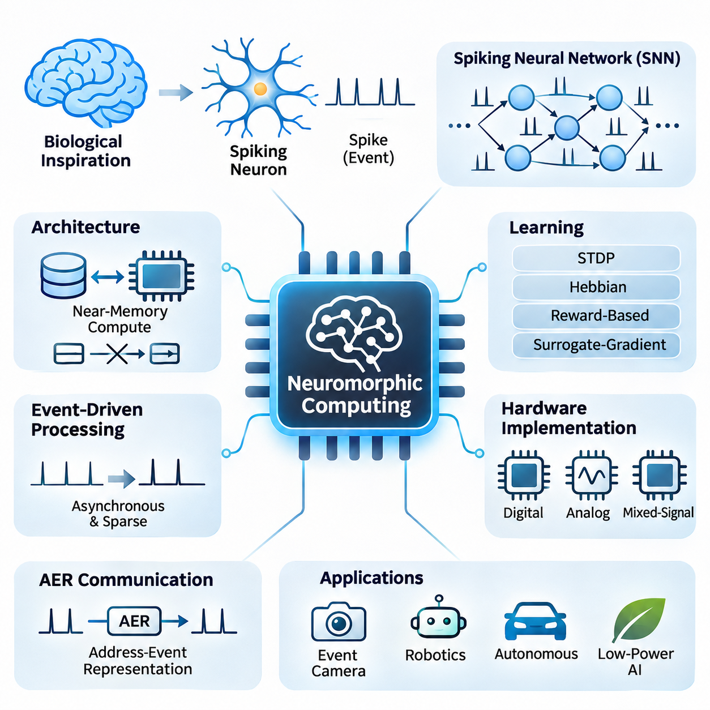
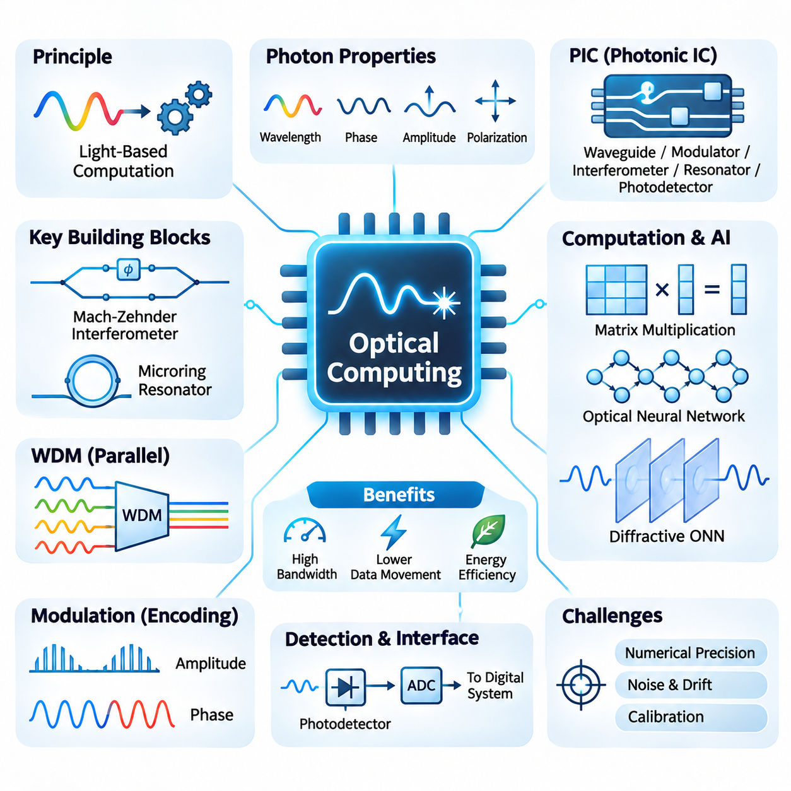
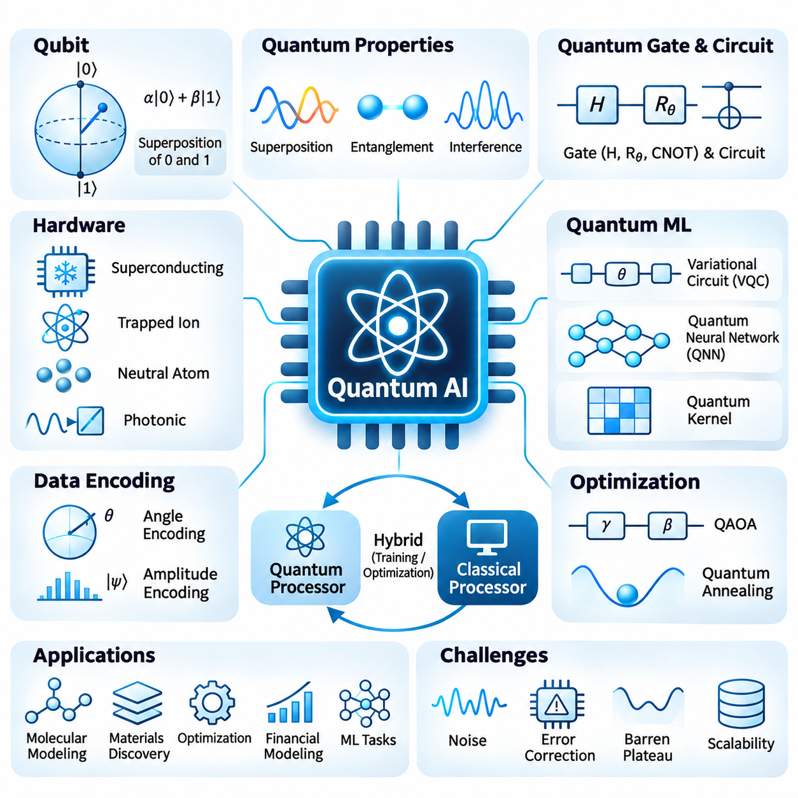
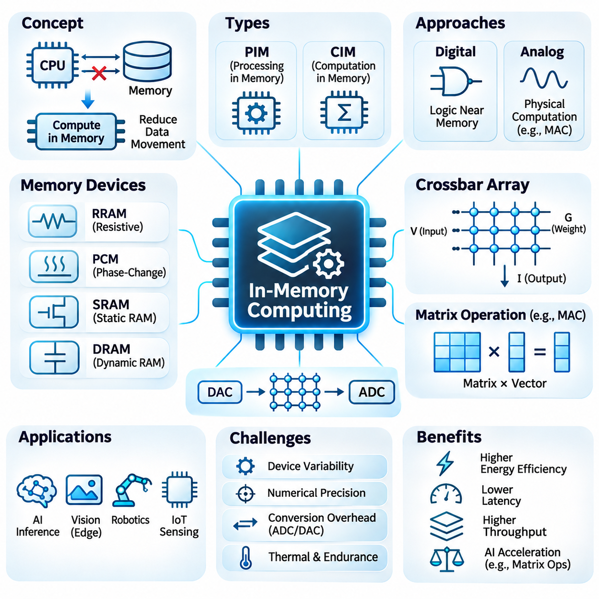
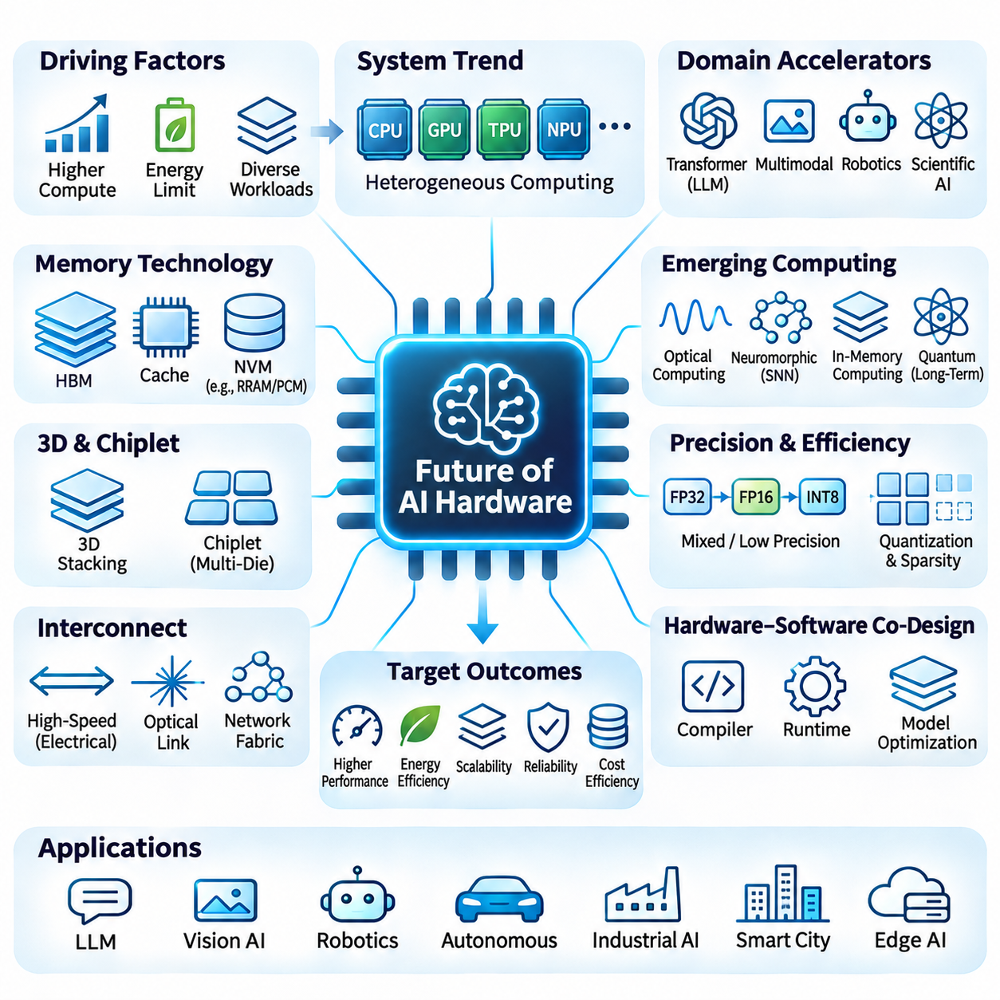

**Volume 39. Hardware for AI**

# 06. Advanced AI Hardware

## 06.01 Neuromorphic Computing

{width="7.268055555555556in" height="7.268055555555556in"}

Neuromorphic computing represents an alternative approach to artificial intelligence hardware inspired by the structure and operation of biological nervous systems. Unlike conventional processors that execute instructions through sequential or massively parallel arithmetic operations, neuromorphic systems emphasize distributed computation, event-driven communication, and local memory. Their objective is to process information efficiently by exploiting sparse activity and temporal dynamics.

The fundamental computational element in neuromorphic hardware is the artificial spiking neuron, which approximates selected electrical behaviors of biological neurons. Instead of continuously transmitting numerical activation values, spiking neurons communicate through discrete events called spikes. These events occur when internal membrane potentials reach defined thresholds, allowing information to be represented through spike timing, frequency, and spatial activity patterns.

Spiking neural networks, commonly abbreviated as SNNs, provide the primary computational framework for neuromorphic systems. Their neurons maintain internal states that evolve over time in response to incoming spikes. The leaky integrate-and-fire model is widely used because it captures essential temporal integration and threshold behavior with relatively low computational complexity. More elaborate neuron models can represent adaptation, bursting, and additional biological dynamics.

A major architectural distinction between neuromorphic processors and conventional accelerators concerns the relationship between computation and memory. Traditional von Neumann architectures frequently transfer data between processing units and separate memory hierarchies. Neuromorphic architectures instead place neuron state and synaptic information near computational elements, potentially reducing communication overhead and improving energy efficiency for sparse workloads.

Event-driven processing enables neuromorphic systems to perform computation primarily when relevant signals arrive. In conventional synchronous architectures, clock-driven operations may continue even when input information changes minimally. Neuromorphic circuits can exploit asynchronous events to avoid unnecessary switching activity. However, actual energy savings depend on spike density, communication costs, circuit design, and the characteristics of the application.

Synaptic connections determine how spikes influence downstream neurons and provide the basis for learning and information processing. Each connection may contain a weight, delay, or additional state variable describing its functional behavior. Hardware implementations store these properties using digital memory, analog circuits, or emerging memory devices. The organization of synaptic storage strongly influences scalability, connectivity, precision, and energy consumption.

Learning in neuromorphic systems can employ biologically inspired mechanisms such as spike-timing-dependent plasticity, or STDP. This approach adjusts synaptic strengths according to the relative timing of presynaptic and postsynaptic spikes. Other methods include local Hebbian learning, reward-modulated plasticity, surrogate-gradient optimization, and conversion from conventional artificial neural networks. Each technique offers different tradeoffs in accuracy, biological plausibility, and hardware compatibility.

Surrogate-gradient learning addresses the difficulty of training spiking neural networks through standard gradient-based optimization. Because spike generation involves discontinuous threshold functions, ordinary derivatives cannot directly describe all relevant changes. Surrogate methods replace problematic derivatives during backward computation with smooth approximations. This enables gradient-based training while preserving discrete spike generation during forward execution.

Neuromorphic hardware can be implemented through digital, analog, or mixed-signal architectures. Digital implementations provide programmable neuron dynamics, predictable numerical behavior, and compatibility with established semiconductor manufacturing processes. Analog implementations exploit continuous electrical behavior to emulate neuronal dynamics efficiently. Mixed-signal designs combine analog state evolution with digital communication and control to balance flexibility and physical efficiency.

Intel Loihi and IBM TrueNorth illustrate different approaches to specialized neuromorphic processor design. Loihi architectures emphasize programmable spiking computation and support for selected local learning mechanisms, whereas TrueNorth demonstrated large-scale digital spiking networks with configurable neuronal and synaptic connectivity. These processors highlight how neuromorphic hardware differs from GPUs and TPUs in communication patterns, computational primitives, and programming assumptions.

Communication between neuromorphic cores commonly relies on address-event representation, known as AER. In this approach, spike events are transmitted as compact messages identifying their source or destination. Routing networks deliver these messages to connected neurons without requiring continuous transmission of dense activation tensors. Efficient routing is essential because communication congestion, fan-out, and synchronization overhead can limit system scalability.

Neuromorphic systems are particularly relevant to sensory processing because many physical signals contain meaningful temporal changes rather than uniformly distributed information. Event-based cameras, for example, generate asynchronous events when local pixel brightness changes beyond a threshold. These sensors can produce sparse streams that align naturally with spiking computation, supporting low-latency motion perception, optical flow estimation, and visual tracking under suitable conditions.

Robotics provides another promising application domain because autonomous machines must continuously interpret sensory signals and react to changing environments. Neuromorphic processors may support event-based perception, reflex-like control, tactile processing, and adaptive sensor fusion. Their potential advantages become especially relevant when power availability is limited and reaction latency matters, although complete robotic systems still require conventional computation for many planning and control tasks.

Energy efficiency is frequently presented as a central motivation for neuromorphic computing, but comparisons require careful experimental design. Energy per spike, energy per inference, average power, task accuracy, and end-to-end latency describe different aspects of performance. A neuromorphic processor may demonstrate excellent efficiency for sparse temporal workloads while offering fewer advantages for dense matrix multiplication or large transformer models.

Hardware scalability introduces additional challenges involving neuron connectivity, memory capacity, routing bandwidth, and distributed state management. Biological neural systems exhibit enormous connectivity, but reproducing arbitrary connectivity in silicon can create substantial communication overhead. Practical neuromorphic architectures therefore employ constrained connectivity patterns, hierarchical routing, multicast mechanisms, and partitioning strategies to distribute networks across processing cores.

Programming neuromorphic hardware requires translating computational models into neuron populations, synaptic connections, event-routing configurations, and execution schedules. Software environments such as Lava and research-oriented SNN frameworks help developers construct and evaluate spiking networks. However, differences among hardware platforms complicate portability, and deployment often requires hardware-specific optimization of neuron models, numerical precision, connectivity, and learning rules.

Reliability and numerical behavior also require attention because neuromorphic computation depends on temporal state evolution. Quantized membrane potentials, finite timestamp resolution, stochastic spike behavior, and analog device variation can influence network outputs. Engineers must evaluate sensitivity to these factors and establish reproducible testing procedures. Calibration, fault tolerance, and controlled operating conditions become especially important for safety-critical applications.

Emerging devices such as memristors and resistive memory elements are being investigated for synaptic storage and adaptive computation. Their programmable conductance can potentially represent synaptic weights within compact physical structures. Nevertheless, endurance limitations, device variability, nonlinear updates, retention behavior, and manufacturing consistency remain significant engineering concerns. Practical adoption depends on overcoming these limitations at the system level.

Neuromorphic computing should therefore be understood as a complementary hardware paradigm rather than a universal replacement for conventional AI accelerators. GPUs and TPUs remain highly effective for dense numerical computation, large-scale training, and transformer inference. Neuromorphic architectures instead target computational regimes where sparse events, temporal processing, local state, and asynchronous operation can provide measurable advantages in efficiency or responsiveness.

Future neuromorphic systems are likely to involve closer integration among specialized sensors, spiking processors, conventional accelerators, and adaptive control software. Hybrid architectures can assign event-driven perception and reactive processing to neuromorphic components while retaining GPUs or CPUs for complex reasoning and optimization. Their long-term significance will depend on demonstrable improvements in application-level performance, software maturity, manufacturability, and total system efficiency.

## 06.02 Optical Computing

{width="7.268055555555556in" height="7.268055555555556in"}

Optical computing represents an emerging approach to information processing that uses light rather than electrical signals to perform computational operations. By exploiting the physical properties of photons, optical systems can execute selected mathematical transformations through propagation, interference, and diffraction. This paradigm offers opportunities for high-bandwidth computation, reduced communication bottlenecks, and efficient acceleration of artificial intelligence workloads.

Conventional electronic processors rely on transistor switching and electrical interconnections to manipulate digital information. As computational workloads increase, energy consumption and data movement become significant limitations. Optical computing approaches these challenges by encoding information into optical signals and processing them through photonic components. However, practical systems still require electronic interfaces for memory, control, and many nonlinear operations.

The fundamental information carrier in optical computing is the photon, which exhibits properties such as wavelength, phase, amplitude, and polarization. These characteristics provide multiple dimensions for representing and manipulating data. Optical signals can propagate through waveguides or free space, allowing information to be transformed by physical interactions. Computational functionality depends on precisely controlling these optical properties.

Photonic integrated circuits, commonly abbreviated as PICs, integrate optical components onto semiconductor substrates. Waveguides, modulators, interferometers, resonators, and photodetectors can be combined to construct computational structures. Silicon photonics is particularly attractive because it can leverage established semiconductor fabrication techniques, although integrating efficient light sources and maintaining precise optical behavior remain important engineering challenges.

One of the most promising applications of optical computing is matrix multiplication, which forms the computational foundation of many neural networks. Optical interference networks can implement linear transformations by controlling the amplitude and phase relationships of propagating light. Once configured, these structures can perform mathematical operations through physical propagation, potentially reducing the number of sequential electronic operations required.

Mach-Zehnder interferometers are important building blocks for programmable optical matrix operations. An interferometer divides an optical signal into separate paths and recombines them to produce controlled interference. By adjusting phase shifts, networks of interferometers can implement configurable linear transformations. Such architectures are particularly relevant to neural network layers dominated by matrix-vector multiplication.

Optical neural networks extend these principles to machine learning architectures by implementing selected neural computations using photonic devices. Input values are encoded into optical signals, transformed through optical components, and converted into output representations. Linear operations can be highly parallel, but nonlinear activation functions often require electronic processing or specialized optical mechanisms, complicating fully optical implementations.

Diffractive optical neural networks provide another computational approach by using structured optical elements to transform propagating light. Carefully designed diffractive layers modify the phase or amplitude of optical waves, producing interference patterns that encode computational results. These systems can perform certain inference tasks with minimal electronic computation during optical propagation, although training and detection generally require additional infrastructure.

Wavelength-division multiplexing enables multiple optical channels to share a common transmission medium by assigning different wavelengths to separate information streams. In optical AI accelerators, this technique can support parallel data transmission and selected computational operations. Its effectiveness depends on optical bandwidth, channel isolation, modulation accuracy, and the ability to manage interference and nonlinear effects.

Microring resonators are compact photonic devices that selectively interact with particular optical wavelengths. Their resonance characteristics can be controlled through thermal, electrical, or other tuning mechanisms. Arrays of microring resonators can implement filtering, signal weighting, and wavelength-selective operations. However, temperature sensitivity, fabrication variation, and tuning power introduce challenges for large-scale computational systems.

Optical modulation determines how numerical information is represented in light. Amplitude modulation changes optical intensity, while phase modulation alters the phase of an electromagnetic wave. More sophisticated encoding schemes combine multiple optical dimensions to increase information density. The selected representation influences numerical precision, noise sensitivity, hardware complexity, and compatibility with downstream processing components.

Photodetectors convert optical signals into electrical signals, allowing optical computational results to interact with conventional digital systems. Analog-to-digital converters may then transform detected signals into numerical representations suitable for electronic processing. These conversion stages introduce latency and energy overhead, meaning that the efficiency of an optical accelerator must be evaluated across the complete computational pipeline.

Numerical precision is a significant challenge because many optical operations are fundamentally analog. Optical noise, phase instability, component mismatch, detector limitations, and environmental variations can affect computational accuracy. Calibration and error compensation are therefore essential for reliable operation. Mixed-precision architectures may combine optical computation with digital correction to balance efficiency and numerical robustness.

Training optical neural networks introduces additional difficulties because gradient computation and parameter updates must account for physical device characteristics. One approach trains a numerical model of the optical system and transfers optimized parameters to hardware. Other approaches employ hardware-in-the-loop optimization or experimentally measured gradients. These methods must address calibration errors, device drift, and differences between simulated and physical behavior.

Optical computing is particularly attractive for workloads involving repeated linear algebra operations, signal processing, and high-throughput inference. Convolutional neural networks, attention mechanisms, and scientific computing applications contain mathematical structures that may benefit from photonic acceleration. Nevertheless, actual advantages depend on workload dimensions, data reuse, conversion overhead, and whether the optical hardware supports the required computational operations efficiently.

Energy efficiency must be assessed beyond the optical processing elements themselves. Lasers, modulators, thermal tuning circuits, photodetectors, converters, and electronic controllers all contribute to total power consumption. Although passive optical propagation can perform certain transformations with little incremental switching energy, maintaining stable and accurate operation may require substantial supporting infrastructure.

Scalability presents additional challenges involving optical losses, component density, signal routing, thermal stability, and manufacturing variability. Larger photonic networks can accumulate insertion losses and phase errors, reducing computational accuracy. Optical amplification may compensate for attenuation but introduces additional noise and energy consumption. Efficient packaging and integration with electronic systems are therefore critical to practical deployment.

Hybrid electronic-photonic architectures represent a realistic direction for advanced AI hardware development. Electronic processors can manage memory, nonlinear functions, scheduling, and control, while photonic circuits accelerate selected linear operations or communication pathways. Such heterogeneous systems allow designers to exploit optical parallelism without requiring every computational function to be implemented using light.

The long-term potential of optical computing depends on improvements in photonic integration, programmable optical devices, calibration techniques, and hardware-software co-design. Optical accelerators are unlikely to replace general-purpose electronic processors across all workloads, but they may become valuable specialized components. Their success will ultimately depend on measurable gains in throughput, latency, energy efficiency, accuracy, and overall system cost.

## 06.03 Quantum AI

{width="7.268055555555556in" height="7.268055555555556in"}

Quantum AI represents an emerging interdisciplinary field that combines quantum computing with artificial intelligence to investigate new computational methods for learning, optimization, and inference. Quantum computers manipulate information using quantum mechanical principles rather than conventional binary logic alone. Their potential lies in exploiting quantum state evolution to accelerate selected computational problems, although practical advantages for general AI workloads remain unproven.

The fundamental information unit in quantum computing is the quantum bit, or qubit, which differs from a classical bit through its ability to exist in a superposition of computational basis states. A qubit can be described by probability amplitudes associated with the states zero and one. When measured, it produces a classical outcome according to quantum probabilities, making the design of useful quantum algorithms fundamentally different from classical computation.

Quantum superposition allows multiple computational amplitudes to evolve within a quantum system, while entanglement creates correlations that cannot generally be reproduced by independent classical states. Quantum interference enables algorithms to amplify desirable outcomes and suppress others. These properties provide the mathematical foundation for quantum computation, but they do not imply that every possible solution can be evaluated or extracted simultaneously.

Quantum gates manipulate qubit states through controlled physical operations that are mathematically represented by unitary transformations. Single-qubit gates modify amplitudes and phases, while multi-qubit gates establish interactions and entanglement. Quantum circuits organize these operations into computational sequences. Their practical execution depends on gate fidelity, circuit depth, connectivity, measurement accuracy, and the physical stability of the quantum processor.

Quantum hardware can be constructed using superconducting circuits, trapped ions, neutral atoms, photonic systems, and other physical technologies. Each implementation offers different characteristics in coherence time, gate speed, connectivity, scalability, and operating conditions. Superconducting systems generally require cryogenic environments, while trapped-ion platforms use electromagnetic confinement and laser-based control to manipulate quantum states.

Quantum machine learning investigates how quantum circuits can represent data, construct computational models, and support learning algorithms. Hybrid quantum-classical approaches are especially important because current quantum processors cannot independently perform the complete training pipelines used in modern AI. Classical processors typically manage data preparation, parameter optimization, and evaluation, while quantum circuits execute selected transformations or measurements.

Variational quantum circuits provide a widely studied framework for hybrid quantum machine learning. These circuits contain adjustable parameters that control quantum gate operations. A classical optimizer updates the parameters according to measured outputs and a defined objective function. Repeated execution gradually modifies the quantum model, creating a training process conceptually related to parameter optimization in conventional neural networks.

Quantum neural networks use parameterized quantum circuits to implement trainable computational structures inspired by neural network principles. Input data may be encoded into qubit rotations, amplitudes, or other quantum representations. Subsequent quantum operations transform the encoded states, and measurements generate outputs. However, quantum neural networks do not automatically reproduce the architecture or computational advantages of conventional deep neural networks.

Data encoding is a central challenge because most practical AI datasets originate as classical numerical information. Angle encoding represents features through quantum rotation parameters, while amplitude encoding maps normalized data into quantum state amplitudes. Although amplitude encoding can provide compact mathematical representations, preparing arbitrary quantum states may require substantial computational resources. Consequently, data-loading costs must be included in performance evaluations.

Quantum feature maps transform classical inputs into quantum states that can be compared through quantum similarity measures. Quantum kernel methods use these representations to construct kernel matrices for classification and regression. Their potential advantage depends on whether the quantum feature space provides useful structure that classical algorithms cannot efficiently reproduce. Demonstrating such advantages requires comparisons against carefully optimized classical baselines.

Quantum optimization is another important research direction because many AI applications involve combinatorial search and constrained decision-making. The Quantum Approximate Optimization Algorithm, or QAOA, combines parameterized quantum operations with classical optimization. It seeks approximate solutions to selected optimization problems, but performance depends on circuit design, problem structure, hardware noise, and the quality of classical alternatives.

Quantum annealing approaches optimization through the evolution of a physical system toward low-energy configurations. Problems are typically expressed using Ising models or quadratic unconstrained binary optimization formulations. Quantum annealers can explore certain optimization landscapes, although embedding overhead and hardware limitations affect practical performance. Their computational advantages over classical optimization methods remain problem-dependent.

Quantum AI research also examines potential acceleration of linear algebra, sampling, and probabilistic computation. Certain quantum algorithms offer theoretical speedups under specific mathematical assumptions, including efficient state preparation and restricted output requirements. However, extracting large classical results from quantum states can eliminate expected benefits. Algorithmic complexity must therefore account for input preparation, measurement, and error correction.

Noise represents one of the greatest obstacles to practical quantum AI. Physical qubits experience decoherence, imperfect gate operations, measurement errors, and environmental disturbances. These effects become increasingly significant as circuit depth and qubit count grow. Noise mitigation techniques can improve selected experimental results, but they introduce additional sampling and computational overhead and cannot fully replace fault-tolerant quantum error correction.

Quantum error correction protects logical quantum information by encoding it across multiple physical qubits and repeatedly detecting errors without directly measuring the protected logical state. Fault-tolerant quantum computing aims to execute long algorithms reliably despite imperfect physical components. Achieving this capability requires substantial hardware resources, accurate control systems, and efficient decoding, making large-scale fault-tolerant Quantum AI a long-term engineering objective.

Training quantum models introduces difficulties beyond hardware noise. Parameterized circuits may exhibit barren plateaus, where gradients become extremely small across large regions of the optimization landscape. Measurement uncertainty further increases the number of circuit executions required for gradient estimation. Researchers investigate structured circuit designs, local objective functions, improved initialization, and alternative optimization methods to address these limitations.

Quantum AI software frameworks provide tools for constructing circuits, simulating quantum operations, and integrating classical optimization. Qiskit, Cirq, and PennyLane support different aspects of quantum programming and experimentation. Hardware access is often provided through cloud services, allowing researchers to compare simulation results with physical execution. Reproducibility requires careful documentation of backend characteristics, noise conditions, circuit compilation, and measurement statistics.

Applications under investigation include molecular modeling, materials discovery, optimization, financial modeling, and selected machine learning tasks. Quantum simulation is particularly relevant to physical systems whose quantum behavior is difficult to represent classically. Nevertheless, the relationship between quantum simulation advantages and broader AI acceleration is not automatic. Each application requires evidence that quantum resources improve meaningful end-to-end outcomes.

Quantum AI should therefore be viewed as a specialized and experimental computing paradigm rather than an immediate replacement for GPUs, TPUs, or conventional AI infrastructure. Classical accelerators remain essential for large-scale neural network training and inference. Future hybrid architectures may delegate carefully selected optimization, simulation, or sampling operations to quantum processors while retaining classical hardware for data management and most computational workloads.

The future of Quantum AI depends on advances in qubit quality, error correction, scalable interconnections, quantum algorithms, and hardware-software co-design. Meaningful progress must be evaluated through solution accuracy, execution time, energy requirements, resource overhead, and comparisons with strong classical methods. Its long-term significance will emerge from demonstrated computational advantages in specific applications rather than theoretical quantum parallelism alone.

## 06.04 In Memory Computing

{width="7.268055555555556in" height="7.268055555555556in"}

In-memory computing represents an advanced computing paradigm that performs selected computational operations directly within or near memory structures. Unlike conventional von Neumann architectures, which repeatedly transfer data between processors and memory, in-memory computing reduces unnecessary data movement. This approach addresses the growing memory bottleneck in artificial intelligence systems, where transferring model parameters and intermediate activations can consume substantial energy and execution time.

The fundamental motivation for in-memory computing arises from the increasing imbalance between computational throughput and memory access efficiency. Modern GPUs and AI accelerators can execute enormous numbers of arithmetic operations, but their performance often depends on continuously supplying data from memory. When data movement becomes the dominant cost, adding computational units provides diminishing benefits. In-memory architectures seek to improve efficiency by bringing computation closer to stored information.

In-memory computing is commonly divided into processing-in-memory and computation-in-memory approaches. Processing-in-memory architectures integrate computational logic within memory devices or closely associated memory structures. Computation-in-memory architectures exploit the physical behavior of memory cells and arrays to perform operations directly. Although these terms are sometimes used interchangeably, their implementation mechanisms, supported operations, and precision characteristics can differ substantially.

Digital in-memory computing incorporates logic circuits into memory arrays or peripheral structures to execute arithmetic and logical operations near stored data. Such systems may support addition, multiplication, accumulation, comparison, and bitwise operations. Digital implementations offer predictable numerical behavior and compatibility with conventional semiconductor design methodologies. However, additional circuitry increases area requirements and may reduce the effective density of memory structures.

Analog in-memory computing exploits electrical properties of memory devices to perform mathematical operations through physical interactions. In resistive memory arrays, stored conductance values can represent numerical weights, while applied voltages represent input signals. The resulting electrical currents approximate weighted sums according to Ohm\'s law and Kirchhoff\'s current law. This enables parallel multiply-accumulate operations without requiring conventional digital multipliers for every individual product.

Crossbar arrays are central structures in many analog in-memory computing architectures. They consist of intersecting conductive lines connected through programmable memory elements. Input voltages are applied along rows, and output currents are collected through columns. Each intersection contributes a weighted current determined by its programmed conductance. Consequently, an entire matrix-vector multiplication can be approximated through the collective electrical behavior of the array.

Resistive random-access memory, commonly called RRAM or ReRAM, is an important candidate technology for in-memory computing. Its resistance states can be modified through electrical programming, allowing memory cells to represent binary or multilevel information. RRAM arrays offer potential advantages in nonvolatile storage and computational density. However, device variability, endurance limitations, resistance drift, and nonlinear switching behavior complicate precise analog computation.

Phase-change memory provides another approach by storing information through changes in the physical phase of a material. Different material states exhibit distinct electrical resistance characteristics that can encode computational weights. Phase-change devices can support analog or multilevel storage, making them relevant to neural network acceleration. Their practical limitations include programming energy, conductance drift, device endurance, and variations between individual memory cells.

Static random-access memory, or SRAM, can also support computation-in-memory through modifications to conventional memory circuits. SRAM-based designs may implement digital or analog operations using bitlines, wordlines, and peripheral circuitry. Because SRAM is compatible with established CMOS manufacturing processes, it provides a practical foundation for specialized AI accelerators. Its primary disadvantages include relatively large cell area and limited storage density compared with emerging nonvolatile memories.

Dynamic random-access memory, or DRAM, offers opportunities for processing-in-memory because of its high storage density and widespread use in computing systems. DRAM-based architectures can incorporate computational functions near memory banks or exploit selected internal memory operations. These approaches may accelerate data-intensive workloads while reducing transfers across external memory interfaces. Nevertheless, refresh requirements, timing constraints, and architectural complexity limit supported computational operations.

Matrix multiplication is a particularly important application because neural networks rely heavily on multiply-accumulate operations. Fully connected layers, convolutional layers, and selected transformer computations can be expressed using matrix operations. In-memory computing can reduce repeated movement of model weights between storage and arithmetic units. The resulting efficiency depends on array dimensions, weight reuse, input precision, and the overhead of peripheral conversion circuits.

Analog-to-digital and digital-to-analog converters play essential roles in analog in-memory computing systems. Digital input values must often be converted into electrical signals, while analog computation results require conversion back into digital representations. These interfaces introduce energy consumption, latency, and quantization errors. Consequently, the theoretical efficiency of an analog memory array may differ substantially from the measured efficiency of a complete accelerator.

Numerical precision presents a major challenge because physical memory devices do not always maintain perfectly stable conductance values. Thermal noise, programming uncertainty, device aging, parasitic resistance, and nonlinear electrical behavior can distort computational results. Calibration and compensation techniques are therefore necessary for reliable operation. Quantization-aware training and hardware-aware optimization can help neural networks tolerate these imperfections without excessive accuracy degradation.

Weight programming is another important consideration because neural network parameters must be mapped into physical memory states. Programming procedures may require iterative write-and-verify operations to achieve acceptable accuracy. Frequent updates can increase energy consumption and accelerate device wear. For this reason, some in-memory computing architectures are particularly attractive for inference workloads, where weights remain relatively stable after deployment.

Training neural networks directly within memory arrays is more challenging than performing inference because learning requires repeated weight updates. Gradient calculations, parameter modifications, and optimizer states introduce additional computational and storage requirements. Analog weight updates may also suffer from asymmetric programming characteristics and limited precision. Hybrid architectures can address these issues by combining conventional digital training with in-memory inference acceleration.

Memory hierarchy integration determines how effectively in-memory computing can operate within larger AI systems. Practical architectures may combine conventional caches, SRAM-based computing arrays, nonvolatile memory structures, and external DRAM. Data placement and scheduling must minimize unnecessary transfers while preserving computational correctness. Efficient integration requires coordination among memory controllers, compiler optimizations, runtime systems, and accelerator hardware.

Scalability introduces challenges involving array size, signal integrity, communication bandwidth, and manufacturing consistency. Larger analog crossbar arrays can experience increased voltage drops, parasitic effects, and accumulated computational errors. Dividing large matrices across smaller arrays improves manageability but introduces additional data transfers and partial-result accumulation. Architectural optimization must balance parallelism, numerical accuracy, memory capacity, and peripheral overhead.

In-memory computing is especially promising for edge AI systems, where power consumption, physical dimensions, and thermal constraints are critical. Robotics, autonomous sensing, industrial monitoring, and embedded vision applications frequently require efficient inference under limited energy budgets. Specialized in-memory accelerators may reduce the energy required for repeated neural network operations, although their suitability depends on model structure, supported precision, and deployment requirements.

The evaluation of in-memory computing hardware requires system-level performance measurements rather than isolated memory-array results. Important metrics include inference latency, throughput, energy per operation, model accuracy, memory capacity, and total power consumption. Comparisons with GPUs, TPUs, and conventional NPUs should account for data conversion, communication, control circuitry, and workload characteristics. Reliable benchmarking must use equivalent computational tasks and accuracy requirements.

Future in-memory computing systems are likely to combine digital processing, analog memory arrays, emerging nonvolatile devices, and hardware-aware software frameworks. Advances in semiconductor manufacturing, device reliability, compiler technology, and neural network optimization will determine their practical adoption. Rather than replacing conventional processors entirely, in-memory computing may become a specialized acceleration technology that reduces data movement and improves the energy efficiency of selected AI workloads.

## 06.05 Future of AI Hardware

{width="7.268055555555556in" height="7.268055555555556in"}

The future of AI hardware will be shaped by increasing computational demands, energy constraints, and the growing diversity of artificial intelligence workloads. Traditional improvements in transistor density and clock frequency are no longer sufficient to sustain performance growth independently. Future architectures must combine specialized processing, advanced memory technologies, efficient interconnections, and intelligent software optimization to deliver scalable computational capabilities.

Heterogeneous computing is expected to become a defining characteristic of advanced AI systems. CPUs, GPUs, TPUs, NPUs, and specialized accelerators will cooperate within unified computational environments. Each processor type can execute operations suited to its architectural strengths, improving overall resource utilization. Efficient workload scheduling, shared memory access, and low-latency communication will determine the effectiveness of these heterogeneous platforms.

Domain-specific accelerators will increasingly target computational patterns found in transformers, multimodal models, robotics, and scientific AI. Rather than supporting every possible operation equally, these processors optimize selected mathematical kernels, dataflows, and memory access patterns. Their effectiveness depends on balancing specialization with programmability, because rapidly evolving neural network architectures can make narrowly optimized hardware less adaptable.

Memory technology will play a central role in future AI hardware development. High-bandwidth memory, advanced packaging, and larger on-chip caches can reduce data transfer delays between processing elements. Emerging nonvolatile memories may provide additional opportunities for efficient storage and computation. Nevertheless, memory capacity, bandwidth, latency, endurance, and power consumption must be optimized together rather than treated as independent design objectives.

Three-dimensional integration and chiplet-based architectures offer alternatives to conventional monolithic semiconductor designs. Multiple computational dies can be interconnected through advanced packaging technologies, allowing different process nodes and specialized components to coexist. Vertical stacking can shorten selected communication paths and increase integration density. However, thermal management, manufacturing yield, interconnect reliability, and packaging costs remain major engineering challenges.

Interconnect technology will become increasingly important as AI systems expand across multiple accelerators and computing nodes. High-speed electrical links, optical interconnections, and advanced network fabrics can support distributed processing and large-scale model execution. Communication efficiency depends on bandwidth, latency, synchronization, and topology. Future systems must minimize unnecessary data transfers while maintaining reliable coordination among processing resources.

Optical computing may provide specialized acceleration for selected linear algebra operations and communication-intensive workloads. Photonic integrated circuits can exploit interference, wavelength multiplexing, and parallel optical propagation to manipulate information. Their potential advantages must be evaluated against laser power, signal conversion, calibration, and integration overhead. Hybrid electronic-photonic systems are therefore more realistic than fully optical general-purpose processors.

Neuromorphic computing introduces another architectural direction by using event-driven processing and brain-inspired computational structures. Spiking neural networks can exploit sparse temporal activity to reduce unnecessary operations in suitable workloads. Such architectures may benefit autonomous sensing, adaptive robotics, and low-power perception. However, limited software maturity, training complexity, and application-specific performance continue to constrain widespread adoption.

In-memory computing addresses the energy and latency associated with transferring data between memory and processing units. Digital and analog memory arrays can perform selected arithmetic operations close to stored model parameters. Emerging resistive devices and SRAM-based computational structures offer different tradeoffs in density, precision, and reliability. Future implementations must overcome device variability, conversion overhead, and limited flexibility to achieve system-level benefits.

Quantum computing represents a longer-term possibility for accelerating specific optimization, simulation, and mathematical problems relevant to AI. Quantum processors exploit superposition, entanglement, and interference, but practical applications remain constrained by noise, limited qubit quality, and substantial error-correction requirements. Quantum hardware is unlikely to replace conventional AI accelerators broadly, although hybrid quantum-classical systems may eventually support specialized computational tasks.

Energy efficiency will become a primary design constraint as model complexity and deployment scale continue to increase. Power delivery, cooling infrastructure, and operational electricity costs directly influence the feasibility of large AI installations. Hardware designers must improve performance per watt through efficient arithmetic, reduced data movement, dynamic power management, and workload-aware execution. Sustainable scaling requires evaluating energy consumption across the complete system lifecycle.

Precision-aware computing will increasingly exploit the numerical tolerance of neural networks. Reduced-precision formats, mixed-precision arithmetic, quantization, and sparsity-aware execution can decrease computational and memory requirements. Hardware support for these techniques must preserve acceptable model accuracy and numerical stability. Adaptive precision strategies may dynamically allocate computational resources according to layer sensitivity, workload characteristics, and inference requirements.

Large language models and multimodal foundation models will continue influencing accelerator architecture. Attention mechanisms, matrix multiplication, normalization, and memory-intensive decoding create different computational demands across training and inference. Efficient hardware must support large parameter storage, high-bandwidth communication, and flexible execution. Memory capacity and data movement may become more important than peak arithmetic throughput for certain inference workloads.

Edge AI hardware will evolve toward more capable and energy-efficient processing platforms that operate independently of continuous cloud connectivity. Autonomous robots, vehicles, industrial systems, and embedded devices require predictable latency, reliable sensing, and efficient local inference. Future edge processors may integrate CPUs, GPUs, NPUs, sensor interfaces, and safety functions within compact systems. Thermal limitations and real-time requirements will strongly influence their architecture.

Physical AI will introduce additional hardware requirements by connecting perception, reasoning, planning, and control with real-world interaction. Robotic systems must process multimodal sensor streams while responding to dynamic environments under strict timing constraints. Hardware architectures will need to coordinate vision processing, spatial understanding, motion planning, and actuator control. Reliability, deterministic execution, and functional safety will be as important as computational throughput.

Hardware-software co-design will become essential for extracting practical performance from increasingly specialized accelerators. Compilers, graph optimizers, runtime schedulers, and memory planners must understand the capabilities and constraints of underlying processors. Techniques such as operator fusion, tensor layout optimization, and automated kernel generation can improve execution efficiency. Flexible software ecosystems will help hardware remain useful as AI models evolve.

Reliability and security will become increasingly important as AI accelerators enter safety-critical and economically sensitive applications. Hardware faults, memory corruption, thermal instability, and malicious interference can compromise computational correctness. Future systems will require stronger monitoring, isolation, secure execution, and fault recovery mechanisms. Robust hardware design must also consider supply-chain integrity, firmware security, and long-term operational maintenance.

The economic future of AI hardware will depend on manufacturing capacity, semiconductor supply chains, development costs, and infrastructure availability. Advanced fabrication processes and packaging technologies require substantial capital investment and specialized expertise. Organizations must evaluate total cost of ownership rather than purchasing price alone. Hardware utilization, software compatibility, maintenance, energy consumption, and upgrade flexibility will determine long-term value.

Benchmarking future AI hardware requires realistic workloads and comprehensive system-level measurements. Peak theoretical performance alone cannot represent practical efficiency across training, inference, robotics, and distributed computing. Evaluations should include throughput, latency, energy per task, memory efficiency, accuracy, reliability, and deployment cost. Standardized methodologies and reproducible experiments will be necessary for meaningful comparisons across emerging architectures.

Ultimately, the future of AI hardware will not be determined by a single processor technology but by the integration of complementary computational approaches. Electronic accelerators, advanced memory, photonic devices, neuromorphic processors, and potentially quantum systems may serve different roles within heterogeneous platforms. Successful architectures will combine computational efficiency, programmability, reliability, and economic practicality to support increasingly intelligent and autonomous systems.
