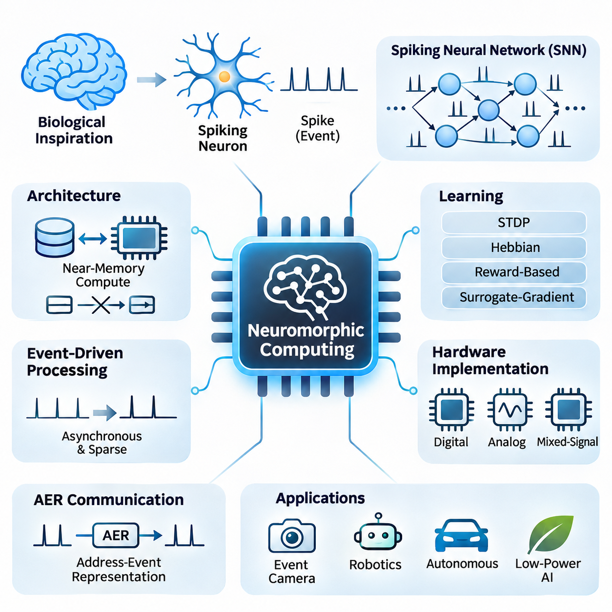
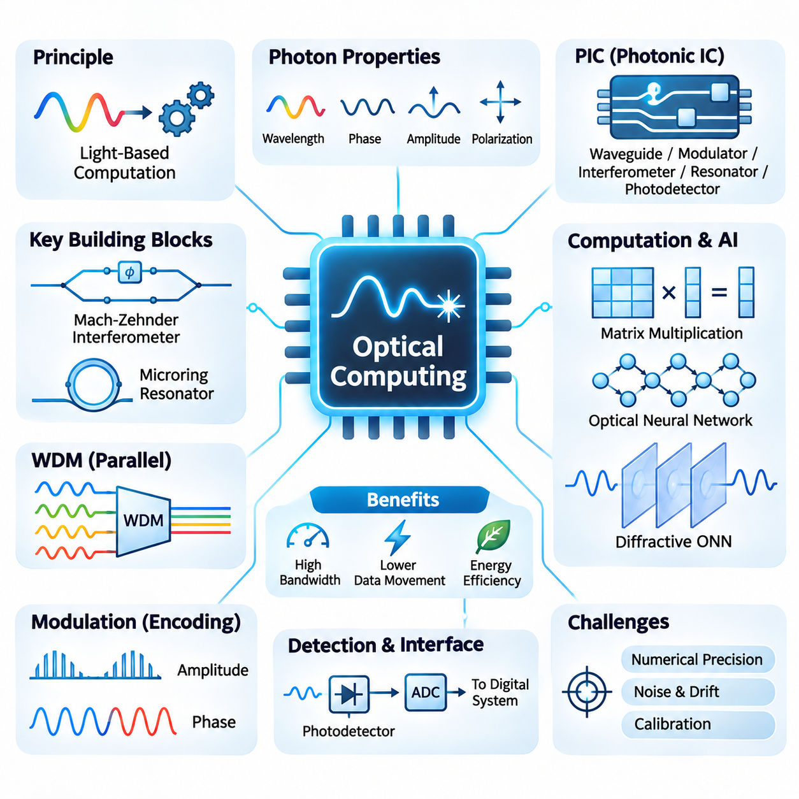
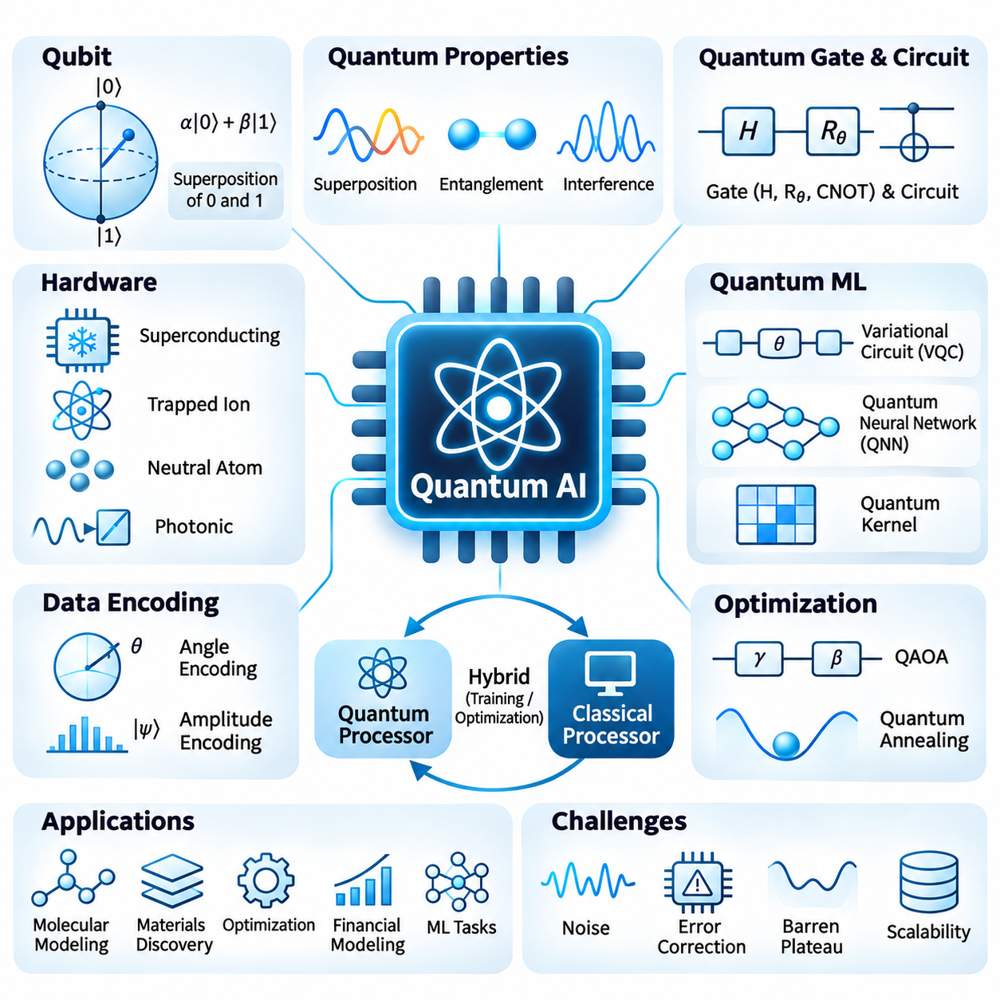
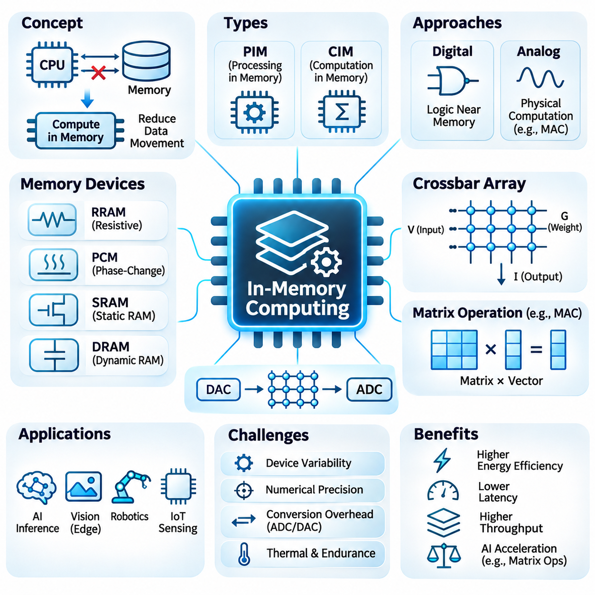
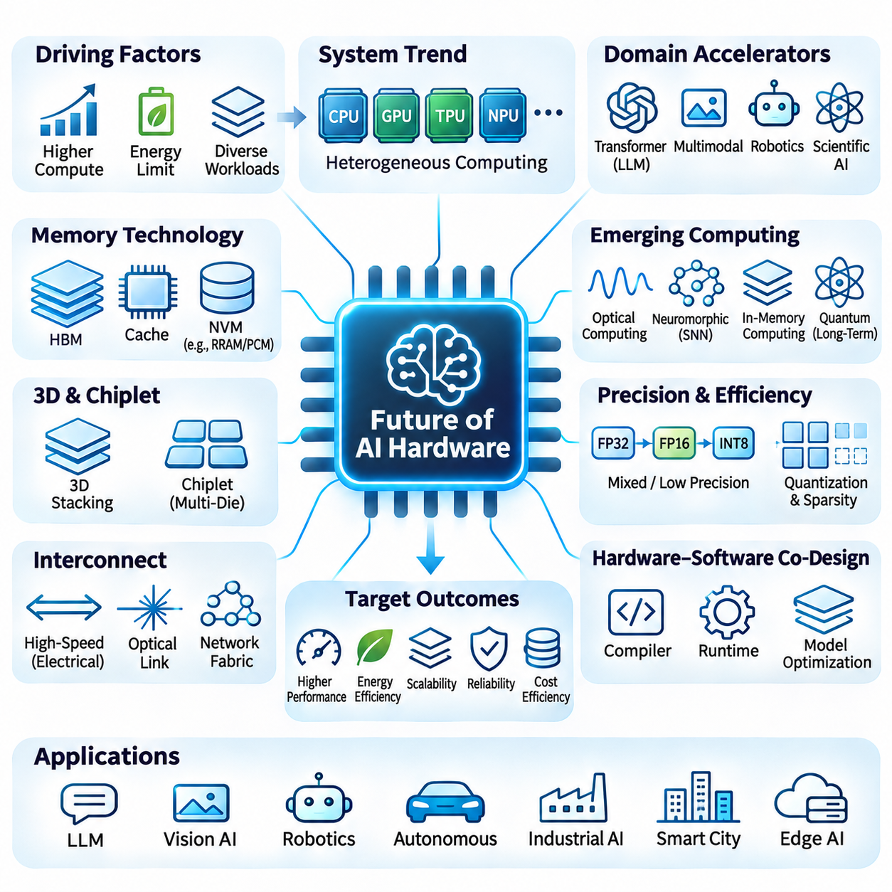

**Volume 39. Hardware for AI**

# 06. Advanced AI Hardware

## 06.01 Neuromorphic Computing

{width="7.268055555555556in" height="7.268055555555556in"}

뉴로모픽 컴퓨팅(Neuromorphic Computing)은 생물학적 신경계(Biological Nervous Systems)의 구조와 작동 원리에서 영감을 얻은 대안적인 인공지능 하드웨어(Artificial Intelligence Hardware) 접근 방식이다. 순차적 또는 대규모 병렬 산술 연산을 통해 명령어를 실행하는 기존 프로세서(Conventional Processor)와 달리, 뉴로모픽 시스템(Neuromorphic System)은 분산 연산(Distributed Computation), 이벤트 기반 통신(Event-Driven Communication), 지역 메모리(Local Memory)를 강조한다. 이러한 구조는 희소 활성화(Sparse Activity)와 시간적 동역학(Temporal Dynamics)을 활용하여 정보 처리 효율성을 높이는 것을 목표로 한다.

뉴로모픽 하드웨어의 기본 연산 요소는 생물학적 뉴런(Biological Neuron)의 전기적 동작 중 일부를 근사하는 인공 스파이킹 뉴런(Artificial Spiking Neuron)이다. 스파이킹 뉴런은 연속적인 수치 활성화 값(Numerical Activation Value)을 전달하는 대신 스파이크(Spike)라는 이산 이벤트(Discrete Event)를 통해 통신한다. 이러한 이벤트는 내부 막전위(Membrane Potential)가 특정 임계값(Threshold)에 도달할 때 발생하며, 스파이크의 발생 시점(Spike Timing), 빈도(Frequency), 공간적 활성화 패턴(Spatial Activity Pattern)을 통해 정보를 표현할 수 있다.

스파이킹 신경망(Spiking Neural Network, SNN)은 뉴로모픽 시스템의 핵심 연산 프레임워크(Computational Framework)를 제공한다. 각 뉴런은 입력 스파이크에 반응하여 시간에 따라 변화하는 내부 상태(Internal State)를 유지한다. 누설 적분 발화 모델(Leaky Integrate-and-Fire Model)은 비교적 낮은 연산 복잡도(Computational Complexity)로 시간적 적분(Temporal Integration)과 임계값 기반 발화(Threshold-Based Firing)를 구현할 수 있어 널리 사용된다. 보다 정교한 뉴런 모델은 적응(Adaptation), 버스팅(Bursting), 추가적인 생물학적 동역학(Biological Dynamics)을 표현할 수 있다.

뉴로모픽 프로세서(Neuromorphic Processor)와 기존 가속기(Conventional Accelerator)를 구분하는 중요한 아키텍처적 특징은 연산(Computation)과 메모리(Memory)의 관계에 있다. 전통적인 폰 노이만 아키텍처(Von Neumann Architecture)는 처리 장치(Processing Unit)와 분리된 메모리 계층(Memory Hierarchy) 사이에서 데이터를 빈번하게 이동시킨다. 반면 뉴로모픽 아키텍처(Neuromorphic Architecture)는 뉴런 상태(Neuron State)와 시냅스 정보(Synaptic Information)를 연산 요소 가까이에 배치하여 통신 오버헤드(Communication Overhead)를 줄이고 희소 작업 부하(Sparse Workload)의 에너지 효율성(Energy Efficiency)을 향상시킬 수 있다.

이벤트 기반 처리(Event-Driven Processing)는 관련 신호가 도착할 때 주로 연산을 수행하도록 뉴로모픽 시스템을 구성한다. 기존 동기식 아키텍처(Synchronous Architecture)에서는 입력 정보의 변화가 거의 없어도 클록 기반 연산(Clock-Driven Operation)이 계속 실행될 수 있다. 뉴로모픽 회로(Neuromorphic Circuit)는 비동기 이벤트(Asynchronous Event)를 활용하여 불필요한 스위칭 동작(Switching Activity)을 줄일 수 있다. 그러나 실제 에너지 절감 효과는 스파이크 밀도(Spike Density), 통신 비용(Communication Cost), 회로 설계(Circuit Design), 응용 분야(Application)의 특성에 따라 달라진다.

시냅스 연결(Synaptic Connection)은 스파이크가 후속 뉴런(Downstream Neuron)에 미치는 영향을 결정하며 학습(Learning)과 정보 처리(Information Processing)의 기반을 제공한다. 각 연결은 가중치(Weight), 지연 시간(Delay), 기능적 동작을 나타내는 추가 상태 변수(State Variable)를 포함할 수 있다. 하드웨어 구현에서는 디지털 메모리(Digital Memory), 아날로그 회로(Analog Circuit), 신흥 메모리 소자(Emerging Memory Device)를 활용하여 이러한 속성을 저장한다. 시냅스 저장 구조(Synaptic Storage Architecture)는 확장성(Scalability), 연결성(Connectivity), 정밀도(Precision), 에너지 소비(Energy Consumption)에 큰 영향을 미친다.

뉴로모픽 시스템의 학습은 스파이크 타이밍 의존 가소성(Spike-Timing-Dependent Plasticity, STDP)과 같은 생물학적 영감 기반 메커니즘(Biologically Inspired Mechanism)을 활용할 수 있다. 이 방법은 시냅스 전 뉴런(Presynaptic Neuron)과 시냅스 후 뉴런(Postsynaptic Neuron)의 상대적인 스파이크 발생 시점에 따라 시냅스 강도(Synaptic Strength)를 조정한다. 다른 방법으로는 지역 헤브 학습(Local Hebbian Learning), 보상 조절 가소성(Reward-Modulated Plasticity), 대리 기울기 최적화(Surrogate-Gradient Optimization), 기존 인공 신경망(Artificial Neural Network)의 변환이 있으며, 각각 정확도(Accuracy), 생물학적 타당성(Biological Plausibility), 하드웨어 호환성(Hardware Compatibility)에서 서로 다른 절충 관계(Tradeoff)를 가진다.

대리 기울기 학습(Surrogate-Gradient Learning)은 표준 기울기 기반 최적화(Gradient-Based Optimization)를 이용하여 스파이킹 신경망을 학습할 때 발생하는 어려움을 해결한다. 스파이크 생성(Spike Generation)은 불연속 임계 함수(Discontinuous Threshold Function)를 포함하므로 일반적인 미분(Derivative)만으로 모든 관련 변화를 직접 표현하기 어렵다. 대리 기울기 방법은 역방향 연산(Backward Computation) 과정에서 문제가 되는 미분을 부드러운 근사 함수(Smooth Approximation)로 대체한다. 이를 통해 순전파(Forward Execution)에서는 이산 스파이크 생성을 유지하면서 기울기 기반 학습을 수행할 수 있다.

뉴로모픽 하드웨어는 디지털(Digital), 아날로그(Analog), 혼합 신호(Mixed-Signal) 아키텍처를 통해 구현할 수 있다. 디지털 구현(Digital Implementation)은 프로그래밍 가능한 뉴런 동역학(Programmable Neuron Dynamics), 예측 가능한 수치 동작(Numerical Behavior), 기존 반도체 제조 공정(Semiconductor Manufacturing Process)과의 호환성을 제공한다. 아날로그 구현(Analog Implementation)은 연속적인 전기적 특성을 활용하여 뉴런 동역학을 효율적으로 모사한다. 혼합 신호 설계(Mixed-Signal Design)는 아날로그 상태 변화(Analog State Evolution)와 디지털 통신 및 제어(Digital Communication and Control)를 결합하여 유연성과 물리적 효율성 사이의 균형을 추구한다.

인텔 로이히(Intel Loihi)와 IBM 트루노스(IBM TrueNorth)는 특수 목적 뉴로모픽 프로세서(Specialized Neuromorphic Processor)의 서로 다른 설계 접근 방식을 보여준다. 로이히 아키텍처(Loihi Architecture)는 프로그래밍 가능한 스파이킹 연산(Programmable Spiking Computation)과 일부 지역 학습 메커니즘(Local Learning Mechanism)을 지원하는 데 중점을 둔다. 반면 트루노스(TrueNorth)는 설정 가능한 뉴런 및 시냅스 연결(Neuron and Synaptic Connectivity)을 갖춘 대규모 디지털 스파이킹 네트워크(Digital Spiking Network)를 구현하였다. 이러한 프로세서는 통신 패턴(Communication Pattern), 연산 기본 요소(Computational Primitive), 프로그래밍 가정(Programming Assumption) 측면에서 뉴로모픽 하드웨어가 GPU 및 TPU와 어떻게 다른지 보여준다.

뉴로모픽 코어(Neuromorphic Core) 사이의 통신은 일반적으로 주소 이벤트 표현(Address-Event Representation, AER)에 의존한다. 이 방식에서는 스파이크 이벤트를 출발지(Source) 또는 목적지(Destination)를 식별하는 간결한 메시지(Compact Message)로 전송한다. 라우팅 네트워크(Routing Network)는 밀집 활성화 텐서(Dense Activation Tensor)를 지속적으로 전송하지 않고도 연결된 뉴런에 메시지를 전달한다. 효율적인 라우팅(Efficient Routing)은 통신 혼잡(Communication Congestion), 팬아웃(Fan-Out), 동기화 오버헤드(Synchronization Overhead)가 시스템 확장성(System Scalability)을 제한할 수 있기 때문에 매우 중요하다.

뉴로모픽 시스템은 많은 물리적 신호(Physical Signal)가 균일하게 분포된 정보보다 의미 있는 시간적 변화(Temporal Change)를 포함한다는 점에서 감각 정보 처리(Sensory Processing)에 특히 적합하다. 예를 들어 이벤트 기반 카메라(Event-Based Camera)는 개별 픽셀(Pixel)의 밝기 변화가 특정 임계값을 초과할 때 비동기 이벤트를 생성한다. 이러한 센서는 스파이킹 연산(Spiking Computation)과 자연스럽게 결합되는 희소 이벤트 스트림(Sparse Event Stream)을 생성하며, 적절한 조건에서 저지연 동작 인식(Low-Latency Motion Perception), 광학 흐름 추정(Optical Flow Estimation), 시각적 추적(Visual Tracking)을 지원할 수 있다.

로보틱스(Robotics)는 자율 기계(Autonomous Machine)가 감각 신호를 지속적으로 해석하고 변화하는 환경에 반응해야 한다는 점에서 또 다른 유망한 응용 분야이다. 뉴로모픽 프로세서는 이벤트 기반 인식(Event-Based Perception), 반사 행동 유사 제어(Reflex-Like Control), 촉각 정보 처리(Tactile Processing), 적응형 센서 융합(Adaptive Sensor Fusion)을 지원할 수 있다. 이러한 잠재적 이점은 전력 공급(Power Availability)이 제한되고 반응 지연 시간(Reaction Latency)이 중요한 환경에서 특히 의미가 있다. 다만 완전한 로봇 시스템(Complete Robotic System)은 다양한 계획(Planning) 및 제어(Control) 작업을 위해 여전히 기존 연산 기술을 필요로 한다.

에너지 효율성(Energy Efficiency)은 뉴로모픽 컴퓨팅의 핵심적인 개발 동기로 자주 제시되지만, 성능 비교(Performance Comparison)에는 신중한 실험 설계(Experimental Design)가 필요하다. 스파이크당 에너지(Energy per Spike), 추론당 에너지(Energy per Inference), 평균 전력(Average Power), 작업 정확도(Task Accuracy), 종단 간 지연 시간(End-to-End Latency)은 서로 다른 성능 특성을 나타낸다. 뉴로모픽 프로세서는 희소 시간적 작업 부하(Sparse Temporal Workload)에서 높은 효율성을 보일 수 있지만, 밀집 행렬 곱셈(Dense Matrix Multiplication)이나 대규모 트랜스포머 모델(Large Transformer Model)에서는 상대적인 이점이 제한될 수 있다.

하드웨어 확장성(Hardware Scalability)은 뉴런 연결성(Neuron Connectivity), 메모리 용량(Memory Capacity), 라우팅 대역폭(Routing Bandwidth), 분산 상태 관리(Distributed State Management)와 관련된 추가적인 문제를 발생시킨다. 생물학적 신경계는 방대한 연결 구조를 갖지만, 임의의 연결성을 실리콘(Silicon)에서 재현하면 상당한 통신 오버헤드가 발생할 수 있다. 따라서 실제 뉴로모픽 아키텍처는 제한된 연결 패턴(Constrained Connectivity Pattern), 계층적 라우팅(Hierarchical Routing), 멀티캐스트 메커니즘(Multicast Mechanism), 분할 전략(Partitioning Strategy)을 활용하여 네트워크를 여러 처리 코어(Processing Core)에 분산한다.

뉴로모픽 하드웨어 프로그래밍(Neuromorphic Hardware Programming)은 계산 모델(Computational Model)을 뉴런 집단(Neuron Population), 시냅스 연결(Synaptic Connection), 이벤트 라우팅 구성(Event-Routing Configuration), 실행 스케줄(Execution Schedule)로 변환하는 과정을 필요로 한다. 라바(Lava)와 스파이킹 신경망 연구 프레임워크(SNN Research Framework) 같은 소프트웨어 환경은 개발자가 스파이킹 네트워크를 구성하고 평가하도록 지원한다. 그러나 하드웨어 플랫폼 간 차이는 이식성(Portability)을 어렵게 하며, 배포(Deployment) 과정에서는 뉴런 모델, 수치 정밀도, 연결 구조, 학습 규칙에 대한 하드웨어별 최적화(Hardware-Specific Optimization)가 필요한 경우가 많다.

신뢰성(Reliability)과 수치적 동작(Numerical Behavior) 역시 중요한 고려 사항이다. 뉴로모픽 연산은 시간에 따른 상태 변화(Temporal State Evolution)에 의존하기 때문이다. 양자화된 막전위(Quantized Membrane Potential), 제한된 타임스탬프 해상도(Finite Timestamp Resolution), 확률적 스파이크 동작(Stochastic Spike Behavior), 아날로그 소자 변동성(Analog Device Variation)은 네트워크 출력(Network Output)에 영향을 줄 수 있다. 엔지니어는 이러한 요소에 대한 민감도(Sensitivity)를 평가하고 재현 가능한 시험 절차(Reproducible Testing Procedure)를 수립해야 한다. 보정(Calibration), 결함 허용성(Fault Tolerance), 제어된 운용 조건(Controlled Operating Condition)은 안전 필수 응용 분야(Safety-Critical Application)에서 특히 중요하다.

멤리스터(Memristor)와 저항성 메모리 소자(Resistive Memory Element) 같은 신흥 소자는 시냅스 저장(Synaptic Storage)과 적응형 연산(Adaptive Computation)을 위해 연구되고 있다. 이러한 소자의 프로그래밍 가능한 전도도(Programmable Conductance)는 소형 물리 구조(Compact Physical Structure) 내에서 시냅스 가중치(Synaptic Weight)를 표현할 가능성을 제공한다. 그러나 내구성 한계(Endurance Limitation), 소자 변동성(Device Variability), 비선형 갱신(Nonlinear Update), 데이터 유지 특성(Retention Behavior), 제조 일관성(Manufacturing Consistency)은 여전히 중요한 공학적 과제이다. 실제 도입 여부는 시스템 수준(System Level)에서 이러한 제약을 해결할 수 있는지에 달려 있다.

따라서 뉴로모픽 컴퓨팅은 기존 인공지능 가속기(Conventional AI Accelerator)를 보편적으로 대체하는 기술이 아니라 상호 보완적인 하드웨어 패러다임(Complementary Hardware Paradigm)으로 이해해야 한다. GPU와 TPU는 밀집 수치 연산(Dense Numerical Computation), 대규모 학습(Large-Scale Training), 트랜스포머 추론(Transformer Inference)에서 여전히 높은 효율성을 제공한다. 반면 뉴로모픽 아키텍처는 희소 이벤트(Sparse Event), 시간적 처리(Temporal Processing), 지역 상태(Local State), 비동기 동작(Asynchronous Operation)이 효율성 또는 응답성(Responsiveness)에서 측정 가능한 이점을 제공하는 연산 영역을 목표로 한다.

미래의 뉴로모픽 시스템(Future Neuromorphic System)은 특수 목적 센서(Specialized Sensor), 스파이킹 프로세서(Spiking Processor), 기존 가속기(Conventional Accelerator), 적응형 제어 소프트웨어(Adaptive Control Software) 사이의 긴밀한 통합을 중심으로 발전할 가능성이 높다. 하이브리드 아키텍처(Hybrid Architecture)는 이벤트 기반 인식과 반응형 처리(Reactive Processing)를 뉴로모픽 구성 요소에 할당하면서 복잡한 추론(Complex Reasoning)과 최적화(Optimization)는 GPU 또는 CPU에 유지할 수 있다. 뉴로모픽 컴퓨팅의 장기적인 중요성은 응용 수준 성능(Application-Level Performance), 소프트웨어 성숙도(Software Maturity), 제조 가능성(Manufacturability), 전체 시스템 효율성(Total System Efficiency)에서 실질적이고 검증 가능한 개선을 달성하는지에 따라 결정될 것이다.

## 06.02 Optical Computing

{width="7.268055555555556in" height="7.268055555555556in"}

광 컴퓨팅(Optical Computing)은 전기 신호(Electrical Signal) 대신 빛(Light)을 사용하여 연산을 수행하는 새로운 정보 처리(Information Processing) 접근 방식이다. 광자(Photon)의 물리적 특성을 활용함으로써 광학 시스템(Optical System)은 전파(Propagation), 간섭(Interference), 회절(Diffraction)을 통해 특정 수학적 변환(Mathematical Transformation)을 수행할 수 있다. 이러한 컴퓨팅 패러다임(Computing Paradigm)은 높은 대역폭(High Bandwidth), 통신 병목 현상(Communication Bottleneck) 감소, 인공지능 작업 부하(Artificial Intelligence Workload)의 효율적인 가속을 실현할 가능성을 제공한다.

기존 전자 프로세서(Conventional Electronic Processor)는 디지털 정보(Digital Information)를 처리하기 위해 트랜지스터 스위칭(Transistor Switching)과 전기적 상호 연결(Electrical Interconnection)에 의존한다. 연산 작업 부하가 증가함에 따라 에너지 소비(Energy Consumption)와 데이터 이동(Data Movement)은 중요한 제약 요소가 된다. 광 컴퓨팅은 정보를 광 신호(Optical Signal)로 인코딩(Encoding)하고 광자 구성 요소(Photonic Component)를 통해 처리함으로써 이러한 문제에 접근한다. 그러나 실제 시스템에서는 메모리(Memory), 제어(Control), 다양한 비선형 연산(Nonlinear Operation)을 위해 여전히 전자 인터페이스(Electronic Interface)가 필요하다.

광 컴퓨팅의 기본 정보 전달자는 광자(Photon)이며, 광자는 파장(Wavelength), 위상(Phase), 진폭(Amplitude), 편광(Polarization)과 같은 특성을 가진다. 이러한 특성은 데이터를 표현하고 조작하기 위한 여러 차원(Dimension)을 제공한다. 광 신호는 도파관(Waveguide)이나 자유 공간(Free Space)을 통해 전파될 수 있으며, 물리적 상호작용(Physical Interaction)에 의해 정보가 변환된다. 연산 기능(Computational Functionality)은 이러한 광학적 특성(Optical Property)을 정밀하게 제어하는 능력에 따라 결정된다.

광자 집적 회로(Photonic Integrated Circuit, PIC)는 광학 구성 요소(Optical Component)를 반도체 기판(Semiconductor Substrate) 위에 통합하는 기술이다. 도파관(Waveguide), 변조기(Modulator), 간섭계(Interferometer), 공진기(Resonator), 광검출기(Photodetector)를 결합하여 연산 구조(Computational Structure)를 구성할 수 있다. 실리콘 포토닉스(Silicon Photonics)는 기존 반도체 제조 기술(Semiconductor Fabrication Technology)을 활용할 수 있다는 점에서 특히 유망하다. 다만 효율적인 광원(Light Source)의 통합과 정밀한 광학적 동작(Optical Behavior)의 유지가 중요한 공학적 과제로 남아 있다.

광 컴퓨팅의 가장 유망한 응용 분야 중 하나는 행렬 곱셈(Matrix Multiplication)이며, 이는 많은 신경망(Neural Network)의 연산 기반을 형성한다. 광 간섭 네트워크(Optical Interference Network)는 전파되는 빛의 진폭과 위상 관계를 제어하여 선형 변환(Linear Transformation)을 구현할 수 있다. 이러한 구조는 일단 설정되면 물리적 전파(Physical Propagation)를 통해 수학적 연산을 수행하므로, 필요한 순차적 전자 연산(Sequential Electronic Operation)의 수를 줄일 가능성이 있다.

마하-젠더 간섭계(Mach-Zehnder Interferometer, MZI)는 프로그래밍 가능한 광 행렬 연산(Programmable Optical Matrix Operation)의 중요한 구성 요소이다. 간섭계(Interferometer)는 광 신호를 서로 다른 경로로 분리한 후 다시 결합하여 제어된 간섭(Controlled Interference)을 생성한다. 위상 이동(Phase Shift)을 조정하면 간섭계 네트워크(Interferometer Network)가 설정 가능한 선형 변환(Configurable Linear Transformation)을 구현할 수 있다. 이러한 아키텍처는 행렬-벡터 곱셈(Matrix-Vector Multiplication)이 지배적인 신경망 계층(Neural Network Layer)에 특히 적합하다.

광 신경망(Optical Neural Network)은 광자 소자(Photonic Device)를 사용하여 일부 신경망 연산(Neural Computation)을 구현함으로써 이러한 원리를 기계 학습(Machine Learning) 아키텍처로 확장한다. 입력값(Input Value)은 광 신호로 인코딩되고 광학 구성 요소를 통해 변환된 후 출력 표현(Output Representation)으로 변환된다. 선형 연산(Linear Operation)은 높은 수준의 병렬 처리(Parallel Processing)가 가능하지만, 비선형 활성화 함수(Nonlinear Activation Function)는 전자적 처리(Electronic Processing) 또는 특수 광학 메커니즘(Specialized Optical Mechanism)을 필요로 하는 경우가 많아 완전 광학 구현(Fully Optical Implementation)을 복잡하게 만든다.

회절 광 신경망(Diffractive Optical Neural Network)은 구조화된 광학 요소(Structured Optical Element)를 사용하여 전파되는 빛을 변환하는 또 다른 연산 접근 방식이다. 정밀하게 설계된 회절 계층(Diffractive Layer)은 광파(Optical Wave)의 위상 또는 진폭을 변화시켜 연산 결과를 인코딩하는 간섭 패턴(Interference Pattern)을 생성한다. 이러한 시스템은 광 전파 과정에서 최소한의 전자 연산으로 특정 추론 작업(Inference Task)을 수행할 수 있지만, 학습(Training)과 검출(Detection)에는 일반적으로 추가적인 인프라(Infrastructure)가 필요하다.

파장 분할 다중화(Wavelength-Division Multiplexing, WDM)는 서로 다른 정보 스트림(Information Stream)에 별도의 파장을 할당하여 여러 광 채널(Optical Channel)이 공통 전송 매체(Transmission Medium)를 공유하도록 한다. 광 인공지능 가속기(Optical AI Accelerator)에서는 이 기술을 통해 병렬 데이터 전송(Parallel Data Transmission)과 특정 연산 작업을 지원할 수 있다. 실제 효과는 광 대역폭(Optical Bandwidth), 채널 분리도(Channel Isolation), 변조 정확도(Modulation Accuracy), 간섭 및 비선형 효과(Nonlinear Effect)의 관리 능력에 따라 달라진다.

마이크로링 공진기(Microring Resonator)는 특정 광 파장(Optical Wavelength)과 선택적으로 상호작용하는 소형 광자 소자(Compact Photonic Device)이다. 공진 특성(Resonance Characteristic)은 열적(Thermal), 전기적(Electrical) 또는 기타 조정 메커니즘(Tuning Mechanism)을 통해 제어할 수 있다. 마이크로링 공진기 배열(Microring Resonator Array)은 필터링(Filtering), 신호 가중치 적용(Signal Weighting), 파장 선택 연산(Wavelength-Selective Operation)을 구현할 수 있다. 그러나 온도 민감도(Temperature Sensitivity), 제조 편차(Fabrication Variation), 조정 전력(Tuning Power)은 대규모 연산 시스템에서 해결해야 할 과제이다.

광 변조(Optical Modulation)는 수치 정보(Numerical Information)를 빛으로 표현하는 방법을 결정한다. 진폭 변조(Amplitude Modulation)는 광 강도(Optical Intensity)를 변화시키고, 위상 변조(Phase Modulation)는 전자기파(Electromagnetic Wave)의 위상을 변경한다. 더욱 정교한 인코딩 방식(Encoding Scheme)은 여러 광학적 차원을 결합하여 정보 밀도(Information Density)를 높인다. 선택한 표현 방식(Representation Method)은 수치 정밀도(Numerical Precision), 잡음 민감도(Noise Sensitivity), 하드웨어 복잡도(Hardware Complexity), 후속 처리 구성 요소(Downstream Processing Component)와의 호환성에 영향을 미친다.

광검출기(Photodetector)는 광 신호를 전기 신호(Electrical Signal)로 변환하여 광 연산 결과(Optical Computational Result)가 기존 디지털 시스템(Digital System)과 상호작용할 수 있도록 한다. 이후 아날로그-디지털 변환기(Analog-to-Digital Converter, ADC)는 검출된 신호를 전자적 처리에 적합한 수치 표현(Numerical Representation)으로 변환할 수 있다. 이러한 변환 단계(Conversion Stage)는 지연 시간(Latency)과 에너지 오버헤드(Energy Overhead)를 발생시키므로, 광 가속기(Optical Accelerator)의 효율성은 전체 연산 파이프라인(Computational Pipeline)을 기준으로 평가해야 한다.

수치 정밀도(Numerical Precision)는 많은 광 연산(Optical Operation)이 본질적으로 아날로그(Analog) 방식으로 수행되기 때문에 중요한 과제이다. 광 잡음(Optical Noise), 위상 불안정성(Phase Instability), 구성 요소 불일치(Component Mismatch), 검출기 한계(Detector Limitation), 환경적 변동(Environmental Variation)은 연산 정확도(Computational Accuracy)에 영향을 줄 수 있다. 따라서 신뢰할 수 있는 동작을 위해 보정(Calibration)과 오류 보상(Error Compensation)이 필수적이다. 혼합 정밀도 아키텍처(Mixed-Precision Architecture)는 광 연산과 디지털 보정(Digital Correction)을 결합하여 효율성과 수치적 견고성(Numerical Robustness)의 균형을 맞출 수 있다.

광 신경망의 학습(Training)은 기울기 계산(Gradient Computation)과 매개변수 갱신(Parameter Update) 과정에서 물리적 소자 특성(Physical Device Characteristic)을 고려해야 하므로 추가적인 어려움이 발생한다. 한 가지 접근 방식은 광학 시스템의 수치 모델(Numerical Model)을 학습한 후 최적화된 매개변수(Optimized Parameter)를 하드웨어로 전송하는 것이다. 다른 접근 방식에는 하드웨어 인 더 루프 최적화(Hardware-in-the-Loop Optimization)와 실험적으로 측정된 기울기(Experimentally Measured Gradient)를 활용하는 방법이 있다. 이러한 방법은 보정 오류(Calibration Error), 소자 드리프트(Device Drift), 시뮬레이션과 실제 물리적 동작 사이의 차이를 해결해야 한다.

광 컴퓨팅은 반복적인 선형대수 연산(Linear Algebra Operation), 신호 처리(Signal Processing), 고처리량 추론(High-Throughput Inference)을 포함하는 작업 부하에 특히 매력적이다. 합성곱 신경망(Convolutional Neural Network, CNN), 어텐션 메커니즘(Attention Mechanism), 과학 컴퓨팅(Scientific Computing) 응용 분야에는 광자 가속(Photonic Acceleration)의 이점을 활용할 수 있는 수학적 구조가 포함되어 있다. 그러나 실제 이점은 작업 부하의 차원(Workload Dimension), 데이터 재사용(Data Reuse), 변환 오버헤드(Conversion Overhead), 광 하드웨어가 필요한 연산을 얼마나 효율적으로 지원하는지에 따라 달라진다.

에너지 효율성(Energy Efficiency)은 광 처리 요소(Optical Processing Element) 자체를 넘어 전체 시스템 관점에서 평가해야 한다. 레이저(Laser), 변조기(Modulator), 열 조정 회로(Thermal Tuning Circuit), 광검출기(Photodetector), 변환기(Converter), 전자 제어기(Electronic Controller)는 모두 전체 전력 소비(Total Power Consumption)에 영향을 미친다. 수동 광 전파(Passive Optical Propagation)는 일부 변환을 수행할 때 추가적인 스위칭 에너지(Switching Energy)가 거의 필요하지 않을 수 있지만, 안정적이고 정확한 동작을 유지하려면 상당한 지원 인프라(Supporting Infrastructure)가 필요할 수 있다.

확장성(Scalability)은 광 손실(Optical Loss), 구성 요소 밀도(Component Density), 신호 라우팅(Signal Routing), 열적 안정성(Thermal Stability), 제조 변동성(Manufacturing Variability)과 관련된 추가적인 문제를 발생시킨다. 대규모 광자 네트워크(Photonic Network)에서는 삽입 손실(Insertion Loss)과 위상 오류(Phase Error)가 누적되어 연산 정확도가 감소할 수 있다. 광 증폭(Optical Amplification)은 감쇠(Attenuation)를 보상할 수 있지만 추가적인 잡음과 에너지 소비를 발생시킨다. 따라서 효율적인 패키징(Packaging)과 전자 시스템(Electronic System)과의 통합은 실제 배포(Practical Deployment)에 매우 중요하다.

하이브리드 전자-광자 아키텍처(Hybrid Electronic-Photonic Architecture)는 첨단 인공지능 하드웨어(Advanced AI Hardware) 개발에서 현실적인 방향을 제시한다. 전자 프로세서(Electronic Processor)는 메모리, 비선형 함수(Nonlinear Function), 스케줄링(Scheduling), 제어를 관리하고, 광자 회로(Photonic Circuit)는 특정 선형 연산이나 통신 경로(Communication Pathway)를 가속할 수 있다. 이러한 이기종 시스템(Heterogeneous System)은 모든 연산 기능을 빛으로 구현할 필요 없이 광 병렬성(Optical Parallelism)의 장점을 활용할 수 있도록 한다.

광 컴퓨팅의 장기적인 잠재력(Long-Term Potential)은 광자 집적(Photonic Integration), 프로그래밍 가능한 광학 소자(Programmable Optical Device), 보정 기술(Calibration Technique), 하드웨어-소프트웨어 공동 설계(Hardware-Software Co-Design)의 발전에 달려 있다. 광 가속기는 모든 작업 부하에서 범용 전자 프로세서(General-Purpose Electronic Processor)를 대체하기는 어렵지만, 가치 있는 특수 목적 구성 요소(Specialized Component)로 발전할 수 있다. 궁극적인 성공 여부는 처리량(Throughput), 지연 시간(Latency), 에너지 효율성(Energy Efficiency), 정확도(Accuracy), 전체 시스템 비용(Overall System Cost)에서 측정 가능한 개선을 달성하는지에 따라 결정될 것이다.

## 06.03 Quantum AI

{width="7.268055555555556in" height="7.268055555555556in"}

양자 인공지능(Quantum AI)은 양자 컴퓨팅(Quantum Computing)과 인공지능(Artificial Intelligence)을 결합하여 학습(Learning), 최적화(Optimization), 추론(Inference)을 위한 새로운 연산 방법을 연구하는 융합 분야(Interdisciplinary Field)이다. 양자 컴퓨터(Quantum Computer)는 기존의 이진 논리(Binary Logic)에만 의존하지 않고 양자역학적 원리(Quantum Mechanical Principles)를 활용하여 정보를 처리한다. 이러한 기술의 잠재력은 양자 상태 진화(Quantum State Evolution)를 이용해 특정 연산 문제를 가속하는 데 있지만, 일반적인 인공지능 작업 부하(AI Workload)에 대한 실질적인 이점은 아직 충분히 입증되지 않았다.

양자 컴퓨팅의 기본 정보 단위는 큐비트(Qubit)이며, 이는 계산 기저 상태(Computational Basis State)의 중첩(Superposition)으로 존재할 수 있다는 점에서 고전 비트(Classical Bit)와 구별된다. 큐비트는 0과 1 상태에 대응하는 확률 진폭(Probability Amplitude)으로 표현할 수 있다. 측정(Measurement)이 수행되면 양자 확률(Quantum Probability)에 따라 고전적인 결과(Classical Outcome)가 생성된다. 따라서 유용한 양자 알고리즘(Quantum Algorithm)의 설계 방식은 고전 컴퓨팅(Classical Computing)과 근본적으로 다르다.

양자 중첩(Quantum Superposition)은 양자 시스템(Quantum System) 내에서 여러 계산 진폭(Computational Amplitude)이 함께 진화하도록 하며, 양자 얽힘(Quantum Entanglement)은 독립적인 고전 상태(Classical State)로는 일반적으로 재현할 수 없는 상관관계(Correlation)를 형성한다. 양자 간섭(Quantum Interference)은 알고리즘이 원하는 결과의 확률 진폭을 증폭하고 다른 결과를 억제하도록 한다. 이러한 특성은 양자 연산의 수학적 기반(Mathematical Foundation)을 제공하지만, 모든 가능한 해(Solution)를 동시에 평가하거나 추출할 수 있다는 의미는 아니다.

양자 게이트(Quantum Gate)는 수학적으로 유니터리 변환(Unitary Transformation)으로 표현되는 제어된 물리적 연산(Controlled Physical Operation)을 통해 큐비트 상태(Qubit State)를 조작한다. 단일 큐비트 게이트(Single-Qubit Gate)는 확률 진폭과 위상을 변경하고, 다중 큐비트 게이트(Multi-Qubit Gate)는 상호작용과 얽힘을 형성한다. 양자 회로(Quantum Circuit)는 이러한 연산을 계산 순서(Computational Sequence)에 따라 구성한다. 실제 실행 성능은 게이트 충실도(Gate Fidelity), 회로 깊이(Circuit Depth), 연결성(Connectivity), 측정 정확도(Measurement Accuracy), 양자 프로세서(Quantum Processor)의 물리적 안정성에 따라 결정된다.

양자 하드웨어(Quantum Hardware)는 초전도 회로(Superconducting Circuit), 포획 이온(Trapped Ion), 중성 원자(Neutral Atom), 광자 시스템(Photonic System) 및 기타 물리적 기술을 사용하여 구현할 수 있다. 각 구현 방식은 결맞음 시간(Coherence Time), 게이트 속도(Gate Speed), 연결성(Connectivity), 확장성(Scalability), 운용 조건(Operating Condition)에서 서로 다른 특성을 제공한다. 초전도 시스템(Superconducting System)은 일반적으로 극저온 환경(Cryogenic Environment)을 필요로 하며, 포획 이온 플랫폼(Trapped-Ion Platform)은 전자기적 구속(Electromagnetic Confinement)과 레이저 기반 제어(Laser-Based Control)를 사용하여 양자 상태를 조작한다.

양자 기계 학습(Quantum Machine Learning, QML)은 양자 회로를 활용하여 데이터를 표현하고, 계산 모델(Computational Model)을 구성하며, 학습 알고리즘(Learning Algorithm)을 지원하는 방법을 연구한다. 현재의 양자 프로세서(Quantum Processor)는 현대 인공지능에서 사용하는 전체 학습 파이프라인(Training Pipeline)을 독립적으로 수행하기 어렵기 때문에 하이브리드 양자-고전 접근 방식(Hybrid Quantum-Classical Approach)이 특히 중요하다. 일반적으로 고전 프로세서(Classical Processor)는 데이터 준비(Data Preparation), 매개변수 최적화(Parameter Optimization), 평가(Evaluation)를 담당하고, 양자 회로는 특정 변환(Transformation)이나 측정 작업을 수행한다.

변분 양자 회로(Variational Quantum Circuit, VQC)는 하이브리드 양자 기계 학습(Hybrid Quantum Machine Learning)에서 널리 연구되는 프레임워크(Framework)를 제공한다. 이러한 회로에는 양자 게이트 연산(Quantum Gate Operation)을 제어하는 조정 가능한 매개변수(Adjustable Parameter)가 포함된다. 고전 최적화기(Classical Optimizer)는 측정된 출력(Measured Output)과 정의된 목적 함수(Objective Function)에 따라 매개변수를 갱신한다. 반복 실행을 통해 양자 모델(Quantum Model)이 점진적으로 수정되며, 이는 기존 신경망(Conventional Neural Network)의 매개변수 최적화와 개념적으로 유사한 학습 과정(Training Process)을 형성한다.

양자 신경망(Quantum Neural Network, QNN)은 매개변수화된 양자 회로(Parameterized Quantum Circuit)를 사용하여 신경망 원리(Neural Network Principle)에서 영감을 얻은 학습 가능한 연산 구조(Trainable Computational Structure)를 구현한다. 입력 데이터(Input Data)는 큐비트 회전(Qubit Rotation), 진폭(Amplitude), 기타 양자 표현(Quantum Representation)으로 인코딩될 수 있다. 이후 양자 연산은 인코딩된 상태를 변환하고 측정을 통해 출력을 생성한다. 그러나 양자 신경망이 기존 심층 신경망(Deep Neural Network)의 아키텍처나 연산상의 이점을 자동으로 재현하는 것은 아니다.

데이터 인코딩(Data Encoding)은 대부분의 실제 인공지능 데이터셋(AI Dataset)이 고전적인 수치 정보(Classical Numerical Information)로 구성되어 있기 때문에 핵심적인 과제이다. 각도 인코딩(Angle Encoding)은 양자 회전 매개변수(Quantum Rotation Parameter)를 통해 특징(Feature)을 표현하고, 진폭 인코딩(Amplitude Encoding)은 정규화된 데이터(Normalized Data)를 양자 상태 진폭(Quantum State Amplitude)에 매핑한다. 진폭 인코딩은 수학적으로 압축된 표현(Compact Representation)을 제공할 수 있지만, 임의의 양자 상태(Arbitrary Quantum State)를 준비하는 데 상당한 연산 자원이 필요할 수 있다. 따라서 성능 평가(Performance Evaluation)에는 데이터 로딩 비용(Data-Loading Cost)을 반드시 포함해야 한다.

양자 특징 맵(Quantum Feature Map)은 고전 입력(Classical Input)을 양자 유사도 측정(Quantum Similarity Measure)을 통해 비교할 수 있는 양자 상태로 변환한다. 양자 커널 방법(Quantum Kernel Method)은 이러한 표현을 활용하여 분류(Classification)와 회귀(Regression)를 위한 커널 행렬(Kernel Matrix)을 구성한다. 잠재적인 이점은 양자 특징 공간(Quantum Feature Space)이 고전 알고리즘(Classical Algorithm)으로 효율적으로 재현하기 어려운 유용한 구조를 제공하는지에 달려 있다. 이러한 이점을 입증하려면 충분히 최적화된 고전 기준 모델(Classical Baseline)과의 신중한 비교가 필요하다.

양자 최적화(Quantum Optimization)는 많은 인공지능 응용 분야가 조합 탐색(Combinatorial Search)과 제약 조건 기반 의사결정(Constrained Decision-Making)을 포함한다는 점에서 중요한 연구 방향이다. 양자 근사 최적화 알고리즘(Quantum Approximate Optimization Algorithm, QAOA)은 매개변수화된 양자 연산(Parameterized Quantum Operation)과 고전 최적화(Classical Optimization)를 결합한다. 이 알고리즘은 특정 최적화 문제(Optimization Problem)의 근사해(Approximate Solution)를 찾는 것을 목표로 하지만, 성능은 회로 설계(Circuit Design), 문제 구조(Problem Structure), 하드웨어 잡음(Hardware Noise), 고전적 대안(Classical Alternative)의 품질에 따라 달라진다.

양자 어닐링(Quantum Annealing)은 물리적 시스템(Physical System)이 낮은 에너지 상태(Low-Energy Configuration)로 진화하는 과정을 통해 최적화 문제에 접근한다. 문제는 일반적으로 아이징 모델(Ising Model)이나 이차 비제약 이진 최적화(Quadratic Unconstrained Binary Optimization, QUBO) 형태로 표현된다. 양자 어닐러(Quantum Annealer)는 특정 최적화 지형(Optimization Landscape)을 탐색할 수 있지만, 임베딩 오버헤드(Embedding Overhead)와 하드웨어 제약(Hardware Limitation)이 실제 성능에 영향을 미친다. 고전 최적화 방법(Classical Optimization Method) 대비 연산상의 이점은 문제의 특성에 따라 달라진다.

양자 인공지능 연구는 선형대수(Linear Algebra), 샘플링(Sampling), 확률적 연산(Probabilistic Computation)의 가속 가능성도 조사한다. 일부 양자 알고리즘은 효율적인 상태 준비(Efficient State Preparation)와 제한된 출력 요구사항(Restricted Output Requirement)을 포함한 특정 수학적 가정(Mathematical Assumption) 아래에서 이론적인 속도 향상(Theoretical Speedup)을 제공한다. 그러나 양자 상태에서 대량의 고전적 결과(Classical Result)를 추출하는 과정은 예상되는 이점을 상쇄할 수 있다. 따라서 알고리즘 복잡도(Algorithmic Complexity)를 평가할 때 입력 준비(Input Preparation), 측정(Measurement), 오류 정정(Error Correction)을 함께 고려해야 한다.

잡음(Noise)은 실용적인 양자 인공지능을 구현하는 데 가장 큰 장애 요인 중 하나이다. 물리적 큐비트(Physical Qubit)는 결맞음 손실(Decoherence), 불완전한 게이트 연산(Imperfect Gate Operation), 측정 오류(Measurement Error), 환경적 교란(Environmental Disturbance)의 영향을 받는다. 이러한 영향은 회로 깊이와 큐비트 수가 증가할수록 더욱 중요해진다. 잡음 완화 기법(Noise Mitigation Technique)은 일부 실험 결과를 개선할 수 있지만 추가적인 샘플링(Sampling)과 연산 오버헤드(Computational Overhead)를 발생시키며, 내결함성 양자 오류 정정(Fault-Tolerant Quantum Error Correction)을 완전히 대체할 수는 없다.

양자 오류 정정(Quantum Error Correction)은 여러 물리적 큐비트에 논리적 양자 정보(Logical Quantum Information)를 인코딩하고, 보호 대상 논리 상태(Logical State)를 직접 측정하지 않으면서 반복적으로 오류를 검출하여 정보를 보호한다. 내결함성 양자 컴퓨팅(Fault-Tolerant Quantum Computing)은 불완전한 물리적 구성 요소에도 불구하고 긴 알고리즘을 안정적으로 실행하는 것을 목표로 한다. 이를 실현하려면 상당한 하드웨어 자원(Hardware Resource), 정밀한 제어 시스템(Control System), 효율적인 디코딩(Decoding)이 필요하므로 대규모 내결함성 양자 인공지능은 장기적인 공학적 목표(Long-Term Engineering Objective)에 해당한다.

양자 모델 학습(Quantum Model Training)은 하드웨어 잡음 외에도 추가적인 어려움을 가진다. 매개변수화된 회로(Parameterized Circuit)에서는 최적화 공간(Optimization Landscape)의 넓은 영역에서 기울기(Gradient)가 극도로 작아지는 불모 고원 현상(Barren Plateau)이 발생할 수 있다. 측정 불확실성(Measurement Uncertainty)은 기울기 추정(Gradient Estimation)에 필요한 회로 실행 횟수를 더욱 증가시킨다. 연구자들은 이러한 한계를 해결하기 위해 구조화된 회로 설계(Structured Circuit Design), 지역 목적 함수(Local Objective Function), 개선된 초기화(Improved Initialization), 대안적 최적화 방법(Alternative Optimization Method)을 연구하고 있다.

양자 인공지능 소프트웨어 프레임워크(Quantum AI Software Framework)는 회로 구성(Circuit Construction), 양자 연산 시뮬레이션(Quantum Operation Simulation), 고전 최적화 통합(Classical Optimization Integration)을 위한 도구를 제공한다. 키스킷(Qiskit), 서크(Cirq), 페니레인(PennyLane)은 양자 프로그래밍(Quantum Programming)과 실험의 다양한 측면을 지원한다. 하드웨어 접근(Hardware Access)은 클라우드 서비스(Cloud Service)를 통해 제공되는 경우가 많아 연구자가 시뮬레이션 결과(Simulation Result)와 실제 물리적 실행(Physical Execution)을 비교할 수 있다. 재현성(Reproducibility)을 확보하려면 백엔드 특성(Backend Characteristic), 잡음 조건(Noise Condition), 회로 컴파일(Circuit Compilation), 측정 통계(Measurement Statistics)를 신중하게 문서화해야 한다.

연구 중인 응용 분야에는 분자 모델링(Molecular Modeling), 신소재 발견(Materials Discovery), 최적화(Optimization), 금융 모델링(Financial Modeling), 특정 기계 학습 작업(Machine Learning Task)이 포함된다. 양자 시뮬레이션(Quantum Simulation)은 고전적으로 표현하기 어려운 양자적 거동(Quantum Behavior)을 가진 물리적 시스템을 연구하는 데 특히 중요하다. 그러나 양자 시뮬레이션의 이점이 더 광범위한 인공지능 가속(AI Acceleration)으로 자동 연결되는 것은 아니다. 각 응용 분야에서는 양자 자원(Quantum Resource)이 의미 있는 종단 간 결과(End-to-End Outcome)를 개선한다는 증거가 필요하다.

따라서 양자 인공지능은 GPU, TPU 또는 기존 인공지능 인프라(Conventional AI Infrastructure)를 즉시 대체하는 기술이 아니라 특수 목적의 실험적 컴퓨팅 패러다임(Specialized and Experimental Computing Paradigm)으로 이해해야 한다. 고전 가속기(Classical Accelerator)는 대규모 신경망 학습(Large-Scale Neural Network Training)과 추론(Inference)에 여전히 필수적이다. 미래의 하이브리드 아키텍처(Hybrid Architecture)는 신중하게 선택된 최적화, 시뮬레이션, 샘플링 작업을 양자 프로세서에 할당하면서 데이터 관리(Data Management)와 대부분의 연산 작업은 고전 하드웨어(Classical Hardware)에 유지할 수 있다.

양자 인공지능의 미래는 큐비트 품질(Qubit Quality), 오류 정정(Error Correction), 확장 가능한 상호 연결(Scalable Interconnection), 양자 알고리즘(Quantum Algorithm), 하드웨어-소프트웨어 공동 설계(Hardware-Software Co-Design)의 발전에 달려 있다. 의미 있는 기술적 진전은 해의 정확도(Solution Accuracy), 실행 시간(Execution Time), 에너지 요구량(Energy Requirement), 자원 오버헤드(Resource Overhead), 강력한 고전적 방법(Strong Classical Method)과의 비교를 통해 평가해야 한다. 양자 인공지능의 장기적인 중요성은 이론적인 양자 병렬성(Theoretical Quantum Parallelism) 자체가 아니라 특정 응용 분야에서 입증되는 실질적인 연산상의 이점(Computational Advantage)을 통해 나타날 것이다.

## 06.04 In Memory Computing

{width="7.268055555555556in" height="7.268055555555556in"}

인메모리 컴퓨팅(In-Memory Computing)은 메모리 구조(Memory Structure)의 내부 또는 인접한 위치에서 특정 연산 작업(Computational Operation)을 직접 수행하는 첨단 컴퓨팅 패러다임(Advanced Computing Paradigm)이다. 프로세서(Processor)와 메모리(Memory) 사이에서 데이터를 반복적으로 전송하는 기존 폰 노이만 아키텍처(Von Neumann Architecture)와 달리, 인메모리 컴퓨팅은 불필요한 데이터 이동(Data Movement)을 줄인다. 이러한 접근 방식은 모델 매개변수(Model Parameter)와 중간 활성화값(Intermediate Activation)의 전송에 상당한 에너지와 실행 시간이 소모되는 인공지능 시스템(Artificial Intelligence System)의 메모리 병목 현상(Memory Bottleneck)을 해결하는 데 목적이 있다.

인메모리 컴퓨팅의 근본적인 개발 동기는 연산 처리량(Computational Throughput)과 메모리 접근 효율성(Memory Access Efficiency) 사이에서 점점 커지는 불균형에 있다. 현대의 GPU와 인공지능 가속기(AI Accelerator)는 방대한 수의 산술 연산(Arithmetic Operation)을 수행할 수 있지만, 실제 성능은 메모리에서 데이터를 지속적으로 공급받는 능력에 크게 의존한다. 데이터 이동이 주요 비용 요소가 되면 연산 장치(Computational Unit)를 추가하더라도 성능 향상 효과는 점차 감소한다. 인메모리 아키텍처(In-Memory Architecture)는 연산을 저장된 정보에 더 가까운 위치로 이동시켜 효율성을 개선하고자 한다.

인메모리 컴퓨팅은 일반적으로 메모리 내 처리(Processing-in-Memory, PIM)와 메모리 내 연산(Computation-in-Memory, CIM) 방식으로 구분된다. 메모리 내 처리 아키텍처는 연산 논리 회로(Computational Logic Circuit)를 메모리 소자(Memory Device) 내부 또는 밀접하게 연결된 메모리 구조에 통합한다. 메모리 내 연산 아키텍처는 메모리 셀(Memory Cell)과 배열(Array)의 물리적 동작을 활용하여 연산을 직접 수행한다. 두 용어는 때때로 혼용되지만, 구현 메커니즘(Implementation Mechanism), 지원 연산(Supported Operation), 정밀도 특성(Precision Characteristic)에서는 상당한 차이가 있을 수 있다.

디지털 인메모리 컴퓨팅(Digital In-Memory Computing)은 메모리 배열(Memory Array)이나 주변 회로(Peripheral Circuit)에 논리 회로(Logic Circuit)를 통합하여 저장된 데이터 근처에서 산술 및 논리 연산(Arithmetic and Logical Operation)을 수행한다. 이러한 시스템은 덧셈(Addition), 곱셈(Multiplication), 누산(Accumulation), 비교(Comparison), 비트 단위 연산(Bitwise Operation)을 지원할 수 있다. 디지털 구현(Digital Implementation)은 예측 가능한 수치적 동작(Numerical Behavior)과 기존 반도체 설계 방법론(Semiconductor Design Methodology)과의 호환성을 제공한다. 그러나 추가 회로는 면적 요구량(Area Requirement)을 증가시키고 메모리 구조의 유효 저장 밀도(Effective Storage Density)를 감소시킬 수 있다.

아날로그 인메모리 컴퓨팅(Analog In-Memory Computing)은 메모리 소자의 전기적 특성(Electrical Property)을 활용하여 물리적 상호작용(Physical Interaction)을 통해 수학적 연산(Mathematical Operation)을 수행한다. 저항성 메모리 배열(Resistive Memory Array)에서는 저장된 컨덕턴스(Conductance) 값이 수치 가중치(Numerical Weight)를 나타내고, 인가된 전압(Applied Voltage)이 입력 신호(Input Signal)를 표현할 수 있다. 결과적으로 발생하는 전류(Electrical Current)는 옴의 법칙(Ohm\'s Law)과 키르히호프 전류 법칙(Kirchhoff\'s Current Law)에 따라 가중합(Weighted Sum)을 근사적으로 계산한다. 이를 통해 개별 곱셈마다 기존 디지털 곱셈기(Digital Multiplier)를 사용하지 않고도 병렬 곱셈-누산 연산(Parallel Multiply-Accumulate Operation)을 수행할 수 있다.

크로스바 배열(Crossbar Array)은 많은 아날로그 인메모리 컴퓨팅 아키텍처에서 핵심적인 구조이다. 이 배열은 프로그래밍 가능한 메모리 소자(Programmable Memory Element)를 통해 연결된 교차 도전선(Intersecting Conductive Line)으로 구성된다. 입력 전압(Input Voltage)은 행(Row)을 따라 인가되고 출력 전류(Output Current)는 열(Column)을 통해 수집된다. 각 교차점(Intersection)은 설정된 컨덕턴스에 따라 가중 전류(Weighted Current)를 생성한다. 따라서 배열 전체의 집합적인 전기적 동작(Collective Electrical Behavior)을 통해 행렬-벡터 곱셈(Matrix-Vector Multiplication)을 근사적으로 수행할 수 있다.

저항성 랜덤 액세스 메모리(Resistive Random-Access Memory, RRAM 또는 ReRAM)는 인메모리 컴퓨팅의 중요한 후보 기술이다. 전기적 프로그래밍(Electrical Programming)을 통해 저항 상태(Resistance State)를 변경할 수 있으므로 메모리 셀은 이진 정보(Binary Information) 또는 다중 레벨 정보(Multilevel Information)를 표현할 수 있다. RRAM 배열은 비휘발성 저장(Nonvolatile Storage)과 연산 밀도(Computational Density) 측면에서 잠재적인 장점을 제공한다. 그러나 소자 변동성(Device Variability), 내구성 한계(Endurance Limitation), 저항 드리프트(Resistance Drift), 비선형 스위칭 특성(Nonlinear Switching Behavior)은 정밀한 아날로그 연산을 어렵게 만든다.

상변화 메모리(Phase-Change Memory, PCM)는 물질의 물리적 상(Physical Phase) 변화를 통해 정보를 저장하는 또 다른 접근 방식이다. 서로 다른 물질 상태(Material State)는 계산 가중치(Computational Weight)를 인코딩할 수 있는 고유한 전기 저항 특성(Electrical Resistance Characteristic)을 나타낸다. 상변화 소자(Phase-Change Device)는 아날로그 또는 다중 레벨 저장(Analog or Multilevel Storage)을 지원할 수 있어 신경망 가속(Neural Network Acceleration)에 활용될 가능성이 있다. 실제 적용에서의 한계에는 프로그래밍 에너지(Programming Energy), 컨덕턴스 드리프트(Conductance Drift), 소자 내구성(Device Endurance), 개별 메모리 셀 사이의 특성 편차가 포함된다.

정적 랜덤 액세스 메모리(Static Random-Access Memory, SRAM)도 기존 메모리 회로(Conventional Memory Circuit)를 수정하여 메모리 내 연산(Computation-in-Memory)을 지원할 수 있다. SRAM 기반 설계(SRAM-Based Design)는 비트라인(Bitline), 워드라인(Wordline), 주변 회로(Peripheral Circuit)를 사용하여 디지털 또는 아날로그 연산을 구현할 수 있다. SRAM은 확립된 상보형 금속 산화막 반도체 제조 공정(Complementary Metal-Oxide-Semiconductor, CMOS)과 호환되므로 특수 목적 인공지능 가속기(Specialized AI Accelerator)의 실용적인 기반을 제공한다. 주요 단점은 새로운 비휘발성 메모리(Emerging Nonvolatile Memory)에 비해 상대적으로 큰 셀 면적(Cell Area)과 제한된 저장 밀도(Storage Density)이다.

동적 랜덤 액세스 메모리(Dynamic Random-Access Memory, DRAM)는 높은 저장 밀도와 컴퓨팅 시스템에서의 광범위한 사용을 바탕으로 메모리 내 처리(Processing-in-Memory)의 가능성을 제공한다. DRAM 기반 아키텍처(DRAM-Based Architecture)는 메모리 뱅크(Memory Bank) 근처에 연산 기능을 통합하거나 특정 내부 메모리 연산(Internal Memory Operation)을 활용할 수 있다. 이러한 접근 방식은 외부 메모리 인터페이스(External Memory Interface)를 통한 데이터 전송을 줄이면서 데이터 집약적 작업 부하(Data-Intensive Workload)를 가속할 수 있다. 그러나 리프레시 요구사항(Refresh Requirement), 타이밍 제약(Timing Constraint), 아키텍처 복잡도(Architectural Complexity)는 지원 가능한 연산 작업을 제한한다.

행렬 곱셈(Matrix Multiplication)은 신경망이 곱셈-누산 연산(Multiply-Accumulate Operation)에 크게 의존하기 때문에 특히 중요한 응용 분야이다. 완전 연결 계층(Fully Connected Layer), 합성곱 계층(Convolutional Layer), 특정 트랜스포머 연산(Transformer Computation)은 행렬 연산(Matrix Operation)으로 표현할 수 있다. 인메모리 컴퓨팅은 저장 장치와 산술 연산 장치(Arithmetic Unit) 사이에서 모델 가중치(Model Weight)를 반복적으로 이동시키는 작업을 줄일 수 있다. 결과적인 효율성은 배열 크기(Array Dimension), 가중치 재사용(Weight Reuse), 입력 정밀도(Input Precision), 주변 변환 회로(Peripheral Conversion Circuit)의 오버헤드에 따라 달라진다.

아날로그-디지털 변환기(Analog-to-Digital Converter, ADC)와 디지털-아날로그 변환기(Digital-to-Analog Converter, DAC)는 아날로그 인메모리 컴퓨팅 시스템에서 필수적인 역할을 한다. 디지털 입력값(Digital Input Value)은 전기 신호(Electrical Signal)로 변환되어야 하는 경우가 많으며, 아날로그 연산 결과(Analog Computation Result)는 다시 디지털 표현(Digital Representation)으로 변환해야 한다. 이러한 인터페이스는 에너지 소비(Energy Consumption), 지연 시간(Latency), 양자화 오류(Quantization Error)를 발생시킨다. 따라서 아날로그 메모리 배열(Analog Memory Array)의 이론적인 효율성과 완전한 가속기(Complete Accelerator)에서 측정되는 효율성 사이에는 상당한 차이가 발생할 수 있다.

수치 정밀도(Numerical Precision)는 물리적 메모리 소자(Physical Memory Device)가 항상 완벽하게 안정적인 컨덕턴스 값을 유지하지 못하기 때문에 중요한 과제이다. 열 잡음(Thermal Noise), 프로그래밍 불확실성(Programming Uncertainty), 소자 노화(Device Aging), 기생 저항(Parasitic Resistance), 비선형 전기적 동작(Nonlinear Electrical Behavior)은 연산 결과를 왜곡할 수 있다. 따라서 신뢰할 수 있는 동작을 위해 보정(Calibration)과 보상 기법(Compensation Technique)이 필요하다. 양자화 인식 학습(Quantization-Aware Training)과 하드웨어 인식 최적화(Hardware-Aware Optimization)는 신경망이 이러한 불완전성을 허용하면서 과도한 정확도 저하(Accuracy Degradation)를 방지하도록 지원할 수 있다.

가중치 프로그래밍(Weight Programming)은 신경망 매개변수(Neural Network Parameter)를 물리적 메모리 상태(Physical Memory State)에 매핑해야 하므로 또 다른 중요한 고려사항이다. 프로그래밍 절차(Programming Procedure)는 허용 가능한 정확도를 달성하기 위해 반복적인 기록 및 검증 작업(Write-and-Verify Operation)을 필요로 할 수 있다. 빈번한 갱신(Update)은 에너지 소비를 증가시키고 소자 마모(Device Wear)를 가속할 수 있다. 이러한 이유로 일부 인메모리 컴퓨팅 아키텍처는 배포 이후 가중치가 비교적 안정적으로 유지되는 추론 작업(Inference Workload)에 특히 적합하다.

메모리 배열 내부에서 직접 신경망을 학습하는 것은 학습 과정에서 반복적인 가중치 갱신(Weight Update)이 필요하므로 추론을 수행하는 것보다 어렵다. 기울기 계산(Gradient Calculation), 매개변수 수정(Parameter Modification), 최적화기 상태(Optimizer State)는 추가적인 연산 및 저장 요구사항(Computational and Storage Requirement)을 발생시킨다. 아날로그 가중치 갱신(Analog Weight Update)은 비대칭 프로그래밍 특성(Asymmetric Programming Characteristic)과 제한된 정밀도(Limited Precision)의 영향을 받을 수도 있다. 하이브리드 아키텍처(Hybrid Architecture)는 기존 디지털 학습(Digital Training)과 인메모리 추론 가속(In-Memory Inference Acceleration)을 결합하여 이러한 문제를 해결할 수 있다.

메모리 계층 구조 통합(Memory Hierarchy Integration)은 인메모리 컴퓨팅이 대규모 인공지능 시스템 내에서 얼마나 효과적으로 작동할 수 있는지를 결정한다. 실제 아키텍처는 기존 캐시(Cache), SRAM 기반 연산 배열(SRAM-Based Computing Array), 비휘발성 메모리 구조(Nonvolatile Memory Structure), 외부 DRAM을 결합할 수 있다. 데이터 배치(Data Placement)와 스케줄링(Scheduling)은 연산의 정확성(Computational Correctness)을 유지하면서 불필요한 전송을 최소화해야 한다. 효율적인 통합을 위해서는 메모리 컨트롤러(Memory Controller), 컴파일러 최적화(Compiler Optimization), 런타임 시스템(Runtime System), 가속기 하드웨어(Accelerator Hardware) 사이의 협력이 필요하다.

확장성(Scalability)은 배열 크기(Array Size), 신호 무결성(Signal Integrity), 통신 대역폭(Communication Bandwidth), 제조 일관성(Manufacturing Consistency)과 관련된 문제를 발생시킨다. 대형 아날로그 크로스바 배열(Analog Crossbar Array)에서는 전압 강하(Voltage Drop), 기생 효과(Parasitic Effect), 누적 연산 오류(Accumulated Computational Error)가 증가할 수 있다. 대형 행렬(Large Matrix)을 작은 배열로 분할하면 관리가 쉬워지지만 추가적인 데이터 전송과 부분 결과 누산(Partial-Result Accumulation)이 필요하다. 아키텍처 최적화(Architectural Optimization)는 병렬성(Parallelism), 수치 정확도(Numerical Accuracy), 메모리 용량(Memory Capacity), 주변 회로 오버헤드(Peripheral Overhead) 사이의 균형을 고려해야 한다.

인메모리 컴퓨팅은 전력 소비(Power Consumption), 물리적 크기(Physical Dimension), 열적 제약(Thermal Constraint)이 중요한 엣지 인공지능 시스템(Edge AI System)에서 특히 유망하다. 로보틱스(Robotics), 자율 센싱(Autonomous Sensing), 산업 모니터링(Industrial Monitoring), 임베디드 비전(Embedded Vision) 응용 분야에서는 제한된 에너지 예산(Energy Budget) 내에서 효율적인 추론이 자주 요구된다. 특수 목적 인메모리 가속기(Specialized In-Memory Accelerator)는 반복적인 신경망 연산에 필요한 에너지를 줄일 수 있지만, 적합성은 모델 구조(Model Structure), 지원 정밀도(Supported Precision), 배포 요구사항(Deployment Requirement)에 따라 달라진다.

인메모리 컴퓨팅 하드웨어(In-Memory Computing Hardware)의 평가는 개별 메모리 배열의 결과가 아니라 시스템 수준 성능 측정(System-Level Performance Measurement)을 기반으로 수행해야 한다. 중요한 평가 지표(Metric)에는 추론 지연 시간(Inference Latency), 처리량(Throughput), 연산당 에너지(Energy per Operation), 모델 정확도(Model Accuracy), 메모리 용량(Memory Capacity), 전체 전력 소비(Total Power Consumption)가 포함된다. GPU, TPU, 기존 신경망 처리 장치(Neural Processing Unit, NPU)와의 비교에서는 데이터 변환(Data Conversion), 통신(Communication), 제어 회로(Control Circuitry), 작업 부하 특성(Workload Characteristic)을 고려해야 한다. 신뢰할 수 있는 벤치마킹(Benchmarking)은 동등한 연산 작업과 정확도 요구사항(Accuracy Requirement)을 사용해야 한다.

미래의 인메모리 컴퓨팅 시스템은 디지털 처리(Digital Processing), 아날로그 메모리 배열(Analog Memory Array), 차세대 비휘발성 소자(Emerging Nonvolatile Device), 하드웨어 인식 소프트웨어 프레임워크(Hardware-Aware Software Framework)를 결합할 가능성이 높다. 반도체 제조(Semiconductor Manufacturing), 소자 신뢰성(Device Reliability), 컴파일러 기술(Compiler Technology), 신경망 최적화(Neural Network Optimization)의 발전이 실제 도입 여부를 결정할 것이다. 인메모리 컴퓨팅은 기존 프로세서(Conventional Processor)를 완전히 대체하기보다는 데이터 이동을 줄이고 특정 인공지능 작업 부하의 에너지 효율성을 개선하는 특수 목적 가속 기술(Specialized Acceleration Technology)로 발전할 수 있다.

## 06.05 Future of AI Hardware

{width="7.268055555555556in" height="7.268055555555556in"}

인공지능 하드웨어(AI Hardware)의 미래는 증가하는 연산 수요(Computational Demand), 에너지 제약(Energy Constraint), 인공지능 작업 부하(Artificial Intelligence Workload)의 다양성 확대에 의해 형성될 것이다. 기존의 트랜지스터 집적도(Transistor Density)와 클록 주파수(Clock Frequency) 향상만으로는 더 이상 지속적인 성능 증가(Performance Growth)를 독립적으로 유지하기 어렵다. 미래 아키텍처(Future Architecture)는 확장 가능한 연산 능력(Scalable Computational Capability)을 제공하기 위해 특수 목적 처리(Specialized Processing), 첨단 메모리 기술(Advanced Memory Technology), 효율적인 상호 연결(Efficient Interconnection), 지능형 소프트웨어 최적화(Intelligent Software Optimization)를 결합해야 한다.

이기종 컴퓨팅(Heterogeneous Computing)은 첨단 인공지능 시스템(Advanced AI System)의 핵심적인 특징이 될 것으로 예상된다. CPU, GPU, TPU, NPU 및 특수 목적 가속기(Specialized Accelerator)는 통합된 연산 환경(Unified Computational Environment)에서 상호 협력하게 될 것이다. 각 프로세서 유형(Processor Type)은 아키텍처의 강점에 적합한 연산을 실행함으로써 전체 자원 활용률(Resource Utilization)을 개선할 수 있다. 효율적인 작업 부하 스케줄링(Workload Scheduling), 공유 메모리 접근(Shared Memory Access), 저지연 통신(Low-Latency Communication)은 이러한 이기종 플랫폼(Heterogeneous Platform)의 효율성을 결정할 것이다.

도메인 특화 가속기(Domain-Specific Accelerator)는 트랜스포머(Transformer), 멀티모달 모델(Multimodal Model), 로보틱스(Robotics), 과학 인공지능(Scientific AI)에서 나타나는 연산 패턴(Computational Pattern)을 점점 더 집중적으로 처리하게 될 것이다. 이러한 프로세서는 모든 가능한 연산을 동일하게 지원하기보다는 특정 수학적 커널(Mathematical Kernel), 데이터 흐름(Dataflow), 메모리 접근 패턴(Memory Access Pattern)을 최적화한다. 그러나 빠르게 발전하는 신경망 아키텍처(Neural Network Architecture)는 지나치게 제한적으로 최적화된 하드웨어의 적응성을 떨어뜨릴 수 있으므로, 특수화(Specialization)와 프로그래밍 가능성(Programmability) 사이의 균형이 중요하다.

메모리 기술(Memory Technology)은 미래 인공지능 하드웨어 개발에서 핵심적인 역할을 수행할 것이다. 고대역폭 메모리(High-Bandwidth Memory, HBM), 첨단 패키징(Advanced Packaging), 대용량 온칩 캐시(On-Chip Cache)는 처리 요소(Processing Element) 사이의 데이터 전송 지연(Data Transfer Delay)을 줄일 수 있다. 차세대 비휘발성 메모리(Emerging Nonvolatile Memory)는 효율적인 저장과 연산을 위한 추가적인 가능성을 제공할 수 있다. 그러나 메모리 용량(Memory Capacity), 대역폭(Bandwidth), 지연 시간(Latency), 내구성(Endurance), 전력 소비(Power Consumption)는 독립적인 설계 목표가 아니라 상호 연관된 요소로 함께 최적화해야 한다.

3차원 집적(Three-Dimensional Integration)과 칩렛 기반 아키텍처(Chiplet-Based Architecture)는 기존의 단일 반도체 칩 설계(Monolithic Semiconductor Design)를 대체하거나 보완할 수 있는 접근 방식이다. 여러 연산 다이(Computational Die)를 첨단 패키징 기술(Advanced Packaging Technology)로 연결하면 서로 다른 공정 노드(Process Node)와 특수 목적 구성 요소(Specialized Component)를 함께 사용할 수 있다. 수직 적층(Vertical Stacking)은 특정 통신 경로(Communication Path)를 단축하고 집적 밀도(Integration Density)를 높일 수 있다. 그러나 열 관리(Thermal Management), 제조 수율(Manufacturing Yield), 상호 연결 신뢰성(Interconnect Reliability), 패키징 비용(Packaging Cost)은 여전히 중요한 공학적 과제이다.

상호 연결 기술(Interconnect Technology)은 인공지능 시스템이 여러 가속기(Accelerator)와 컴퓨팅 노드(Computing Node)로 확장됨에 따라 더욱 중요해질 것이다. 고속 전기 연결(High-Speed Electrical Link), 광 상호 연결(Optical Interconnection), 첨단 네트워크 패브릭(Advanced Network Fabric)은 분산 처리(Distributed Processing)와 대규모 모델 실행(Large-Scale Model Execution)을 지원할 수 있다. 통신 효율성(Communication Efficiency)은 대역폭(Bandwidth), 지연 시간(Latency), 동기화(Synchronization), 토폴로지(Topology)에 따라 달라진다. 미래 시스템은 연산 자원 사이의 안정적인 협력을 유지하면서 불필요한 데이터 전송을 최소화해야 한다.

광 컴퓨팅(Optical Computing)은 특정 선형대수 연산(Linear Algebra Operation)과 통신 집약적 작업 부하(Communication-Intensive Workload)에 특수 목적 가속(Specialized Acceleration)을 제공할 수 있다. 광자 집적 회로(Photonic Integrated Circuit)는 간섭(Interference), 파장 다중화(Wavelength Multiplexing), 병렬 광 전파(Parallel Optical Propagation)를 활용하여 정보를 처리할 수 있다. 이러한 기술의 잠재적인 이점은 레이저 전력(Laser Power), 신호 변환(Signal Conversion), 보정(Calibration), 통합 오버헤드(Integration Overhead)를 고려하여 평가해야 한다. 따라서 완전 광학 범용 프로세서(Fully Optical General-Purpose Processor)보다는 하이브리드 전자-광자 시스템(Hybrid Electronic-Photonic System)이 더욱 현실적인 방향이다.

뉴로모픽 컴퓨팅(Neuromorphic Computing)은 이벤트 기반 처리(Event-Driven Processing)와 뇌에서 영감을 얻은 연산 구조(Brain-Inspired Computational Structure)를 활용하는 또 다른 아키텍처 방향을 제시한다. 스파이킹 신경망(Spiking Neural Network, SNN)은 희소한 시간적 활동(Sparse Temporal Activity)을 활용하여 적합한 작업 부하에서 불필요한 연산을 줄일 수 있다. 이러한 아키텍처는 자율 센싱(Autonomous Sensing), 적응형 로보틱스(Adaptive Robotics), 저전력 인식(Low-Power Perception)에 유용할 수 있다. 그러나 소프트웨어 성숙도(Software Maturity)의 부족, 학습 복잡도(Training Complexity), 응용 분야별 성능 차이는 광범위한 도입을 제한하고 있다.

인메모리 컴퓨팅(In-Memory Computing)은 메모리와 처리 장치(Processing Unit) 사이의 데이터 전송에서 발생하는 에너지 소비와 지연 시간을 해결하기 위한 기술이다. 디지털 및 아날로그 메모리 배열(Digital and Analog Memory Array)은 저장된 모델 매개변수(Model Parameter) 근처에서 특정 산술 연산(Arithmetic Operation)을 수행할 수 있다. 차세대 저항성 소자(Emerging Resistive Device)와 SRAM 기반 연산 구조(SRAM-Based Computational Structure)는 밀도(Density), 정밀도(Precision), 신뢰성(Reliability) 측면에서 서로 다른 절충 관계(Tradeoff)를 제공한다. 미래 구현에서는 시스템 수준의 이점을 달성하기 위해 소자 변동성(Device Variability), 변환 오버헤드(Conversion Overhead), 제한된 유연성(Limited Flexibility)을 극복해야 한다.

양자 컴퓨팅(Quantum Computing)은 인공지능과 관련된 특정 최적화(Optimization), 시뮬레이션(Simulation), 수학적 문제(Mathematical Problem)를 가속할 수 있는 장기적인 가능성을 제공한다. 양자 프로세서(Quantum Processor)는 중첩(Superposition), 얽힘(Entanglement), 간섭(Interference)을 활용하지만, 실제 응용은 잡음(Noise), 제한된 큐비트 품질(Qubit Quality), 상당한 오류 정정 요구사항(Error-Correction Requirement)에 의해 제약받고 있다. 양자 하드웨어(Quantum Hardware)가 기존 인공지능 가속기를 광범위하게 대체할 가능성은 낮지만, 하이브리드 양자-고전 시스템(Hybrid Quantum-Classical System)은 장기적으로 특수 목적 연산 작업을 지원할 수 있다.

에너지 효율성(Energy Efficiency)은 모델 복잡도(Model Complexity)와 배포 규모(Deployment Scale)가 지속적으로 증가함에 따라 핵심적인 설계 제약(Design Constraint)이 될 것이다. 전력 공급(Power Delivery), 냉각 인프라(Cooling Infrastructure), 운영 전력 비용(Operational Electricity Cost)은 대규모 인공지능 시설(Large AI Installation)의 실현 가능성에 직접적인 영향을 미친다. 하드웨어 설계자는 효율적인 산술 연산(Efficient Arithmetic), 데이터 이동 감소(Reduced Data Movement), 동적 전력 관리(Dynamic Power Management), 작업 부하 인식 실행(Workload-Aware Execution)을 통해 와트당 성능(Performance per Watt)을 개선해야 한다. 지속 가능한 확장(Sustainable Scaling)을 위해서는 전체 시스템 수명주기(System Lifecycle)에 걸친 에너지 소비를 평가해야 한다.

정밀도 인식 컴퓨팅(Precision-Aware Computing)은 신경망(Neural Network)이 허용할 수 있는 수치적 오차(Numerical Tolerance)를 점점 더 적극적으로 활용할 것이다. 저정밀도 형식(Reduced-Precision Format), 혼합 정밀도 연산(Mixed-Precision Arithmetic), 양자화(Quantization), 희소성 인식 실행(Sparsity-Aware Execution)은 연산 및 메모리 요구사항을 줄일 수 있다. 이러한 기술을 지원하는 하드웨어는 허용 가능한 모델 정확도(Model Accuracy)와 수치적 안정성(Numerical Stability)을 유지해야 한다. 적응형 정밀도 전략(Adaptive Precision Strategy)은 계층 민감도(Layer Sensitivity), 작업 부하 특성(Workload Characteristic), 추론 요구사항(Inference Requirement)에 따라 연산 자원을 동적으로 할당할 수 있다.

대규모 언어 모델(Large Language Model, LLM)과 멀티모달 기반 모델(Multimodal Foundation Model)은 가속기 아키텍처(Accelerator Architecture)에 지속적으로 영향을 미칠 것이다. 어텐션 메커니즘(Attention Mechanism), 행렬 곱셈(Matrix Multiplication), 정규화(Normalization), 메모리 집약적 디코딩(Memory-Intensive Decoding)은 학습(Training)과 추론(Inference) 과정에서 서로 다른 연산 요구사항을 발생시킨다. 효율적인 하드웨어는 대규모 매개변수 저장(Large Parameter Storage), 고대역폭 통신(High-Bandwidth Communication), 유연한 실행(Flexible Execution)을 지원해야 한다. 특정 추론 작업 부하에서는 최대 산술 처리량(Peak Arithmetic Throughput)보다 메모리 용량과 데이터 이동이 더욱 중요해질 수 있다.

엣지 인공지능 하드웨어(Edge AI Hardware)는 지속적인 클라우드 연결(Cloud Connectivity)에 의존하지 않고 독립적으로 작동할 수 있는 고성능·고효율 처리 플랫폼(Processing Platform)으로 발전할 것이다. 자율 로봇(Autonomous Robot), 차량(Vehicle), 산업 시스템(Industrial System), 임베디드 장치(Embedded Device)는 예측 가능한 지연 시간(Predictable Latency), 신뢰할 수 있는 센싱(Reliable Sensing), 효율적인 로컬 추론(Local Inference)을 요구한다. 미래의 엣지 프로세서(Edge Processor)는 CPU, GPU, NPU, 센서 인터페이스(Sensor Interface), 안전 기능(Safety Function)을 소형 시스템에 통합할 수 있다. 열적 한계(Thermal Limitation)와 실시간 요구사항(Real-Time Requirement)은 이러한 아키텍처에 큰 영향을 미칠 것이다.

피지컬 인공지능(Physical AI)은 인식(Perception), 추론(Reasoning), 계획(Planning), 제어(Control)를 실제 환경과의 상호작용(Real-World Interaction)에 연결함으로써 추가적인 하드웨어 요구사항(Hardware Requirement)을 발생시킬 것이다. 로봇 시스템(Robotic System)은 엄격한 시간 제약(Timing Constraint) 아래에서 동적인 환경(Dynamic Environment)에 대응하면서 멀티모달 센서 스트림(Multimodal Sensor Stream)을 처리해야 한다. 하드웨어 아키텍처는 비전 처리(Vision Processing), 공간 이해(Spatial Understanding), 동작 계획(Motion Planning), 액추에이터 제어(Actuator Control)를 조율해야 한다. 신뢰성(Reliability), 결정론적 실행(Deterministic Execution), 기능 안전(Functional Safety)은 연산 처리량만큼 중요해질 것이다.

하드웨어-소프트웨어 공동 설계(Hardware-Software Co-Design)는 점점 더 특수화되는 가속기에서 실질적인 성능을 확보하기 위해 필수적인 요소가 될 것이다. 컴파일러(Compiler), 그래프 최적화기(Graph Optimizer), 런타임 스케줄러(Runtime Scheduler), 메모리 플래너(Memory Planner)는 기반 프로세서(Underlying Processor)의 기능과 제약을 이해해야 한다. 연산자 융합(Operator Fusion), 텐서 배치 최적화(Tensor Layout Optimization), 자동 커널 생성(Automated Kernel Generation)과 같은 기술은 실행 효율성(Execution Efficiency)을 개선할 수 있다. 유연한 소프트웨어 생태계(Flexible Software Ecosystem)는 인공지능 모델이 발전하더라도 하드웨어가 지속적으로 활용될 수 있도록 지원할 것이다.

신뢰성(Reliability)과 보안(Security)은 인공지능 가속기가 안전 필수 응용 분야(Safety-Critical Application)와 경제적으로 민감한 분야(Economically Sensitive Application)에 도입됨에 따라 더욱 중요해질 것이다. 하드웨어 결함(Hardware Fault), 메모리 손상(Memory Corruption), 열적 불안정성(Thermal Instability), 악의적인 간섭(Malicious Interference)은 연산의 정확성(Computational Correctness)을 훼손할 수 있다. 미래 시스템에는 더욱 강력한 모니터링(Monitoring), 격리(Isolation), 보안 실행(Secure Execution), 장애 복구(Fault Recovery) 메커니즘이 필요하다. 견고한 하드웨어 설계(Robust Hardware Design)는 공급망 무결성(Supply-Chain Integrity), 펌웨어 보안(Firmware Security), 장기적인 운영 유지보수(Operational Maintenance)도 고려해야 한다.

인공지능 하드웨어의 경제적 미래(Economic Future)는 제조 역량(Manufacturing Capacity), 반도체 공급망(Semiconductor Supply Chain), 개발 비용(Development Cost), 인프라 가용성(Infrastructure Availability)에 따라 달라질 것이다. 첨단 제조 공정(Advanced Fabrication Process)과 패키징 기술(Packaging Technology)은 상당한 자본 투자(Capital Investment)와 전문 기술(Specialized Expertise)을 필요로 한다. 조직은 단순한 구매 가격(Purchasing Price)이 아니라 총소유비용(Total Cost of Ownership, TCO)을 평가해야 한다. 하드웨어 활용률(Hardware Utilization), 소프트웨어 호환성(Software Compatibility), 유지보수(Maintenance), 에너지 소비(Energy Consumption), 업그레이드 유연성(Upgrade Flexibility)이 장기적인 가치를 결정할 것이다.

미래 인공지능 하드웨어의 벤치마킹(Benchmarking)은 현실적인 작업 부하(Realistic Workload)와 포괄적인 시스템 수준 측정(System-Level Measurement)을 필요로 한다. 이론적인 최대 성능(Peak Theoretical Performance)만으로는 학습, 추론, 로보틱스, 분산 컴퓨팅(Distributed Computing) 전반의 실제 효율성을 나타낼 수 없다. 평가에는 처리량(Throughput), 지연 시간(Latency), 작업당 에너지(Energy per Task), 메모리 효율성(Memory Efficiency), 정확도(Accuracy), 신뢰성(Reliability), 배포 비용(Deployment Cost)이 포함되어야 한다. 새롭게 등장하는 아키텍처 사이에서 의미 있는 비교를 수행하려면 표준화된 방법론(Standardized Methodology)과 재현 가능한 실험(Reproducible Experiment)이 필요하다.

궁극적으로 인공지능 하드웨어의 미래는 단일 프로세서 기술(Single Processor Technology)이 아니라 상호 보완적인 연산 접근 방식(Complementary Computational Approach)의 통합에 의해 결정될 것이다. 전자 가속기(Electronic Accelerator), 첨단 메모리(Advanced Memory), 광자 소자(Photonic Device), 뉴로모픽 프로세서(Neuromorphic Processor), 잠재적으로는 양자 시스템(Quantum System)이 이기종 플랫폼(Heterogeneous Platform) 내에서 서로 다른 역할을 수행할 수 있다. 성공적인 아키텍처는 연산 효율성(Computational Efficiency), 프로그래밍 가능성(Programmability), 신뢰성(Reliability), 경제적 실용성(Economic Practicality)을 결합하여 점점 더 지능적이고 자율적인 시스템(Intelligent and Autonomous System)을 지원하게 될 것이다.
