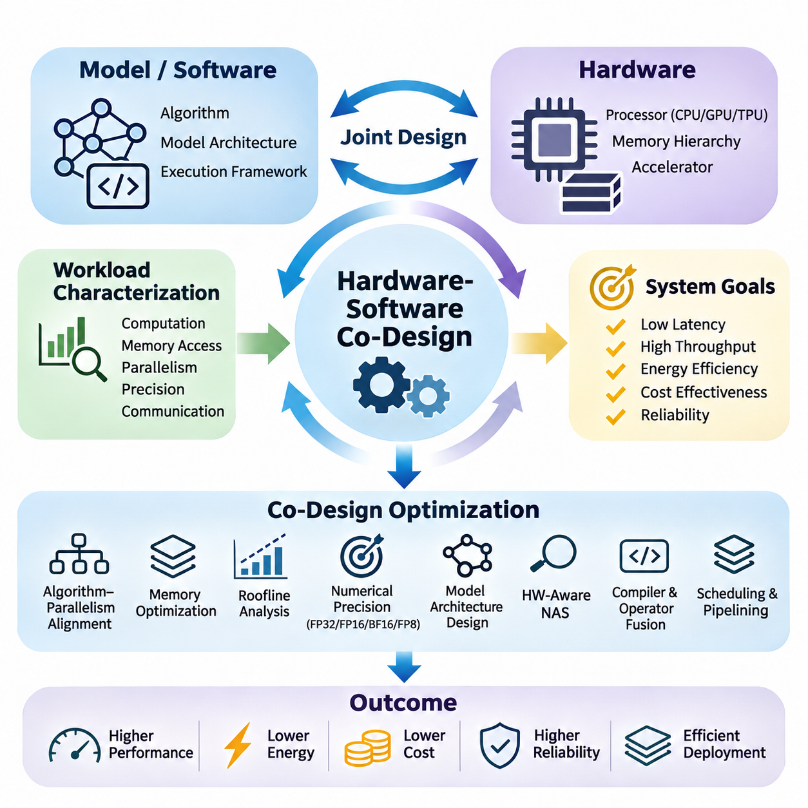
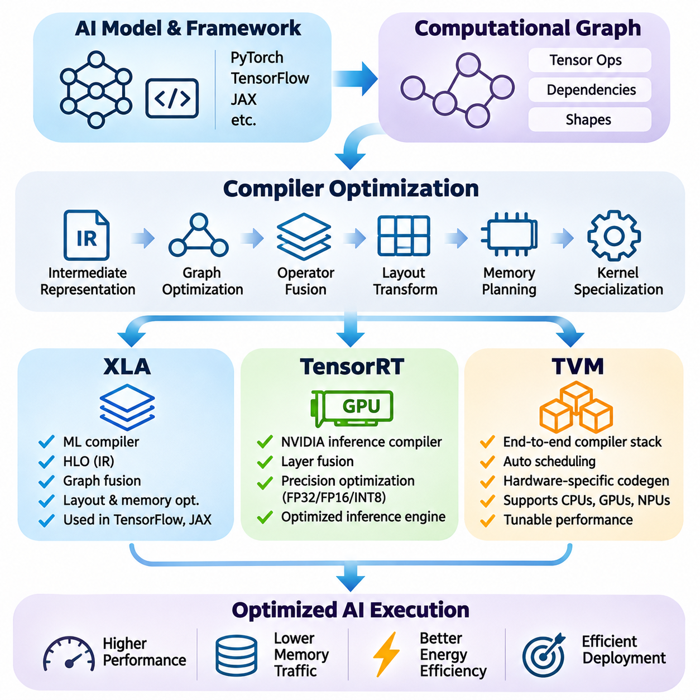
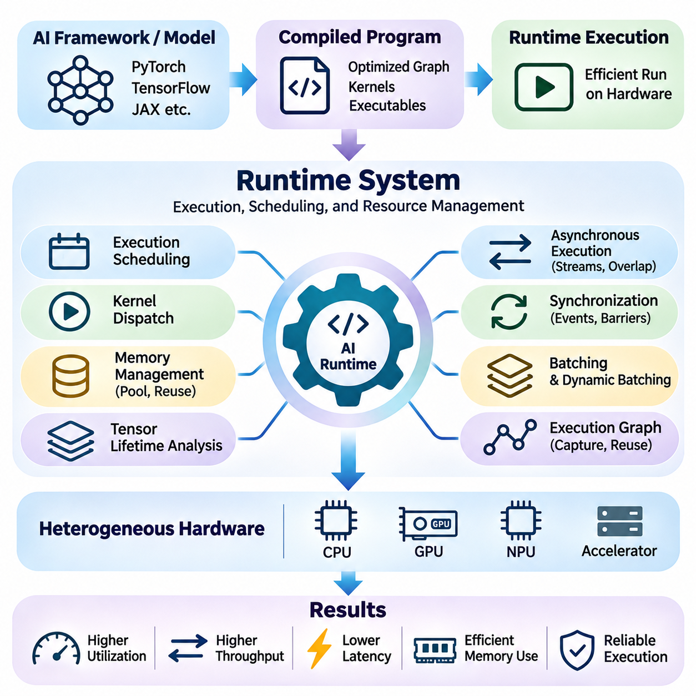
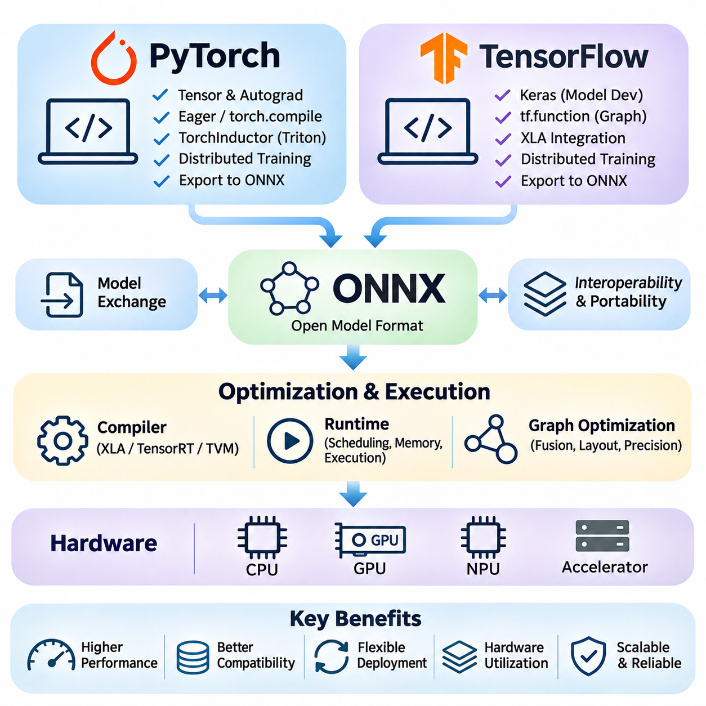
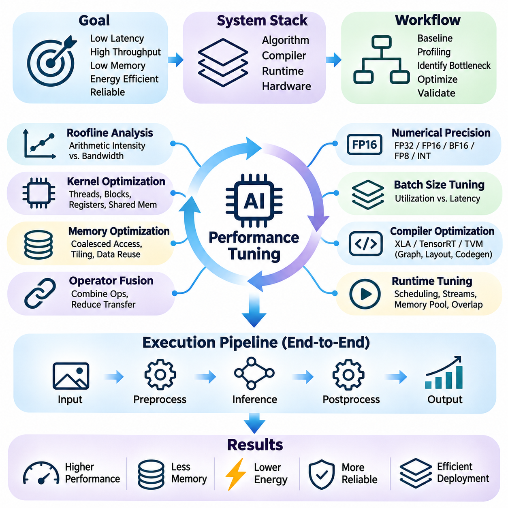
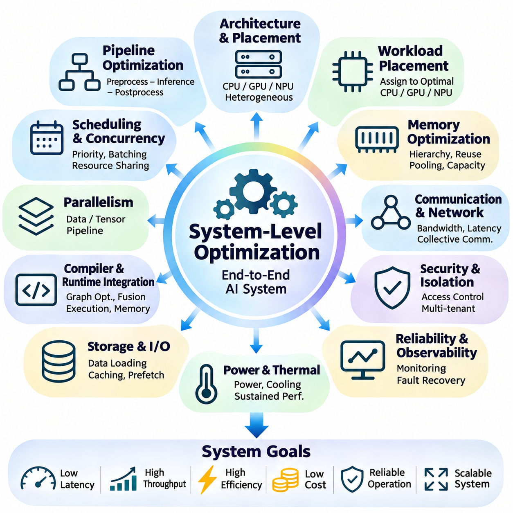

**Volume 39. Hardware for AI**


# 07. Hardware Software Co Design

## 07.01 Co Design Principles

{width="7.268055555555556in" height="7.268055555555556in"}

Hardware-software co-design is a systematic engineering approach in which computational hardware and software algorithms are developed together rather than optimized independently. In artificial intelligence systems, this approach aligns model architectures, processing units, memory hierarchies, and execution frameworks to achieve efficient performance under practical constraints involving latency, throughput, energy consumption, cost, and reliability.

Traditional system development often treats hardware as a fixed execution platform while software developers concentrate on algorithmic improvements. However, modern AI workloads exhibit complex computational patterns that strongly depend on hardware characteristics. Hardware-software co-design addresses this limitation by allowing architectural decisions and algorithmic requirements to influence each other throughout the development lifecycle.

The fundamental principle of co-design is that overall system efficiency cannot be determined by computational capability alone. A processor may provide high theoretical arithmetic throughput while delivering poor application performance because of memory bandwidth limitations, synchronization overhead, or inefficient data movement. Effective co-design therefore evaluates the complete execution path rather than isolated hardware specifications.

Workload characterization provides the foundation for hardware-software co-design. Engineers examine computational intensity, tensor dimensions, memory access patterns, parallelism, numerical precision, and communication requirements. These characteristics determine whether a workload benefits primarily from general-purpose processors, graphics processing units, tensor accelerators, or specialized hardware designed for particular mathematical operations.

An important design consideration is the relationship between algorithm structure and hardware parallelism. Neural networks contain operations with different opportunities for concurrent execution, including matrix multiplication, convolution, attention, normalization, and elementwise transformations. Co-design attempts to organize these operations so that their execution patterns correspond closely to the parallel processing capabilities of the selected hardware.

Memory architecture plays a central role because data movement frequently consumes substantial execution time and energy. Modern accelerators employ registers, caches, shared memory, high-bandwidth memory, and external storage to support different access requirements. Co-design strategies improve data locality, maximize reuse, and reduce unnecessary transfers between memory levels, allowing computational units to remain productive.

The roofline model provides a useful analytical framework for understanding the interaction between arithmetic performance and memory bandwidth. It relates attainable computational throughput to operational intensity, defined as the number of arithmetic operations performed per byte of data transferred. This relationship helps engineers determine whether optimization should emphasize additional parallel computation or improved memory utilization.

Numerical precision represents another major opportunity for coordinated optimization. AI workloads may use FP32, FP16, BF16, FP8, or integer representations depending on accuracy requirements and hardware support. Lower-precision computation can reduce memory traffic and increase arithmetic throughput, but its practical effectiveness depends on numerical stability, quantization behavior, and the precision capabilities of individual accelerator architectures.

Model architecture itself can be adapted to match hardware characteristics. Channel dimensions, attention head configurations, tensor shapes, and layer structures influence accelerator utilization. Dimensions aligned with hardware execution units may improve throughput, while irregular tensor sizes can introduce padding or inefficient execution. Such considerations encourage hardware-aware neural architecture design rather than relying exclusively on theoretical model complexity.

Hardware-aware neural architecture search extends this principle by incorporating deployment constraints into automated model selection. Instead of optimizing predictive accuracy alone, the search process evaluates latency, energy consumption, memory footprint, and hardware compatibility. The resulting architectures seek favorable tradeoffs between model quality and implementation efficiency on a specified computational platform.

Compiler technology connects high-level AI models with low-level hardware execution. Computational graphs must be transformed into efficient instructions, kernels, and memory operations. Graph optimization, operator fusion, layout transformation, and instruction scheduling help exploit accelerator capabilities. Consequently, co-design requires awareness of how compiler transformations influence the relationship between model structure and actual hardware behavior.

Operator fusion illustrates the benefits of coordinated software and hardware optimization. When multiple operations execute separately, intermediate tensors may require repeated memory reads and writes. Combining compatible operations into a single kernel can reduce memory traffic and launch overhead. However, fusion must consider register pressure, shared memory capacity, and occupancy because excessive fusion can sometimes reduce execution efficiency.

Scheduling and pipelining are equally important for improving system utilization. AI execution frequently involves overlapping data transfers, preprocessing, computation, and output processing. Carefully designed pipelines can hide communication latency and reduce processor idle time. Their effectiveness depends on hardware concurrency mechanisms, software scheduling policies, buffer availability, and dependencies between successive computational stages.

Runtime systems introduce another layer of interaction between hardware and software. Memory allocation, kernel dispatch, stream management, batching, and resource scheduling affect practical performance. A runtime optimized for a specific accelerator can reduce overhead and improve execution predictability. Co-design therefore extends beyond model compilation to include the mechanisms responsible for executing workloads under changing operating conditions.

Energy efficiency must be considered alongside computational performance, particularly in embedded and edge AI systems. Processor frequency, voltage, memory activity, and accelerator utilization influence total power consumption. Dynamic voltage and frequency scaling can reduce energy demand, although aggressive power reduction may increase latency. Co-design seeks operating configurations that satisfy application deadlines while respecting available power budgets.

Thermal behavior also creates dependencies between hardware configuration and software execution. Sustained AI workloads generate heat that can trigger frequency throttling and reduce long-term throughput. Software scheduling, workload distribution, and precision selection can influence thermal conditions. Effective co-design considers sustained operating performance rather than relying exclusively on short-duration benchmark measurements.

Real-time AI applications introduce additional requirements involving deterministic execution and bounded response times. Autonomous robots, industrial inspection systems, and embedded controllers must process information within specified deadlines. Hardware selection and software scheduling must account for worst-case latency, sensor synchronization, communication delays, and competing computational tasks rather than average inference speed alone.

Scalability introduces further design challenges when AI workloads extend across multiple accelerators or computing nodes. Model partitioning, tensor parallelism, pipeline parallelism, and data parallelism create different communication patterns. Their effectiveness depends on interconnect bandwidth, synchronization costs, memory capacity, and collective communication support. Co-design aligns distributed execution strategies with the topology of the underlying computing infrastructure.

Hardware-software interfaces should provide sufficient abstraction without concealing critical performance characteristics. Frameworks and intermediate representations improve portability across accelerators, while specialized kernels expose architecture-specific capabilities. Effective co-design balances portability, maintainability, and optimization opportunities, recognizing that maximum performance on one platform may require implementation choices that limit compatibility with others.

A practical co-design methodology begins with measurable system objectives and representative workloads. Engineers establish baseline performance, identify bottlenecks through profiling, and evaluate alternative hardware and software configurations. Iterative experimentation reveals whether proposed changes improve the complete application. Measurements should include latency distributions, throughput, memory utilization, energy consumption, and numerical accuracy.

Design-space exploration formalizes the evaluation of competing configurations. Candidate systems may differ in processor architecture, memory capacity, numerical precision, model structure, batch size, and execution strategy. Because these variables interact, optimizing one dimension independently can produce misleading conclusions. Multi-objective evaluation identifies configurations that provide favorable compromises among performance, efficiency, cost, and operational constraints.

Performance portability is an important consideration when AI applications must support heterogeneous computing platforms. A model optimized for one GPU architecture may behave differently on a TPU, NPU, FPGA, or CPU. Co-design should distinguish architecture-independent algorithmic improvements from hardware-specific optimizations. This distinction supports maintainable software while preserving opportunities for specialized acceleration where justified.

Reliability and validation complete the co-design process. Numerical differences, memory limitations, concurrency defects, and thermal instability can produce failures that are not visible during isolated model testing. Validation must therefore include integrated workloads, realistic operating conditions, prolonged execution, and hardware-specific failure scenarios. Reproducible benchmarking ensures that performance improvements do not compromise correctness or operational stability.

Ultimately, hardware-software co-design treats artificial intelligence as an integrated computational system rather than a collection of independently optimized components. Its central objective is to coordinate algorithms, architectures, compilers, runtimes, and physical constraints throughout development. This integrated perspective enables AI systems to achieve stronger practical performance, greater energy efficiency, and more reliable deployment across diverse computing environments.

하드웨어-소프트웨어 공동설계(Hardware-Software Co-Design)는 컴퓨팅 하드웨어(Computing Hardware)와 소프트웨어 알고리즘(Software Algorithms)을 독립적으로 최적화하는 대신 함께 개발하는 체계적인 공학적 접근 방식이다. 인공지능(AI) 시스템에서 이러한 접근 방식은 모델 아키텍처(Model Architecture), 처리 장치(Processing Unit), 메모리 계층 구조(Memory Hierarchy), 실행 프레임워크(Execution Framework)를 정렬하여 지연시간(Latency), 처리량(Throughput), 에너지 소비(Energy Consumption), 비용(Cost), 신뢰성(Reliability) 등의 실제 제약 조건에서 효율적인 성능을 달성하도록 한다.

전통적인 시스템 개발(System Development)에서는 하드웨어를 고정된 실행 플랫폼(Execution Platform)으로 취급하고, 소프트웨어 개발자는 주로 알고리즘 개선(Algorithmic Improvement)에 집중한다. 그러나 현대 인공지능 작업부하(AI Workload)는 하드웨어 특성(Hardware Characteristics)에 크게 의존하는 복잡한 연산 패턴(Computational Pattern)을 나타낸다. 하드웨어-소프트웨어 공동설계는 아키텍처 결정(Architectural Decision)과 알고리즘 요구사항(Algorithmic Requirement)이 전체 개발 생명주기(Development Lifecycle)에 걸쳐 상호 영향을 미치도록 함으로써 이러한 한계를 해결한다.

공동설계(Co-Design)의 기본 원칙은 전체 시스템 효율성(System Efficiency)이 연산 능력(Computational Capability)만으로 결정되지 않는다는 것이다. 프로세서(Processor)는 높은 이론적 산술 처리량(Theoretical Arithmetic Throughput)을 제공하더라도 메모리 대역폭 제한(Memory Bandwidth Limitation), 동기화 오버헤드(Synchronization Overhead), 비효율적인 데이터 이동(Data Movement)으로 인해 실제 애플리케이션 성능(Application Performance)이 낮을 수 있다. 따라서 효과적인 공동설계는 개별 하드웨어 사양(Hardware Specification)이 아니라 전체 실행 경로(Execution Path)를 평가한다.

작업부하 특성 분석(Workload Characterization)은 하드웨어-소프트웨어 공동설계의 기초를 제공한다. 엔지니어는 연산 집약도(Computational Intensity), 텐서 차원(Tensor Dimension), 메모리 접근 패턴(Memory Access Pattern), 병렬성(Parallelism), 수치 정밀도(Numerical Precision), 통신 요구사항(Communication Requirement)을 분석한다. 이러한 특성은 작업부하가 범용 프로세서(General-Purpose Processor), 그래픽 처리 장치(GPU), 텐서 가속기(Tensor Accelerator), 특정 수학 연산을 위한 특수 하드웨어(Specialized Hardware) 중 어디에서 가장 큰 이점을 얻는지 결정한다.

중요한 설계 고려사항(Design Consideration)은 알고리즘 구조(Algorithm Structure)와 하드웨어 병렬성(Hardware Parallelism) 사이의 관계이다. 신경망(Neural Network)은 행렬 곱셈(Matrix Multiplication), 합성곱(Convolution), 어텐션(Attention), 정규화(Normalization), 원소별 연산(Elementwise Operation)처럼 서로 다른 병렬 실행 가능성을 가진 연산을 포함한다. 공동설계는 이러한 연산의 실행 패턴(Execution Pattern)이 선택된 하드웨어의 병렬 처리 능력(Parallel Processing Capability)에 최대한 부합하도록 구성한다.

메모리 아키텍처(Memory Architecture)는 데이터 이동(Data Movement)이 상당한 실행시간(Execution Time)과 에너지(Energy)를 소비하는 경우가 많기 때문에 핵심적인 역할을 한다. 현대 가속기(Accelerator)는 레지스터(Register), 캐시(Cache), 공유 메모리(Shared Memory), 고대역폭 메모리(High-Bandwidth Memory), 외부 저장장치(External Storage)를 활용하여 다양한 접근 요구사항을 지원한다. 공동설계 전략은 데이터 지역성(Data Locality)을 개선하고 재사용(Data Reuse)을 극대화하며 메모리 계층 간 불필요한 전송을 줄여 연산 장치의 활용도를 높인다.

루프라인 모델(Roofline Model)은 산술 성능(Arithmetic Performance)과 메모리 대역폭(Memory Bandwidth)의 상호작용을 이해하기 위한 유용한 분석 프레임워크(Analytical Framework)를 제공한다. 이 모델은 달성 가능한 연산 처리량(Attainable Computational Throughput)을 데이터 전송 바이트당 산술 연산 수로 정의되는 연산 집약도(Operational Intensity)와 연결한다. 이러한 관계는 최적화가 추가적인 병렬 연산(Parallel Computation)에 집중해야 하는지, 메모리 활용도(Memory Utilization) 개선에 집중해야 하는지 판단하는 데 도움이 된다.

수치 정밀도(Numerical Precision)는 조정된 최적화(Coordinated Optimization)를 위한 또 다른 중요한 기회를 제공한다. 인공지능 작업부하는 정확도 요구사항(Accuracy Requirement)과 하드웨어 지원(Hardware Support)에 따라 FP32, FP16, BF16, FP8 또는 정수 표현(Integer Representation)을 사용할 수 있다. 저정밀도 연산(Low-Precision Computation)은 메모리 트래픽(Memory Traffic)을 줄이고 산술 처리량(Arithmetic Throughput)을 증가시킬 수 있지만, 실제 효과는 수치 안정성(Numerical Stability), 양자화 동작(Quantization Behavior), 개별 가속기 아키텍처의 정밀도 처리 능력에 따라 달라진다.

모델 아키텍처(Model Architecture) 자체도 하드웨어 특성(Hardware Characteristics)에 맞게 조정할 수 있다. 채널 차원(Channel Dimension), 어텐션 헤드 구성(Attention Head Configuration), 텐서 형상(Tensor Shape), 계층 구조(Layer Structure)는 가속기 활용도(Accelerator Utilization)에 영향을 준다. 하드웨어 실행 장치(Hardware Execution Unit)에 정렬된 차원은 처리량을 개선할 수 있지만, 불규칙한 텐서 크기는 패딩(Padding)이나 비효율적인 실행을 유발할 수 있다. 이러한 고려사항은 이론적인 모델 복잡도(Model Complexity)에만 의존하지 않는 하드웨어 인식 신경망 아키텍처 설계(Hardware-Aware Neural Architecture Design)를 촉진한다.

하드웨어 인식 신경망 아키텍처 탐색(Hardware-Aware Neural Architecture Search)은 배포 제약 조건(Deployment Constraints)을 자동화된 모델 선택(Model Selection)에 포함함으로써 이러한 원칙을 확장한다. 예측 정확도(Predictive Accuracy)만 최적화하는 대신 탐색 과정(Search Process)에서 지연시간(Latency), 에너지 소비(Energy Consumption), 메모리 사용량(Memory Footprint), 하드웨어 호환성(Hardware Compatibility)을 평가한다. 결과적으로 특정 컴퓨팅 플랫폼(Computing Platform)에서 모델 품질(Model Quality)과 구현 효율성(Implementation Efficiency) 사이의 유리한 절충안을 찾는다.

컴파일러 기술(Compiler Technology)은 고수준 인공지능 모델(High-Level AI Model)과 저수준 하드웨어 실행(Low-Level Hardware Execution)을 연결한다. 계산 그래프(Computational Graph)는 효율적인 명령어(Instruction), 커널(Kernel), 메모리 연산(Memory Operation)으로 변환되어야 한다. 그래프 최적화(Graph Optimization), 연산자 융합(Operator Fusion), 데이터 배치 변환(Layout Transformation), 명령어 스케줄링(Instruction Scheduling)은 가속기 기능을 활용하도록 돕는다. 따라서 공동설계에서는 컴파일러 변환(Compiler Transformation)이 모델 구조와 실제 하드웨어 동작의 관계에 미치는 영향을 이해해야 한다.

연산자 융합(Operator Fusion)은 소프트웨어와 하드웨어의 조정된 최적화가 제공하는 이점을 보여준다. 여러 연산이 개별적으로 실행되면 중간 텐서(Intermediate Tensor)에 대해 반복적인 메모리 읽기와 쓰기가 필요할 수 있다. 호환 가능한 연산을 하나의 커널(Kernel)로 결합하면 메모리 트래픽(Memory Traffic)과 커널 실행 오버헤드(Kernel Launch Overhead)를 줄일 수 있다. 그러나 과도한 융합은 레지스터 압박(Register Pressure), 공유 메모리 용량(Shared Memory Capacity), 점유율(Occupancy)에 영향을 주어 오히려 실행 효율성을 낮출 수 있다.

스케줄링(Scheduling)과 파이프라이닝(Pipelining) 역시 시스템 활용도(System Utilization)를 개선하는 데 중요하다. 인공지능 실행 과정에서는 데이터 전송(Data Transfer), 전처리(Preprocessing), 연산(Computation), 출력 처리(Output Processing)를 중첩하여 수행하는 경우가 많다. 신중하게 설계된 파이프라인(Pipeline)은 통신 지연시간(Communication Latency)을 숨기고 프로세서 유휴시간(Processor Idle Time)을 줄일 수 있다. 이러한 효과는 하드웨어 동시성 메커니즘(Hardware Concurrency Mechanism), 소프트웨어 스케줄링 정책(Software Scheduling Policy), 버퍼 가용성(Buffer Availability), 연속적인 연산 단계 간 의존성(Dependency)에 따라 달라진다.

런타임 시스템(Runtime System)은 하드웨어와 소프트웨어 사이에 또 다른 상호작용 계층(Interaction Layer)을 형성한다. 메모리 할당(Memory Allocation), 커널 디스패치(Kernel Dispatch), 스트림 관리(Stream Management), 배치 처리(Batching), 자원 스케줄링(Resource Scheduling)은 실제 성능에 영향을 미친다. 특정 가속기에 최적화된 런타임(Runtime)은 오버헤드(Overhead)를 줄이고 실행 예측 가능성(Execution Predictability)을 개선할 수 있다. 따라서 공동설계는 모델 컴파일(Model Compilation)을 넘어 변화하는 운영 조건에서 작업부하를 실행하는 메커니즘까지 포함한다.

에너지 효율성(Energy Efficiency)은 특히 임베디드 및 엣지 인공지능 시스템(Embedded and Edge AI System)에서 연산 성능과 함께 고려해야 한다. 프로세서 주파수(Processor Frequency), 전압(Voltage), 메모리 활동(Memory Activity), 가속기 활용도(Accelerator Utilization)는 전체 전력 소비(Total Power Consumption)에 영향을 준다. 동적 전압 및 주파수 조절(Dynamic Voltage and Frequency Scaling)은 에너지 요구량을 줄일 수 있지만, 지나친 전력 절감은 지연시간을 증가시킬 수 있다. 공동설계는 사용 가능한 전력 예산(Power Budget)을 준수하면서 애플리케이션의 처리 기한(Application Deadline)을 만족하는 동작 구성을 추구한다.

열적 특성(Thermal Behavior) 역시 하드웨어 구성(Hardware Configuration)과 소프트웨어 실행(Software Execution) 사이에 의존성을 형성한다. 지속적인 인공지능 작업부하는 열을 발생시켜 주파수 스로틀링(Frequency Throttling)을 유발하고 장기적인 처리량을 감소시킬 수 있다. 소프트웨어 스케줄링(Software Scheduling), 작업부하 분산(Workload Distribution), 정밀도 선택(Precision Selection)은 열적 조건에 영향을 미친다. 효과적인 공동설계는 짧은 시간 동안 측정한 벤치마크(Benchmark) 결과에만 의존하지 않고 지속 운용 성능(Sustained Operating Performance)을 고려한다.

실시간 인공지능 애플리케이션(Real-Time AI Application)은 결정적 실행(Deterministic Execution)과 제한된 응답시간(Bounded Response Time)에 관한 추가 요구사항을 가진다. 자율 로봇(Autonomous Robot), 산업 검사 시스템(Industrial Inspection System), 임베디드 제어기(Embedded Controller)는 지정된 마감시간(Deadline) 내에 정보를 처리해야 한다. 하드웨어 선택과 소프트웨어 스케줄링은 평균 추론 속도(Average Inference Speed)뿐 아니라 최악의 경우 지연시간(Worst-Case Latency), 센서 동기화(Sensor Synchronization), 통신 지연(Communication Delay), 경쟁하는 연산 작업(Competing Computational Task)을 고려해야 한다.

확장성(Scalability)은 인공지능 작업부하가 여러 가속기(Accelerator)나 컴퓨팅 노드(Computing Node)로 확장될 때 추가적인 설계 과제를 제시한다. 모델 분할(Model Partitioning), 텐서 병렬성(Tensor Parallelism), 파이프라인 병렬성(Pipeline Parallelism), 데이터 병렬성(Data Parallelism)은 서로 다른 통신 패턴(Communication Pattern)을 생성한다. 이러한 방식의 효율성은 상호연결 대역폭(Interconnect Bandwidth), 동기화 비용(Synchronization Cost), 메모리 용량(Memory Capacity), 집합 통신 지원(Collective Communication Support)에 따라 달라진다. 공동설계는 분산 실행 전략(Distributed Execution Strategy)을 기반 컴퓨팅 인프라의 토폴로지(Topology)에 맞게 정렬한다.

하드웨어-소프트웨어 인터페이스(Hardware-Software Interface)는 중요한 성능 특성(Performance Characteristic)을 숨기지 않으면서 충분한 추상화(Abstraction)를 제공해야 한다. 프레임워크(Framework)와 중간 표현(Intermediate Representation)은 여러 가속기 간 이식성(Portability)을 개선하며, 특수 커널(Specialized Kernel)은 아키텍처별 기능(Architecture-Specific Capability)을 활용한다. 효과적인 공동설계는 이식성, 유지보수성(Maintainability), 최적화 기회(Optimization Opportunity) 사이에서 균형을 유지하며, 특정 플랫폼에서 최대 성능을 얻기 위한 구현 선택이 다른 플랫폼과의 호환성을 제한할 수 있음을 인식한다.

실용적인 공동설계 방법론(Co-Design Methodology)은 측정 가능한 시스템 목표(System Objective)와 대표적인 작업부하(Representative Workload)를 정의하는 것에서 시작한다. 엔지니어는 기준 성능(Baseline Performance)을 설정하고 프로파일링(Profiling)을 통해 병목현상(Bottleneck)을 식별하며 대체 하드웨어 및 소프트웨어 구성(Alternative Configuration)을 평가한다. 반복적인 실험(Iterative Experimentation)은 제안된 변경이 전체 애플리케이션을 개선하는지 확인한다. 측정 항목에는 지연시간 분포(Latency Distribution), 처리량(Throughput), 메모리 활용도(Memory Utilization), 에너지 소비(Energy Consumption), 수치 정확도(Numerical Accuracy)가 포함되어야 한다.

설계 공간 탐색(Design-Space Exploration)은 경쟁하는 여러 구성(Configuration)을 체계적으로 평가하는 과정을 의미한다. 후보 시스템(Candidate System)은 프로세서 아키텍처(Processor Architecture), 메모리 용량(Memory Capacity), 수치 정밀도(Numerical Precision), 모델 구조(Model Structure), 배치 크기(Batch Size), 실행 전략(Execution Strategy)에서 차이를 보일 수 있다. 이러한 변수들은 서로 영향을 미치므로 한 가지 요소만 독립적으로 최적화하면 잘못된 결론에 도달할 수 있다. 다목적 평가(Multi-Objective Evaluation)는 성능, 효율성, 비용, 운영 제약 조건 사이에서 유리한 절충안을 제공하는 구성을 식별한다.

성능 이식성(Performance Portability)은 인공지능 애플리케이션이 이기종 컴퓨팅 플랫폼(Heterogeneous Computing Platform)을 지원해야 할 때 중요한 고려사항이다. 특정 GPU 아키텍처에 최적화된 모델은 TPU, NPU, FPGA 또는 CPU에서 서로 다르게 동작할 수 있다. 공동설계는 아키텍처 독립적인 알고리즘 개선(Architecture-Independent Algorithmic Improvement)과 하드웨어 특화 최적화(Hardware-Specific Optimization)를 구분해야 한다. 이러한 구분은 유지보수 가능한 소프트웨어(Maintainable Software)를 지원하면서 필요한 경우 특수 가속(Specialized Acceleration)을 활용할 수 있도록 한다.

신뢰성(Reliability)과 검증(Validation)은 공동설계 과정을 완성하는 핵심 요소이다. 수치적 차이(Numerical Difference), 메모리 제한(Memory Limitation), 동시성 결함(Concurrency Defect), 열적 불안정성(Thermal Instability)은 개별 모델 테스트(Model Testing)에서는 드러나지 않는 장애를 유발할 수 있다. 따라서 검증에는 통합 작업부하(Integrated Workload), 현실적인 운영 조건(Realistic Operating Condition), 장시간 실행(Prolonged Execution), 하드웨어별 장애 시나리오(Hardware-Specific Failure Scenario)가 포함되어야 한다. 재현 가능한 벤치마킹(Reproducible Benchmarking)은 성능 개선이 정확성(Correctness)이나 운영 안정성(Operational Stability)을 저해하지 않도록 보장한다.

궁극적으로 하드웨어-소프트웨어 공동설계(Hardware-Software Co-Design)는 인공지능을 독립적으로 최적화된 구성요소의 집합이 아니라 통합된 컴퓨팅 시스템(Integrated Computational System)으로 취급한다. 핵심 목표는 개발 전 과정에서 알고리즘(Algorithm), 아키텍처(Architecture), 컴파일러(Compiler), 런타임(Runtime), 물리적 제약 조건(Physical Constraint)을 조정하는 것이다. 이러한 통합적 관점(Integrated Perspective)은 다양한 컴퓨팅 환경(Computing Environment)에서 인공지능 시스템이 더 높은 실제 성능(Practical Performance), 향상된 에너지 효율성(Energy Efficiency), 안정적인 배포(Reliable Deployment)를 달성하도록 한다.

## 07.02 Compiler Optimization

{width="7.268055555555556in" height="7.268055555555556in"}

Compiler optimization is a fundamental component of hardware-software co-design that transforms high-level artificial intelligence models into efficient hardware-executable programs. Modern AI frameworks express computation through tensor operations and computational graphs, but these representations do not directly reflect accelerator capabilities. AI compilers bridge this gap by optimizing execution graphs, memory access, instruction scheduling, and hardware-specific kernel generation.

The primary objective of AI compiler optimization is to improve computational efficiency without changing the intended mathematical behavior of a model beyond permitted numerical tolerances. Optimization techniques include constant folding, dead code elimination, operator fusion, layout transformation, memory planning, and kernel specialization. These transformations reduce execution overhead and improve hardware utilization across training and inference workloads.

Intermediate representations provide the foundation for modern compiler architectures. An intermediate representation captures computational operations, tensor shapes, dependencies, and execution semantics in a form suitable for analysis and transformation. Multiple abstraction levels allow compilers to perform graph-level optimization before generating lower-level instructions. This separation improves portability while enabling specialized optimization for different hardware platforms.

Graph optimization identifies opportunities to simplify computation and reduce unnecessary operations. Constant expressions can be evaluated during compilation, redundant operations can be eliminated, and compatible operators can be combined. These transformations reduce runtime overhead and intermediate memory traffic. Their effectiveness depends on tensor shapes, operator dependencies, numerical precision, and the execution characteristics of the target accelerator.

Operator fusion is particularly important for neural network execution because intermediate tensors frequently move between memory and computational units. Combining operations such as matrix multiplication, bias addition, and activation can eliminate intermediate memory transfers. Fusion may also reduce kernel launch overhead. However, excessive fusion can increase register pressure, reduce occupancy, and create kernels that perform worse than separate operations.

XLA, originally known as Accelerated Linear Algebra, is a compiler infrastructure designed to optimize machine learning computations for different hardware backends. It transforms high-level tensor computations into optimized executable programs through graph analysis, operation fusion, and backend-specific code generation. XLA is closely associated with TensorFlow and JAX, where compilation can improve execution efficiency by optimizing groups of operations together.

XLA represents computations through High Level Optimizer, or HLO, an intermediate representation that describes tensor operations and their dependencies. HLO enables compiler passes to analyze computational graphs, simplify expressions, eliminate redundant operations, and transform execution patterns. The compiler progressively lowers these representations into forms suitable for hardware-specific execution, including optimized CPU and accelerator implementations.

A major advantage of XLA is its ability to optimize computations across boundaries that might otherwise be executed as separate framework operations. By analyzing complete computational regions, XLA can identify fusion opportunities and reduce unnecessary intermediate tensors. These transformations are particularly valuable for workloads containing repeated elementwise operations, normalization, reductions, and compatible tensor transformations.

XLA also performs layout assignment and memory-related optimization to improve data access efficiency. Tensor layouts determine how multidimensional values are represented in physical memory, influencing coalesced access, cache utilization, and vectorized execution. The compiler selects or transforms layouts according to backend requirements. Effective layout management can significantly influence performance even when the mathematical operations remain unchanged.

In JAX, just-in-time compilation allows compatible Python-defined numerical functions to be traced and compiled through the XLA compilation infrastructure. This approach can reduce interpreter and dispatch overhead while enabling graph-level optimization. However, compilation introduces startup costs, and changes in shapes or compilation parameters may trigger additional compilation. Consequently, performance evaluation should distinguish compilation time from steady-state execution.

TensorRT is an NVIDIA inference optimization framework designed to accelerate trained neural networks on supported NVIDIA GPUs and related computing platforms. It transforms compatible model representations into optimized inference engines through layer fusion, precision selection, kernel optimization, and execution planning. Unlike general training frameworks, TensorRT primarily targets efficient deployment of inference workloads under specific hardware and runtime constraints.

TensorRT constructs optimized execution engines by analyzing network structure, tensor dimensions, supported operations, and available computational resources. Its builder evaluates implementation alternatives and selects execution strategies appropriate for the target device. The resulting engine contains optimized execution information that reduces runtime decision overhead and enables efficient utilization of supported GPU acceleration features.

Precision optimization is a central capability of TensorRT because modern NVIDIA accelerators support multiple numerical formats. Depending on hardware support and model compatibility, inference may use FP32, FP16, BF16, FP8, or INT8 execution paths. Lower precision can improve throughput and reduce memory requirements, but numerical behavior must be validated. Quantized inference may require calibration or quantization-aware preparation to preserve acceptable prediction accuracy.

TensorRT also supports dynamic tensor dimensions through optimization profiles that describe permitted input shape ranges. This capability is important for applications where batch size, image resolution, or sequence length changes during execution. Different shapes can require different kernels and memory configurations. Carefully selected optimization profiles help balance flexibility, engine size, memory consumption, and inference performance.

Kernel selection is another important aspect of TensorRT optimization. Multiple implementations may exist for convolution, matrix multiplication, attention, and related operations. Their performance depends on tensor dimensions, data layout, precision, workspace availability, and accelerator architecture. TensorRT evaluates supported implementation choices during engine construction, allowing execution strategies to be adapted to the target hardware.

TensorRT deployment commonly involves exporting models from frameworks such as PyTorch or TensorFlow through supported conversion paths, including ONNX. The exported graph is parsed, optimized, and compiled into an inference engine. Unsupported operators may require plugins or graph modifications. Model conversion must preserve numerical correctness, tensor semantics, and expected input-output behavior throughout the deployment pipeline.

TVM is an open-source machine learning compiler framework designed to optimize tensor computations across heterogeneous hardware platforms. Its architecture supports graph-level transformations, tensor-level scheduling, and target-specific code generation. Unlike solutions focused primarily on one hardware ecosystem, TVM emphasizes flexible compilation strategies for CPUs, GPUs, and specialized accelerators, making it relevant to portable AI deployment.

TVM employs intermediate representations that separate high-level computational structure from lower-level implementation details. Relax provides a representation for graph-oriented tensor programs, while TensorIR expresses tensor computations and scheduling transformations. This separation allows optimization at multiple levels, including graph rewriting, loop transformation, memory allocation, and hardware-specific execution planning.

Tensor scheduling is a defining capability of TVM because mathematical operations can be implemented through many different execution strategies. Loop tiling, reordering, fusion, vectorization, parallelization, and memory caching influence computational efficiency. TVM enables these transformations to be expressed and evaluated systematically, allowing implementations to exploit processor parallelism and memory hierarchy characteristics.

Automatic tuning extends TVM optimization by searching for efficient execution configurations. MetaSchedule can explore candidate scheduling transformations and evaluate their measured performance on target hardware. The search process considers execution time and implementation constraints rather than relying exclusively on manually selected schedules. This approach is useful when workload characteristics or accelerator architectures make optimal configurations difficult to predict.

TVM also supports hardware specialization through code generation and integration mechanisms for different execution environments. Developers can adapt compilation workflows to target processor instruction sets, GPU execution models, and accelerator-specific interfaces. However, practical performance depends on backend maturity, supported operators, available tuning infrastructure, and the quality of generated kernels for the selected platform.

XLA, TensorRT, and TVM address overlapping optimization challenges but emphasize different development priorities. XLA provides integrated compilation for supported machine learning frameworks, TensorRT specializes in NVIDIA inference acceleration, and TVM emphasizes customizable compilation across heterogeneous targets. Their suitability depends on framework integration, deployment hardware, workload characteristics, numerical requirements, and engineering resources.

Compiler selection should therefore begin with an analysis of the complete application rather than isolated benchmark results. Training workloads may benefit from graph compilation and operation fusion, while production inference may require specialized engines and predictable execution latency. Edge systems introduce additional memory, power, and thermal constraints. A compiler must be evaluated against these requirements using representative models and realistic operating conditions.

Compiler optimization also introduces engineering tradeoffs involving compilation time, binary size, portability, and maintenance. Aggressive specialization may improve execution speed but increase compilation overhead or reduce flexibility across input shapes. Hardware-specific optimizations can improve accelerator utilization while creating dependencies on particular runtime versions or architectures. Effective deployment requires balancing optimization gains against operational complexity.

Performance validation must measure the complete execution pipeline, including preprocessing, host-device transfers, kernel execution, synchronization, and postprocessing. Kernel-level acceleration does not necessarily translate into equivalent end-to-end improvements. Profiling tools help identify whether execution is limited by computation, memory bandwidth, launch overhead, or data movement. Numerical comparisons are equally necessary to detect changes introduced by precision reduction or graph transformations.

Ultimately, compiler optimization connects algorithmic representation with physical computing architecture. XLA, TensorRT, and TVM demonstrate how graph transformation, intermediate representations, scheduling, and hardware-aware code generation can improve AI execution. Their effective application requires coordinated decisions across model design, compiler configuration, runtime integration, and hardware selection to achieve reliable and efficient artificial intelligence systems.

컴파일러 최적화(Compiler Optimization)는 고수준 인공지능 모델(High-Level Artificial Intelligence Model)을 효율적인 하드웨어 실행 프로그램(Hardware-Executable Program)으로 변환하는 하드웨어-소프트웨어 공동설계(Hardware-Software Co-Design)의 핵심 구성요소이다. 현대 인공지능 프레임워크(AI Framework)는 텐서 연산(Tensor Operation)과 계산 그래프(Computational Graph)를 통해 연산을 표현하지만, 이러한 표현이 가속기(Accelerator)의 기능을 직접 반영하지는 않는다. 인공지능 컴파일러(AI Compiler)는 실행 그래프(Execution Graph), 메모리 접근(Memory Access), 명령어 스케줄링(Instruction Scheduling), 하드웨어 특화 커널 생성(Hardware-Specific Kernel Generation)을 최적화하여 이러한 차이를 연결한다.

인공지능 컴파일러 최적화(AI Compiler Optimization)의 주요 목표는 허용된 수치 오차(Numerical Tolerance) 범위를 벗어나 모델의 의도된 수학적 동작(Mathematical Behavior)을 변경하지 않으면서 연산 효율성(Computational Efficiency)을 개선하는 것이다. 최적화 기법에는 상수 접기(Constant Folding), 불필요 코드 제거(Dead Code Elimination), 연산자 융합(Operator Fusion), 데이터 배치 변환(Layout Transformation), 메모리 계획(Memory Planning), 커널 특수화(Kernel Specialization)가 포함된다. 이러한 변환은 실행 오버헤드(Execution Overhead)를 줄이고 학습(Training) 및 추론(Inference) 작업부하에서 하드웨어 활용도(Hardware Utilization)를 개선한다.

중간 표현(Intermediate Representation)은 현대 컴파일러 아키텍처(Compiler Architecture)의 기반을 제공한다. 중간 표현은 계산 연산(Computational Operation), 텐서 형상(Tensor Shape), 의존성(Dependency), 실행 의미론(Execution Semantics)을 분석과 변환에 적합한 형태로 표현한다. 여러 추상화 수준(Abstraction Level)을 사용하면 컴파일러가 저수준 명령어(Low-Level Instruction)를 생성하기 전에 그래프 수준 최적화(Graph-Level Optimization)를 수행할 수 있다. 이러한 분리는 이식성(Portability)을 개선하면서 다양한 하드웨어 플랫폼(Hardware Platform)에 대한 특화 최적화(Specialized Optimization)를 가능하게 한다.

그래프 최적화(Graph Optimization)는 연산을 단순화하고 불필요한 작업을 줄일 수 있는 기회를 식별한다. 상수 표현식(Constant Expression)은 컴파일 과정에서 계산할 수 있으며, 중복 연산(Redundant Operation)은 제거하고 호환 가능한 연산자(Compatible Operator)는 결합할 수 있다. 이러한 변환은 런타임 오버헤드(Runtime Overhead)와 중간 메모리 트래픽(Intermediate Memory Traffic)을 줄인다. 최적화 효과는 텐서 형상(Tensor Shape), 연산자 의존성(Operator Dependency), 수치 정밀도(Numerical Precision), 대상 가속기(Target Accelerator)의 실행 특성에 따라 달라진다.

연산자 융합(Operator Fusion)은 중간 텐서(Intermediate Tensor)가 메모리와 연산 장치(Computational Unit) 사이에서 자주 이동하기 때문에 신경망 실행(Neural Network Execution)에서 특히 중요하다. 행렬 곱셈(Matrix Multiplication), 편향 추가(Bias Addition), 활성화(Activation) 등의 연산을 결합하면 중간 메모리 전송(Intermediate Memory Transfer)을 제거할 수 있다. 융합은 커널 실행 오버헤드(Kernel Launch Overhead)도 줄일 수 있다. 그러나 과도한 융합은 레지스터 압박(Register Pressure)을 증가시키고 점유율(Occupancy)을 낮추어 개별 연산보다 성능이 떨어지는 커널을 생성할 수 있다.

XLA(Accelerated Linear Algebra)는 다양한 하드웨어 백엔드(Hardware Backend)에 맞춰 기계학습 연산(Machine Learning Computation)을 최적화하도록 설계된 컴파일러 인프라(Compiler Infrastructure)이다. XLA는 그래프 분석(Graph Analysis), 연산 융합(Operation Fusion), 백엔드별 코드 생성(Backend-Specific Code Generation)을 통해 고수준 텐서 연산(High-Level Tensor Computation)을 최적화된 실행 프로그램(Executable Program)으로 변환한다. XLA는 TensorFlow 및 JAX와 밀접하게 연관되어 있으며, 여러 연산을 함께 최적화하여 실행 효율성(Execution Efficiency)을 개선할 수 있다.

XLA는 텐서 연산(Tensor Operation)과 연산 간 의존성(Dependency)을 설명하는 중간 표현(Intermediate Representation)인 고수준 최적화 표현(HLO, High Level Optimizer)을 사용한다. HLO를 통해 컴파일러 패스(Compiler Pass)는 계산 그래프(Computational Graph)를 분석하고 표현식을 단순화하며 중복 연산을 제거하고 실행 패턴(Execution Pattern)을 변환할 수 있다. 컴파일러는 이러한 표현을 점진적으로 낮은 수준으로 변환하여 최적화된 CPU 및 가속기 구현(Accelerator Implementation)을 포함한 하드웨어별 실행에 적합한 형태로 만든다.

XLA의 주요 장점은 별도의 프레임워크 연산(Framework Operation)으로 실행될 수 있는 경계를 넘어 연산을 최적화할 수 있다는 것이다. XLA는 전체 계산 영역(Computational Region)을 분석하여 융합 기회(Fusion Opportunity)를 식별하고 불필요한 중간 텐서(Intermediate Tensor)를 줄일 수 있다. 이러한 변환은 반복적인 원소별 연산(Elementwise Operation), 정규화(Normalization), 축소 연산(Reduction), 호환 가능한 텐서 변환(Tensor Transformation)을 포함하는 작업부하에서 특히 유용하다.

XLA는 데이터 접근 효율성(Data Access Efficiency)을 개선하기 위해 데이터 배치 할당(Layout Assignment)과 메모리 관련 최적화(Memory-Related Optimization)도 수행한다. 텐서 배치(Tensor Layout)는 다차원 값(Multidimensional Value)이 물리적 메모리(Physical Memory)에 표현되는 방식을 결정하며, 병합 메모리 접근(Coalesced Access), 캐시 활용도(Cache Utilization), 벡터화 실행(Vectorized Execution)에 영향을 준다. 컴파일러는 백엔드 요구사항(Backend Requirement)에 따라 데이터 배치를 선택하거나 변환한다. 효과적인 데이터 배치 관리는 수학적 연산이 동일하게 유지되더라도 성능에 상당한 영향을 미칠 수 있다.

JAX에서는 적시 컴파일(Just-In-Time Compilation)을 통해 호환 가능한 Python 기반 수치 함수(Numerical Function)를 추적(Tracing)하고 XLA 컴파일 인프라를 통해 컴파일할 수 있다. 이러한 접근 방식은 인터프리터 오버헤드(Interpreter Overhead)와 디스패치 오버헤드(Dispatch Overhead)를 줄이면서 그래프 수준 최적화(Graph-Level Optimization)를 가능하게 한다. 그러나 컴파일은 초기 실행 비용(Startup Cost)을 발생시키며, 텐서 형상이나 컴파일 매개변수(Compilation Parameter)가 변경되면 추가 컴파일이 필요할 수 있다. 따라서 성능 평가에서는 컴파일 시간(Compilation Time)과 정상 상태 실행(Steady-State Execution)을 구분해야 한다.

TensorRT는 지원되는 NVIDIA GPU 및 관련 컴퓨팅 플랫폼(Computing Platform)에서 학습된 신경망(Trained Neural Network)의 실행을 가속하도록 설계된 NVIDIA 추론 최적화 프레임워크(Inference Optimization Framework)이다. TensorRT는 계층 융합(Layer Fusion), 정밀도 선택(Precision Selection), 커널 최적화(Kernel Optimization), 실행 계획(Execution Planning)을 통해 호환 가능한 모델 표현(Model Representation)을 최적화된 추론 엔진(Inference Engine)으로 변환한다. 일반적인 학습 프레임워크와 달리 TensorRT는 특정 하드웨어 및 런타임 제약 조건에서 효율적인 추론 배포(Inference Deployment)를 주요 목표로 한다.

TensorRT는 네트워크 구조(Network Structure), 텐서 차원(Tensor Dimension), 지원되는 연산(Supported Operation), 사용 가능한 연산 자원(Computational Resource)을 분석하여 최적화된 실행 엔진(Execution Engine)을 구성한다. 엔진 빌더(Engine Builder)는 여러 구현 대안(Implementation Alternative)을 평가하고 대상 장치(Target Device)에 적합한 실행 전략(Execution Strategy)을 선택한다. 생성된 엔진에는 최적화된 실행 정보(Optimized Execution Information)가 포함되어 런타임 의사결정 오버헤드(Runtime Decision Overhead)를 줄이고 지원되는 GPU 가속 기능을 효율적으로 활용할 수 있다.

정밀도 최적화(Precision Optimization)는 현대 NVIDIA 가속기(NVIDIA Accelerator)가 여러 수치 형식(Numerical Format)을 지원하기 때문에 TensorRT의 핵심 기능이다. 하드웨어 지원(Hardware Support)과 모델 호환성(Model Compatibility)에 따라 추론은 FP32, FP16, BF16, FP8 또는 INT8 실행 경로(Execution Path)를 사용할 수 있다. 낮은 정밀도(Lower Precision)는 처리량(Throughput)을 개선하고 메모리 요구량(Memory Requirement)을 줄일 수 있지만, 수치적 동작(Numerical Behavior)을 검증해야 한다. 양자화 추론(Quantized Inference)은 허용 가능한 예측 정확도(Prediction Accuracy)를 유지하기 위해 보정(Calibration)이나 양자화 인식 준비(Quantization-Aware Preparation)가 필요할 수 있다.

TensorRT는 허용 가능한 입력 형상 범위(Input Shape Range)를 정의하는 최적화 프로파일(Optimization Profile)을 통해 동적 텐서 차원(Dynamic Tensor Dimension)도 지원한다. 이러한 기능은 배치 크기(Batch Size), 이미지 해상도(Image Resolution), 시퀀스 길이(Sequence Length)가 실행 중 변경되는 애플리케이션에서 중요하다. 서로 다른 텐서 형상은 다른 커널(Kernel)과 메모리 구성(Memory Configuration)을 요구할 수 있다. 신중하게 선택한 최적화 프로파일은 유연성(Flexibility), 엔진 크기(Engine Size), 메모리 소비(Memory Consumption), 추론 성능(Inference Performance) 사이의 균형을 유지하는 데 도움이 된다.

커널 선택(Kernel Selection)은 TensorRT 최적화의 또 다른 중요한 요소이다. 합성곱(Convolution), 행렬 곱셈(Matrix Multiplication), 어텐션(Attention) 및 관련 연산에는 여러 구현 방식(Implementation)이 존재할 수 있다. 성능은 텐서 차원(Tensor Dimension), 데이터 배치(Data Layout), 정밀도(Precision), 작업공간 가용성(Workspace Availability), 가속기 아키텍처(Accelerator Architecture)에 따라 달라진다. TensorRT는 엔진 구성(Engine Construction) 과정에서 지원되는 구현 방식을 평가하여 실행 전략을 대상 하드웨어에 맞게 조정한다.

TensorRT 배포(Deployment)는 일반적으로 PyTorch 또는 TensorFlow와 같은 프레임워크에서 ONNX를 포함한 지원되는 변환 경로(Conversion Path)를 통해 모델을 내보내는 과정(Model Export)을 포함한다. 내보낸 그래프(Exported Graph)는 파싱(Parsing), 최적화(Optimization), 컴파일(Compilation)을 거쳐 추론 엔진(Inference Engine)으로 변환된다. 지원되지 않는 연산자(Unsupported Operator)는 플러그인(Plugin)이나 그래프 수정(Graph Modification)이 필요할 수 있다. 모델 변환(Model Conversion)은 전체 배포 파이프라인(Deployment Pipeline)에서 수치적 정확성(Numerical Correctness), 텐서 의미론(Tensor Semantics), 예상 입력 및 출력 동작(Input-Output Behavior)을 유지해야 한다.

TVM은 이기종 하드웨어 플랫폼(Heterogeneous Hardware Platform) 전반에서 텐서 연산(Tensor Computation)을 최적화하도록 설계된 오픈소스 기계학습 컴파일러 프레임워크(Open-Source Machine Learning Compiler Framework)이다. TVM의 아키텍처는 그래프 수준 변환(Graph-Level Transformation), 텐서 수준 스케줄링(Tensor-Level Scheduling), 대상별 코드 생성(Target-Specific Code Generation)을 지원한다. 특정 하드웨어 생태계에 주로 집중하는 솔루션과 달리 TVM은 CPU, GPU, 특수 가속기(Specialized Accelerator)를 위한 유연한 컴파일 전략(Compilation Strategy)을 강조하므로 이식 가능한 인공지능 배포(Portable AI Deployment)에 적합하다.

TVM은 고수준 계산 구조(High-Level Computational Structure)와 저수준 구현 세부사항(Low-Level Implementation Detail)을 분리하는 중간 표현(Intermediate Representation)을 사용한다. Relax는 그래프 중심 텐서 프로그램(Graph-Oriented Tensor Program)을 위한 표현을 제공하며, TensorIR은 텐서 연산(Tensor Computation)과 스케줄링 변환(Scheduling Transformation)을 표현한다. 이러한 분리는 그래프 재작성(Graph Rewriting), 반복문 변환(Loop Transformation), 메모리 할당(Memory Allocation), 하드웨어별 실행 계획(Hardware-Specific Execution Planning)을 포함한 여러 수준의 최적화를 가능하게 한다.

텐서 스케줄링(Tensor Scheduling)은 수학적 연산(Mathematical Operation)을 다양한 실행 전략(Execution Strategy)으로 구현할 수 있기 때문에 TVM의 핵심 기능이다. 반복문 타일링(Loop Tiling), 재정렬(Reordering), 융합(Fusion), 벡터화(Vectorization), 병렬화(Parallelization), 메모리 캐싱(Memory Caching)은 연산 효율성(Computational Efficiency)에 영향을 준다. TVM은 이러한 변환을 체계적으로 표현하고 평가할 수 있도록 하여 구현이 프로세서 병렬성(Processor Parallelism)과 메모리 계층 구조(Memory Hierarchy)의 특성을 활용하도록 한다.

자동 튜닝(Automatic Tuning)은 효율적인 실행 구성(Execution Configuration)을 탐색함으로써 TVM 최적화를 확장한다. MetaSchedule은 후보 스케줄링 변환(Candidate Scheduling Transformation)을 탐색하고 대상 하드웨어(Target Hardware)에서 측정한 성능을 평가할 수 있다. 탐색 과정(Search Process)은 수동으로 선택한 스케줄에만 의존하지 않고 실행시간(Execution Time)과 구현 제약 조건(Implementation Constraint)을 고려한다. 이러한 접근 방식은 작업부하 특성(Workload Characteristic)이나 가속기 아키텍처(Accelerator Architecture) 때문에 최적 구성을 예측하기 어려운 경우 유용하다.

TVM은 다양한 실행 환경(Execution Environment)을 위한 코드 생성(Code Generation)과 통합 메커니즘(Integration Mechanism)을 통해 하드웨어 특수화(Hardware Specialization)도 지원한다. 개발자는 프로세서 명령어 집합(Processor Instruction Set), GPU 실행 모델(GPU Execution Model), 가속기별 인터페이스(Accelerator-Specific Interface)에 맞게 컴파일 워크플로(Compilation Workflow)를 조정할 수 있다. 그러나 실제 성능은 백엔드 성숙도(Backend Maturity), 지원되는 연산자(Supported Operator), 사용 가능한 튜닝 인프라(Tuning Infrastructure), 선택된 플랫폼에서 생성된 커널의 품질(Kernel Quality)에 따라 달라진다.

XLA, TensorRT, TVM은 서로 겹치는 최적화 과제(Optimization Challenge)를 해결하지만 서로 다른 개발 우선순위(Development Priority)를 강조한다. XLA는 지원되는 기계학습 프레임워크(Machine Learning Framework)를 위한 통합 컴파일(Integrated Compilation)을 제공하고, TensorRT는 NVIDIA 추론 가속(NVIDIA Inference Acceleration)에 특화되어 있으며, TVM은 이기종 대상(Heterogeneous Target) 전반에 걸친 사용자 정의 가능한 컴파일(Customizable Compilation)을 강조한다. 적합성은 프레임워크 통합(Framework Integration), 배포 하드웨어(Deployment Hardware), 작업부하 특성(Workload Characteristic), 수치 요구사항(Numerical Requirement), 엔지니어링 자원(Engineering Resource)에 따라 달라진다.

따라서 컴파일러 선택(Compiler Selection)은 개별 벤치마크 결과(Isolated Benchmark Result)가 아니라 전체 애플리케이션(Complete Application)의 분석에서 시작해야 한다. 학습 작업부하(Training Workload)는 그래프 컴파일(Graph Compilation)과 연산 융합(Operation Fusion)의 이점을 얻을 수 있으며, 실제 운영 추론(Production Inference)은 특수 실행 엔진(Specialized Execution Engine)과 예측 가능한 실행 지연시간(Predictable Execution Latency)을 요구할 수 있다. 엣지 시스템(Edge System)은 메모리, 전력, 열적 제약 조건(Thermal Constraint)을 추가로 고려해야 한다. 컴파일러는 대표적인 모델(Representative Model)과 현실적인 운영 조건(Realistic Operating Condition)을 사용하여 이러한 요구사항에 따라 평가해야 한다.

컴파일러 최적화(Compiler Optimization)는 컴파일 시간(Compilation Time), 바이너리 크기(Binary Size), 이식성(Portability), 유지보수(Maintenance)와 관련된 엔지니어링 절충안(Engineering Tradeoff)도 발생시킨다. 공격적인 특수화(Aggressive Specialization)는 실행 속도(Execution Speed)를 개선할 수 있지만 컴파일 오버헤드(Compilation Overhead)를 증가시키거나 다양한 입력 형상(Input Shape)에 대한 유연성을 감소시킬 수 있다. 하드웨어 특화 최적화(Hardware-Specific Optimization)는 가속기 활용도(Accelerator Utilization)를 높이는 동시에 특정 런타임 버전(Runtime Version)이나 아키텍처(Architecture)에 대한 의존성을 만들 수 있다. 효과적인 배포를 위해서는 최적화 이점(Optimization Gain)과 운영 복잡성(Operational Complexity) 사이의 균형이 필요하다.

성능 검증(Performance Validation)은 전처리(Preprocessing), 호스트-장치 전송(Host-Device Transfer), 커널 실행(Kernel Execution), 동기화(Synchronization), 후처리(Postprocessing)를 포함한 전체 실행 파이프라인(Execution Pipeline)을 측정해야 한다. 커널 수준 가속(Kernel-Level Acceleration)이 반드시 동일한 수준의 종단 간 성능 개선(End-to-End Performance Improvement)으로 이어지는 것은 아니다. 프로파일링 도구(Profiling Tool)는 실행이 연산(Computation), 메모리 대역폭(Memory Bandwidth), 실행 오버헤드(Launch Overhead), 데이터 이동(Data Movement) 중 무엇에 의해 제한되는지 식별하는 데 도움이 된다. 정밀도 감소(Precision Reduction)나 그래프 변환(Graph Transformation)으로 발생하는 변화를 감지하기 위해 수치 비교(Numerical Comparison)도 필요하다.

궁극적으로 컴파일러 최적화(Compiler Optimization)는 알고리즘 표현(Algorithmic Representation)과 물리적 컴퓨팅 아키텍처(Physical Computing Architecture)를 연결한다. XLA, TensorRT, TVM은 그래프 변환(Graph Transformation), 중간 표현(Intermediate Representation), 스케줄링(Scheduling), 하드웨어 인식 코드 생성(Hardware-Aware Code Generation)이 인공지능 실행 효율성을 어떻게 개선할 수 있는지 보여준다. 이러한 기술을 효과적으로 적용하려면 모델 설계(Model Design), 컴파일러 구성(Compiler Configuration), 런타임 통합(Runtime Integration), 하드웨어 선택(Hardware Selection)에 걸친 조정된 의사결정(Coordinated Decision-Making)이 필요하며, 이를 통해 신뢰성과 효율성을 갖춘 인공지능 시스템(Reliable and Efficient AI System)을 구현할 수 있다.

## 07.03 Runtime Systems

{width="7.268055555555556in" height="7.268055555555556in"}

Runtime systems form the execution layer that connects compiled artificial intelligence models with physical computing hardware. While compilers transform computational graphs into optimized instructions, runtime systems manage how these instructions execute under actual operating conditions. They coordinate memory allocation, kernel dispatch, device communication, synchronization, and resource scheduling to deliver efficient and reliable AI computation.

An AI runtime system operates between application frameworks and hardware execution interfaces. It receives executable operations, manages their dependencies, and schedules them on available processing devices. This architecture separates model-level computation from low-level execution management. Runtime implementations may support CPUs, GPUs, NPUs, and specialized accelerators through device-specific backends and execution APIs.

Execution scheduling is a fundamental responsibility of runtime systems. Neural networks contain operations with dependencies that determine when each computation can begin. Runtime schedulers analyze these relationships and dispatch ready operations while preserving correctness. Efficient scheduling minimizes idle periods, reduces unnecessary synchronization, and improves the utilization of available computational resources.

Kernel dispatch determines how computational operations are submitted to hardware execution units. Each dispatch may introduce overhead associated with command preparation, driver interaction, and execution synchronization. For workloads containing many small operations, this overhead can become significant. Runtime optimization therefore attempts to reduce unnecessary launches, combine compatible operations, and maintain efficient execution queues.

Memory management is another critical runtime function because AI workloads frequently allocate large tensors and temporary buffers. Repeated allocation and deallocation can introduce latency, fragmentation, and synchronization overhead. Runtime memory pools reduce these costs by reusing previously allocated storage. Effective allocation strategies must account for tensor lifetimes, device capacity, alignment requirements, and concurrent execution.

Tensor lifetime analysis allows runtime systems to identify when intermediate data is no longer required. Memory regions associated with completed operations can be reused by subsequent computations when dependency and concurrency constraints permit. This approach reduces peak memory consumption without changing model semantics. Accurate lifetime tracking is particularly important for large neural networks operating under limited accelerator memory.

Asynchronous execution enables computation and data movement to proceed without requiring the host processor to wait after every operation. GPU runtimes commonly use execution streams and event mechanisms to coordinate concurrent activities. When dependencies allow, data transfers can overlap with kernel execution. Such overlap improves throughput, although incorrect synchronization can introduce race conditions or inconsistent results.

Synchronization ensures that operations observe valid data and execute in the required order. Runtime systems may use events, barriers, stream dependencies, and device synchronization primitives to enforce correctness. Excessive synchronization reduces parallelism and introduces unnecessary waiting. Insufficient synchronization can cause data hazards. Effective runtime design therefore balances execution concurrency with precise dependency management.

Batching is an important runtime strategy for improving accelerator utilization. Processing multiple inputs together can increase arithmetic intensity and amortize kernel launch overhead. However, larger batches require additional memory and may increase individual request latency. Runtime systems must select batching policies according to workload characteristics, throughput objectives, response deadlines, and available device resources.

Dynamic batching extends this concept by combining inference requests arriving at different times into shared execution batches. A runtime may briefly queue compatible requests before dispatching them together. This strategy is valuable for high-throughput inference services, but queueing introduces latency. Adaptive batching policies attempt to maximize hardware utilization while maintaining service-level latency requirements.

Runtime execution graphs provide another mechanism for reducing repeated scheduling overhead. When a workload follows a stable execution pattern, compatible operations and their dependencies can be captured or represented as a reusable graph. Subsequent executions can submit this graph with reduced host-side overhead. Graph-based execution is particularly effective for repetitive inference workloads with predictable computational structures.

Heterogeneous runtime systems coordinate computation across different processor types. A CPU may perform control logic and preprocessing while a GPU executes neural network operations and an NPU handles specialized inference tasks. Efficient coordination requires explicit device placement, memory transfer management, and dependency tracking. Poor partitioning can eliminate acceleration benefits through excessive communication overhead.

Data movement between host and accelerator memory is a major runtime performance consideration. Transfers through interfaces such as PCIe can introduce substantial latency and consume bandwidth. Runtime systems may use pinned host memory, asynchronous copies, buffer reuse, and overlapping execution to reduce transfer overhead. The optimal strategy depends on data size, transfer frequency, hardware topology, and memory accessibility.

Runtime resource scheduling becomes more complex when multiple models or applications share an accelerator. Concurrent workloads compete for computational units, memory bandwidth, cache capacity, and device memory. Runtime policies may prioritize latency-sensitive tasks, regulate concurrency, or isolate resource usage. Effective scheduling seeks predictable application performance while maintaining high aggregate hardware utilization.

Inference runtimes frequently support optimized execution engines generated by specialized compilers. TensorRT-based execution, ONNX Runtime, and other inference environments provide mechanisms for loading models, managing execution contexts, and dispatching optimized operators. Their performance depends on execution providers, supported kernels, memory management policies, and compatibility with the underlying accelerator architecture.

Training runtimes introduce additional responsibilities involving gradient computation, optimizer updates, and distributed synchronization. They coordinate forward execution, backward propagation, gradient accumulation, and parameter updates. In distributed environments, runtime systems also manage collective communication and device synchronization. These activities must be scheduled carefully to prevent communication overhead from dominating computational performance.

Distributed runtime systems coordinate workloads across multiple accelerators and computing nodes. They manage task placement, communication dependencies, collective operations, and execution progress. Network latency and interconnect bandwidth influence scheduling decisions. Overlapping communication with computation can improve efficiency, but distributed execution also requires mechanisms for detecting failures and recovering from interrupted operations.

Real-time AI runtime systems must satisfy timing constraints in addition to computational correctness. Autonomous robots, industrial controllers, and embedded perception systems require bounded response times for critical operations. Runtime scheduling must consider execution priorities, resource contention, memory allocation delays, and synchronization overhead. Predictable latency is often more important than maximum average throughput.

Power and thermal management influence runtime behavior in edge and embedded environments. Runtime systems may adjust execution frequency, workload placement, batching, or concurrency to operate within energy and temperature constraints. Sustained computational demand can trigger thermal throttling and reduce performance. Adaptive execution policies help maintain acceptable service quality under changing physical operating conditions.

Runtime observability provides the measurements necessary to understand execution behavior. Profiling and monitoring tools collect kernel execution times, memory consumption, queue delays, device utilization, and synchronization overhead. These measurements reveal bottlenecks that may not be visible from model-level benchmarks. Runtime telemetry also supports performance regression detection and capacity planning.

Fault handling is essential for reliable runtime operation. Device memory exhaustion, unsupported operations, execution timeouts, and hardware communication failures can interrupt AI workloads. Runtime systems should detect such conditions, report meaningful diagnostics, and apply appropriate recovery mechanisms. Depending on the application, recovery may involve restarting execution, releasing resources, or switching to a supported fallback path.

Runtime security becomes important when accelerators are shared across applications or users. Memory isolation, access control, resource ownership, and execution boundaries help prevent unintended interference. Model execution environments must also consider untrusted inputs and externally supplied computational graphs. Secure runtime design reduces the risk of unauthorized memory access, resource exhaustion, and execution instability.

Performance tuning requires evaluating runtime behavior under representative operating conditions. Engineers should measure end-to-end latency, throughput, memory utilization, synchronization costs, and resource contention. Warm-up behavior and initialization overhead should be distinguished from steady-state execution. Optimization decisions must consider realistic request patterns rather than relying exclusively on isolated kernel benchmarks.

Hardware-software co-design connects runtime architecture with compiler optimization and hardware capabilities. Compilers determine how operations are transformed, while runtimes determine when and where those operations execute. Hardware characteristics constrain memory allocation, concurrency, and communication. Coordinating these layers enables more efficient scheduling, reduced data movement, and improved utilization of specialized accelerators.

Ultimately, runtime systems transform optimized AI computations into dependable operational behavior. Their responsibilities extend beyond launching kernels to managing memory, concurrency, scheduling, communication, resource sharing, and fault recovery. Well-designed runtimes allow artificial intelligence applications to achieve high throughput, predictable latency, efficient energy usage, and reliable execution across diverse hardware environments.

런타임 시스템(Runtime Systems)은 컴파일된 인공지능 모델(Compiled Artificial Intelligence Model)을 물리적 컴퓨팅 하드웨어(Physical Computing Hardware)와 연결하는 실행 계층(Execution Layer)을 형성한다. 컴파일러(Compiler)가 계산 그래프(Computational Graph)를 최적화된 명령어(Optimized Instruction)로 변환하는 반면, 런타임 시스템은 실제 운영 조건에서 이러한 명령어가 실행되는 방식을 관리한다. 메모리 할당(Memory Allocation), 커널 디스패치(Kernel Dispatch), 장치 통신(Device Communication), 동기화(Synchronization), 자원 스케줄링(Resource Scheduling)을 조정하여 효율적이고 신뢰할 수 있는 인공지능 연산(AI Computation)을 제공한다.

인공지능 런타임 시스템(AI Runtime System)은 애플리케이션 프레임워크(Application Framework)와 하드웨어 실행 인터페이스(Hardware Execution Interface) 사이에서 동작한다. 실행 가능한 연산(Executable Operation)을 수신하고 연산 간 의존성(Dependency)을 관리하며 사용 가능한 처리 장치(Processing Device)에 작업을 스케줄링한다. 이러한 아키텍처(Architecture)는 모델 수준 연산(Model-Level Computation)과 저수준 실행 관리(Low-Level Execution Management)를 분리한다. 런타임 구현(Runtime Implementation)은 장치별 백엔드(Device-Specific Backend)와 실행 API(Execution API)를 통해 CPU, GPU, NPU 및 특수 가속기(Specialized Accelerator)를 지원할 수 있다.

실행 스케줄링(Execution Scheduling)은 런타임 시스템(Runtime System)의 기본적인 책임이다. 신경망(Neural Network)은 각 연산이 언제 시작될 수 있는지를 결정하는 의존성(Dependency)을 포함한다. 런타임 스케줄러(Runtime Scheduler)는 이러한 관계를 분석하고 정확성(Correctness)을 유지하면서 실행 가능한 연산을 디스패치(Dispatch)한다. 효율적인 스케줄링은 유휴시간(Idle Period)을 최소화하고 불필요한 동기화(Synchronization)를 줄이며 사용 가능한 연산 자원(Computational Resource)의 활용도를 높인다.

커널 디스패치(Kernel Dispatch)는 연산 작업(Computational Operation)이 하드웨어 실행 장치(Hardware Execution Unit)에 제출되는 방식을 결정한다. 각 디스패치에는 명령 준비(Command Preparation), 드라이버 상호작용(Driver Interaction), 실행 동기화(Execution Synchronization)와 관련된 오버헤드(Overhead)가 발생할 수 있다. 작은 연산이 많이 포함된 작업부하(Workload)에서는 이러한 오버헤드가 상당해질 수 있다. 따라서 런타임 최적화(Runtime Optimization)는 불필요한 커널 실행(Kernel Launch)을 줄이고 호환 가능한 연산을 결합하며 효율적인 실행 대기열(Execution Queue)을 유지하는 것을 목표로 한다.

메모리 관리(Memory Management)는 인공지능 작업부하(AI Workload)가 대형 텐서(Large Tensor)와 임시 버퍼(Temporary Buffer)를 자주 할당하기 때문에 또 다른 핵심 런타임 기능(Runtime Function)이다. 반복적인 메모리 할당 및 해제(Allocation and Deallocation)는 지연시간(Latency), 메모리 단편화(Fragmentation), 동기화 오버헤드(Synchronization Overhead)를 유발할 수 있다. 런타임 메모리 풀(Runtime Memory Pool)은 이전에 할당된 저장 공간(Storage)을 재사용하여 이러한 비용을 줄인다. 효과적인 할당 전략(Allocation Strategy)은 텐서 수명(Tensor Lifetime), 장치 용량(Device Capacity), 메모리 정렬 요구사항(Alignment Requirement), 동시 실행(Concurrent Execution)을 고려해야 한다.

텐서 수명 분석(Tensor Lifetime Analysis)을 통해 런타임 시스템(Runtime System)은 중간 데이터(Intermediate Data)가 더 이상 필요하지 않은 시점을 식별할 수 있다. 완료된 연산과 관련된 메모리 영역(Memory Region)은 의존성 및 동시성 제약 조건(Dependency and Concurrency Constraint)이 허용하는 경우 후속 연산에서 재사용할 수 있다. 이러한 접근 방식은 모델 의미론(Model Semantics)을 변경하지 않으면서 최대 메모리 소비량(Peak Memory Consumption)을 줄인다. 정확한 수명 추적(Lifetime Tracking)은 제한된 가속기 메모리(Accelerator Memory)에서 실행되는 대규모 신경망(Large Neural Network)에 특히 중요하다.

비동기 실행(Asynchronous Execution)은 호스트 프로세서(Host Processor)가 모든 연산이 완료될 때까지 기다리지 않고 연산과 데이터 이동(Data Movement)을 진행할 수 있도록 한다. GPU 런타임(GPU Runtime)은 일반적으로 실행 스트림(Execution Stream)과 이벤트 메커니즘(Event Mechanism)을 사용하여 동시 작업(Concurrent Activity)을 조정한다. 의존성이 허용되는 경우 데이터 전송(Data Transfer)과 커널 실행(Kernel Execution)을 중첩할 수 있다. 이러한 중첩은 처리량(Throughput)을 개선하지만 잘못된 동기화(Incorrect Synchronization)는 경쟁 상태(Race Condition)나 일관성 없는 결과(Inconsistent Result)를 유발할 수 있다.

동기화(Synchronization)는 연산이 유효한 데이터(Valid Data)를 참조하고 필요한 순서에 따라 실행되도록 보장한다. 런타임 시스템(Runtime System)은 이벤트(Event), 배리어(Barrier), 스트림 의존성(Stream Dependency), 장치 동기화 기본 요소(Device Synchronization Primitive)를 사용하여 정확성(Correctness)을 유지할 수 있다. 과도한 동기화(Excessive Synchronization)는 병렬성(Parallelism)을 감소시키고 불필요한 대기시간(Waiting Time)을 발생시킨다. 반대로 동기화가 부족하면 데이터 위험(Data Hazard)이 발생할 수 있다. 따라서 효과적인 런타임 설계(Runtime Design)는 실행 동시성(Execution Concurrency)과 정확한 의존성 관리(Dependency Management) 사이의 균형을 유지한다.

배치 처리(Batching)는 가속기 활용도(Accelerator Utilization)를 개선하기 위한 중요한 런타임 전략(Runtime Strategy)이다. 여러 입력(Input)을 함께 처리하면 산술 집약도(Arithmetic Intensity)를 높이고 커널 실행 오버헤드(Kernel Launch Overhead)를 분산시킬 수 있다. 그러나 배치 크기(Batch Size)가 커지면 추가 메모리가 필요하고 개별 요청 지연시간(Individual Request Latency)이 증가할 수 있다. 런타임 시스템(Runtime System)은 작업부하 특성(Workload Characteristic), 처리량 목표(Throughput Objective), 응답 마감시간(Response Deadline), 사용 가능한 장치 자원(Device Resource)에 따라 배치 정책(Batching Policy)을 선택해야 한다.

동적 배치 처리(Dynamic Batching)는 서로 다른 시점에 도착하는 추론 요청(Inference Request)을 하나의 실행 배치(Execution Batch)로 결합하여 이러한 개념을 확장한다. 런타임(Runtime)은 호환 가능한 요청을 함께 디스패치(Dispatch)하기 전에 짧은 시간 동안 대기열(Queue)에 저장할 수 있다. 이러한 전략은 높은 처리량(High Throughput)이 필요한 추론 서비스(Inference Service)에 유용하지만 대기열 처리(Queueing)는 지연시간(Latency)을 발생시킨다. 적응형 배치 정책(Adaptive Batching Policy)은 서비스 수준 지연시간 요구사항(Service-Level Latency Requirement)을 유지하면서 하드웨어 활용도(Hardware Utilization)를 극대화하려고 한다.

런타임 실행 그래프(Runtime Execution Graph)는 반복적인 스케줄링 오버헤드(Scheduling Overhead)를 줄이기 위한 또 다른 메커니즘이다. 작업부하(Workload)가 안정적인 실행 패턴(Execution Pattern)을 따르는 경우 호환 가능한 연산과 그 의존성을 재사용 가능한 그래프(Reusable Graph)로 캡처(Capture)하거나 표현할 수 있다. 이후 실행에서는 호스트 측 오버헤드(Host-Side Overhead)를 줄인 상태로 해당 그래프를 제출할 수 있다. 그래프 기반 실행(Graph-Based Execution)은 예측 가능한 계산 구조(Computational Structure)를 가진 반복적인 추론 작업부하(Inference Workload)에 특히 효과적이다.

이기종 런타임 시스템(Heterogeneous Runtime System)은 서로 다른 프로세서 유형(Processor Type) 간의 연산을 조정한다. CPU는 제어 로직(Control Logic)과 전처리(Preprocessing)를 수행하고, GPU는 신경망 연산(Neural Network Operation)을 실행하며, NPU는 특수 추론 작업(Specialized Inference Task)을 처리할 수 있다. 효율적인 조정을 위해서는 명시적인 장치 배치(Device Placement), 메모리 전송 관리(Memory Transfer Management), 의존성 추적(Dependency Tracking)이 필요하다. 비효율적인 작업 분할(Poor Partitioning)은 과도한 통신 오버헤드(Communication Overhead)로 인해 가속 효과를 상쇄할 수 있다.

호스트 메모리(Host Memory)와 가속기 메모리(Accelerator Memory) 사이의 데이터 이동(Data Movement)은 중요한 런타임 성능 고려사항(Runtime Performance Consideration)이다. PCIe와 같은 인터페이스(Interface)를 통한 전송은 상당한 지연시간(Latency)을 발생시키고 대역폭(Bandwidth)을 소비할 수 있다. 런타임 시스템(Runtime System)은 페이지 고정 호스트 메모리(Pinned Host Memory), 비동기 복사(Asynchronous Copy), 버퍼 재사용(Buffer Reuse), 중첩 실행(Overlapping Execution)을 활용하여 전송 오버헤드(Transfer Overhead)를 줄일 수 있다. 최적의 전략은 데이터 크기(Data Size), 전송 빈도(Transfer Frequency), 하드웨어 토폴로지(Hardware Topology), 메모리 접근 가능성(Memory Accessibility)에 따라 달라진다.

여러 모델(Model)이나 애플리케이션(Application)이 하나의 가속기(Accelerator)를 공유하면 런타임 자원 스케줄링(Runtime Resource Scheduling)이 더욱 복잡해진다. 동시 작업부하(Concurrent Workload)는 연산 장치(Computational Unit), 메모리 대역폭(Memory Bandwidth), 캐시 용량(Cache Capacity), 장치 메모리(Device Memory)를 놓고 경쟁한다. 런타임 정책(Runtime Policy)은 지연시간에 민감한 작업(Latency-Sensitive Task)에 우선순위를 부여하거나 동시성(Concurrency)을 조절하고 자원 사용(Resource Usage)을 격리할 수 있다. 효과적인 스케줄링은 전체 하드웨어 활용도(Aggregate Hardware Utilization)를 높게 유지하면서 예측 가능한 애플리케이션 성능(Application Performance)을 확보하는 것을 목표로 한다.

추론 런타임(Inference Runtime)은 특수 컴파일러(Specialized Compiler)가 생성한 최적화된 실행 엔진(Optimized Execution Engine)을 지원하는 경우가 많다. TensorRT 기반 실행(TensorRT-Based Execution), ONNX Runtime 및 기타 추론 환경(Inference Environment)은 모델 로딩(Model Loading), 실행 컨텍스트 관리(Execution Context Management), 최적화된 연산자 디스패치(Optimized Operator Dispatch)를 위한 메커니즘을 제공한다. 이러한 환경의 성능은 실행 제공자(Execution Provider), 지원되는 커널(Supported Kernel), 메모리 관리 정책(Memory Management Policy), 기반 가속기 아키텍처(Accelerator Architecture)와의 호환성(Compatibility)에 따라 달라진다.

학습 런타임(Training Runtime)은 기울기 계산(Gradient Computation), 최적화기 갱신(Optimizer Update), 분산 동기화(Distributed Synchronization)와 관련된 추가적인 책임을 가진다. 순전파 실행(Forward Execution), 역전파(Backward Propagation), 기울기 누적(Gradient Accumulation), 매개변수 갱신(Parameter Update)을 조정한다. 분산 환경(Distributed Environment)에서는 집합 통신(Collective Communication)과 장치 동기화(Device Synchronization)도 관리한다. 이러한 작업은 통신 오버헤드(Communication Overhead)가 연산 성능(Computational Performance)을 지배하지 않도록 신중하게 스케줄링해야 한다.

분산 런타임 시스템(Distributed Runtime System)은 여러 가속기(Accelerator)와 컴퓨팅 노드(Computing Node)에 걸친 작업부하(Workload)를 조정한다. 작업 배치(Task Placement), 통신 의존성(Communication Dependency), 집합 연산(Collective Operation), 실행 진행 상태(Execution Progress)를 관리한다. 네트워크 지연시간(Network Latency)과 상호연결 대역폭(Interconnect Bandwidth)은 스케줄링 결정(Scheduling Decision)에 영향을 준다. 통신과 연산의 중첩(Communication-Computation Overlap)은 효율성을 개선할 수 있지만, 분산 실행(Distributed Execution)에는 장애 감지(Failure Detection)와 중단된 연산의 복구(Recovery)를 위한 메커니즘도 필요하다.

실시간 인공지능 런타임 시스템(Real-Time AI Runtime System)은 연산 정확성(Computational Correctness)뿐 아니라 시간 제약 조건(Timing Constraint)도 만족해야 한다. 자율 로봇(Autonomous Robot), 산업용 제어기(Industrial Controller), 임베디드 인식 시스템(Embedded Perception System)은 중요한 연산에 대해 제한된 응답시간(Bounded Response Time)을 요구한다. 런타임 스케줄링(Runtime Scheduling)은 실행 우선순위(Execution Priority), 자원 경합(Resource Contention), 메모리 할당 지연(Memory Allocation Delay), 동기화 오버헤드(Synchronization Overhead)를 고려해야 한다. 예측 가능한 지연시간(Predictable Latency)은 최대 평균 처리량(Maximum Average Throughput)보다 중요한 경우가 많다.

전력 및 열 관리(Power and Thermal Management)는 엣지 및 임베디드 환경(Edge and Embedded Environment)에서 런타임 동작(Runtime Behavior)에 영향을 준다. 런타임 시스템(Runtime System)은 에너지와 온도 제약 조건(Energy and Temperature Constraint) 내에서 동작하도록 실행 주파수(Execution Frequency), 작업부하 배치(Workload Placement), 배치 처리(Batching), 동시성(Concurrency)을 조정할 수 있다. 지속적인 연산 요구(Sustained Computational Demand)는 열 스로틀링(Thermal Throttling)을 유발하고 성능을 감소시킬 수 있다. 적응형 실행 정책(Adaptive Execution Policy)은 변화하는 물리적 운영 조건(Physical Operating Condition)에서도 허용 가능한 서비스 품질(Service Quality)을 유지하도록 돕는다.

런타임 관측 가능성(Runtime Observability)은 실행 동작(Execution Behavior)을 이해하는 데 필요한 측정 정보를 제공한다. 프로파일링 및 모니터링 도구(Profiling and Monitoring Tool)는 커널 실행시간(Kernel Execution Time), 메모리 소비(Memory Consumption), 대기열 지연(Queue Delay), 장치 활용도(Device Utilization), 동기화 오버헤드(Synchronization Overhead)를 수집한다. 이러한 측정은 모델 수준 벤치마크(Model-Level Benchmark)에서는 드러나지 않는 병목현상(Bottleneck)을 식별한다. 런타임 원격측정(Runtime Telemetry)은 성능 회귀 감지(Performance Regression Detection)와 용량 계획(Capacity Planning)도 지원한다.

장애 처리(Fault Handling)는 신뢰할 수 있는 런타임 운영(Runtime Operation)에 필수적이다. 장치 메모리 부족(Device Memory Exhaustion), 지원되지 않는 연산(Unsupported Operation), 실행 시간 초과(Execution Timeout), 하드웨어 통신 장애(Hardware Communication Failure)는 인공지능 작업부하(AI Workload)를 중단시킬 수 있다. 런타임 시스템(Runtime System)은 이러한 상황을 감지하고 의미 있는 진단 정보(Diagnostic Information)를 제공하며 적절한 복구 메커니즘(Recovery Mechanism)을 적용해야 한다. 애플리케이션에 따라 복구에는 실행 재시작(Execution Restart), 자원 해제(Resource Release), 지원되는 대체 실행 경로(Fallback Path)로의 전환이 포함될 수 있다.

런타임 보안(Runtime Security)은 여러 애플리케이션이나 사용자(User)가 가속기(Accelerator)를 공유할 때 중요해진다. 메모리 격리(Memory Isolation), 접근 제어(Access Control), 자원 소유권(Resource Ownership), 실행 경계(Execution Boundary)는 의도하지 않은 간섭(Unintended Interference)을 방지하는 데 도움이 된다. 모델 실행 환경(Model Execution Environment)은 신뢰할 수 없는 입력(Untrusted Input)과 외부에서 제공된 계산 그래프(Externally Supplied Computational Graph)도 고려해야 한다. 안전한 런타임 설계(Secure Runtime Design)는 무단 메모리 접근(Unauthorized Memory Access), 자원 고갈(Resource Exhaustion), 실행 불안정성(Execution Instability)의 위험을 줄인다.

성능 튜닝(Performance Tuning)을 위해서는 대표적인 운영 조건(Representative Operating Condition)에서 런타임 동작(Runtime Behavior)을 평가해야 한다. 엔지니어는 종단 간 지연시간(End-to-End Latency), 처리량(Throughput), 메모리 활용도(Memory Utilization), 동기화 비용(Synchronization Cost), 자원 경합(Resource Contention)을 측정해야 한다. 워밍업 동작(Warm-Up Behavior)과 초기화 오버헤드(Initialization Overhead)는 정상 상태 실행(Steady-State Execution)과 구분해야 한다. 최적화 결정(Optimization Decision)은 개별 커널 벤치마크(Isolated Kernel Benchmark)에만 의존하지 않고 현실적인 요청 패턴(Realistic Request Pattern)을 고려해야 한다.

하드웨어-소프트웨어 공동설계(Hardware-Software Co-Design)는 런타임 아키텍처(Runtime Architecture)를 컴파일러 최적화(Compiler Optimization) 및 하드웨어 기능(Hardware Capability)과 연결한다. 컴파일러(Compiler)는 연산이 어떻게 변환되는지를 결정하고, 런타임(Runtime)은 해당 연산이 언제 어디에서 실행되는지를 결정한다. 하드웨어 특성(Hardware Characteristic)은 메모리 할당(Memory Allocation), 동시성(Concurrency), 통신(Communication)을 제약한다. 이러한 계층을 조정하면 더욱 효율적인 스케줄링(Scheduling), 데이터 이동 감소(Reduced Data Movement), 특수 가속기 활용도(Specialized Accelerator Utilization) 개선이 가능하다.

궁극적으로 런타임 시스템(Runtime Systems)은 최적화된 인공지능 연산(Optimized AI Computation)을 신뢰할 수 있는 운영 동작(Dependable Operational Behavior)으로 전환한다. 그 책임은 단순한 커널 실행(Kernel Launch)을 넘어 메모리 관리(Memory Management), 동시성(Concurrency), 스케줄링(Scheduling), 통신(Communication), 자원 공유(Resource Sharing), 장애 복구(Fault Recovery)까지 확장된다. 잘 설계된 런타임(Well-Designed Runtime)은 다양한 하드웨어 환경(Hardware Environment)에서 인공지능 애플리케이션(AI Application)이 높은 처리량(High Throughput), 예측 가능한 지연시간(Predictable Latency), 효율적인 에너지 사용(Efficient Energy Usage), 신뢰할 수 있는 실행(Reliable Execution)을 달성하도록 한다.

## 07.04 AI Framework Integration

{width="7.268055555555556in" height="7.268055555555556in"}

AI framework integration connects high-level model development with compiler optimization, runtime execution, and hardware acceleration. Frameworks such as PyTorch and TensorFlow provide tools for defining, training, and evaluating neural networks, while ONNX enables standardized model exchange. Effective integration ensures that computational graphs, tensor representations, numerical precision, and execution requirements remain compatible across development and deployment environments.

Modern AI systems frequently use different software components for model development and production inference. Researchers prioritize flexibility, automatic differentiation, and rapid experimentation, whereas deployment environments emphasize predictable latency, memory efficiency, and hardware utilization. Framework integration bridges these priorities by providing reliable mechanisms for model conversion, graph optimization, accelerator execution, and runtime interoperability.

PyTorch is a widely adopted deep learning framework built around tensor computation and automatic differentiation. Its eager execution model allows developers to construct and debug neural networks using familiar Python programming patterns. PyTorch supports CPU and GPU execution through specialized backends, making it suitable for research, training, and deployment. Its modular architecture also supports integration with optimized compilers and inference runtimes.

PyTorch uses an automatic differentiation engine to construct and evaluate gradients during neural network training. Operations performed on tensors can be tracked to support backward propagation and parameter optimization. This execution model provides flexibility for dynamic computational structures. However, eager execution may introduce Python overhead and repeated operator dispatch costs, motivating compilation and graph-based execution techniques.

The torch.compile interface provides a compilation pathway for optimizing supported PyTorch models. It uses graph capture and compiler components such as TorchDynamo and TorchInductor to transform executable regions into optimized implementations. These transformations can reduce framework overhead and improve kernel efficiency. Actual performance depends on graph compatibility, tensor shapes, backend capabilities, and compilation costs.

TorchInductor generates optimized code for supported computational graphs and can use hardware-oriented kernel generation techniques. On GPU platforms, generated implementations may employ Triton kernels to improve memory access and parallel execution. Optimization opportunities include operator fusion, loop transformation, and reduced intermediate storage. Nevertheless, unsupported operations or dynamic control flow may limit the extent of compilation.

PyTorch supports distributed training through mechanisms that coordinate computation across multiple devices and processes. DistributedDataParallel synchronizes gradients across replicated models, while fully sharded approaches distribute parameters and optimizer states to reduce per-device memory requirements. Efficient execution depends on communication bandwidth, collective operations, gradient scheduling, and the underlying accelerator interconnect.

For deployment, PyTorch models may be exported into representations suitable for external compilers and runtimes. The torch.export mechanism captures supported model computations into an exportable graph representation with explicit constraints. Models can also be converted to ONNX through supported export workflows. Exported models must preserve tensor semantics, input requirements, and numerical behavior while remaining compatible with target execution environments.

TensorFlow provides an integrated machine learning ecosystem supporting model construction, training, optimization, and deployment. Its tensor-based programming model supports execution on CPUs, GPUs, and specialized accelerators through compatible backends. TensorFlow combines high-level interfaces with graph execution mechanisms, enabling developers to move from experimental models toward optimized production systems.

TensorFlow commonly uses the Keras interface for defining neural network architectures and training procedures. Keras provides reusable layers, model abstractions, optimization algorithms, and training workflows. These abstractions simplify development while allowing integration with lower-level TensorFlow operations. Hardware performance still depends on computational graph structure, operator support, tensor layout, and accelerator-specific execution capabilities.

The tf.function mechanism converts compatible Python-defined TensorFlow computations into graph representations. Graph execution can reduce Python overhead and expose optimization opportunities across multiple operations. TensorFlow graphs represent dependencies and tensor transformations explicitly, supporting execution planning and compiler integration. Retracing may occur when input signatures or execution conditions change, introducing additional overhead.

TensorFlow integrates with XLA through supported compilation pathways that optimize computational graphs for compatible hardware backends. XLA can perform operation fusion, constant propagation, layout optimization, and code generation. These techniques may improve execution efficiency for suitable workloads. However, unsupported operations, compilation overhead, and dynamic shape behavior can influence whether XLA provides practical performance benefits.

TensorFlow also supports distributed execution strategies for scaling model training across devices and computing nodes. Data parallelism, model distribution, and coordinated parameter updates allow workloads to use multiple accelerators. Communication and synchronization become important performance factors. Framework integration must coordinate device placement, gradient aggregation, checkpoint management, and execution scheduling to maintain training efficiency.

TensorFlow Lite, now associated with the LiteRT ecosystem, provides deployment-oriented capabilities for running supported models on mobile and embedded devices. Model conversion, quantization, and accelerator delegation help adapt neural networks to constrained environments. Available execution paths depend on device support and runtime configuration. Accuracy and latency should be validated on the intended hardware rather than inferred from desktop benchmarks.

ONNX, the Open Neural Network Exchange format, provides an open representation for exchanging machine learning models between compatible frameworks and execution environments. It describes computational graphs using standardized operators, tensor definitions, attributes, and model metadata. ONNX is not itself a training framework or execution engine. Its primary role is to support interoperability between model development tools, compilers, and inference runtimes.

An ONNX model represents computation as a directed graph containing nodes, inputs, outputs, initializers, and operator attributes. Nodes reference operations defined by operator sets, commonly called opsets. The opset version determines the semantics and availability of supported operators. Model compatibility therefore depends on both the exported graph and the operator versions recognized by the target runtime.

ONNX export converts framework-specific computations into standardized graph operations whenever suitable mappings exist. This process may require graph tracing, symbolic conversion, shape analysis, or operator decomposition. Unsupported custom operations and framework-specific behavior can complicate conversion. Successful export requires verification that the resulting model reproduces the intended computation within acceptable numerical tolerances.

ONNX Runtime is a cross-platform execution environment designed to run supported ONNX models efficiently. It provides execution providers that connect graph operations to different hardware backends, including CPU and supported accelerator implementations. Runtime graph optimization, operator selection, and memory planning improve execution efficiency. Actual performance depends on provider capabilities, model structure, and device configuration.

Execution provider selection is central to ONNX Runtime integration. A provider may accelerate supported operators while unsupported operations execute through another available provider. Such partitioning enables broad model compatibility but may introduce data transfers and synchronization overhead. Effective deployment requires inspecting operator placement, execution partitions, and fallback behavior rather than assuming every operation uses the preferred accelerator.

ONNX-based deployment frequently connects PyTorch or TensorFlow development workflows with optimized inference environments. A model can be trained in its original framework, exported to ONNX, validated, and executed through ONNX Runtime or another compatible backend. This separation allows deployment architectures to evolve independently of training frameworks, although operator compatibility and model conversion remain important engineering constraints.

Numerical consistency is essential when integrating multiple frameworks and execution backends. Differences in floating-point precision, reduction order, operator implementation, and quantization behavior can produce output variations. Validation should compare representative inputs, intermediate tensors when necessary, and final predictions. Acceptable tolerances must reflect application requirements, particularly for safety-sensitive or high-precision systems.

Dynamic tensor shapes create additional challenges for framework interoperability. Variable batch sizes, image dimensions, and sequence lengths may require symbolic dimensions, shape constraints, or specialized execution profiles. A model that accepts dynamic inputs in its original framework may encounter restrictions after export or compilation. Deployment testing must cover the intended shape ranges and associated memory requirements.

Hardware-software co-design requires framework selection to consider both development productivity and deployment efficiency. PyTorch emphasizes flexible experimentation and increasingly integrated compilation, TensorFlow offers graph-oriented execution and deployment pathways, and ONNX provides standardized model interchange. These technologies can complement one another within a single AI pipeline rather than functioning exclusively as competing alternatives.

Performance evaluation should include framework overhead, graph compilation, data transfers, runtime scheduling, and accelerator execution. A model that performs well during native framework execution may behave differently after export or optimization. Benchmarking should distinguish initial compilation costs from steady-state inference and measure realistic batch sizes. Memory consumption, numerical accuracy, and operational stability are equally important evaluation criteria.

Ultimately, AI framework integration establishes continuity between model development, compiler optimization, and hardware deployment. PyTorch, TensorFlow, and ONNX provide complementary mechanisms for expressing computations, optimizing execution, and exchanging models across software environments. Effective integration depends on compatible operator semantics, reliable conversion, numerical validation, and hardware-aware runtime configuration, enabling portable and efficient AI systems.

인공지능 프레임워크 통합(AI Framework Integration)은 고수준 모델 개발(High-Level Model Development)을 컴파일러 최적화(Compiler Optimization), 런타임 실행(Runtime Execution), 하드웨어 가속(Hardware Acceleration)과 연결한다. PyTorch와 TensorFlow 같은 프레임워크는 신경망(Neural Network)을 정의하고 학습하며 평가하는 도구를 제공하고, ONNX는 표준화된 모델 교환(Standardized Model Exchange)을 가능하게 한다. 효과적인 통합은 계산 그래프(Computational Graph), 텐서 표현(Tensor Representation), 수치 정밀도(Numerical Precision), 실행 요구사항(Execution Requirement)이 개발 및 배포 환경 전반에서 호환성을 유지하도록 보장한다.

현대 인공지능 시스템(AI System)은 모델 개발(Model Development)과 실제 운영 추론(Production Inference)에 서로 다른 소프트웨어 구성요소(Software Component)를 사용하는 경우가 많다. 연구자는 유연성(Flexibility), 자동 미분(Automatic Differentiation), 신속한 실험(Rapid Experimentation)을 우선시하는 반면, 배포 환경(Deployment Environment)은 예측 가능한 지연시간(Predictable Latency), 메모리 효율성(Memory Efficiency), 하드웨어 활용도(Hardware Utilization)를 강조한다. 프레임워크 통합(Framework Integration)은 모델 변환(Model Conversion), 그래프 최적화(Graph Optimization), 가속기 실행(Accelerator Execution), 런타임 상호운용성(Runtime Interoperability)을 위한 신뢰할 수 있는 메커니즘을 제공하여 이러한 요구사항을 연결한다.

PyTorch는 텐서 연산(Tensor Computation)과 자동 미분(Automatic Differentiation)을 중심으로 구축된 널리 사용되는 딥러닝 프레임워크(Deep Learning Framework)이다. 즉시 실행 모델(Eager Execution Model)을 통해 개발자는 익숙한 Python 프로그래밍 방식(Python Programming Pattern)을 사용하여 신경망을 구성하고 디버깅(Debugging)할 수 있다. PyTorch는 특수 백엔드(Specialized Backend)를 통해 CPU 및 GPU 실행을 지원하므로 연구, 학습, 배포에 적합하다. 모듈형 아키텍처(Modular Architecture)는 최적화된 컴파일러(Optimized Compiler) 및 추론 런타임(Inference Runtime)과의 통합도 지원한다.

PyTorch는 자동 미분 엔진(Automatic Differentiation Engine)을 사용하여 신경망 학습(Neural Network Training) 과정에서 기울기(Gradient)를 구성하고 계산한다. 텐서(Tensor)에 수행되는 연산은 역전파(Backward Propagation)와 매개변수 최적화(Parameter Optimization)를 지원하도록 추적할 수 있다. 이러한 실행 모델(Execution Model)은 동적 계산 구조(Dynamic Computational Structure)에 유연성을 제공한다. 그러나 즉시 실행(Eager Execution)은 Python 오버헤드(Python Overhead)와 반복적인 연산자 디스패치 비용(Operator Dispatch Cost)을 발생시킬 수 있으므로 컴파일(Compilation)과 그래프 기반 실행(Graph-Based Execution) 기법이 필요해진다.

torch.compile 인터페이스(Interface)는 지원되는 PyTorch 모델을 최적화하기 위한 컴파일 경로(Compilation Pathway)를 제공한다. TorchDynamo 및 TorchInductor와 같은 그래프 캡처(Graph Capture) 및 컴파일러 구성요소(Compiler Component)를 사용하여 실행 가능한 계산 영역(Executable Region)을 최적화된 구현(Optimized Implementation)으로 변환한다. 이러한 변환은 프레임워크 오버헤드(Framework Overhead)를 줄이고 커널 효율성(Kernel Efficiency)을 개선할 수 있다. 실제 성능은 그래프 호환성(Graph Compatibility), 텐서 형상(Tensor Shape), 백엔드 기능(Backend Capability), 컴파일 비용(Compilation Cost)에 따라 달라진다.

TorchInductor는 지원되는 계산 그래프(Computational Graph)에 대해 최적화된 코드(Optimized Code)를 생성하며 하드웨어 지향 커널 생성(Hardware-Oriented Kernel Generation) 기법을 활용할 수 있다. GPU 플랫폼에서는 생성된 구현이 Triton 커널(Triton Kernel)을 사용하여 메모리 접근(Memory Access)과 병렬 실행(Parallel Execution)을 개선할 수 있다. 최적화 기회에는 연산자 융합(Operator Fusion), 반복문 변환(Loop Transformation), 중간 저장 공간 감소(Reduced Intermediate Storage)가 포함된다. 그러나 지원되지 않는 연산(Unsupported Operation)이나 동적 제어 흐름(Dynamic Control Flow)은 컴파일 범위를 제한할 수 있다.

PyTorch는 여러 장치(Device)와 프로세스(Process)에 걸친 연산을 조정하는 메커니즘을 통해 분산 학습(Distributed Training)을 지원한다. DistributedDataParallel은 복제된 모델(Replicated Model) 사이에서 기울기(Gradient)를 동기화하며, 완전 샤딩 방식(Fully Sharded Approach)은 매개변수(Parameter)와 최적화기 상태(Optimizer State)를 분산하여 장치별 메모리 요구량(Per-Device Memory Requirement)을 줄인다. 효율적인 실행은 통신 대역폭(Communication Bandwidth), 집합 연산(Collective Operation), 기울기 스케줄링(Gradient Scheduling), 기반 가속기 상호연결(Accelerator Interconnect)에 따라 달라진다.

배포(Deployment)를 위해 PyTorch 모델은 외부 컴파일러(External Compiler)와 런타임(Runtime)에 적합한 표현(Representation)으로 내보낼 수 있다. torch.export 메커니즘(Mechanism)은 명시적인 제약 조건(Explicit Constraint)을 포함한 내보내기 가능한 그래프 표현(Exportable Graph Representation)으로 지원되는 모델 연산(Model Computation)을 캡처한다. 지원되는 내보내기 워크플로(Export Workflow)를 통해 모델을 ONNX로 변환할 수도 있다. 내보낸 모델(Exported Model)은 대상 실행 환경(Target Execution Environment)과 호환성을 유지하면서 텐서 의미론(Tensor Semantics), 입력 요구사항(Input Requirement), 수치적 동작(Numerical Behavior)을 보존해야 한다.

TensorFlow는 모델 구성(Model Construction), 학습(Training), 최적화(Optimization), 배포(Deployment)를 지원하는 통합 기계학습 생태계(Integrated Machine Learning Ecosystem)를 제공한다. 텐서 기반 프로그래밍 모델(Tensor-Based Programming Model)은 호환 가능한 백엔드(Compatible Backend)를 통해 CPU, GPU, 특수 가속기(Specialized Accelerator)에서 실행을 지원한다. TensorFlow는 고수준 인터페이스(High-Level Interface)와 그래프 실행 메커니즘(Graph Execution Mechanism)을 결합하여 개발자가 실험용 모델(Experimental Model)을 최적화된 운영 시스템(Optimized Production System)으로 발전시킬 수 있도록 한다.

TensorFlow는 일반적으로 신경망 아키텍처(Neural Network Architecture)와 학습 절차(Training Procedure)를 정의하기 위해 Keras 인터페이스(Interface)를 사용한다. Keras는 재사용 가능한 계층(Reusable Layer), 모델 추상화(Model Abstraction), 최적화 알고리즘(Optimization Algorithm), 학습 워크플로(Training Workflow)를 제공한다. 이러한 추상화는 개발을 단순화하면서 저수준 TensorFlow 연산(Low-Level TensorFlow Operation)과의 통합을 허용한다. 하드웨어 성능(Hardware Performance)은 여전히 계산 그래프 구조(Computational Graph Structure), 연산자 지원(Operator Support), 텐서 배치(Tensor Layout), 가속기별 실행 기능(Accelerator-Specific Execution Capability)에 따라 달라진다.

tf.function 메커니즘(Mechanism)은 호환 가능한 Python 기반 TensorFlow 연산을 그래프 표현(Graph Representation)으로 변환한다. 그래프 실행(Graph Execution)은 Python 오버헤드(Python Overhead)를 줄이고 여러 연산에 걸친 최적화 기회(Optimization Opportunity)를 제공할 수 있다. TensorFlow 그래프는 의존성(Dependency)과 텐서 변환(Tensor Transformation)을 명시적으로 표현하여 실행 계획(Execution Planning)과 컴파일러 통합(Compiler Integration)을 지원한다. 입력 시그니처(Input Signature)나 실행 조건(Execution Condition)이 변경되면 재추적(Retracing)이 발생하여 추가 오버헤드(Overhead)가 발생할 수 있다.

TensorFlow는 호환 가능한 하드웨어 백엔드(Hardware Backend)에 대해 계산 그래프(Computational Graph)를 최적화하는 지원된 컴파일 경로(Compilation Pathway)를 통해 XLA와 통합된다. XLA는 연산 융합(Operation Fusion), 상수 전파(Constant Propagation), 데이터 배치 최적화(Layout Optimization), 코드 생성(Code Generation)을 수행할 수 있다. 이러한 기법은 적합한 작업부하(Workload)의 실행 효율성(Execution Efficiency)을 개선할 수 있다. 그러나 지원되지 않는 연산(Unsupported Operation), 컴파일 오버헤드(Compilation Overhead), 동적 형상 동작(Dynamic Shape Behavior)은 XLA가 실제 성능 이점을 제공하는지에 영향을 줄 수 있다.

TensorFlow는 여러 장치(Device)와 컴퓨팅 노드(Computing Node)에 걸쳐 모델 학습(Model Training)을 확장하기 위한 분산 실행 전략(Distributed Execution Strategy)도 지원한다. 데이터 병렬성(Data Parallelism), 모델 분산(Model Distribution), 조정된 매개변수 갱신(Coordinated Parameter Update)을 통해 여러 가속기(Accelerator)를 활용할 수 있다. 통신(Communication)과 동기화(Synchronization)는 중요한 성능 요소가 된다. 프레임워크 통합(Framework Integration)은 학습 효율성(Training Efficiency)을 유지하기 위해 장치 배치(Device Placement), 기울기 집계(Gradient Aggregation), 체크포인트 관리(Checkpoint Management), 실행 스케줄링(Execution Scheduling)을 조정해야 한다.

TensorFlow Lite는 현재 LiteRT 생태계(LiteRT Ecosystem)와 연관되어 있으며 모바일 및 임베디드 장치(Mobile and Embedded Device)에서 지원되는 모델을 실행하기 위한 배포 지향 기능(Deployment-Oriented Capability)을 제공한다. 모델 변환(Model Conversion), 양자화(Quantization), 가속기 위임(Accelerator Delegation)은 신경망을 자원 제약 환경(Resource-Constrained Environment)에 맞게 조정하는 데 도움이 된다. 사용 가능한 실행 경로(Execution Path)는 장치 지원(Device Support)과 런타임 구성(Runtime Configuration)에 따라 달라진다. 정확도(Accuracy)와 지연시간(Latency)은 데스크톱 벤치마크(Desktop Benchmark)에서 추론하기보다 실제 대상 하드웨어(Target Hardware)에서 검증해야 한다.

ONNX(Open Neural Network Exchange)는 호환 가능한 프레임워크(Framework)와 실행 환경(Execution Environment) 사이에서 기계학습 모델(Machine Learning Model)을 교환하기 위한 개방형 표현(Open Representation)을 제공한다. 표준화된 연산자(Standardized Operator), 텐서 정의(Tensor Definition), 속성(Attribute), 모델 메타데이터(Model Metadata)를 사용하여 계산 그래프(Computational Graph)를 기술한다. ONNX 자체는 학습 프레임워크(Training Framework)나 실행 엔진(Execution Engine)이 아니다. 주요 역할은 모델 개발 도구(Model Development Tool), 컴파일러(Compiler), 추론 런타임(Inference Runtime) 사이의 상호운용성(Interoperability)을 지원하는 것이다.

ONNX 모델은 노드(Node), 입력(Input), 출력(Output), 초기화 데이터(Initializer), 연산자 속성(Operator Attribute)을 포함하는 방향성 그래프(Directed Graph)로 연산을 표현한다. 노드는 일반적으로 연산자 집합(Operator Set), 즉 옵셋(Opset)에 정의된 연산을 참조한다. 옵셋 버전(Opset Version)은 지원되는 연산자의 의미론(Semantics)과 사용 가능 여부(Availability)를 결정한다. 따라서 모델 호환성(Model Compatibility)은 내보낸 그래프(Exported Graph)뿐 아니라 대상 런타임(Target Runtime)이 인식하는 연산자 버전(Operator Version)에 따라 달라진다.

ONNX 내보내기(ONNX Export)는 적절한 매핑(Mapping)이 존재하는 경우 프레임워크별 연산(Framework-Specific Computation)을 표준화된 그래프 연산(Standardized Graph Operation)으로 변환한다. 이 과정에는 그래프 추적(Graph Tracing), 심볼릭 변환(Symbolic Conversion), 형상 분석(Shape Analysis), 연산자 분해(Operator Decomposition)가 필요할 수 있다. 지원되지 않는 사용자 정의 연산(Custom Operation)과 프레임워크별 동작(Framework-Specific Behavior)은 변환을 복잡하게 만들 수 있다. 성공적인 내보내기를 위해서는 생성된 모델이 허용 가능한 수치 오차(Numerical Tolerance) 범위 내에서 의도된 연산을 재현하는지 검증해야 한다.

ONNX Runtime은 지원되는 ONNX 모델을 효율적으로 실행하도록 설계된 크로스 플랫폼 실행 환경(Cross-Platform Execution Environment)이다. CPU 및 지원되는 가속기 구현(Accelerator Implementation)을 포함한 다양한 하드웨어 백엔드(Hardware Backend)에 그래프 연산(Graph Operation)을 연결하는 실행 제공자(Execution Provider)를 제공한다. 런타임 그래프 최적화(Runtime Graph Optimization), 연산자 선택(Operator Selection), 메모리 계획(Memory Planning)은 실행 효율성(Execution Efficiency)을 개선한다. 실제 성능은 실행 제공자의 기능(Provider Capability), 모델 구조(Model Structure), 장치 구성(Device Configuration)에 따라 달라진다.

실행 제공자 선택(Execution Provider Selection)은 ONNX Runtime 통합의 핵심이다. 특정 실행 제공자(Execution Provider)는 지원되는 연산자(Operator)를 가속할 수 있으며, 지원되지 않는 연산은 사용 가능한 다른 실행 제공자를 통해 수행될 수 있다. 이러한 분할(Partitioning)은 폭넓은 모델 호환성(Model Compatibility)을 제공하지만 데이터 전송(Data Transfer)과 동기화 오버헤드(Synchronization Overhead)를 발생시킬 수 있다. 효과적인 배포를 위해서는 모든 연산이 선호하는 가속기(Preferred Accelerator)를 사용한다고 가정하지 않고 연산자 배치(Operator Placement), 실행 분할(Execution Partition), 대체 실행 동작(Fallback Behavior)을 확인해야 한다.

ONNX 기반 배포(ONNX-Based Deployment)는 PyTorch 또는 TensorFlow 개발 워크플로(Development Workflow)를 최적화된 추론 환경(Optimized Inference Environment)과 연결하는 경우가 많다. 모델은 원래 프레임워크(Original Framework)에서 학습한 후 ONNX로 내보내고 검증한 다음 ONNX Runtime 또는 다른 호환 가능한 백엔드(Compatible Backend)에서 실행할 수 있다. 이러한 분리는 배포 아키텍처(Deployment Architecture)가 학습 프레임워크(Training Framework)와 독립적으로 발전할 수 있도록 하지만 연산자 호환성(Operator Compatibility)과 모델 변환(Model Conversion)은 여전히 중요한 엔지니어링 제약 조건(Engineering Constraint)이다.

수치적 일관성(Numerical Consistency)은 여러 프레임워크(Framework)와 실행 백엔드(Execution Backend)를 통합할 때 필수적이다. 부동소수점 정밀도(Floating-Point Precision), 축소 연산 순서(Reduction Order), 연산자 구현(Operator Implementation), 양자화 동작(Quantization Behavior)의 차이는 출력값의 변동(Output Variation)을 발생시킬 수 있다. 검증(Validation)에서는 대표적인 입력(Representative Input), 필요한 경우 중간 텐서(Intermediate Tensor), 최종 예측(Final Prediction)을 비교해야 한다. 허용 오차(Acceptable Tolerance)는 특히 안전에 민감하거나 높은 정밀도를 요구하는 시스템(Safety-Sensitive or High-Precision System)에서 애플리케이션 요구사항(Application Requirement)을 반영해야 한다.

동적 텐서 형상(Dynamic Tensor Shape)은 프레임워크 상호운용성(Framework Interoperability)에 추가적인 과제를 제시한다. 가변 배치 크기(Variable Batch Size), 이미지 차원(Image Dimension), 시퀀스 길이(Sequence Length)는 심볼릭 차원(Symbolic Dimension), 형상 제약 조건(Shape Constraint), 특수 실행 프로파일(Specialized Execution Profile)을 요구할 수 있다. 원래 프레임워크(Original Framework)에서 동적 입력(Dynamic Input)을 허용하는 모델도 내보내기(Export)나 컴파일(Compilation) 이후에는 제한을 받을 수 있다. 배포 테스트(Deployment Testing)는 의도된 형상 범위(Shape Range)와 관련 메모리 요구사항(Memory Requirement)을 모두 포함해야 한다.

하드웨어-소프트웨어 공동설계(Hardware-Software Co-Design)에서는 프레임워크 선택(Framework Selection) 시 개발 생산성(Development Productivity)과 배포 효율성(Deployment Efficiency)을 함께 고려해야 한다. PyTorch는 유연한 실험(Flexible Experimentation)과 점차 통합되는 컴파일(Integrated Compilation)을 강조하고, TensorFlow는 그래프 지향 실행(Graph-Oriented Execution)과 배포 경로(Deployment Pathway)를 제공하며, ONNX는 표준화된 모델 교환(Standardized Model Interchange)을 지원한다. 이러한 기술은 반드시 서로 경쟁하는 대안(Competing Alternative)으로만 작동하는 것이 아니라 하나의 인공지능 파이프라인(AI Pipeline) 안에서 상호 보완적으로 활용될 수 있다.

성능 평가(Performance Evaluation)에는 프레임워크 오버헤드(Framework Overhead), 그래프 컴파일(Graph Compilation), 데이터 전송(Data Transfer), 런타임 스케줄링(Runtime Scheduling), 가속기 실행(Accelerator Execution)이 포함되어야 한다. 원래 프레임워크에서 우수한 성능을 보이는 모델도 내보내기(Export)나 최적화(Optimization) 이후에는 다르게 동작할 수 있다. 벤치마킹(Benchmarking)은 초기 컴파일 비용(Initial Compilation Cost)과 정상 상태 추론(Steady-State Inference)을 구분하고 현실적인 배치 크기(Realistic Batch Size)를 측정해야 한다. 메모리 소비(Memory Consumption), 수치 정확도(Numerical Accuracy), 운영 안정성(Operational Stability)도 동일하게 중요한 평가 기준(Evaluation Criterion)이다.

궁극적으로 인공지능 프레임워크 통합(AI Framework Integration)은 모델 개발(Model Development), 컴파일러 최적화(Compiler Optimization), 하드웨어 배포(Hardware Deployment) 사이의 연속성(Continuity)을 확립한다. PyTorch, TensorFlow, ONNX는 연산 표현(Computation Representation), 실행 최적화(Execution Optimization), 소프트웨어 환경 간 모델 교환(Model Exchange)을 위한 상호 보완적인 메커니즘을 제공한다. 효과적인 통합은 호환 가능한 연산자 의미론(Operator Semantics), 신뢰할 수 있는 변환(Reliable Conversion), 수치 검증(Numerical Validation), 하드웨어 인식 런타임 구성(Hardware-Aware Runtime Configuration)에 달려 있으며, 이를 통해 이식성과 효율성을 갖춘 인공지능 시스템(Portable and Efficient AI System)을 구현할 수 있다.

## 07.05 Performance Tuning

{width="7.268055555555556in" height="7.268055555555556in"}

Performance tuning in hardware-software co-design is the systematic process of improving AI execution efficiency by coordinating algorithms, compilers, runtimes, and computing hardware. Its objective is not simply to maximize computational throughput but to balance latency, memory consumption, energy efficiency, and operational reliability. Effective tuning requires measurable performance targets, representative workloads, and an understanding of hardware limitations.

The tuning process begins with establishing a reliable performance baseline. Engineers measure end-to-end execution time, inference throughput, memory utilization, and device activity under controlled conditions. Input dimensions, batch sizes, numerical precision, software versions, and hardware configurations must remain consistent. A reproducible baseline makes it possible to distinguish genuine improvements from measurement noise or environmental variation.

Profiling identifies the operations and system components responsible for performance limitations. CPU profilers, GPU tracing tools, and framework-level instrumentation reveal kernel execution time, memory transfers, synchronization delays, and scheduling overhead. Measurements should cover the complete application pipeline rather than isolated operators. This approach prevents optimization efforts from targeting components that contribute little to total execution time.

Performance bottlenecks are commonly classified as compute-bound, memory-bound, communication-bound, or launch-bound. Compute-bound workloads approach the arithmetic capacity of processing units, while memory-bound workloads are limited by data movement. Communication-bound execution suffers from transfer or synchronization costs. Launch-bound workloads spend excessive time dispatching small operations rather than performing useful computation.

The roofline model provides a useful framework for understanding the relationship between arithmetic intensity, memory bandwidth, and achievable computational performance. Arithmetic intensity measures the number of operations performed per byte transferred from memory. Workloads with low intensity are often constrained by bandwidth, while high-intensity workloads may approach compute limits. This distinction guides optimization priorities.

Kernel optimization focuses on improving how individual computational operations use hardware resources. Thread organization, block dimensions, register allocation, shared memory usage, and instruction scheduling influence GPU performance. Efficient kernels balance parallel occupancy with resource consumption. Increasing thread counts or allocating more shared memory does not automatically improve throughput because hardware resources are finite.

Memory access optimization reduces the cost of transferring data between storage levels. Coalesced global memory access, cache-friendly layouts, aligned transfers, and effective data reuse improve bandwidth utilization. Tiling techniques divide large computations into smaller blocks that fit available on-chip memory. These strategies are especially important for matrix multiplication, convolution, attention, and other tensor-intensive operations.

Operator fusion improves performance by combining compatible computational stages into fewer execution kernels. Fusing matrix multiplication with bias addition or activation can eliminate intermediate tensor writes and reduce launch overhead. However, larger fused kernels may require additional registers or shared memory. Performance tuning must evaluate whether reduced data movement outweighs possible losses in occupancy or scheduling flexibility.

Numerical precision selection offers substantial optimization opportunities on modern AI accelerators. FP16, BF16, FP8, and integer formats can reduce memory traffic and exploit specialized arithmetic units when supported. Lower precision may improve throughput and energy efficiency, but numerical stability and prediction accuracy must be validated. Mixed-precision strategies preserve higher precision where necessary while accelerating suitable operations.

Batch size tuning balances accelerator utilization against latency and memory requirements. Larger batches often improve throughput by amortizing fixed execution overhead and increasing parallel work. However, they may increase queueing delays, memory consumption, and response times. Optimal batch sizes depend on model architecture, input dimensions, accelerator capacity, and whether the application prioritizes throughput or real-time responsiveness.

Compiler optimization contributes to performance tuning through graph simplification, kernel generation, layout transformation, and execution specialization. Tools such as XLA, TensorRT, and TVM can transform computational graphs into efficient hardware-specific implementations. Compilation parameters, shape constraints, and optimization profiles influence performance. Compiled execution should be compared against representative framework baselines.

Runtime tuning addresses the scheduling and resource management decisions made during model execution. Asynchronous streams, execution graphs, memory pools, and overlapping transfers can reduce overhead. Efficient runtimes minimize unnecessary synchronization and reuse allocated buffers. However, aggressive concurrency may increase contention for memory bandwidth, computational units, or cache resources, reducing overall efficiency.

Data transfer optimization is particularly important when computation spans CPUs, GPUs, and specialized accelerators. Host-device transfers may dominate latency for small models or frequently exchanged tensors. Pinned memory, asynchronous copying, persistent buffers, and reduced transfer frequency can improve performance. The effectiveness of these techniques depends on interface bandwidth, transfer size, and the ability to overlap communication with computation.

Pipeline optimization considers the complete sequence of preprocessing, inference, and postprocessing. A fast neural network does not guarantee a fast application when image decoding, tensor conversion, or output processing dominates execution time. Pipeline stages can sometimes execute concurrently through buffering and asynchronous scheduling. End-to-end measurements reveal whether local improvements produce meaningful application-level acceleration.

Multi-device performance tuning introduces communication and synchronization challenges. Data parallelism, tensor parallelism, and pipeline parallelism distribute workloads across accelerators, but each strategy creates different communication requirements. Efficient collective operations and overlapping computation with communication can improve scalability. Network topology, interconnect bandwidth, and workload partitioning determine achievable scaling efficiency.

Real-time AI applications require optimization for predictable latency rather than maximum average throughput alone. Robotics, autonomous systems, and industrial inspection may impose strict processing deadlines. Tail latency, scheduling jitter, and resource contention can compromise system behavior even when average inference time is acceptable. Performance tuning must therefore evaluate latency distributions and worst-case operating scenarios.

Power and thermal constraints influence sustained performance, particularly in embedded and edge AI systems. High clock frequencies may improve short-term throughput but increase energy consumption and heat generation. Thermal throttling can reduce performance during prolonged operation. Tuning should consider power limits, cooling capacity, execution frequency, and workload scheduling to achieve stable performance over realistic operating periods.

Performance tuning also involves managing memory capacity and fragmentation. Large models may require activation reuse, buffer sharing, quantization, or partitioned execution to fit accelerator memory. Excessive allocation can trigger memory exhaustion or introduce synchronization overhead. Memory planning should account for model parameters, intermediate activations, temporary workspaces, and concurrent inference requests.

Hardware-aware model optimization can improve execution efficiency before compilation begins. Tensor dimensions, channel counts, attention configurations, and layer structures affect accelerator utilization. Models with theoretically fewer operations are not always faster because irregular shapes or unsupported operators may execute inefficiently. Architecture decisions should therefore be evaluated using actual hardware measurements.

Automated tuning frameworks explore combinations of kernel parameters, scheduling transformations, and execution configurations. Search methods may evaluate tile sizes, thread mappings, memory layouts, and precision choices. Tools such as TVM MetaSchedule can automate portions of this process. However, tuning results depend on representative benchmarks, search budgets, hardware availability, and the stability of execution conditions.

Performance regression testing ensures that optimization gains remain valid as software and hardware environments evolve. Changes in compiler versions, drivers, model architectures, or runtime configurations may alter execution behavior. Automated benchmarks can detect unexpected increases in latency, memory usage, or energy consumption. Reproducible testing environments and documented configurations support reliable long-term maintenance.

Optimization decisions should consider the relationship between performance improvements and engineering complexity. Highly specialized kernels may deliver excellent speed but require additional maintenance and platform-specific validation. General-purpose implementations offer greater portability but may sacrifice efficiency. Effective tuning balances execution performance, development cost, deployment flexibility, and long-term maintainability.

A structured tuning methodology applies incremental changes, measures their effects, and preserves configurations that demonstrate reliable improvements. Each experiment should identify the suspected bottleneck, proposed optimization, expected benefit, and validation criteria. Multiple performance metrics must be evaluated together because reducing latency may increase memory consumption or energy usage. Controlled experimentation prevents misleading conclusions.

Ultimately, performance tuning transforms theoretical hardware capability into practical AI system efficiency. Its success depends on coordinated optimization across model architecture, compiler transformations, runtime scheduling, memory movement, and physical hardware constraints. By combining accurate profiling, systematic experimentation, and realistic validation, hardware-software co-design enables scalable, responsive, and energy-efficient artificial intelligence deployment.

하드웨어-소프트웨어 공동설계(Hardware-Software Co-Design)에서 성능 튜닝(Performance Tuning)은 알고리즘(Algorithm), 컴파일러(Compiler), 런타임(Runtime), 컴퓨팅 하드웨어(Computing Hardware)를 조정하여 인공지능 실행 효율성(AI Execution Efficiency)을 개선하는 체계적인 과정이다. 그 목표는 단순히 연산 처리량(Computational Throughput)을 극대화하는 것이 아니라 지연시간(Latency), 메모리 소비(Memory Consumption), 에너지 효율성(Energy Efficiency), 운영 신뢰성(Operational Reliability) 사이의 균형을 유지하는 것이다. 효과적인 튜닝에는 측정 가능한 성능 목표(Performance Target), 대표적인 작업부하(Representative Workload), 하드웨어 제약 조건(Hardware Limitation)에 대한 이해가 필요하다.

튜닝 과정(Tuning Process)은 신뢰할 수 있는 성능 기준선(Performance Baseline)을 설정하는 것에서 시작한다. 엔지니어는 통제된 조건(Controlled Condition)에서 종단 간 실행시간(End-to-End Execution Time), 추론 처리량(Inference Throughput), 메모리 활용도(Memory Utilization), 장치 활동(Device Activity)을 측정한다. 입력 차원(Input Dimension), 배치 크기(Batch Size), 수치 정밀도(Numerical Precision), 소프트웨어 버전(Software Version), 하드웨어 구성(Hardware Configuration)은 일관되게 유지해야 한다. 재현 가능한 기준선(Reproducible Baseline)은 실제 성능 개선(Genuine Improvement)을 측정 잡음(Measurement Noise)이나 환경 변화(Environmental Variation)와 구분할 수 있도록 한다.

프로파일링(Profiling)은 성능 제한(Performance Limitation)을 발생시키는 연산과 시스템 구성요소(System Component)를 식별한다. CPU 프로파일러(CPU Profiler), GPU 추적 도구(GPU Tracing Tool), 프레임워크 수준 계측(Framework-Level Instrumentation)은 커널 실행시간(Kernel Execution Time), 메모리 전송(Memory Transfer), 동기화 지연(Synchronization Delay), 스케줄링 오버헤드(Scheduling Overhead)를 보여준다. 측정은 개별 연산자(Isolated Operator)가 아니라 전체 애플리케이션 파이프라인(Complete Application Pipeline)을 포함해야 한다. 이러한 접근 방식은 전체 실행시간에 거의 영향을 미치지 않는 구성요소에 최적화 노력이 집중되는 것을 방지한다.

성능 병목현상(Performance Bottleneck)은 일반적으로 연산 제한형(Compute-Bound), 메모리 제한형(Memory-Bound), 통신 제한형(Communication-Bound), 실행 오버헤드 제한형(Launch-Bound)으로 분류된다. 연산 제한형 작업부하(Compute-Bound Workload)는 처리 장치(Processing Unit)의 산술 처리 능력(Arithmetic Capacity)에 근접하며, 메모리 제한형 작업부하는 데이터 이동(Data Movement)에 의해 제약된다. 통신 제한형 실행(Communication-Bound Execution)은 전송 또는 동기화 비용(Transfer or Synchronization Cost)의 영향을 받는다. 실행 오버헤드 제한형 작업부하는 실제 연산보다 작은 작업의 디스패치(Dispatch)에 과도한 시간을 소비한다.

루프라인 모델(Roofline Model)은 산술 집약도(Arithmetic Intensity), 메모리 대역폭(Memory Bandwidth), 달성 가능한 연산 성능(Achievable Computational Performance) 사이의 관계를 이해하기 위한 유용한 분석 프레임워크(Analytical Framework)를 제공한다. 산술 집약도는 메모리에서 전송되는 바이트(Byte)당 수행되는 연산 수(Operation Count)를 측정한다. 집약도가 낮은 작업부하(Low-Intensity Workload)는 대역폭(Bandwidth)에 의해 제한되는 경우가 많으며, 집약도가 높은 작업부하(High-Intensity Workload)는 연산 성능 한계(Compute Limit)에 근접할 수 있다. 이러한 구분은 최적화 우선순위(Optimization Priority)를 결정하는 데 도움이 된다.

커널 최적화(Kernel Optimization)는 개별 연산(Computational Operation)이 하드웨어 자원(Hardware Resource)을 사용하는 방식을 개선하는 데 집중한다. 스레드 구성(Thread Organization), 블록 차원(Block Dimension), 레지스터 할당(Register Allocation), 공유 메모리 사용(Shared Memory Usage), 명령어 스케줄링(Instruction Scheduling)은 GPU 성능(GPU Performance)에 영향을 준다. 효율적인 커널(Efficient Kernel)은 병렬 점유율(Parallel Occupancy)과 자원 소비(Resource Consumption) 사이의 균형을 유지한다. 하드웨어 자원은 유한하므로 스레드 수를 늘리거나 공유 메모리를 더 많이 할당한다고 해서 처리량이 자동으로 개선되는 것은 아니다.

메모리 접근 최적화(Memory Access Optimization)는 저장 계층(Storage Level) 사이에서 데이터를 전송하는 비용을 줄인다. 병합된 전역 메모리 접근(Coalesced Global Memory Access), 캐시 친화적 데이터 배치(Cache-Friendly Layout), 정렬된 전송(Aligned Transfer), 효과적인 데이터 재사용(Effective Data Reuse)은 대역폭 활용도(Bandwidth Utilization)를 개선한다. 타일링 기법(Tiling Technique)은 대규모 연산을 사용 가능한 온칩 메모리(On-Chip Memory)에 들어갈 수 있는 작은 블록(Block)으로 분할한다. 이러한 전략은 행렬 곱셈(Matrix Multiplication), 합성곱(Convolution), 어텐션(Attention) 및 기타 텐서 집약적 연산(Tensor-Intensive Operation)에서 특히 중요하다.

연산자 융합(Operator Fusion)은 호환 가능한 연산 단계(Computational Stage)를 더 적은 수의 실행 커널(Execution Kernel)로 결합하여 성능을 개선한다. 행렬 곱셈(Matrix Multiplication)을 편향 추가(Bias Addition) 또는 활성화(Activation)와 융합하면 중간 텐서 쓰기(Intermediate Tensor Write)를 제거하고 커널 실행 오버헤드(Kernel Launch Overhead)를 줄일 수 있다. 그러나 더 큰 융합 커널(Fused Kernel)은 추가 레지스터(Register)나 공유 메모리(Shared Memory)를 요구할 수 있다. 성능 튜닝에서는 데이터 이동 감소(Reduced Data Movement)의 이점이 점유율(Occupancy)이나 스케줄링 유연성(Scheduling Flexibility)의 잠재적 손실보다 큰지 평가해야 한다.

수치 정밀도 선택(Numerical Precision Selection)은 현대 인공지능 가속기(AI Accelerator)에서 상당한 최적화 기회(Optimization Opportunity)를 제공한다. FP16, BF16, FP8 및 정수 형식(Integer Format)은 지원되는 경우 메모리 트래픽(Memory Traffic)을 줄이고 특수 산술 장치(Specialized Arithmetic Unit)를 활용할 수 있다. 낮은 정밀도(Lower Precision)는 처리량(Throughput)과 에너지 효율성(Energy Efficiency)을 개선할 수 있지만 수치 안정성(Numerical Stability)과 예측 정확도(Prediction Accuracy)를 검증해야 한다. 혼합 정밀도 전략(Mixed-Precision Strategy)은 필요한 부분에서는 높은 정밀도(Higher Precision)를 유지하면서 적합한 연산을 가속한다.

배치 크기 튜닝(Batch Size Tuning)은 가속기 활용도(Accelerator Utilization)와 지연시간(Latency) 및 메모리 요구사항(Memory Requirement) 사이의 균형을 조정한다. 큰 배치(Larger Batch)는 고정 실행 오버헤드(Fixed Execution Overhead)를 분산하고 병렬 작업(Parallel Work)을 증가시켜 처리량(Throughput)을 개선하는 경우가 많다. 그러나 대기열 지연(Queueing Delay), 메모리 소비(Memory Consumption), 응답시간(Response Time)이 증가할 수 있다. 최적 배치 크기(Optimal Batch Size)는 모델 아키텍처(Model Architecture), 입력 차원(Input Dimension), 가속기 용량(Accelerator Capacity), 애플리케이션이 처리량과 실시간 응답성(Real-Time Responsiveness) 중 무엇을 우선하는지에 따라 달라진다.

컴파일러 최적화(Compiler Optimization)는 그래프 단순화(Graph Simplification), 커널 생성(Kernel Generation), 데이터 배치 변환(Layout Transformation), 실행 특수화(Execution Specialization)를 통해 성능 튜닝에 기여한다. XLA, TensorRT, TVM과 같은 도구는 계산 그래프(Computational Graph)를 효율적인 하드웨어 특화 구현(Hardware-Specific Implementation)으로 변환할 수 있다. 컴파일 매개변수(Compilation Parameter), 형상 제약 조건(Shape Constraint), 최적화 프로파일(Optimization Profile)은 성능에 영향을 준다. 컴파일된 실행(Compiled Execution)은 대표적인 프레임워크 기준선(Representative Framework Baseline)과 비교해야 한다.

런타임 튜닝(Runtime Tuning)은 모델 실행(Model Execution) 중 이루어지는 스케줄링(Scheduling) 및 자원 관리(Resource Management) 결정을 다룬다. 비동기 스트림(Asynchronous Stream), 실행 그래프(Execution Graph), 메모리 풀(Memory Pool), 중첩 전송(Overlapping Transfer)은 오버헤드(Overhead)를 줄일 수 있다. 효율적인 런타임(Efficient Runtime)은 불필요한 동기화(Synchronization)를 최소화하고 할당된 버퍼(Allocated Buffer)를 재사용한다. 그러나 공격적인 동시성(Aggressive Concurrency)은 메모리 대역폭(Memory Bandwidth), 연산 장치(Computational Unit), 캐시 자원(Cache Resource)에 대한 경합(Contention)을 증가시켜 전체 효율성을 감소시킬 수 있다.

데이터 전송 최적화(Data Transfer Optimization)는 CPU, GPU, 특수 가속기(Specialized Accelerator)에 걸쳐 연산이 수행될 때 특히 중요하다. 호스트-장치 전송(Host-Device Transfer)은 작은 모델(Small Model)이나 빈번하게 교환되는 텐서(Frequently Exchanged Tensor)의 지연시간을 지배할 수 있다. 페이지 고정 메모리(Pinned Memory), 비동기 복사(Asynchronous Copy), 지속 버퍼(Persistent Buffer), 전송 빈도 감소(Reduced Transfer Frequency)는 성능을 개선할 수 있다. 이러한 기법의 효과는 인터페이스 대역폭(Interface Bandwidth), 전송 크기(Transfer Size), 통신과 연산의 중첩 가능성(Communication-Computation Overlap)에 따라 달라진다.

파이프라인 최적화(Pipeline Optimization)는 전처리(Preprocessing), 추론(Inference), 후처리(Postprocessing)의 전체 실행 순서(Execution Sequence)를 고려한다. 이미지 디코딩(Image Decoding), 텐서 변환(Tensor Conversion), 출력 처리(Output Processing)가 실행시간을 지배하는 경우 빠른 신경망(Fast Neural Network)만으로는 빠른 애플리케이션(Fast Application)을 보장할 수 없다. 파이프라인 단계(Pipeline Stage)는 버퍼링(Buffering)과 비동기 스케줄링(Asynchronous Scheduling)을 통해 동시에 실행될 수 있다. 종단 간 측정(End-to-End Measurement)은 개별 단계의 개선이 실제 애플리케이션 수준 가속(Application-Level Acceleration)으로 이어지는지 보여준다.

다중 장치 성능 튜닝(Multi-Device Performance Tuning)은 통신(Communication)과 동기화(Synchronization)에 관한 추가적인 과제를 제시한다. 데이터 병렬성(Data Parallelism), 텐서 병렬성(Tensor Parallelism), 파이프라인 병렬성(Pipeline Parallelism)은 작업부하(Workload)를 여러 가속기(Accelerator)에 분산하지만 각각 서로 다른 통신 요구사항(Communication Requirement)을 발생시킨다. 효율적인 집합 연산(Collective Operation)과 통신 및 연산의 중첩(Communication-Computation Overlap)은 확장성(Scalability)을 개선할 수 있다. 네트워크 토폴로지(Network Topology), 상호연결 대역폭(Interconnect Bandwidth), 작업부하 분할(Workload Partitioning)은 달성 가능한 확장 효율성(Scaling Efficiency)을 결정한다.

실시간 인공지능 애플리케이션(Real-Time AI Application)은 최대 평균 처리량(Maximum Average Throughput)보다 예측 가능한 지연시간(Predictable Latency)을 위한 최적화가 필요하다. 로보틱스(Robotics), 자율 시스템(Autonomous System), 산업 검사(Industrial Inspection)는 엄격한 처리 마감시간(Processing Deadline)을 요구할 수 있다. 평균 추론시간(Average Inference Time)이 허용 가능하더라도 꼬리 지연시간(Tail Latency), 스케줄링 지터(Scheduling Jitter), 자원 경합(Resource Contention)은 시스템 동작(System Behavior)을 저해할 수 있다. 따라서 성능 튜닝은 지연시간 분포(Latency Distribution)와 최악의 운영 시나리오(Worst-Case Operating Scenario)를 평가해야 한다.

전력 및 열 제약 조건(Power and Thermal Constraint)은 특히 임베디드 및 엣지 인공지능 시스템(Embedded and Edge AI System)에서 지속 성능(Sustained Performance)에 영향을 준다. 높은 클록 주파수(Clock Frequency)는 단기 처리량(Short-Term Throughput)을 개선할 수 있지만 에너지 소비(Energy Consumption)와 열 발생(Heat Generation)을 증가시킨다. 열 스로틀링(Thermal Throttling)은 장시간 동작(Prolonged Operation) 중 성능을 감소시킬 수 있다. 튜닝에서는 전력 제한(Power Limit), 냉각 용량(Cooling Capacity), 실행 주파수(Execution Frequency), 작업부하 스케줄링(Workload Scheduling)을 고려하여 현실적인 운영 기간 동안 안정적인 성능을 달성해야 한다.

성능 튜닝(Performance Tuning)에는 메모리 용량(Memory Capacity)과 단편화(Fragmentation) 관리도 포함된다. 대규모 모델(Large Model)은 가속기 메모리(Accelerator Memory)에 적재하기 위해 활성화값 재사용(Activation Reuse), 버퍼 공유(Buffer Sharing), 양자화(Quantization), 분할 실행(Partitioned Execution)이 필요할 수 있다. 과도한 메모리 할당(Excessive Allocation)은 메모리 부족(Memory Exhaustion)을 유발하거나 동기화 오버헤드(Synchronization Overhead)를 발생시킬 수 있다. 메모리 계획(Memory Planning)은 모델 매개변수(Model Parameter), 중간 활성화값(Intermediate Activation), 임시 작업공간(Temporary Workspace), 동시 추론 요청(Concurrent Inference Request)을 고려해야 한다.

하드웨어 인식 모델 최적화(Hardware-Aware Model Optimization)는 컴파일(Compilation)이 시작되기 전부터 실행 효율성(Execution Efficiency)을 개선할 수 있다. 텐서 차원(Tensor Dimension), 채널 수(Channel Count), 어텐션 구성(Attention Configuration), 계층 구조(Layer Structure)는 가속기 활용도(Accelerator Utilization)에 영향을 준다. 이론적으로 연산 수(Operation Count)가 적은 모델이 항상 더 빠른 것은 아니며, 불규칙한 형상(Irregular Shape)이나 지원되지 않는 연산자(Unsupported Operator)는 비효율적으로 실행될 수 있다. 따라서 아키텍처 결정(Architecture Decision)은 실제 하드웨어 측정(Actual Hardware Measurement)을 통해 평가해야 한다.

자동 튜닝 프레임워크(Automated Tuning Framework)는 커널 매개변수(Kernel Parameter), 스케줄링 변환(Scheduling Transformation), 실행 구성(Execution Configuration)의 조합을 탐색한다. 탐색 방법(Search Method)은 타일 크기(Tile Size), 스레드 매핑(Thread Mapping), 메모리 배치(Memory Layout), 정밀도 선택(Precision Choice)을 평가할 수 있다. TVM MetaSchedule과 같은 도구는 이러한 과정의 일부를 자동화할 수 있다. 그러나 튜닝 결과(Tuning Result)는 대표적인 벤치마크(Representative Benchmark), 탐색 예산(Search Budget), 하드웨어 가용성(Hardware Availability), 실행 조건의 안정성(Execution Condition Stability)에 따라 달라진다.

성능 회귀 테스트(Performance Regression Testing)는 소프트웨어 및 하드웨어 환경(Software and Hardware Environment)이 변화하더라도 최적화 효과(Optimization Gain)가 유지되는지 확인한다. 컴파일러 버전(Compiler Version), 드라이버(Driver), 모델 아키텍처(Model Architecture), 런타임 구성(Runtime Configuration)의 변경은 실행 동작(Execution Behavior)을 변화시킬 수 있다. 자동화된 벤치마크(Automated Benchmark)는 지연시간(Latency), 메모리 사용량(Memory Usage), 에너지 소비(Energy Consumption)의 예상하지 못한 증가를 감지할 수 있다. 재현 가능한 테스트 환경(Reproducible Testing Environment)과 문서화된 구성(Documented Configuration)은 신뢰할 수 있는 장기 유지보수(Long-Term Maintenance)를 지원한다.

최적화 결정(Optimization Decision)은 성능 개선(Performance Improvement)과 엔지니어링 복잡성(Engineering Complexity) 사이의 관계를 고려해야 한다. 고도로 특수화된 커널(Highly Specialized Kernel)은 우수한 실행 속도(Execution Speed)를 제공할 수 있지만 추가적인 유지보수(Maintenance)와 플랫폼별 검증(Platform-Specific Validation)이 필요하다. 범용 구현(General-Purpose Implementation)은 더 높은 이식성(Portability)을 제공하지만 효율성을 희생할 수 있다. 효과적인 튜닝은 실행 성능(Execution Performance), 개발 비용(Development Cost), 배포 유연성(Deployment Flexibility), 장기 유지보수성(Long-Term Maintainability) 사이의 균형을 유지한다.

구조화된 튜닝 방법론(Structured Tuning Methodology)은 점진적인 변경(Incremental Change)을 적용하고 효과를 측정하며 신뢰할 수 있는 개선을 보여주는 구성을 유지한다. 각 실험(Experiment)은 의심되는 병목현상(Suspected Bottleneck), 제안된 최적화(Proposed Optimization), 예상 이점(Expected Benefit), 검증 기준(Validation Criteria)을 명확히 해야 한다. 지연시간(Latency)을 줄이는 과정에서 메모리 소비(Memory Consumption)나 에너지 사용량(Energy Usage)이 증가할 수 있으므로 여러 성능 지표(Performance Metric)를 함께 평가해야 한다. 통제된 실험(Controlled Experimentation)은 잘못된 결론(Misleading Conclusion)을 방지한다.

궁극적으로 성능 튜닝(Performance Tuning)은 이론적인 하드웨어 성능(Theoretical Hardware Capability)을 실제 인공지능 시스템 효율성(Practical AI System Efficiency)으로 전환한다. 성공 여부는 모델 아키텍처(Model Architecture), 컴파일러 변환(Compiler Transformation), 런타임 스케줄링(Runtime Scheduling), 메모리 이동(Memory Movement), 물리적 하드웨어 제약 조건(Physical Hardware Constraint)에 걸친 조정된 최적화(Coordinated Optimization)에 달려 있다. 정확한 프로파일링(Accurate Profiling), 체계적인 실험(Systematic Experimentation), 현실적인 검증(Realistic Validation)을 결합함으로써 하드웨어-소프트웨어 공동설계(Hardware-Software Co-Design)는 확장 가능하고(Scalable), 응답성이 높으며(Responsive), 에너지 효율적인(Energy-Efficient) 인공지능 배포(AI Deployment)를 가능하게 한다.

## 07.06 System Level Optimization

{width="7.268055555555556in" height="7.268055555555556in"}

System-level optimization extends hardware-software co-design beyond individual models, kernels, and accelerators to the complete AI computing environment. It considers how processors, memory, storage, networks, runtimes, and applications interact during execution. The objective is to maximize end-to-end efficiency while satisfying latency, throughput, power, reliability, and cost constraints under realistic operating conditions.

A central principle of system-level optimization is that improving one component does not necessarily improve overall performance. A faster GPU kernel may provide little benefit when preprocessing, memory transfers, or network communication dominate execution time. Engineers must therefore analyze the complete processing pipeline and identify the components that limit application performance. Optimization priorities should reflect measured system bottlenecks.

System architecture determines how computational resources are organized and connected. CPUs typically coordinate application logic and data preparation, while GPUs and specialized accelerators execute intensive tensor operations. Memory controllers, interconnects, and storage systems support data exchange between components. Effective architecture design minimizes unnecessary communication and places computation near the data it requires.

Workload placement is an important optimization decision in heterogeneous computing systems. Different operations may execute more efficiently on CPUs, GPUs, NPUs, or dedicated accelerators. Placement strategies must consider execution latency, memory accessibility, transfer overhead, and resource availability. Assigning every operation to the fastest theoretical processor can reduce performance when communication costs exceed computational benefits.

End-to-end pipeline optimization examines data acquisition, preprocessing, inference, postprocessing, and output delivery as interconnected stages. Each stage contributes to overall latency and throughput. Buffering and asynchronous scheduling can overlap independent operations, reducing idle time. However, pipeline performance remains constrained by the slowest sustained stage unless resources or workload distribution are adjusted.

Memory hierarchy optimization coordinates register usage, caches, device memory, host memory, and persistent storage. Large AI models generate substantial traffic between these levels, and inefficient transfers can dominate execution time. Data locality, tensor reuse, memory pooling, and intelligent caching reduce unnecessary movement. The objective is to maintain computational units with sufficient data while minimizing bandwidth pressure.

Memory capacity planning becomes critical when multiple models or concurrent requests share computing resources. Model parameters, activations, temporary buffers, and runtime workspaces compete for limited memory. Excessive allocation can cause fragmentation, swapping, or execution failure. System-level memory planning must estimate peak consumption and reserve sufficient capacity for workload variation and operational overhead.

Communication optimization is essential in distributed AI systems where accelerators exchange tensors, gradients, and model parameters. Network bandwidth, latency, topology, and collective communication algorithms influence scaling efficiency. High-speed interconnects reduce transfer costs, but poor partitioning can still create communication bottlenecks. Overlapping data exchange with computation helps improve resource utilization.

Data parallelism, tensor parallelism, and pipeline parallelism offer different strategies for distributing computational workloads. Data parallelism replicates models and synchronizes updates, while tensor parallelism partitions operations across devices. Pipeline parallelism divides model stages among processors. The optimal strategy depends on model size, communication requirements, memory capacity, and the available hardware topology.

Scheduling policies determine how tasks compete for processors, memory bandwidth, and accelerator execution time. Priority-based scheduling can protect latency-sensitive applications, while throughput-oriented scheduling may favor batching and high device occupancy. Resource contention introduces unpredictable delays. Effective scheduling must balance fairness, utilization, isolation, and application-specific service requirements.

Batching and concurrency management influence system throughput and response latency. Larger batches can improve accelerator efficiency but increase memory demand and request waiting time. Concurrent execution can improve utilization when workloads use complementary resources. However, excessive concurrency may saturate memory bandwidth or create synchronization overhead. Adaptive policies should respond to changing request rates.

Storage and input-output optimization are particularly important for data-intensive training and inference pipelines. Dataset loading, decoding, augmentation, and checkpoint operations may prevent accelerators from receiving data efficiently. Parallel data loaders, caching, prefetching, and suitable storage formats reduce stalls. Storage throughput should be evaluated together with CPU preprocessing capacity and available memory.

Compiler and runtime integration contributes to system-level optimization by coordinating graph transformations with execution scheduling. Compilers reduce redundant operations and generate efficient kernels, while runtimes manage memory, device placement, and asynchronous execution. Their interaction determines whether local improvements translate into application-level gains. Optimization should evaluate the combined execution stack rather than isolated components.

Power management introduces additional constraints because AI systems operate within electrical and cooling limits. Processor frequency, accelerator utilization, memory activity, and communication intensity affect total energy consumption. Dynamic power policies can improve efficiency but may introduce latency variation. System-level optimization should consider performance per watt and energy per completed task alongside raw throughput.

Thermal design influences sustained computational performance in servers, embedded platforms, and robotic systems. Continuous workloads generate heat that can trigger throttling and reduce effective processing capacity. Cooling systems, component placement, airflow, and workload scheduling affect thermal stability. Short benchmark results may therefore differ substantially from performance during prolonged real-world operation.

Reliability optimization addresses failures that emerge from interactions between hardware and software components. Memory exhaustion, communication interruptions, device faults, and runtime crashes can disrupt AI execution. Monitoring, fault detection, checkpointing, and controlled recovery improve availability. Critical systems may require redundancy or fallback execution paths to maintain essential functions during partial failures.

Real-time AI systems impose strict requirements on response predictability and deadline compliance. Autonomous vehicles, industrial robots, and embedded controllers must process sensor information within bounded time intervals. Scheduling jitter, communication delays, and resource contention can compromise system behavior. Optimization must evaluate tail latency and worst-case execution conditions rather than average throughput alone.

System observability provides the measurements required to understand complex execution behavior. Telemetry systems collect processor utilization, accelerator activity, memory pressure, network traffic, power consumption, and application latency. Correlating these measurements reveals dependencies between components. Effective monitoring also supports capacity planning, performance regression detection, and operational troubleshooting.

Performance modeling helps engineers predict how architectural changes influence system behavior before deployment. Analytical models, simulation, and controlled benchmarking can estimate throughput, memory requirements, and communication overhead. Predictions should be validated against measured workloads because real systems contain scheduling delays and resource interactions that simplified models may overlook.

Cost optimization evaluates computational performance together with hardware acquisition, energy consumption, maintenance, and operational expenses. The fastest architecture may not provide the best economic outcome. Resource utilization, accelerator sharing, deployment scale, and system lifetime influence total cost of ownership. Effective design seeks favorable performance per unit cost while preserving reliability and future expansion options.

Scalability planning ensures that AI infrastructure can accommodate increasing model complexity and workload demand. Adding accelerators does not guarantee proportional performance gains because communication, storage, and scheduling overhead may increase. Horizontal and vertical scaling strategies must be evaluated against application requirements. Capacity expansion should follow measured bottlenecks and realistic growth projections.

Security and isolation are important when AI infrastructure supports multiple applications or users. Shared accelerators, memory regions, and runtime services require controlled access and resource ownership. Isolation mechanisms reduce interference and unauthorized data exposure. Security controls may introduce additional overhead, so system design must balance protection requirements with computational efficiency and operational flexibility.

System-level optimization requires coordinated experimentation across hardware configuration, software architecture, and operational policies. Engineers should establish reproducible baselines, change controlled variables, and measure end-to-end outcomes. Improvements in one metric may create regressions elsewhere, such as higher throughput accompanied by greater latency or power consumption. Multi-objective evaluation helps identify sustainable configurations.

Ultimately, system-level optimization transforms individually capable computing components into an efficient and dependable AI platform. Its success depends on coordinated decisions involving workload placement, memory hierarchy, communication, scheduling, power, thermal behavior, and reliability. By evaluating the complete execution environment, hardware-software co-design enables scalable, cost-effective, and operationally robust artificial intelligence systems.

시스템 수준 최적화(System-Level Optimization)는 하드웨어-소프트웨어 공동설계(Hardware-Software Co-Design)의 범위를 개별 모델(Model), 커널(Kernel), 가속기(Accelerator)를 넘어 전체 인공지능 컴퓨팅 환경(AI Computing Environment)으로 확장한다. 프로세서(Processor), 메모리(Memory), 저장장치(Storage), 네트워크(Network), 런타임(Runtime), 애플리케이션(Application)이 실행 과정에서 상호작용하는 방식을 고려한다. 목표는 현실적인 운영 조건(Realistic Operating Conditions)에서 지연시간(Latency), 처리량(Throughput), 전력(Power), 신뢰성(Reliability), 비용(Cost) 제약 조건을 만족하면서 종단 간 효율성(End-to-End Efficiency)을 극대화하는 것이다.

시스템 수준 최적화(System-Level Optimization)의 핵심 원칙은 하나의 구성요소(Component)를 개선한다고 해서 반드시 전체 성능(Overall Performance)이 향상되는 것은 아니라는 점이다. 전처리(Preprocessing), 메모리 전송(Memory Transfer), 네트워크 통신(Network Communication)이 실행시간을 지배하는 경우 더 빠른 GPU 커널(GPU Kernel)은 거의 이점을 제공하지 못할 수 있다. 따라서 엔지니어는 전체 처리 파이프라인(Processing Pipeline)을 분석하고 애플리케이션 성능(Application Performance)을 제한하는 구성요소를 식별해야 한다. 최적화 우선순위(Optimization Priority)는 측정된 시스템 병목현상(System Bottleneck)을 반영해야 한다.

시스템 아키텍처(System Architecture)는 연산 자원(Computational Resource)이 구성되고 연결되는 방식을 결정한다. CPU는 일반적으로 애플리케이션 로직(Application Logic)과 데이터 준비(Data Preparation)를 조정하며, GPU와 특수 가속기(Specialized Accelerator)는 집약적인 텐서 연산(Tensor Operation)을 실행한다. 메모리 컨트롤러(Memory Controller), 상호연결(Interconnect), 저장장치 시스템(Storage System)은 구성요소 간 데이터 교환(Data Exchange)을 지원한다. 효과적인 아키텍처 설계(Architecture Design)는 불필요한 통신(Communication)을 최소화하고 필요한 데이터 가까이에 연산을 배치한다.

작업부하 배치(Workload Placement)는 이기종 컴퓨팅 시스템(Heterogeneous Computing System)에서 중요한 최적화 결정(Optimization Decision)이다. 서로 다른 연산(Operation)은 CPU, GPU, NPU 또는 전용 가속기(Dedicated Accelerator)에서 더 효율적으로 실행될 수 있다. 배치 전략(Placement Strategy)은 실행 지연시간(Execution Latency), 메모리 접근 가능성(Memory Accessibility), 전송 오버헤드(Transfer Overhead), 자원 가용성(Resource Availability)을 고려해야 한다. 모든 연산을 이론적으로 가장 빠른 프로세서(Processor)에 할당하더라도 통신 비용(Communication Cost)이 연산상의 이점(Computational Benefit)을 초과하면 성능이 감소할 수 있다.

종단 간 파이프라인 최적화(End-to-End Pipeline Optimization)는 데이터 수집(Data Acquisition), 전처리(Preprocessing), 추론(Inference), 후처리(Postprocessing), 출력 전달(Output Delivery)을 상호 연결된 단계로 분석한다. 각 단계는 전체 지연시간(Latency)과 처리량(Throughput)에 영향을 준다. 버퍼링(Buffering)과 비동기 스케줄링(Asynchronous Scheduling)은 독립적인 연산을 중첩하여 유휴시간(Idle Time)을 줄일 수 있다. 그러나 자원이나 작업부하 분산(Workload Distribution)을 조정하지 않는 한 파이프라인 성능(Pipeline Performance)은 지속적으로 처리 속도가 가장 느린 단계(Slowest Sustained Stage)에 의해 제한된다.

메모리 계층 구조 최적화(Memory Hierarchy Optimization)는 레지스터(Register), 캐시(Cache), 장치 메모리(Device Memory), 호스트 메모리(Host Memory), 영구 저장장치(Persistent Storage)의 사용을 조정한다. 대규모 인공지능 모델(Large AI Model)은 이러한 계층 사이에서 상당한 데이터 트래픽(Data Traffic)을 발생시키며, 비효율적인 전송은 실행시간을 지배할 수 있다. 데이터 지역성(Data Locality), 텐서 재사용(Tensor Reuse), 메모리 풀링(Memory Pooling), 지능형 캐싱(Intelligent Caching)은 불필요한 데이터 이동(Data Movement)을 줄인다. 목표는 대역폭 부담(Bandwidth Pressure)을 최소화하면서 연산 장치(Computational Unit)에 충분한 데이터를 지속적으로 공급하는 것이다.

메모리 용량 계획(Memory Capacity Planning)은 여러 모델(Model)이나 동시 요청(Concurrent Request)이 컴퓨팅 자원(Computing Resource)을 공유할 때 중요해진다. 모델 매개변수(Model Parameter), 활성화값(Activation), 임시 버퍼(Temporary Buffer), 런타임 작업공간(Runtime Workspace)은 제한된 메모리를 놓고 경쟁한다. 과도한 메모리 할당(Excessive Allocation)은 단편화(Fragmentation), 스와핑(Swapping), 실행 실패(Execution Failure)를 유발할 수 있다. 시스템 수준 메모리 계획(System-Level Memory Planning)은 최대 메모리 소비량(Peak Memory Consumption)을 추정하고 작업부하 변동(Workload Variation)과 운영 오버헤드(Operational Overhead)에 대비한 충분한 용량을 확보해야 한다.

통신 최적화(Communication Optimization)는 가속기(Accelerator)가 텐서(Tensor), 기울기(Gradient), 모델 매개변수(Model Parameter)를 교환하는 분산 인공지능 시스템(Distributed AI System)에서 필수적이다. 네트워크 대역폭(Network Bandwidth), 지연시간(Latency), 토폴로지(Topology), 집합 통신 알고리즘(Collective Communication Algorithm)은 확장 효율성(Scaling Efficiency)에 영향을 준다. 고속 상호연결(High-Speed Interconnect)은 전송 비용(Transfer Cost)을 줄이지만 비효율적인 작업 분할(Poor Partitioning)은 여전히 통신 병목현상(Communication Bottleneck)을 발생시킬 수 있다. 데이터 교환과 연산의 중첩(Overlapping Data Exchange with Computation)은 자원 활용도(Resource Utilization)를 개선하는 데 도움이 된다.

데이터 병렬성(Data Parallelism), 텐서 병렬성(Tensor Parallelism), 파이프라인 병렬성(Pipeline Parallelism)은 연산 작업부하(Computational Workload)를 분산하기 위한 서로 다른 전략을 제공한다. 데이터 병렬성은 모델을 복제(Replication)하고 갱신(Update)을 동기화하며, 텐서 병렬성은 연산을 여러 장치(Device)에 분할한다. 파이프라인 병렬성은 모델 단계(Model Stage)를 여러 프로세서(Processor)에 분산한다. 최적의 전략은 모델 크기(Model Size), 통신 요구사항(Communication Requirement), 메모리 용량(Memory Capacity), 사용 가능한 하드웨어 토폴로지(Hardware Topology)에 따라 달라진다.

스케줄링 정책(Scheduling Policy)은 작업(Task)이 프로세서(Processor), 메모리 대역폭(Memory Bandwidth), 가속기 실행시간(Accelerator Execution Time)을 놓고 경쟁하는 방식을 결정한다. 우선순위 기반 스케줄링(Priority-Based Scheduling)은 지연시간에 민감한 애플리케이션(Latency-Sensitive Application)을 보호할 수 있으며, 처리량 중심 스케줄링(Throughput-Oriented Scheduling)은 배치 처리(Batching)와 높은 장치 점유율(Device Occupancy)을 선호할 수 있다. 자원 경합(Resource Contention)은 예측하기 어려운 지연(Unpredictable Delay)을 발생시킨다. 효과적인 스케줄링은 공정성(Fairness), 활용도(Utilization), 격리(Isolation), 애플리케이션별 서비스 요구사항(Application-Specific Service Requirement) 사이의 균형을 유지해야 한다.

배치 처리(Batching)와 동시성 관리(Concurrency Management)는 시스템 처리량(System Throughput)과 응답 지연시간(Response Latency)에 영향을 준다. 큰 배치(Larger Batch)는 가속기 효율성(Accelerator Efficiency)을 개선할 수 있지만 메모리 요구량(Memory Demand)과 요청 대기시간(Request Waiting Time)을 증가시킨다. 동시 실행(Concurrent Execution)은 작업부하가 상호 보완적인 자원(Complementary Resource)을 사용할 때 활용도를 개선할 수 있다. 그러나 과도한 동시성(Excessive Concurrency)은 메모리 대역폭(Memory Bandwidth)을 포화시키거나 동기화 오버헤드(Synchronization Overhead)를 발생시킬 수 있다. 적응형 정책(Adaptive Policy)은 변화하는 요청률(Request Rate)에 대응해야 한다.

저장장치 및 입출력 최적화(Storage and Input-Output Optimization)는 데이터 집약적 학습 및 추론 파이프라인(Data-Intensive Training and Inference Pipeline)에서 특히 중요하다. 데이터셋 로딩(Dataset Loading), 디코딩(Decoding), 데이터 증강(Augmentation), 체크포인트 연산(Checkpoint Operation)은 가속기에 데이터가 효율적으로 공급되는 것을 방해할 수 있다. 병렬 데이터 로더(Parallel Data Loader), 캐싱(Caching), 사전 가져오기(Prefetching), 적절한 저장 형식(Storage Format)은 처리 중단(Stall)을 줄인다. 저장장치 처리량(Storage Throughput)은 CPU 전처리 용량(CPU Preprocessing Capacity)과 사용 가능한 메모리(Available Memory)를 함께 고려하여 평가해야 한다.

컴파일러 및 런타임 통합(Compiler and Runtime Integration)은 그래프 변환(Graph Transformation)과 실행 스케줄링(Execution Scheduling)을 조정하여 시스템 수준 최적화(System-Level Optimization)에 기여한다. 컴파일러(Compiler)는 중복 연산(Redundant Operation)을 줄이고 효율적인 커널(Efficient Kernel)을 생성하며, 런타임(Runtime)은 메모리(Memory), 장치 배치(Device Placement), 비동기 실행(Asynchronous Execution)을 관리한다. 이들의 상호작용은 개별적인 개선이 애플리케이션 수준의 성능 향상(Application-Level Gain)으로 이어지는지를 결정한다. 최적화는 개별 구성요소가 아니라 결합된 실행 스택(Combined Execution Stack)을 평가해야 한다.

전력 관리(Power Management)는 인공지능 시스템(AI System)이 전기적 및 냉각 한계(Electrical and Cooling Limit) 내에서 동작하기 때문에 추가적인 제약 조건을 도입한다. 프로세서 주파수(Processor Frequency), 가속기 활용도(Accelerator Utilization), 메모리 활동(Memory Activity), 통신 집약도(Communication Intensity)는 전체 에너지 소비(Total Energy Consumption)에 영향을 준다. 동적 전력 정책(Dynamic Power Policy)은 효율성을 개선할 수 있지만 지연시간 변동(Latency Variation)을 발생시킬 수 있다. 시스템 수준 최적화는 원시 처리량(Raw Throughput)과 함께 와트당 성능(Performance per Watt) 및 완료 작업당 에너지(Energy per Completed Task)를 고려해야 한다.

열 설계(Thermal Design)는 서버(Server), 임베디드 플랫폼(Embedded Platform), 로봇 시스템(Robotic System)의 지속적인 연산 성능(Sustained Computational Performance)에 영향을 준다. 연속적인 작업부하(Continuous Workload)는 열을 발생시켜 스로틀링(Throttling)을 유발하고 실효 처리 용량(Effective Processing Capacity)을 감소시킬 수 있다. 냉각 시스템(Cooling System), 구성요소 배치(Component Placement), 공기 흐름(Airflow), 작업부하 스케줄링(Workload Scheduling)은 열적 안정성(Thermal Stability)에 영향을 준다. 따라서 짧은 벤치마크(Short Benchmark) 결과는 장시간 실제 운영(Prolonged Real-World Operation) 중의 성능과 상당한 차이를 보일 수 있다.

신뢰성 최적화(Reliability Optimization)는 하드웨어 및 소프트웨어 구성요소(Hardware and Software Component)의 상호작용에서 발생하는 장애(Failure)를 다룬다. 메모리 부족(Memory Exhaustion), 통신 중단(Communication Interruption), 장치 결함(Device Fault), 런타임 충돌(Runtime Crash)은 인공지능 실행(AI Execution)을 방해할 수 있다. 모니터링(Monitoring), 장애 감지(Fault Detection), 체크포인트(Checkpointing), 제어된 복구(Controlled Recovery)는 가용성(Availability)을 개선한다. 핵심 시스템(Critical System)은 부분 장애(Partial Failure) 중에도 필수 기능(Essential Function)을 유지하기 위해 이중화(Redundancy)나 대체 실행 경로(Fallback Execution Path)가 필요할 수 있다.

실시간 인공지능 시스템(Real-Time AI System)은 응답 예측 가능성(Response Predictability)과 마감시간 준수(Deadline Compliance)에 관한 엄격한 요구사항을 가진다. 자율주행 차량(Autonomous Vehicle), 산업용 로봇(Industrial Robot), 임베디드 제어기(Embedded Controller)는 제한된 시간 간격(Bounded Time Interval) 내에 센서 정보(Sensor Information)를 처리해야 한다. 스케줄링 지터(Scheduling Jitter), 통신 지연(Communication Delay), 자원 경합(Resource Contention)은 시스템 동작(System Behavior)을 저해할 수 있다. 최적화는 평균 처리량(Average Throughput)뿐 아니라 꼬리 지연시간(Tail Latency)과 최악의 실행 조건(Worst-Case Execution Condition)을 평가해야 한다.

시스템 관측 가능성(System Observability)은 복잡한 실행 동작(Execution Behavior)을 이해하는 데 필요한 측정 정보를 제공한다. 원격측정 시스템(Telemetry System)은 프로세서 활용도(Processor Utilization), 가속기 활동(Accelerator Activity), 메모리 압박(Memory Pressure), 네트워크 트래픽(Network Traffic), 전력 소비(Power Consumption), 애플리케이션 지연시간(Application Latency)을 수집한다. 이러한 측정값의 상관관계(Correlation)를 분석하면 구성요소 사이의 의존성(Dependency)을 파악할 수 있다. 효과적인 모니터링(Monitoring)은 용량 계획(Capacity Planning), 성능 회귀 감지(Performance Regression Detection), 운영 문제 해결(Operational Troubleshooting)도 지원한다.

성능 모델링(Performance Modeling)은 배포(Deployment) 전에 아키텍처 변경(Architectural Change)이 시스템 동작(System Behavior)에 미치는 영향을 예측하는 데 도움이 된다. 분석 모델(Analytical Model), 시뮬레이션(Simulation), 통제된 벤치마킹(Controlled Benchmarking)은 처리량(Throughput), 메모리 요구사항(Memory Requirement), 통신 오버헤드(Communication Overhead)를 추정할 수 있다. 실제 시스템(Real System)에는 단순화된 모델(Simplified Model)이 간과할 수 있는 스케줄링 지연(Scheduling Delay)과 자원 상호작용(Resource Interaction)이 존재하므로 예측 결과는 측정된 작업부하(Measured Workload)를 통해 검증해야 한다.

비용 최적화(Cost Optimization)는 하드웨어 구매(Hardware Acquisition), 에너지 소비(Energy Consumption), 유지보수(Maintenance), 운영비(Operational Expense)와 함께 연산 성능(Computational Performance)을 평가한다. 가장 빠른 아키텍처(Fastest Architecture)가 반드시 최상의 경제적 결과(Economic Outcome)를 제공하는 것은 아니다. 자원 활용도(Resource Utilization), 가속기 공유(Accelerator Sharing), 배포 규모(Deployment Scale), 시스템 수명(System Lifetime)은 총소유비용(Total Cost of Ownership)에 영향을 준다. 효과적인 설계는 신뢰성(Reliability)과 향후 확장 가능성(Future Expansion Option)을 유지하면서 비용 대비 성능(Performance per Unit Cost)이 유리한 구성을 추구한다.

확장성 계획(Scalability Planning)은 인공지능 인프라(AI Infrastructure)가 증가하는 모델 복잡도(Model Complexity)와 작업부하 수요(Workload Demand)를 수용할 수 있도록 보장한다. 가속기(Accelerator)를 추가하더라도 통신(Communication), 저장장치(Storage), 스케줄링 오버헤드(Scheduling Overhead)가 증가할 수 있으므로 성능이 비례하여 향상되는 것은 아니다. 수평 확장(Horizontal Scaling)과 수직 확장(Vertical Scaling) 전략은 애플리케이션 요구사항(Application Requirement)에 따라 평가해야 한다. 용량 확장(Capacity Expansion)은 측정된 병목현상(Measured Bottleneck)과 현실적인 성장 예측(Realistic Growth Projection)에 근거해야 한다.

보안(Security)과 격리(Isolation)는 인공지능 인프라(AI Infrastructure)가 여러 애플리케이션(Application)이나 사용자(User)를 지원할 때 중요하다. 공유 가속기(Shared Accelerator), 메모리 영역(Memory Region), 런타임 서비스(Runtime Service)에는 통제된 접근(Controlled Access)과 자원 소유권(Resource Ownership)이 필요하다. 격리 메커니즘(Isolation Mechanism)은 간섭(Interference)과 무단 데이터 노출(Unauthorized Data Exposure)을 줄인다. 보안 제어(Security Control)는 추가 오버헤드(Overhead)를 발생시킬 수 있으므로 시스템 설계(System Design)는 보호 요구사항(Protection Requirement)과 연산 효율성(Computational Efficiency), 운영 유연성(Operational Flexibility) 사이의 균형을 유지해야 한다.

시스템 수준 최적화(System-Level Optimization)는 하드웨어 구성(Hardware Configuration), 소프트웨어 아키텍처(Software Architecture), 운영 정책(Operational Policy)에 걸친 조정된 실험(Coordinated Experimentation)을 요구한다. 엔지니어는 재현 가능한 기준선(Reproducible Baseline)을 설정하고 통제된 변수(Controlled Variable)를 변경하며 종단 간 결과(End-to-End Outcome)를 측정해야 한다. 하나의 지표(Metric)가 개선되더라도 처리량 증가와 함께 지연시간(Latency)이나 전력 소비(Power Consumption)가 증가하는 등 다른 영역에서 성능 회귀(Regression)가 발생할 수 있다. 다목적 평가(Multi-Objective Evaluation)는 지속 가능한 구성(Sustainable Configuration)을 식별하는 데 도움이 된다.

궁극적으로 시스템 수준 최적화(System-Level Optimization)는 개별적으로 우수한 성능을 가진 컴퓨팅 구성요소(Computing Component)를 효율적이고 신뢰할 수 있는 인공지능 플랫폼(AI Platform)으로 통합한다. 성공 여부는 작업부하 배치(Workload Placement), 메모리 계층 구조(Memory Hierarchy), 통신(Communication), 스케줄링(Scheduling), 전력(Power), 열적 동작(Thermal Behavior), 신뢰성(Reliability)에 관한 조정된 의사결정(Coordinated Decision-Making)에 달려 있다. 전체 실행 환경(Complete Execution Environment)을 평가함으로써 하드웨어-소프트웨어 공동설계(Hardware-Software Co-Design)는 확장 가능하고(Scalable), 비용 효율적이며(Cost-Effective), 운영상 견고한(Operationally Robust) 인공지능 시스템을 구현할 수 있도록 한다.
