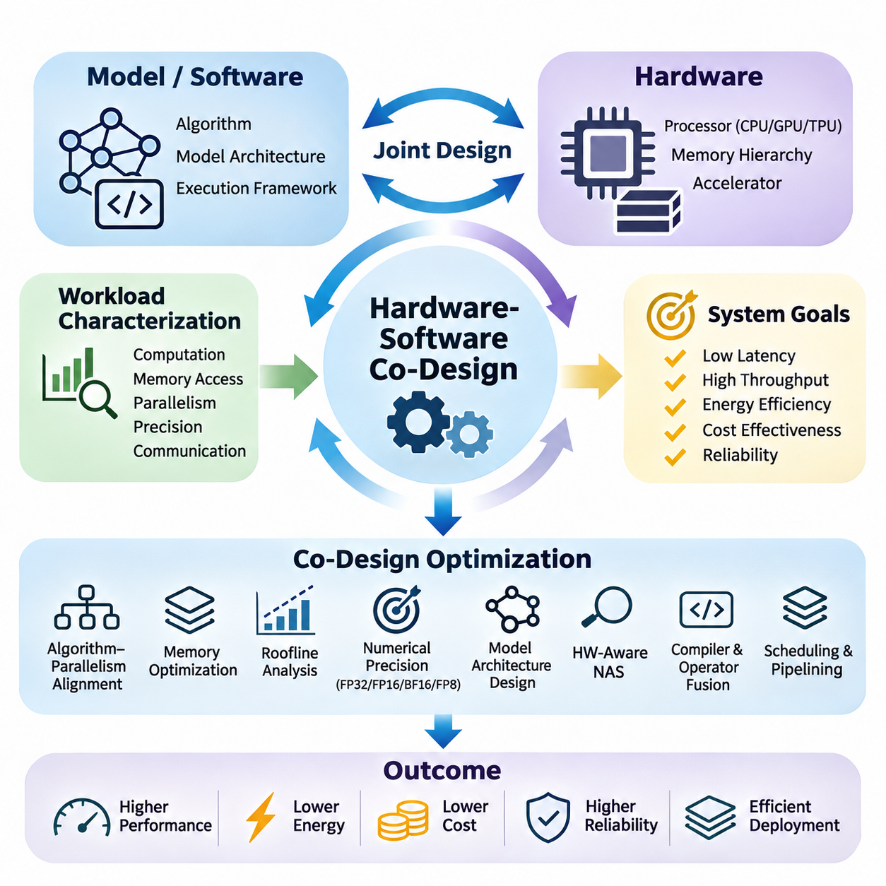
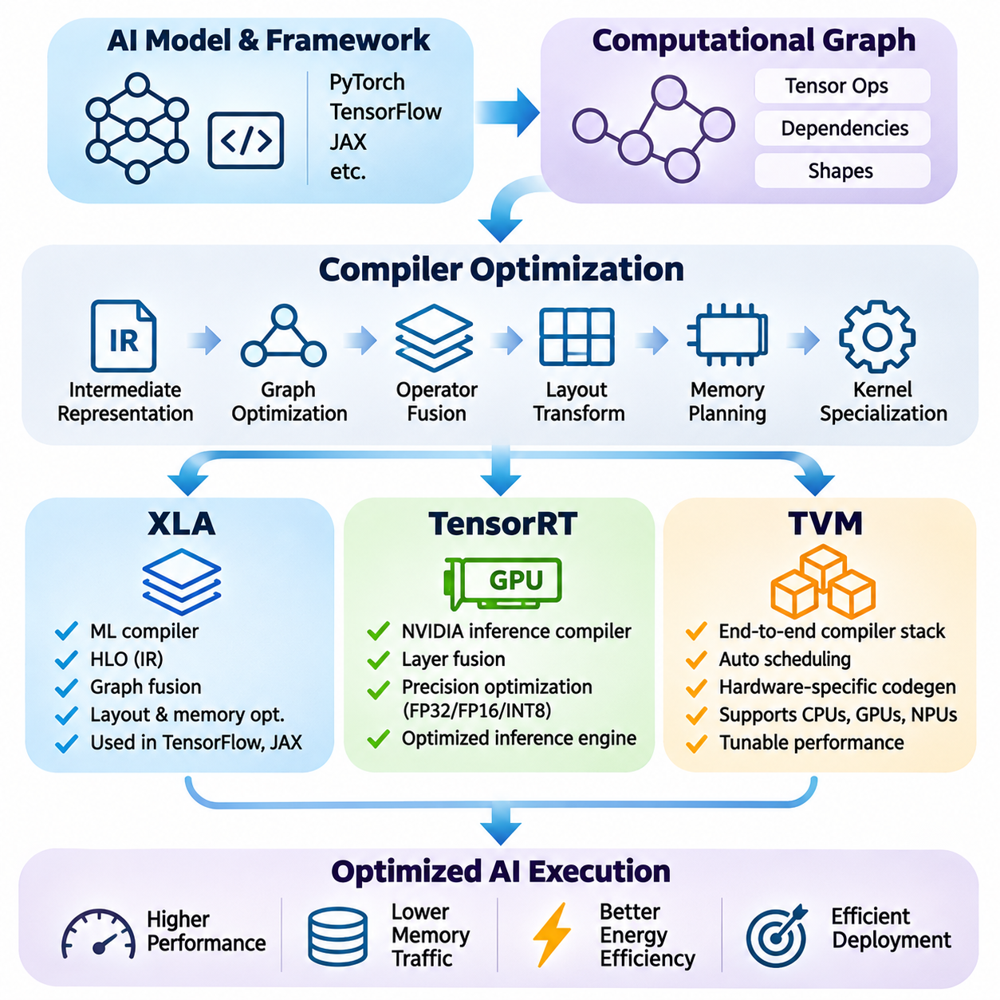
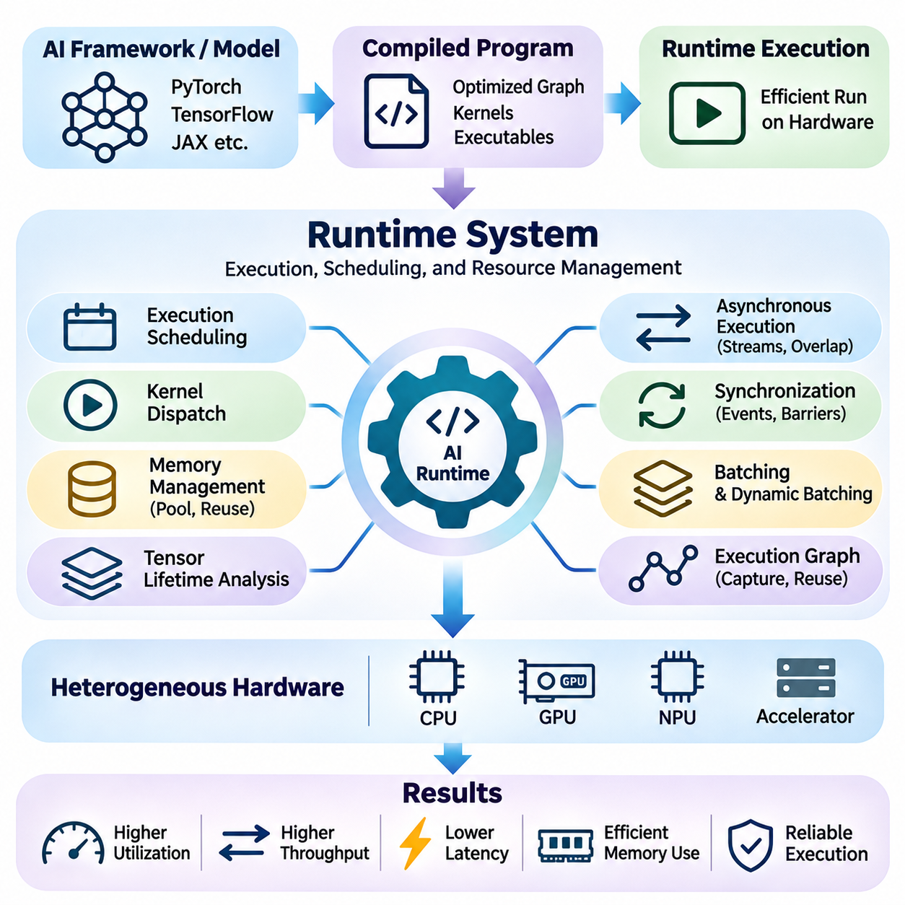
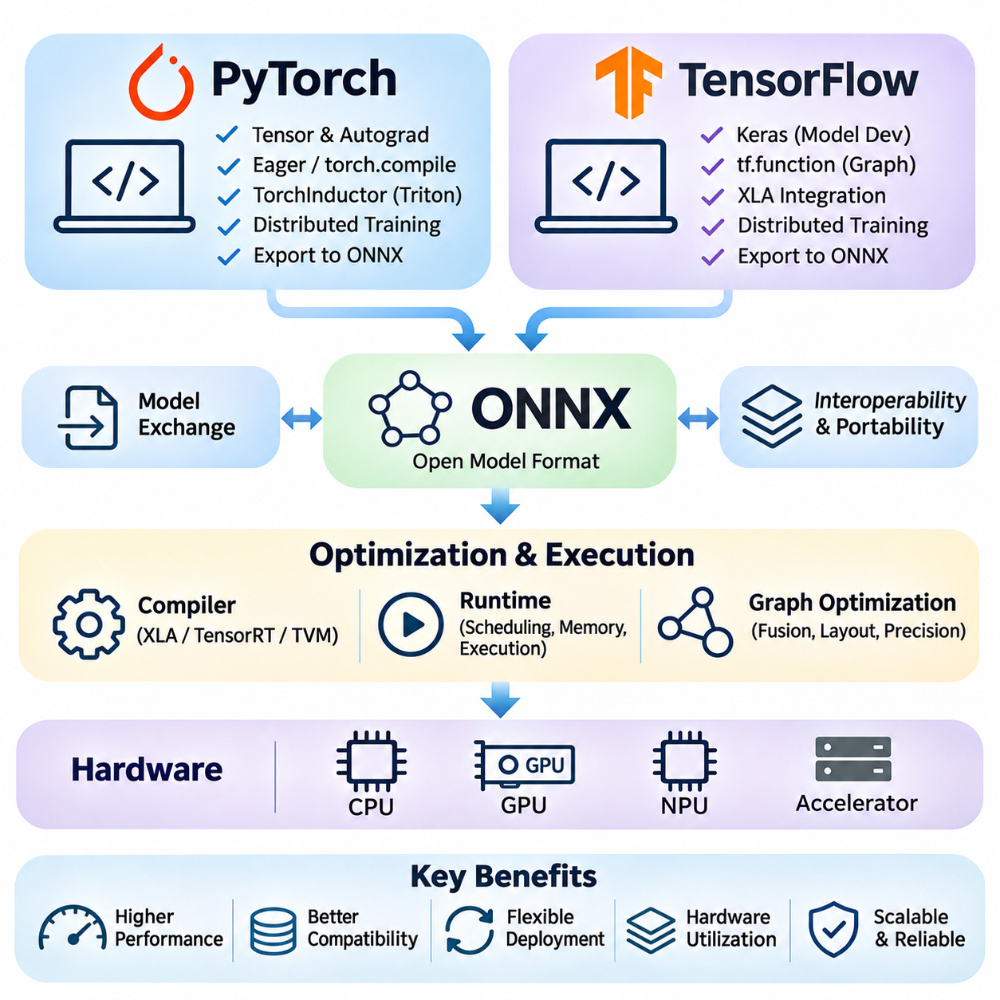
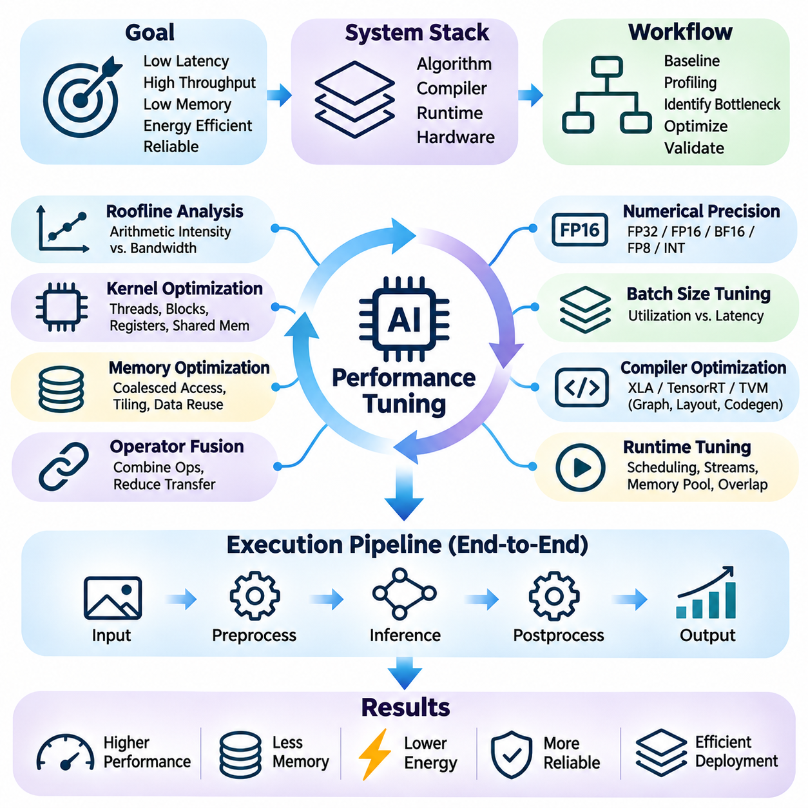
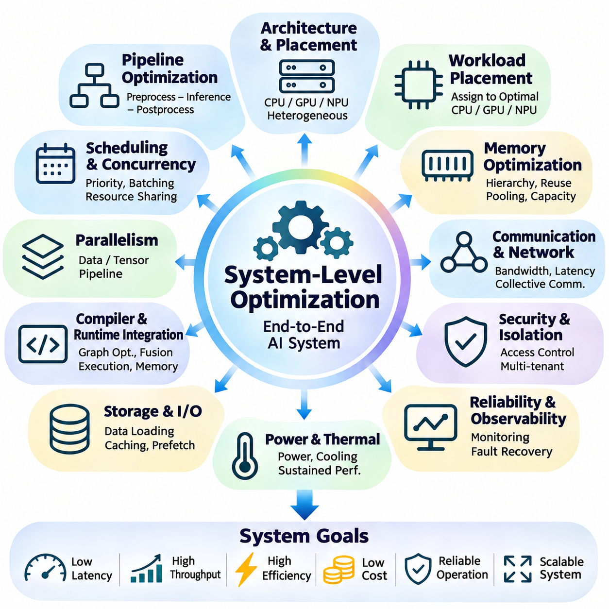

**Volume 39. Hardware for AI**

# 07. Hardware Software Co Design

## 07.01 Co Design Principles

{width="7.268055555555556in" height="7.268055555555556in"}

Hardware-software co-design is a systematic engineering approach in which computational hardware and software algorithms are developed together rather than optimized independently. In artificial intelligence systems, this approach aligns model architectures, processing units, memory hierarchies, and execution frameworks to achieve efficient performance under practical constraints involving latency, throughput, energy consumption, cost, and reliability.

Traditional system development often treats hardware as a fixed execution platform while software developers concentrate on algorithmic improvements. However, modern AI workloads exhibit complex computational patterns that strongly depend on hardware characteristics. Hardware-software co-design addresses this limitation by allowing architectural decisions and algorithmic requirements to influence each other throughout the development lifecycle.

The fundamental principle of co-design is that overall system efficiency cannot be determined by computational capability alone. A processor may provide high theoretical arithmetic throughput while delivering poor application performance because of memory bandwidth limitations, synchronization overhead, or inefficient data movement. Effective co-design therefore evaluates the complete execution path rather than isolated hardware specifications.

Workload characterization provides the foundation for hardware-software co-design. Engineers examine computational intensity, tensor dimensions, memory access patterns, parallelism, numerical precision, and communication requirements. These characteristics determine whether a workload benefits primarily from general-purpose processors, graphics processing units, tensor accelerators, or specialized hardware designed for particular mathematical operations.

An important design consideration is the relationship between algorithm structure and hardware parallelism. Neural networks contain operations with different opportunities for concurrent execution, including matrix multiplication, convolution, attention, normalization, and elementwise transformations. Co-design attempts to organize these operations so that their execution patterns correspond closely to the parallel processing capabilities of the selected hardware.

Memory architecture plays a central role because data movement frequently consumes substantial execution time and energy. Modern accelerators employ registers, caches, shared memory, high-bandwidth memory, and external storage to support different access requirements. Co-design strategies improve data locality, maximize reuse, and reduce unnecessary transfers between memory levels, allowing computational units to remain productive.

The roofline model provides a useful analytical framework for understanding the interaction between arithmetic performance and memory bandwidth. It relates attainable computational throughput to operational intensity, defined as the number of arithmetic operations performed per byte of data transferred. This relationship helps engineers determine whether optimization should emphasize additional parallel computation or improved memory utilization.

Numerical precision represents another major opportunity for coordinated optimization. AI workloads may use FP32, FP16, BF16, FP8, or integer representations depending on accuracy requirements and hardware support. Lower-precision computation can reduce memory traffic and increase arithmetic throughput, but its practical effectiveness depends on numerical stability, quantization behavior, and the precision capabilities of individual accelerator architectures.

Model architecture itself can be adapted to match hardware characteristics. Channel dimensions, attention head configurations, tensor shapes, and layer structures influence accelerator utilization. Dimensions aligned with hardware execution units may improve throughput, while irregular tensor sizes can introduce padding or inefficient execution. Such considerations encourage hardware-aware neural architecture design rather than relying exclusively on theoretical model complexity.

Hardware-aware neural architecture search extends this principle by incorporating deployment constraints into automated model selection. Instead of optimizing predictive accuracy alone, the search process evaluates latency, energy consumption, memory footprint, and hardware compatibility. The resulting architectures seek favorable tradeoffs between model quality and implementation efficiency on a specified computational platform.

Compiler technology connects high-level AI models with low-level hardware execution. Computational graphs must be transformed into efficient instructions, kernels, and memory operations. Graph optimization, operator fusion, layout transformation, and instruction scheduling help exploit accelerator capabilities. Consequently, co-design requires awareness of how compiler transformations influence the relationship between model structure and actual hardware behavior.

Operator fusion illustrates the benefits of coordinated software and hardware optimization. When multiple operations execute separately, intermediate tensors may require repeated memory reads and writes. Combining compatible operations into a single kernel can reduce memory traffic and launch overhead. However, fusion must consider register pressure, shared memory capacity, and occupancy because excessive fusion can sometimes reduce execution efficiency.

Scheduling and pipelining are equally important for improving system utilization. AI execution frequently involves overlapping data transfers, preprocessing, computation, and output processing. Carefully designed pipelines can hide communication latency and reduce processor idle time. Their effectiveness depends on hardware concurrency mechanisms, software scheduling policies, buffer availability, and dependencies between successive computational stages.

Runtime systems introduce another layer of interaction between hardware and software. Memory allocation, kernel dispatch, stream management, batching, and resource scheduling affect practical performance. A runtime optimized for a specific accelerator can reduce overhead and improve execution predictability. Co-design therefore extends beyond model compilation to include the mechanisms responsible for executing workloads under changing operating conditions.

Energy efficiency must be considered alongside computational performance, particularly in embedded and edge AI systems. Processor frequency, voltage, memory activity, and accelerator utilization influence total power consumption. Dynamic voltage and frequency scaling can reduce energy demand, although aggressive power reduction may increase latency. Co-design seeks operating configurations that satisfy application deadlines while respecting available power budgets.

Thermal behavior also creates dependencies between hardware configuration and software execution. Sustained AI workloads generate heat that can trigger frequency throttling and reduce long-term throughput. Software scheduling, workload distribution, and precision selection can influence thermal conditions. Effective co-design considers sustained operating performance rather than relying exclusively on short-duration benchmark measurements.

Real-time AI applications introduce additional requirements involving deterministic execution and bounded response times. Autonomous robots, industrial inspection systems, and embedded controllers must process information within specified deadlines. Hardware selection and software scheduling must account for worst-case latency, sensor synchronization, communication delays, and competing computational tasks rather than average inference speed alone.

Scalability introduces further design challenges when AI workloads extend across multiple accelerators or computing nodes. Model partitioning, tensor parallelism, pipeline parallelism, and data parallelism create different communication patterns. Their effectiveness depends on interconnect bandwidth, synchronization costs, memory capacity, and collective communication support. Co-design aligns distributed execution strategies with the topology of the underlying computing infrastructure.

Hardware-software interfaces should provide sufficient abstraction without concealing critical performance characteristics. Frameworks and intermediate representations improve portability across accelerators, while specialized kernels expose architecture-specific capabilities. Effective co-design balances portability, maintainability, and optimization opportunities, recognizing that maximum performance on one platform may require implementation choices that limit compatibility with others.

A practical co-design methodology begins with measurable system objectives and representative workloads. Engineers establish baseline performance, identify bottlenecks through profiling, and evaluate alternative hardware and software configurations. Iterative experimentation reveals whether proposed changes improve the complete application. Measurements should include latency distributions, throughput, memory utilization, energy consumption, and numerical accuracy.

Design-space exploration formalizes the evaluation of competing configurations. Candidate systems may differ in processor architecture, memory capacity, numerical precision, model structure, batch size, and execution strategy. Because these variables interact, optimizing one dimension independently can produce misleading conclusions. Multi-objective evaluation identifies configurations that provide favorable compromises among performance, efficiency, cost, and operational constraints.

Performance portability is an important consideration when AI applications must support heterogeneous computing platforms. A model optimized for one GPU architecture may behave differently on a TPU, NPU, FPGA, or CPU. Co-design should distinguish architecture-independent algorithmic improvements from hardware-specific optimizations. This distinction supports maintainable software while preserving opportunities for specialized acceleration where justified.

Reliability and validation complete the co-design process. Numerical differences, memory limitations, concurrency defects, and thermal instability can produce failures that are not visible during isolated model testing. Validation must therefore include integrated workloads, realistic operating conditions, prolonged execution, and hardware-specific failure scenarios. Reproducible benchmarking ensures that performance improvements do not compromise correctness or operational stability.

Ultimately, hardware-software co-design treats artificial intelligence as an integrated computational system rather than a collection of independently optimized components. Its central objective is to coordinate algorithms, architectures, compilers, runtimes, and physical constraints throughout development. This integrated perspective enables AI systems to achieve stronger practical performance, greater energy efficiency, and more reliable deployment across diverse computing environments.

## 07.02 Compiler Optimization

{width="7.268055555555556in" height="7.268055555555556in"}

Compiler optimization is a fundamental component of hardware-software co-design that transforms high-level artificial intelligence models into efficient hardware-executable programs. Modern AI frameworks express computation through tensor operations and computational graphs, but these representations do not directly reflect accelerator capabilities. AI compilers bridge this gap by optimizing execution graphs, memory access, instruction scheduling, and hardware-specific kernel generation.

The primary objective of AI compiler optimization is to improve computational efficiency without changing the intended mathematical behavior of a model beyond permitted numerical tolerances. Optimization techniques include constant folding, dead code elimination, operator fusion, layout transformation, memory planning, and kernel specialization. These transformations reduce execution overhead and improve hardware utilization across training and inference workloads.

Intermediate representations provide the foundation for modern compiler architectures. An intermediate representation captures computational operations, tensor shapes, dependencies, and execution semantics in a form suitable for analysis and transformation. Multiple abstraction levels allow compilers to perform graph-level optimization before generating lower-level instructions. This separation improves portability while enabling specialized optimization for different hardware platforms.

Graph optimization identifies opportunities to simplify computation and reduce unnecessary operations. Constant expressions can be evaluated during compilation, redundant operations can be eliminated, and compatible operators can be combined. These transformations reduce runtime overhead and intermediate memory traffic. Their effectiveness depends on tensor shapes, operator dependencies, numerical precision, and the execution characteristics of the target accelerator.

Operator fusion is particularly important for neural network execution because intermediate tensors frequently move between memory and computational units. Combining operations such as matrix multiplication, bias addition, and activation can eliminate intermediate memory transfers. Fusion may also reduce kernel launch overhead. However, excessive fusion can increase register pressure, reduce occupancy, and create kernels that perform worse than separate operations.

XLA, originally known as Accelerated Linear Algebra, is a compiler infrastructure designed to optimize machine learning computations for different hardware backends. It transforms high-level tensor computations into optimized executable programs through graph analysis, operation fusion, and backend-specific code generation. XLA is closely associated with TensorFlow and JAX, where compilation can improve execution efficiency by optimizing groups of operations together.

XLA represents computations through High Level Optimizer, or HLO, an intermediate representation that describes tensor operations and their dependencies. HLO enables compiler passes to analyze computational graphs, simplify expressions, eliminate redundant operations, and transform execution patterns. The compiler progressively lowers these representations into forms suitable for hardware-specific execution, including optimized CPU and accelerator implementations.

A major advantage of XLA is its ability to optimize computations across boundaries that might otherwise be executed as separate framework operations. By analyzing complete computational regions, XLA can identify fusion opportunities and reduce unnecessary intermediate tensors. These transformations are particularly valuable for workloads containing repeated elementwise operations, normalization, reductions, and compatible tensor transformations.

XLA also performs layout assignment and memory-related optimization to improve data access efficiency. Tensor layouts determine how multidimensional values are represented in physical memory, influencing coalesced access, cache utilization, and vectorized execution. The compiler selects or transforms layouts according to backend requirements. Effective layout management can significantly influence performance even when the mathematical operations remain unchanged.

In JAX, just-in-time compilation allows compatible Python-defined numerical functions to be traced and compiled through the XLA compilation infrastructure. This approach can reduce interpreter and dispatch overhead while enabling graph-level optimization. However, compilation introduces startup costs, and changes in shapes or compilation parameters may trigger additional compilation. Consequently, performance evaluation should distinguish compilation time from steady-state execution.

TensorRT is an NVIDIA inference optimization framework designed to accelerate trained neural networks on supported NVIDIA GPUs and related computing platforms. It transforms compatible model representations into optimized inference engines through layer fusion, precision selection, kernel optimization, and execution planning. Unlike general training frameworks, TensorRT primarily targets efficient deployment of inference workloads under specific hardware and runtime constraints.

TensorRT constructs optimized execution engines by analyzing network structure, tensor dimensions, supported operations, and available computational resources. Its builder evaluates implementation alternatives and selects execution strategies appropriate for the target device. The resulting engine contains optimized execution information that reduces runtime decision overhead and enables efficient utilization of supported GPU acceleration features.

Precision optimization is a central capability of TensorRT because modern NVIDIA accelerators support multiple numerical formats. Depending on hardware support and model compatibility, inference may use FP32, FP16, BF16, FP8, or INT8 execution paths. Lower precision can improve throughput and reduce memory requirements, but numerical behavior must be validated. Quantized inference may require calibration or quantization-aware preparation to preserve acceptable prediction accuracy.

TensorRT also supports dynamic tensor dimensions through optimization profiles that describe permitted input shape ranges. This capability is important for applications where batch size, image resolution, or sequence length changes during execution. Different shapes can require different kernels and memory configurations. Carefully selected optimization profiles help balance flexibility, engine size, memory consumption, and inference performance.

Kernel selection is another important aspect of TensorRT optimization. Multiple implementations may exist for convolution, matrix multiplication, attention, and related operations. Their performance depends on tensor dimensions, data layout, precision, workspace availability, and accelerator architecture. TensorRT evaluates supported implementation choices during engine construction, allowing execution strategies to be adapted to the target hardware.

TensorRT deployment commonly involves exporting models from frameworks such as PyTorch or TensorFlow through supported conversion paths, including ONNX. The exported graph is parsed, optimized, and compiled into an inference engine. Unsupported operators may require plugins or graph modifications. Model conversion must preserve numerical correctness, tensor semantics, and expected input-output behavior throughout the deployment pipeline.

TVM is an open-source machine learning compiler framework designed to optimize tensor computations across heterogeneous hardware platforms. Its architecture supports graph-level transformations, tensor-level scheduling, and target-specific code generation. Unlike solutions focused primarily on one hardware ecosystem, TVM emphasizes flexible compilation strategies for CPUs, GPUs, and specialized accelerators, making it relevant to portable AI deployment.

TVM employs intermediate representations that separate high-level computational structure from lower-level implementation details. Relax provides a representation for graph-oriented tensor programs, while TensorIR expresses tensor computations and scheduling transformations. This separation allows optimization at multiple levels, including graph rewriting, loop transformation, memory allocation, and hardware-specific execution planning.

Tensor scheduling is a defining capability of TVM because mathematical operations can be implemented through many different execution strategies. Loop tiling, reordering, fusion, vectorization, parallelization, and memory caching influence computational efficiency. TVM enables these transformations to be expressed and evaluated systematically, allowing implementations to exploit processor parallelism and memory hierarchy characteristics.

Automatic tuning extends TVM optimization by searching for efficient execution configurations. MetaSchedule can explore candidate scheduling transformations and evaluate their measured performance on target hardware. The search process considers execution time and implementation constraints rather than relying exclusively on manually selected schedules. This approach is useful when workload characteristics or accelerator architectures make optimal configurations difficult to predict.

TVM also supports hardware specialization through code generation and integration mechanisms for different execution environments. Developers can adapt compilation workflows to target processor instruction sets, GPU execution models, and accelerator-specific interfaces. However, practical performance depends on backend maturity, supported operators, available tuning infrastructure, and the quality of generated kernels for the selected platform.

XLA, TensorRT, and TVM address overlapping optimization challenges but emphasize different development priorities. XLA provides integrated compilation for supported machine learning frameworks, TensorRT specializes in NVIDIA inference acceleration, and TVM emphasizes customizable compilation across heterogeneous targets. Their suitability depends on framework integration, deployment hardware, workload characteristics, numerical requirements, and engineering resources.

Compiler selection should therefore begin with an analysis of the complete application rather than isolated benchmark results. Training workloads may benefit from graph compilation and operation fusion, while production inference may require specialized engines and predictable execution latency. Edge systems introduce additional memory, power, and thermal constraints. A compiler must be evaluated against these requirements using representative models and realistic operating conditions.

Compiler optimization also introduces engineering tradeoffs involving compilation time, binary size, portability, and maintenance. Aggressive specialization may improve execution speed but increase compilation overhead or reduce flexibility across input shapes. Hardware-specific optimizations can improve accelerator utilization while creating dependencies on particular runtime versions or architectures. Effective deployment requires balancing optimization gains against operational complexity.

Performance validation must measure the complete execution pipeline, including preprocessing, host-device transfers, kernel execution, synchronization, and postprocessing. Kernel-level acceleration does not necessarily translate into equivalent end-to-end improvements. Profiling tools help identify whether execution is limited by computation, memory bandwidth, launch overhead, or data movement. Numerical comparisons are equally necessary to detect changes introduced by precision reduction or graph transformations.

Ultimately, compiler optimization connects algorithmic representation with physical computing architecture. XLA, TensorRT, and TVM demonstrate how graph transformation, intermediate representations, scheduling, and hardware-aware code generation can improve AI execution. Their effective application requires coordinated decisions across model design, compiler configuration, runtime integration, and hardware selection to achieve reliable and efficient artificial intelligence systems.

## 07.03 Runtime Systems

{width="7.268055555555556in" height="7.268055555555556in"}

Runtime systems form the execution layer that connects compiled artificial intelligence models with physical computing hardware. While compilers transform computational graphs into optimized instructions, runtime systems manage how these instructions execute under actual operating conditions. They coordinate memory allocation, kernel dispatch, device communication, synchronization, and resource scheduling to deliver efficient and reliable AI computation.

An AI runtime system operates between application frameworks and hardware execution interfaces. It receives executable operations, manages their dependencies, and schedules them on available processing devices. This architecture separates model-level computation from low-level execution management. Runtime implementations may support CPUs, GPUs, NPUs, and specialized accelerators through device-specific backends and execution APIs.

Execution scheduling is a fundamental responsibility of runtime systems. Neural networks contain operations with dependencies that determine when each computation can begin. Runtime schedulers analyze these relationships and dispatch ready operations while preserving correctness. Efficient scheduling minimizes idle periods, reduces unnecessary synchronization, and improves the utilization of available computational resources.

Kernel dispatch determines how computational operations are submitted to hardware execution units. Each dispatch may introduce overhead associated with command preparation, driver interaction, and execution synchronization. For workloads containing many small operations, this overhead can become significant. Runtime optimization therefore attempts to reduce unnecessary launches, combine compatible operations, and maintain efficient execution queues.

Memory management is another critical runtime function because AI workloads frequently allocate large tensors and temporary buffers. Repeated allocation and deallocation can introduce latency, fragmentation, and synchronization overhead. Runtime memory pools reduce these costs by reusing previously allocated storage. Effective allocation strategies must account for tensor lifetimes, device capacity, alignment requirements, and concurrent execution.

Tensor lifetime analysis allows runtime systems to identify when intermediate data is no longer required. Memory regions associated with completed operations can be reused by subsequent computations when dependency and concurrency constraints permit. This approach reduces peak memory consumption without changing model semantics. Accurate lifetime tracking is particularly important for large neural networks operating under limited accelerator memory.

Asynchronous execution enables computation and data movement to proceed without requiring the host processor to wait after every operation. GPU runtimes commonly use execution streams and event mechanisms to coordinate concurrent activities. When dependencies allow, data transfers can overlap with kernel execution. Such overlap improves throughput, although incorrect synchronization can introduce race conditions or inconsistent results.

Synchronization ensures that operations observe valid data and execute in the required order. Runtime systems may use events, barriers, stream dependencies, and device synchronization primitives to enforce correctness. Excessive synchronization reduces parallelism and introduces unnecessary waiting. Insufficient synchronization can cause data hazards. Effective runtime design therefore balances execution concurrency with precise dependency management.

Batching is an important runtime strategy for improving accelerator utilization. Processing multiple inputs together can increase arithmetic intensity and amortize kernel launch overhead. However, larger batches require additional memory and may increase individual request latency. Runtime systems must select batching policies according to workload characteristics, throughput objectives, response deadlines, and available device resources.

Dynamic batching extends this concept by combining inference requests arriving at different times into shared execution batches. A runtime may briefly queue compatible requests before dispatching them together. This strategy is valuable for high-throughput inference services, but queueing introduces latency. Adaptive batching policies attempt to maximize hardware utilization while maintaining service-level latency requirements.

Runtime execution graphs provide another mechanism for reducing repeated scheduling overhead. When a workload follows a stable execution pattern, compatible operations and their dependencies can be captured or represented as a reusable graph. Subsequent executions can submit this graph with reduced host-side overhead. Graph-based execution is particularly effective for repetitive inference workloads with predictable computational structures.

Heterogeneous runtime systems coordinate computation across different processor types. A CPU may perform control logic and preprocessing while a GPU executes neural network operations and an NPU handles specialized inference tasks. Efficient coordination requires explicit device placement, memory transfer management, and dependency tracking. Poor partitioning can eliminate acceleration benefits through excessive communication overhead.

Data movement between host and accelerator memory is a major runtime performance consideration. Transfers through interfaces such as PCIe can introduce substantial latency and consume bandwidth. Runtime systems may use pinned host memory, asynchronous copies, buffer reuse, and overlapping execution to reduce transfer overhead. The optimal strategy depends on data size, transfer frequency, hardware topology, and memory accessibility.

Runtime resource scheduling becomes more complex when multiple models or applications share an accelerator. Concurrent workloads compete for computational units, memory bandwidth, cache capacity, and device memory. Runtime policies may prioritize latency-sensitive tasks, regulate concurrency, or isolate resource usage. Effective scheduling seeks predictable application performance while maintaining high aggregate hardware utilization.

Inference runtimes frequently support optimized execution engines generated by specialized compilers. TensorRT-based execution, ONNX Runtime, and other inference environments provide mechanisms for loading models, managing execution contexts, and dispatching optimized operators. Their performance depends on execution providers, supported kernels, memory management policies, and compatibility with the underlying accelerator architecture.

Training runtimes introduce additional responsibilities involving gradient computation, optimizer updates, and distributed synchronization. They coordinate forward execution, backward propagation, gradient accumulation, and parameter updates. In distributed environments, runtime systems also manage collective communication and device synchronization. These activities must be scheduled carefully to prevent communication overhead from dominating computational performance.

Distributed runtime systems coordinate workloads across multiple accelerators and computing nodes. They manage task placement, communication dependencies, collective operations, and execution progress. Network latency and interconnect bandwidth influence scheduling decisions. Overlapping communication with computation can improve efficiency, but distributed execution also requires mechanisms for detecting failures and recovering from interrupted operations.

Real-time AI runtime systems must satisfy timing constraints in addition to computational correctness. Autonomous robots, industrial controllers, and embedded perception systems require bounded response times for critical operations. Runtime scheduling must consider execution priorities, resource contention, memory allocation delays, and synchronization overhead. Predictable latency is often more important than maximum average throughput.

Power and thermal management influence runtime behavior in edge and embedded environments. Runtime systems may adjust execution frequency, workload placement, batching, or concurrency to operate within energy and temperature constraints. Sustained computational demand can trigger thermal throttling and reduce performance. Adaptive execution policies help maintain acceptable service quality under changing physical operating conditions.

Runtime observability provides the measurements necessary to understand execution behavior. Profiling and monitoring tools collect kernel execution times, memory consumption, queue delays, device utilization, and synchronization overhead. These measurements reveal bottlenecks that may not be visible from model-level benchmarks. Runtime telemetry also supports performance regression detection and capacity planning.

Fault handling is essential for reliable runtime operation. Device memory exhaustion, unsupported operations, execution timeouts, and hardware communication failures can interrupt AI workloads. Runtime systems should detect such conditions, report meaningful diagnostics, and apply appropriate recovery mechanisms. Depending on the application, recovery may involve restarting execution, releasing resources, or switching to a supported fallback path.

Runtime security becomes important when accelerators are shared across applications or users. Memory isolation, access control, resource ownership, and execution boundaries help prevent unintended interference. Model execution environments must also consider untrusted inputs and externally supplied computational graphs. Secure runtime design reduces the risk of unauthorized memory access, resource exhaustion, and execution instability.

Performance tuning requires evaluating runtime behavior under representative operating conditions. Engineers should measure end-to-end latency, throughput, memory utilization, synchronization costs, and resource contention. Warm-up behavior and initialization overhead should be distinguished from steady-state execution. Optimization decisions must consider realistic request patterns rather than relying exclusively on isolated kernel benchmarks.

Hardware-software co-design connects runtime architecture with compiler optimization and hardware capabilities. Compilers determine how operations are transformed, while runtimes determine when and where those operations execute. Hardware characteristics constrain memory allocation, concurrency, and communication. Coordinating these layers enables more efficient scheduling, reduced data movement, and improved utilization of specialized accelerators.

Ultimately, runtime systems transform optimized AI computations into dependable operational behavior. Their responsibilities extend beyond launching kernels to managing memory, concurrency, scheduling, communication, resource sharing, and fault recovery. Well-designed runtimes allow artificial intelligence applications to achieve high throughput, predictable latency, efficient energy usage, and reliable execution across diverse hardware environments.

## 07.04 AI Framework Integration

{width="7.268055555555556in" height="7.268055555555556in"}

AI framework integration connects high-level model development with compiler optimization, runtime execution, and hardware acceleration. Frameworks such as PyTorch and TensorFlow provide tools for defining, training, and evaluating neural networks, while ONNX enables standardized model exchange. Effective integration ensures that computational graphs, tensor representations, numerical precision, and execution requirements remain compatible across development and deployment environments.

Modern AI systems frequently use different software components for model development and production inference. Researchers prioritize flexibility, automatic differentiation, and rapid experimentation, whereas deployment environments emphasize predictable latency, memory efficiency, and hardware utilization. Framework integration bridges these priorities by providing reliable mechanisms for model conversion, graph optimization, accelerator execution, and runtime interoperability.

PyTorch is a widely adopted deep learning framework built around tensor computation and automatic differentiation. Its eager execution model allows developers to construct and debug neural networks using familiar Python programming patterns. PyTorch supports CPU and GPU execution through specialized backends, making it suitable for research, training, and deployment. Its modular architecture also supports integration with optimized compilers and inference runtimes.

PyTorch uses an automatic differentiation engine to construct and evaluate gradients during neural network training. Operations performed on tensors can be tracked to support backward propagation and parameter optimization. This execution model provides flexibility for dynamic computational structures. However, eager execution may introduce Python overhead and repeated operator dispatch costs, motivating compilation and graph-based execution techniques.

The torch.compile interface provides a compilation pathway for optimizing supported PyTorch models. It uses graph capture and compiler components such as TorchDynamo and TorchInductor to transform executable regions into optimized implementations. These transformations can reduce framework overhead and improve kernel efficiency. Actual performance depends on graph compatibility, tensor shapes, backend capabilities, and compilation costs.

TorchInductor generates optimized code for supported computational graphs and can use hardware-oriented kernel generation techniques. On GPU platforms, generated implementations may employ Triton kernels to improve memory access and parallel execution. Optimization opportunities include operator fusion, loop transformation, and reduced intermediate storage. Nevertheless, unsupported operations or dynamic control flow may limit the extent of compilation.

PyTorch supports distributed training through mechanisms that coordinate computation across multiple devices and processes. DistributedDataParallel synchronizes gradients across replicated models, while fully sharded approaches distribute parameters and optimizer states to reduce per-device memory requirements. Efficient execution depends on communication bandwidth, collective operations, gradient scheduling, and the underlying accelerator interconnect.

For deployment, PyTorch models may be exported into representations suitable for external compilers and runtimes. The torch.export mechanism captures supported model computations into an exportable graph representation with explicit constraints. Models can also be converted to ONNX through supported export workflows. Exported models must preserve tensor semantics, input requirements, and numerical behavior while remaining compatible with target execution environments.

TensorFlow provides an integrated machine learning ecosystem supporting model construction, training, optimization, and deployment. Its tensor-based programming model supports execution on CPUs, GPUs, and specialized accelerators through compatible backends. TensorFlow combines high-level interfaces with graph execution mechanisms, enabling developers to move from experimental models toward optimized production systems.

TensorFlow commonly uses the Keras interface for defining neural network architectures and training procedures. Keras provides reusable layers, model abstractions, optimization algorithms, and training workflows. These abstractions simplify development while allowing integration with lower-level TensorFlow operations. Hardware performance still depends on computational graph structure, operator support, tensor layout, and accelerator-specific execution capabilities.

The tf.function mechanism converts compatible Python-defined TensorFlow computations into graph representations. Graph execution can reduce Python overhead and expose optimization opportunities across multiple operations. TensorFlow graphs represent dependencies and tensor transformations explicitly, supporting execution planning and compiler integration. Retracing may occur when input signatures or execution conditions change, introducing additional overhead.

TensorFlow integrates with XLA through supported compilation pathways that optimize computational graphs for compatible hardware backends. XLA can perform operation fusion, constant propagation, layout optimization, and code generation. These techniques may improve execution efficiency for suitable workloads. However, unsupported operations, compilation overhead, and dynamic shape behavior can influence whether XLA provides practical performance benefits.

TensorFlow also supports distributed execution strategies for scaling model training across devices and computing nodes. Data parallelism, model distribution, and coordinated parameter updates allow workloads to use multiple accelerators. Communication and synchronization become important performance factors. Framework integration must coordinate device placement, gradient aggregation, checkpoint management, and execution scheduling to maintain training efficiency.

TensorFlow Lite, now associated with the LiteRT ecosystem, provides deployment-oriented capabilities for running supported models on mobile and embedded devices. Model conversion, quantization, and accelerator delegation help adapt neural networks to constrained environments. Available execution paths depend on device support and runtime configuration. Accuracy and latency should be validated on the intended hardware rather than inferred from desktop benchmarks.

ONNX, the Open Neural Network Exchange format, provides an open representation for exchanging machine learning models between compatible frameworks and execution environments. It describes computational graphs using standardized operators, tensor definitions, attributes, and model metadata. ONNX is not itself a training framework or execution engine. Its primary role is to support interoperability between model development tools, compilers, and inference runtimes.

An ONNX model represents computation as a directed graph containing nodes, inputs, outputs, initializers, and operator attributes. Nodes reference operations defined by operator sets, commonly called opsets. The opset version determines the semantics and availability of supported operators. Model compatibility therefore depends on both the exported graph and the operator versions recognized by the target runtime.

ONNX export converts framework-specific computations into standardized graph operations whenever suitable mappings exist. This process may require graph tracing, symbolic conversion, shape analysis, or operator decomposition. Unsupported custom operations and framework-specific behavior can complicate conversion. Successful export requires verification that the resulting model reproduces the intended computation within acceptable numerical tolerances.

ONNX Runtime is a cross-platform execution environment designed to run supported ONNX models efficiently. It provides execution providers that connect graph operations to different hardware backends, including CPU and supported accelerator implementations. Runtime graph optimization, operator selection, and memory planning improve execution efficiency. Actual performance depends on provider capabilities, model structure, and device configuration.

Execution provider selection is central to ONNX Runtime integration. A provider may accelerate supported operators while unsupported operations execute through another available provider. Such partitioning enables broad model compatibility but may introduce data transfers and synchronization overhead. Effective deployment requires inspecting operator placement, execution partitions, and fallback behavior rather than assuming every operation uses the preferred accelerator.

ONNX-based deployment frequently connects PyTorch or TensorFlow development workflows with optimized inference environments. A model can be trained in its original framework, exported to ONNX, validated, and executed through ONNX Runtime or another compatible backend. This separation allows deployment architectures to evolve independently of training frameworks, although operator compatibility and model conversion remain important engineering constraints.

Numerical consistency is essential when integrating multiple frameworks and execution backends. Differences in floating-point precision, reduction order, operator implementation, and quantization behavior can produce output variations. Validation should compare representative inputs, intermediate tensors when necessary, and final predictions. Acceptable tolerances must reflect application requirements, particularly for safety-sensitive or high-precision systems.

Dynamic tensor shapes create additional challenges for framework interoperability. Variable batch sizes, image dimensions, and sequence lengths may require symbolic dimensions, shape constraints, or specialized execution profiles. A model that accepts dynamic inputs in its original framework may encounter restrictions after export or compilation. Deployment testing must cover the intended shape ranges and associated memory requirements.

Hardware-software co-design requires framework selection to consider both development productivity and deployment efficiency. PyTorch emphasizes flexible experimentation and increasingly integrated compilation, TensorFlow offers graph-oriented execution and deployment pathways, and ONNX provides standardized model interchange. These technologies can complement one another within a single AI pipeline rather than functioning exclusively as competing alternatives.

Performance evaluation should include framework overhead, graph compilation, data transfers, runtime scheduling, and accelerator execution. A model that performs well during native framework execution may behave differently after export or optimization. Benchmarking should distinguish initial compilation costs from steady-state inference and measure realistic batch sizes. Memory consumption, numerical accuracy, and operational stability are equally important evaluation criteria.

Ultimately, AI framework integration establishes continuity between model development, compiler optimization, and hardware deployment. PyTorch, TensorFlow, and ONNX provide complementary mechanisms for expressing computations, optimizing execution, and exchanging models across software environments. Effective integration depends on compatible operator semantics, reliable conversion, numerical validation, and hardware-aware runtime configuration, enabling portable and efficient AI systems.

## 07.05 Performance Tuning

{width="7.268055555555556in" height="7.268055555555556in"}

Performance tuning in hardware-software co-design is the systematic process of improving AI execution efficiency by coordinating algorithms, compilers, runtimes, and computing hardware. Its objective is not simply to maximize computational throughput but to balance latency, memory consumption, energy efficiency, and operational reliability. Effective tuning requires measurable performance targets, representative workloads, and an understanding of hardware limitations.

The tuning process begins with establishing a reliable performance baseline. Engineers measure end-to-end execution time, inference throughput, memory utilization, and device activity under controlled conditions. Input dimensions, batch sizes, numerical precision, software versions, and hardware configurations must remain consistent. A reproducible baseline makes it possible to distinguish genuine improvements from measurement noise or environmental variation.

Profiling identifies the operations and system components responsible for performance limitations. CPU profilers, GPU tracing tools, and framework-level instrumentation reveal kernel execution time, memory transfers, synchronization delays, and scheduling overhead. Measurements should cover the complete application pipeline rather than isolated operators. This approach prevents optimization efforts from targeting components that contribute little to total execution time.

Performance bottlenecks are commonly classified as compute-bound, memory-bound, communication-bound, or launch-bound. Compute-bound workloads approach the arithmetic capacity of processing units, while memory-bound workloads are limited by data movement. Communication-bound execution suffers from transfer or synchronization costs. Launch-bound workloads spend excessive time dispatching small operations rather than performing useful computation.

The roofline model provides a useful framework for understanding the relationship between arithmetic intensity, memory bandwidth, and achievable computational performance. Arithmetic intensity measures the number of operations performed per byte transferred from memory. Workloads with low intensity are often constrained by bandwidth, while high-intensity workloads may approach compute limits. This distinction guides optimization priorities.

Kernel optimization focuses on improving how individual computational operations use hardware resources. Thread organization, block dimensions, register allocation, shared memory usage, and instruction scheduling influence GPU performance. Efficient kernels balance parallel occupancy with resource consumption. Increasing thread counts or allocating more shared memory does not automatically improve throughput because hardware resources are finite.

Memory access optimization reduces the cost of transferring data between storage levels. Coalesced global memory access, cache-friendly layouts, aligned transfers, and effective data reuse improve bandwidth utilization. Tiling techniques divide large computations into smaller blocks that fit available on-chip memory. These strategies are especially important for matrix multiplication, convolution, attention, and other tensor-intensive operations.

Operator fusion improves performance by combining compatible computational stages into fewer execution kernels. Fusing matrix multiplication with bias addition or activation can eliminate intermediate tensor writes and reduce launch overhead. However, larger fused kernels may require additional registers or shared memory. Performance tuning must evaluate whether reduced data movement outweighs possible losses in occupancy or scheduling flexibility.

Numerical precision selection offers substantial optimization opportunities on modern AI accelerators. FP16, BF16, FP8, and integer formats can reduce memory traffic and exploit specialized arithmetic units when supported. Lower precision may improve throughput and energy efficiency, but numerical stability and prediction accuracy must be validated. Mixed-precision strategies preserve higher precision where necessary while accelerating suitable operations.

Batch size tuning balances accelerator utilization against latency and memory requirements. Larger batches often improve throughput by amortizing fixed execution overhead and increasing parallel work. However, they may increase queueing delays, memory consumption, and response times. Optimal batch sizes depend on model architecture, input dimensions, accelerator capacity, and whether the application prioritizes throughput or real-time responsiveness.

Compiler optimization contributes to performance tuning through graph simplification, kernel generation, layout transformation, and execution specialization. Tools such as XLA, TensorRT, and TVM can transform computational graphs into efficient hardware-specific implementations. Compilation parameters, shape constraints, and optimization profiles influence performance. Compiled execution should be compared against representative framework baselines.

Runtime tuning addresses the scheduling and resource management decisions made during model execution. Asynchronous streams, execution graphs, memory pools, and overlapping transfers can reduce overhead. Efficient runtimes minimize unnecessary synchronization and reuse allocated buffers. However, aggressive concurrency may increase contention for memory bandwidth, computational units, or cache resources, reducing overall efficiency.

Data transfer optimization is particularly important when computation spans CPUs, GPUs, and specialized accelerators. Host-device transfers may dominate latency for small models or frequently exchanged tensors. Pinned memory, asynchronous copying, persistent buffers, and reduced transfer frequency can improve performance. The effectiveness of these techniques depends on interface bandwidth, transfer size, and the ability to overlap communication with computation.

Pipeline optimization considers the complete sequence of preprocessing, inference, and postprocessing. A fast neural network does not guarantee a fast application when image decoding, tensor conversion, or output processing dominates execution time. Pipeline stages can sometimes execute concurrently through buffering and asynchronous scheduling. End-to-end measurements reveal whether local improvements produce meaningful application-level acceleration.

Multi-device performance tuning introduces communication and synchronization challenges. Data parallelism, tensor parallelism, and pipeline parallelism distribute workloads across accelerators, but each strategy creates different communication requirements. Efficient collective operations and overlapping computation with communication can improve scalability. Network topology, interconnect bandwidth, and workload partitioning determine achievable scaling efficiency.

Real-time AI applications require optimization for predictable latency rather than maximum average throughput alone. Robotics, autonomous systems, and industrial inspection may impose strict processing deadlines. Tail latency, scheduling jitter, and resource contention can compromise system behavior even when average inference time is acceptable. Performance tuning must therefore evaluate latency distributions and worst-case operating scenarios.

Power and thermal constraints influence sustained performance, particularly in embedded and edge AI systems. High clock frequencies may improve short-term throughput but increase energy consumption and heat generation. Thermal throttling can reduce performance during prolonged operation. Tuning should consider power limits, cooling capacity, execution frequency, and workload scheduling to achieve stable performance over realistic operating periods.

Performance tuning also involves managing memory capacity and fragmentation. Large models may require activation reuse, buffer sharing, quantization, or partitioned execution to fit accelerator memory. Excessive allocation can trigger memory exhaustion or introduce synchronization overhead. Memory planning should account for model parameters, intermediate activations, temporary workspaces, and concurrent inference requests.

Hardware-aware model optimization can improve execution efficiency before compilation begins. Tensor dimensions, channel counts, attention configurations, and layer structures affect accelerator utilization. Models with theoretically fewer operations are not always faster because irregular shapes or unsupported operators may execute inefficiently. Architecture decisions should therefore be evaluated using actual hardware measurements.

Automated tuning frameworks explore combinations of kernel parameters, scheduling transformations, and execution configurations. Search methods may evaluate tile sizes, thread mappings, memory layouts, and precision choices. Tools such as TVM MetaSchedule can automate portions of this process. However, tuning results depend on representative benchmarks, search budgets, hardware availability, and the stability of execution conditions.

Performance regression testing ensures that optimization gains remain valid as software and hardware environments evolve. Changes in compiler versions, drivers, model architectures, or runtime configurations may alter execution behavior. Automated benchmarks can detect unexpected increases in latency, memory usage, or energy consumption. Reproducible testing environments and documented configurations support reliable long-term maintenance.

Optimization decisions should consider the relationship between performance improvements and engineering complexity. Highly specialized kernels may deliver excellent speed but require additional maintenance and platform-specific validation. General-purpose implementations offer greater portability but may sacrifice efficiency. Effective tuning balances execution performance, development cost, deployment flexibility, and long-term maintainability.

A structured tuning methodology applies incremental changes, measures their effects, and preserves configurations that demonstrate reliable improvements. Each experiment should identify the suspected bottleneck, proposed optimization, expected benefit, and validation criteria. Multiple performance metrics must be evaluated together because reducing latency may increase memory consumption or energy usage. Controlled experimentation prevents misleading conclusions.

Ultimately, performance tuning transforms theoretical hardware capability into practical AI system efficiency. Its success depends on coordinated optimization across model architecture, compiler transformations, runtime scheduling, memory movement, and physical hardware constraints. By combining accurate profiling, systematic experimentation, and realistic validation, hardware-software co-design enables scalable, responsive, and energy-efficient artificial intelligence deployment.

## 07.06 System Level Optimization

{width="7.268055555555556in" height="7.268055555555556in"}

System-level optimization extends hardware-software co-design beyond individual models, kernels, and accelerators to the complete AI computing environment. It considers how processors, memory, storage, networks, runtimes, and applications interact during execution. The objective is to maximize end-to-end efficiency while satisfying latency, throughput, power, reliability, and cost constraints under realistic operating conditions.

A central principle of system-level optimization is that improving one component does not necessarily improve overall performance. A faster GPU kernel may provide little benefit when preprocessing, memory transfers, or network communication dominate execution time. Engineers must therefore analyze the complete processing pipeline and identify the components that limit application performance. Optimization priorities should reflect measured system bottlenecks.

System architecture determines how computational resources are organized and connected. CPUs typically coordinate application logic and data preparation, while GPUs and specialized accelerators execute intensive tensor operations. Memory controllers, interconnects, and storage systems support data exchange between components. Effective architecture design minimizes unnecessary communication and places computation near the data it requires.

Workload placement is an important optimization decision in heterogeneous computing systems. Different operations may execute more efficiently on CPUs, GPUs, NPUs, or dedicated accelerators. Placement strategies must consider execution latency, memory accessibility, transfer overhead, and resource availability. Assigning every operation to the fastest theoretical processor can reduce performance when communication costs exceed computational benefits.

End-to-end pipeline optimization examines data acquisition, preprocessing, inference, postprocessing, and output delivery as interconnected stages. Each stage contributes to overall latency and throughput. Buffering and asynchronous scheduling can overlap independent operations, reducing idle time. However, pipeline performance remains constrained by the slowest sustained stage unless resources or workload distribution are adjusted.

Memory hierarchy optimization coordinates register usage, caches, device memory, host memory, and persistent storage. Large AI models generate substantial traffic between these levels, and inefficient transfers can dominate execution time. Data locality, tensor reuse, memory pooling, and intelligent caching reduce unnecessary movement. The objective is to maintain computational units with sufficient data while minimizing bandwidth pressure.

Memory capacity planning becomes critical when multiple models or concurrent requests share computing resources. Model parameters, activations, temporary buffers, and runtime workspaces compete for limited memory. Excessive allocation can cause fragmentation, swapping, or execution failure. System-level memory planning must estimate peak consumption and reserve sufficient capacity for workload variation and operational overhead.

Communication optimization is essential in distributed AI systems where accelerators exchange tensors, gradients, and model parameters. Network bandwidth, latency, topology, and collective communication algorithms influence scaling efficiency. High-speed interconnects reduce transfer costs, but poor partitioning can still create communication bottlenecks. Overlapping data exchange with computation helps improve resource utilization.

Data parallelism, tensor parallelism, and pipeline parallelism offer different strategies for distributing computational workloads. Data parallelism replicates models and synchronizes updates, while tensor parallelism partitions operations across devices. Pipeline parallelism divides model stages among processors. The optimal strategy depends on model size, communication requirements, memory capacity, and the available hardware topology.

Scheduling policies determine how tasks compete for processors, memory bandwidth, and accelerator execution time. Priority-based scheduling can protect latency-sensitive applications, while throughput-oriented scheduling may favor batching and high device occupancy. Resource contention introduces unpredictable delays. Effective scheduling must balance fairness, utilization, isolation, and application-specific service requirements.

Batching and concurrency management influence system throughput and response latency. Larger batches can improve accelerator efficiency but increase memory demand and request waiting time. Concurrent execution can improve utilization when workloads use complementary resources. However, excessive concurrency may saturate memory bandwidth or create synchronization overhead. Adaptive policies should respond to changing request rates.

Storage and input-output optimization are particularly important for data-intensive training and inference pipelines. Dataset loading, decoding, augmentation, and checkpoint operations may prevent accelerators from receiving data efficiently. Parallel data loaders, caching, prefetching, and suitable storage formats reduce stalls. Storage throughput should be evaluated together with CPU preprocessing capacity and available memory.

Compiler and runtime integration contributes to system-level optimization by coordinating graph transformations with execution scheduling. Compilers reduce redundant operations and generate efficient kernels, while runtimes manage memory, device placement, and asynchronous execution. Their interaction determines whether local improvements translate into application-level gains. Optimization should evaluate the combined execution stack rather than isolated components.

Power management introduces additional constraints because AI systems operate within electrical and cooling limits. Processor frequency, accelerator utilization, memory activity, and communication intensity affect total energy consumption. Dynamic power policies can improve efficiency but may introduce latency variation. System-level optimization should consider performance per watt and energy per completed task alongside raw throughput.

Thermal design influences sustained computational performance in servers, embedded platforms, and robotic systems. Continuous workloads generate heat that can trigger throttling and reduce effective processing capacity. Cooling systems, component placement, airflow, and workload scheduling affect thermal stability. Short benchmark results may therefore differ substantially from performance during prolonged real-world operation.

Reliability optimization addresses failures that emerge from interactions between hardware and software components. Memory exhaustion, communication interruptions, device faults, and runtime crashes can disrupt AI execution. Monitoring, fault detection, checkpointing, and controlled recovery improve availability. Critical systems may require redundancy or fallback execution paths to maintain essential functions during partial failures.

Real-time AI systems impose strict requirements on response predictability and deadline compliance. Autonomous vehicles, industrial robots, and embedded controllers must process sensor information within bounded time intervals. Scheduling jitter, communication delays, and resource contention can compromise system behavior. Optimization must evaluate tail latency and worst-case execution conditions rather than average throughput alone.

System observability provides the measurements required to understand complex execution behavior. Telemetry systems collect processor utilization, accelerator activity, memory pressure, network traffic, power consumption, and application latency. Correlating these measurements reveals dependencies between components. Effective monitoring also supports capacity planning, performance regression detection, and operational troubleshooting.

Performance modeling helps engineers predict how architectural changes influence system behavior before deployment. Analytical models, simulation, and controlled benchmarking can estimate throughput, memory requirements, and communication overhead. Predictions should be validated against measured workloads because real systems contain scheduling delays and resource interactions that simplified models may overlook.

Cost optimization evaluates computational performance together with hardware acquisition, energy consumption, maintenance, and operational expenses. The fastest architecture may not provide the best economic outcome. Resource utilization, accelerator sharing, deployment scale, and system lifetime influence total cost of ownership. Effective design seeks favorable performance per unit cost while preserving reliability and future expansion options.

Scalability planning ensures that AI infrastructure can accommodate increasing model complexity and workload demand. Adding accelerators does not guarantee proportional performance gains because communication, storage, and scheduling overhead may increase. Horizontal and vertical scaling strategies must be evaluated against application requirements. Capacity expansion should follow measured bottlenecks and realistic growth projections.

Security and isolation are important when AI infrastructure supports multiple applications or users. Shared accelerators, memory regions, and runtime services require controlled access and resource ownership. Isolation mechanisms reduce interference and unauthorized data exposure. Security controls may introduce additional overhead, so system design must balance protection requirements with computational efficiency and operational flexibility.

System-level optimization requires coordinated experimentation across hardware configuration, software architecture, and operational policies. Engineers should establish reproducible baselines, change controlled variables, and measure end-to-end outcomes. Improvements in one metric may create regressions elsewhere, such as higher throughput accompanied by greater latency or power consumption. Multi-objective evaluation helps identify sustainable configurations.

Ultimately, system-level optimization transforms individually capable computing components into an efficient and dependable AI platform. Its success depends on coordinated decisions involving workload placement, memory hierarchy, communication, scheduling, power, thermal behavior, and reliability. By evaluating the complete execution environment, hardware-software co-design enables scalable, cost-effective, and operationally robust artificial intelligence systems.
