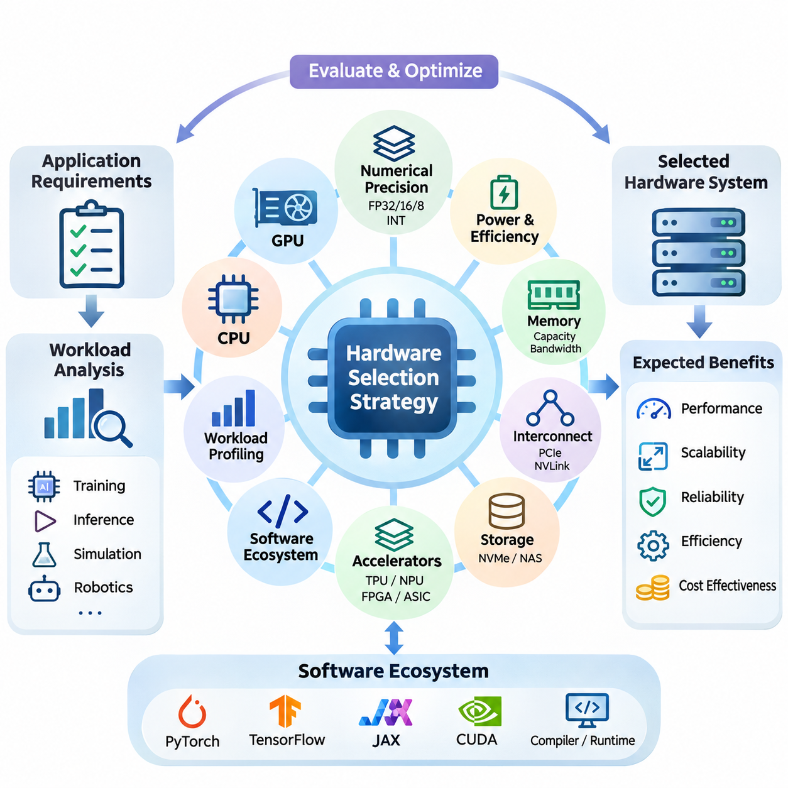
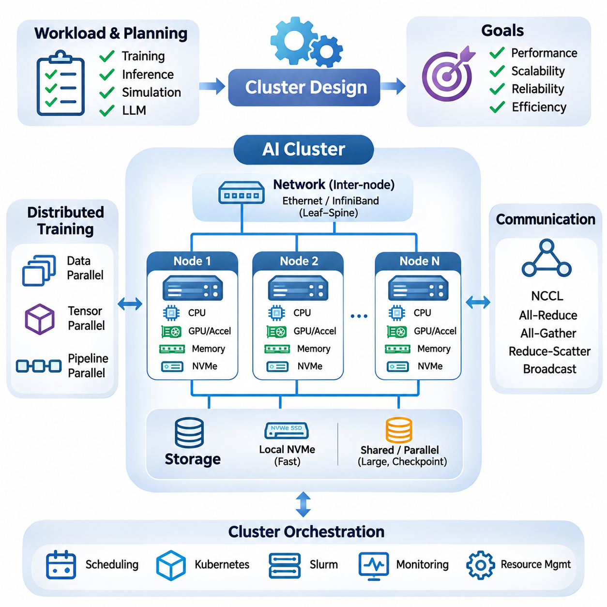
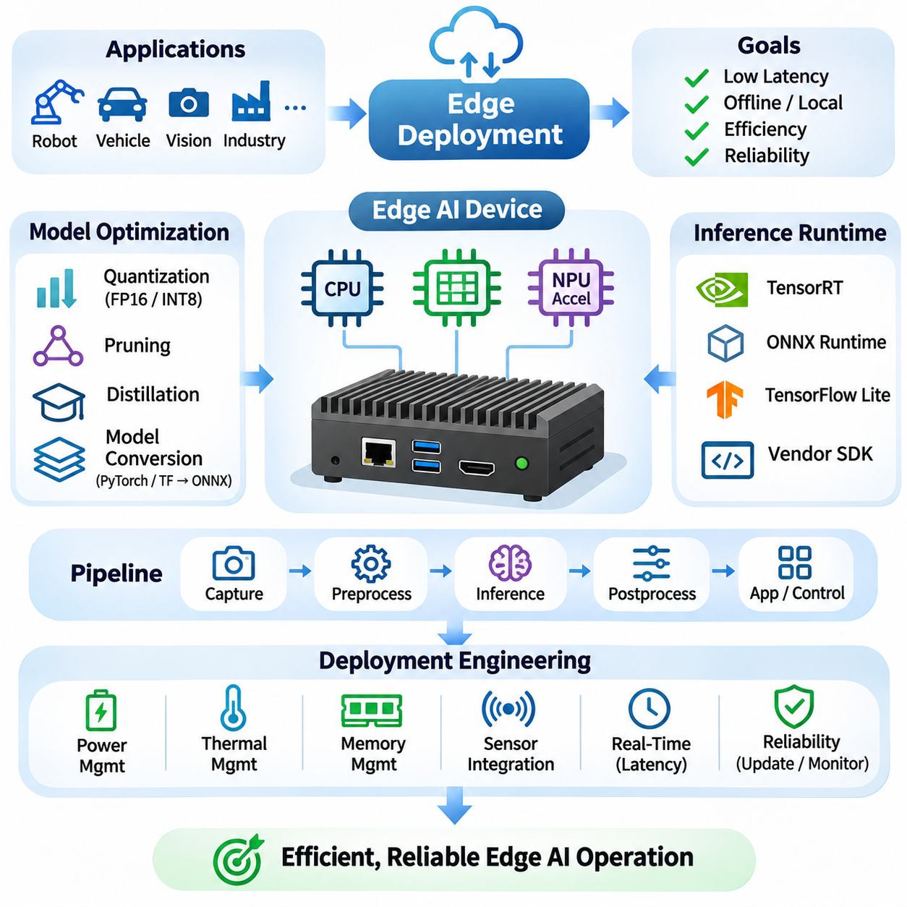
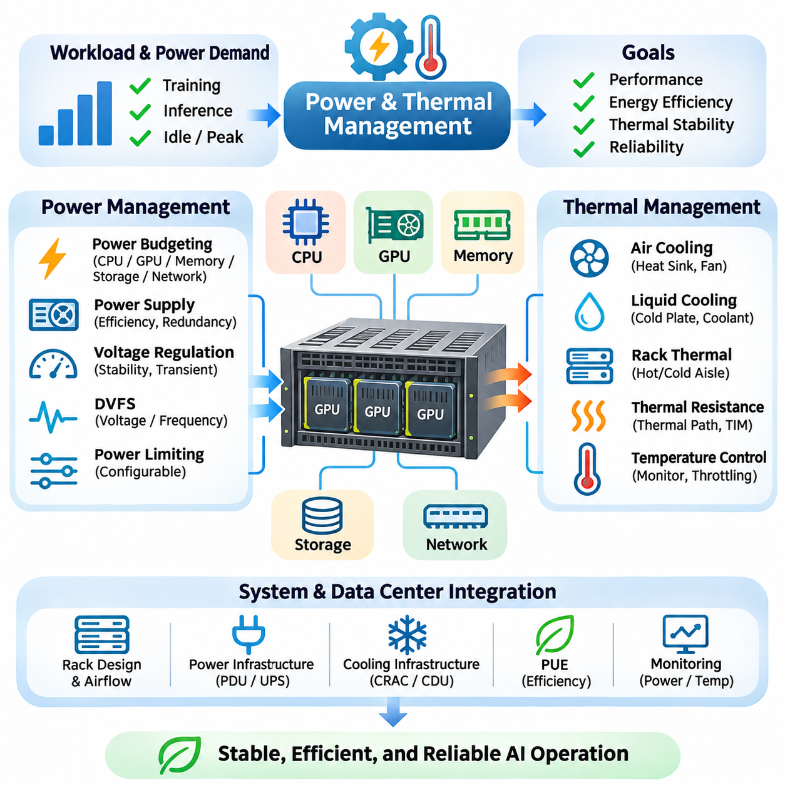
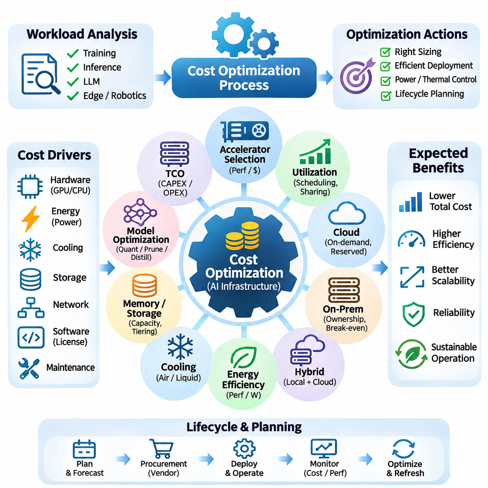
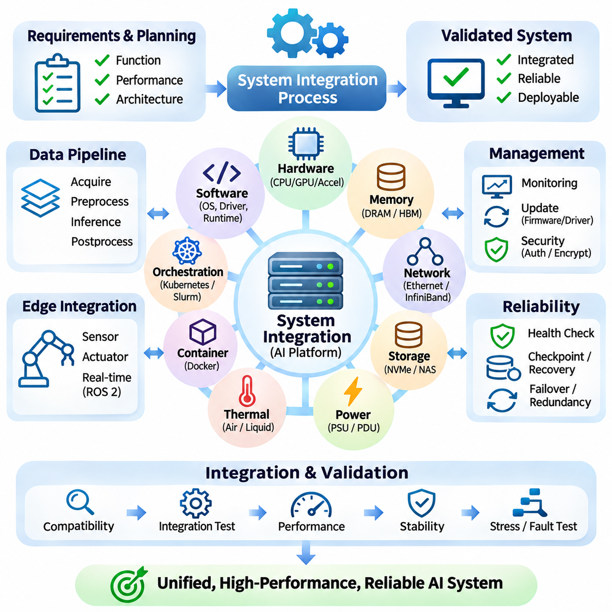

**Volume 39. Hardware for AI**


# 08. Engineering and Deployment

## 08.01 Hardware Selection Strategy

{width="7.268055555555556in" height="7.268055555555556in"}

Hardware selection is a fundamental engineering decision that determines the performance, scalability, reliability, and operational efficiency of artificial intelligence systems. An effective selection strategy begins by translating application requirements into measurable hardware specifications. Rather than choosing devices based solely on peak computational performance, engineers must evaluate the complete relationship between workloads, memory capacity, data movement, power consumption, and deployment constraints.

The first stage involves analyzing the computational characteristics of the intended AI workload. Deep learning training, real-time inference, scientific simulation, and autonomous robotics impose different requirements on hardware resources. Training frequently demands high computational throughput and substantial memory capacity, while inference emphasizes predictable latency and efficiency. Understanding these differences prevents unnecessary investment in hardware capabilities that provide limited practical benefits.

Workload profiling provides quantitative evidence for selecting appropriate processing architectures. Engineers examine arithmetic intensity, tensor dimensions, memory access patterns, batch sizes, and computational dependencies. Operations dominated by matrix multiplication can benefit from specialized tensor accelerators, whereas irregular control logic may execute more efficiently on conventional CPUs. Profiling representative workloads reveals whether performance is primarily limited by computation, memory bandwidth, or communication overhead.

CPU selection remains important even in systems dominated by GPU acceleration. CPUs coordinate operating system functions, data preprocessing, scheduling, communication, and peripheral management. Their core counts, clock frequencies, cache hierarchies, and memory channels influence overall system performance. A powerful accelerator can remain underutilized when insufficient CPU resources delay data preparation or interrupt the execution pipeline.

GPU selection requires evaluating architectural characteristics beyond advertised floating-point performance. Important factors include streaming multiprocessor organization, tensor core capabilities, supported numerical formats, memory bandwidth, and device memory capacity. GPUs designed for large-scale training may prioritize high-bandwidth memory and interconnect performance, while inference-oriented devices often emphasize power efficiency, deployment density, and predictable execution behavior.

Numerical precision requirements directly influence accelerator suitability. Modern AI hardware supports formats such as FP32, FP16, BF16, FP8, and integer quantization, although availability varies by architecture. Lower-precision computation can improve throughput and reduce memory consumption when model accuracy remains acceptable. Hardware evaluation must therefore consider whether the target accelerator efficiently supports the numerical formats required by the selected models and software frameworks.

Memory capacity is frequently a more restrictive constraint than theoretical computational throughput. Large neural networks require storage for parameters, activations, temporary tensors, and potentially optimizer states. Training workloads can consume substantially more memory than inference because intermediate results and gradients must be retained. Engineers should estimate peak memory demand under realistic batch sizes and include sufficient headroom for runtime overhead and future model expansion.

Memory bandwidth and hierarchy also determine effective computational performance. High-bandwidth memory supports data-intensive accelerator operations, while caches and local memory reduce repeated transfers from slower storage levels. Workloads with poor data locality may experience limited accelerator utilization despite substantial arithmetic capability. Hardware selection should therefore account for access patterns, cache behavior, memory channels, and the relationship between computation and data movement.

Interconnect architecture becomes critical when AI workloads span multiple accelerators. PCIe provides general-purpose connectivity, while specialized interconnects such as NVLink can offer higher-bandwidth communication between supported GPUs. Distributed training may require frequent gradient synchronization, parameter exchange, or tensor transfers. The effectiveness of a multi-accelerator configuration depends on topology, communication bandwidth, latency, and collective communication efficiency.

Storage infrastructure must support the sustained data demands of AI pipelines. NVMe solid-state drives provide high local throughput and relatively low access latency, while network-attached and distributed storage systems support shared datasets and centralized management. Selection depends on dataset size, access concurrency, sequential versus random reading patterns, and checkpoint frequency. Insufficient storage throughput can create persistent accelerator idle time.

AI accelerator alternatives should be evaluated according to their architectural specialization and software maturity. Tensor Processing Units emphasize efficient tensor computation, while neural processing units target power-efficient inference. FPGAs offer configurable execution pipelines, and ASICs can provide exceptional efficiency for narrowly defined operations. Each architecture presents different tradeoffs involving programmability, development effort, numerical support, performance, and long-term maintainability.

Software ecosystem compatibility is an essential component of hardware selection. AI development commonly relies on PyTorch, TensorFlow, JAX, CUDA, and specialized compiler or runtime environments. Hardware that lacks mature drivers, optimized kernels, debugging utilities, or supported framework integrations may introduce significant engineering costs. Compatibility testing should verify model operators, numerical formats, deployment runtimes, and operating system requirements before procurement.

Compiler and runtime optimization capabilities can significantly affect the practical value of an accelerator. Technologies such as TensorRT, XLA, and TVM can transform computational graphs, optimize kernel execution, and reduce unnecessary data movement on supported platforms. However, optimization effectiveness depends on hardware architecture and operator coverage. Engineers should benchmark optimized implementations rather than assuming that nominal accelerator specifications predict deployed performance.

Hardware selection for edge AI introduces additional constraints involving physical dimensions, thermal dissipation, energy consumption, and environmental conditions. Embedded platforms such as NVIDIA Jetson integrate computational acceleration with interfaces suitable for cameras, sensors, and robotic controllers. Their suitability depends on sustained inference performance, memory capacity, available interfaces, and power budgets. Peak benchmark results alone cannot establish reliable real-world operation.

Real-time AI applications require special attention to latency predictability. Autonomous vehicles, industrial inspection systems, and robotic platforms may operate under strict perception and control deadlines. Average inference speed is insufficient when occasional execution delays can disrupt system behavior. Engineers must evaluate worst-case or high-percentile latency, scheduling interference, memory contention, and communication delays under realistic operating conditions.

Power consumption should be evaluated at the system level rather than through accelerator specifications alone. CPUs, GPUs, memory, storage, networking equipment, and cooling systems collectively determine electrical demand. Performance per watt provides a useful comparison, but the relevant measurement must reflect actual workload execution. A device with higher peak power may deliver better energy efficiency if it completes computational tasks substantially faster.

Thermal characteristics influence sustained performance and hardware reliability. Accelerators may reduce operating frequencies when cooling capacity cannot maintain acceptable temperatures. Consequently, short-duration benchmarks can overestimate performance during continuous training or inference. Engineers should evaluate thermal design power, airflow requirements, enclosure restrictions, ambient temperature, and cooling redundancy to ensure that the selected hardware maintains stable performance.

Reliability requirements differ considerably between experimental and production environments. Research systems may tolerate occasional interruptions, while industrial AI infrastructure often requires continuous availability and predictable recovery. Enterprise hardware can provide capabilities such as error-correcting memory, advanced monitoring, and validated operating configurations. Selection should consider component failure rates, serviceability, spare-part availability, and the consequences of unexpected downtime.

Scalability planning prevents hardware decisions from becoming obstacles to future development. A single accelerator may satisfy initial experiments but become insufficient as model size, dataset volume, or concurrent users increase. Engineers should examine available expansion slots, power capacity, memory scalability, networking infrastructure, and supported accelerator configurations. Modular architectures can simplify upgrades, although expansion flexibility must be balanced against initial acquisition costs.

Hardware procurement should account for total cost of ownership rather than purchase price alone. Operational expenses include electricity, cooling, maintenance, software support, infrastructure upgrades, and engineering labor. Equipment utilization strongly influences economic efficiency because expensive accelerators provide limited value when frequently idle. Cost comparisons should relate expenditure to completed training workloads, inference requests, or other measurable application outcomes.

Cloud and on-premises hardware introduce different economic and operational tradeoffs. Cloud infrastructure provides rapid provisioning, elastic capacity, and access to specialized accelerators without substantial initial investment. On-premises systems offer greater physical control and potentially favorable economics under sustained utilization. Selection should consider workload variability, data governance, network transfer costs, equipment depreciation, and the operational expertise required to maintain infrastructure.

A structured evaluation process should compare candidate hardware using representative workloads and consistent measurement conditions. Relevant measurements include training throughput, inference latency, accelerator utilization, memory consumption, energy use, and operational stability. Results should be collected with documented software versions, numerical precision, batch sizes, and system configurations. This approach reduces the risk of selecting hardware based on misleading specifications or incomparable benchmarks.

Prototype validation provides an opportunity to identify integration problems before committing to large-scale procurement. Engineers can test accelerator compatibility, peripheral connectivity, power delivery, thermal behavior, and workload execution using a limited hardware configuration. Prototype results may expose unexpected bottlenecks in CPU preprocessing, storage access, or communication. Early validation reduces redesign costs and improves confidence in subsequent deployment decisions.

Hardware selection must also consider lifecycle management and supply-chain stability. Accelerator availability, component lead times, vendor support policies, and replacement compatibility affect long-term system sustainability. Proprietary software dependencies may increase migration costs when hardware platforms change. Organizations should document architectural assumptions and establish contingency options for critical components, especially when AI systems are expected to operate for many years.

The final selection should emerge from a balanced assessment of performance, compatibility, reliability, scalability, energy efficiency, and economic feasibility. No single hardware architecture is optimal for every AI workload. Successful engineering aligns processing resources, memory systems, communication infrastructure, and software capabilities with measurable application requirements. This workload-driven strategy establishes a reliable foundation for subsequent cluster design, edge deployment, and system integration.

하드웨어 선택(Hardware Selection)은 인공지능(Artificial Intelligence, AI) 시스템의 성능(Performance), 확장성(Scalability), 신뢰성(Reliability), 운영 효율성(Operational Efficiency)을 결정하는 핵심 엔지니어링 의사결정이다. 효과적인 선택 전략은 애플리케이션 요구사항(Application Requirements)을 측정 가능한 하드웨어 사양(Hardware Specifications)으로 변환하는 과정에서 시작된다. 단순히 최대 연산 성능(Peak Computational Performance)만을 기준으로 장치를 선택하기보다는 작업 부하(Workload), 메모리 용량(Memory Capacity), 데이터 이동(Data Movement), 전력 소비(Power Consumption), 배포 제약조건(Deployment Constraints) 사이의 전체적인 관계를 평가해야 한다.

첫 번째 단계에서는 대상 인공지능 작업 부하(AI Workload)의 연산 특성(Computational Characteristics)을 분석한다. 딥러닝 학습(Deep Learning Training), 실시간 추론(Real-Time Inference), 과학 시뮬레이션(Scientific Simulation), 자율 로보틱스(Autonomous Robotics)는 서로 다른 하드웨어 자원을 요구한다. 학습은 일반적으로 높은 연산 처리량(Computational Throughput)과 충분한 메모리 용량을 필요로 하지만, 추론은 예측 가능한 지연시간(Predictable Latency)과 실행 효율성(Execution Efficiency)을 강조한다. 이러한 차이를 이해하면 실제 활용 가치가 제한적인 하드웨어 기능에 불필요하게 투자하는 것을 방지할 수 있다.

작업 부하 프로파일링(Workload Profiling)은 적절한 처리 아키텍처(Processing Architecture)를 선택하기 위한 정량적 근거를 제공한다. 엔지니어는 연산 집약도(Arithmetic Intensity), 텐서 차원(Tensor Dimensions), 메모리 접근 패턴(Memory Access Patterns), 배치 크기(Batch Size), 연산 의존성(Computational Dependencies)을 분석한다. 행렬 곱셈(Matrix Multiplication)이 중심인 연산은 특수 텐서 가속기(Tensor Accelerator)의 이점을 얻을 수 있지만, 불규칙한 제어 논리(Control Logic)는 기존 중앙처리장치(CPU)에서 더 효율적으로 실행될 수 있다. 대표적인 작업 부하를 프로파일링하면 성능이 연산 능력, 메모리 대역폭 또는 통신 오버헤드 중 무엇에 의해 제한되는지 파악할 수 있다.

중앙처리장치(Central Processing Unit, CPU)의 선택은 그래픽처리장치(GPU) 가속이 중심인 시스템에서도 중요하다. CPU는 운영체제(Operating System) 기능, 데이터 전처리(Data Preprocessing), 스케줄링(Scheduling), 통신(Communication), 주변장치 관리(Peripheral Management)를 조정한다. 코어 수(Core Count), 클록 주파수(Clock Frequency), 캐시 계층구조(Cache Hierarchy), 메모리 채널(Memory Channels)은 전체 시스템 성능에 영향을 미친다. CPU 자원이 부족하여 데이터 준비가 지연되거나 실행 파이프라인(Execution Pipeline)이 중단되면 강력한 가속기도 충분히 활용되지 못할 수 있다.

그래픽처리장치(Graphics Processing Unit, GPU)를 선택할 때는 표시된 부동소수점 연산 성능(Floating-Point Performance) 이외의 아키텍처 특성도 평가해야 한다. 중요한 요소에는 스트리밍 멀티프로세서(Streaming Multiprocessor, SM) 구성, 텐서 코어(Tensor Core) 기능, 지원 수치 형식(Numerical Formats), 메모리 대역폭(Memory Bandwidth), 장치 메모리 용량(Device Memory Capacity)이 포함된다. 대규모 학습용 GPU는 고대역폭 메모리(High-Bandwidth Memory, HBM)와 상호연결(Interconnect) 성능을 우선시할 수 있으며, 추론용 장치는 전력 효율성, 배포 밀도(Deployment Density), 예측 가능한 실행 특성을 강조하는 경우가 많다.

수치 정밀도(Numerical Precision) 요구사항은 가속기의 적합성에 직접적인 영향을 미친다. 최신 AI 하드웨어는 아키텍처에 따라 FP32, FP16, BF16, FP8 및 정수 양자화(Integer Quantization)와 같은 형식을 지원한다. 저정밀도 연산(Low-Precision Computation)은 모델 정확도(Model Accuracy)가 허용 범위 내에서 유지될 경우 처리량을 높이고 메모리 소비를 줄일 수 있다. 따라서 하드웨어 평가에서는 대상 가속기가 선택한 모델과 소프트웨어 프레임워크(Software Framework)에 필요한 수치 형식을 효율적으로 지원하는지 확인해야 한다.

메모리 용량(Memory Capacity)은 이론적인 연산 처리량보다 더 엄격한 제약조건이 되는 경우가 많다. 대규모 신경망(Neural Network)은 모델 매개변수(Model Parameters), 활성화 값(Activations), 임시 텐서(Temporary Tensors), 경우에 따라 최적화기 상태(Optimizer States)를 저장할 공간이 필요하다. 학습 작업은 중간 결과(Intermediate Results)와 기울기(Gradients)를 유지해야 하므로 추론보다 훨씬 많은 메모리를 사용할 수 있다. 엔지니어는 실제 배치 크기를 기준으로 최대 메모리 요구량(Peak Memory Demand)을 추정하고 실행 환경의 오버헤드(Runtime Overhead)와 향후 모델 확장을 위한 충분한 여유 용량을 확보해야 한다.

메모리 대역폭(Memory Bandwidth)과 메모리 계층구조(Memory Hierarchy) 역시 실효 연산 성능(Effective Computational Performance)을 결정한다. 고대역폭 메모리는 데이터 집약적인 가속기 연산을 지원하며, 캐시(Cache)와 로컬 메모리(Local Memory)는 상대적으로 느린 저장 계층에서 반복적으로 데이터를 전송하는 작업을 줄인다. 데이터 지역성(Data Locality)이 낮은 작업 부하는 높은 연산 능력에도 불구하고 가속기 활용률(Accelerator Utilization)이 제한될 수 있다. 따라서 하드웨어 선택에서는 접근 패턴, 캐시 동작, 메모리 채널, 연산과 데이터 이동 사이의 관계를 함께 고려해야 한다.

상호연결 아키텍처(Interconnect Architecture)는 AI 작업이 여러 가속기에 분산될 때 중요해진다. PCIe는 범용 연결 기능을 제공하며, NVLink와 같은 특수 상호연결 기술은 지원되는 GPU 사이에서 더 높은 대역폭의 통신을 제공할 수 있다. 분산 학습(Distributed Training)에서는 기울기 동기화(Gradient Synchronization), 매개변수 교환(Parameter Exchange), 텐서 전송(Tensor Transfer)이 빈번하게 발생할 수 있다. 다중 가속기 구성(Multi-Accelerator Configuration)의 효율성은 연결 토폴로지(Topology), 통신 대역폭, 지연시간, 집합 통신(Collective Communication)의 효율성에 따라 달라진다.

스토리지 인프라(Storage Infrastructure)는 AI 파이프라인(AI Pipeline)의 지속적인 데이터 요구량을 충족해야 한다. NVMe 기반 솔리드 스테이트 드라이브(Solid-State Drive, SSD)는 높은 로컬 처리량과 비교적 낮은 접근 지연시간을 제공하며, 네트워크 연결 스토리지(Network-Attached Storage, NAS)와 분산 스토리지(Distributed Storage)는 공유 데이터셋(Shared Dataset)과 중앙집중식 관리(Centralized Management)를 지원한다. 선택 기준에는 데이터셋 크기, 동시 접근 수준, 순차 및 무작위 읽기 패턴, 체크포인트(Checkpoint) 저장 빈도가 포함된다. 스토리지 처리량이 부족하면 가속기가 지속적으로 유휴 상태(Idle State)에 머무를 수 있다.

대체 AI 가속기(AI Accelerator)는 아키텍처의 특화 수준과 소프트웨어 성숙도(Software Maturity)를 기준으로 평가해야 한다. 텐서처리장치(Tensor Processing Unit, TPU)는 효율적인 텐서 연산을 강조하며, 신경망처리장치(Neural Processing Unit, NPU)는 전력 효율적인 추론을 목표로 한다. 현장 프로그래머블 게이트 어레이(Field-Programmable Gate Array, FPGA)는 구성 가능한 실행 파이프라인을 제공하며, 주문형 집적회로(Application-Specific Integrated Circuit, ASIC)는 특정 연산에서 매우 높은 효율성을 제공할 수 있다. 각 아키텍처는 프로그래밍 가능성, 개발 노력, 수치 지원, 성능, 장기 유지보수성 사이에서 서로 다른 절충관계를 가진다.

소프트웨어 생태계 호환성(Software Ecosystem Compatibility)은 하드웨어 선택의 필수 요소이다. AI 개발에서는 일반적으로 PyTorch, TensorFlow, JAX, CUDA 및 특수 컴파일러(Compiler) 또는 런타임 환경(Runtime Environment)을 활용한다. 성숙한 드라이버(Driver), 최적화된 커널(Optimized Kernel), 디버깅 도구(Debugging Tools), 프레임워크 통합(Framework Integration)이 부족한 하드웨어는 상당한 엔지니어링 비용을 발생시킬 수 있다. 따라서 구매 전에 모델 연산자(Model Operators), 수치 형식, 배포 런타임(Deployment Runtime), 운영체제 요구사항에 대한 호환성 검증(Compatibility Testing)을 수행해야 한다.

컴파일러 및 런타임 최적화(Runtime Optimization) 기능은 가속기의 실질적인 활용 가치에 큰 영향을 미칠 수 있다. TensorRT, XLA, TVM과 같은 기술은 지원되는 플랫폼에서 연산 그래프(Computational Graph)를 변환하고 커널 실행을 최적화하며 불필요한 데이터 이동을 줄일 수 있다. 그러나 최적화 효과는 하드웨어 아키텍처와 연산자 지원 범위(Operator Coverage)에 따라 달라진다. 엔지니어는 명목상의 가속기 사양만으로 배포 성능을 예측하기보다는 최적화된 구현을 실제로 벤치마킹(Benchmarking)해야 한다.

엣지 인공지능(Edge AI)을 위한 하드웨어 선택에는 물리적 크기(Physical Dimensions), 열 방출(Thermal Dissipation), 에너지 소비(Energy Consumption), 환경 조건(Environmental Conditions)과 관련된 추가 제약이 존재한다. NVIDIA Jetson과 같은 임베디드 플랫폼(Embedded Platform)은 카메라, 센서, 로봇 제어기에 적합한 인터페이스와 연산 가속 기능을 통합한다. 플랫폼의 적합성은 지속적인 추론 성능(Sustained Inference Performance), 메모리 용량, 사용 가능한 인터페이스, 전력 예산(Power Budget)에 따라 결정된다. 최대 벤치마크 성능만으로 실제 환경에서의 안정적인 작동을 보장할 수는 없다.

실시간 AI(Real-Time AI) 애플리케이션에서는 지연시간 예측 가능성(Latency Predictability)을 특별히 고려해야 한다. 자율주행차(Autonomous Vehicle), 산업 검사 시스템(Industrial Inspection System), 로봇 플랫폼(Robotic Platform)은 엄격한 인지 및 제어 마감시간(Perception and Control Deadlines) 내에서 작동해야 할 수 있다. 간헐적인 실행 지연이 시스템 동작을 방해할 수 있으므로 평균 추론 속도만으로는 충분하지 않다. 엔지니어는 실제 운영 조건에서 최악 사례 지연시간(Worst-Case Latency), 높은 백분위 지연시간(High-Percentile Latency), 스케줄링 간섭(Scheduling Interference), 메모리 경합(Memory Contention), 통신 지연을 평가해야 한다.

전력 소비(Power Consumption)는 가속기 사양만이 아니라 시스템 전체 수준(System Level)에서 평가해야 한다. CPU, GPU, 메모리, 스토리지, 네트워크 장비, 냉각 시스템(Cooling System)은 모두 전력 수요에 영향을 미친다. 와트당 성능(Performance per Watt)은 유용한 비교 지표이지만 실제 작업 부하 실행을 반영해야 한다. 최대 전력이 높은 장치라도 연산 작업을 훨씬 빠르게 완료한다면 전체 에너지 효율성(Energy Efficiency)이 더 높을 수 있다.

열 특성(Thermal Characteristics)은 지속 성능(Sustained Performance)과 하드웨어 신뢰성에 영향을 미친다. 냉각 용량(Cooling Capacity)이 허용 온도를 유지하지 못하면 가속기는 동작 주파수(Operating Frequency)를 낮출 수 있다. 따라서 짧은 시간 동안 수행한 벤치마크는 연속적인 학습 또는 추론 과정에서의 성능을 과대평가할 수 있다. 엔지니어는 열설계전력(Thermal Design Power, TDP), 공기 흐름(Airflow), 인클로저 제약조건(Enclosure Constraints), 주변 온도(Ambient Temperature), 냉각 이중화(Cooling Redundancy)를 평가하여 안정적인 성능을 확보해야 한다.

신뢰성 요구사항(Reliability Requirements)은 실험 환경과 실제 운영 환경에서 상당히 다르다. 연구 시스템(Research System)은 간헐적인 중단을 허용할 수 있지만, 산업용 AI 인프라(Industrial AI Infrastructure)는 지속적인 가용성(Continuous Availability)과 예측 가능한 복구(Recovery)를 요구하는 경우가 많다. 엔터프라이즈급 하드웨어(Enterprise Hardware)는 오류 정정 메모리(Error-Correcting Memory, ECC), 고급 모니터링(Advanced Monitoring), 검증된 운영 구성(Validated Operating Configuration)과 같은 기능을 제공할 수 있다. 선택 과정에서는 부품 고장률(Component Failure Rate), 정비 용이성(Serviceability), 예비 부품 가용성(Spare-Part Availability), 예기치 않은 가동 중단(Downtime)의 영향을 고려해야 한다.

확장성 계획(Scalability Planning)은 초기 하드웨어 결정이 향후 개발의 장애물이 되는 것을 방지한다. 단일 가속기(Single Accelerator)는 초기 실험에는 충분할 수 있지만 모델 크기, 데이터셋 용량, 동시 사용자 수가 증가하면 부족해질 수 있다. 엔지니어는 확장 슬롯(Expansion Slots), 전력 공급 용량(Power Capacity), 메모리 확장성(Memory Scalability), 네트워크 인프라(Network Infrastructure), 지원되는 가속기 구성을 검토해야 한다. 모듈형 아키텍처(Modular Architecture)는 업그레이드를 단순화할 수 있지만 확장 유연성과 초기 구매 비용 사이의 균형이 필요하다.

하드웨어 구매(Hardware Procurement)에서는 단순한 구매 가격보다 총소유비용(Total Cost of Ownership, TCO)을 고려해야 한다. 운영비용(Operational Expenses)에는 전기, 냉각, 유지보수, 소프트웨어 지원, 인프라 업그레이드, 엔지니어링 인건비가 포함된다. 고가의 가속기가 자주 유휴 상태에 머문다면 경제적 가치가 제한되므로 장비 활용률(Equipment Utilization)은 비용 효율성에 큰 영향을 미친다. 비용 비교는 완료된 학습 작업, 추론 요청 또는 기타 측정 가능한 애플리케이션 성과와 지출을 연결하여 수행해야 한다.

클라우드(Cloud)와 온프레미스(On-Premises) 하드웨어는 경제성과 운영 측면에서 서로 다른 절충관계를 가진다. 클라우드 인프라(Cloud Infrastructure)는 대규모 초기 투자 없이 신속한 자원 프로비저닝(Resource Provisioning), 탄력적인 용량(Elastic Capacity), 특수 가속기에 대한 접근을 제공한다. 온프레미스 시스템(On-Premises System)은 더 높은 물리적 통제권(Physical Control)을 제공하며 지속적인 높은 활용률 조건에서 경제적으로 유리할 수 있다. 선택 시에는 작업 부하 변동성(Workload Variability), 데이터 거버넌스(Data Governance), 네트워크 전송 비용(Network Transfer Costs), 장비 감가상각(Equipment Depreciation), 인프라 유지에 필요한 운영 전문성을 고려해야 한다.

체계적인 평가 프로세스(Structured Evaluation Process)는 대표적인 작업 부하와 일관된 측정 조건을 활용하여 후보 하드웨어를 비교해야 한다. 주요 측정 항목에는 학습 처리량(Training Throughput), 추론 지연시간(Inference Latency), 가속기 활용률, 메모리 소비, 에너지 사용량, 운영 안정성(Operational Stability)이 포함된다. 결과는 소프트웨어 버전(Software Versions), 수치 정밀도, 배치 크기, 시스템 구성(System Configuration)과 함께 기록해야 한다. 이러한 접근은 오해의 소지가 있는 사양이나 비교할 수 없는 벤치마크 결과에 기반하여 하드웨어를 선택할 위험을 줄인다.

프로토타입 검증(Prototype Validation)은 대규모 구매를 결정하기 전에 시스템 통합 문제(System Integration Problems)를 발견할 기회를 제공한다. 엔지니어는 제한된 하드웨어 구성에서 가속기 호환성, 주변장치 연결(Peripheral Connectivity), 전력 공급(Power Delivery), 열 동작(Thermal Behavior), 작업 부하 실행을 시험할 수 있다. 프로토타입 결과는 CPU 전처리, 스토리지 접근, 통신 과정에서 예상하지 못한 병목현상(Bottleneck)을 드러낼 수 있다. 초기 검증은 재설계 비용(Redesign Costs)을 줄이고 후속 배포 결정에 대한 신뢰도를 높인다.

하드웨어 선택에서는 수명주기 관리(Lifecycle Management)와 공급망 안정성(Supply-Chain Stability)도 고려해야 한다. 가속기 공급 가능성(Accelerator Availability), 부품 조달 기간(Component Lead Time), 공급업체 지원 정책(Vendor Support Policies), 교체 호환성(Replacement Compatibility)은 장기적인 시스템 지속가능성(System Sustainability)에 영향을 미친다. 독점 소프트웨어 의존성(Proprietary Software Dependencies)은 하드웨어 플랫폼 변경 시 마이그레이션 비용(Migration Costs)을 증가시킬 수 있다. 조직은 핵심 아키텍처 가정(Architectural Assumptions)을 문서화하고, 특히 장기간 운영되는 AI 시스템의 핵심 부품에 대해 대체 방안(Contingency Options)을 마련해야 한다.

최종 하드웨어 선택은 성능, 호환성(Compatibility), 신뢰성, 확장성, 에너지 효율성, 경제적 타당성(Economic Feasibility)을 균형 있게 평가한 결과여야 한다. 모든 AI 작업 부하에 최적인 단일 하드웨어 아키텍처는 존재하지 않는다. 성공적인 엔지니어링은 처리 자원(Processing Resources), 메모리 시스템(Memory Systems), 통신 인프라(Communication Infrastructure), 소프트웨어 기능(Software Capabilities)을 측정 가능한 애플리케이션 요구사항에 맞게 정렬하는 것이다. 이러한 작업 부하 중심 전략(Workload-Driven Strategy)은 이후 클러스터 설계(Cluster Design), 엣지 배포(Edge Deployment), 시스템 통합(System Integration)을 위한 신뢰성 높은 기반을 제공한다.

## 08.02 Cluster Design

{width="7.268055555555556in" height="7.268055555555556in"}

Cluster design is a fundamental engineering discipline that integrates multiple computing nodes into a coordinated infrastructure capable of executing large-scale artificial intelligence workloads. An effective AI cluster must balance computational throughput, memory capacity, communication efficiency, storage performance, and operational reliability. Its architecture should reflect application requirements rather than simply maximizing the number of installed accelerators.

The design process begins with workload characterization and capacity planning. Distributed training, large language model inference, scientific computing, and simulation impose different resource demands. Engineers estimate model size, dataset volume, accelerator memory requirements, concurrency, and expected growth. These measurements determine the number of computing nodes, their internal configurations, and the communication infrastructure necessary to support efficient execution.

A computing node typically integrates CPUs, GPUs or specialized accelerators, system memory, local storage, and network interfaces. Node architecture determines how efficiently these components cooperate during AI execution. CPU socket placement, PCIe connectivity, memory channels, and accelerator topology influence data transfer performance. Balanced node configurations prevent individual subsystems from becoming persistent bottlenecks during computationally intensive workloads.

GPU topology is particularly important for distributed deep learning. Multiple accelerators within a node may communicate through PCIe or supported high-bandwidth interconnects such as NVLink. Communication capabilities vary across accelerator generations and server platforms. Engineers must examine actual device connectivity rather than assuming uniform peer-to-peer bandwidth. Efficient topology placement reduces synchronization overhead and improves the execution of model-parallel workloads.

Inter-node networking determines how effectively a cluster scales beyond individual servers. Ethernet and InfiniBand provide communication infrastructure with different performance characteristics and deployment considerations. High-speed networking is especially valuable when distributed workloads exchange gradients, activations, or model parameters frequently. Network selection should consider bandwidth, latency, congestion behavior, adapter capabilities, and the communication patterns of target applications.

Network topology influences communication efficiency and infrastructure cost. Leaf-spine architectures can provide substantial aggregate bandwidth and predictable connectivity when properly provisioned. Oversubscription ratios determine how much traffic can traverse shared network links simultaneously. AI training clusters with intensive collective communication generally benefit from low-oversubscription designs, while less communication-intensive workloads may tolerate more economical network configurations.

Distributed training introduces communication requirements that must be considered during cluster planning. Data parallelism replicates models across accelerators and synchronizes gradients, while tensor parallelism distributes mathematical operations across devices. Pipeline parallelism divides model execution into sequential stages. Each approach creates different communication patterns, making topology-aware placement essential for maintaining high accelerator utilization.

Collective communication libraries coordinate operations such as all-reduce, all-gather, reduce-scatter, and broadcast across distributed devices. Technologies such as NVIDIA NCCL optimize supported GPU communication paths and network configurations. Their effectiveness depends on hardware topology, message size, synchronization frequency, and network congestion. Cluster engineers should benchmark collective operations independently to identify communication limitations before deploying large training workloads.

Memory architecture must support both individual node execution and distributed model placement. GPU memory capacity determines how much model state can remain directly accessible to accelerators. System DRAM supports preprocessing, buffering, and host-side operations. Distributed workloads may require parameter sharding, activation checkpointing, or offloading to accommodate large models. These techniques reduce memory pressure but introduce additional computation or data movement.

Storage design is equally important because AI clusters process large datasets and generate frequent checkpoints. Local NVMe storage provides fast temporary access, while shared storage enables coordinated dataset distribution and recovery. Network-attached storage, parallel file systems, and object storage offer different scalability characteristics. Engineers must evaluate aggregate throughput, metadata performance, concurrent access patterns, and checkpoint restoration requirements.

Data ingestion pipelines should deliver training samples without repeatedly stalling accelerators. Dataset preprocessing, decompression, augmentation, and caching may consume substantial CPU and storage resources. Distributed data loaders must partition datasets consistently while maintaining sufficient randomness for training. Prefetching and local caching can reduce repeated network transfers, but their effectiveness depends on dataset organization and available memory.

Cluster orchestration coordinates resource allocation, job scheduling, and operational management. Platforms such as Kubernetes and Slurm support different deployment models and scheduling requirements. Kubernetes is commonly associated with containerized services and flexible orchestration, while Slurm is widely used for batch-oriented high-performance computing. The appropriate scheduler depends on workload duration, resource sharing, operational complexity, and organizational requirements.

Resource scheduling should account for accelerator topology, memory capacity, and communication locality. Assigning distributed jobs across poorly connected nodes can increase synchronization delays and reduce throughput. Topology-aware scheduling attempts to place related processes near suitable communication resources. Scheduling policies must also address job priorities, queue fairness, resource fragmentation, and the coexistence of training and inference workloads.

Containerization improves reproducibility by packaging application dependencies, runtime libraries, and execution environments. Container images can standardize software configurations across heterogeneous computing nodes. However, GPU workloads still depend on compatible host drivers, device interfaces, and accelerator runtime support. Cluster deployment procedures should validate these dependencies and maintain controlled software versions to reduce unexpected compatibility failures.

High availability and fault tolerance become increasingly important as cluster size grows. Large distributed jobs may encounter hardware failures, network interruptions, or software crashes during extended execution. Checkpointing allows training to resume from previously saved states, reducing lost computation. Recovery strategies should consider checkpoint frequency, storage overhead, restart procedures, and whether the distributed framework supports coordinated failure handling.

Monitoring infrastructure provides visibility into cluster health and workload efficiency. Engineers track accelerator utilization, memory consumption, CPU load, network traffic, storage throughput, temperature, and power demand. Observability platforms can combine metrics, logs, and alerts to identify abnormal behavior. Monitoring should distinguish genuine computational saturation from inefficiencies caused by communication delays, data starvation, or scheduling conflicts.

Power distribution and thermal management impose physical limits on cluster density. High-performance accelerator servers can require substantial electrical capacity and cooling infrastructure. Rack-level design must consider power distribution units, redundant power supplies, airflow direction, and heat removal. Sustained AI workloads can generate continuous thermal loads, making realistic power and cooling assessments essential before equipment installation.

Cluster scalability depends on both horizontal expansion and architectural consistency. Adding computing nodes increases available resources, but application performance may not scale proportionally. Communication overhead, synchronization barriers, storage contention, and workload imbalance can limit efficiency. Engineers should measure strong scaling and weak scaling behavior to understand whether additional hardware provides meaningful computational benefits.

Heterogeneous clusters combine different processor generations, accelerator types, or memory configurations. Such environments can improve resource utilization by matching workloads to suitable devices. However, heterogeneous scheduling introduces complications involving numerical compatibility, performance imbalance, and software dependencies. Workload placement should account for actual device capabilities rather than treating all accelerators as interchangeable resources.

Security architecture must protect shared infrastructure, training datasets, model artifacts, and administrative interfaces. Network segmentation, identity management, access controls, and encrypted communication help reduce unauthorized access. Multi-tenant clusters require isolation between workloads and careful management of privileged operations. Security controls should be integrated into provisioning, orchestration, storage access, and monitoring rather than added after deployment.

Cluster economics should be evaluated through total cost of ownership and useful computational output. Hardware acquisition, networking, storage, electricity, cooling, maintenance, and administration contribute to operational expenditure. Accelerator utilization strongly influences cost efficiency because unused resources continue to incur infrastructure expenses. Cost per training run, completed experiment, or inference request provides more meaningful information than hardware purchase price alone.

Capacity management should incorporate future workload growth and changing model architectures. Increasing parameter counts, longer context windows, larger datasets, and higher inference concurrency may alter resource requirements. Modular infrastructure enables incremental expansion, but power capacity, networking, and storage must accommodate anticipated growth. Excessive overprovisioning increases costs, while insufficient capacity creates persistent scheduling delays.

Performance validation should use representative distributed workloads rather than relying exclusively on synthetic benchmarks. Engineers evaluate training throughput, communication efficiency, scaling behavior, checkpoint duration, and resource utilization under realistic conditions. Benchmark results must document accelerator configurations, network topology, software versions, and workload parameters. Consistent measurement enables reliable comparisons between alternative cluster architectures.

A successful AI cluster integrates computing, communication, storage, orchestration, reliability, and operational management into a coherent system. Its effectiveness depends on balanced engineering decisions rather than isolated hardware specifications. By aligning architecture with measurable workload requirements, organizations can build infrastructure that supports efficient distributed training, scalable inference, and dependable long-term operation while controlling complexity and cost.

클러스터 설계(Cluster Design)는 여러 컴퓨팅 노드(Computing Nodes)를 하나의 통합된 인프라(Infrastructure)로 구성하여 대규모 인공지능 작업 부하(Artificial Intelligence Workloads)를 실행할 수 있도록 하는 핵심 엔지니어링 분야이다. 효과적인 AI 클러스터(AI Cluster)는 연산 처리량(Computational Throughput), 메모리 용량(Memory Capacity), 통신 효율성(Communication Efficiency), 스토리지 성능(Storage Performance), 운영 신뢰성(Operational Reliability) 사이의 균형을 유지해야 한다. 클러스터 아키텍처(Cluster Architecture)는 단순히 설치된 가속기(Accelerator)의 수를 최대화하기보다는 애플리케이션 요구사항(Application Requirements)을 반영하여 설계되어야 한다.

설계 과정은 작업 부하 특성 분석(Workload Characterization)과 용량 계획(Capacity Planning)에서 시작된다. 분산 학습(Distributed Training), 대규모 언어 모델 추론(Large Language Model Inference), 과학 컴퓨팅(Scientific Computing), 시뮬레이션(Simulation)은 서로 다른 자원 요구사항을 가진다. 엔지니어는 모델 크기(Model Size), 데이터셋 용량(Dataset Volume), 가속기 메모리 요구량(Accelerator Memory Requirements), 동시 처리 수준(Concurrency), 예상 성장 규모(Expected Growth)를 추정한다. 이러한 측정 결과는 컴퓨팅 노드의 수, 내부 구성, 효율적인 실행을 지원하는 통신 인프라(Communication Infrastructure)를 결정하는 기준이 된다.

컴퓨팅 노드(Computing Node)는 일반적으로 중앙처리장치(Central Processing Unit, CPU), 그래픽처리장치(Graphics Processing Unit, GPU) 또는 특수 가속기(Specialized Accelerator), 시스템 메모리(System Memory), 로컬 스토리지(Local Storage), 네트워크 인터페이스(Network Interface)를 통합한다. 노드 아키텍처(Node Architecture)는 이러한 구성요소가 AI 연산 과정에서 얼마나 효율적으로 협력하는지를 결정한다. CPU 소켓 배치(CPU Socket Placement), PCIe 연결성(PCIe Connectivity), 메모리 채널(Memory Channels), 가속기 토폴로지(Accelerator Topology)는 데이터 전송 성능에 영향을 미친다. 균형 잡힌 노드 구성은 개별 하위 시스템(Subsystem)이 지속적인 병목현상(Bottleneck)을 일으키는 것을 방지한다.

GPU 토폴로지(GPU Topology)는 분산 딥러닝(Distributed Deep Learning)에서 특히 중요하다. 하나의 노드에 포함된 여러 가속기는 PCIe 또는 NVLink와 같은 지원되는 고대역폭 상호연결(High-Bandwidth Interconnect)을 통해 통신할 수 있다. 통신 기능은 가속기 세대(Accelerator Generation)와 서버 플랫폼(Server Platform)에 따라 달라진다. 엔지니어는 모든 장치 간 통신 대역폭(Peer-to-Peer Bandwidth)이 동일하다고 가정하기보다는 실제 장치 연결 구조(Device Connectivity)를 확인해야 한다. 효율적인 토폴로지 배치(Topology Placement)는 동기화 오버헤드(Synchronization Overhead)를 줄이고 모델 병렬 작업(Model-Parallel Workloads)의 실행 성능을 향상시킨다.

노드 간 네트워킹(Inter-Node Networking)은 클러스터가 개별 서버를 넘어 얼마나 효율적으로 확장되는지를 결정한다. 이더넷(Ethernet)과 인피니밴드(InfiniBand)는 서로 다른 성능 특성과 배포 고려사항을 가진 통신 인프라를 제공한다. 고속 네트워킹(High-Speed Networking)은 분산 작업이 기울기(Gradients), 활성화 값(Activations), 모델 매개변수(Model Parameters)를 빈번하게 교환할 때 특히 유용하다. 네트워크 선택에서는 대역폭(Bandwidth), 지연시간(Latency), 혼잡 동작(Congestion Behavior), 네트워크 어댑터 기능(Adapter Capabilities), 대상 애플리케이션의 통신 패턴(Communication Patterns)을 고려해야 한다.

네트워크 토폴로지(Network Topology)는 통신 효율성과 인프라 비용에 영향을 미친다. 리프-스파인 아키텍처(Leaf-Spine Architecture)는 적절하게 구성될 경우 높은 총 대역폭(Aggregate Bandwidth)과 예측 가능한 연결성(Connectivity)을 제공할 수 있다. 초과 구독 비율(Oversubscription Ratio)은 여러 통신 흐름이 공유 네트워크 링크(Network Link)를 동시에 사용할 수 있는 수준을 결정한다. 집합 통신(Collective Communication)이 집중적으로 발생하는 AI 학습 클러스터는 일반적으로 낮은 초과 구독 구조(Low-Oversubscription Design)의 이점을 얻지만, 통신 집약도가 낮은 작업은 더 경제적인 네트워크 구성을 허용할 수 있다.

분산 학습(Distributed Training)은 클러스터 계획 과정에서 고려해야 할 고유한 통신 요구사항을 발생시킨다. 데이터 병렬화(Data Parallelism)는 여러 가속기에 모델을 복제하고 기울기를 동기화하며, 텐서 병렬화(Tensor Parallelism)는 수학적 연산을 여러 장치에 분산한다. 파이프라인 병렬화(Pipeline Parallelism)는 모델 실행을 순차적인 단계(Sequential Stages)로 분할한다. 각 접근 방식은 서로 다른 통신 패턴을 생성하므로 높은 가속기 활용률(Accelerator Utilization)을 유지하려면 토폴로지 인식 배치(Topology-Aware Placement)가 필수적이다.

집합 통신 라이브러리(Collective Communication Libraries)는 분산 장치 사이에서 올리듀스(All-Reduce), 올개더(All-Gather), 리듀스스캐터(Reduce-Scatter), 브로드캐스트(Broadcast)와 같은 연산을 조정한다. NVIDIA NCCL과 같은 기술은 지원되는 GPU 통신 경로(GPU Communication Paths)와 네트워크 구성을 최적화한다. 이러한 기술의 효과는 하드웨어 토폴로지(Hardware Topology), 메시지 크기(Message Size), 동기화 빈도(Synchronization Frequency), 네트워크 혼잡(Network Congestion)에 따라 달라진다. 클러스터 엔지니어는 대규모 학습 작업을 배포하기 전에 집합 통신 연산을 독립적으로 벤치마킹(Benchmarking)하여 통신 제약을 식별해야 한다.

메모리 아키텍처(Memory Architecture)는 개별 노드의 실행과 분산 모델 배치(Distributed Model Placement)를 모두 지원해야 한다. GPU 메모리 용량(GPU Memory Capacity)은 가속기가 직접 접근할 수 있는 모델 상태(Model State)의 크기를 결정한다. 시스템 동적 랜덤 접근 메모리(System DRAM)는 전처리(Preprocessing), 버퍼링(Buffering), 호스트 측 연산(Host-Side Operations)을 지원한다. 분산 작업은 대규모 모델을 수용하기 위해 매개변수 샤딩(Parameter Sharding), 활성화 체크포인팅(Activation Checkpointing), 오프로딩(Offloading)을 필요로 할 수 있다. 이러한 기술은 메모리 부담을 줄이지만 추가적인 연산 또는 데이터 이동을 발생시킨다.

스토리지 설계(Storage Design) 역시 중요하다. AI 클러스터는 대규모 데이터셋을 처리하고 빈번하게 체크포인트(Checkpoint)를 생성하기 때문이다. 로컬 NVMe 스토리지(Local NVMe Storage)는 빠른 임시 데이터 접근을 제공하며, 공유 스토리지(Shared Storage)는 데이터셋 분배(Dataset Distribution)와 복구(Recovery)를 지원한다. 네트워크 연결 스토리지(Network-Attached Storage, NAS), 병렬 파일 시스템(Parallel File System), 객체 스토리지(Object Storage)는 서로 다른 확장성 특성(Scalability Characteristics)을 가진다. 엔지니어는 총 처리량(Aggregate Throughput), 메타데이터 성능(Metadata Performance), 동시 접근 패턴(Concurrent Access Patterns), 체크포인트 복원 요구사항(Checkpoint Restoration Requirements)을 평가해야 한다.

데이터 수집 및 공급 파이프라인(Data Ingestion Pipeline)은 가속기가 반복적으로 대기하지 않도록 학습 샘플(Training Samples)을 전달해야 한다. 데이터셋 전처리(Dataset Preprocessing), 압축 해제(Decompression), 데이터 증강(Data Augmentation), 캐싱(Caching)은 상당한 CPU 및 스토리지 자원을 소비할 수 있다. 분산 데이터 로더(Distributed Data Loader)는 학습에 필요한 충분한 무작위성(Randomness)을 유지하면서 데이터셋을 일관되게 분할해야 한다. 사전 가져오기(Prefetching)와 로컬 캐싱(Local Caching)은 반복적인 네트워크 전송을 줄일 수 있지만, 효과는 데이터셋 구성과 사용 가능한 메모리에 따라 달라진다.

클러스터 오케스트레이션(Cluster Orchestration)은 자원 할당(Resource Allocation), 작업 스케줄링(Job Scheduling), 운영 관리(Operational Management)를 조정한다. 쿠버네티스(Kubernetes)와 슬럼(Slurm) 같은 플랫폼은 서로 다른 배포 모델(Deployment Models)과 스케줄링 요구사항을 지원한다. Kubernetes는 일반적으로 컨테이너화된 서비스(Containerized Services)와 유연한 오케스트레이션에 사용되며, Slurm은 배치 중심 고성능 컴퓨팅(Batch-Oriented High-Performance Computing)에 널리 활용된다. 적절한 스케줄러(Scheduler)는 작업 실행 시간(Workload Duration), 자원 공유(Resource Sharing), 운영 복잡성(Operational Complexity), 조직의 요구사항에 따라 결정된다.

자원 스케줄링(Resource Scheduling)은 가속기 토폴로지, 메모리 용량, 통신 지역성(Communication Locality)을 고려해야 한다. 분산 작업을 연결성이 낮은 노드에 배치하면 동기화 지연(Synchronization Delays)이 증가하고 처리량이 감소할 수 있다. 토폴로지 인식 스케줄링(Topology-Aware Scheduling)은 관련 프로세스(Process)를 적절한 통신 자원 가까이에 배치하려고 한다. 스케줄링 정책(Scheduling Policies)은 작업 우선순위(Job Priorities), 대기열 공정성(Queue Fairness), 자원 단편화(Resource Fragmentation), 학습 및 추론 작업의 공존(Coexistence)도 관리해야 한다.

컨테이너화(Containerization)는 애플리케이션 의존성(Application Dependencies), 런타임 라이브러리(Runtime Libraries), 실행 환경(Execution Environments)을 패키징하여 재현성(Reproducibility)을 향상시킨다. 컨테이너 이미지(Container Image)는 서로 다른 컴퓨팅 노드에서 소프트웨어 구성을 표준화할 수 있다. 그러나 GPU 작업은 여전히 호환되는 호스트 드라이버(Host Drivers), 장치 인터페이스(Device Interfaces), 가속기 런타임 지원(Accelerator Runtime Support)에 의존한다. 클러스터 배포 절차는 이러한 의존성을 검증하고 소프트웨어 버전을 통제하여 예상하지 못한 호환성 오류(Compatibility Failures)를 줄여야 한다.

고가용성(High Availability)과 결함 허용(Fault Tolerance)은 클러스터 규모가 증가할수록 더욱 중요해진다. 대규모 분산 작업은 장시간 실행되는 동안 하드웨어 고장(Hardware Failures), 네트워크 중단(Network Interruptions), 소프트웨어 충돌(Software Crashes)을 경험할 수 있다. 체크포인팅(Checkpointing)은 이전에 저장된 상태에서 학습을 재개할 수 있도록 하여 손실되는 연산량을 줄인다. 복구 전략(Recovery Strategies)은 체크포인트 저장 빈도(Checkpoint Frequency), 스토리지 오버헤드(Storage Overhead), 재시작 절차(Restart Procedures), 분산 프레임워크(Distributed Framework)의 조정된 장애 처리(Coordinated Failure Handling) 지원 여부를 고려해야 한다.

모니터링 인프라(Monitoring Infrastructure)는 클러스터 상태(Cluster Health)와 작업 효율성(Workload Efficiency)에 대한 가시성(Visibility)을 제공한다. 엔지니어는 가속기 활용률, 메모리 소비, CPU 부하(CPU Load), 네트워크 트래픽(Network Traffic), 스토리지 처리량(Storage Throughput), 온도(Temperature), 전력 수요(Power Demand)를 추적한다. 관측 가능성 플랫폼(Observability Platform)은 메트릭(Metrics), 로그(Logs), 경고(Alerts)를 통합하여 비정상 동작을 식별할 수 있다. 모니터링은 실제 연산 자원의 포화(Computational Saturation)와 통신 지연, 데이터 공급 부족(Data Starvation), 스케줄링 충돌(Scheduling Conflicts)로 발생하는 비효율성을 구분해야 한다.

전력 분배(Power Distribution)와 열 관리(Thermal Management)는 클러스터 집적도(Cluster Density)에 물리적인 한계를 부여한다. 고성능 가속기 서버(High-Performance Accelerator Server)는 상당한 전력 용량(Electrical Capacity)과 냉각 인프라(Cooling Infrastructure)를 요구할 수 있다. 랙 수준 설계(Rack-Level Design)에서는 전력 분배 장치(Power Distribution Unit, PDU), 이중화 전원공급장치(Redundant Power Supplies), 공기 흐름 방향(Airflow Direction), 열 제거(Heat Removal)를 고려해야 한다. 지속적인 AI 작업은 연속적인 열 부하(Thermal Load)를 발생시킬 수 있으므로 장비 설치 전에 실제 조건을 반영한 전력 및 냉각 평가가 필수적이다.

클러스터 확장성(Cluster Scalability)은 수평 확장(Horizontal Expansion)과 아키텍처 일관성(Architectural Consistency)에 따라 결정된다. 컴퓨팅 노드를 추가하면 사용 가능한 자원은 증가하지만 애플리케이션 성능이 반드시 비례하여 향상되는 것은 아니다. 통신 오버헤드(Communication Overhead), 동기화 장벽(Synchronization Barriers), 스토리지 경합(Storage Contention), 작업 부하 불균형(Workload Imbalance)은 확장 효율성을 제한할 수 있다. 엔지니어는 강한 확장성(Strong Scaling)과 약한 확장성(Weak Scaling)을 측정하여 추가 하드웨어가 실질적인 연산 성능 향상을 제공하는지 파악해야 한다.

이기종 클러스터(Heterogeneous Cluster)는 서로 다른 프로세서 세대(Processor Generations), 가속기 유형(Accelerator Types), 메모리 구성(Memory Configurations)을 결합한다. 이러한 환경은 작업에 적합한 장치를 할당함으로써 자원 활용률(Resource Utilization)을 높일 수 있다. 그러나 이기종 스케줄링(Heterogeneous Scheduling)은 수치 호환성(Numerical Compatibility), 성능 불균형(Performance Imbalance), 소프트웨어 의존성(Software Dependencies)과 관련된 복잡성을 증가시킨다. 작업 배치(Workload Placement)는 모든 가속기를 동일한 자원으로 취급하기보다는 실제 장치 기능(Device Capabilities)을 고려해야 한다.

보안 아키텍처(Security Architecture)는 공유 인프라(Shared Infrastructure), 학습 데이터셋(Training Datasets), 모델 산출물(Model Artifacts), 관리 인터페이스(Administrative Interfaces)를 보호해야 한다. 네트워크 분할(Network Segmentation), 신원 관리(Identity Management), 접근 제어(Access Controls), 암호화 통신(Encrypted Communication)은 무단 접근(Unauthorized Access)의 위험을 줄이는 데 도움이 된다. 다중 테넌트 클러스터(Multi-Tenant Cluster)는 작업 간 격리(Workload Isolation)와 특권 작업(Privileged Operations)에 대한 신중한 관리가 필요하다. 보안 통제(Security Controls)는 배포 이후에 추가하기보다는 프로비저닝(Provisioning), 오케스트레이션, 스토리지 접근, 모니터링에 통합되어야 한다.

클러스터 경제성(Cluster Economics)은 총소유비용(Total Cost of Ownership, TCO)과 실질적인 연산 산출물(Useful Computational Output)을 기준으로 평가해야 한다. 하드웨어 구매(Hardware Acquisition), 네트워킹(Networking), 스토리지(Storage), 전기(Electricity), 냉각(Cooling), 유지보수(Maintenance), 관리(Administration)는 운영비용(Operational Expenditure)에 영향을 미친다. 사용되지 않는 자원도 인프라 비용을 발생시키므로 가속기 활용률은 비용 효율성(Cost Efficiency)을 크게 좌우한다. 학습 실행당 비용(Cost per Training Run), 완료된 실험당 비용(Cost per Completed Experiment), 추론 요청당 비용(Cost per Inference Request)은 단순한 하드웨어 구매 가격보다 의미 있는 정보를 제공한다.

용량 관리(Capacity Management)는 향후 작업 부하 증가와 변화하는 모델 아키텍처(Model Architectures)를 반영해야 한다. 매개변수 수(Parameter Counts), 컨텍스트 윈도 크기(Context Window Size), 데이터셋 규모(Dataset Scale), 추론 동시성(Inference Concurrency)의 증가는 자원 요구사항을 변화시킬 수 있다. 모듈형 인프라(Modular Infrastructure)는 점진적인 확장(Incremental Expansion)을 가능하게 하지만 전력 용량, 네트워킹, 스토리지는 예상 성장에 대응할 수 있어야 한다. 과도한 자원 사전 확보(Overprovisioning)는 비용을 증가시키고, 부족한 용량은 지속적인 스케줄링 지연(Scheduling Delays)을 발생시킨다.

성능 검증(Performance Validation)은 합성 벤치마크(Synthetic Benchmarks)에만 의존하지 않고 대표적인 분산 작업(Representative Distributed Workloads)을 활용해야 한다. 엔지니어는 실제 조건에서 학습 처리량(Training Throughput), 통신 효율성, 확장 동작(Scaling Behavior), 체크포인트 소요 시간(Checkpoint Duration), 자원 활용률을 평가한다. 벤치마크 결과에는 가속기 구성(Accelerator Configurations), 네트워크 토폴로지, 소프트웨어 버전(Software Versions), 작업 부하 매개변수(Workload Parameters)를 기록해야 한다. 일관된 측정(Consistent Measurement)은 서로 다른 클러스터 아키텍처 사이의 신뢰할 수 있는 비교를 가능하게 한다.

성공적인 AI 클러스터(AI Cluster)는 컴퓨팅(Computing), 통신(Communication), 스토리지(Storage), 오케스트레이션(Orchestration), 신뢰성(Reliability), 운영 관리(Operational Management)를 일관된 시스템(Coherent System)으로 통합한다. 클러스터의 효과는 개별 하드웨어 사양(Isolated Hardware Specifications)이 아니라 균형 잡힌 엔지니어링 의사결정(Balanced Engineering Decisions)에 달려 있다. 측정 가능한 작업 부하 요구사항(Measurable Workload Requirements)에 아키텍처를 맞춤으로써 조직은 복잡성과 비용을 통제하면서 효율적인 분산 학습, 확장 가능한 추론(Scalable Inference), 신뢰할 수 있는 장기 운영(Long-Term Operation)을 지원하는 인프라를 구축할 수 있다.

## 08.03 Edge Deployment

{width="7.268055555555556in" height="7.268055555555556in"}

Edge deployment refers to the implementation of artificial intelligence models directly on devices located near data sources, sensors, or physical processes. Unlike centralized cloud computing, edge AI performs inference locally to reduce communication latency, network dependency, and unnecessary data transmission. Successful deployment requires coordinated engineering across computing hardware, model optimization, software integration, power management, and operational reliability.

The primary objective of edge deployment is to deliver AI functionality within the computational and environmental constraints of the target device. Industrial robots, autonomous vehicles, smart cameras, and embedded controllers operate under different performance requirements. Engineers must translate application objectives into measurable specifications involving inference latency, throughput, memory consumption, energy efficiency, and response deadlines.

Hardware selection begins with evaluating the capabilities of embedded CPUs, GPUs, neural processing units, and specialized accelerators. Platforms such as NVIDIA Jetson integrate general-purpose processing with parallel acceleration and peripheral connectivity. Their suitability depends on model complexity, supported numerical precision, memory bandwidth, and available interfaces. Hardware decisions must also consider long-term software support and industrial operating conditions.

Edge devices typically have more restrictive memory budgets than cloud servers. Model parameters, intermediate activations, input buffers, and runtime libraries compete for limited memory resources. Excessive memory allocation can produce execution failures or unpredictable latency. Engineers should measure peak memory usage under realistic workloads and reserve sufficient capacity for operating system services, communication processes, and concurrent applications.

Model optimization is essential for achieving efficient edge inference. Quantization reduces numerical precision, while pruning removes selected model parameters or computational structures. Knowledge distillation transfers useful behavior from larger models into smaller architectures. These techniques can reduce memory consumption and computational demand, although their effectiveness depends on hardware support and acceptable accuracy degradation.

Quantization strategies must be matched to accelerator capabilities. FP16 and INT8 execution can improve performance on supported hardware, while other precision formats may offer different efficiency characteristics. Post-training quantization converts existing models without extensive retraining, whereas quantization-aware training incorporates numerical effects during optimization. Engineers must validate accuracy, numerical stability, and latency after conversion.

Inference runtimes provide the execution layer connecting optimized models to target hardware. TensorRT, ONNX Runtime, TensorFlow Lite, and vendor-specific SDKs support different deployment architectures. Runtime selection depends on operator compatibility, accelerator support, memory management, and execution efficiency. Unsupported operations may require alternative implementations or execution on less efficient processing resources.

Model conversion is a critical stage in the deployment pipeline. Models developed in PyTorch or TensorFlow may be exported through intermediate representations such as ONNX. Conversion must preserve computational behavior while satisfying the target runtime\'s operator requirements. Engineers should compare reference outputs with deployed outputs using representative test inputs, accounting for expected numerical differences caused by optimization.

Real-time inference requires more than high average processing speed. Robotic perception, industrial inspection, and autonomous navigation depend on predictable response times. Engineers should evaluate latency distributions, worst-case execution behavior, and scheduling interference. A system that achieves high average frame rates may still fail operational requirements if occasional delays exceed control or safety-related deadlines.

Pipeline architecture determines how efficiently edge systems process incoming data. Camera acquisition, preprocessing, inference, postprocessing, and application logic often execute as interconnected stages. Sequential execution may introduce unnecessary waiting between operations. Asynchronous pipelines, buffering, and carefully managed concurrency can improve throughput while preserving synchronization between sensor measurements and inference results.

Sensor integration introduces additional engineering challenges. Cameras, LiDAR sensors, radar modules, and industrial interfaces generate data with different formats, frequencies, and timing requirements. Accurate timestamps and synchronization mechanisms are essential when combining multiple sensor streams. Edge AI applications must also account for sensor calibration, communication delays, and data quality variations under changing environmental conditions.

Power management is particularly important for battery-operated and thermally constrained devices. Accelerator utilization, processor frequency, memory activity, and peripheral operation contribute to total energy consumption. Dynamic voltage and frequency scaling can reduce power demand when computational requirements permit. Engineers must evaluate energy per inference alongside latency and throughput to establish sustainable operating configurations.

Thermal management directly influences sustained inference performance. Compact embedded systems may operate inside sealed enclosures with limited airflow or elevated ambient temperatures. Continuous workloads can cause thermal throttling, reducing processing frequency and increasing inference latency. Appropriate heat sinks, conductive cooling paths, airflow management, and temperature monitoring help maintain stable performance during extended operation.

Deployment software must integrate reliably with operating systems, device drivers, and application frameworks. Embedded Linux environments commonly support accelerator runtimes, sensor interfaces, and communication middleware. Robotics applications may additionally use ROS 2 for distributed component communication. Software integration should account for process isolation, dependency management, startup sequencing, and recovery from individual component failures.

Containerization can simplify deployment by packaging application dependencies and maintaining consistent runtime environments. Container images support reproducible installation and controlled software updates across device fleets. However, accelerator drivers and hardware interfaces often remain dependent on the host operating system. Engineers must verify compatibility between containers, device firmware, runtime libraries, and physical interfaces.

Network connectivity should be treated as an operational resource rather than an unconditional dependency. Edge devices may experience limited bandwidth, intermittent connections, or complete network outages. Critical local inference functions should continue operating when connectivity is unavailable, provided their safety requirements permit it. Cloud communication can support telemetry, centralized monitoring, model distribution, and noncritical analytical processing.

Edge-cloud collaboration enables computational responsibilities to be distributed according to latency, resource availability, and data governance requirements. Large-scale model training and complex analytics may execute in centralized infrastructure, while time-sensitive inference remains on edge devices. This separation reduces onboard computational requirements and simplifies model development. Synchronization mechanisms must ensure that deployed models remain compatible with local software and hardware configurations.

Security considerations extend across hardware, firmware, software, and communication channels. Secure boot, signed software packages, access control, and encrypted communication help protect deployed systems against unauthorized modification. Sensitive sensor data may remain local to reduce unnecessary exposure. Engineers should also protect model artifacts, configuration files, credentials, and remote management interfaces throughout the device lifecycle.

Remote device management becomes essential when edge AI systems operate across multiple locations. Centralized management services can track software versions, hardware status, model configurations, and operational health. Over-the-air updates enable controlled distribution of new software and models. Reliable update procedures should include integrity verification, compatibility checks, staged deployment, and rollback mechanisms when failures occur.

Operational monitoring must extend beyond basic accelerator utilization. Engineers should observe inference latency, frame processing rates, memory usage, temperature, power consumption, sensor availability, and application errors. Long-term measurements can reveal performance degradation caused by environmental changes or software updates. Monitoring data should support diagnosis without overwhelming limited communication bandwidth or local storage capacity.

Reliability engineering addresses failures involving sensors, accelerators, storage, communication, and application processes. Watchdog mechanisms can detect stalled components, while health checks support automated recovery. Systems should define safe behavior when inference results are unavailable or unreliable. In safety-critical applications, independent protective mechanisms may be necessary because AI inference alone cannot guarantee functional safety.

Validation must reproduce the environmental conditions expected during deployment. Laboratory benchmarks may not capture temperature extremes, vibration, electrical interference, variable lighting, or sustained computational loading. Engineers should test representative operating scenarios and measure performance over extended periods. Validation should include accuracy, latency, thermal stability, power consumption, recovery behavior, and integration with surrounding equipment.

Edge deployment should also consider hardware lifecycle and maintainability. Embedded platforms may remain in operation for years, making component availability, software support, and replacement compatibility important. Modular application architectures can reduce dependence on individual accelerator generations. Documented deployment configurations and automated testing simplify maintenance while supporting controlled upgrades throughout the operational lifecycle.

Successful edge AI deployment transforms an optimized model into a dependable physical computing system. Performance depends on the combined behavior of hardware acceleration, memory management, sensor integration, runtime software, and environmental constraints. A systematic deployment strategy emphasizes measurable requirements, realistic validation, secure operation, and maintainability, enabling reliable AI inference in robotics, autonomous systems, and industrial environments.

엣지 배포(Edge Deployment)는 데이터 소스(Data Sources), 센서(Sensors), 물리적 프로세스(Physical Processes) 가까이에 위치한 장치에서 인공지능(Artificial Intelligence, AI) 모델을 직접 구현하는 것을 의미한다. 중앙집중식 클라우드 컴퓨팅(Centralized Cloud Computing)과 달리 엣지 AI(Edge AI)는 로컬 환경에서 추론(Inference)을 수행하여 통신 지연시간(Communication Latency), 네트워크 의존성(Network Dependency), 불필요한 데이터 전송(Data Transmission)을 줄인다. 성공적인 배포를 위해서는 컴퓨팅 하드웨어(Computing Hardware), 모델 최적화(Model Optimization), 소프트웨어 통합(Software Integration), 전력 관리(Power Management), 운영 신뢰성(Operational Reliability)을 아우르는 통합적인 엔지니어링이 필요하다.

엣지 배포의 주요 목표는 대상 장치의 연산 및 환경적 제약조건(Computational and Environmental Constraints) 내에서 AI 기능을 제공하는 것이다. 산업용 로봇(Industrial Robots), 자율주행차(Autonomous Vehicles), 스마트 카메라(Smart Cameras), 임베디드 제어기(Embedded Controllers)는 서로 다른 성능 요구사항(Performance Requirements)을 가진다. 엔지니어는 애플리케이션 목표(Application Objectives)를 추론 지연시간(Inference Latency), 처리량(Throughput), 메모리 소비(Memory Consumption), 에너지 효율성(Energy Efficiency), 응답 마감시간(Response Deadlines)과 관련된 측정 가능한 사양으로 변환해야 한다.

하드웨어 선택(Hardware Selection)은 임베디드 중앙처리장치(Embedded CPU), 그래픽처리장치(Graphics Processing Unit, GPU), 신경망처리장치(Neural Processing Unit, NPU), 특수 가속기(Specialized Accelerators)의 기능을 평가하는 과정에서 시작된다. NVIDIA Jetson과 같은 플랫폼은 범용 처리(General-Purpose Processing), 병렬 가속(Parallel Acceleration), 주변장치 연결성(Peripheral Connectivity)을 통합한다. 이러한 플랫폼의 적합성은 모델 복잡도(Model Complexity), 지원되는 수치 정밀도(Numerical Precision), 메모리 대역폭(Memory Bandwidth), 사용 가능한 인터페이스(Available Interfaces)에 따라 결정된다. 하드웨어 결정에서는 장기적인 소프트웨어 지원(Long-Term Software Support)과 산업 환경의 운영 조건(Industrial Operating Conditions)도 고려해야 한다.

엣지 장치(Edge Devices)는 일반적으로 클라우드 서버(Cloud Servers)보다 제한적인 메모리 예산(Memory Budget)을 가진다. 모델 매개변수(Model Parameters), 중간 활성화 값(Intermediate Activations), 입력 버퍼(Input Buffers), 런타임 라이브러리(Runtime Libraries)는 제한된 메모리 자원을 공유한다. 과도한 메모리 할당(Memory Allocation)은 실행 실패(Execution Failures) 또는 예측하기 어려운 지연시간(Unpredictable Latency)을 발생시킬 수 있다. 엔지니어는 실제 작업 부하(Realistic Workloads)에서 최대 메모리 사용량(Peak Memory Usage)을 측정하고 운영체제 서비스(Operating System Services), 통신 프로세스(Communication Processes), 동시 실행 애플리케이션(Concurrent Applications)을 위한 충분한 용량을 확보해야 한다.

모델 최적화(Model Optimization)는 효율적인 엣지 추론(Edge Inference)을 구현하는 데 필수적이다. 양자화(Quantization)는 수치 정밀도를 낮추며, 가지치기(Pruning)는 선택된 모델 매개변수 또는 연산 구조(Computational Structures)를 제거한다. 지식 증류(Knowledge Distillation)는 대규모 모델(Larger Models)의 유용한 동작을 소규모 아키텍처(Smaller Architectures)로 전달한다. 이러한 기술은 메모리 소비와 연산 요구량(Computational Demand)을 줄일 수 있지만, 실제 효과는 하드웨어 지원(Hardware Support)과 허용 가능한 정확도 저하(Acceptable Accuracy Degradation)에 따라 달라진다.

양자화 전략(Quantization Strategies)은 가속기 기능(Accelerator Capabilities)에 맞게 설계되어야 한다. FP16과 INT8 실행은 지원되는 하드웨어에서 성능을 향상시킬 수 있으며, 다른 정밀도 형식(Precision Formats)은 서로 다른 효율성 특성을 제공할 수 있다. 학습 후 양자화(Post-Training Quantization, PTQ)는 광범위한 재학습 없이 기존 모델을 변환하며, 양자화 인식 학습(Quantization-Aware Training, QAT)은 최적화 과정에서 수치적 영향을 반영한다. 엔지니어는 변환 이후 정확도(Accuracy), 수치 안정성(Numerical Stability), 지연시간을 검증해야 한다.

추론 런타임(Inference Runtime)은 최적화된 모델과 대상 하드웨어(Target Hardware)를 연결하는 실행 계층(Execution Layer)을 제공한다. TensorRT, ONNX Runtime, TensorFlow Lite 및 공급업체별 소프트웨어 개발 키트(Vendor-Specific Software Development Kits, SDKs)는 서로 다른 배포 아키텍처(Deployment Architectures)를 지원한다. 런타임 선택은 연산자 호환성(Operator Compatibility), 가속기 지원(Accelerator Support), 메모리 관리(Memory Management), 실행 효율성(Execution Efficiency)에 따라 결정된다. 지원되지 않는 연산(Unsupported Operations)은 대체 구현(Alternative Implementations)이 필요하거나 효율성이 낮은 처리 자원에서 실행해야 할 수 있다.

모델 변환(Model Conversion)은 배포 파이프라인(Deployment Pipeline)의 핵심 단계이다. PyTorch 또는 TensorFlow에서 개발된 모델은 ONNX와 같은 중간 표현(Intermediate Representations)을 통해 내보낼 수 있다. 변환 과정에서는 대상 런타임의 연산자 요구사항(Operator Requirements)을 충족하면서 연산 동작(Computational Behavior)을 유지해야 한다. 엔지니어는 대표적인 테스트 입력(Representative Test Inputs)을 사용하여 기준 모델 출력(Reference Outputs)과 배포 모델 출력(Deployed Outputs)을 비교하고, 최적화로 인해 발생할 수 있는 수치적 차이(Numerical Differences)를 고려해야 한다.

실시간 추론(Real-Time Inference)은 높은 평균 처리 속도(Average Processing Speed) 이상의 요구사항을 가진다. 로봇 인지(Robotic Perception), 산업 검사(Industrial Inspection), 자율주행 내비게이션(Autonomous Navigation)은 예측 가능한 응답시간(Predictable Response Times)에 의존한다. 엔지니어는 지연시간 분포(Latency Distributions), 최악 사례 실행 동작(Worst-Case Execution Behavior), 스케줄링 간섭(Scheduling Interference)을 평가해야 한다. 평균 프레임 속도(Average Frame Rate)가 높은 시스템이라도 간헐적인 지연이 제어 또는 안전 관련 마감시간(Control or Safety-Related Deadlines)을 초과하면 운영 요구사항을 충족하지 못할 수 있다.

파이프라인 아키텍처(Pipeline Architecture)는 엣지 시스템이 입력 데이터를 얼마나 효율적으로 처리하는지를 결정한다. 카메라 영상 획득(Camera Acquisition), 전처리(Preprocessing), 추론(Inference), 후처리(Postprocessing), 애플리케이션 논리(Application Logic)는 일반적으로 상호 연결된 단계로 실행된다. 순차 실행(Sequential Execution)은 연산 단계 사이에 불필요한 대기시간을 발생시킬 수 있다. 비동기 파이프라인(Asynchronous Pipelines), 버퍼링(Buffering), 신중하게 관리되는 동시성(Concurrency)은 센서 측정값과 추론 결과 사이의 동기화(Synchronization)를 유지하면서 처리량을 향상시킬 수 있다.

센서 통합(Sensor Integration)은 추가적인 엔지니어링 과제를 발생시킨다. 카메라(Cameras), 라이다(LiDAR Sensors), 레이더 모듈(Radar Modules), 산업용 인터페이스(Industrial Interfaces)는 서로 다른 데이터 형식(Data Formats), 주파수(Frequencies), 타이밍 요구사항(Timing Requirements)을 가진 데이터를 생성한다. 여러 센서 스트림(Sensor Streams)을 결합할 때 정확한 타임스탬프(Timestamps)와 동기화 메커니즘(Synchronization Mechanisms)이 필수적이다. 엣지 AI 애플리케이션은 변화하는 환경 조건(Environmental Conditions)에서 센서 보정(Sensor Calibration), 통신 지연(Communication Delays), 데이터 품질 변동(Data Quality Variations)도 고려해야 한다.

전력 관리(Power Management)는 배터리 구동 장치(Battery-Operated Devices)와 열적 제약이 있는 장치(Thermally Constrained Devices)에서 특히 중요하다. 가속기 활용률(Accelerator Utilization), 프로세서 주파수(Processor Frequency), 메모리 활동(Memory Activity), 주변장치 동작(Peripheral Operation)은 전체 에너지 소비(Total Energy Consumption)에 영향을 미친다. 동적 전압 및 주파수 조절(Dynamic Voltage and Frequency Scaling, DVFS)은 연산 요구사항이 허용하는 경우 전력 수요를 줄일 수 있다. 엔지니어는 지속 가능한 운영 구성(Sustainable Operating Configurations)을 수립하기 위해 지연시간 및 처리량과 함께 추론당 에너지(Energy per Inference)를 평가해야 한다.

열 관리(Thermal Management)는 지속적인 추론 성능(Sustained Inference Performance)에 직접적인 영향을 미친다. 소형 임베디드 시스템(Compact Embedded Systems)은 공기 흐름(Airflow)이 제한되거나 주변 온도(Ambient Temperature)가 높은 밀폐형 인클로저(Sealed Enclosures) 내부에서 작동할 수 있다. 연속적인 작업 부하(Continuous Workloads)는 열 스로틀링(Thermal Throttling)을 유발하여 처리 주파수(Processing Frequency)를 낮추고 추론 지연시간을 증가시킬 수 있다. 적절한 방열판(Heat Sinks), 전도 냉각 경로(Conductive Cooling Paths), 공기 흐름 관리(Airflow Management), 온도 모니터링(Temperature Monitoring)은 장시간 작동 중 안정적인 성능을 유지하는 데 도움이 된다.

배포 소프트웨어(Deployment Software)는 운영체제(Operating Systems), 장치 드라이버(Device Drivers), 애플리케이션 프레임워크(Application Frameworks)와 안정적으로 통합되어야 한다. 임베디드 리눅스 환경(Embedded Linux Environments)은 일반적으로 가속기 런타임(Accelerator Runtimes), 센서 인터페이스(Sensor Interfaces), 통신 미들웨어(Communication Middleware)를 지원한다. 로봇 애플리케이션(Robotics Applications)은 분산 구성요소 통신(Distributed Component Communication)을 위해 ROS 2를 추가로 사용할 수 있다. 소프트웨어 통합에서는 프로세스 격리(Process Isolation), 의존성 관리(Dependency Management), 시작 순서(Startup Sequencing), 개별 구성요소 장애(Component Failures)로부터의 복구를 고려해야 한다.

컨테이너화(Containerization)는 애플리케이션 의존성(Application Dependencies)을 패키징하고 일관된 런타임 환경(Runtime Environments)을 유지하여 배포를 단순화할 수 있다. 컨테이너 이미지(Container Images)는 여러 장치로 구성된 플릿(Device Fleets)에서 재현 가능한 설치(Reproducible Installation)와 통제된 소프트웨어 업데이트(Controlled Software Updates)를 지원한다. 그러나 가속기 드라이버(Accelerator Drivers)와 하드웨어 인터페이스(Hardware Interfaces)는 호스트 운영체제(Host Operating System)에 의존하는 경우가 많다. 엔지니어는 컨테이너, 장치 펌웨어(Device Firmware), 런타임 라이브러리(Runtime Libraries), 물리적 인터페이스(Physical Interfaces) 사이의 호환성을 검증해야 한다.

네트워크 연결성(Network Connectivity)은 무조건적인 의존성이 아니라 운영 자원(Operational Resource)으로 취급해야 한다. 엣지 장치는 제한된 대역폭(Limited Bandwidth), 간헐적인 연결(Intermittent Connections), 완전한 네트워크 중단(Network Outages)을 경험할 수 있다. 안전 요구사항(Safety Requirements)이 허용하는 범위에서 핵심 로컬 추론 기능(Critical Local Inference Functions)은 연결이 불가능한 상황에서도 계속 작동해야 한다. 클라우드 통신(Cloud Communication)은 원격 측정(Telemetry), 중앙집중식 모니터링(Centralized Monitoring), 모델 배포(Model Distribution), 비핵심 분석 처리(Noncritical Analytical Processing)를 지원할 수 있다.

엣지-클라우드 협업(Edge-Cloud Collaboration)은 지연시간, 자원 가용성(Resource Availability), 데이터 거버넌스(Data Governance) 요구사항에 따라 연산 책임(Computational Responsibilities)을 분산할 수 있도록 한다. 대규모 모델 학습(Large-Scale Model Training)과 복잡한 분석(Complex Analytics)은 중앙집중식 인프라(Centralized Infrastructure)에서 실행하고, 시간 민감형 추론(Time-Sensitive Inference)은 엣지 장치에서 유지할 수 있다. 이러한 분리는 온보드 연산 요구사항(Onboard Computational Requirements)을 줄이고 모델 개발(Model Development)을 단순화한다. 동기화 메커니즘(Synchronization Mechanisms)은 배포된 모델이 로컬 소프트웨어 및 하드웨어 구성과 호환되도록 보장해야 한다.

보안 고려사항(Security Considerations)은 하드웨어(Hardware), 펌웨어(Firmware), 소프트웨어(Software), 통신 채널(Communication Channels) 전반에 적용된다. 보안 부팅(Secure Boot), 서명된 소프트웨어 패키지(Signed Software Packages), 접근 제어(Access Control), 암호화 통신(Encrypted Communication)은 배포된 시스템을 무단 변경(Unauthorized Modification)으로부터 보호하는 데 도움이 된다. 민감한 센서 데이터(Sensitive Sensor Data)는 불필요한 노출(Unnecessary Exposure)을 줄이기 위해 로컬에 유지할 수 있다. 엔지니어는 장치 수명주기(Device Lifecycle) 전반에 걸쳐 모델 산출물(Model Artifacts), 구성 파일(Configuration Files), 인증 정보(Credentials), 원격 관리 인터페이스(Remote Management Interfaces)도 보호해야 한다.

원격 장치 관리(Remote Device Management)는 엣지 AI 시스템이 여러 장소에서 운영될 때 필수적이다. 중앙집중식 관리 서비스(Centralized Management Services)는 소프트웨어 버전(Software Versions), 하드웨어 상태(Hardware Status), 모델 구성(Model Configurations), 운영 상태(Operational Health)를 추적할 수 있다. 무선 업데이트(Over-the-Air Updates, OTA)는 새로운 소프트웨어와 모델을 통제된 방식으로 배포할 수 있도록 한다. 신뢰성 높은 업데이트 절차(Reliable Update Procedures)에는 무결성 검증(Integrity Verification), 호환성 검사(Compatibility Checks), 단계적 배포(Staged Deployment), 장애 발생 시 롤백 메커니즘(Rollback Mechanisms)이 포함되어야 한다.

운영 모니터링(Operational Monitoring)은 기본적인 가속기 활용률(Accelerator Utilization)을 넘어 확장되어야 한다. 엔지니어는 추론 지연시간(Inference Latency), 프레임 처리 속도(Frame Processing Rates), 메모리 사용량(Memory Usage), 온도(Temperature), 전력 소비(Power Consumption), 센서 가용성(Sensor Availability), 애플리케이션 오류(Application Errors)를 관찰해야 한다. 장기적인 측정(Long-Term Measurements)은 환경 변화(Environmental Changes)나 소프트웨어 업데이트(Software Updates)로 인한 성능 저하(Performance Degradation)를 발견할 수 있다. 모니터링 데이터(Monitoring Data)는 제한된 통신 대역폭이나 로컬 스토리지 용량에 과도한 부담을 주지 않으면서 문제 진단을 지원해야 한다.

신뢰성 엔지니어링(Reliability Engineering)은 센서, 가속기, 스토리지, 통신, 애플리케이션 프로세스(Application Processes)에서 발생하는 장애를 다룬다. 워치독 메커니즘(Watchdog Mechanisms)은 정지된 구성요소(Stalled Components)를 감지할 수 있으며, 상태 점검(Health Checks)은 자동 복구(Automated Recovery)를 지원한다. 시스템은 추론 결과를 사용할 수 없거나 신뢰할 수 없는 경우의 안전 동작(Safe Behavior)을 정의해야 한다. 안전 필수 애플리케이션(Safety-Critical Applications)에서는 AI 추론만으로 기능 안전(Functional Safety)을 보장할 수 없으므로 독립적인 보호 메커니즘(Independent Protective Mechanisms)이 필요할 수 있다.

검증(Validation)은 배포 과정에서 예상되는 환경 조건(Environmental Conditions)을 재현해야 한다. 실험실 벤치마크(Laboratory Benchmarks)는 극한 온도(Temperature Extremes), 진동(Vibration), 전자기 간섭(Electrical Interference), 조명 변화(Variable Lighting), 지속적인 연산 부하(Sustained Computational Loading)를 충분히 반영하지 못할 수 있다. 엔지니어는 대표적인 운영 시나리오(Representative Operating Scenarios)를 시험하고 장시간에 걸쳐 성능을 측정해야 한다. 검증에는 정확도(Accuracy), 지연시간(Latency), 열 안정성(Thermal Stability), 전력 소비, 복구 동작(Recovery Behavior), 주변 장비와의 통합(Integration with Surrounding Equipment)이 포함되어야 한다.

엣지 배포에서는 하드웨어 수명주기(Hardware Lifecycle)와 유지보수성(Maintainability)도 고려해야 한다. 임베디드 플랫폼(Embedded Platforms)은 수년 동안 운영될 수 있으므로 부품 가용성(Component Availability), 소프트웨어 지원(Software Support), 교체 호환성(Replacement Compatibility)이 중요하다. 모듈형 애플리케이션 아키텍처(Modular Application Architectures)는 특정 가속기 세대(Accelerator Generations)에 대한 의존성을 줄일 수 있다. 문서화된 배포 구성(Documented Deployment Configurations)과 자동화된 테스트(Automated Testing)는 유지보수를 단순화하고 운영 수명주기(Operational Lifecycle) 전반에 걸쳐 통제된 업그레이드(Controlled Upgrades)를 지원한다.

성공적인 엣지 AI 배포(Edge AI Deployment)는 최적화된 모델(Optimized Model)을 신뢰할 수 있는 물리적 컴퓨팅 시스템(Dependable Physical Computing System)으로 전환하는 과정이다. 성능은 하드웨어 가속(Hardware Acceleration), 메모리 관리(Memory Management), 센서 통합(Sensor Integration), 런타임 소프트웨어(Runtime Software), 환경적 제약조건(Environmental Constraints)의 복합적인 동작에 따라 결정된다. 체계적인 배포 전략(Systematic Deployment Strategy)은 측정 가능한 요구사항(Measurable Requirements), 현실적인 검증(Realistic Validation), 안전한 운영(Secure Operation), 유지보수성을 강조하며, 로보틱스(Robotics), 자율 시스템(Autonomous Systems), 산업 환경(Industrial Environments)에서 신뢰성 높은 AI 추론을 가능하게 한다.

## 08.04 Power and Thermal Management

{width="7.268055555555556in" height="7.268055555555556in"}

Power and thermal management are fundamental aspects of artificial intelligence hardware engineering because computational performance depends on the ability to deliver electrical energy and remove generated heat. Modern GPUs, CPUs, and AI accelerators can consume substantial power during intensive workloads. Effective system design must balance computational throughput, energy efficiency, thermal stability, hardware reliability, and infrastructure operating costs.

Power consumption varies significantly with workload characteristics, processor utilization, operating frequency, and numerical precision. Training large neural networks often produces sustained computational demand, while inference workloads may exhibit intermittent activity. Engineers must distinguish idle power, average operating power, and peak power requirements. These measurements provide the foundation for selecting power supplies, cooling systems, and appropriate infrastructure capacity.

Power budgeting begins by estimating the electrical requirements of every major system component. CPUs, GPUs, memory modules, storage devices, network adapters, cooling fans, and peripheral equipment contribute to total consumption. Power supply capacity must accommodate simultaneous peak demands and reasonable operating margins. Accurate budgeting prevents instability caused by insufficient power delivery while avoiding unnecessarily oversized electrical infrastructure.

Power supply units convert incoming electrical energy into regulated voltages required by computing components. Conversion efficiency influences electricity consumption and the amount of waste heat generated inside a system. High-efficiency power supplies reduce conversion losses, particularly during sustained operation. Engineers should evaluate efficiency across expected load conditions, redundancy requirements, voltage stability, and compatibility with accelerator power demands.

Voltage regulation is essential for maintaining stable operation under rapidly changing computational loads. High-performance accelerators can produce substantial transient current demands when execution activity changes. Voltage regulator modules must respond without allowing unacceptable voltage deviations. Power delivery networks should consider current capacity, electrical impedance, transient response, connector ratings, and the physical arrangement of power distribution components.

Dynamic voltage and frequency scaling allows processors to adjust operating conditions according to computational demand. Reducing clock frequency and supply voltage can lower power consumption when maximum performance is unnecessary. Conversely, higher operating frequencies may increase throughput but also raise thermal output. Effective policies balance performance requirements, energy efficiency, and response-time constraints rather than pursuing maximum frequency continuously.

Power limiting provides another mechanism for controlling accelerator energy consumption. Many GPUs support configurable power limits that constrain sustained electrical demand. Lower power settings may reduce peak performance while improving performance per watt under certain workloads. Engineers should benchmark actual applications across multiple power configurations because energy efficiency depends on model architecture, memory behavior, and accelerator utilization.

Thermal management begins with understanding how electrical power becomes heat during computation. Semiconductor switching activity, leakage currents, memory access, and power conversion losses contribute to thermal generation. Heat must travel from semiconductor junctions through packaging materials and cooling interfaces before reaching the surrounding environment. The effectiveness of this heat transfer determines operating temperature and sustained computational performance.

Thermal resistance describes the relationship between heat flow and temperature difference across a cooling path. Heat sinks, thermal interface materials, package structures, and enclosure airflow collectively determine effective thermal resistance. Excessive resistance causes semiconductor junction temperatures to rise even when cooling equipment appears adequate. Engineers must evaluate the complete thermal path rather than focusing exclusively on the nominal capacity of a cooling device.

Air cooling remains common in workstations, edge systems, and many server environments. Heat sinks transfer energy from processors into surrounding air, while fans maintain airflow through the enclosure. Cooling effectiveness depends on fin geometry, airflow velocity, inlet temperature, and pressure resistance. Poor component placement or obstructed airflow can create localized hot spots that reduce performance and accelerate hardware degradation.

Liquid cooling offers an alternative for high-density AI computing infrastructure. Cold plates transfer heat from processors into circulating coolant, which transports thermal energy toward external heat exchangers. Liquid systems can support high heat flux and reduce dependence on large internal airflow volumes. However, deployment requires careful consideration of pumps, plumbing, leak detection, coolant compatibility, maintenance procedures, and system redundancy.

Rack-level thermal engineering becomes increasingly important as accelerator density grows. Multiple high-power servers can generate concentrated thermal loads that exceed conventional cooling assumptions. Hot-aisle and cold-aisle separation helps prevent heated exhaust air from mixing with incoming cooling air. Rack placement, cable management, airflow containment, and cooling distribution must be coordinated to maintain predictable inlet temperatures.

Data center power and cooling design must account for infrastructure-level efficiency. Power usage effectiveness compares total facility energy consumption with the energy consumed by computing equipment. Lower values indicate reduced supporting energy overhead, although they do not directly measure computational productivity. Engineers should evaluate facility efficiency alongside useful AI throughput, equipment utilization, and total energy consumption.

Thermal throttling occurs when hardware reduces operating frequency or power consumption to remain within temperature limits. This protection mechanism can prevent immediate overheating but may introduce unpredictable performance degradation. Long-duration training and inference workloads should therefore be evaluated under steady-state thermal conditions. Short benchmarks may conceal cooling deficiencies that emerge only after prolonged operation.

Temperature monitoring provides essential feedback for both protection and optimization. Modern processors expose sensors that report junction temperatures, operating frequencies, power consumption, and throttling conditions. Monitoring systems can identify abnormal trends before they cause service interruptions. Engineers should establish warning thresholds, collect historical measurements, and correlate temperature changes with workload intensity and cooling performance.

Power and thermal management are closely connected to reliability engineering. Elevated operating temperatures can accelerate certain semiconductor aging mechanisms and reduce component lifetime. Repeated thermal cycling may also stress solder joints, connectors, and packaging materials. Stable operating conditions, adequate cooling margins, and controlled environmental exposure contribute to long-term hardware reliability and predictable maintenance requirements.

Edge AI devices introduce additional challenges because they often operate with limited cooling capacity and strict energy budgets. Embedded accelerators may be installed inside compact robotic platforms, industrial enclosures, or battery-powered equipment. Passive cooling reduces mechanical complexity but limits heat removal capability. Designers must consider ambient temperature, enclosure conductivity, airflow restrictions, vibration, and available installation space.

Battery-powered AI systems require coordination between computational demand and energy availability. Inference workloads compete with sensors, communication equipment, actuators, and control electronics for limited battery capacity. Power-aware scheduling can reduce accelerator activity during periods of low demand. Engineers should evaluate operating duration, peak discharge requirements, battery efficiency, and the effect of computational loading on mission endurance.

Workload scheduling can improve energy efficiency by coordinating computational activity with available resources. Batch processing may increase accelerator utilization, while unnecessary concurrency can increase memory pressure and thermal demand. Scheduling decisions should consider deadlines, processor power states, and cooling limitations. Energy-aware orchestration can distribute workloads across nodes to balance performance, electrical demand, and thermal conditions.

Cluster-scale power management requires coordination between individual servers and shared electrical infrastructure. Simultaneous accelerator activity can produce substantial aggregate demand, particularly during synchronized training operations. Power capping and workload placement may help avoid exceeding rack or facility limits. These policies must account for application performance, node heterogeneity, and the consequences of reduced power availability.

Thermal-aware scheduling extends resource management by considering temperature distributions and cooling constraints. Workloads may be assigned to nodes with sufficient thermal headroom to sustain required performance. Temperature-dependent scheduling can reduce localized overheating and unnecessary throttling. However, moving workloads may introduce communication overhead, making thermal optimization a system-level tradeoff rather than an isolated cooling decision.

Performance evaluation should include energy and thermal measurements alongside traditional throughput metrics. Useful indicators include joules per inference, energy per training step, sustained throughput per watt, and temperature under representative workloads. Measurements must use consistent operating conditions and clearly defined system boundaries. This approach prevents misleading comparisons based solely on nominal power ratings or short-duration performance peaks.

Operational planning must address cooling equipment failures, power interruptions, and abnormal environmental conditions. Redundant power supplies, monitoring alarms, controlled shutdown procedures, and appropriate recovery mechanisms reduce the impact of infrastructure faults. Cooling failure detection is particularly important in high-density accelerator installations. System protection should prioritize hardware integrity and operational safety when normal thermal conditions cannot be maintained.

Successful power and thermal management requires an integrated engineering strategy spanning semiconductor behavior, hardware design, workload optimization, and facility infrastructure. Electrical efficiency and heat removal directly influence sustained AI performance, operating costs, and equipment lifetime. By combining accurate power budgeting, effective cooling, continuous monitoring, and workload-aware control, organizations can build reliable and energy-efficient AI computing systems.

전력 및 열 관리(Power and Thermal Management)는 전기 에너지(Electrical Energy)를 안정적으로 공급하고 발생하는 열(Heat)을 제거하는 능력이 연산 성능(Computational Performance)을 결정하기 때문에 인공지능 하드웨어 엔지니어링(Artificial Intelligence Hardware Engineering)의 핵심 요소이다. 최신 그래픽처리장치(Graphics Processing Unit, GPU), 중앙처리장치(Central Processing Unit, CPU), AI 가속기(AI Accelerator)는 집약적인 작업 부하(Intensive Workloads)에서 상당한 전력을 소비할 수 있다. 효과적인 시스템 설계(System Design)는 연산 처리량(Computational Throughput), 에너지 효율성(Energy Efficiency), 열 안정성(Thermal Stability), 하드웨어 신뢰성(Hardware Reliability), 인프라 운영비용(Infrastructure Operating Costs) 사이의 균형을 유지해야 한다.

전력 소비(Power Consumption)는 작업 부하 특성(Workload Characteristics), 프로세서 활용률(Processor Utilization), 동작 주파수(Operating Frequency), 수치 정밀도(Numerical Precision)에 따라 크게 달라진다. 대규모 신경망 학습(Large Neural Network Training)은 지속적인 연산 수요(Computational Demand)를 발생시키는 경우가 많지만, 추론 작업 부하(Inference Workloads)는 간헐적인 활동(Intermittent Activity)을 나타낼 수 있다. 엔지니어는 유휴 전력(Idle Power), 평균 동작 전력(Average Operating Power), 최대 전력 요구량(Peak Power Requirements)을 구분해야 한다. 이러한 측정값은 전원공급장치(Power Supplies), 냉각 시스템(Cooling Systems), 적절한 인프라 용량(Infrastructure Capacity)을 선택하는 기초가 된다.

전력 예산 수립(Power Budgeting)은 시스템의 모든 주요 구성요소에 대한 전기적 요구사항(Electrical Requirements)을 추정하는 것에서 시작된다. CPU, GPU, 메모리 모듈(Memory Modules), 스토리지 장치(Storage Devices), 네트워크 어댑터(Network Adapters), 냉각 팬(Cooling Fans), 주변장치(Peripheral Equipment)는 전체 전력 소비에 영향을 미친다. 전원공급 용량(Power Supply Capacity)은 동시 최대 전력 수요(Simultaneous Peak Demands)와 합리적인 운영 여유(Operating Margins)를 수용해야 한다. 정확한 전력 예산 수립은 전력 공급 부족으로 발생하는 불안정성을 방지하면서 불필요하게 과도한 전력 인프라(Electrical Infrastructure)를 구축하는 것을 피할 수 있도록 한다.

전원공급장치(Power Supply Unit, PSU)는 입력 전기 에너지를 컴퓨팅 구성요소(Computing Components)에 필요한 안정화된 전압(Regulated Voltages)으로 변환한다. 변환 효율(Conversion Efficiency)은 전력 소비와 시스템 내부에서 발생하는 폐열(Waste Heat)의 양에 영향을 미친다. 고효율 전원공급장치(High-Efficiency Power Supplies)는 특히 지속적인 운영(Sustained Operation)에서 변환 손실(Conversion Losses)을 줄인다. 엔지니어는 예상 부하 조건(Expected Load Conditions) 전반의 효율성, 이중화 요구사항(Redundancy Requirements), 전압 안정성(Voltage Stability), 가속기 전력 요구사항(Accelerator Power Demands)과의 호환성을 평가해야 한다.

전압 조정(Voltage Regulation)은 빠르게 변화하는 연산 부하(Computational Loads)에서도 안정적인 동작을 유지하는 데 필수적이다. 고성능 가속기(High-Performance Accelerators)는 실행 활동(Execution Activity)이 변화할 때 상당한 과도 전류 수요(Transient Current Demands)를 발생시킬 수 있다. 전압 조정 모듈(Voltage Regulator Module, VRM)은 허용할 수 없는 전압 편차(Voltage Deviations)가 발생하지 않도록 대응해야 한다. 전력 공급망(Power Delivery Network)은 전류 용량(Current Capacity), 전기 임피던스(Electrical Impedance), 과도 응답(Transient Response), 커넥터 정격(Connector Ratings), 전력 분배 구성요소(Power Distribution Components)의 물리적 배치를 고려해야 한다.

동적 전압 및 주파수 조절(Dynamic Voltage and Frequency Scaling, DVFS)은 프로세서가 연산 수요에 따라 동작 조건(Operating Conditions)을 조정할 수 있도록 한다. 최대 성능이 필요하지 않을 때 클록 주파수(Clock Frequency)와 공급 전압(Supply Voltage)을 낮추면 전력 소비를 줄일 수 있다. 반대로 높은 동작 주파수는 처리량(Throughput)을 증가시킬 수 있지만 열 발생량(Thermal Output)도 증가시킨다. 효과적인 제어 정책(Control Policies)은 지속적으로 최대 주파수를 추구하기보다는 성능 요구사항(Performance Requirements), 에너지 효율성, 응답시간 제약조건(Response-Time Constraints)의 균형을 유지해야 한다.

전력 제한(Power Limiting)은 가속기 에너지 소비(Accelerator Energy Consumption)를 제어하는 또 다른 메커니즘이다. 많은 GPU는 지속적인 전력 수요를 제한하는 설정 가능한 전력 한도(Configurable Power Limits)를 지원한다. 낮은 전력 설정(Lower Power Settings)은 최대 성능(Peak Performance)을 감소시킬 수 있지만 특정 작업 부하에서는 와트당 성능(Performance per Watt)을 향상시킬 수 있다. 엔지니어는 에너지 효율성이 모델 아키텍처(Model Architecture), 메모리 동작(Memory Behavior), 가속기 활용률(Accelerator Utilization)에 따라 달라지므로 여러 전력 구성(Power Configurations)에서 실제 애플리케이션을 벤치마킹(Benchmarking)해야 한다.

열 관리(Thermal Management)는 연산 과정에서 전기 에너지가 열로 변환되는 원리를 이해하는 것에서 시작된다. 반도체 스위칭 활동(Semiconductor Switching Activity), 누설 전류(Leakage Currents), 메모리 접근(Memory Access), 전력 변환 손실(Power Conversion Losses)은 열 발생(Thermal Generation)에 기여한다. 열은 주변 환경(Surrounding Environment)으로 전달되기 전에 반도체 접합부(Semiconductor Junctions)에서 패키징 재료(Packaging Materials)와 냉각 인터페이스(Cooling Interfaces)를 통과해야 한다. 이러한 열전달(Heat Transfer)의 효율성은 동작 온도(Operating Temperature)와 지속적인 연산 성능(Sustained Computational Performance)을 결정한다.

열저항(Thermal Resistance)은 냉각 경로(Cooling Path)를 통과하는 열 흐름(Heat Flow)과 온도 차이(Temperature Difference) 사이의 관계를 나타낸다. 방열판(Heat Sinks), 열전달 인터페이스 재료(Thermal Interface Materials, TIM), 패키지 구조(Package Structures), 인클로저 공기 흐름(Enclosure Airflow)은 전체 유효 열저항(Effective Thermal Resistance)을 결정한다. 과도한 열저항은 냉각 장비(Cooling Equipment)의 용량이 충분해 보이더라도 반도체 접합부 온도(Semiconductor Junction Temperature)를 상승시킨다. 엔지니어는 냉각 장치(Cooling Device)의 명목상 용량(Nominal Capacity)에만 집중하기보다는 전체 열전달 경로(Complete Thermal Path)를 평가해야 한다.

공랭식 냉각(Air Cooling)은 워크스테이션(Workstations), 엣지 시스템(Edge Systems), 많은 서버 환경(Server Environments)에서 일반적으로 사용된다. 방열판은 프로세서에서 발생한 열에너지를 주변 공기로 전달하며, 팬(Fans)은 인클로저 내부의 공기 흐름을 유지한다. 냉각 효율(Cooling Effectiveness)은 핀 형상(Fin Geometry), 공기 흐름 속도(Airflow Velocity), 유입 공기 온도(Inlet Temperature), 압력 저항(Pressure Resistance)에 따라 달라진다. 부적절한 구성요소 배치(Component Placement)나 차단된 공기 흐름(Obstructed Airflow)은 국부적인 고온 영역(Localized Hot Spots)을 발생시켜 성능을 저하시키고 하드웨어 열화(Hardware Degradation)를 가속할 수 있다.

액랭식 냉각(Liquid Cooling)은 고밀도 AI 컴퓨팅 인프라(High-Density AI Computing Infrastructure)를 위한 대안이다. 콜드 플레이트(Cold Plates)는 프로세서에서 발생한 열을 순환 냉각수(Circulating Coolant)로 전달하고, 냉각수는 열에너지를 외부 열교환기(External Heat Exchangers)로 운반한다. 액랭식 시스템(Liquid Cooling Systems)은 높은 열유속(High Heat Flux)을 처리하고 대규모 내부 공기 흐름에 대한 의존성을 줄일 수 있다. 그러나 배포 과정에서는 펌프(Pumps), 배관(Plumbing), 누수 감지(Leak Detection), 냉각수 호환성(Coolant Compatibility), 유지보수 절차(Maintenance Procedures), 시스템 이중화(System Redundancy)를 신중하게 고려해야 한다.

랙 수준 열 엔지니어링(Rack-Level Thermal Engineering)은 가속기 집적도(Accelerator Density)가 증가할수록 더욱 중요해진다. 여러 고전력 서버(High-Power Servers)는 기존 냉각 설계의 가정을 초과하는 집중적인 열 부하(Concentrated Thermal Loads)를 발생시킬 수 있다. 핫 아일 및 콜드 아일 분리(Hot-Aisle and Cold-Aisle Separation)는 가열된 배기 공기(Heated Exhaust Air)가 유입 냉각 공기(Incoming Cooling Air)와 혼합되는 것을 방지하는 데 도움이 된다. 예측 가능한 유입 공기 온도(Predictable Inlet Temperatures)를 유지하려면 랙 배치(Rack Placement), 케이블 관리(Cable Management), 공기 흐름 차폐(Airflow Containment), 냉각 분배(Cooling Distribution)를 통합적으로 조정해야 한다.

데이터센터 전력 및 냉각 설계(Data Center Power and Cooling Design)는 인프라 수준의 효율성(Infrastructure-Level Efficiency)을 고려해야 한다. 전력 사용 효율(Power Usage Effectiveness, PUE)은 전체 시설 에너지 소비(Total Facility Energy Consumption)를 컴퓨팅 장비의 에너지 소비와 비교하는 지표이다. 낮은 값은 지원 인프라의 에너지 오버헤드(Supporting Energy Overhead)가 감소했음을 나타내지만 연산 생산성(Computational Productivity)을 직접 측정하지는 않는다. 엔지니어는 유효 AI 처리량(Useful AI Throughput), 장비 활용률(Equipment Utilization), 전체 에너지 소비(Total Energy Consumption)와 함께 시설 효율성(Facility Efficiency)을 평가해야 한다.

열 스로틀링(Thermal Throttling)은 하드웨어가 온도 한계(Temperature Limits)를 유지하기 위해 동작 주파수 또는 전력 소비를 낮출 때 발생한다. 이러한 보호 메커니즘(Protection Mechanism)은 즉각적인 과열(Overheating)을 방지할 수 있지만 예측하기 어려운 성능 저하(Unpredictable Performance Degradation)를 유발할 수 있다. 따라서 장시간 학습(Long-Duration Training)과 추론 작업(Inference Workloads)은 정상상태 열 조건(Steady-State Thermal Conditions)에서 평가해야 한다. 짧은 벤치마크(Short Benchmarks)는 장시간 작동한 이후에만 나타나는 냉각 성능 부족(Cooling Deficiencies)을 감출 수 있다.

온도 모니터링(Temperature Monitoring)은 시스템 보호(System Protection)와 최적화(Optimization)에 필수적인 피드백(Feedback)을 제공한다. 최신 프로세서는 접합부 온도(Junction Temperatures), 동작 주파수(Operating Frequencies), 전력 소비(Power Consumption), 스로틀링 상태(Throttling Conditions)를 보고하는 센서를 제공한다. 모니터링 시스템(Monitoring Systems)은 서비스 중단(Service Interruptions)을 일으키기 전에 비정상적인 추세(Abnormal Trends)를 식별할 수 있다. 엔지니어는 경고 임계값(Warning Thresholds)을 설정하고 과거 측정 데이터(Historical Measurements)를 수집하며 온도 변화(Temperature Changes)를 작업 부하 강도(Workload Intensity) 및 냉각 성능(Cooling Performance)과 연관 지어 분석해야 한다.

전력 및 열 관리(Power and Thermal Management)는 신뢰성 엔지니어링(Reliability Engineering)과 밀접하게 연결되어 있다. 높은 동작 온도(Elevated Operating Temperatures)는 특정 반도체 노화 메커니즘(Semiconductor Aging Mechanisms)을 가속하고 부품 수명(Component Lifetime)을 단축할 수 있다. 반복적인 열 사이클링(Thermal Cycling)은 솔더 접합부(Solder Joints), 커넥터(Connectors), 패키징 재료(Packaging Materials)에 기계적 스트레스(Mechanical Stress)를 가할 수 있다. 안정적인 동작 조건(Stable Operating Conditions), 충분한 냉각 여유(Cooling Margins), 통제된 환경 노출(Controlled Environmental Exposure)은 장기적인 하드웨어 신뢰성과 예측 가능한 유지보수 요구사항(Predictable Maintenance Requirements)에 기여한다.

엣지 AI 장치(Edge AI Devices)는 제한된 냉각 용량(Limited Cooling Capacity)과 엄격한 에너지 예산(Strict Energy Budgets)으로 인해 추가적인 문제를 가진다. 임베디드 가속기(Embedded Accelerators)는 소형 로봇 플랫폼(Compact Robotic Platforms), 산업용 인클로저(Industrial Enclosures), 배터리 구동 장비(Battery-Powered Equipment) 내부에 설치될 수 있다. 수동 냉각(Passive Cooling)은 기계적 복잡성(Mechanical Complexity)을 줄이지만 열 제거 능력(Heat Removal Capability)을 제한한다. 설계자는 주변 온도(Ambient Temperature), 인클로저 열전도성(Enclosure Conductivity), 공기 흐름 제한(Airflow Restrictions), 진동(Vibration), 사용 가능한 설치 공간(Available Installation Space)을 고려해야 한다.

배터리 구동 AI 시스템(Battery-Powered AI Systems)은 연산 수요(Computational Demand)와 에너지 가용성(Energy Availability) 사이의 조정이 필요하다. 추론 작업(Inference Workloads)은 제한된 배터리 용량(Battery Capacity)을 센서(Sensors), 통신 장비(Communication Equipment), 액추에이터(Actuators), 제어 전자장치(Control Electronics)와 공유한다. 전력 인식 스케줄링(Power-Aware Scheduling)은 연산 수요가 낮은 기간에 가속기 활동(Accelerator Activity)을 줄일 수 있다. 엔지니어는 작동 시간(Operating Duration), 최대 방전 요구사항(Peak Discharge Requirements), 배터리 효율(Battery Efficiency), 연산 부하가 임무 지속시간(Mission Endurance)에 미치는 영향을 평가해야 한다.

작업 부하 스케줄링(Workload Scheduling)은 연산 활동(Computational Activity)을 사용 가능한 자원(Available Resources)과 조정하여 에너지 효율성을 향상시킬 수 있다. 배치 처리(Batch Processing)는 가속기 활용률을 높일 수 있지만 불필요한 동시 실행(Concurrency)은 메모리 부담(Memory Pressure)과 열 수요(Thermal Demand)를 증가시킬 수 있다. 스케줄링 결정(Scheduling Decisions)은 마감시간(Deadlines), 프로세서 전력 상태(Processor Power States), 냉각 제약조건(Cooling Constraints)을 고려해야 한다. 에너지 인식 오케스트레이션(Energy-Aware Orchestration)은 여러 노드에 작업을 분산하여 성능, 전력 수요, 열 조건 사이의 균형을 유지할 수 있다.

클러스터 규모의 전력 관리(Cluster-Scale Power Management)는 개별 서버와 공유 전력 인프라(Shared Electrical Infrastructure) 사이의 조정이 필요하다. 여러 가속기가 동시에 작동하면 특히 동기화된 학습 작업(Synchronized Training Operations)에서 상당한 총 전력 수요(Aggregate Power Demand)가 발생할 수 있다. 전력 상한 제어(Power Capping)와 작업 부하 배치(Workload Placement)는 랙 또는 시설의 전력 한도(Rack or Facility Power Limits)를 초과하지 않도록 하는 데 도움이 될 수 있다. 이러한 정책은 애플리케이션 성능(Application Performance), 노드 이기종성(Node Heterogeneity), 전력 가용성 감소(Reduced Power Availability)의 영향을 고려해야 한다.

열 인식 스케줄링(Thermal-Aware Scheduling)은 온도 분포(Temperature Distributions)와 냉각 제약조건(Cooling Constraints)을 고려하여 자원 관리(Resource Management)를 확장한다. 필요한 성능을 지속적으로 유지할 수 있는 충분한 열적 여유(Thermal Headroom)를 가진 노드에 작업을 할당할 수 있다. 온도 의존형 스케줄링(Temperature-Dependent Scheduling)은 국부적인 과열(Localized Overheating)과 불필요한 스로틀링(Unnecessary Throttling)을 줄일 수 있다. 그러나 작업 이동(Workload Migration)은 통신 오버헤드(Communication Overhead)를 발생시킬 수 있으므로 열 최적화(Thermal Optimization)는 독립적인 냉각 결정이 아니라 시스템 수준의 절충관계(System-Level Tradeoff)로 다루어야 한다.

성능 평가(Performance Evaluation)에는 기존 처리량 지표(Throughput Metrics)와 함께 에너지 및 열 측정(Energy and Thermal Measurements)이 포함되어야 한다. 유용한 지표에는 추론당 에너지(Joules per Inference), 학습 단계당 에너지(Energy per Training Step), 와트당 지속 처리량(Sustained Throughput per Watt), 대표적인 작업 부하에서의 온도(Temperature under Representative Workloads)가 포함된다. 측정은 일관된 동작 조건(Consistent Operating Conditions)과 명확하게 정의된 시스템 경계(System Boundaries)를 사용해야 한다. 이러한 접근 방식은 명목상 전력 정격(Nominal Power Ratings)이나 짧은 시간 동안의 최대 성능(Short-Duration Performance Peaks)에만 기반한 오해의 소지가 있는 비교를 방지한다.

운영 계획(Operational Planning)은 냉각 장비 고장(Cooling Equipment Failures), 전력 중단(Power Interruptions), 비정상적인 환경 조건(Abnormal Environmental Conditions)에 대응해야 한다. 이중화 전원공급장치(Redundant Power Supplies), 모니터링 경보(Monitoring Alarms), 통제된 종료 절차(Controlled Shutdown Procedures), 적절한 복구 메커니즘(Recovery Mechanisms)은 인프라 장애(Infrastructure Faults)의 영향을 줄인다. 냉각 장애 감지(Cooling Failure Detection)는 고밀도 가속기 설치 환경(High-Density Accelerator Installations)에서 특히 중요하다. 정상적인 열 조건(Normal Thermal Conditions)을 유지할 수 없는 경우 시스템 보호(System Protection)는 하드웨어 무결성(Hardware Integrity)과 운영 안전(Operational Safety)을 우선해야 한다.

성공적인 전력 및 열 관리(Power and Thermal Management)를 위해서는 반도체 동작(Semiconductor Behavior), 하드웨어 설계(Hardware Design), 작업 부하 최적화(Workload Optimization), 시설 인프라(Facility Infrastructure)를 포괄하는 통합 엔지니어링 전략(Integrated Engineering Strategy)이 필요하다. 전기적 효율성(Electrical Efficiency)과 열 제거(Heat Removal)는 지속적인 AI 성능(Sustained AI Performance), 운영비용(Operating Costs), 장비 수명(Equipment Lifetime)에 직접적인 영향을 미친다. 정확한 전력 예산 수립(Accurate Power Budgeting), 효과적인 냉각(Effective Cooling), 지속적인 모니터링(Continuous Monitoring), 작업 부하 인식 제어(Workload-Aware Control)를 결합함으로써 조직은 신뢰성 높고 에너지 효율적인 AI 컴퓨팅 시스템(AI Computing Systems)을 구축할 수 있다.

## 08.05 Cost Optimization

{width="7.268055555555556in" height="7.268055555555556in"}

Cost optimization in artificial intelligence hardware systems involves minimizing total expenditure while maintaining required computational performance, reliability, and scalability. Effective optimization considers hardware acquisition, energy consumption, infrastructure operation, software licensing, and maintenance throughout the system lifecycle. The objective is not simply to purchase inexpensive equipment but to maximize useful computational output relative to total ownership cost.

Total cost of ownership provides a comprehensive framework for evaluating AI infrastructure investments. Capital expenditure includes processors, accelerators, memory, storage, networking, and facility upgrades. Operational expenditure covers electricity, cooling, maintenance, administration, and recurring software services. Comparing these costs over a defined operating period helps organizations identify architectures that offer sustainable economic performance.

Workload characterization is the foundation of accurate cost planning. Training large language models, executing real-time inference, and processing industrial sensor data impose different computational requirements. Engineers should estimate model complexity, dataset volume, memory demand, throughput targets, and utilization patterns. Matching hardware capabilities to actual workloads prevents unnecessary investment in resources that deliver limited practical value.

Accelerator selection strongly influences infrastructure economics because GPUs and specialized processors often represent substantial acquisition costs. High-end accelerators may provide superior throughput but are not automatically the most economical option. Performance per dollar should be measured using representative applications rather than theoretical peak specifications. Memory capacity, interconnect performance, and software compatibility must also be included in comparisons.

Hardware utilization is a critical determinant of cost efficiency. Expensive accelerators generate little economic value when they remain idle because of scheduling delays, data loading bottlenecks, or insufficient workload demand. Monitoring GPU utilization, memory occupancy, and job completion rates reveals opportunities for improvement. Better scheduling, resource sharing, and pipeline optimization can increase useful output without purchasing additional hardware.

Cloud computing introduces flexible financial models that differ from traditional hardware ownership. On-demand instances provide immediate access to computing resources without large initial investments. Reserved capacity and committed-use arrangements may reduce costs for predictable workloads, while interruptible instances can support fault-tolerant tasks. Economic evaluation must consider usage duration, availability requirements, data transfer charges, and operational flexibility.

On-premises infrastructure can become economically attractive when workloads are predictable and hardware utilization remains consistently high. Ownership provides greater control over resource availability, configuration, and data placement. However, organizations must account for depreciation, equipment replacement, electricity, cooling, physical space, and administrative expertise. Break-even analysis helps determine when owned infrastructure becomes preferable to cloud services.

Hybrid infrastructure combines local computing resources with cloud capacity to accommodate changing demand. Stable workloads may execute on owned hardware, while temporary peaks or specialized experiments use external resources. This approach can reduce overprovisioning and improve flexibility. Effective hybrid operation requires workload portability, compatible software environments, secure data movement, and careful monitoring of transfer costs.

Energy efficiency directly affects the long-term economics of AI systems. Accelerators consume electricity during computation, while supporting equipment and cooling infrastructure introduce additional demand. Performance per watt provides useful information, but energy per completed task offers a more application-oriented measure. Power limits, efficient numerical precision, and workload scheduling can reduce energy consumption without necessarily sacrificing required performance.

Cooling efficiency is another important component of operational cost. High-density accelerator installations may require substantial airflow, liquid cooling, or specialized facility infrastructure. Poor thermal design increases energy consumption and may reduce sustained computational performance through throttling. Engineers should evaluate cooling requirements alongside hardware density, environmental conditions, and expected operating duration.

Memory and storage provisioning must balance performance requirements against unnecessary capacity. Excessive memory investment increases acquisition cost, while insufficient memory can force inefficient offloading or prevent model execution. Storage systems should provide adequate throughput for dataset ingestion and checkpoint operations. Tiered storage, caching, compression, and data lifecycle policies can reduce expenses while preserving access to frequently used information.

Network infrastructure costs increase as AI clusters expand across multiple computing nodes. High-bandwidth interconnects improve distributed training efficiency but may require expensive adapters, switches, and cabling. Network investment should reflect actual communication patterns and scaling requirements. Applications with limited inter-node communication may operate efficiently on less expensive configurations, while tightly synchronized training can justify premium networking.

Model optimization provides a software-driven approach to reducing hardware costs. Quantization, pruning, knowledge distillation, and efficient model architectures can decrease memory requirements and computational demand. Smaller models may execute on lower-cost accelerators or support more concurrent inference requests. Optimization must preserve acceptable accuracy and operational behavior, making application-level validation essential before deployment.

Inference serving efficiency is particularly important for applications processing continuous requests. Batching can increase accelerator throughput, while dynamic batching adapts execution to changing demand. Model caching, memory reuse, and optimized runtimes reduce unnecessary overhead. However, aggressive batching may increase response latency, requiring careful adjustment to meet service-level objectives and maintain user experience.

Distributed training efficiency influences the cost of large-scale AI development. Adding accelerators does not guarantee proportional reductions in training time because communication and synchronization introduce overhead. Data parallelism, tensor parallelism, and pipeline parallelism should be selected according to model architecture and cluster topology. Scaling efficiency measurements help determine whether additional hardware provides sufficient economic benefit.

Checkpointing and fault recovery also affect training economics. Frequent checkpoints reduce potential computation loss but consume storage bandwidth and execution time. Infrequent checkpoints increase the amount of work lost after failures. Engineers should optimize checkpoint intervals according to failure probability, checkpoint duration, and recovery cost. Reliable restart mechanisms are especially valuable when using interruptible computing resources.

Resource orchestration can reduce waste by matching jobs to available computing capacity. Schedulers such as Kubernetes and Slurm support resource allocation and workload management across shared infrastructure. Priority policies, queue management, and topology-aware placement can improve utilization. Resource quotas and automated shutdown of idle environments further reduce unnecessary spending while maintaining operational control.

Cost observability requires continuous measurement of infrastructure expenditure and computational productivity. Useful metrics include cost per training run, cost per inference request, accelerator utilization, energy per task, and storage consumption. Combining financial information with technical telemetry reveals inefficient configurations. Dashboards and automated reporting can help engineering teams identify trends and evaluate optimization decisions.

Procurement strategy influences acquisition costs and long-term operational flexibility. Volume purchasing, vendor negotiations, warranty terms, maintenance agreements, and component availability affect overall economics. Standardized hardware configurations may simplify support and spare-part management. However, excessive dependence on a single supplier can introduce pricing risks and limit future architectural choices.

Lifecycle planning should consider depreciation, technological obsolescence, and replacement schedules. AI accelerators evolve rapidly, potentially changing the economic value of existing equipment. Premature replacement wastes remaining useful life, while retaining inefficient hardware may increase operating costs. Organizations should compare expected performance improvements with acquisition expenses, migration effort, and the remaining value of deployed infrastructure.

Cost optimization must also account for engineering productivity. Hardware that requires extensive custom development, unstable drivers, or complex maintenance may produce hidden labor expenses. Mature software ecosystems and standardized deployment procedures can reduce integration time and operational risk. The economic value of a platform therefore includes developer efficiency, debugging capability, documentation quality, and long-term support.

Capacity forecasting helps organizations avoid both overprovisioning and resource shortages. Historical utilization, planned experiments, model growth, and inference demand provide inputs for forecasting. Incremental expansion can preserve financial flexibility, although procurement lead times and infrastructure limits must be considered. Scenario analysis allows teams to evaluate cost exposure under different growth rates and workload assumptions.

Optimization decisions should be validated through controlled experiments using realistic workloads. Engineers can compare accelerator types, batch sizes, precision formats, power settings, and deployment architectures under consistent conditions. Results should include execution time, accuracy, energy consumption, reliability, and total cost. This evidence-based approach prevents short-term savings from creating larger operational expenses or unacceptable performance limitations.

Successful cost optimization integrates financial planning with hardware architecture, software efficiency, workload scheduling, and operational management. The most economical AI system is not necessarily the one with the lowest purchase price or highest peak performance. By measuring useful output against lifecycle expenditure, organizations can develop scalable, reliable computing infrastructure that delivers sustainable value as AI workloads evolve.

인공지능 하드웨어 시스템(Artificial Intelligence Hardware Systems)의 비용 최적화(Cost Optimization)는 요구되는 연산 성능(Computational Performance), 신뢰성(Reliability), 확장성(Scalability)을 유지하면서 총지출(Total Expenditure)을 최소화하는 과정이다. 효과적인 최적화는 시스템 수명주기(System Lifecycle) 전반에 걸쳐 하드웨어 구매(Hardware Acquisition), 에너지 소비(Energy Consumption), 인프라 운영(Infrastructure Operation), 소프트웨어 라이선스(Software Licensing), 유지보수(Maintenance)를 고려한다. 목표는 단순히 저렴한 장비를 구매하는 것이 아니라 총소유비용(Total Ownership Cost) 대비 유효 연산 산출물(Useful Computational Output)을 극대화하는 것이다.

총소유비용(Total Cost of Ownership, TCO)은 AI 인프라 투자(AI Infrastructure Investments)를 평가하기 위한 포괄적인 프레임워크(Comprehensive Framework)를 제공한다. 자본적 지출(Capital Expenditure, CAPEX)에는 프로세서(Processors), 가속기(Accelerators), 메모리(Memory), 스토리지(Storage), 네트워킹(Networking), 시설 업그레이드(Facility Upgrades)가 포함된다. 운영비용(Operational Expenditure, OPEX)은 전기(Electricity), 냉각(Cooling), 유지보수, 관리(Administration), 반복적인 소프트웨어 서비스(Recurring Software Services)를 포함한다. 정해진 운영 기간(Operating Period) 동안 이러한 비용을 비교하면 조직은 지속 가능한 경제적 성능(Sustainable Economic Performance)을 제공하는 아키텍처를 식별할 수 있다.

작업 부하 특성 분석(Workload Characterization)은 정확한 비용 계획(Cost Planning)의 기초이다. 대규모 언어 모델 학습(Large Language Model Training), 실시간 추론(Real-Time Inference), 산업용 센서 데이터 처리(Industrial Sensor Data Processing)는 서로 다른 연산 요구사항(Computational Requirements)을 가진다. 엔지니어는 모델 복잡도(Model Complexity), 데이터셋 용량(Dataset Volume), 메모리 요구량(Memory Demand), 처리량 목표(Throughput Targets), 활용 패턴(Utilization Patterns)을 추정해야 한다. 하드웨어 기능(Hardware Capabilities)을 실제 작업 부하에 맞추면 실질적인 가치가 제한적인 자원에 대한 불필요한 투자를 방지할 수 있다.

가속기 선택(Accelerator Selection)은 인프라 경제성(Infrastructure Economics)에 큰 영향을 미친다. GPU와 특수 프로세서(Specialized Processors)는 상당한 구매 비용(Acquisition Costs)을 차지하는 경우가 많기 때문이다. 고성능 가속기(High-End Accelerators)는 우수한 처리량(Throughput)을 제공할 수 있지만 반드시 가장 경제적인 선택인 것은 아니다. 달러당 성능(Performance per Dollar)은 이론적인 최대 사양(Theoretical Peak Specifications)이 아니라 대표적인 애플리케이션(Representative Applications)을 사용하여 측정해야 한다. 비교 과정에는 메모리 용량(Memory Capacity), 상호연결 성능(Interconnect Performance), 소프트웨어 호환성(Software Compatibility)도 포함되어야 한다.

하드웨어 활용률(Hardware Utilization)은 비용 효율성(Cost Efficiency)을 결정하는 핵심 요소이다. 고가의 가속기가 스케줄링 지연(Scheduling Delays), 데이터 로딩 병목현상(Data Loading Bottlenecks), 불충분한 작업 수요(Insufficient Workload Demand)로 인해 유휴 상태(Idle State)에 머무르면 경제적 가치가 거의 발생하지 않는다. GPU 활용률(GPU Utilization), 메모리 점유율(Memory Occupancy), 작업 완료율(Job Completion Rates)을 모니터링하면 개선 기회를 발견할 수 있다. 향상된 스케줄링(Scheduling), 자원 공유(Resource Sharing), 파이프라인 최적화(Pipeline Optimization)는 추가 하드웨어 구매 없이 유효 산출물을 증가시킬 수 있다.

클라우드 컴퓨팅(Cloud Computing)은 기존 하드웨어 소유 방식(Hardware Ownership)과 다른 유연한 재무 모델(Flexible Financial Models)을 제공한다. 온디맨드 인스턴스(On-Demand Instances)는 대규모 초기 투자 없이 컴퓨팅 자원(Computing Resources)에 즉시 접근할 수 있도록 한다. 예약 용량(Reserved Capacity)과 약정 사용 계약(Committed-Use Arrangements)은 예측 가능한 작업 부하의 비용을 줄일 수 있으며, 중단 가능한 인스턴스(Interruptible Instances)는 결함 허용 작업(Fault-Tolerant Tasks)을 지원할 수 있다. 경제성 평가(Economic Evaluation)에서는 사용 기간(Usage Duration), 가용성 요구사항(Availability Requirements), 데이터 전송 요금(Data Transfer Charges), 운영 유연성(Operational Flexibility)을 고려해야 한다.

온프레미스 인프라(On-Premises Infrastructure)는 작업 부하를 예측할 수 있고 하드웨어 활용률이 지속적으로 높게 유지될 때 경제적으로 유리해질 수 있다. 장비 소유(Ownership)는 자원 가용성(Resource Availability), 구성(Configuration), 데이터 배치(Data Placement)에 대한 더 높은 통제권을 제공한다. 그러나 조직은 감가상각(Depreciation), 장비 교체(Equipment Replacement), 전기, 냉각, 물리적 공간(Physical Space), 관리 전문성(Administrative Expertise)을 고려해야 한다. 손익분기점 분석(Break-Even Analysis)은 소유 인프라(Owned Infrastructure)가 클라우드 서비스(Cloud Services)보다 유리해지는 시점을 판단하는 데 도움이 된다.

하이브리드 인프라(Hybrid Infrastructure)는 로컬 컴퓨팅 자원(Local Computing Resources)과 클라우드 용량(Cloud Capacity)을 결합하여 변화하는 수요에 대응한다. 안정적인 작업 부하(Stable Workloads)는 자체 하드웨어(Owned Hardware)에서 실행하고, 일시적인 최대 수요(Temporary Peaks)나 특수 실험(Specialized Experiments)은 외부 자원(External Resources)을 사용할 수 있다. 이러한 접근 방식은 과잉 자원 확보(Overprovisioning)를 줄이고 유연성을 향상시킬 수 있다. 효과적인 하이브리드 운영(Hybrid Operation)을 위해서는 작업 부하 이식성(Workload Portability), 호환 가능한 소프트웨어 환경(Compatible Software Environments), 안전한 데이터 이동(Secure Data Movement), 전송 비용(Transfer Costs)에 대한 신중한 모니터링이 필요하다.

에너지 효율성(Energy Efficiency)은 AI 시스템의 장기적인 경제성(Long-Term Economics)에 직접적인 영향을 미친다. 가속기는 연산 과정에서 전기를 소비하며, 지원 장비(Supporting Equipment)와 냉각 인프라(Cooling Infrastructure)는 추가적인 전력 수요를 발생시킨다. 와트당 성능(Performance per Watt)은 유용한 정보를 제공하지만, 완료된 작업당 에너지(Energy per Completed Task)는 애플리케이션 중심의 측정 지표이다. 전력 제한(Power Limits), 효율적인 수치 정밀도(Efficient Numerical Precision), 작업 부하 스케줄링(Workload Scheduling)은 요구되는 성능을 반드시 희생하지 않으면서 에너지 소비를 줄일 수 있다.

냉각 효율성(Cooling Efficiency)은 운영비용(Operational Cost)의 또 다른 중요한 구성요소이다. 고밀도 가속기 설치 환경(High-Density Accelerator Installations)은 상당한 공기 흐름(Airflow), 액랭식 냉각(Liquid Cooling), 특수 시설 인프라(Specialized Facility Infrastructure)를 필요로 할 수 있다. 부적절한 열 설계(Thermal Design)는 에너지 소비를 증가시키고 열 스로틀링(Thermal Throttling)을 통해 지속적인 연산 성능(Sustained Computational Performance)을 저하시킬 수 있다. 엔지니어는 하드웨어 집적도(Hardware Density), 환경 조건(Environmental Conditions), 예상 운영 기간(Expected Operating Duration)과 함께 냉각 요구사항(Cooling Requirements)을 평가해야 한다.

메모리 및 스토리지 용량 계획(Memory and Storage Provisioning)은 성능 요구사항과 불필요한 용량 확보 사이의 균형을 유지해야 한다. 과도한 메모리 투자(Excessive Memory Investment)는 구매 비용을 증가시키지만, 메모리가 부족하면 비효율적인 오프로딩(Offloading)이 필요하거나 모델 실행(Model Execution)이 불가능해질 수 있다. 스토리지 시스템(Storage Systems)은 데이터셋 수집(Dataset Ingestion)과 체크포인트 작업(Checkpoint Operations)에 충분한 처리량을 제공해야 한다. 계층형 스토리지(Tiered Storage), 캐싱(Caching), 압축(Compression), 데이터 수명주기 정책(Data Lifecycle Policies)은 자주 사용하는 정보에 대한 접근성을 유지하면서 비용을 줄일 수 있다.

네트워크 인프라 비용(Network Infrastructure Costs)은 AI 클러스터(AI Clusters)가 여러 컴퓨팅 노드(Computing Nodes)로 확장됨에 따라 증가한다. 고대역폭 상호연결(High-Bandwidth Interconnects)은 분산 학습 효율성(Distributed Training Efficiency)을 향상시키지만 고가의 어댑터(Adapters), 스위치(Switches), 케이블(Cabling)을 필요로 할 수 있다. 네트워크 투자(Network Investment)는 실제 통신 패턴(Communication Patterns)과 확장 요구사항(Scaling Requirements)을 반영해야 한다. 노드 간 통신(Inter-Node Communication)이 제한적인 애플리케이션은 저비용 구성에서도 효율적으로 작동할 수 있지만, 긴밀하게 동기화된 학습(Tightly Synchronized Training)은 고급 네트워킹(Premium Networking)에 대한 투자를 정당화할 수 있다.

모델 최적화(Model Optimization)는 하드웨어 비용(Hardware Costs)을 줄이기 위한 소프트웨어 중심 접근 방식(Software-Driven Approach)을 제공한다. 양자화(Quantization), 가지치기(Pruning), 지식 증류(Knowledge Distillation), 효율적인 모델 아키텍처(Efficient Model Architectures)는 메모리 요구량과 연산 수요(Computational Demand)를 줄일 수 있다. 소규모 모델(Smaller Models)은 저비용 가속기(Lower-Cost Accelerators)에서 실행되거나 더 많은 동시 추론 요청(Concurrent Inference Requests)을 지원할 수 있다. 최적화는 허용 가능한 정확도(Acceptable Accuracy)와 운영 동작(Operational Behavior)을 유지해야 하므로 배포 전에 애플리케이션 수준 검증(Application-Level Validation)이 필수적이다.

추론 서비스 효율성(Inference Serving Efficiency)은 지속적으로 요청을 처리하는 애플리케이션에서 특히 중요하다. 배치 처리(Batching)는 가속기 처리량을 높일 수 있으며, 동적 배치 처리(Dynamic Batching)는 변화하는 수요에 맞춰 실행을 조정한다. 모델 캐싱(Model Caching), 메모리 재사용(Memory Reuse), 최적화된 런타임(Optimized Runtimes)은 불필요한 오버헤드(Overhead)를 줄인다. 그러나 과도한 배치 처리는 응답 지연시간(Response Latency)을 증가시킬 수 있으므로 서비스 수준 목표(Service-Level Objectives, SLO)를 충족하고 사용자 경험(User Experience)을 유지하기 위한 신중한 조정이 필요하다.

분산 학습 효율성(Distributed Training Efficiency)은 대규모 AI 개발(Large-Scale AI Development)의 비용에 영향을 미친다. 가속기를 추가한다고 해서 통신(Communication)과 동기화(Synchronization)에서 발생하는 오버헤드 때문에 학습 시간이 비례하여 감소하는 것은 아니다. 데이터 병렬화(Data Parallelism), 텐서 병렬화(Tensor Parallelism), 파이프라인 병렬화(Pipeline Parallelism)는 모델 아키텍처(Model Architecture)와 클러스터 토폴로지(Cluster Topology)에 따라 선택해야 한다. 확장 효율성 측정(Scaling Efficiency Measurements)은 추가 하드웨어가 충분한 경제적 이점(Economic Benefit)을 제공하는지 판단하는 데 도움이 된다.

체크포인팅(Checkpointing)과 장애 복구(Fault Recovery)도 학습 경제성(Training Economics)에 영향을 미친다. 빈번한 체크포인트(Frequent Checkpoints)는 잠재적인 연산 손실(Computation Loss)을 줄이지만 스토리지 대역폭(Storage Bandwidth)과 실행 시간(Execution Time)을 소비한다. 반대로 체크포인트 간격이 너무 길면 장애 이후 손실되는 작업량이 증가한다. 엔지니어는 장애 발생 확률(Failure Probability), 체크포인트 소요 시간(Checkpoint Duration), 복구 비용(Recovery Cost)에 따라 체크포인트 간격(Checkpoint Intervals)을 최적화해야 한다. 신뢰성 높은 재시작 메커니즘(Reliable Restart Mechanisms)은 중단 가능한 컴퓨팅 자원(Interruptible Computing Resources)을 사용할 때 특히 유용하다.

자원 오케스트레이션(Resource Orchestration)은 작업을 사용 가능한 컴퓨팅 용량(Available Computing Capacity)에 맞게 배치하여 낭비를 줄일 수 있다. Kubernetes와 Slurm 같은 스케줄러(Schedulers)는 공유 인프라(Shared Infrastructure) 전반에서 자원 할당(Resource Allocation)과 작업 부하 관리(Workload Management)를 지원한다. 우선순위 정책(Priority Policies), 대기열 관리(Queue Management), 토폴로지 인식 배치(Topology-Aware Placement)는 활용률을 향상시킬 수 있다. 자원 할당량(Resource Quotas)과 유휴 환경의 자동 종료(Automated Shutdown of Idle Environments)는 운영 통제(Operational Control)를 유지하면서 불필요한 지출을 추가로 줄인다.

비용 관측 가능성(Cost Observability)은 인프라 지출(Infrastructure Expenditure)과 연산 생산성(Computational Productivity)을 지속적으로 측정하는 것을 요구한다. 유용한 지표에는 학습 실행당 비용(Cost per Training Run), 추론 요청당 비용(Cost per Inference Request), 가속기 활용률(Accelerator Utilization), 작업당 에너지(Energy per Task), 스토리지 소비(Storage Consumption)가 포함된다. 재무 정보(Financial Information)와 기술적 원격 측정 데이터(Technical Telemetry)를 결합하면 비효율적인 구성을 발견할 수 있다. 대시보드(Dashboards)와 자동화된 보고(Automated Reporting)는 엔지니어링 팀이 추세를 식별하고 최적화 결정을 평가하는 데 도움이 된다.

조달 전략(Procurement Strategy)은 구매 비용(Acquisition Costs)과 장기적인 운영 유연성(Operational Flexibility)에 영향을 미친다. 대량 구매(Volume Purchasing), 공급업체 협상(Vendor Negotiations), 보증 조건(Warranty Terms), 유지보수 계약(Maintenance Agreements), 부품 가용성(Component Availability)은 전체 경제성에 영향을 준다. 표준화된 하드웨어 구성(Standardized Hardware Configurations)은 기술 지원(Support)과 예비 부품 관리(Spare-Part Management)를 단순화할 수 있다. 그러나 단일 공급업체(Single Supplier)에 대한 과도한 의존은 가격 위험(Pricing Risks)을 발생시키고 향후 아키텍처 선택(Architectural Choices)을 제한할 수 있다.

수명주기 계획(Lifecycle Planning)은 감가상각(Depreciation), 기술적 노후화(Technological Obsolescence), 교체 일정(Replacement Schedules)을 고려해야 한다. AI 가속기(AI Accelerators)는 빠르게 발전하므로 기존 장비(Existing Equipment)의 경제적 가치(Economic Value)가 변화할 수 있다. 조기 교체(Premature Replacement)는 남아 있는 사용 수명(Remaining Useful Life)을 낭비하지만, 비효율적인 하드웨어를 계속 사용하면 운영비용이 증가할 수 있다. 조직은 예상 성능 향상(Expected Performance Improvements)을 구매 비용(Acquisition Expenses), 마이그레이션 노력(Migration Effort), 배포된 인프라의 잔존 가치(Remaining Value of Deployed Infrastructure)와 비교해야 한다.

비용 최적화(Cost Optimization)에서는 엔지니어링 생산성(Engineering Productivity)도 고려해야 한다. 광범위한 맞춤형 개발(Custom Development), 불안정한 드라이버(Unstable Drivers), 복잡한 유지보수(Complex Maintenance)를 요구하는 하드웨어는 숨겨진 인건비(Hidden Labor Expenses)를 발생시킬 수 있다. 성숙한 소프트웨어 생태계(Mature Software Ecosystems)와 표준화된 배포 절차(Standardized Deployment Procedures)는 통합 시간(Integration Time)과 운영 위험(Operational Risk)을 줄일 수 있다. 따라서 플랫폼의 경제적 가치(Economic Value)에는 개발자 효율성(Developer Efficiency), 디버깅 기능(Debugging Capability), 문서 품질(Documentation Quality), 장기 지원(Long-Term Support)이 포함된다.

용량 예측(Capacity Forecasting)은 조직이 과잉 자원 확보(Overprovisioning)와 자원 부족(Resource Shortages)을 모두 방지하는 데 도움이 된다. 과거 활용률(Historical Utilization), 계획된 실험(Planned Experiments), 모델 성장(Model Growth), 추론 수요(Inference Demand)는 예측을 위한 입력 정보가 된다. 점진적인 확장(Incremental Expansion)은 재무적 유연성(Financial Flexibility)을 유지할 수 있지만 조달 소요 기간(Procurement Lead Times)과 인프라 한계(Infrastructure Limits)를 고려해야 한다. 시나리오 분석(Scenario Analysis)을 통해 팀은 서로 다른 성장률(Growth Rates)과 작업 부하 가정(Workload Assumptions)에 따른 비용 위험(Cost Exposure)을 평가할 수 있다.

최적화 결정(Optimization Decisions)은 실제 작업 부하(Realistic Workloads)를 사용하는 통제된 실험(Controlled Experiments)을 통해 검증해야 한다. 엔지니어는 일관된 조건(Consistent Conditions)에서 가속기 유형(Accelerator Types), 배치 크기(Batch Sizes), 정밀도 형식(Precision Formats), 전력 설정(Power Settings), 배포 아키텍처(Deployment Architectures)를 비교할 수 있다. 결과에는 실행 시간(Execution Time), 정확도(Accuracy), 에너지 소비(Energy Consumption), 신뢰성(Reliability), 총비용(Total Cost)이 포함되어야 한다. 이러한 증거 기반 접근 방식(Evidence-Based Approach)은 단기적인 비용 절감(Short-Term Savings)이 더 큰 운영비용이나 허용할 수 없는 성능 제한(Performance Limitations)을 초래하는 것을 방지한다.

성공적인 비용 최적화(Cost Optimization)는 재무 계획(Financial Planning)을 하드웨어 아키텍처(Hardware Architecture), 소프트웨어 효율성(Software Efficiency), 작업 부하 스케줄링(Workload Scheduling), 운영 관리(Operational Management)와 통합한다. 가장 경제적인 AI 시스템(AI System)은 반드시 구매 가격(Purchase Price)이 가장 낮거나 최대 성능(Peak Performance)이 가장 높은 시스템은 아니다. 유효 산출물(Useful Output)을 수명주기 지출(Lifecycle Expenditure)과 비교하여 측정함으로써 조직은 AI 작업 부하가 발전함에 따라 지속 가능한 가치(Sustainable Value)를 제공하는 확장 가능하고 신뢰성 높은 컴퓨팅 인프라(Computing Infrastructure)를 개발할 수 있다.

## 08.06 System Integration

{width="7.268055555555556in" height="7.268055555555556in"}

System integration is the engineering process of combining computing hardware, software frameworks, communication networks, storage resources, and operational services into a unified artificial intelligence platform. Individual components may demonstrate excellent performance independently but behave inefficiently when connected. Successful integration requires compatible interfaces, coordinated resource management, predictable execution, and reliable operation across the complete system.

Integration planning begins with defining functional requirements, performance targets, and architectural boundaries. Engineers identify the responsibilities of CPUs, GPUs, accelerators, memory, storage, and networking components. Data flows and execution dependencies must be documented before implementation. Clear interface specifications reduce integration conflicts and help ensure that hardware capabilities align with application requirements.

Hardware compatibility is a fundamental concern when assembling AI computing systems. Processor architectures, PCIe generations, accelerator interfaces, memory configurations, and motherboard capabilities must operate together. Physical constraints involving expansion slots, power connectors, cooling clearance, and enclosure dimensions also influence integration. Compatibility validation should precede procurement to avoid expensive redesigns and deployment delays.

Software integration connects operating systems, device drivers, accelerator runtimes, and machine learning frameworks. CUDA, ROCm, TensorRT, and other execution environments provide access to specialized hardware capabilities. Their supported versions and dependencies must be coordinated carefully. Incompatible drivers or libraries can prevent execution, reduce performance, or introduce instability that becomes difficult to diagnose.

Driver and firmware management establish the foundation for consistent hardware operation. GPU drivers, network adapter firmware, storage controllers, and system BIOS settings influence compatibility and performance. Engineers should maintain validated configuration baselines and record changes systematically. Controlled updates reduce unexpected regressions, while rollback procedures provide recovery options when newly introduced versions cause operational problems.

Data pipeline integration ensures that information moves efficiently from storage and sensors into computational resources. Input acquisition, preprocessing, memory transfer, model execution, and output generation must operate as coordinated stages. Poor synchronization or unnecessary data copying can create bottlenecks even when accelerators provide substantial processing capacity. Efficient buffering and asynchronous execution improve throughput.

Memory integration requires coordination between system RAM, accelerator memory, and storage hierarchies. Host-to-device transfers, pinned memory, shared memory, and direct memory access mechanisms influence execution efficiency. Engineers must account for memory allocation overhead and data movement patterns. Appropriate memory management reduces transfer delays and prevents resource exhaustion during concurrent or large-scale workloads.

Communication integration becomes increasingly important in distributed AI infrastructure. Computing nodes exchange model parameters, gradients, intermediate activations, and control messages through network interfaces. Communication libraries must operate efficiently with the selected network topology and accelerator architecture. Network configuration, routing, synchronization, and collective operations should be validated under realistic distributed workloads.

Storage integration connects datasets, model artifacts, checkpoints, and operational logs to the computing environment. Local NVMe devices provide high-speed temporary access, while shared storage supports coordinated access across multiple nodes. File systems and storage protocols must satisfy throughput, concurrency, and reliability requirements. Data integrity mechanisms and backup procedures protect valuable training results and configuration information.

Containerization supports consistent software deployment across heterogeneous hardware environments. Container images package application dependencies and simplify reproducibility, while orchestration platforms coordinate execution. However, containers still depend on compatible host drivers and hardware interfaces. Integration testing should verify accelerator visibility, device permissions, runtime compatibility, and resource allocation before production deployment.

Cluster orchestration integrates scheduling, monitoring, networking, and resource allocation into a manageable operating environment. Kubernetes and Slurm support different approaches to workload coordination. Scheduling policies should consider accelerator availability, memory requirements, communication locality, and job priorities. Effective orchestration reduces resource fragmentation and improves overall infrastructure utilization.

Edge system integration introduces additional requirements involving sensors, actuators, communication interfaces, and real-time execution. Embedded AI platforms must coordinate perception, inference, control, and device management within limited resources. Robotics middleware such as ROS 2 can support modular communication between components. Accurate timestamps, sensor synchronization, and predictable execution behavior are essential for reliable physical operation.

Power integration ensures that all system components receive stable electrical energy under changing computational loads. CPUs, GPUs, networking equipment, storage devices, and cooling systems may create substantial combined demand. Power distribution must accommodate peak loads, transient currents, and appropriate safety margins. Engineers should validate power supply capacity, connector ratings, protection mechanisms, and system behavior during load transitions.

Thermal integration coordinates cooling hardware, enclosure design, airflow, and operational monitoring. High-performance accelerators can produce concentrated heat that affects neighboring components and system stability. Cooling arrangements must maintain acceptable temperatures during sustained workloads. Engineers should evaluate thermal interface materials, airflow restrictions, sensor readings, and throttling behavior under representative operating conditions.

Performance integration requires evaluating the complete execution pipeline rather than isolated hardware specifications. A fast accelerator may remain underutilized because of slow preprocessing, storage access, or communication delays. End-to-end profiling identifies the stages responsible for reduced throughput or excessive latency. Optimization should target measured bottlenecks and consider the interactions between hardware, software, and workload scheduling.

Real-time integration emphasizes deterministic behavior and controlled response latency. Autonomous systems and industrial applications may require sensor processing, inference, and control actions to complete within strict deadlines. Operating system scheduling, communication delays, and accelerator contention can introduce timing variation. Engineers should measure latency distributions and establish appropriate resource isolation for time-sensitive tasks.

Reliability integration combines hardware fault detection, software recovery, monitoring, and operational procedures. Individual component failures should not automatically cause uncontrolled system behavior. Watchdog mechanisms, health checks, checkpoint recovery, and redundant infrastructure can improve availability. Failure handling must distinguish recoverable interruptions from conditions requiring safe shutdown or human intervention.

Security integration protects communication channels, computational resources, stored information, and management interfaces. Authentication, authorization, encryption, secure boot, and software integrity verification reduce exposure to unauthorized access. Security policies must remain consistent across operating systems, containers, orchestration services, and edge devices. Centralized management should not create unnecessary single points of vulnerability.

Monitoring integration provides a unified view of hardware health, application performance, and infrastructure operation. Metrics from processors, accelerators, storage, networking, and cooling systems should be correlated with workload execution. Logs and traces help identify faults that cross component boundaries. Effective observability supports performance optimization, predictive maintenance, and rapid diagnosis of operational incidents.

Testing and validation should progress from individual components to complete system operation. Unit testing verifies isolated functions, while integration testing examines interfaces and interactions. System-level validation evaluates performance, reliability, resource consumption, and operational behavior under representative workloads. Stress testing and fault injection can reveal weaknesses that remain hidden during normal execution.

Deployment automation improves consistency by standardizing configuration, installation, and update procedures. Infrastructure-as-code tools, configuration management, and continuous integration pipelines reduce manual errors. Automated validation can detect incompatible software versions or missing dependencies before release. Reproducible deployment procedures simplify scaling, maintenance, and recovery across distributed and edge computing environments.

Lifecycle integration ensures that hardware replacements, software upgrades, and model updates remain compatible with the operational platform. Version control, configuration records, compatibility matrices, and rollback mechanisms support controlled evolution. Engineers should evaluate changes against established performance and reliability baselines. Long-term maintainability depends on minimizing undocumented dependencies and preserving clear architectural interfaces.

System integration also requires coordination between hardware engineers, software developers, AI researchers, and operations teams. Each discipline contributes different requirements and constraints that influence overall architecture. Shared specifications, documented interfaces, and systematic testing reduce misunderstandings. Effective collaboration ensures that individual optimizations support complete system objectives rather than creating conflicts elsewhere.

Successful AI system integration transforms separate computing technologies into a coherent and dependable operational platform. Its effectiveness depends on compatibility, efficient data movement, coordinated execution, monitoring, security, and maintainability. By validating interactions across the entire architecture, organizations can deploy AI infrastructure that delivers sustained performance, reliable operation, and scalable functionality in cloud, cluster, and edge environments.

시스템 통합(System Integration)은 컴퓨팅 하드웨어(Computing Hardware), 소프트웨어 프레임워크(Software Frameworks), 통신 네트워크(Communication Networks), 스토리지 자원(Storage Resources), 운영 서비스(Operational Services)를 하나의 통합된 인공지능 플랫폼(Artificial Intelligence Platform)으로 결합하는 엔지니어링 과정(Engineering Process)이다. 개별 구성요소는 독립적으로 우수한 성능을 보이더라도 서로 연결되면 비효율적으로 동작할 수 있다. 성공적인 통합을 위해서는 호환 가능한 인터페이스(Compatible Interfaces), 조정된 자원 관리(Coordinated Resource Management), 예측 가능한 실행(Predictable Execution), 전체 시스템에 걸친 신뢰성 높은 운영(Reliable Operation)이 필요하다.

통합 계획(Integration Planning)은 기능 요구사항(Functional Requirements), 성능 목표(Performance Targets), 아키텍처 경계(Architectural Boundaries)를 정의하는 것에서 시작된다. 엔지니어는 중앙처리장치(Central Processing Unit, CPU), 그래픽처리장치(Graphics Processing Unit, GPU), 가속기(Accelerators), 메모리(Memory), 스토리지(Storage), 네트워킹 구성요소(Networking Components)의 역할을 식별한다. 구현 전에 데이터 흐름(Data Flows)과 실행 의존성(Execution Dependencies)을 문서화해야 한다. 명확한 인터페이스 명세(Interface Specifications)는 통합 과정의 충돌을 줄이고 하드웨어 기능(Hardware Capabilities)이 애플리케이션 요구사항(Application Requirements)에 부합하도록 돕는다.

하드웨어 호환성(Hardware Compatibility)은 AI 컴퓨팅 시스템(AI Computing Systems)을 구성할 때 기본적으로 고려해야 하는 사항이다. 프로세서 아키텍처(Processor Architectures), PCIe 세대(PCIe Generations), 가속기 인터페이스(Accelerator Interfaces), 메모리 구성(Memory Configurations), 메인보드 기능(Motherboard Capabilities)은 상호 호환되어야 한다. 확장 슬롯(Expansion Slots), 전원 커넥터(Power Connectors), 냉각 여유 공간(Cooling Clearance), 인클로저 크기(Enclosure Dimensions)와 관련된 물리적 제약조건(Physical Constraints)도 통합에 영향을 미친다. 비용이 많이 드는 재설계(Redesigns)와 배포 지연(Deployment Delays)을 방지하려면 구매 전에 호환성 검증(Compatibility Validation)을 수행해야 한다.

소프트웨어 통합(Software Integration)은 운영체제(Operating Systems), 장치 드라이버(Device Drivers), 가속기 런타임(Accelerator Runtimes), 기계학습 프레임워크(Machine Learning Frameworks)를 연결한다. CUDA, ROCm, TensorRT 및 기타 실행 환경(Execution Environments)은 특수 하드웨어 기능(Specialized Hardware Capabilities)에 접근할 수 있도록 한다. 지원되는 버전(Supported Versions)과 의존성(Dependencies)은 신중하게 조정되어야 한다. 호환되지 않는 드라이버나 라이브러리(Incompatible Drivers or Libraries)는 실행을 방해하거나 성능을 저하시키며, 진단하기 어려운 불안정성(Instability)을 유발할 수 있다.

드라이버 및 펌웨어 관리(Driver and Firmware Management)는 일관된 하드웨어 동작(Consistent Hardware Operation)을 위한 기반을 마련한다. GPU 드라이버(GPU Drivers), 네트워크 어댑터 펌웨어(Network Adapter Firmware), 스토리지 컨트롤러(Storage Controllers), 시스템 BIOS 설정(System BIOS Settings)은 호환성과 성능에 영향을 미친다. 엔지니어는 검증된 구성 기준선(Validated Configuration Baselines)을 유지하고 변경 사항을 체계적으로 기록해야 한다. 통제된 업데이트(Controlled Updates)는 예상치 못한 성능 회귀(Unexpected Regressions)를 줄이며, 롤백 절차(Rollback Procedures)는 새로 도입한 버전이 운영 문제를 일으킬 때 복구 수단을 제공한다.

데이터 파이프라인 통합(Data Pipeline Integration)은 정보가 스토리지와 센서에서 연산 자원(Computational Resources)으로 효율적으로 이동하도록 보장한다. 입력 획득(Input Acquisition), 전처리(Preprocessing), 메모리 전송(Memory Transfer), 모델 실행(Model Execution), 출력 생성(Output Generation)은 서로 조정된 단계로 동작해야 한다. 동기화(Synchronization)가 부적절하거나 불필요한 데이터 복사(Data Copying)가 발생하면 가속기가 상당한 처리 능력을 제공하더라도 병목현상(Bottlenecks)이 발생할 수 있다. 효율적인 버퍼링(Buffering)과 비동기 실행(Asynchronous Execution)은 처리량(Throughput)을 향상시킨다.

메모리 통합(Memory Integration)은 시스템 RAM(System RAM), 가속기 메모리(Accelerator Memory), 스토리지 계층구조(Storage Hierarchies) 사이의 조정을 필요로 한다. 호스트와 장치 간 전송(Host-to-Device Transfers), 고정 메모리(Pinned Memory), 공유 메모리(Shared Memory), 직접 메모리 접근(Direct Memory Access, DMA) 메커니즘은 실행 효율성(Execution Efficiency)에 영향을 미친다. 엔지니어는 메모리 할당 오버헤드(Memory Allocation Overhead)와 데이터 이동 패턴(Data Movement Patterns)을 고려해야 한다. 적절한 메모리 관리(Memory Management)는 전송 지연(Transfer Delays)을 줄이고 동시 실행 또는 대규모 작업 부하(Concurrent or Large-Scale Workloads)에서 자원 고갈(Resource Exhaustion)을 방지한다.

통신 통합(Communication Integration)은 분산 AI 인프라(Distributed AI Infrastructure)에서 더욱 중요해진다. 컴퓨팅 노드(Computing Nodes)는 네트워크 인터페이스(Network Interfaces)를 통해 모델 매개변수(Model Parameters), 기울기(Gradients), 중간 활성화 값(Intermediate Activations), 제어 메시지(Control Messages)를 교환한다. 통신 라이브러리(Communication Libraries)는 선택된 네트워크 토폴로지(Network Topology)와 가속기 아키텍처(Accelerator Architecture)에서 효율적으로 동작해야 한다. 네트워크 구성(Network Configuration), 라우팅(Routing), 동기화(Synchronization), 집합 통신 연산(Collective Operations)은 실제 분산 작업 부하(Realistic Distributed Workloads)에서 검증되어야 한다.

스토리지 통합(Storage Integration)은 데이터셋(Datasets), 모델 산출물(Model Artifacts), 체크포인트(Checkpoints), 운영 로그(Operational Logs)를 컴퓨팅 환경(Computing Environment)에 연결한다. 로컬 NVMe 장치(Local NVMe Devices)는 고속 임시 접근(High-Speed Temporary Access)을 제공하며, 공유 스토리지(Shared Storage)는 여러 노드 사이의 조정된 접근(Coordinated Access)을 지원한다. 파일 시스템(File Systems)과 스토리지 프로토콜(Storage Protocols)은 처리량(Throughput), 동시성(Concurrency), 신뢰성(Reliability) 요구사항을 충족해야 한다. 데이터 무결성 메커니즘(Data Integrity Mechanisms)과 백업 절차(Backup Procedures)는 중요한 학습 결과(Training Results)와 구성 정보(Configuration Information)를 보호한다.

컨테이너화(Containerization)는 이기종 하드웨어 환경(Heterogeneous Hardware Environments)에서 일관된 소프트웨어 배포(Consistent Software Deployment)를 지원한다. 컨테이너 이미지(Container Images)는 애플리케이션 의존성(Application Dependencies)을 패키징하여 재현성(Reproducibility)을 높이고, 오케스트레이션 플랫폼(Orchestration Platforms)은 실행을 조정한다. 그러나 컨테이너는 여전히 호환 가능한 호스트 드라이버(Host Drivers)와 하드웨어 인터페이스(Hardware Interfaces)에 의존한다. 운영 환경에 배포하기 전에 통합 테스트(Integration Testing)를 통해 가속기 인식(Accelerator Visibility), 장치 접근 권한(Device Permissions), 런타임 호환성(Runtime Compatibility), 자원 할당(Resource Allocation)을 검증해야 한다.

클러스터 오케스트레이션(Cluster Orchestration)은 스케줄링(Scheduling), 모니터링(Monitoring), 네트워킹(Networking), 자원 할당(Resource Allocation)을 관리 가능한 운영 환경(Manageable Operating Environment)으로 통합한다. Kubernetes와 Slurm은 작업 부하 조정(Workload Coordination)을 위한 서로 다른 접근 방식을 지원한다. 스케줄링 정책(Scheduling Policies)은 가속기 가용성(Accelerator Availability), 메모리 요구사항(Memory Requirements), 통신 지역성(Communication Locality), 작업 우선순위(Job Priorities)를 고려해야 한다. 효과적인 오케스트레이션은 자원 단편화(Resource Fragmentation)를 줄이고 전체 인프라 활용률(Infrastructure Utilization)을 향상시킨다.

엣지 시스템 통합(Edge System Integration)은 센서(Sensors), 액추에이터(Actuators), 통신 인터페이스(Communication Interfaces), 실시간 실행(Real-Time Execution)과 관련된 추가 요구사항을 가진다. 임베디드 AI 플랫폼(Embedded AI Platforms)은 제한된 자원 내에서 인지(Perception), 추론(Inference), 제어(Control), 장치 관리(Device Management)를 조정해야 한다. ROS 2와 같은 로봇 미들웨어(Robotics Middleware)는 구성요소 간 모듈형 통신(Modular Communication)을 지원할 수 있다. 정확한 타임스탬프(Accurate Timestamps), 센서 동기화(Sensor Synchronization), 예측 가능한 실행 동작(Predictable Execution Behavior)은 신뢰성 높은 물리적 동작(Physical Operation)에 필수적이다.

전력 통합(Power Integration)은 변화하는 연산 부하(Computational Loads)에서도 모든 시스템 구성요소가 안정적인 전기 에너지(Stable Electrical Energy)를 공급받도록 보장한다. CPU, GPU, 네트워킹 장비(Networking Equipment), 스토리지 장치(Storage Devices), 냉각 시스템(Cooling Systems)은 결합되어 상당한 전력 수요(Combined Power Demand)를 발생시킬 수 있다. 전력 분배(Power Distribution)는 최대 부하(Peak Loads), 과도 전류(Transient Currents), 적절한 안전 여유(Safety Margins)를 수용해야 한다. 엔지니어는 전원공급장치 용량(Power Supply Capacity), 커넥터 정격(Connector Ratings), 보호 메커니즘(Protection Mechanisms), 부하 전환(Load Transitions) 중 시스템 동작을 검증해야 한다.

열 통합(Thermal Integration)은 냉각 하드웨어(Cooling Hardware), 인클로저 설계(Enclosure Design), 공기 흐름(Airflow), 운영 모니터링(Operational Monitoring)을 조정한다. 고성능 가속기(High-Performance Accelerators)는 집중적인 열(Concentrated Heat)을 발생시켜 인접 구성요소와 시스템 안정성(System Stability)에 영향을 미칠 수 있다. 냉각 구성(Cooling Arrangements)은 지속적인 작업 부하(Sustained Workloads)에서 허용 가능한 온도(Acceptable Temperatures)를 유지해야 한다. 엔지니어는 대표적인 동작 조건(Representative Operating Conditions)에서 열전달 인터페이스 재료(Thermal Interface Materials), 공기 흐름 제한(Airflow Restrictions), 센서 측정값(Sensor Readings), 스로틀링 동작(Throttling Behavior)을 평가해야 한다.

성능 통합(Performance Integration)은 개별 하드웨어 사양(Isolated Hardware Specifications)이 아니라 전체 실행 파이프라인(Complete Execution Pipeline)을 평가해야 한다. 빠른 가속기(Fast Accelerator)라도 느린 전처리(Slow Preprocessing), 스토리지 접근(Storage Access), 통신 지연(Communication Delays)으로 인해 활용률이 낮아질 수 있다. 종단 간 프로파일링(End-to-End Profiling)은 처리량 감소(Reduced Throughput) 또는 과도한 지연시간(Excessive Latency)의 원인이 되는 단계를 식별한다. 최적화(Optimization)는 측정된 병목현상(Measured Bottlenecks)을 대상으로 하며 하드웨어, 소프트웨어, 작업 부하 스케줄링(Workload Scheduling) 사이의 상호작용을 고려해야 한다.

실시간 통합(Real-Time Integration)은 결정론적 동작(Deterministic Behavior)과 통제된 응답 지연시간(Controlled Response Latency)을 강조한다. 자율 시스템(Autonomous Systems)과 산업용 애플리케이션(Industrial Applications)은 센서 처리(Sensor Processing), 추론(Inference), 제어 동작(Control Actions)을 엄격한 마감시간(Strict Deadlines) 내에 완료해야 할 수 있다. 운영체제 스케줄링(Operating System Scheduling), 통신 지연(Communication Delays), 가속기 자원 경합(Accelerator Contention)은 실행 시간의 변동(Timing Variation)을 유발할 수 있다. 엔지니어는 지연시간 분포(Latency Distributions)를 측정하고 시간 민감형 작업(Time-Sensitive Tasks)에 적절한 자원 격리(Resource Isolation)를 설정해야 한다.

신뢰성 통합(Reliability Integration)은 하드웨어 장애 감지(Hardware Fault Detection), 소프트웨어 복구(Software Recovery), 모니터링(Monitoring), 운영 절차(Operational Procedures)를 결합한다. 개별 구성요소의 장애(Component Failures)가 자동으로 통제되지 않는 시스템 동작(Uncontrolled System Behavior)을 초래해서는 안 된다. 워치독 메커니즘(Watchdog Mechanisms), 상태 점검(Health Checks), 체크포인트 복구(Checkpoint Recovery), 이중화 인프라(Redundant Infrastructure)는 가용성(Availability)을 향상시킬 수 있다. 장애 처리(Failure Handling)는 복구 가능한 중단(Recoverable Interruptions)과 안전 종료(Safe Shutdown) 또는 사람의 개입(Human Intervention)이 필요한 상황을 구분해야 한다.

보안 통합(Security Integration)은 통신 채널(Communication Channels), 연산 자원(Computational Resources), 저장된 정보(Stored Information), 관리 인터페이스(Management Interfaces)를 보호한다. 인증(Authentication), 인가(Authorization), 암호화(Encryption), 보안 부팅(Secure Boot), 소프트웨어 무결성 검증(Software Integrity Verification)은 무단 접근(Unauthorized Access)에 대한 노출을 줄인다. 보안 정책(Security Policies)은 운영체제, 컨테이너, 오케스트레이션 서비스(Orchestration Services), 엣지 장치(Edge Devices) 전반에서 일관되게 유지되어야 한다. 중앙집중식 관리(Centralized Management)가 불필요한 단일 취약 지점(Single Points of Vulnerability)을 만들어서는 안 된다.

모니터링 통합(Monitoring Integration)은 하드웨어 상태(Hardware Health), 애플리케이션 성능(Application Performance), 인프라 운영(Infrastructure Operation)에 대한 통합된 관점(Unified View)을 제공한다. 프로세서, 가속기, 스토리지, 네트워킹, 냉각 시스템의 측정 지표(Metrics)는 작업 부하 실행(Workload Execution)과 연관 지어 분석해야 한다. 로그(Logs)와 추적 데이터(Traces)는 구성요소 경계를 넘어 발생하는 장애(Faults)를 식별하는 데 도움이 된다. 효과적인 관측 가능성(Observability)은 성능 최적화(Performance Optimization), 예측 유지보수(Predictive Maintenance), 운영 사고(Operational Incidents)의 신속한 진단을 지원한다.

테스트 및 검증(Testing and Validation)은 개별 구성요소에서 전체 시스템 운영(Complete System Operation)으로 단계적으로 진행되어야 한다. 단위 테스트(Unit Testing)는 독립적인 기능(Isolated Functions)을 검증하고, 통합 테스트(Integration Testing)는 인터페이스와 상호작용(Interactions)을 검사한다. 시스템 수준 검증(System-Level Validation)은 대표적인 작업 부하(Representative Workloads)에서 성능, 신뢰성, 자원 소비(Resource Consumption), 운영 동작(Operational Behavior)을 평가한다. 스트레스 테스트(Stress Testing)와 장애 주입(Fault Injection)은 정상적인 실행 과정에서 드러나지 않는 취약점을 발견할 수 있다.

배포 자동화(Deployment Automation)는 구성(Configuration), 설치(Installation), 업데이트 절차(Update Procedures)를 표준화하여 일관성을 향상시킨다. 코드형 인프라(Infrastructure as Code, IaC) 도구, 구성 관리(Configuration Management), 지속적 통합 파이프라인(Continuous Integration Pipelines)은 수작업 오류(Manual Errors)를 줄인다. 자동화된 검증(Automated Validation)은 릴리스(Release) 전에 호환되지 않는 소프트웨어 버전(Incompatible Software Versions)이나 누락된 의존성(Missing Dependencies)을 감지할 수 있다. 재현 가능한 배포 절차(Reproducible Deployment Procedures)는 분산 및 엣지 컴퓨팅 환경(Distributed and Edge Computing Environments)에서 확장(Scaling), 유지보수(Maintenance), 복구(Recovery)를 단순화한다.

수명주기 통합(Lifecycle Integration)은 하드웨어 교체(Hardware Replacements), 소프트웨어 업그레이드(Software Upgrades), 모델 업데이트(Model Updates)가 운영 플랫폼(Operational Platform)과 계속 호환되도록 보장한다. 버전 관리(Version Control), 구성 기록(Configuration Records), 호환성 매트릭스(Compatibility Matrices), 롤백 메커니즘(Rollback Mechanisms)은 통제된 시스템 발전(Controlled Evolution)을 지원한다. 엔지니어는 확립된 성능 및 신뢰성 기준선(Performance and Reliability Baselines)에 따라 변경 사항을 평가해야 한다. 장기 유지보수성(Long-Term Maintainability)은 문서화되지 않은 의존성(Undocumented Dependencies)을 최소화하고 명확한 아키텍처 인터페이스(Architectural Interfaces)를 유지하는 데 달려 있다.

시스템 통합(System Integration)은 하드웨어 엔지니어(Hardware Engineers), 소프트웨어 개발자(Software Developers), AI 연구자(AI Researchers), 운영 팀(Operations Teams) 사이의 협업도 필요로 한다. 각 전문 분야(Discipline)는 전체 아키텍처에 영향을 미치는 서로 다른 요구사항과 제약조건(Constraints)을 제공한다. 공유 명세(Shared Specifications), 문서화된 인터페이스(Documented Interfaces), 체계적인 테스트(Systematic Testing)는 오해를 줄인다. 효과적인 협업(Effective Collaboration)은 개별 최적화(Individual Optimizations)가 다른 영역에서 충돌을 일으키지 않고 전체 시스템 목표(Complete System Objectives)를 지원하도록 보장한다.

성공적인 AI 시스템 통합(AI System Integration)은 개별 컴퓨팅 기술(Computing Technologies)을 일관되고 신뢰할 수 있는 운영 플랫폼(Coherent and Dependable Operational Platform)으로 전환한다. 그 효과는 호환성(Compatibility), 효율적인 데이터 이동(Efficient Data Movement), 조정된 실행(Coordinated Execution), 모니터링(Monitoring), 보안(Security), 유지보수성(Maintainability)에 달려 있다. 전체 아키텍처에 걸친 상호작용(Interactions)을 검증함으로써 조직은 클라우드(Cloud), 클러스터(Cluster), 엣지(Edge) 환경에서 지속적인 성능(Sustained Performance), 신뢰성 높은 운영(Reliable Operation), 확장 가능한 기능(Scalable Functionality)을 제공하는 AI 인프라를 배포할 수 있다.
