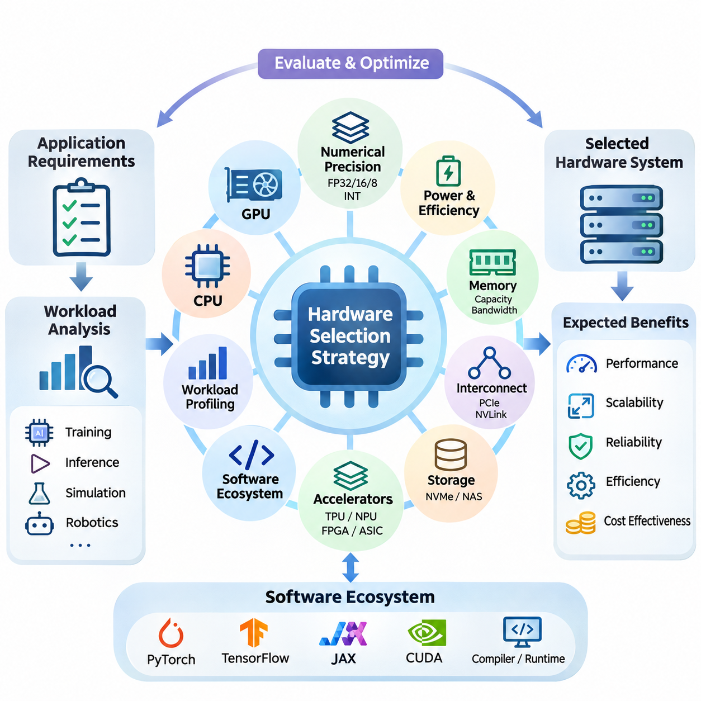
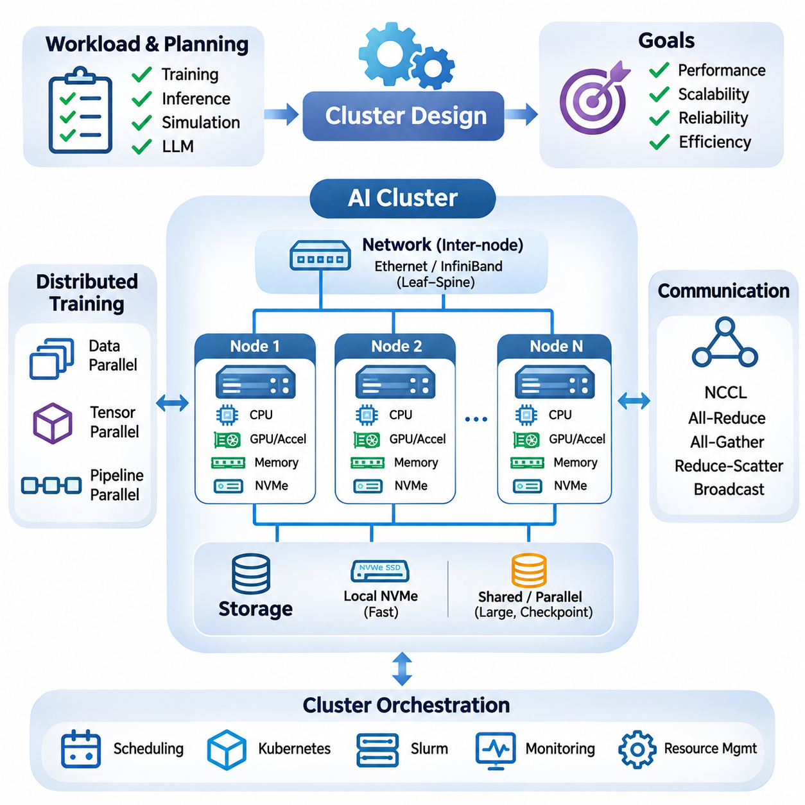
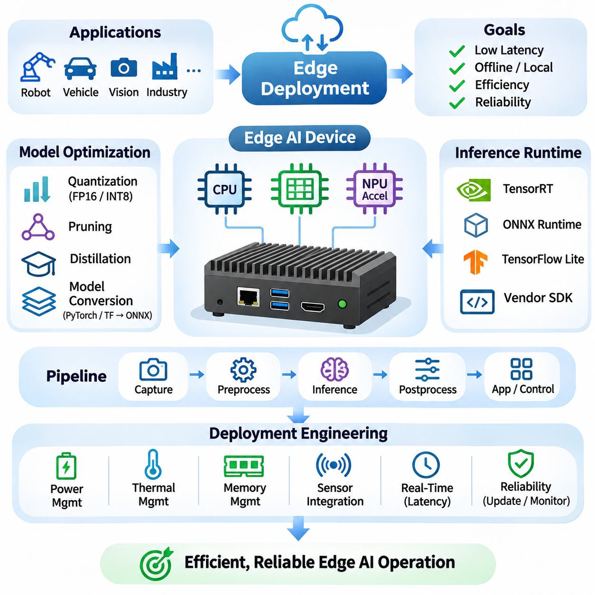
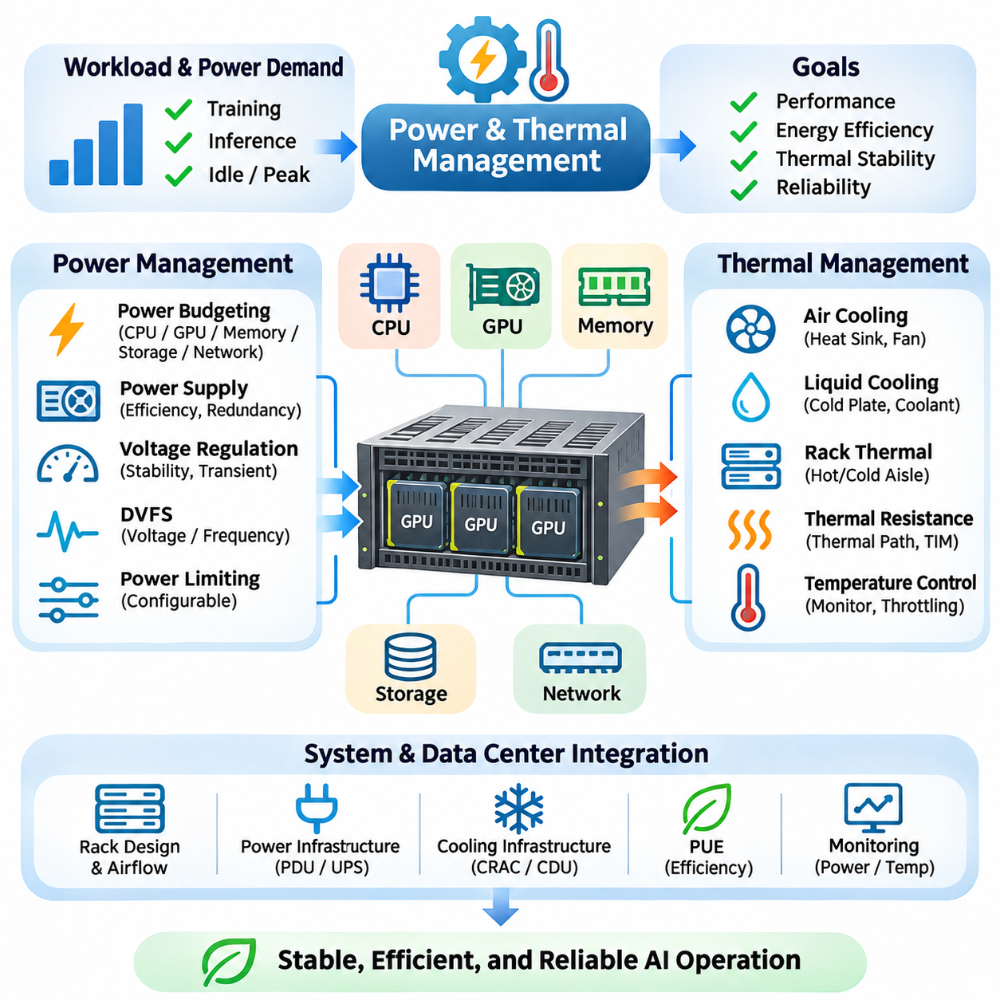
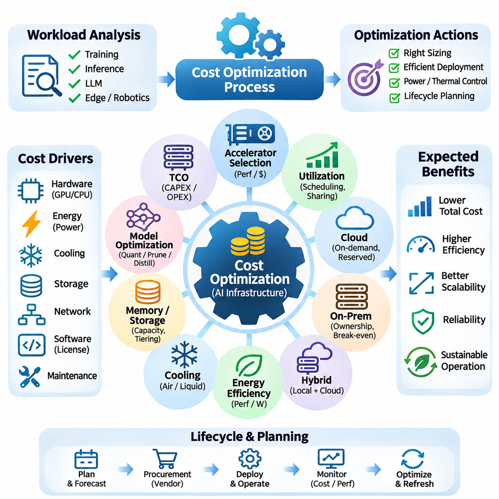
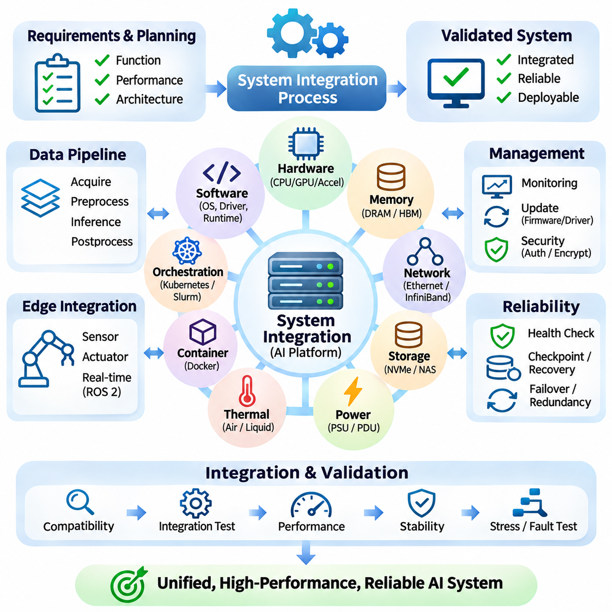

**Volume 39. Hardware for AI**

# 08. Engineering and Deployment

## 08.01 Hardware Selection Strategy

{width="7.268055555555556in" height="7.268055555555556in"}

Hardware selection is a fundamental engineering decision that determines the performance, scalability, reliability, and operational efficiency of artificial intelligence systems. An effective selection strategy begins by translating application requirements into measurable hardware specifications. Rather than choosing devices based solely on peak computational performance, engineers must evaluate the complete relationship between workloads, memory capacity, data movement, power consumption, and deployment constraints.

The first stage involves analyzing the computational characteristics of the intended AI workload. Deep learning training, real-time inference, scientific simulation, and autonomous robotics impose different requirements on hardware resources. Training frequently demands high computational throughput and substantial memory capacity, while inference emphasizes predictable latency and efficiency. Understanding these differences prevents unnecessary investment in hardware capabilities that provide limited practical benefits.

Workload profiling provides quantitative evidence for selecting appropriate processing architectures. Engineers examine arithmetic intensity, tensor dimensions, memory access patterns, batch sizes, and computational dependencies. Operations dominated by matrix multiplication can benefit from specialized tensor accelerators, whereas irregular control logic may execute more efficiently on conventional CPUs. Profiling representative workloads reveals whether performance is primarily limited by computation, memory bandwidth, or communication overhead.

CPU selection remains important even in systems dominated by GPU acceleration. CPUs coordinate operating system functions, data preprocessing, scheduling, communication, and peripheral management. Their core counts, clock frequencies, cache hierarchies, and memory channels influence overall system performance. A powerful accelerator can remain underutilized when insufficient CPU resources delay data preparation or interrupt the execution pipeline.

GPU selection requires evaluating architectural characteristics beyond advertised floating-point performance. Important factors include streaming multiprocessor organization, tensor core capabilities, supported numerical formats, memory bandwidth, and device memory capacity. GPUs designed for large-scale training may prioritize high-bandwidth memory and interconnect performance, while inference-oriented devices often emphasize power efficiency, deployment density, and predictable execution behavior.

Numerical precision requirements directly influence accelerator suitability. Modern AI hardware supports formats such as FP32, FP16, BF16, FP8, and integer quantization, although availability varies by architecture. Lower-precision computation can improve throughput and reduce memory consumption when model accuracy remains acceptable. Hardware evaluation must therefore consider whether the target accelerator efficiently supports the numerical formats required by the selected models and software frameworks.

Memory capacity is frequently a more restrictive constraint than theoretical computational throughput. Large neural networks require storage for parameters, activations, temporary tensors, and potentially optimizer states. Training workloads can consume substantially more memory than inference because intermediate results and gradients must be retained. Engineers should estimate peak memory demand under realistic batch sizes and include sufficient headroom for runtime overhead and future model expansion.

Memory bandwidth and hierarchy also determine effective computational performance. High-bandwidth memory supports data-intensive accelerator operations, while caches and local memory reduce repeated transfers from slower storage levels. Workloads with poor data locality may experience limited accelerator utilization despite substantial arithmetic capability. Hardware selection should therefore account for access patterns, cache behavior, memory channels, and the relationship between computation and data movement.

Interconnect architecture becomes critical when AI workloads span multiple accelerators. PCIe provides general-purpose connectivity, while specialized interconnects such as NVLink can offer higher-bandwidth communication between supported GPUs. Distributed training may require frequent gradient synchronization, parameter exchange, or tensor transfers. The effectiveness of a multi-accelerator configuration depends on topology, communication bandwidth, latency, and collective communication efficiency.

Storage infrastructure must support the sustained data demands of AI pipelines. NVMe solid-state drives provide high local throughput and relatively low access latency, while network-attached and distributed storage systems support shared datasets and centralized management. Selection depends on dataset size, access concurrency, sequential versus random reading patterns, and checkpoint frequency. Insufficient storage throughput can create persistent accelerator idle time.

AI accelerator alternatives should be evaluated according to their architectural specialization and software maturity. Tensor Processing Units emphasize efficient tensor computation, while neural processing units target power-efficient inference. FPGAs offer configurable execution pipelines, and ASICs can provide exceptional efficiency for narrowly defined operations. Each architecture presents different tradeoffs involving programmability, development effort, numerical support, performance, and long-term maintainability.

Software ecosystem compatibility is an essential component of hardware selection. AI development commonly relies on PyTorch, TensorFlow, JAX, CUDA, and specialized compiler or runtime environments. Hardware that lacks mature drivers, optimized kernels, debugging utilities, or supported framework integrations may introduce significant engineering costs. Compatibility testing should verify model operators, numerical formats, deployment runtimes, and operating system requirements before procurement.

Compiler and runtime optimization capabilities can significantly affect the practical value of an accelerator. Technologies such as TensorRT, XLA, and TVM can transform computational graphs, optimize kernel execution, and reduce unnecessary data movement on supported platforms. However, optimization effectiveness depends on hardware architecture and operator coverage. Engineers should benchmark optimized implementations rather than assuming that nominal accelerator specifications predict deployed performance.

Hardware selection for edge AI introduces additional constraints involving physical dimensions, thermal dissipation, energy consumption, and environmental conditions. Embedded platforms such as NVIDIA Jetson integrate computational acceleration with interfaces suitable for cameras, sensors, and robotic controllers. Their suitability depends on sustained inference performance, memory capacity, available interfaces, and power budgets. Peak benchmark results alone cannot establish reliable real-world operation.

Real-time AI applications require special attention to latency predictability. Autonomous vehicles, industrial inspection systems, and robotic platforms may operate under strict perception and control deadlines. Average inference speed is insufficient when occasional execution delays can disrupt system behavior. Engineers must evaluate worst-case or high-percentile latency, scheduling interference, memory contention, and communication delays under realistic operating conditions.

Power consumption should be evaluated at the system level rather than through accelerator specifications alone. CPUs, GPUs, memory, storage, networking equipment, and cooling systems collectively determine electrical demand. Performance per watt provides a useful comparison, but the relevant measurement must reflect actual workload execution. A device with higher peak power may deliver better energy efficiency if it completes computational tasks substantially faster.

Thermal characteristics influence sustained performance and hardware reliability. Accelerators may reduce operating frequencies when cooling capacity cannot maintain acceptable temperatures. Consequently, short-duration benchmarks can overestimate performance during continuous training or inference. Engineers should evaluate thermal design power, airflow requirements, enclosure restrictions, ambient temperature, and cooling redundancy to ensure that the selected hardware maintains stable performance.

Reliability requirements differ considerably between experimental and production environments. Research systems may tolerate occasional interruptions, while industrial AI infrastructure often requires continuous availability and predictable recovery. Enterprise hardware can provide capabilities such as error-correcting memory, advanced monitoring, and validated operating configurations. Selection should consider component failure rates, serviceability, spare-part availability, and the consequences of unexpected downtime.

Scalability planning prevents hardware decisions from becoming obstacles to future development. A single accelerator may satisfy initial experiments but become insufficient as model size, dataset volume, or concurrent users increase. Engineers should examine available expansion slots, power capacity, memory scalability, networking infrastructure, and supported accelerator configurations. Modular architectures can simplify upgrades, although expansion flexibility must be balanced against initial acquisition costs.

Hardware procurement should account for total cost of ownership rather than purchase price alone. Operational expenses include electricity, cooling, maintenance, software support, infrastructure upgrades, and engineering labor. Equipment utilization strongly influences economic efficiency because expensive accelerators provide limited value when frequently idle. Cost comparisons should relate expenditure to completed training workloads, inference requests, or other measurable application outcomes.

Cloud and on-premises hardware introduce different economic and operational tradeoffs. Cloud infrastructure provides rapid provisioning, elastic capacity, and access to specialized accelerators without substantial initial investment. On-premises systems offer greater physical control and potentially favorable economics under sustained utilization. Selection should consider workload variability, data governance, network transfer costs, equipment depreciation, and the operational expertise required to maintain infrastructure.

A structured evaluation process should compare candidate hardware using representative workloads and consistent measurement conditions. Relevant measurements include training throughput, inference latency, accelerator utilization, memory consumption, energy use, and operational stability. Results should be collected with documented software versions, numerical precision, batch sizes, and system configurations. This approach reduces the risk of selecting hardware based on misleading specifications or incomparable benchmarks.

Prototype validation provides an opportunity to identify integration problems before committing to large-scale procurement. Engineers can test accelerator compatibility, peripheral connectivity, power delivery, thermal behavior, and workload execution using a limited hardware configuration. Prototype results may expose unexpected bottlenecks in CPU preprocessing, storage access, or communication. Early validation reduces redesign costs and improves confidence in subsequent deployment decisions.

Hardware selection must also consider lifecycle management and supply-chain stability. Accelerator availability, component lead times, vendor support policies, and replacement compatibility affect long-term system sustainability. Proprietary software dependencies may increase migration costs when hardware platforms change. Organizations should document architectural assumptions and establish contingency options for critical components, especially when AI systems are expected to operate for many years.

The final selection should emerge from a balanced assessment of performance, compatibility, reliability, scalability, energy efficiency, and economic feasibility. No single hardware architecture is optimal for every AI workload. Successful engineering aligns processing resources, memory systems, communication infrastructure, and software capabilities with measurable application requirements. This workload-driven strategy establishes a reliable foundation for subsequent cluster design, edge deployment, and system integration.

## 08.02 Cluster Design

{width="7.268055555555556in" height="7.268055555555556in"}

Cluster design is a fundamental engineering discipline that integrates multiple computing nodes into a coordinated infrastructure capable of executing large-scale artificial intelligence workloads. An effective AI cluster must balance computational throughput, memory capacity, communication efficiency, storage performance, and operational reliability. Its architecture should reflect application requirements rather than simply maximizing the number of installed accelerators.

The design process begins with workload characterization and capacity planning. Distributed training, large language model inference, scientific computing, and simulation impose different resource demands. Engineers estimate model size, dataset volume, accelerator memory requirements, concurrency, and expected growth. These measurements determine the number of computing nodes, their internal configurations, and the communication infrastructure necessary to support efficient execution.

A computing node typically integrates CPUs, GPUs or specialized accelerators, system memory, local storage, and network interfaces. Node architecture determines how efficiently these components cooperate during AI execution. CPU socket placement, PCIe connectivity, memory channels, and accelerator topology influence data transfer performance. Balanced node configurations prevent individual subsystems from becoming persistent bottlenecks during computationally intensive workloads.

GPU topology is particularly important for distributed deep learning. Multiple accelerators within a node may communicate through PCIe or supported high-bandwidth interconnects such as NVLink. Communication capabilities vary across accelerator generations and server platforms. Engineers must examine actual device connectivity rather than assuming uniform peer-to-peer bandwidth. Efficient topology placement reduces synchronization overhead and improves the execution of model-parallel workloads.

Inter-node networking determines how effectively a cluster scales beyond individual servers. Ethernet and InfiniBand provide communication infrastructure with different performance characteristics and deployment considerations. High-speed networking is especially valuable when distributed workloads exchange gradients, activations, or model parameters frequently. Network selection should consider bandwidth, latency, congestion behavior, adapter capabilities, and the communication patterns of target applications.

Network topology influences communication efficiency and infrastructure cost. Leaf-spine architectures can provide substantial aggregate bandwidth and predictable connectivity when properly provisioned. Oversubscription ratios determine how much traffic can traverse shared network links simultaneously. AI training clusters with intensive collective communication generally benefit from low-oversubscription designs, while less communication-intensive workloads may tolerate more economical network configurations.

Distributed training introduces communication requirements that must be considered during cluster planning. Data parallelism replicates models across accelerators and synchronizes gradients, while tensor parallelism distributes mathematical operations across devices. Pipeline parallelism divides model execution into sequential stages. Each approach creates different communication patterns, making topology-aware placement essential for maintaining high accelerator utilization.

Collective communication libraries coordinate operations such as all-reduce, all-gather, reduce-scatter, and broadcast across distributed devices. Technologies such as NVIDIA NCCL optimize supported GPU communication paths and network configurations. Their effectiveness depends on hardware topology, message size, synchronization frequency, and network congestion. Cluster engineers should benchmark collective operations independently to identify communication limitations before deploying large training workloads.

Memory architecture must support both individual node execution and distributed model placement. GPU memory capacity determines how much model state can remain directly accessible to accelerators. System DRAM supports preprocessing, buffering, and host-side operations. Distributed workloads may require parameter sharding, activation checkpointing, or offloading to accommodate large models. These techniques reduce memory pressure but introduce additional computation or data movement.

Storage design is equally important because AI clusters process large datasets and generate frequent checkpoints. Local NVMe storage provides fast temporary access, while shared storage enables coordinated dataset distribution and recovery. Network-attached storage, parallel file systems, and object storage offer different scalability characteristics. Engineers must evaluate aggregate throughput, metadata performance, concurrent access patterns, and checkpoint restoration requirements.

Data ingestion pipelines should deliver training samples without repeatedly stalling accelerators. Dataset preprocessing, decompression, augmentation, and caching may consume substantial CPU and storage resources. Distributed data loaders must partition datasets consistently while maintaining sufficient randomness for training. Prefetching and local caching can reduce repeated network transfers, but their effectiveness depends on dataset organization and available memory.

Cluster orchestration coordinates resource allocation, job scheduling, and operational management. Platforms such as Kubernetes and Slurm support different deployment models and scheduling requirements. Kubernetes is commonly associated with containerized services and flexible orchestration, while Slurm is widely used for batch-oriented high-performance computing. The appropriate scheduler depends on workload duration, resource sharing, operational complexity, and organizational requirements.

Resource scheduling should account for accelerator topology, memory capacity, and communication locality. Assigning distributed jobs across poorly connected nodes can increase synchronization delays and reduce throughput. Topology-aware scheduling attempts to place related processes near suitable communication resources. Scheduling policies must also address job priorities, queue fairness, resource fragmentation, and the coexistence of training and inference workloads.

Containerization improves reproducibility by packaging application dependencies, runtime libraries, and execution environments. Container images can standardize software configurations across heterogeneous computing nodes. However, GPU workloads still depend on compatible host drivers, device interfaces, and accelerator runtime support. Cluster deployment procedures should validate these dependencies and maintain controlled software versions to reduce unexpected compatibility failures.

High availability and fault tolerance become increasingly important as cluster size grows. Large distributed jobs may encounter hardware failures, network interruptions, or software crashes during extended execution. Checkpointing allows training to resume from previously saved states, reducing lost computation. Recovery strategies should consider checkpoint frequency, storage overhead, restart procedures, and whether the distributed framework supports coordinated failure handling.

Monitoring infrastructure provides visibility into cluster health and workload efficiency. Engineers track accelerator utilization, memory consumption, CPU load, network traffic, storage throughput, temperature, and power demand. Observability platforms can combine metrics, logs, and alerts to identify abnormal behavior. Monitoring should distinguish genuine computational saturation from inefficiencies caused by communication delays, data starvation, or scheduling conflicts.

Power distribution and thermal management impose physical limits on cluster density. High-performance accelerator servers can require substantial electrical capacity and cooling infrastructure. Rack-level design must consider power distribution units, redundant power supplies, airflow direction, and heat removal. Sustained AI workloads can generate continuous thermal loads, making realistic power and cooling assessments essential before equipment installation.

Cluster scalability depends on both horizontal expansion and architectural consistency. Adding computing nodes increases available resources, but application performance may not scale proportionally. Communication overhead, synchronization barriers, storage contention, and workload imbalance can limit efficiency. Engineers should measure strong scaling and weak scaling behavior to understand whether additional hardware provides meaningful computational benefits.

Heterogeneous clusters combine different processor generations, accelerator types, or memory configurations. Such environments can improve resource utilization by matching workloads to suitable devices. However, heterogeneous scheduling introduces complications involving numerical compatibility, performance imbalance, and software dependencies. Workload placement should account for actual device capabilities rather than treating all accelerators as interchangeable resources.

Security architecture must protect shared infrastructure, training datasets, model artifacts, and administrative interfaces. Network segmentation, identity management, access controls, and encrypted communication help reduce unauthorized access. Multi-tenant clusters require isolation between workloads and careful management of privileged operations. Security controls should be integrated into provisioning, orchestration, storage access, and monitoring rather than added after deployment.

Cluster economics should be evaluated through total cost of ownership and useful computational output. Hardware acquisition, networking, storage, electricity, cooling, maintenance, and administration contribute to operational expenditure. Accelerator utilization strongly influences cost efficiency because unused resources continue to incur infrastructure expenses. Cost per training run, completed experiment, or inference request provides more meaningful information than hardware purchase price alone.

Capacity management should incorporate future workload growth and changing model architectures. Increasing parameter counts, longer context windows, larger datasets, and higher inference concurrency may alter resource requirements. Modular infrastructure enables incremental expansion, but power capacity, networking, and storage must accommodate anticipated growth. Excessive overprovisioning increases costs, while insufficient capacity creates persistent scheduling delays.

Performance validation should use representative distributed workloads rather than relying exclusively on synthetic benchmarks. Engineers evaluate training throughput, communication efficiency, scaling behavior, checkpoint duration, and resource utilization under realistic conditions. Benchmark results must document accelerator configurations, network topology, software versions, and workload parameters. Consistent measurement enables reliable comparisons between alternative cluster architectures.

A successful AI cluster integrates computing, communication, storage, orchestration, reliability, and operational management into a coherent system. Its effectiveness depends on balanced engineering decisions rather than isolated hardware specifications. By aligning architecture with measurable workload requirements, organizations can build infrastructure that supports efficient distributed training, scalable inference, and dependable long-term operation while controlling complexity and cost.

## 08.03 Edge Deployment

{width="7.268055555555556in" height="7.268055555555556in"}

Edge deployment refers to the implementation of artificial intelligence models directly on devices located near data sources, sensors, or physical processes. Unlike centralized cloud computing, edge AI performs inference locally to reduce communication latency, network dependency, and unnecessary data transmission. Successful deployment requires coordinated engineering across computing hardware, model optimization, software integration, power management, and operational reliability.

The primary objective of edge deployment is to deliver AI functionality within the computational and environmental constraints of the target device. Industrial robots, autonomous vehicles, smart cameras, and embedded controllers operate under different performance requirements. Engineers must translate application objectives into measurable specifications involving inference latency, throughput, memory consumption, energy efficiency, and response deadlines.

Hardware selection begins with evaluating the capabilities of embedded CPUs, GPUs, neural processing units, and specialized accelerators. Platforms such as NVIDIA Jetson integrate general-purpose processing with parallel acceleration and peripheral connectivity. Their suitability depends on model complexity, supported numerical precision, memory bandwidth, and available interfaces. Hardware decisions must also consider long-term software support and industrial operating conditions.

Edge devices typically have more restrictive memory budgets than cloud servers. Model parameters, intermediate activations, input buffers, and runtime libraries compete for limited memory resources. Excessive memory allocation can produce execution failures or unpredictable latency. Engineers should measure peak memory usage under realistic workloads and reserve sufficient capacity for operating system services, communication processes, and concurrent applications.

Model optimization is essential for achieving efficient edge inference. Quantization reduces numerical precision, while pruning removes selected model parameters or computational structures. Knowledge distillation transfers useful behavior from larger models into smaller architectures. These techniques can reduce memory consumption and computational demand, although their effectiveness depends on hardware support and acceptable accuracy degradation.

Quantization strategies must be matched to accelerator capabilities. FP16 and INT8 execution can improve performance on supported hardware, while other precision formats may offer different efficiency characteristics. Post-training quantization converts existing models without extensive retraining, whereas quantization-aware training incorporates numerical effects during optimization. Engineers must validate accuracy, numerical stability, and latency after conversion.

Inference runtimes provide the execution layer connecting optimized models to target hardware. TensorRT, ONNX Runtime, TensorFlow Lite, and vendor-specific SDKs support different deployment architectures. Runtime selection depends on operator compatibility, accelerator support, memory management, and execution efficiency. Unsupported operations may require alternative implementations or execution on less efficient processing resources.

Model conversion is a critical stage in the deployment pipeline. Models developed in PyTorch or TensorFlow may be exported through intermediate representations such as ONNX. Conversion must preserve computational behavior while satisfying the target runtime\'s operator requirements. Engineers should compare reference outputs with deployed outputs using representative test inputs, accounting for expected numerical differences caused by optimization.

Real-time inference requires more than high average processing speed. Robotic perception, industrial inspection, and autonomous navigation depend on predictable response times. Engineers should evaluate latency distributions, worst-case execution behavior, and scheduling interference. A system that achieves high average frame rates may still fail operational requirements if occasional delays exceed control or safety-related deadlines.

Pipeline architecture determines how efficiently edge systems process incoming data. Camera acquisition, preprocessing, inference, postprocessing, and application logic often execute as interconnected stages. Sequential execution may introduce unnecessary waiting between operations. Asynchronous pipelines, buffering, and carefully managed concurrency can improve throughput while preserving synchronization between sensor measurements and inference results.

Sensor integration introduces additional engineering challenges. Cameras, LiDAR sensors, radar modules, and industrial interfaces generate data with different formats, frequencies, and timing requirements. Accurate timestamps and synchronization mechanisms are essential when combining multiple sensor streams. Edge AI applications must also account for sensor calibration, communication delays, and data quality variations under changing environmental conditions.

Power management is particularly important for battery-operated and thermally constrained devices. Accelerator utilization, processor frequency, memory activity, and peripheral operation contribute to total energy consumption. Dynamic voltage and frequency scaling can reduce power demand when computational requirements permit. Engineers must evaluate energy per inference alongside latency and throughput to establish sustainable operating configurations.

Thermal management directly influences sustained inference performance. Compact embedded systems may operate inside sealed enclosures with limited airflow or elevated ambient temperatures. Continuous workloads can cause thermal throttling, reducing processing frequency and increasing inference latency. Appropriate heat sinks, conductive cooling paths, airflow management, and temperature monitoring help maintain stable performance during extended operation.

Deployment software must integrate reliably with operating systems, device drivers, and application frameworks. Embedded Linux environments commonly support accelerator runtimes, sensor interfaces, and communication middleware. Robotics applications may additionally use ROS 2 for distributed component communication. Software integration should account for process isolation, dependency management, startup sequencing, and recovery from individual component failures.

Containerization can simplify deployment by packaging application dependencies and maintaining consistent runtime environments. Container images support reproducible installation and controlled software updates across device fleets. However, accelerator drivers and hardware interfaces often remain dependent on the host operating system. Engineers must verify compatibility between containers, device firmware, runtime libraries, and physical interfaces.

Network connectivity should be treated as an operational resource rather than an unconditional dependency. Edge devices may experience limited bandwidth, intermittent connections, or complete network outages. Critical local inference functions should continue operating when connectivity is unavailable, provided their safety requirements permit it. Cloud communication can support telemetry, centralized monitoring, model distribution, and noncritical analytical processing.

Edge-cloud collaboration enables computational responsibilities to be distributed according to latency, resource availability, and data governance requirements. Large-scale model training and complex analytics may execute in centralized infrastructure, while time-sensitive inference remains on edge devices. This separation reduces onboard computational requirements and simplifies model development. Synchronization mechanisms must ensure that deployed models remain compatible with local software and hardware configurations.

Security considerations extend across hardware, firmware, software, and communication channels. Secure boot, signed software packages, access control, and encrypted communication help protect deployed systems against unauthorized modification. Sensitive sensor data may remain local to reduce unnecessary exposure. Engineers should also protect model artifacts, configuration files, credentials, and remote management interfaces throughout the device lifecycle.

Remote device management becomes essential when edge AI systems operate across multiple locations. Centralized management services can track software versions, hardware status, model configurations, and operational health. Over-the-air updates enable controlled distribution of new software and models. Reliable update procedures should include integrity verification, compatibility checks, staged deployment, and rollback mechanisms when failures occur.

Operational monitoring must extend beyond basic accelerator utilization. Engineers should observe inference latency, frame processing rates, memory usage, temperature, power consumption, sensor availability, and application errors. Long-term measurements can reveal performance degradation caused by environmental changes or software updates. Monitoring data should support diagnosis without overwhelming limited communication bandwidth or local storage capacity.

Reliability engineering addresses failures involving sensors, accelerators, storage, communication, and application processes. Watchdog mechanisms can detect stalled components, while health checks support automated recovery. Systems should define safe behavior when inference results are unavailable or unreliable. In safety-critical applications, independent protective mechanisms may be necessary because AI inference alone cannot guarantee functional safety.

Validation must reproduce the environmental conditions expected during deployment. Laboratory benchmarks may not capture temperature extremes, vibration, electrical interference, variable lighting, or sustained computational loading. Engineers should test representative operating scenarios and measure performance over extended periods. Validation should include accuracy, latency, thermal stability, power consumption, recovery behavior, and integration with surrounding equipment.

Edge deployment should also consider hardware lifecycle and maintainability. Embedded platforms may remain in operation for years, making component availability, software support, and replacement compatibility important. Modular application architectures can reduce dependence on individual accelerator generations. Documented deployment configurations and automated testing simplify maintenance while supporting controlled upgrades throughout the operational lifecycle.

Successful edge AI deployment transforms an optimized model into a dependable physical computing system. Performance depends on the combined behavior of hardware acceleration, memory management, sensor integration, runtime software, and environmental constraints. A systematic deployment strategy emphasizes measurable requirements, realistic validation, secure operation, and maintainability, enabling reliable AI inference in robotics, autonomous systems, and industrial environments.

## 08.04 Power and Thermal Management

{width="7.268055555555556in" height="7.268055555555556in"}

Power and thermal management are fundamental aspects of artificial intelligence hardware engineering because computational performance depends on the ability to deliver electrical energy and remove generated heat. Modern GPUs, CPUs, and AI accelerators can consume substantial power during intensive workloads. Effective system design must balance computational throughput, energy efficiency, thermal stability, hardware reliability, and infrastructure operating costs.

Power consumption varies significantly with workload characteristics, processor utilization, operating frequency, and numerical precision. Training large neural networks often produces sustained computational demand, while inference workloads may exhibit intermittent activity. Engineers must distinguish idle power, average operating power, and peak power requirements. These measurements provide the foundation for selecting power supplies, cooling systems, and appropriate infrastructure capacity.

Power budgeting begins by estimating the electrical requirements of every major system component. CPUs, GPUs, memory modules, storage devices, network adapters, cooling fans, and peripheral equipment contribute to total consumption. Power supply capacity must accommodate simultaneous peak demands and reasonable operating margins. Accurate budgeting prevents instability caused by insufficient power delivery while avoiding unnecessarily oversized electrical infrastructure.

Power supply units convert incoming electrical energy into regulated voltages required by computing components. Conversion efficiency influences electricity consumption and the amount of waste heat generated inside a system. High-efficiency power supplies reduce conversion losses, particularly during sustained operation. Engineers should evaluate efficiency across expected load conditions, redundancy requirements, voltage stability, and compatibility with accelerator power demands.

Voltage regulation is essential for maintaining stable operation under rapidly changing computational loads. High-performance accelerators can produce substantial transient current demands when execution activity changes. Voltage regulator modules must respond without allowing unacceptable voltage deviations. Power delivery networks should consider current capacity, electrical impedance, transient response, connector ratings, and the physical arrangement of power distribution components.

Dynamic voltage and frequency scaling allows processors to adjust operating conditions according to computational demand. Reducing clock frequency and supply voltage can lower power consumption when maximum performance is unnecessary. Conversely, higher operating frequencies may increase throughput but also raise thermal output. Effective policies balance performance requirements, energy efficiency, and response-time constraints rather than pursuing maximum frequency continuously.

Power limiting provides another mechanism for controlling accelerator energy consumption. Many GPUs support configurable power limits that constrain sustained electrical demand. Lower power settings may reduce peak performance while improving performance per watt under certain workloads. Engineers should benchmark actual applications across multiple power configurations because energy efficiency depends on model architecture, memory behavior, and accelerator utilization.

Thermal management begins with understanding how electrical power becomes heat during computation. Semiconductor switching activity, leakage currents, memory access, and power conversion losses contribute to thermal generation. Heat must travel from semiconductor junctions through packaging materials and cooling interfaces before reaching the surrounding environment. The effectiveness of this heat transfer determines operating temperature and sustained computational performance.

Thermal resistance describes the relationship between heat flow and temperature difference across a cooling path. Heat sinks, thermal interface materials, package structures, and enclosure airflow collectively determine effective thermal resistance. Excessive resistance causes semiconductor junction temperatures to rise even when cooling equipment appears adequate. Engineers must evaluate the complete thermal path rather than focusing exclusively on the nominal capacity of a cooling device.

Air cooling remains common in workstations, edge systems, and many server environments. Heat sinks transfer energy from processors into surrounding air, while fans maintain airflow through the enclosure. Cooling effectiveness depends on fin geometry, airflow velocity, inlet temperature, and pressure resistance. Poor component placement or obstructed airflow can create localized hot spots that reduce performance and accelerate hardware degradation.

Liquid cooling offers an alternative for high-density AI computing infrastructure. Cold plates transfer heat from processors into circulating coolant, which transports thermal energy toward external heat exchangers. Liquid systems can support high heat flux and reduce dependence on large internal airflow volumes. However, deployment requires careful consideration of pumps, plumbing, leak detection, coolant compatibility, maintenance procedures, and system redundancy.

Rack-level thermal engineering becomes increasingly important as accelerator density grows. Multiple high-power servers can generate concentrated thermal loads that exceed conventional cooling assumptions. Hot-aisle and cold-aisle separation helps prevent heated exhaust air from mixing with incoming cooling air. Rack placement, cable management, airflow containment, and cooling distribution must be coordinated to maintain predictable inlet temperatures.

Data center power and cooling design must account for infrastructure-level efficiency. Power usage effectiveness compares total facility energy consumption with the energy consumed by computing equipment. Lower values indicate reduced supporting energy overhead, although they do not directly measure computational productivity. Engineers should evaluate facility efficiency alongside useful AI throughput, equipment utilization, and total energy consumption.

Thermal throttling occurs when hardware reduces operating frequency or power consumption to remain within temperature limits. This protection mechanism can prevent immediate overheating but may introduce unpredictable performance degradation. Long-duration training and inference workloads should therefore be evaluated under steady-state thermal conditions. Short benchmarks may conceal cooling deficiencies that emerge only after prolonged operation.

Temperature monitoring provides essential feedback for both protection and optimization. Modern processors expose sensors that report junction temperatures, operating frequencies, power consumption, and throttling conditions. Monitoring systems can identify abnormal trends before they cause service interruptions. Engineers should establish warning thresholds, collect historical measurements, and correlate temperature changes with workload intensity and cooling performance.

Power and thermal management are closely connected to reliability engineering. Elevated operating temperatures can accelerate certain semiconductor aging mechanisms and reduce component lifetime. Repeated thermal cycling may also stress solder joints, connectors, and packaging materials. Stable operating conditions, adequate cooling margins, and controlled environmental exposure contribute to long-term hardware reliability and predictable maintenance requirements.

Edge AI devices introduce additional challenges because they often operate with limited cooling capacity and strict energy budgets. Embedded accelerators may be installed inside compact robotic platforms, industrial enclosures, or battery-powered equipment. Passive cooling reduces mechanical complexity but limits heat removal capability. Designers must consider ambient temperature, enclosure conductivity, airflow restrictions, vibration, and available installation space.

Battery-powered AI systems require coordination between computational demand and energy availability. Inference workloads compete with sensors, communication equipment, actuators, and control electronics for limited battery capacity. Power-aware scheduling can reduce accelerator activity during periods of low demand. Engineers should evaluate operating duration, peak discharge requirements, battery efficiency, and the effect of computational loading on mission endurance.

Workload scheduling can improve energy efficiency by coordinating computational activity with available resources. Batch processing may increase accelerator utilization, while unnecessary concurrency can increase memory pressure and thermal demand. Scheduling decisions should consider deadlines, processor power states, and cooling limitations. Energy-aware orchestration can distribute workloads across nodes to balance performance, electrical demand, and thermal conditions.

Cluster-scale power management requires coordination between individual servers and shared electrical infrastructure. Simultaneous accelerator activity can produce substantial aggregate demand, particularly during synchronized training operations. Power capping and workload placement may help avoid exceeding rack or facility limits. These policies must account for application performance, node heterogeneity, and the consequences of reduced power availability.

Thermal-aware scheduling extends resource management by considering temperature distributions and cooling constraints. Workloads may be assigned to nodes with sufficient thermal headroom to sustain required performance. Temperature-dependent scheduling can reduce localized overheating and unnecessary throttling. However, moving workloads may introduce communication overhead, making thermal optimization a system-level tradeoff rather than an isolated cooling decision.

Performance evaluation should include energy and thermal measurements alongside traditional throughput metrics. Useful indicators include joules per inference, energy per training step, sustained throughput per watt, and temperature under representative workloads. Measurements must use consistent operating conditions and clearly defined system boundaries. This approach prevents misleading comparisons based solely on nominal power ratings or short-duration performance peaks.

Operational planning must address cooling equipment failures, power interruptions, and abnormal environmental conditions. Redundant power supplies, monitoring alarms, controlled shutdown procedures, and appropriate recovery mechanisms reduce the impact of infrastructure faults. Cooling failure detection is particularly important in high-density accelerator installations. System protection should prioritize hardware integrity and operational safety when normal thermal conditions cannot be maintained.

Successful power and thermal management requires an integrated engineering strategy spanning semiconductor behavior, hardware design, workload optimization, and facility infrastructure. Electrical efficiency and heat removal directly influence sustained AI performance, operating costs, and equipment lifetime. By combining accurate power budgeting, effective cooling, continuous monitoring, and workload-aware control, organizations can build reliable and energy-efficient AI computing systems.

## 08.05 Cost Optimization

{width="7.268055555555556in" height="7.268055555555556in"}

Cost optimization in artificial intelligence hardware systems involves minimizing total expenditure while maintaining required computational performance, reliability, and scalability. Effective optimization considers hardware acquisition, energy consumption, infrastructure operation, software licensing, and maintenance throughout the system lifecycle. The objective is not simply to purchase inexpensive equipment but to maximize useful computational output relative to total ownership cost.

Total cost of ownership provides a comprehensive framework for evaluating AI infrastructure investments. Capital expenditure includes processors, accelerators, memory, storage, networking, and facility upgrades. Operational expenditure covers electricity, cooling, maintenance, administration, and recurring software services. Comparing these costs over a defined operating period helps organizations identify architectures that offer sustainable economic performance.

Workload characterization is the foundation of accurate cost planning. Training large language models, executing real-time inference, and processing industrial sensor data impose different computational requirements. Engineers should estimate model complexity, dataset volume, memory demand, throughput targets, and utilization patterns. Matching hardware capabilities to actual workloads prevents unnecessary investment in resources that deliver limited practical value.

Accelerator selection strongly influences infrastructure economics because GPUs and specialized processors often represent substantial acquisition costs. High-end accelerators may provide superior throughput but are not automatically the most economical option. Performance per dollar should be measured using representative applications rather than theoretical peak specifications. Memory capacity, interconnect performance, and software compatibility must also be included in comparisons.

Hardware utilization is a critical determinant of cost efficiency. Expensive accelerators generate little economic value when they remain idle because of scheduling delays, data loading bottlenecks, or insufficient workload demand. Monitoring GPU utilization, memory occupancy, and job completion rates reveals opportunities for improvement. Better scheduling, resource sharing, and pipeline optimization can increase useful output without purchasing additional hardware.

Cloud computing introduces flexible financial models that differ from traditional hardware ownership. On-demand instances provide immediate access to computing resources without large initial investments. Reserved capacity and committed-use arrangements may reduce costs for predictable workloads, while interruptible instances can support fault-tolerant tasks. Economic evaluation must consider usage duration, availability requirements, data transfer charges, and operational flexibility.

On-premises infrastructure can become economically attractive when workloads are predictable and hardware utilization remains consistently high. Ownership provides greater control over resource availability, configuration, and data placement. However, organizations must account for depreciation, equipment replacement, electricity, cooling, physical space, and administrative expertise. Break-even analysis helps determine when owned infrastructure becomes preferable to cloud services.

Hybrid infrastructure combines local computing resources with cloud capacity to accommodate changing demand. Stable workloads may execute on owned hardware, while temporary peaks or specialized experiments use external resources. This approach can reduce overprovisioning and improve flexibility. Effective hybrid operation requires workload portability, compatible software environments, secure data movement, and careful monitoring of transfer costs.

Energy efficiency directly affects the long-term economics of AI systems. Accelerators consume electricity during computation, while supporting equipment and cooling infrastructure introduce additional demand. Performance per watt provides useful information, but energy per completed task offers a more application-oriented measure. Power limits, efficient numerical precision, and workload scheduling can reduce energy consumption without necessarily sacrificing required performance.

Cooling efficiency is another important component of operational cost. High-density accelerator installations may require substantial airflow, liquid cooling, or specialized facility infrastructure. Poor thermal design increases energy consumption and may reduce sustained computational performance through throttling. Engineers should evaluate cooling requirements alongside hardware density, environmental conditions, and expected operating duration.

Memory and storage provisioning must balance performance requirements against unnecessary capacity. Excessive memory investment increases acquisition cost, while insufficient memory can force inefficient offloading or prevent model execution. Storage systems should provide adequate throughput for dataset ingestion and checkpoint operations. Tiered storage, caching, compression, and data lifecycle policies can reduce expenses while preserving access to frequently used information.

Network infrastructure costs increase as AI clusters expand across multiple computing nodes. High-bandwidth interconnects improve distributed training efficiency but may require expensive adapters, switches, and cabling. Network investment should reflect actual communication patterns and scaling requirements. Applications with limited inter-node communication may operate efficiently on less expensive configurations, while tightly synchronized training can justify premium networking.

Model optimization provides a software-driven approach to reducing hardware costs. Quantization, pruning, knowledge distillation, and efficient model architectures can decrease memory requirements and computational demand. Smaller models may execute on lower-cost accelerators or support more concurrent inference requests. Optimization must preserve acceptable accuracy and operational behavior, making application-level validation essential before deployment.

Inference serving efficiency is particularly important for applications processing continuous requests. Batching can increase accelerator throughput, while dynamic batching adapts execution to changing demand. Model caching, memory reuse, and optimized runtimes reduce unnecessary overhead. However, aggressive batching may increase response latency, requiring careful adjustment to meet service-level objectives and maintain user experience.

Distributed training efficiency influences the cost of large-scale AI development. Adding accelerators does not guarantee proportional reductions in training time because communication and synchronization introduce overhead. Data parallelism, tensor parallelism, and pipeline parallelism should be selected according to model architecture and cluster topology. Scaling efficiency measurements help determine whether additional hardware provides sufficient economic benefit.

Checkpointing and fault recovery also affect training economics. Frequent checkpoints reduce potential computation loss but consume storage bandwidth and execution time. Infrequent checkpoints increase the amount of work lost after failures. Engineers should optimize checkpoint intervals according to failure probability, checkpoint duration, and recovery cost. Reliable restart mechanisms are especially valuable when using interruptible computing resources.

Resource orchestration can reduce waste by matching jobs to available computing capacity. Schedulers such as Kubernetes and Slurm support resource allocation and workload management across shared infrastructure. Priority policies, queue management, and topology-aware placement can improve utilization. Resource quotas and automated shutdown of idle environments further reduce unnecessary spending while maintaining operational control.

Cost observability requires continuous measurement of infrastructure expenditure and computational productivity. Useful metrics include cost per training run, cost per inference request, accelerator utilization, energy per task, and storage consumption. Combining financial information with technical telemetry reveals inefficient configurations. Dashboards and automated reporting can help engineering teams identify trends and evaluate optimization decisions.

Procurement strategy influences acquisition costs and long-term operational flexibility. Volume purchasing, vendor negotiations, warranty terms, maintenance agreements, and component availability affect overall economics. Standardized hardware configurations may simplify support and spare-part management. However, excessive dependence on a single supplier can introduce pricing risks and limit future architectural choices.

Lifecycle planning should consider depreciation, technological obsolescence, and replacement schedules. AI accelerators evolve rapidly, potentially changing the economic value of existing equipment. Premature replacement wastes remaining useful life, while retaining inefficient hardware may increase operating costs. Organizations should compare expected performance improvements with acquisition expenses, migration effort, and the remaining value of deployed infrastructure.

Cost optimization must also account for engineering productivity. Hardware that requires extensive custom development, unstable drivers, or complex maintenance may produce hidden labor expenses. Mature software ecosystems and standardized deployment procedures can reduce integration time and operational risk. The economic value of a platform therefore includes developer efficiency, debugging capability, documentation quality, and long-term support.

Capacity forecasting helps organizations avoid both overprovisioning and resource shortages. Historical utilization, planned experiments, model growth, and inference demand provide inputs for forecasting. Incremental expansion can preserve financial flexibility, although procurement lead times and infrastructure limits must be considered. Scenario analysis allows teams to evaluate cost exposure under different growth rates and workload assumptions.

Optimization decisions should be validated through controlled experiments using realistic workloads. Engineers can compare accelerator types, batch sizes, precision formats, power settings, and deployment architectures under consistent conditions. Results should include execution time, accuracy, energy consumption, reliability, and total cost. This evidence-based approach prevents short-term savings from creating larger operational expenses or unacceptable performance limitations.

Successful cost optimization integrates financial planning with hardware architecture, software efficiency, workload scheduling, and operational management. The most economical AI system is not necessarily the one with the lowest purchase price or highest peak performance. By measuring useful output against lifecycle expenditure, organizations can develop scalable, reliable computing infrastructure that delivers sustainable value as AI workloads evolve.

## 08.06 System Integration

{width="7.268055555555556in" height="7.268055555555556in"}

System integration is the engineering process of combining computing hardware, software frameworks, communication networks, storage resources, and operational services into a unified artificial intelligence platform. Individual components may demonstrate excellent performance independently but behave inefficiently when connected. Successful integration requires compatible interfaces, coordinated resource management, predictable execution, and reliable operation across the complete system.

Integration planning begins with defining functional requirements, performance targets, and architectural boundaries. Engineers identify the responsibilities of CPUs, GPUs, accelerators, memory, storage, and networking components. Data flows and execution dependencies must be documented before implementation. Clear interface specifications reduce integration conflicts and help ensure that hardware capabilities align with application requirements.

Hardware compatibility is a fundamental concern when assembling AI computing systems. Processor architectures, PCIe generations, accelerator interfaces, memory configurations, and motherboard capabilities must operate together. Physical constraints involving expansion slots, power connectors, cooling clearance, and enclosure dimensions also influence integration. Compatibility validation should precede procurement to avoid expensive redesigns and deployment delays.

Software integration connects operating systems, device drivers, accelerator runtimes, and machine learning frameworks. CUDA, ROCm, TensorRT, and other execution environments provide access to specialized hardware capabilities. Their supported versions and dependencies must be coordinated carefully. Incompatible drivers or libraries can prevent execution, reduce performance, or introduce instability that becomes difficult to diagnose.

Driver and firmware management establish the foundation for consistent hardware operation. GPU drivers, network adapter firmware, storage controllers, and system BIOS settings influence compatibility and performance. Engineers should maintain validated configuration baselines and record changes systematically. Controlled updates reduce unexpected regressions, while rollback procedures provide recovery options when newly introduced versions cause operational problems.

Data pipeline integration ensures that information moves efficiently from storage and sensors into computational resources. Input acquisition, preprocessing, memory transfer, model execution, and output generation must operate as coordinated stages. Poor synchronization or unnecessary data copying can create bottlenecks even when accelerators provide substantial processing capacity. Efficient buffering and asynchronous execution improve throughput.

Memory integration requires coordination between system RAM, accelerator memory, and storage hierarchies. Host-to-device transfers, pinned memory, shared memory, and direct memory access mechanisms influence execution efficiency. Engineers must account for memory allocation overhead and data movement patterns. Appropriate memory management reduces transfer delays and prevents resource exhaustion during concurrent or large-scale workloads.

Communication integration becomes increasingly important in distributed AI infrastructure. Computing nodes exchange model parameters, gradients, intermediate activations, and control messages through network interfaces. Communication libraries must operate efficiently with the selected network topology and accelerator architecture. Network configuration, routing, synchronization, and collective operations should be validated under realistic distributed workloads.

Storage integration connects datasets, model artifacts, checkpoints, and operational logs to the computing environment. Local NVMe devices provide high-speed temporary access, while shared storage supports coordinated access across multiple nodes. File systems and storage protocols must satisfy throughput, concurrency, and reliability requirements. Data integrity mechanisms and backup procedures protect valuable training results and configuration information.

Containerization supports consistent software deployment across heterogeneous hardware environments. Container images package application dependencies and simplify reproducibility, while orchestration platforms coordinate execution. However, containers still depend on compatible host drivers and hardware interfaces. Integration testing should verify accelerator visibility, device permissions, runtime compatibility, and resource allocation before production deployment.

Cluster orchestration integrates scheduling, monitoring, networking, and resource allocation into a manageable operating environment. Kubernetes and Slurm support different approaches to workload coordination. Scheduling policies should consider accelerator availability, memory requirements, communication locality, and job priorities. Effective orchestration reduces resource fragmentation and improves overall infrastructure utilization.

Edge system integration introduces additional requirements involving sensors, actuators, communication interfaces, and real-time execution. Embedded AI platforms must coordinate perception, inference, control, and device management within limited resources. Robotics middleware such as ROS 2 can support modular communication between components. Accurate timestamps, sensor synchronization, and predictable execution behavior are essential for reliable physical operation.

Power integration ensures that all system components receive stable electrical energy under changing computational loads. CPUs, GPUs, networking equipment, storage devices, and cooling systems may create substantial combined demand. Power distribution must accommodate peak loads, transient currents, and appropriate safety margins. Engineers should validate power supply capacity, connector ratings, protection mechanisms, and system behavior during load transitions.

Thermal integration coordinates cooling hardware, enclosure design, airflow, and operational monitoring. High-performance accelerators can produce concentrated heat that affects neighboring components and system stability. Cooling arrangements must maintain acceptable temperatures during sustained workloads. Engineers should evaluate thermal interface materials, airflow restrictions, sensor readings, and throttling behavior under representative operating conditions.

Performance integration requires evaluating the complete execution pipeline rather than isolated hardware specifications. A fast accelerator may remain underutilized because of slow preprocessing, storage access, or communication delays. End-to-end profiling identifies the stages responsible for reduced throughput or excessive latency. Optimization should target measured bottlenecks and consider the interactions between hardware, software, and workload scheduling.

Real-time integration emphasizes deterministic behavior and controlled response latency. Autonomous systems and industrial applications may require sensor processing, inference, and control actions to complete within strict deadlines. Operating system scheduling, communication delays, and accelerator contention can introduce timing variation. Engineers should measure latency distributions and establish appropriate resource isolation for time-sensitive tasks.

Reliability integration combines hardware fault detection, software recovery, monitoring, and operational procedures. Individual component failures should not automatically cause uncontrolled system behavior. Watchdog mechanisms, health checks, checkpoint recovery, and redundant infrastructure can improve availability. Failure handling must distinguish recoverable interruptions from conditions requiring safe shutdown or human intervention.

Security integration protects communication channels, computational resources, stored information, and management interfaces. Authentication, authorization, encryption, secure boot, and software integrity verification reduce exposure to unauthorized access. Security policies must remain consistent across operating systems, containers, orchestration services, and edge devices. Centralized management should not create unnecessary single points of vulnerability.

Monitoring integration provides a unified view of hardware health, application performance, and infrastructure operation. Metrics from processors, accelerators, storage, networking, and cooling systems should be correlated with workload execution. Logs and traces help identify faults that cross component boundaries. Effective observability supports performance optimization, predictive maintenance, and rapid diagnosis of operational incidents.

Testing and validation should progress from individual components to complete system operation. Unit testing verifies isolated functions, while integration testing examines interfaces and interactions. System-level validation evaluates performance, reliability, resource consumption, and operational behavior under representative workloads. Stress testing and fault injection can reveal weaknesses that remain hidden during normal execution.

Deployment automation improves consistency by standardizing configuration, installation, and update procedures. Infrastructure-as-code tools, configuration management, and continuous integration pipelines reduce manual errors. Automated validation can detect incompatible software versions or missing dependencies before release. Reproducible deployment procedures simplify scaling, maintenance, and recovery across distributed and edge computing environments.

Lifecycle integration ensures that hardware replacements, software upgrades, and model updates remain compatible with the operational platform. Version control, configuration records, compatibility matrices, and rollback mechanisms support controlled evolution. Engineers should evaluate changes against established performance and reliability baselines. Long-term maintainability depends on minimizing undocumented dependencies and preserving clear architectural interfaces.

System integration also requires coordination between hardware engineers, software developers, AI researchers, and operations teams. Each discipline contributes different requirements and constraints that influence overall architecture. Shared specifications, documented interfaces, and systematic testing reduce misunderstandings. Effective collaboration ensures that individual optimizations support complete system objectives rather than creating conflicts elsewhere.

Successful AI system integration transforms separate computing technologies into a coherent and dependable operational platform. Its effectiveness depends on compatibility, efficient data movement, coordinated execution, monitoring, security, and maintainability. By validating interactions across the entire architecture, organizations can deploy AI infrastructure that delivers sustained performance, reliable operation, and scalable functionality in cloud, cluster, and edge environments.
