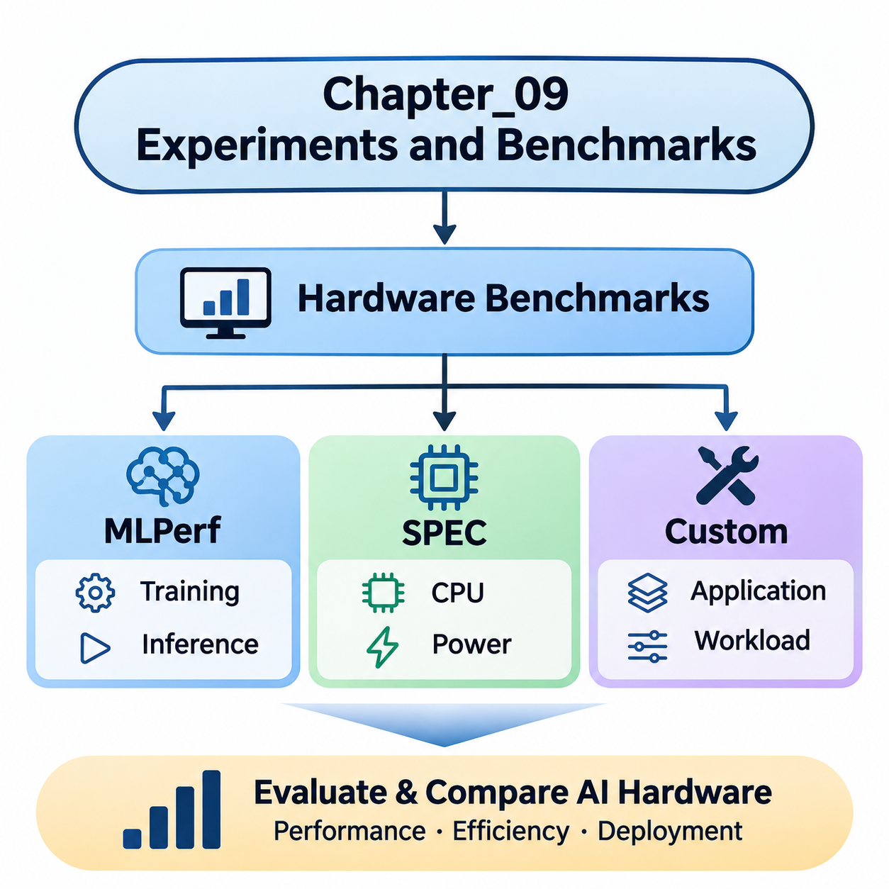
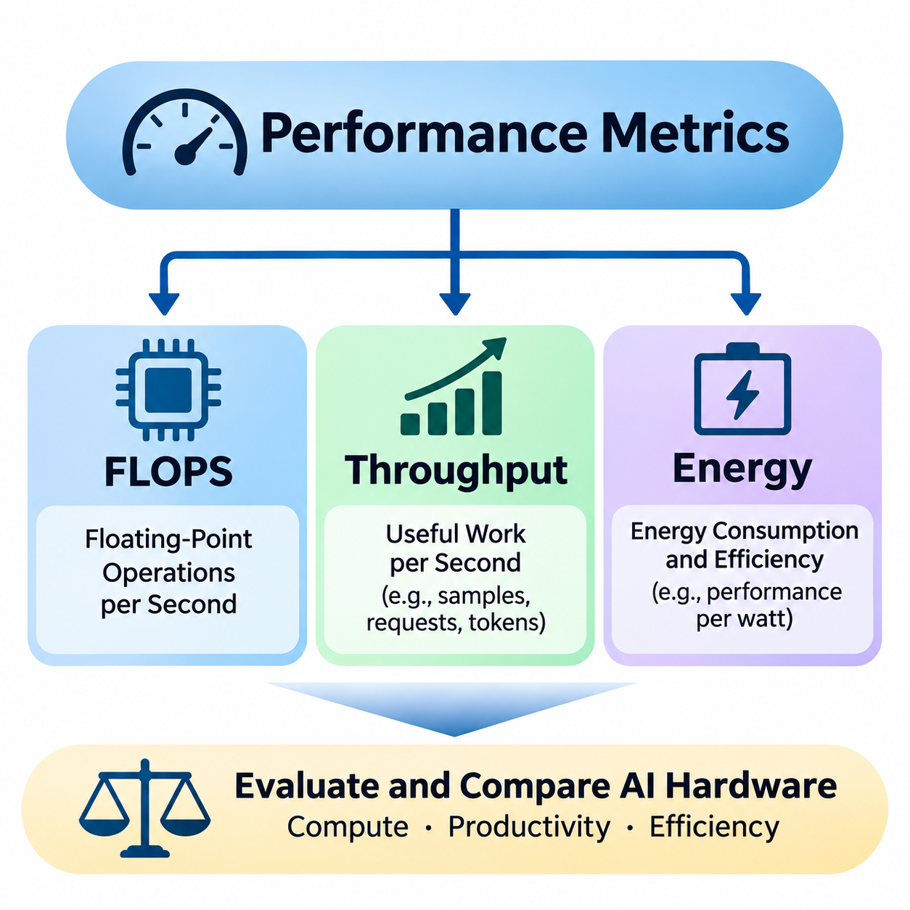
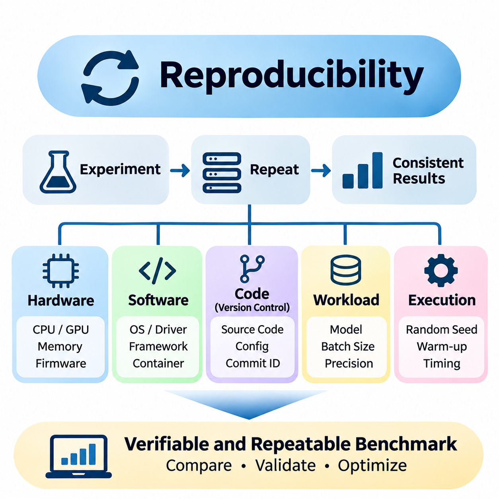
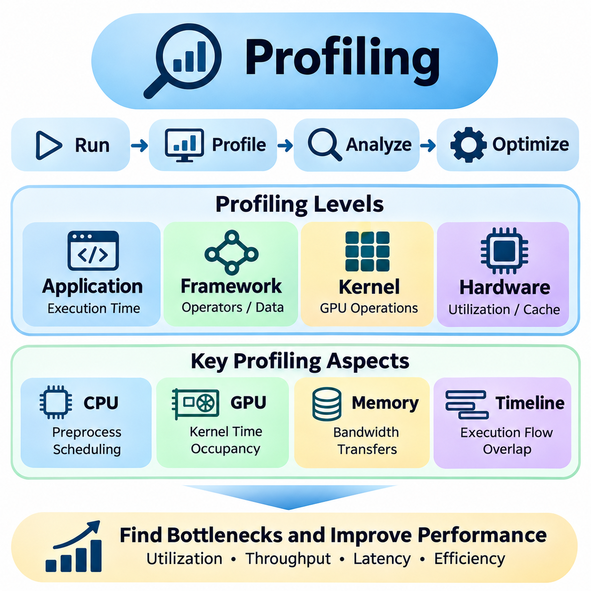
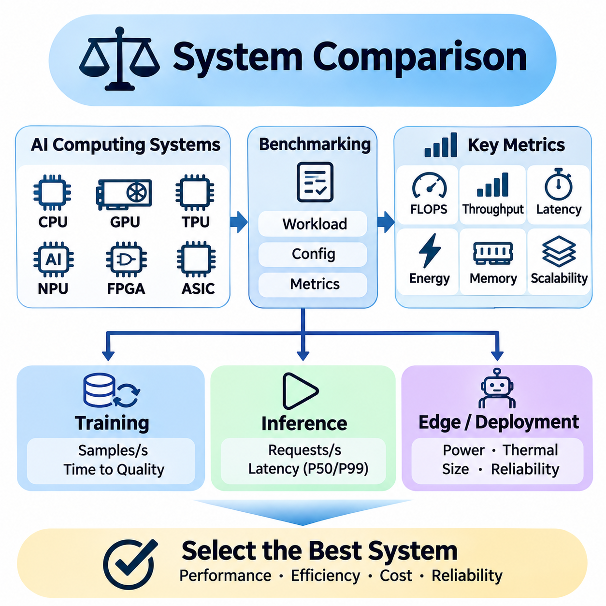

**Volume 39. Hardware for AI**

# 09. Experiments and Benchmarks

## 09.01 Hardware Benchmarks

{width="7.268055555555556in" height="7.268055555555556in"}

Hardware benchmarking provides a systematic method for evaluating the computational capabilities, efficiency, and operational characteristics of AI hardware platforms. Unlike theoretical specifications, benchmarks measure performance under defined workloads and execution conditions. They enable meaningful comparisons among CPUs, GPUs, TPUs, NPUs, FPGAs, and specialized accelerators used for training and inference.

A reliable hardware benchmark must represent the computational behavior of its intended applications. AI workloads combine matrix multiplication, tensor operations, memory transfers, synchronization, and data preprocessing. Their performance depends on hardware architecture, numerical precision, memory capacity, and software optimization. Consequently, benchmark selection must reflect actual deployment requirements rather than peak computational specifications alone.

Standardized benchmarks establish common evaluation procedures that improve comparability across hardware platforms. They specify workloads, measurement methods, execution constraints, and reporting requirements. MLPerf and SPEC represent two important benchmarking approaches, while custom benchmarks address application-specific requirements. Combining these approaches provides a more comprehensive understanding of hardware performance.

MLPerf is a benchmark suite developed through the MLCommons community to evaluate machine learning systems using representative workloads. It includes benchmark categories addressing training and inference performance across different hardware configurations. By defining workload requirements, accuracy targets, and measurement procedures, MLPerf enables structured comparisons among AI accelerators, computing servers, and deployment platforms.

MLPerf Training evaluates the time required to train machine learning models to specified quality targets. Depending on the benchmark, workloads may involve image classification, recommendation systems, language modeling, or other computationally intensive tasks. The resulting measurements reflect not only accelerator performance but also distributed communication, memory efficiency, framework implementation, and overall system integration.

Training benchmarks are particularly valuable when evaluating large GPU clusters and specialized AI accelerators. Multi-device configurations introduce communication overhead, synchronization delays, and workload distribution challenges. A system with greater theoretical processing capacity may achieve lower practical efficiency if its interconnect, memory subsystem, or software stack cannot sustain the required computational throughput.

MLPerf Inference evaluates the performance of systems executing trained models under defined deployment conditions. Depending on the benchmark version and workload, evaluation scenarios can represent offline processing, server requests, or interactive inference. Measurements may emphasize throughput, latency constraints, and response consistency, allowing engineers to assess hardware suitability for different operational environments.

Inference performance is strongly influenced by batch size, model architecture, numerical precision, and execution runtime. GPUs may achieve high throughput through parallel execution, while dedicated NPUs or ASICs may offer advantages in power-constrained environments. MLPerf results must therefore be interpreted alongside configuration details, including accelerator count, software versions, precision formats, and permitted optimizations.

MLPerf also distinguishes between benchmark divisions and submission rules that govern optimization flexibility and comparability. Closed-division results follow prescribed workload requirements, while open-division submissions permit broader experimentation. Official results should be compared within compatible benchmark versions, divisions, workloads, and scenarios because differences in methodology can invalidate otherwise attractive performance comparisons.

The Standard Performance Evaluation Corporation, commonly known as SPEC, develops benchmark suites for evaluating computer systems and infrastructure. Unlike MLPerf, which focuses directly on machine learning workloads, SPEC covers broader computational domains, including processor performance, power efficiency, and selected system-level characteristics. These measurements provide complementary information about the infrastructure supporting AI applications.

SPEC CPU benchmarks evaluate processor performance through standardized computational workloads. Integer and floating-point workloads exercise different aspects of CPU architecture, including instruction execution, cache behavior, memory access, and compiler optimization. Although these workloads do not directly measure neural network training, they help characterize host processors responsible for preprocessing, orchestration, and computational tasks outside accelerator kernels.

CPU performance can significantly influence AI system efficiency even when the primary mathematical operations execute on GPUs. Dataset decoding, tokenization, memory allocation, scheduling, and data transformation frequently depend on host processing resources. Insufficient CPU capacity can leave accelerators underutilized, making complementary CPU benchmarking important when designing balanced AI computing platforms.

SPECpower and related energy-oriented evaluations examine computational performance in relation to electrical power consumption. These measurements help characterize server efficiency under defined operating conditions and utilization levels. For AI infrastructure, energy efficiency affects operating costs, cooling requirements, and deployment density, although general-purpose power benchmarks cannot substitute for direct measurements of AI workload energy consumption.

SPEC results require careful interpretation because benchmark scores depend on processor configurations, memory systems, compilers, operating systems, and permitted optimization settings. A higher score does not necessarily imply superior AI inference or training performance. Instead, SPEC measurements should be treated as complementary indicators that describe important components of the computing environment surrounding specialized AI accelerators.

Custom hardware benchmarks address performance characteristics that standardized suites may not adequately capture. Industrial AI systems often execute specialized neural networks, sensor-processing pipelines, or real-time control applications with unique computational constraints. Custom evaluation procedures allow engineers to reproduce these workloads and measure performance under conditions resembling actual deployment environments.

A custom benchmark begins with a clearly defined workload and execution configuration. Engineers select representative models, input dimensions, batch sizes, precision formats, and runtime environments. The benchmark should also specify preprocessing operations, memory allocation behavior, warm-up procedures, and measurement boundaries. These decisions determine whether the results represent isolated accelerator performance or complete application execution.

Microbenchmarks isolate individual hardware operations to identify architectural strengths and bottlenecks. Matrix multiplication tests reveal tensor-processing efficiency, while memory bandwidth tests characterize data transfer capabilities. Additional experiments can evaluate cache behavior, kernel launch overhead, host-device communication, and synchronization costs. Such measurements help explain why application performance differs from theoretical hardware specifications.

End-to-end benchmarks measure complete AI execution pipelines rather than isolated computational kernels. An image-processing application may include sensor acquisition, decoding, preprocessing, inference, postprocessing, and result transmission. Measuring the entire pipeline reveals delays that accelerator-only benchmarks overlook. This approach is especially important for robotics, autonomous systems, and industrial inspection platforms.

Real-time AI applications require measurements beyond average execution speed. Engineers must examine latency distributions, worst-observed execution times, scheduling interference, and deadline violations. A system that achieves high average throughput may still be unsuitable for deterministic control if occasional processing delays exceed operational limits. Custom benchmarks should therefore reproduce realistic concurrency and resource contention.

Power and thermal behavior also influence benchmark interpretation. Accelerators may initially operate at high clock frequencies before reducing performance because of temperature or power constraints. Sustained testing reveals thermal throttling, cooling limitations, and long-duration performance stability. Embedded AI platforms require particular attention because enclosure design, available airflow, and electrical power budgets directly affect operational capability.

Benchmark methodology must account for measurement uncertainty and experimental variability. Repeated trials help distinguish consistent performance differences from random fluctuations. Hardware utilization, clock frequencies, memory consumption, temperature, and power measurements provide explanatory context. Reporting medians, percentiles, variation, and experimental conditions produces more informative results than presenting a single peak performance figure.

Fair comparisons require consistent workloads and clearly documented software environments. Framework versions, compiler settings, accelerator drivers, numerical precision, and optimization libraries can substantially affect measured performance. When comparing different architectures, equivalent model accuracy and functional behavior should be maintained wherever possible. Otherwise, apparent hardware advantages may originate from differences in computational requirements.

Benchmark optimization introduces an important distinction between measuring hardware capability and evaluating complete hardware-software systems. Compiler fusion, quantization, memory scheduling, and specialized kernels can dramatically improve execution efficiency. Such optimizations are legitimate when permitted by the evaluation methodology, but their effects should be documented to distinguish architectural capabilities from software engineering improvements.

Hardware selection should integrate standardized benchmark results with application-specific measurements. MLPerf provides evidence about representative machine learning workloads, SPEC characterizes complementary computing infrastructure, and custom benchmarks capture deployment-specific behavior. Together, these measurements support decisions involving accelerator selection, memory configuration, processor balance, energy efficiency, and system integration.

Ultimately, effective hardware benchmarking transforms performance evaluation into an evidence-based engineering process. Its objective is not simply to identify the fastest processor, but to determine which computing architecture satisfies application requirements under realistic constraints. By combining MLPerf, SPEC, and carefully designed custom experiments, engineers can evaluate performance, efficiency, scalability, and operational reliability with greater confidence.

## 09.02 Performance Metrics

{width="7.268055555555556in" height="7.268055555555556in"}

Performance metrics provide quantitative methods for evaluating the computational capability, processing efficiency, and operational suitability of AI hardware systems. While architectural specifications describe theoretical resources, measured performance reveals how effectively those resources execute actual workloads. FLOPS, throughput, and energy consumption represent complementary dimensions that must be considered together when comparing computing platforms.

A comprehensive performance evaluation distinguishes theoretical peak capability from sustained application performance. Modern AI accelerators contain thousands of parallel execution units, specialized tensor processors, and high-bandwidth memory systems. However, computational utilization depends on workload structure, memory access patterns, numerical precision, scheduling efficiency, and communication overhead between hardware components.

Floating-Point Operations Per Second, commonly abbreviated as FLOPS, measures the number of floating-point arithmetic operations a computing system can perform each second. It is widely used to characterize the computational capability of CPUs, GPUs, and AI accelerators. FLOPS provides a useful reference for evaluating numerical processing capacity, particularly in scientific computing, neural network training, and matrix-intensive applications.

FLOPS measurements are typically expressed using scales such as GFLOPS, TFLOPS, and PFLOPS, representing billions, trillions, and quadrillions of floating-point operations per second. These units enable comparisons across devices ranging from embedded processors to large computing clusters. Nevertheless, a higher FLOPS rating does not automatically guarantee faster application execution because memory access and workload efficiency may limit achievable performance.

Theoretical peak FLOPS is calculated from architectural parameters such as processing unit count, operating frequency, and supported arithmetic operations per cycle. Specialized tensor processing units can execute multiple arithmetic operations simultaneously, substantially increasing advertised computational capability. These theoretical values assume ideal execution conditions and therefore represent upper performance limits rather than guaranteed application throughput.

Numerical precision strongly influences FLOPS measurements and their interpretation. FP64, FP32, FP16, BF16, and FP8 formats require different hardware resources and provide different numerical characteristics. Modern accelerators may achieve substantially higher operation rates using reduced precision. Consequently, FLOPS comparisons must specify the precision format, accumulation behavior, and whether specialized tensor instructions are involved.

Mixed-precision computing combines different numerical formats to improve computational efficiency while maintaining acceptable model quality. Neural network training may execute matrix operations using lower precision while retaining higher precision for selected accumulations or sensitive calculations. Although this approach increases effective computational throughput, its suitability depends on numerical stability, model architecture, and the accuracy requirements of the target application.

Measured FLOPS represents the computational work completed during an observed execution interval. Engineers can estimate achieved performance by dividing the number of executed floating-point operations by elapsed computation time. However, operation counting requires a consistent methodology because fused multiply-add instructions, sparse operations, and specialized matrix instructions may be counted differently across profiling tools and benchmark frameworks.

The roofline performance model explains the relationship between computational capability and memory bandwidth. It characterizes achievable performance using arithmetic intensity, defined as the number of operations performed per byte transferred from a specified memory level. Workloads with low arithmetic intensity are generally memory-bound, while workloads with sufficiently high arithmetic intensity may become compute-bound.

Throughput measures the quantity of useful work completed within a given period. In AI applications, throughput may be expressed as images per second, tokens per second, inference requests per second, training samples per second, or processed sensor frames per second. Unlike FLOPS, throughput directly reflects application-level productivity and therefore provides a practical measure of hardware effectiveness.

Training throughput describes how quickly a computing platform processes training data during model optimization. It depends on accelerator computation, data loading, gradient calculation, optimizer execution, and synchronization between devices. High training throughput can reduce model development time, although overall training efficiency must also consider convergence behavior, numerical stability, and the number of optimization steps required.

Inference throughput evaluates the rate at which a deployed system processes inputs and generates outputs. Computer vision systems commonly report frames per second, while language models may report generated tokens per second. Server applications often measure completed requests per second. These measurements must identify workload characteristics because input dimensions, sequence lengths, output lengths, and model complexity directly influence processing capacity.

Batch size significantly affects throughput by determining how many inputs are processed together. Larger batches can improve accelerator utilization and amortize kernel launch overhead, especially on massively parallel GPUs. However, batching may increase memory consumption and request waiting time. Therefore, the batch size that maximizes throughput may not satisfy the latency requirements of interactive or real-time applications.

Throughput and latency describe different aspects of system performance. Throughput measures completed work per unit time, whereas latency measures the elapsed time required to process an individual operation or request. A system may achieve excellent throughput through batching while exhibiting unacceptable response delays. Performance evaluation must therefore examine both metrics under consistent workload and concurrency conditions.

In distributed AI systems, throughput depends on communication efficiency as well as local computational capability. Data parallelism requires gradient synchronization, while model parallelism introduces communication between computational partitions. Network bandwidth, interconnect latency, collective communication algorithms, and workload imbalance can reduce scaling efficiency. Adding accelerators does not necessarily produce proportional throughput improvements.

Sustained throughput provides a more realistic indicator of production performance than short-duration peak measurements. Extended workloads expose thermal throttling, memory fragmentation, resource contention, and fluctuations in input processing. For industrial AI applications, performance consistency is often more important than isolated maximum results because operational systems must maintain processing capacity throughout continuous execution.

Energy consumption represents the electrical energy required to perform computation over time. Power is measured in watts, while energy is commonly expressed in joules or watt-hours. The relationship between power and energy depends on execution duration. A device operating at higher instantaneous power may consume less total energy if it completes the required workload sufficiently faster than a lower-power alternative.

Energy efficiency can be expressed as useful computational work per unit of energy. Common metrics include FLOPS per watt, inferences per joule, images per joule, and tokens per joule. FLOPS per watt describes arithmetic efficiency relative to power, while application-level energy metrics more directly reflect the cost of completing meaningful tasks. These distinctions are important when evaluating different accelerator architectures.

Energy per inference measures the electrical energy consumed to complete an inference operation. It can be estimated by integrating measured power over the execution interval and dividing by the number of completed inferences. Accurate measurements should define whether they include accelerator power, host processing, memory, storage, networking, and idle system consumption, since different measurement boundaries produce different results.

Power consumption varies dynamically with workload intensity, clock frequency, memory activity, and hardware utilization. Dynamic voltage and frequency scaling adjusts operating conditions to balance performance and energy requirements. Power limits may reduce instantaneous throughput while improving energy efficiency. However, excessive power restrictions can increase execution duration and potentially increase the total energy required to complete a workload.

Thermal management also influences energy performance because cooling systems consume electricity and hardware temperature affects operating efficiency. Data center deployments must consider accelerator power alongside server infrastructure, networking, and cooling requirements. Power Usage Effectiveness provides a facility-level efficiency indicator, but application-specific energy measurements remain necessary to evaluate the actual computational efficiency of AI workloads.

Edge AI platforms operate under particularly restrictive energy budgets. Mobile robots, autonomous vehicles, embedded vision systems, and battery-powered devices must balance computational capability against battery capacity and operating duration. Energy-efficient inference may require quantization, model compression, accelerator-specific optimization, and selective processing. These techniques reduce computational demand while preserving acceptable application accuracy.

Performance comparisons should consider FLOPS, throughput, and energy as interconnected rather than independent measurements. A processor with higher theoretical FLOPS may deliver lower application throughput because of memory bottlenecks. Similarly, a device with lower power consumption may require more energy per task if execution takes significantly longer. Meaningful comparisons therefore require consistent workloads, numerical precision, and measurement boundaries.

Reliable experiments must document hardware configurations, software versions, workload parameters, environmental conditions, and measurement procedures. Repeated measurements help characterize variability, while sustained testing reveals performance degradation that short benchmarks may overlook. Reporting theoretical FLOPS, achieved throughput, average power, total energy, and application-level efficiency provides a balanced foundation for engineering decisions.

Ultimately, performance metrics translate hardware capabilities into measurable operational outcomes. FLOPS characterizes arithmetic processing capacity, throughput evaluates useful work completed over time, and energy metrics quantify the electrical cost of computation. Integrating these measurements enables engineers to select AI hardware that satisfies performance targets while controlling energy consumption, deployment cost, thermal constraints, and long-term operational requirements.

## 09.03 Reproducibility [w/Code]

{width="7.268055555555556in" height="7.268055555555556in"}

Reproducibility is a fundamental requirement of reliable AI hardware benchmarking because performance results must remain verifiable across repeated experiments. A reproducible benchmark allows researchers and engineers to reconstruct the experimental environment, execute equivalent workloads, and obtain statistically consistent measurements. This principle transforms isolated performance claims into dependable engineering evidence.

Hardware benchmarking introduces reproducibility challenges because measured performance depends on numerous interacting components. Processor architecture, accelerator configuration, memory capacity, firmware, operating systems, drivers, compilers, and runtime libraries can influence execution behavior. Even minor configuration differences may alter scheduling, memory allocation, kernel selection, and computational efficiency.

A reproducible experiment begins with a precisely defined hardware configuration. Documentation should identify processor models, accelerator types, device counts, memory specifications, interconnect topology, storage devices, and cooling arrangements. Clock frequencies, power limits, firmware versions, and BIOS settings should also be recorded because these parameters directly affect sustained computational performance.

Software environment reproducibility requires systematic control of dependencies and execution settings. Operating system versions, GPU drivers, CUDA toolkits, compiler versions, machine learning frameworks, and acceleration libraries must be documented. Container technologies such as Docker can package software dependencies, although containers still depend on compatible host drivers, hardware capabilities, and kernel interfaces.

Version control provides a foundation for reconstructing benchmark implementations and experimental configurations. Git repositories can preserve source code, configuration files, dependency specifications, and execution scripts. Each benchmark result should reference a specific commit identifier, ensuring that subsequent investigators can identify the exact implementation used during measurement.

Dependency management must extend beyond top-level software packages. Transitive dependencies, binary libraries, compiler toolchains, and hardware-specific runtime components can introduce unexpected differences. Lockfiles, container image digests, and archived installation manifests improve environment consistency. Recording these details reduces ambiguity when benchmarks are repeated months or years later.

Randomness represents another important source of experimental variability. Neural network initialization, dataset shuffling, stochastic augmentation, and parallel execution can produce different results across runs. Setting random seeds improves repeatability, but deterministic behavior may also require explicit framework settings and restrictions on nondeterministic computational kernels.

Deterministic execution does not necessarily guarantee identical results across different hardware architectures. Floating-point arithmetic is sensitive to operation ordering, rounding behavior, reduction strategies, and numerical precision. Parallel processors may execute mathematically equivalent operations in different sequences, producing small numerical differences that can propagate through iterative algorithms.

Benchmark reproducibility therefore requires distinguishing exact replication from statistical consistency. Exact replication attempts to reproduce identical outputs and execution conditions, while statistical reproducibility evaluates whether repeated experiments produce compatible performance distributions. For complex AI hardware systems, statistical consistency is often more practical than demanding identical execution times.

Workload specification is essential because benchmark results depend on the computational tasks being executed. Model architecture, input dimensions, batch size, sequence length, numerical precision, and dataset characteristics should remain consistent. For training benchmarks, optimizer settings, learning rates, convergence criteria, and stopping conditions must also be defined.

Inference benchmarks require additional control over request generation and execution behavior. Warm-up duration, concurrency level, batching policy, input distribution, and measurement intervals can significantly affect throughput and latency. Benchmark documentation should specify whether preprocessing, data transfer, postprocessing, and communication overhead are included in reported execution times.

Warm-up procedures improve measurement consistency by allowing runtime initialization, memory allocation, kernel compilation, and cache population to occur before timed execution. Without warm-up, initial measurements may include one-time overhead unrelated to steady-state performance. However, cold-start behavior should be measured separately when initialization latency is relevant to deployment requirements.

Hardware operating conditions must remain controlled throughout repeated experiments. Temperature, cooling capacity, power delivery, background processes, and accelerator utilization can influence benchmark results. Dynamic voltage and frequency scaling may cause clock frequencies to change during execution, while thermal throttling can reduce performance during sustained workloads.

System isolation helps prevent unrelated activities from contaminating measurements. Background services, operating system updates, storage operations, and competing GPU processes may introduce unpredictable delays. Dedicated benchmark environments, controlled process affinity, and resource allocation policies can reduce interference, although complete isolation may not be achievable on shared infrastructure.

Timing methodology is particularly important when evaluating asynchronous accelerators. GPU operations may execute independently of the host CPU, meaning ordinary CPU timing functions can underestimate actual execution duration. Correct measurement procedures require appropriate synchronization or device-specific timing mechanisms to ensure that recorded intervals include the intended computational work.

Repeated trials provide evidence about performance stability and measurement uncertainty. Rather than reporting only the fastest execution, engineers should collect multiple observations and calculate representative statistics. Medians, means, standard deviations, and percentile distributions help distinguish systematic performance differences from random variation caused by scheduling, temperature, or system activity.

Statistical analysis should consider whether observed differences are meaningful relative to experimental variability. Small performance improvements may fall within normal measurement noise, particularly when execution times are short. Confidence intervals and repeated independent experiments provide stronger evidence than isolated measurements, although their interpretation depends on sampling assumptions and experimental design.

Performance logs should preserve both primary measurements and relevant system telemetry. Execution time, throughput, latency, memory utilization, clock frequency, power consumption, and temperature provide complementary information. Timestamped records make it possible to identify performance degradation, thermal transitions, and resource contention that might otherwise remain hidden.

Automated benchmark pipelines reduce human error and improve procedural consistency. Scripts can initialize environments, validate hardware configurations, execute warm-up iterations, perform repeated measurements, and archive results. Continuous integration systems can detect performance regressions after software changes, provided benchmark hardware and execution conditions remain sufficiently controlled.

Experiment tracking systems can associate performance results with hardware specifications, software versions, configuration parameters, and source code revisions. Structured metadata enables comparisons across benchmark runs and supports long-term performance analysis. Storing raw measurements alongside summarized results allows investigators to reanalyze experiments without repeating expensive computations.

Reproducibility becomes more challenging in distributed AI systems because multiple computing nodes interact through networks and shared infrastructure. Network congestion, communication topology, synchronization behavior, and workload placement can introduce additional variability. Distributed benchmarks should record node configurations, interconnect settings, collective communication libraries, and cluster scheduling conditions.

Energy benchmarking introduces further measurement requirements because electrical power varies dynamically during execution. Reproducible energy experiments must define measurement boundaries, sampling intervals, instrumentation accuracy, and idle power treatment. External power meters and hardware telemetry may report different values, so measurement sources and calibration procedures should be documented.

Cross-platform reproducibility requires separating workload equivalence from implementation equivalence. Different accelerators may use distinct compilers, kernels, and numerical formats to execute the same model. Fair comparisons should preserve functional requirements and accuracy targets while documenting architecture-specific optimizations. Identical source code alone does not guarantee equivalent computational behavior.

Reproducibility also supports performance regression analysis and hardware lifecycle management. When benchmark procedures remain stable, engineers can determine whether changes in drivers, firmware, compilers, or hardware configurations improve or degrade system behavior. Historical benchmark records provide valuable evidence for upgrade decisions, troubleshooting, and production qualification.

Ultimately, reproducibility establishes confidence in AI hardware performance measurements by connecting experimental results to documented conditions and repeatable procedures. Hardware specifications, software environments, workload definitions, statistical analysis, and automated execution must be managed together. A reproducible benchmarking process enables trustworthy system comparisons and supports evidence-based hardware engineering decisions.

## 09.04 Profiling [w/Code]

{width="7.268055555555556in" height="7.268055555555556in"}

Profiling is a systematic technique for examining how AI applications utilize computational resources during execution. Unlike benchmarking, which measures overall performance, profiling investigates the internal behavior responsible for observed results. It identifies execution bottlenecks, inefficient operations, memory limitations, and synchronization delays, enabling engineers to optimize hardware utilization and improve application performance.

AI profiling requires observation across multiple levels of the computing system. Application-level measurements describe overall execution time, while framework-level profiling reveals operator execution and data movement. Kernel-level analysis examines individual computational operations, and hardware-level profiling exposes processor utilization, memory transactions, cache behavior, and instruction execution characteristics.

A profiling workflow begins by establishing a reproducible performance baseline under representative workloads. Engineers should define model architecture, input dimensions, batch size, numerical precision, and runtime configuration before collecting measurements. Stable operating conditions are essential because temperature, clock frequency, competing processes, and initialization overhead can distort profiling results.

CPU profiling examines how host processors contribute to AI application execution. Data preprocessing, memory allocation, scheduling, input decoding, and runtime coordination often execute on CPUs even when neural network computations run on accelerators. Sampling profilers and tracing tools can identify expensive functions, excessive system calls, thread contention, and inefficient data preparation pipelines.

GPU profiling focuses on understanding the execution behavior of massively parallel computational workloads. Profiling tools can measure kernel execution time, streaming multiprocessor activity, memory bandwidth utilization, and device occupancy. These measurements help determine whether a workload is limited by arithmetic throughput, memory transfers, synchronization overhead, or insufficient parallelism.

Kernel-level profiling provides detailed information about individual GPU operations. Matrix multiplication, convolution, attention mechanisms, and reduction kernels exhibit different computational and memory characteristics. Engineers can inspect execution duration, instruction throughput, register pressure, shared memory usage, and occupancy to identify opportunities for kernel fusion, tiling, or improved memory access patterns.

GPU occupancy describes the proportion of active warps relative to the maximum number supported by a streaming multiprocessor. Occupancy depends on register allocation, shared memory requirements, thread block dimensions, and architectural limits. Higher occupancy can improve latency hiding, but maximum occupancy does not necessarily produce maximum performance because instruction efficiency and memory behavior remain important.

Memory profiling is essential because many AI workloads are constrained by data movement rather than arithmetic capability. Profilers can reveal global memory transactions, cache hit rates, memory bandwidth consumption, and host-to-device transfers. Inefficient memory layouts, noncoalesced accesses, redundant copies, and excessive intermediate tensors can significantly reduce effective computational throughput.

The roofline model provides a useful framework for interpreting profiling measurements. It compares achieved computational performance against hardware compute and memory bandwidth limits using arithmetic intensity. A workload operating near the memory bandwidth ceiling is likely memory-bound, while one approaching the computational ceiling may be compute-bound. Performance below both limits suggests additional inefficiencies.

Framework profiling connects high-level neural network operations with lower-level execution behavior. PyTorch Profiler and TensorFlow profiling facilities can associate operators with execution times, memory consumption, and accelerator activity. Such information helps identify expensive layers, unnecessary tensor transformations, synchronization points, and inefficient execution sequences that may not be apparent from model architecture alone.

Timeline tracing reveals how CPU threads, GPU kernels, memory transfers, and synchronization events interact over time. A visual execution timeline can expose idle accelerator periods, serialization between operations, and overlapping computation with data transfers. Proper interpretation requires understanding asynchronous execution because host-side function completion does not necessarily indicate that device-side computation has finished.

NVIDIA Nsight Systems supports system-wide performance analysis by capturing CPU activity, CUDA execution, memory transfers, and synchronization behavior. It is particularly useful for identifying gaps between GPU kernels and understanding interactions among application threads and accelerators. Nsight Compute provides more detailed kernel-level metrics, including memory behavior, instruction execution, and resource utilization.

Profiling on alternative accelerators requires architecture-specific tools and performance counters. TPU, NPU, FPGA, and ASIC platforms may expose different execution statistics, memory hierarchies, and compiler diagnostics. Although the available measurements vary, the fundamental objective remains consistent: connecting application performance to computational resource usage and identifying the dominant execution constraints.

Data pipeline profiling examines whether storage access, decoding, augmentation, and preprocessing can supply accelerators with sufficient input data. A powerful GPU may remain underutilized when CPU workers, storage bandwidth, or data loading processes cannot maintain the required rate. Prefetching, asynchronous loading, caching, and parallel preprocessing can improve pipeline efficiency when profiling confirms these bottlenecks.

Profiling distributed training systems introduces additional complexity because performance depends on communication between devices and nodes. Collective operations, gradient synchronization, parameter exchange, and pipeline scheduling may create idle periods. Engineers should analyze communication duration, computation overlap, network utilization, and workload imbalance to determine whether distributed execution scales efficiently.

Inference profiling emphasizes latency, throughput, and memory behavior under realistic deployment conditions. Batch size, request concurrency, sequence length, and dynamic input shapes can change execution characteristics. Profiling should distinguish model computation from preprocessing, scheduling, data transfer, and postprocessing so that optimization efforts address the components contributing most strongly to end-to-end response time.

Real-time AI applications require profiling methods that capture latency variability rather than only average execution duration. Robotics, autonomous systems, and industrial inspection platforms may operate under strict timing constraints. Engineers should examine latency percentiles, scheduling jitter, deadline violations, and interference from concurrent tasks to determine whether performance remains sufficiently predictable.

Power and thermal profiling extend performance analysis beyond execution speed. Hardware telemetry can record power consumption, clock frequencies, temperatures, and throttling events during workloads. Correlating these measurements with execution timelines helps identify whether performance changes arise from computational limitations, power restrictions, or thermal conditions rather than software inefficiencies.

Profiling itself can influence application behavior by introducing instrumentation overhead. Detailed tracing, hardware counter collection, and frequent sampling may increase execution time or alter scheduling. Engineers should compare instrumented and uninstrumented runs, select appropriate sampling intervals, and use targeted profiling sessions when extensive instrumentation would distort the workload being measured.

Statistical profiling provides a practical alternative when continuous detailed tracing is too expensive. Sampling execution states periodically can identify frequently executed functions and dominant code paths with relatively low overhead. However, sampling may miss short-duration events, and collected samples require sufficient observation time to represent the workload accurately.

Optimization decisions should be guided by measured bottlenecks rather than assumptions about hardware capability. Increasing GPU utilization may require improving data loading instead of modifying computational kernels. Similarly, reducing kernel execution time may have little effect on overall latency when communication or preprocessing dominates. Profiling establishes the evidence needed to prioritize engineering effort.

After implementing an optimization, engineers should repeat profiling under equivalent conditions to verify its effect. Improvements in one metric can introduce regressions elsewhere, such as increased memory usage, reduced numerical accuracy, or higher energy consumption. Comparing before-and-after measurements across execution time, throughput, latency, and resource utilization provides a more reliable assessment.

Automated profiling workflows support continuous performance engineering throughout software development. Scripts and monitoring systems can collect traces, performance counters, resource statistics, and configuration metadata. Integrating selected profiling measurements into regression testing helps detect inefficient code changes, compiler behavior differences, and unexpected resource consumption before production deployment.

Effective profiling also requires careful documentation and interpretation of collected measurements. Hardware specifications, software versions, profiler configurations, workload parameters, and measurement boundaries should accompany results. Because performance counters and derived utilization metrics can differ between architectures, engineers must avoid comparing incompatible statistics without understanding their definitions.

Ultimately, profiling transforms hardware performance optimization into a measurement-driven engineering process. By examining CPU activity, accelerator kernels, memory behavior, communication overhead, and power characteristics, engineers can identify the true causes of performance limitations. Combined with reproducible benchmarking, profiling enables systematic optimization of AI systems for efficiency, scalability, reliability, and sustained operational performance.

## 09.05 System Comparison

{width="7.268055555555556in" height="7.268055555555556in"}

System comparison is the process of evaluating alternative AI computing platforms under consistent workloads and operating conditions. Its purpose is not simply to identify the hardware with the highest theoretical performance, but to determine which system best satisfies application requirements. Reliable comparisons integrate computational capability, throughput, latency, energy efficiency, scalability, cost, and operational reliability.

AI computing systems differ significantly in processor architecture, accelerator design, memory organization, and software support. CPUs provide flexible general-purpose execution, while GPUs emphasize massive parallelism and tensor computation. TPUs, NPUs, FPGAs, and specialized ASICs offer different efficiency and programmability characteristics. These architectural differences must be evaluated against the actual computational structure of target workloads.

A meaningful comparison begins by defining representative workloads and measurable acceptance criteria. Model architecture, input dimensions, batch size, numerical precision, and dataset characteristics should be documented before testing. For training systems, convergence targets and optimization settings are important, while inference platforms require explicit latency limits, throughput objectives, and accuracy requirements.

Theoretical FLOPS provides an initial indication of arithmetic capability but cannot independently predict application performance. Memory bandwidth, cache efficiency, kernel implementation, and communication overhead frequently limit achieved throughput. Consequently, system comparisons should distinguish peak computational specifications from sustained measured performance under realistic execution conditions.

Throughput comparisons quantify how much useful work each platform completes within a defined interval. Training systems may report samples processed per second, while inference systems measure requests, images, frames, or generated tokens per second. Results must use equivalent workloads and measurement boundaries because differences in preprocessing, batching, or output generation can invalidate direct comparisons.

Latency evaluation is essential for interactive applications and real-time AI systems. Average response time alone may conceal occasional delays that violate operational requirements. Engineers should examine median latency, high-percentile latency, scheduling jitter, and deadline violations. A system delivering greater aggregate throughput may still be unsuitable when individual requests require predictable completion times.

Energy efficiency introduces another dimension into hardware selection. Performance per watt describes computational output relative to electrical power, while energy per inference or training operation measures the cost of completing useful work. Comparisons should account for accelerator consumption, host processors, memory, and supporting components. Measurement boundaries must remain consistent across platforms.

Memory capacity and bandwidth strongly influence system suitability, particularly for large neural networks and multimodal workloads. A processor with impressive arithmetic performance may fail to execute a model efficiently when available memory is insufficient. Memory fragmentation, tensor allocation, activation storage, and data transfer requirements should therefore be included in comparative evaluation.

Software ecosystem maturity can determine whether theoretical hardware advantages translate into practical performance. Framework compatibility, compiler quality, kernel libraries, debugging tools, and deployment runtimes affect implementation effort and execution efficiency. A highly optimized GPU environment may outperform a specialized accelerator when the latter lacks support for required operators or model architectures.

System comparison should distinguish hardware capability from software optimization quality. Different platforms may require architecture-specific kernels, graph compilation, quantization, or memory scheduling. Fair evaluations preserve functional equivalence and accuracy targets while permitting documented optimizations. Identical source code does not necessarily represent an equally optimized implementation on different architectures.

Scalability becomes critical when comparing multi-accelerator servers and distributed computing clusters. Additional devices increase theoretical processing capacity but introduce communication, synchronization, and scheduling overhead. Scaling efficiency should be measured across device counts using consistent workloads. Network topology, interconnect bandwidth, and collective communication performance often determine practical scaling limits.

Distributed training comparisons must consider time to reach a specified model quality rather than relying exclusively on samples processed per second. Higher raw throughput may not reduce training time if numerical behavior or optimization settings alter convergence. Measuring time to quality, accelerator utilization, and communication efficiency provides a more meaningful assessment of large-scale training platforms.

Inference system comparisons should reflect deployment scenarios rather than isolated kernel performance. Server workloads emphasize request concurrency and sustained throughput, while edge applications prioritize predictable latency and energy consumption. Batch processing policies, input distributions, model precision, and runtime overhead must match intended operational conditions for results to remain relevant.

Edge AI hardware introduces additional constraints involving physical dimensions, thermal design, battery capacity, and environmental conditions. Embedded GPUs and NPUs may provide lower peak throughput than data center accelerators but achieve better application efficiency within restricted power budgets. Comparative testing should include sustained operation, thermal throttling, and realistic sensor processing pipelines.

Reliability and operational stability are important comparison criteria for continuously deployed AI systems. Performance may degrade because of overheating, memory exhaustion, driver failures, or resource contention. Long-duration testing helps identify instability that short benchmarks overlook. Systems intended for robotics or industrial automation must maintain acceptable behavior under sustained workloads and unexpected operating conditions.

Cost comparisons should extend beyond initial hardware purchase prices. Total cost of ownership includes electricity, cooling, maintenance, software integration, infrastructure, and hardware replacement. Cloud systems introduce usage-based pricing, while on-premises deployments require capital investment and operational management. Cost per completed inference or training task can provide a useful economic comparison.

Benchmark standardization improves comparison credibility by defining common workloads and reporting procedures. MLPerf offers structured evaluations for machine learning training and inference, while SPEC provides complementary information about processor and system characteristics. Custom benchmarks remain necessary when industrial applications, robotic systems, or specialized models are insufficiently represented by standardized workloads.

Reproducibility is essential because system rankings can change with software versions, configuration settings, and environmental conditions. Experiments should record hardware specifications, firmware, drivers, frameworks, compiler options, and benchmark parameters. Repeated trials and statistical summaries help distinguish genuine performance differences from measurement noise and temporary operating fluctuations.

Profiling complements benchmarking by explaining why competing systems produce different results. CPU utilization, accelerator occupancy, memory bandwidth, kernel execution, and communication traces reveal underlying bottlenecks. These observations help determine whether performance limitations originate from hardware architecture, software implementation, data pipelines, or inefficient resource coordination.

A balanced comparison should avoid reducing multiple performance dimensions to a single score without justification. Weighted evaluation methods can combine throughput, latency, energy, memory, cost, and reliability according to application priorities. However, weighting assumptions must be transparent, and mandatory requirements should remain explicit rather than being hidden within aggregate performance scores.

Sensitivity analysis helps determine whether a hardware selection remains appropriate when workload conditions change. Engineers can vary batch size, model complexity, input resolution, concurrency, and power limits to examine performance stability. A platform that performs well under one configuration may become inefficient under another, making workload diversity an important consideration in comparative testing.

Performance comparisons should also account for future expansion and hardware lifecycle requirements. Model sizes, dataset volumes, inference demand, and software dependencies may increase over time. Upgrade paths, accelerator availability, memory expansion, driver maintenance, and vendor support influence long-term suitability. These factors are especially important when infrastructure investments must remain useful across multiple development cycles.

Comparative experiments benefit from structured reporting that separates measured results from interpretation. Tables of hardware specifications, benchmark conditions, performance statistics, and energy measurements provide traceable evidence. Uncertainty ranges, configuration differences, and known limitations should accompany conclusions so that engineering decisions are not based on misleading precision.

Ultimately, system comparison transforms hardware selection into an evidence-based engineering decision. No single architecture is universally superior across all AI workloads and deployment environments. By combining standardized benchmarks, application-specific experiments, profiling, reproducibility, and lifecycle analysis, engineers can identify computing systems that satisfy practical performance, efficiency, reliability, and economic requirements.
