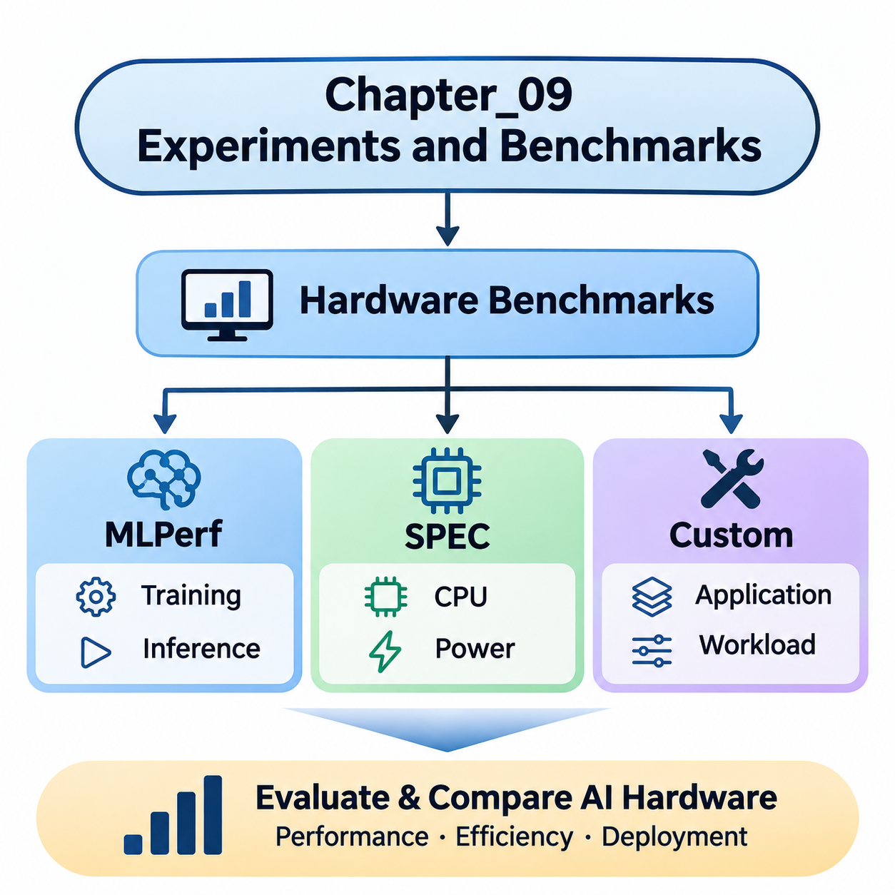
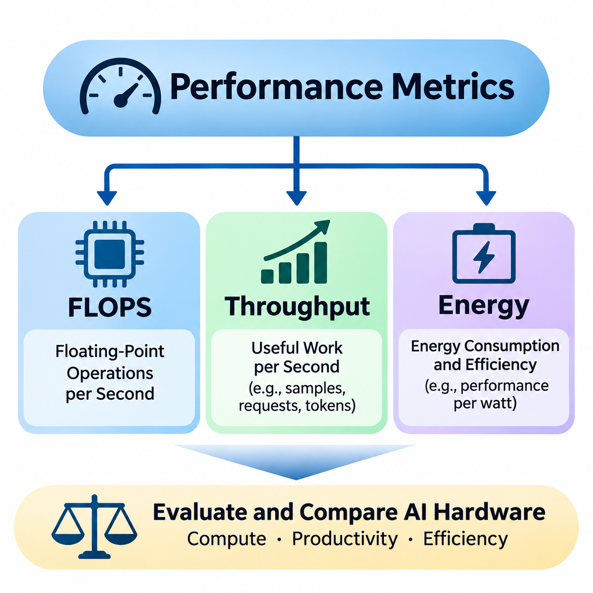
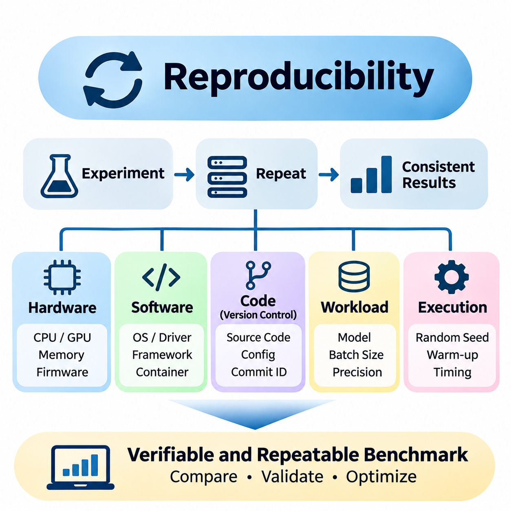
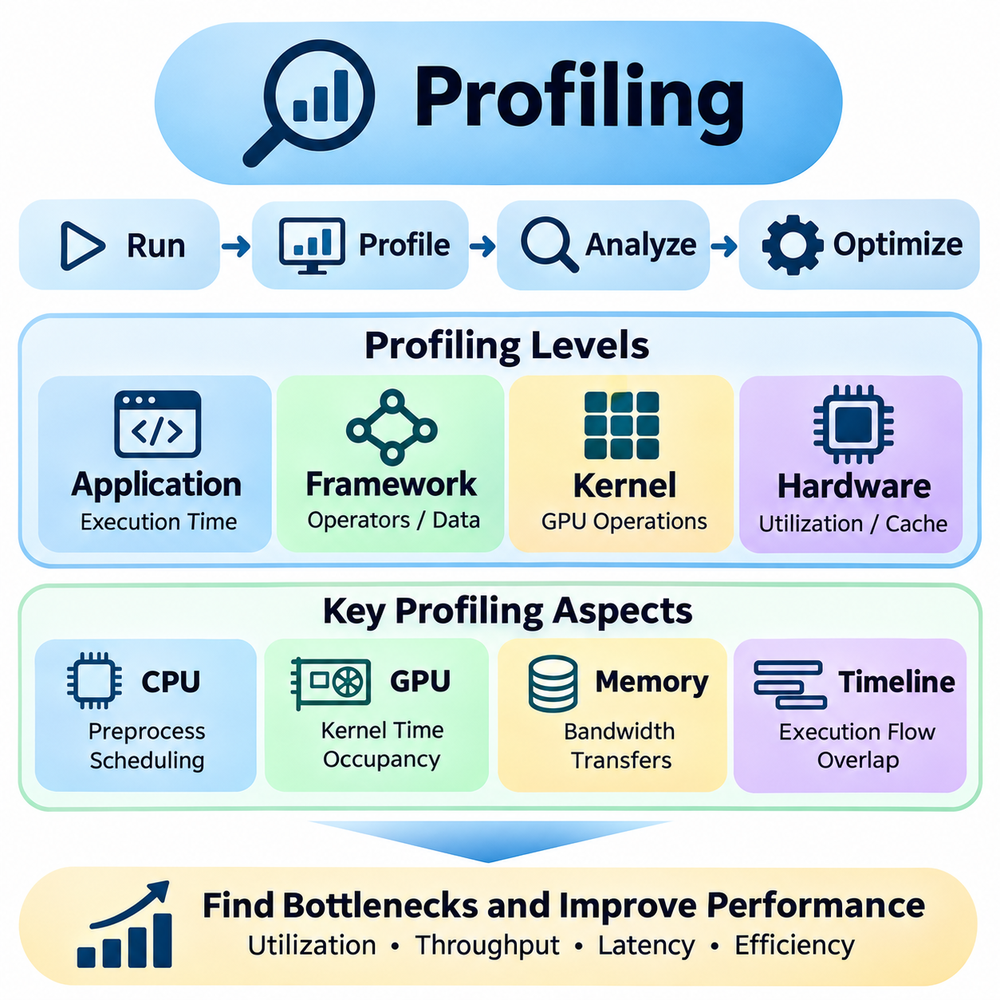
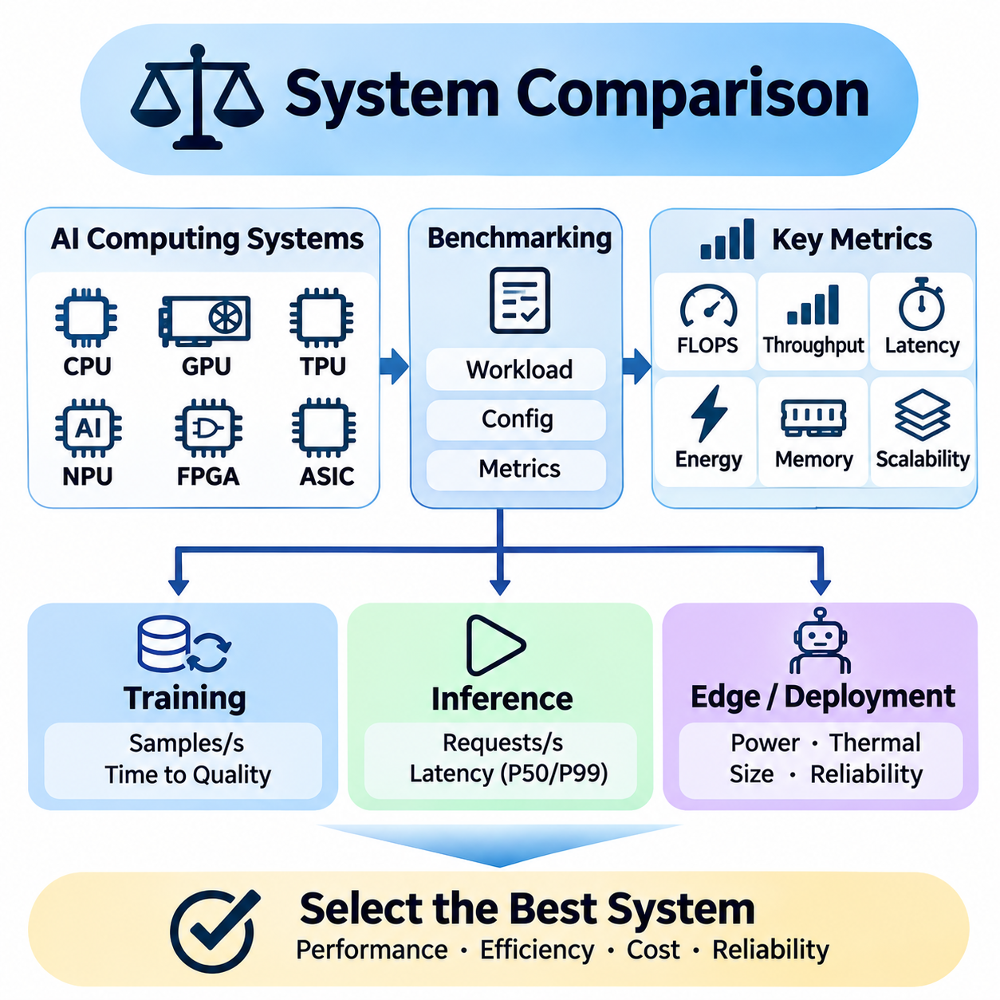

**Volume 39. Hardware for AI**

# 09. Experiments and Benchmarks

## 09.01 Hardware Benchmarks

{width="7.268055555555556in" height="7.268055555555556in"}

하드웨어 벤치마킹(Hardware Benchmarking)은 인공지능(AI) 하드웨어 플랫폼(Hardware Platform)의 연산 능력(Computational Capability), 효율성(Efficiency), 운영 특성(Operational Characteristics)을 체계적으로 평가하는 방법을 제공한다. 이론적 사양(Theoretical Specifications)과 달리 벤치마크(Benchmark)는 정의된 작업 부하(Workload)와 실행 조건(Execution Conditions)에서 성능을 측정한다. 이를 통해 CPU, GPU, TPU, NPU, FPGA 및 학습(Training)과 추론(Inference)에 사용되는 특수 가속기(Specialized Accelerator)를 의미 있게 비교할 수 있다.

신뢰할 수 있는 하드웨어 벤치마크(Hardware Benchmark)는 대상 애플리케이션(Application)의 연산 특성(Computational Behavior)을 반영해야 한다. AI 작업 부하(AI Workload)는 행렬 곱셈(Matrix Multiplication), 텐서 연산(Tensor Operations), 메모리 전송(Memory Transfer), 동기화(Synchronization), 데이터 전처리(Data Preprocessing)를 결합한다. 성능은 하드웨어 아키텍처(Hardware Architecture), 수치 정밀도(Numerical Precision), 메모리 용량(Memory Capacity), 소프트웨어 최적화(Software Optimization)에 따라 달라진다. 따라서 벤치마크 선택은 이론적 최대 연산 성능(Peak Computational Performance)보다 실제 배포 요구사항(Deployment Requirements)을 반영해야 한다.

표준화된 벤치마크(Standardized Benchmark)는 하드웨어 플랫폼 간 비교 가능성(Comparability)을 향상시키는 공통 평가 절차(Evaluation Procedure)를 제공한다. 이러한 벤치마크는 작업 부하(Workload), 측정 방법(Measurement Method), 실행 제약 조건(Execution Constraints), 결과 보고 요구사항(Reporting Requirements)을 정의한다. MLPerf와 SPEC은 중요한 두 가지 벤치마킹 접근 방식(Benchmarking Approach)을 대표하며, 사용자 정의 벤치마크(Custom Benchmark)는 애플리케이션별 요구사항(Application-Specific Requirements)을 평가한다. 이러한 접근 방식을 결합하면 하드웨어 성능을 더욱 종합적으로 이해할 수 있다.

MLPerf는 MLCommons 커뮤니티(MLCommons Community)가 개발한 벤치마크 모음(Benchmark Suite)으로, 대표적인 작업 부하(Representative Workload)를 사용하여 기계학습 시스템(Machine Learning System)을 평가한다. 다양한 하드웨어 구성(Hardware Configuration)에서 학습 성능(Training Performance)과 추론 성능(Inference Performance)을 평가하는 벤치마크 범주(Benchmark Category)를 포함한다. 작업 부하 요구사항(Workload Requirements), 정확도 목표(Accuracy Targets), 측정 절차(Measurement Procedures)를 정의함으로써 AI 가속기(AI Accelerator), 컴퓨팅 서버(Computing Server), 배포 플랫폼(Deployment Platform)을 체계적으로 비교할 수 있도록 한다.

MLPerf 학습(MLPerf Training)은 기계학습 모델(Machine Learning Model)이 지정된 품질 목표(Quality Target)에 도달하는 데 필요한 시간을 평가한다. 벤치마크에 따라 이미지 분류(Image Classification), 추천 시스템(Recommendation System), 언어 모델링(Language Modeling) 또는 기타 연산 집약적 작업(Compute-Intensive Task)이 포함될 수 있다. 측정 결과는 가속기 성능(Accelerator Performance)뿐 아니라 분산 통신(Distributed Communication), 메모리 효율성(Memory Efficiency), 프레임워크 구현(Framework Implementation), 전체 시스템 통합(System Integration)의 영향을 반영한다.

학습 벤치마크(Training Benchmark)는 대규모 GPU 클러스터(GPU Cluster)와 특수 AI 가속기(Specialized AI Accelerator)를 평가할 때 특히 중요하다. 다중 장치 구성(Multi-Device Configuration)은 통신 오버헤드(Communication Overhead), 동기화 지연(Synchronization Delay), 작업 부하 분산(Workload Distribution) 문제를 발생시킨다. 이론적 처리 능력(Theoretical Processing Capacity)이 높은 시스템이라도 상호 연결망(Interconnect), 메모리 하위 시스템(Memory Subsystem), 소프트웨어 스택(Software Stack)이 필요한 연산 처리량(Computational Throughput)을 유지하지 못하면 실제 효율성이 낮아질 수 있다.

MLPerf 추론(MLPerf Inference)은 정의된 배포 조건(Deployment Conditions)에서 학습된 모델(Trained Model)을 실행하는 시스템의 성능을 평가한다. 벤치마크 버전(Benchmark Version)과 작업 부하에 따라 오프라인 처리(Offline Processing), 서버 요청(Server Request), 대화형 추론(Interactive Inference)을 나타내는 평가 시나리오(Evaluation Scenario)가 포함될 수 있다. 측정에서는 처리량(Throughput), 지연시간 제약 조건(Latency Constraints), 응답 일관성(Response Consistency)을 강조하며, 이를 통해 엔지니어는 다양한 운영 환경(Operational Environment)에 대한 하드웨어 적합성(Hardware Suitability)을 평가할 수 있다.

추론 성능(Inference Performance)은 배치 크기(Batch Size), 모델 아키텍처(Model Architecture), 수치 정밀도(Numerical Precision), 실행 런타임(Execution Runtime)의 영향을 크게 받는다. GPU는 병렬 실행(Parallel Execution)을 통해 높은 처리량을 달성할 수 있으며, 전용 NPU나 ASIC은 전력 제약 환경(Power-Constrained Environment)에서 장점을 제공할 수 있다. 따라서 MLPerf 결과는 가속기 수(Accelerator Count), 소프트웨어 버전(Software Version), 정밀도 형식(Precision Format), 허용된 최적화(Permitted Optimization)를 포함한 구성 정보(Configuration Details)와 함께 해석해야 한다.

MLPerf는 최적화 유연성(Optimization Flexibility)과 비교 가능성(Comparability)을 규정하는 벤치마크 부문(Benchmark Division) 및 제출 규칙(Submission Rules)도 구분한다. 폐쇄 부문(Closed Division)의 결과는 규정된 작업 부하 요구사항(Workload Requirements)을 따르며, 개방 부문(Open Division)은 보다 폭넓은 실험(Experimentation)을 허용한다. 방법론(Methodology)의 차이로 인해 겉보기에 유리한 성능 비교가 무효화될 수 있으므로, 공식 결과(Official Results)는 호환 가능한 벤치마크 버전, 부문, 작업 부하, 시나리오 내에서 비교해야 한다.

표준 성능 평가 기관(Standard Performance Evaluation Corporation, SPEC)은 컴퓨터 시스템(Computer System)과 인프라(Infrastructure)를 평가하기 위한 벤치마크 모음(Benchmark Suite)을 개발한다. 기계학습 작업 부하(Machine Learning Workload)에 직접 초점을 맞추는 MLPerf와 달리 SPEC은 프로세서 성능(Processor Performance), 전력 효율성(Power Efficiency), 일부 시스템 수준 특성(System-Level Characteristics)을 포함하는 보다 광범위한 연산 영역(Computational Domain)을 다룬다. 이러한 측정은 AI 애플리케이션을 지원하는 인프라에 대한 보완적인 정보를 제공한다.

SPEC CPU 벤치마크(SPEC CPU Benchmark)는 표준화된 연산 작업 부하(Standardized Computational Workload)를 통해 프로세서 성능(Processor Performance)을 평가한다. 정수 연산(Integer Workload)과 부동소수점 연산(Floating-Point Workload)은 명령어 실행(Instruction Execution), 캐시 동작(Cache Behavior), 메모리 접근(Memory Access), 컴파일러 최적화(Compiler Optimization) 등 CPU 아키텍처의 서로 다른 특성을 평가한다. 이러한 작업 부하는 신경망 학습(Neural Network Training)을 직접 측정하지는 않지만, 전처리(Preprocessing), 작업 조정(Orchestration), 가속기 커널(Accelerator Kernel) 외부의 연산 작업을 담당하는 호스트 프로세서(Host Processor)의 특성을 파악하는 데 도움이 된다.

주요 수학 연산(Mathematical Operations)이 GPU에서 실행되더라도 CPU 성능(CPU Performance)은 AI 시스템 효율성(AI System Efficiency)에 상당한 영향을 미칠 수 있다. 데이터셋 디코딩(Dataset Decoding), 토큰화(Tokenization), 메모리 할당(Memory Allocation), 스케줄링(Scheduling), 데이터 변환(Data Transformation)은 호스트 처리 자원(Host Processing Resources)에 의존하는 경우가 많다. CPU 처리 능력이 부족하면 가속기 활용률(Accelerator Utilization)이 낮아질 수 있으므로, 균형 잡힌 AI 컴퓨팅 플랫폼을 설계할 때 CPU 벤치마킹(CPU Benchmarking)을 함께 수행하는 것이 중요하다.

SPECpower 및 관련 에너지 중심 평가(Energy-Oriented Evaluation)는 전력 소비(Electrical Power Consumption)와 연계하여 연산 성능(Computational Performance)을 분석한다. 이러한 측정은 정의된 운영 조건(Operating Conditions)과 활용률(Utilization Levels)에서 서버 효율성(Server Efficiency)을 파악하는 데 도움이 된다. AI 인프라에서는 에너지 효율성(Energy Efficiency)이 운영 비용(Operating Costs), 냉각 요구사항(Cooling Requirements), 배포 밀도(Deployment Density)에 영향을 미친다. 다만 범용 전력 벤치마크(General-Purpose Power Benchmark)가 AI 작업 부하의 직접적인 에너지 소비 측정(Direct Energy Consumption Measurement)을 대체할 수는 없다.

SPEC 결과는 프로세서 구성(Processor Configuration), 메모리 시스템(Memory System), 컴파일러(Compiler), 운영체제(Operating System), 허용된 최적화 설정(Optimization Settings)에 따라 벤치마크 점수(Benchmark Score)가 달라지므로 신중하게 해석해야 한다. 높은 점수가 반드시 우수한 AI 추론 성능(Inference Performance)이나 학습 성능(Training Performance)을 의미하지는 않는다. SPEC 측정값은 특수 AI 가속기를 둘러싼 컴퓨팅 환경(Computing Environment)의 주요 구성요소를 설명하는 보완적 지표(Complementary Indicator)로 활용해야 한다.

사용자 정의 하드웨어 벤치마크(Custom Hardware Benchmark)는 표준화된 벤치마크(Standardized Benchmark)가 충분히 평가하지 못하는 성능 특성(Performance Characteristics)을 다룬다. 산업용 AI 시스템(Industrial AI System)은 고유한 연산 제약 조건(Computational Constraints)을 가진 특수 신경망(Specialized Neural Network), 센서 처리 파이프라인(Sensor Processing Pipeline), 실시간 제어 애플리케이션(Real-Time Control Application)을 실행하는 경우가 많다. 사용자 정의 평가 절차(Custom Evaluation Procedure)를 활용하면 실제 배포 환경(Deployment Environment)과 유사한 조건에서 이러한 작업 부하를 재현하고 성능을 측정할 수 있다.

사용자 정의 벤치마크(Custom Benchmark)는 명확하게 정의된 작업 부하(Workload)와 실행 구성(Execution Configuration)에서 시작한다. 엔지니어는 대표 모델(Representative Model), 입력 크기(Input Dimensions), 배치 크기(Batch Size), 정밀도 형식(Precision Format), 런타임 환경(Runtime Environment)을 선택한다. 또한 전처리 작업(Preprocessing Operations), 메모리 할당 동작(Memory Allocation Behavior), 준비 실행 절차(Warm-Up Procedures), 측정 범위(Measurement Boundaries)를 지정해야 한다. 이러한 결정은 측정 결과가 개별 가속기 성능(Isolated Accelerator Performance)을 나타내는지, 전체 애플리케이션 실행(Complete Application Execution)을 나타내는지를 결정한다.

마이크로벤치마크(Microbenchmark)는 개별 하드웨어 연산(Hardware Operation)을 분리하여 아키텍처의 강점(Architectural Strengths)과 병목 현상(Bottlenecks)을 식별한다. 행렬 곱셈 테스트(Matrix Multiplication Test)는 텐서 처리 효율성(Tensor Processing Efficiency)을 보여주며, 메모리 대역폭 테스트(Memory Bandwidth Test)는 데이터 전송 능력(Data Transfer Capability)을 평가한다. 추가 실험을 통해 캐시 동작(Cache Behavior), 커널 실행 오버헤드(Kernel Launch Overhead), 호스트와 장치 간 통신(Host-Device Communication), 동기화 비용(Synchronization Costs)을 분석할 수 있다. 이러한 측정은 실제 애플리케이션 성능이 이론적 하드웨어 사양과 다른 이유를 설명하는 데 도움이 된다.

종단 간 벤치마크(End-to-End Benchmark)는 개별 연산 커널(Isolated Computational Kernel)이 아니라 전체 AI 실행 파이프라인(AI Execution Pipeline)을 측정한다. 이미지 처리 애플리케이션(Image Processing Application)에는 센서 데이터 수집(Sensor Acquisition), 디코딩(Decoding), 전처리(Preprocessing), 추론(Inference), 후처리(Postprocessing), 결과 전송(Result Transmission)이 포함될 수 있다. 전체 파이프라인을 측정하면 가속기 중심 벤치마크(Accelerator-Only Benchmark)가 놓치는 지연 요소를 발견할 수 있다. 이러한 접근 방식은 로보틱스(Robotics), 자율 시스템(Autonomous Systems), 산업 검사 플랫폼(Industrial Inspection Platform)에서 특히 중요하다.

실시간 AI 애플리케이션(Real-Time AI Application)은 평균 실행 속도(Average Execution Speed)를 넘어서는 측정이 필요하다. 엔지니어는 지연시간 분포(Latency Distribution), 관측된 최악 실행시간(Worst-Observed Execution Time), 스케줄링 간섭(Scheduling Interference), 마감시간 위반(Deadline Violation)을 분석해야 한다. 평균 처리량(Average Throughput)이 높은 시스템이라도 간헐적인 처리 지연(Processing Delay)이 운영 한계(Operational Limits)를 초과하면 결정적 제어(Deterministic Control)에 적합하지 않을 수 있다. 따라서 사용자 정의 벤치마크는 현실적인 동시 실행(Concurrency)과 자원 경합(Resource Contention)을 재현해야 한다.

전력 및 열 특성(Power and Thermal Behavior)도 벤치마크 해석(Benchmark Interpretation)에 영향을 미친다. 가속기는 처음에는 높은 클록 주파수(Clock Frequency)로 동작하다가 온도 또는 전력 제약(Temperature or Power Constraints)으로 인해 성능을 낮출 수 있다. 지속적인 테스트(Sustained Testing)는 열 스로틀링(Thermal Throttling), 냉각 한계(Cooling Limitations), 장시간 성능 안정성(Long-Duration Performance Stability)을 확인하는 데 도움이 된다. 임베디드 AI 플랫폼(Embedded AI Platform)은 외함 설계(Enclosure Design), 공기 흐름(Airflow), 전력 예산(Power Budget)이 실제 운영 능력에 직접적인 영향을 미치므로 특별한 주의가 필요하다.

벤치마크 방법론(Benchmark Methodology)은 측정 불확실성(Measurement Uncertainty)과 실험 변동성(Experimental Variability)을 고려해야 한다. 반복 실험(Repeated Trials)은 일관된 성능 차이(Consistent Performance Differences)와 무작위 변동(Random Fluctuations)을 구분하는 데 도움이 된다. 하드웨어 활용률(Hardware Utilization), 클록 주파수(Clock Frequency), 메모리 사용량(Memory Consumption), 온도(Temperature), 전력 측정값(Power Measurements)은 결과를 해석하는 데 필요한 정보를 제공한다. 중앙값(Median), 백분위수(Percentile), 변동성(Variation), 실험 조건(Experimental Conditions)을 함께 보고하면 단일 최고 성능 수치(Peak Performance Figure)보다 유용한 결과를 얻을 수 있다.

공정한 비교(Fair Comparison)를 위해서는 일관된 작업 부하(Consistent Workloads)와 명확하게 문서화된 소프트웨어 환경(Software Environment)이 필요하다. 프레임워크 버전(Framework Version), 컴파일러 설정(Compiler Settings), 가속기 드라이버(Accelerator Driver), 수치 정밀도(Numerical Precision), 최적화 라이브러리(Optimization Library)는 측정 성능에 상당한 영향을 미칠 수 있다. 서로 다른 아키텍처(Architecture)를 비교할 때는 가능한 한 동등한 모델 정확도(Model Accuracy)와 기능적 동작(Functional Behavior)을 유지해야 한다. 그렇지 않으면 하드웨어의 성능 우위처럼 보이는 결과가 실제로는 연산 요구사항(Computational Requirements)의 차이에서 비롯될 수 있다.

벤치마크 최적화(Benchmark Optimization)는 하드웨어 자체의 능력(Hardware Capability)을 측정하는 것과 완전한 하드웨어-소프트웨어 시스템(Hardware-Software System)을 평가하는 것 사이의 중요한 차이를 보여준다. 컴파일러 융합(Compiler Fusion), 양자화(Quantization), 메모리 스케줄링(Memory Scheduling), 특수 커널(Specialized Kernel)은 실행 효율성(Execution Efficiency)을 크게 향상시킬 수 있다. 이러한 최적화는 평가 방법론(Evaluation Methodology)에서 허용하는 경우 정당하지만, 아키텍처 자체의 능력과 소프트웨어 엔지니어링 개선 효과를 구분할 수 있도록 그 영향을 문서화해야 한다.

하드웨어 선정(Hardware Selection)은 표준화된 벤치마크 결과(Standardized Benchmark Results)와 애플리케이션별 측정(Application-Specific Measurements)을 통합해야 한다. MLPerf는 대표적인 기계학습 작업 부하(Machine Learning Workloads)에 대한 근거를 제공하고, SPEC은 보완적인 컴퓨팅 인프라(Computing Infrastructure)의 특성을 평가하며, 사용자 정의 벤치마크(Custom Benchmark)는 배포 환경별 동작(Deployment-Specific Behavior)을 측정한다. 이러한 결과를 종합하면 가속기 선정(Accelerator Selection), 메모리 구성(Memory Configuration), 프로세서 균형(Processor Balance), 에너지 효율성(Energy Efficiency), 시스템 통합(System Integration)에 관한 의사결정을 지원할 수 있다.

궁극적으로 효과적인 하드웨어 벤치마킹(Effective Hardware Benchmarking)은 성능 평가(Performance Evaluation)를 실증적 근거 기반의 엔지니어링 프로세스(Evidence-Based Engineering Process)로 전환한다. 그 목적은 단순히 가장 빠른 프로세서(Fastest Processor)를 찾는 것이 아니라, 현실적인 제약 조건(Realistic Constraints)에서 애플리케이션 요구사항(Application Requirements)을 충족하는 컴퓨팅 아키텍처(Computing Architecture)를 결정하는 것이다. MLPerf, SPEC, 체계적으로 설계된 사용자 정의 실험(Custom Experiments)을 결합하면 엔지니어는 성능(Performance), 효율성(Efficiency), 확장성(Scalability), 운영 신뢰성(Operational Reliability)을 더욱 높은 신뢰도로 평가할 수 있다.

## 09.02 Performance Metrics

{width="7.268055555555556in" height="7.268055555555556in"}

성능 지표(Performance Metrics)는 인공지능(AI) 하드웨어 시스템(Hardware System)의 연산 능력(Computational Capability), 처리 효율성(Processing Efficiency), 운영 적합성(Operational Suitability)을 정량적으로 평가하는 방법을 제공한다. 아키텍처 사양(Architectural Specifications)이 이론적인 자원을 설명하는 반면, 측정된 성능(Measured Performance)은 이러한 자원이 실제 작업 부하(Workload)를 얼마나 효과적으로 실행하는지 보여준다. 초당 부동소수점 연산량(FLOPS), 처리량(Throughput), 에너지 소비(Energy Consumption)는 컴퓨팅 플랫폼(Computing Platform)을 비교할 때 함께 고려해야 하는 상호 보완적인 평가 요소이다.

종합적인 성능 평가(Performance Evaluation)는 이론적 최대 성능(Theoretical Peak Capability)과 지속적인 애플리케이션 성능(Sustained Application Performance)을 구분한다. 현대적인 AI 가속기(AI Accelerator)는 수천 개의 병렬 실행 장치(Parallel Execution Units), 특수 텐서 프로세서(Specialized Tensor Processors), 고대역폭 메모리 시스템(High-Bandwidth Memory Systems)을 포함한다. 그러나 연산 자원 활용률(Computational Utilization)은 작업 부하 구조(Workload Structure), 메모리 접근 패턴(Memory Access Patterns), 수치 정밀도(Numerical Precision), 스케줄링 효율성(Scheduling Efficiency), 하드웨어 구성요소 간 통신 오버헤드(Communication Overhead)에 따라 달라진다.

초당 부동소수점 연산량(Floating-Point Operations Per Second, FLOPS)은 컴퓨팅 시스템(Computing System)이 1초 동안 수행할 수 있는 부동소수점 산술 연산(Floating-Point Arithmetic Operations)의 수를 측정한다. 이는 CPU, GPU, AI 가속기(AI Accelerator)의 연산 능력(Computational Capability)을 나타내는 데 널리 사용된다. FLOPS는 특히 과학 컴퓨팅(Scientific Computing), 신경망 학습(Neural Network Training), 행렬 중심 애플리케이션(Matrix-Intensive Applications)에서 수치 연산 처리 능력(Numerical Processing Capacity)을 평가하는 유용한 기준을 제공한다.

FLOPS 측정값은 일반적으로 GFLOPS, TFLOPS, PFLOPS와 같은 단위로 표현하며, 각각 초당 수십억, 수조, 천조 번의 부동소수점 연산을 의미한다. 이러한 단위는 임베디드 프로세서(Embedded Processor)부터 대규모 컴퓨팅 클러스터(Large Computing Cluster)에 이르는 다양한 장치를 비교할 수 있도록 한다. 그러나 FLOPS 수치가 높다고 반드시 애플리케이션 실행 속도(Application Execution Speed)가 빨라지는 것은 아니다. 메모리 접근(Memory Access)과 작업 부하 효율성(Workload Efficiency)이 실제 달성 가능한 성능을 제한할 수 있기 때문이다.

이론적 최대 FLOPS(Theoretical Peak FLOPS)는 처리 장치 수(Processing Unit Count), 동작 주파수(Operating Frequency), 클록 주기당 지원되는 산술 연산(Arithmetic Operations Per Cycle)과 같은 아키텍처 매개변수(Architectural Parameters)를 기반으로 계산한다. 특수 텐서 처리 장치(Specialized Tensor Processing Units)는 여러 산술 연산을 동시에 실행하여 명시된 연산 능력(Advertised Computational Capability)을 크게 향상시킬 수 있다. 이러한 이론적 수치는 이상적인 실행 조건(Ideal Execution Conditions)을 가정하므로 보장된 애플리케이션 처리량이 아니라 성능 상한(Upper Performance Limit)을 나타낸다.

수치 정밀도(Numerical Precision)는 FLOPS 측정과 해석에 큰 영향을 미친다. FP64, FP32, FP16, BF16, FP8 형식은 서로 다른 하드웨어 자원(Hardware Resources)을 필요로 하며 각각 다른 수치적 특성(Numerical Characteristics)을 제공한다. 현대적인 가속기(Accelerator)는 낮은 정밀도(Reduced Precision)를 사용하여 훨씬 높은 연산 속도(Operation Rate)를 달성할 수 있다. 따라서 FLOPS를 비교할 때는 정밀도 형식(Precision Format), 누산 동작(Accumulation Behavior), 특수 텐서 명령어(Specialized Tensor Instructions)의 사용 여부를 명시해야 한다.

혼합 정밀도 연산(Mixed-Precision Computing)은 서로 다른 수치 형식(Numerical Formats)을 결합하여 허용 가능한 모델 품질(Model Quality)을 유지하면서 연산 효율성(Computational Efficiency)을 향상시킨다. 신경망 학습(Neural Network Training)에서는 행렬 연산(Matrix Operations)에 낮은 정밀도를 사용하면서 일부 누산 연산(Accumulation Operations)이나 민감한 계산(Sensitive Calculations)에 높은 정밀도를 유지할 수 있다. 이러한 접근 방식은 유효 연산 처리량(Effective Computational Throughput)을 증가시키지만, 적용 가능성은 수치 안정성(Numerical Stability), 모델 아키텍처(Model Architecture), 대상 애플리케이션의 정확도 요구사항(Accuracy Requirements)에 따라 달라진다.

실측 FLOPS(Measured FLOPS)는 관측된 실행 구간(Observed Execution Interval)에서 완료된 연산 작업량(Computational Work)을 나타낸다. 엔지니어는 실행된 부동소수점 연산 수(Floating-Point Operations)를 경과된 연산 시간(Elapsed Computation Time)으로 나누어 달성 성능(Achieved Performance)을 추정할 수 있다. 그러나 융합 곱셈-덧셈 명령어(Fused Multiply-Add Instructions), 희소 연산(Sparse Operations), 특수 행렬 명령어(Specialized Matrix Instructions)는 프로파일링 도구(Profiling Tools)와 벤치마크 프레임워크(Benchmark Frameworks)에 따라 다르게 계산될 수 있으므로 일관된 연산 계수 방법론(Operation Counting Methodology)이 필요하다.

루프라인 성능 모델(Roofline Performance Model)은 연산 능력(Computational Capability)과 메모리 대역폭(Memory Bandwidth) 사이의 관계를 설명한다. 이 모델은 지정된 메모리 계층(Memory Level)에서 전송되는 바이트(Byte)당 수행되는 연산 수로 정의되는 산술 집약도(Arithmetic Intensity)를 사용하여 달성 가능한 성능(Achievable Performance)을 분석한다. 산술 집약도가 낮은 작업 부하는 일반적으로 메모리 병목형(Memory-Bound)이며, 산술 집약도가 충분히 높은 작업 부하는 연산 병목형(Compute-Bound)이 될 수 있다.

처리량(Throughput)은 일정 시간 동안 완료되는 유효 작업량(Useful Work)의 크기를 측정한다. AI 애플리케이션에서 처리량은 초당 이미지 수(Images per Second), 초당 토큰 수(Tokens per Second), 초당 추론 요청 수(Inference Requests per Second), 초당 학습 샘플 수(Training Samples per Second), 초당 처리된 센서 프레임 수(Processed Sensor Frames per Second)로 표현할 수 있다. FLOPS와 달리 처리량은 애플리케이션 수준의 생산성(Application-Level Productivity)을 직접 반영하므로 하드웨어 효율성(Hardware Effectiveness)을 평가하는 실용적인 지표이다.

학습 처리량(Training Throughput)은 컴퓨팅 플랫폼(Computing Platform)이 모델 최적화(Model Optimization) 과정에서 학습 데이터(Training Data)를 얼마나 빠르게 처리하는지 나타낸다. 이는 가속기 연산(Accelerator Computation), 데이터 로딩(Data Loading), 기울기 계산(Gradient Calculation), 옵티마이저 실행(Optimizer Execution), 장치 간 동기화(Device Synchronization)에 따라 달라진다. 높은 학습 처리량은 모델 개발 시간(Model Development Time)을 단축할 수 있지만, 전체 학습 효율성(Training Efficiency)을 평가할 때는 수렴 특성(Convergence Behavior), 수치 안정성(Numerical Stability), 필요한 최적화 단계 수(Optimization Steps)도 고려해야 한다.

추론 처리량(Inference Throughput)은 배포된 시스템(Deployed System)이 입력을 처리하고 출력을 생성하는 속도를 평가한다. 컴퓨터 비전 시스템(Computer Vision System)은 일반적으로 초당 프레임 수(Frames per Second)를 사용하며, 언어 모델(Language Model)은 초당 생성 토큰 수(Generated Tokens per Second)를 사용할 수 있다. 서버 애플리케이션(Server Application)은 초당 완료된 요청 수(Completed Requests per Second)를 측정하는 경우가 많다. 입력 크기(Input Dimensions), 시퀀스 길이(Sequence Length), 출력 길이(Output Length), 모델 복잡도(Model Complexity)가 처리 능력에 직접적인 영향을 미치므로 작업 부하 특성을 명시해야 한다.

배치 크기(Batch Size)는 동시에 처리되는 입력 수를 결정하므로 처리량(Throughput)에 상당한 영향을 미친다. 큰 배치(Larger Batch)는 특히 대규모 병렬 GPU(Massively Parallel GPU)에서 가속기 활용률(Accelerator Utilization)을 높이고 커널 실행 오버헤드(Kernel Launch Overhead)를 분산시킬 수 있다. 그러나 배치 처리는 메모리 사용량(Memory Consumption)과 요청 대기시간(Request Waiting Time)을 증가시킬 수 있다. 따라서 처리량을 최대화하는 배치 크기가 대화형 또는 실시간 애플리케이션(Interactive or Real-Time Application)의 지연시간 요구사항(Latency Requirements)을 충족하지 못할 수 있다.

처리량(Throughput)과 지연시간(Latency)은 시스템 성능(System Performance)의 서로 다른 측면을 설명한다. 처리량은 단위 시간당 완료된 작업량(Completed Work per Unit Time)을 측정하는 반면, 지연시간은 개별 작업 또는 요청을 처리하는 데 필요한 경과 시간(Elapsed Time)을 측정한다. 시스템은 배치 처리(Batching)를 통해 우수한 처리량을 달성하면서도 허용할 수 없는 응답 지연(Response Delay)을 나타낼 수 있다. 따라서 성능 평가에서는 일관된 작업 부하(Workload)와 동시 실행 조건(Concurrency Conditions)에서 두 지표를 함께 분석해야 한다.

분산 AI 시스템(Distributed AI System)에서 처리량은 개별 장치의 연산 능력뿐 아니라 통신 효율성(Communication Efficiency)에도 영향을 받는다. 데이터 병렬 처리(Data Parallelism)는 기울기 동기화(Gradient Synchronization)를 필요로 하며, 모델 병렬 처리(Model Parallelism)는 연산 분할 영역(Computational Partitions) 사이의 통신을 발생시킨다. 네트워크 대역폭(Network Bandwidth), 상호 연결 지연시간(Interconnect Latency), 집합 통신 알고리즘(Collective Communication Algorithms), 작업 부하 불균형(Workload Imbalance)은 확장 효율성(Scaling Efficiency)을 낮출 수 있다. 따라서 가속기를 추가한다고 처리량이 반드시 비례하여 증가하는 것은 아니다.

지속 처리량(Sustained Throughput)은 짧은 시간 동안 측정한 최대 성능(Short-Duration Peak Performance)보다 실제 운영 환경(Production Environment)의 성능을 더 현실적으로 나타낸다. 장시간 작업 부하(Extended Workload)는 열 스로틀링(Thermal Throttling), 메모리 단편화(Memory Fragmentation), 자원 경합(Resource Contention), 입력 처리 변동(Input Processing Fluctuations)을 드러낸다. 산업용 AI 애플리케이션(Industrial AI Application)에서는 운영 시스템이 연속 실행(Continuous Execution) 중에도 처리 능력을 유지해야 하므로 일시적인 최대 성능보다 성능 일관성(Performance Consistency)이 더 중요한 경우가 많다.

에너지 소비(Energy Consumption)는 시간에 따라 연산을 수행하는 데 필요한 전기 에너지(Electrical Energy)를 나타낸다. 전력(Power)은 와트(Watt)로 측정하며, 에너지(Energy)는 일반적으로 줄(Joule) 또는 와트시(Watt-Hour)로 표현한다. 전력과 에너지의 관계는 실행 시간(Execution Duration)에 따라 달라진다. 순간 전력(Instantaneous Power)이 높은 장치라도 낮은 전력의 장치보다 작업을 충분히 빠르게 완료한다면 총에너지 소비량(Total Energy Consumption)이 더 적을 수 있다.

에너지 효율성(Energy Efficiency)은 단위 에너지당 수행되는 유효 연산 작업량(Useful Computational Work per Unit Energy)으로 표현할 수 있다. 대표적인 지표에는 와트당 FLOPS(FLOPS per Watt), 줄당 추론 수(Inferences per Joule), 줄당 이미지 수(Images per Joule), 줄당 토큰 수(Tokens per Joule)가 포함된다. 와트당 FLOPS는 전력 대비 산술 연산 효율성(Arithmetic Efficiency)을 설명하는 반면, 애플리케이션 수준의 에너지 지표(Application-Level Energy Metrics)는 의미 있는 작업을 완료하는 데 필요한 에너지 비용(Energy Cost)을 더욱 직접적으로 반영한다. 이러한 차이는 서로 다른 가속기 아키텍처(Accelerator Architecture)를 평가할 때 중요하다.

추론당 에너지(Energy per Inference)는 하나의 추론 작업(Inference Operation)을 완료하는 데 소비되는 전기 에너지(Electrical Energy)를 측정한다. 실행 구간(Execution Interval) 동안 측정한 전력을 적분(Integration)한 다음 완료된 추론 수(Completed Inferences)로 나누어 추정할 수 있다. 정확한 측정을 위해서는 가속기 전력(Accelerator Power), 호스트 처리(Host Processing), 메모리(Memory), 저장장치(Storage), 네트워킹(Networking), 유휴 시스템 전력(Idle System Power)의 포함 여부를 정의해야 한다. 측정 범위(Measurement Boundaries)가 다르면 결과도 달라지기 때문이다.

전력 소비(Power Consumption)는 작업 부하 강도(Workload Intensity), 클록 주파수(Clock Frequency), 메모리 활동(Memory Activity), 하드웨어 활용률(Hardware Utilization)에 따라 동적으로 변한다. 동적 전압 및 주파수 조절(Dynamic Voltage and Frequency Scaling, DVFS)은 성능과 에너지 요구사항의 균형을 맞추기 위해 동작 조건(Operating Conditions)을 조정한다. 전력 제한(Power Limit)은 순간 처리량(Instantaneous Throughput)을 낮추면서 에너지 효율성(Energy Efficiency)을 개선할 수 있다. 그러나 과도한 전력 제한은 실행 시간을 증가시켜 작업 완료에 필요한 총에너지(Total Energy)를 오히려 증가시킬 수 있다.

열 관리(Thermal Management) 역시 에너지 성능(Energy Performance)에 영향을 미친다. 냉각 시스템(Cooling System)은 전기를 소비하며, 하드웨어 온도(Hardware Temperature)는 동작 효율성(Operating Efficiency)에 영향을 주기 때문이다. 데이터센터 배포(Data Center Deployment)에서는 가속기 전력(Accelerator Power)뿐 아니라 서버 인프라(Server Infrastructure), 네트워킹(Networking), 냉각 요구사항(Cooling Requirements)도 고려해야 한다. 전력 사용 효율성(Power Usage Effectiveness, PUE)은 시설 수준의 효율성(Facility-Level Efficiency)을 나타내지만, AI 작업 부하의 실제 연산 효율성을 평가하려면 애플리케이션별 에너지 측정(Application-Specific Energy Measurement)이 필요하다.

엣지 AI 플랫폼(Edge AI Platform)은 특히 제한적인 에너지 예산(Energy Budget)에서 동작한다. 모바일 로봇(Mobile Robot), 자율주행 차량(Autonomous Vehicle), 임베디드 비전 시스템(Embedded Vision System), 배터리 구동 장치(Battery-Powered Device)는 연산 능력(Computational Capability), 배터리 용량(Battery Capacity), 운영 시간(Operating Duration) 사이의 균형을 유지해야 한다. 에너지 효율적인 추론(Energy-Efficient Inference)을 위해서는 양자화(Quantization), 모델 압축(Model Compression), 가속기별 최적화(Accelerator-Specific Optimization), 선택적 처리(Selective Processing)가 필요할 수 있다. 이러한 기술은 허용 가능한 애플리케이션 정확도(Application Accuracy)를 유지하면서 연산 요구량(Computational Demand)을 줄인다.

성능 비교(Performance Comparison)에서는 FLOPS, 처리량(Throughput), 에너지(Energy)를 독립적인 측정값이 아니라 상호 연결된 지표(Interconnected Metrics)로 고려해야 한다. 이론적 FLOPS가 높은 프로세서(Processor)라도 메모리 병목 현상(Memory Bottleneck)으로 인해 실제 애플리케이션 처리량(Application Throughput)이 낮을 수 있다. 마찬가지로 전력 소비(Power Consumption)가 낮은 장치라도 실행 시간이 상당히 길다면 작업당 에너지(Energy per Task)가 더 많이 필요할 수 있다. 따라서 의미 있는 비교를 위해서는 일관된 작업 부하(Consistent Workloads), 수치 정밀도(Numerical Precision), 측정 범위(Measurement Boundaries)가 필요하다.

신뢰할 수 있는 실험(Reliable Experiments)을 위해서는 하드웨어 구성(Hardware Configuration), 소프트웨어 버전(Software Version), 작업 부하 매개변수(Workload Parameters), 환경 조건(Environmental Conditions), 측정 절차(Measurement Procedures)를 문서화해야 한다. 반복 측정(Repeated Measurements)은 변동성(Variability)을 파악하는 데 도움이 되며, 지속적인 테스트(Sustained Testing)는 짧은 벤치마크에서 발견하기 어려운 성능 저하(Performance Degradation)를 드러낸다. 이론적 FLOPS(Theoretical FLOPS), 달성 처리량(Achieved Throughput), 평균 전력(Average Power), 총에너지(Total Energy), 애플리케이션 수준 효율성(Application-Level Efficiency)을 함께 보고하면 엔지니어링 의사결정(Engineering Decisions)을 위한 균형 잡힌 근거를 제공할 수 있다.

궁극적으로 성능 지표(Performance Metrics)는 하드웨어 능력(Hardware Capabilities)을 측정 가능한 운영 결과(Measurable Operational Outcomes)로 전환한다. FLOPS는 산술 연산 처리 능력(Arithmetic Processing Capacity)을 나타내고, 처리량(Throughput)은 시간에 따라 완료되는 유효 작업량(Useful Work)을 평가하며, 에너지 지표(Energy Metrics)는 연산에 필요한 전기적 비용(Electrical Cost)을 정량화한다. 이러한 측정값을 통합하면 엔지니어는 에너지 소비(Energy Consumption), 배포 비용(Deployment Cost), 열 제약 조건(Thermal Constraints), 장기 운영 요구사항(Long-Term Operational Requirements)을 관리하면서 성능 목표(Performance Targets)를 충족하는 AI 하드웨어를 선정할 수 있다.

## 09.03 Reproducibility [w/Code]

{width="7.268055555555556in" height="7.268055555555556in"}

재현성(Reproducibility)은 신뢰할 수 있는 인공지능(AI) 하드웨어 벤치마킹(Hardware Benchmarking)의 기본 요구사항이다. 성능 측정 결과(Performance Results)는 반복 실험(Repeated Experiments)을 통해 검증할 수 있어야 하기 때문이다. 재현 가능한 벤치마크(Reproducible Benchmark)는 연구자와 엔지니어가 실험 환경(Experimental Environment)을 재구성하고, 동등한 작업 부하(Equivalent Workloads)를 실행하며, 통계적으로 일관된 측정 결과(Statistically Consistent Measurements)를 얻을 수 있도록 한다. 이러한 원칙은 개별적인 성능 주장을 신뢰할 수 있는 엔지니어링 근거(Engineering Evidence)로 전환한다.

하드웨어 벤치마킹(Hardware Benchmarking)은 측정된 성능이 여러 상호작용 구성요소(Interacting Components)에 의존하기 때문에 재현성 문제(Reproducibility Challenges)를 발생시킨다. 프로세서 아키텍처(Processor Architecture), 가속기 구성(Accelerator Configuration), 메모리 용량(Memory Capacity), 펌웨어(Firmware), 운영체제(Operating System), 드라이버(Driver), 컴파일러(Compiler), 런타임 라이브러리(Runtime Library)는 실행 동작(Execution Behavior)에 영향을 미칠 수 있다. 사소한 구성 차이(Configuration Differences)도 스케줄링(Scheduling), 메모리 할당(Memory Allocation), 커널 선택(Kernel Selection), 연산 효율성(Computational Efficiency)을 변화시킬 수 있다.

재현 가능한 실험(Reproducible Experiment)은 정확하게 정의된 하드웨어 구성(Hardware Configuration)에서 시작한다. 문서에는 프로세서 모델(Processor Model), 가속기 유형(Accelerator Type), 장치 수(Device Count), 메모리 사양(Memory Specifications), 상호 연결 토폴로지(Interconnect Topology), 저장장치(Storage Devices), 냉각 구성(Cooling Arrangements)을 명시해야 한다. 클록 주파수(Clock Frequency), 전력 제한(Power Limit), 펌웨어 버전(Firmware Version), BIOS 설정(BIOS Settings)도 지속적인 연산 성능(Sustained Computational Performance)에 직접적인 영향을 미치므로 기록해야 한다.

소프트웨어 환경 재현성(Software Environment Reproducibility)을 확보하려면 의존성(Dependencies)과 실행 설정(Execution Settings)을 체계적으로 관리해야 한다. 운영체제 버전(Operating System Version), GPU 드라이버(GPU Driver), CUDA 툴킷(CUDA Toolkit), 컴파일러 버전(Compiler Version), 기계학습 프레임워크(Machine Learning Framework), 가속 라이브러리(Acceleration Library)를 문서화해야 한다. Docker와 같은 컨테이너 기술(Container Technology)은 소프트웨어 의존성을 패키징할 수 있지만, 컨테이너(Container) 역시 호환 가능한 호스트 드라이버(Host Driver), 하드웨어 기능(Hardware Capabilities), 커널 인터페이스(Kernel Interfaces)에 의존한다.

버전 관리(Version Control)는 벤치마크 구현(Benchmark Implementation)과 실험 구성(Experimental Configuration)을 재구성하기 위한 기반을 제공한다. Git 저장소(Git Repository)는 소스 코드(Source Code), 구성 파일(Configuration Files), 의존성 명세(Dependency Specifications), 실행 스크립트(Execution Scripts)를 보존할 수 있다. 각 벤치마크 결과(Benchmark Result)는 특정 커밋 식별자(Commit Identifier)를 참조해야 하며, 이를 통해 후속 연구자가 측정 당시 사용된 정확한 구현(Implementation)을 확인할 수 있다.

의존성 관리(Dependency Management)는 최상위 소프트웨어 패키지(Top-Level Software Packages)를 넘어 확장되어야 한다. 전이적 의존성(Transitive Dependencies), 바이너리 라이브러리(Binary Libraries), 컴파일러 도구 체인(Compiler Toolchains), 하드웨어별 런타임 구성요소(Hardware-Specific Runtime Components)는 예상하지 못한 차이를 발생시킬 수 있다. 잠금 파일(Lockfile), 컨테이너 이미지 다이제스트(Container Image Digest), 보관된 설치 명세(Archived Installation Manifest)는 환경 일관성(Environment Consistency)을 향상시킨다. 이러한 정보를 기록하면 수개월 또는 수년 후 벤치마크를 반복할 때 발생할 수 있는 불확실성을 줄일 수 있다.

무작위성(Randomness)은 실험 변동성(Experimental Variability)을 발생시키는 또 다른 중요한 요인이다. 신경망 초기화(Neural Network Initialization), 데이터셋 셔플링(Dataset Shuffling), 확률적 데이터 증강(Stochastic Augmentation), 병렬 실행(Parallel Execution)은 실행할 때마다 서로 다른 결과를 생성할 수 있다. 난수 시드(Random Seed)를 설정하면 반복 가능성(Repeatability)이 향상되지만, 결정적 동작(Deterministic Behavior)을 확보하려면 명시적인 프레임워크 설정(Framework Settings)과 비결정적 연산 커널(Nondeterministic Computational Kernels)에 대한 제한이 필요할 수 있다.

결정적 실행(Deterministic Execution)이 서로 다른 하드웨어 아키텍처(Hardware Architecture)에서 반드시 동일한 결과를 보장하는 것은 아니다. 부동소수점 연산(Floating-Point Arithmetic)은 연산 순서(Operation Ordering), 반올림 동작(Rounding Behavior), 리덕션 전략(Reduction Strategies), 수치 정밀도(Numerical Precision)에 민감하다. 병렬 프로세서(Parallel Processor)는 수학적으로 동등한 연산을 서로 다른 순서로 실행할 수 있으며, 이로 인해 발생한 작은 수치적 차이(Numerical Differences)가 반복 알고리즘(Iterative Algorithms)을 통해 전파될 수 있다.

따라서 벤치마크 재현성(Benchmark Reproducibility)을 평가할 때는 정확한 복제(Exact Replication)와 통계적 일관성(Statistical Consistency)을 구분해야 한다. 정확한 복제는 동일한 출력(Identical Outputs)과 실행 조건(Execution Conditions)을 재현하는 것을 목표로 하며, 통계적 재현성(Statistical Reproducibility)은 반복 실험이 서로 양립 가능한 성능 분포(Compatible Performance Distributions)를 생성하는지 평가한다. 복잡한 AI 하드웨어 시스템(AI Hardware System)에서는 완전히 동일한 실행 시간을 요구하는 것보다 통계적 일관성을 확보하는 것이 더 현실적인 경우가 많다.

작업 부하 명세(Workload Specification)는 벤치마크 결과가 실행되는 연산 작업(Computational Tasks)에 따라 달라지므로 필수적이다. 모델 아키텍처(Model Architecture), 입력 크기(Input Dimensions), 배치 크기(Batch Size), 시퀀스 길이(Sequence Length), 수치 정밀도(Numerical Precision), 데이터셋 특성(Dataset Characteristics)을 일관되게 유지해야 한다. 학습 벤치마크(Training Benchmark)에서는 옵티마이저 설정(Optimizer Settings), 학습률(Learning Rate), 수렴 기준(Convergence Criteria), 종료 조건(Stopping Conditions)도 정의해야 한다.

추론 벤치마크(Inference Benchmark)는 요청 생성(Request Generation)과 실행 동작(Execution Behavior)에 대한 추가적인 관리가 필요하다. 준비 실행 시간(Warm-Up Duration), 동시 실행 수준(Concurrency Level), 배치 처리 정책(Batching Policy), 입력 분포(Input Distribution), 측정 구간(Measurement Intervals)은 처리량(Throughput)과 지연시간(Latency)에 상당한 영향을 미칠 수 있다. 벤치마크 문서(Benchmark Documentation)에는 전처리(Preprocessing), 데이터 전송(Data Transfer), 후처리(Postprocessing), 통신 오버헤드(Communication Overhead)가 보고된 실행 시간(Execution Time)에 포함되는지 명시해야 한다.

준비 실행 절차(Warm-Up Procedures)는 시간 측정(Timed Execution)을 시작하기 전에 런타임 초기화(Runtime Initialization), 메모리 할당(Memory Allocation), 커널 컴파일(Kernel Compilation), 캐시 채우기(Cache Population)를 수행하도록 하여 측정 일관성(Measurement Consistency)을 향상시킨다. 준비 실행이 없으면 초기 측정값(Initial Measurements)에 정상 상태 성능(Steady-State Performance)과 관련 없는 일회성 오버헤드(One-Time Overhead)가 포함될 수 있다. 다만 초기 구동 지연시간(Cold-Start Latency)이 배포 요구사항(Deployment Requirements)과 관련되는 경우에는 이를 별도로 측정해야 한다.

반복 실험(Repeated Experiments) 전반에 걸쳐 하드웨어 동작 조건(Hardware Operating Conditions)을 일정하게 유지해야 한다. 온도(Temperature), 냉각 능력(Cooling Capacity), 전력 공급(Power Delivery), 백그라운드 프로세스(Background Processes), 가속기 활용률(Accelerator Utilization)은 벤치마크 결과에 영향을 미칠 수 있다. 동적 전압 및 주파수 조절(Dynamic Voltage and Frequency Scaling, DVFS)은 실행 중 클록 주파수(Clock Frequency)를 변화시킬 수 있으며, 열 스로틀링(Thermal Throttling)은 지속적인 작업 부하(Sustained Workload)에서 성능을 저하시킬 수 있다.

시스템 격리(System Isolation)는 관련 없는 활동이 측정 결과를 오염시키는 것을 방지하는 데 도움이 된다. 백그라운드 서비스(Background Services), 운영체제 업데이트(Operating System Updates), 저장장치 작업(Storage Operations), 경쟁 GPU 프로세스(Competing GPU Processes)는 예측하기 어려운 지연을 발생시킬 수 있다. 전용 벤치마크 환경(Dedicated Benchmark Environment), 제어된 프로세스 친화도(Controlled Process Affinity), 자원 할당 정책(Resource Allocation Policies)은 간섭을 줄일 수 있지만, 공유 인프라(Shared Infrastructure)에서 완전한 격리(Complete Isolation)를 달성하기는 어려울 수 있다.

시간 측정 방법론(Timing Methodology)은 비동기 가속기(Asynchronous Accelerator)를 평가할 때 특히 중요하다. GPU 연산(GPU Operations)은 호스트 CPU(Host CPU)와 독립적으로 실행될 수 있으므로 일반적인 CPU 시간 측정 함수(CPU Timing Functions)는 실제 실행 시간(Execution Duration)을 과소평가할 수 있다. 올바른 측정 절차(Measurement Procedures)를 위해서는 적절한 동기화(Synchronization) 또는 장치별 시간 측정 메커니즘(Device-Specific Timing Mechanisms)을 사용하여 기록된 시간 구간(Recorded Intervals)에 의도한 연산 작업(Computational Work)이 포함되도록 해야 한다.

반복 시행(Repeated Trials)은 성능 안정성(Performance Stability)과 측정 불확실성(Measurement Uncertainty)에 관한 근거를 제공한다. 엔지니어는 가장 빠른 실행 결과만 보고하는 대신 여러 관측값(Observations)을 수집하고 대표 통계량(Representative Statistics)을 계산해야 한다. 중앙값(Median), 평균(Mean), 표준편차(Standard Deviation), 백분위수 분포(Percentile Distribution)는 스케줄링(Scheduling), 온도(Temperature), 시스템 활동(System Activity)으로 인한 무작위 변동(Random Variation)과 체계적인 성능 차이(Systematic Performance Differences)를 구분하는 데 도움이 된다.

통계 분석(Statistical Analysis)에서는 관측된 성능 차이(Observed Performance Differences)가 실험 변동성(Experimental Variability)에 비해 의미 있는 수준인지 고려해야 한다. 특히 실행 시간이 짧은 경우 작은 성능 개선(Performance Improvement)은 정상적인 측정 잡음(Measurement Noise)의 범위에 포함될 수 있다. 신뢰구간(Confidence Interval)과 반복적인 독립 실험(Independent Experiments)은 개별 측정보다 강력한 근거를 제공하지만, 그 해석은 표본 추출 가정(Sampling Assumptions)과 실험 설계(Experimental Design)에 따라 달라진다.

성능 로그(Performance Logs)는 주요 측정값(Primary Measurements)과 관련 시스템 원격 측정 정보(System Telemetry)를 모두 보존해야 한다. 실행 시간(Execution Time), 처리량(Throughput), 지연시간(Latency), 메모리 활용률(Memory Utilization), 클록 주파수(Clock Frequency), 전력 소비(Power Consumption), 온도(Temperature)는 상호 보완적인 정보를 제공한다. 타임스탬프가 포함된 기록(Timestamped Records)을 사용하면 다른 방법으로는 발견하기 어려운 성능 저하(Performance Degradation), 열 상태 변화(Thermal Transitions), 자원 경합(Resource Contention)을 식별할 수 있다.

자동화된 벤치마크 파이프라인(Automated Benchmark Pipeline)은 인적 오류(Human Error)를 줄이고 절차적 일관성(Procedural Consistency)을 향상시킨다. 스크립트(Script)는 환경 초기화(Environment Initialization), 하드웨어 구성 검증(Hardware Configuration Validation), 준비 실행 반복(Warm-Up Iterations), 반복 측정(Repeated Measurements), 결과 보관(Result Archiving)을 수행할 수 있다. 지속적 통합 시스템(Continuous Integration System)은 벤치마크 하드웨어와 실행 조건이 충분히 통제되는 경우 소프트웨어 변경 이후 발생하는 성능 회귀(Performance Regression)를 감지할 수 있다.

실험 추적 시스템(Experiment Tracking System)은 성능 결과(Performance Results)를 하드웨어 사양(Hardware Specifications), 소프트웨어 버전(Software Versions), 구성 매개변수(Configuration Parameters), 소스 코드 수정 이력(Source Code Revisions)과 연결할 수 있다. 구조화된 메타데이터(Structured Metadata)는 벤치마크 실행 간 비교를 가능하게 하고 장기 성능 분석(Long-Term Performance Analysis)을 지원한다. 원시 측정값(Raw Measurements)을 요약 결과(Summarized Results)와 함께 저장하면 비용이 많이 드는 연산을 다시 수행하지 않고도 실험을 재분석할 수 있다.

분산 AI 시스템(Distributed AI System)에서는 여러 컴퓨팅 노드(Computing Nodes)가 네트워크(Network)와 공유 인프라(Shared Infrastructure)를 통해 상호작용하므로 재현성이 더욱 어려워진다. 네트워크 혼잡(Network Congestion), 통신 토폴로지(Communication Topology), 동기화 동작(Synchronization Behavior), 작업 부하 배치(Workload Placement)는 추가적인 변동성을 발생시킬 수 있다. 분산 벤치마크(Distributed Benchmark)는 노드 구성(Node Configuration), 상호 연결 설정(Interconnect Settings), 집합 통신 라이브러리(Collective Communication Libraries), 클러스터 스케줄링 조건(Cluster Scheduling Conditions)을 기록해야 한다.

에너지 벤치마킹(Energy Benchmarking)은 실행 중 전력(Electrical Power)이 동적으로 변하기 때문에 추가적인 측정 요구사항(Measurement Requirements)을 발생시킨다. 재현 가능한 에너지 실험(Reproducible Energy Experiment)은 측정 범위(Measurement Boundaries), 샘플링 간격(Sampling Intervals), 계측 정확도(Instrumentation Accuracy), 유휴 전력 처리 방식(Idle Power Treatment)을 정의해야 한다. 외부 전력계(External Power Meter)와 하드웨어 원격 측정(Hardware Telemetry)은 서로 다른 값을 보고할 수 있으므로 측정 출처(Measurement Sources)와 교정 절차(Calibration Procedures)를 문서화해야 한다.

교차 플랫폼 재현성(Cross-Platform Reproducibility)을 확보하려면 작업 부하 동등성(Workload Equivalence)과 구현 동등성(Implementation Equivalence)을 구분해야 한다. 서로 다른 가속기(Accelerators)는 동일한 모델(Model)을 실행하기 위해 서로 다른 컴파일러(Compiler), 커널(Kernel), 수치 형식(Numerical Format)을 사용할 수 있다. 공정한 비교(Fair Comparison)를 위해서는 기능적 요구사항(Functional Requirements)과 정확도 목표(Accuracy Targets)를 유지하면서 아키텍처별 최적화(Architecture-Specific Optimizations)를 문서화해야 한다. 동일한 소스 코드(Source Code)만으로는 동등한 연산 동작(Equivalent Computational Behavior)이 보장되지 않는다.

재현성(Reproducibility)은 성능 회귀 분석(Performance Regression Analysis)과 하드웨어 수명주기 관리(Hardware Lifecycle Management)도 지원한다. 벤치마크 절차(Benchmark Procedures)가 안정적으로 유지되면 엔지니어는 드라이버(Driver), 펌웨어(Firmware), 컴파일러(Compiler), 하드웨어 구성(Hardware Configuration)의 변경이 시스템 동작(System Behavior)을 개선하는지 또는 저하시키는지 판단할 수 있다. 과거 벤치마크 기록(Historical Benchmark Records)은 업그레이드 의사결정(Upgrade Decisions), 문제 해결(Troubleshooting), 운영 환경 적격성 평가(Production Qualification)에 유용한 근거를 제공한다.

궁극적으로 재현성(Reproducibility)은 실험 결과(Experimental Results)를 문서화된 조건(Documented Conditions)과 반복 가능한 절차(Repeatable Procedures)에 연결함으로써 AI 하드웨어 성능 측정(AI Hardware Performance Measurements)에 대한 신뢰도를 확립한다. 하드웨어 사양(Hardware Specifications), 소프트웨어 환경(Software Environments), 작업 부하 정의(Workload Definitions), 통계 분석(Statistical Analysis), 자동화된 실행(Automated Execution)을 통합적으로 관리해야 한다. 재현 가능한 벤치마킹 프로세스(Reproducible Benchmarking Process)는 신뢰할 수 있는 시스템 비교(Trustworthy System Comparisons)를 가능하게 하며, 실증적 근거 기반의 하드웨어 엔지니어링 의사결정(Evidence-Based Hardware Engineering Decisions)을 지원한다.

## 09.04 Profiling [w/Code]

{width="7.268055555555556in" height="7.268055555555556in"}

프로파일링(Profiling)은 AI 애플리케이션(AI Application)이 실행 중 연산 자원(Computational Resources)을 어떻게 활용하는지 분석하는 체계적인 기법이다. 전체 성능을 측정하는 벤치마킹(Benchmarking)과 달리 프로파일링은 관측된 성능 결과의 원인이 되는 내부 동작(Internal Behavior)을 조사한다. 이를 통해 실행 병목 현상(Execution Bottlenecks), 비효율적인 연산(Inefficient Operations), 메모리 제약(Memory Limitations), 동기화 지연(Synchronization Delays)을 식별하여 하드웨어 활용률(Hardware Utilization)을 최적화하고 애플리케이션 성능(Application Performance)을 향상시킬 수 있다.

AI 프로파일링(AI Profiling)은 컴퓨팅 시스템(Computing System)의 여러 계층에 걸친 관측을 필요로 한다. 애플리케이션 수준 측정(Application-Level Measurements)은 전체 실행 시간(Overall Execution Time)을 설명하며, 프레임워크 수준 프로파일링(Framework-Level Profiling)은 연산자 실행(Operator Execution)과 데이터 이동(Data Movement)을 분석한다. 커널 수준 분석(Kernel-Level Analysis)은 개별 연산 작업(Computational Operations)을 조사하고, 하드웨어 수준 프로파일링(Hardware-Level Profiling)은 프로세서 활용률(Processor Utilization), 메모리 트랜잭션(Memory Transactions), 캐시 동작(Cache Behavior), 명령어 실행 특성(Instruction Execution Characteristics)을 파악한다.

프로파일링 작업 흐름(Profiling Workflow)은 대표적인 작업 부하(Representative Workloads)에서 재현 가능한 성능 기준선(Reproducible Performance Baseline)을 설정하는 것으로 시작한다. 엔지니어는 측정값을 수집하기 전에 모델 아키텍처(Model Architecture), 입력 크기(Input Dimensions), 배치 크기(Batch Size), 수치 정밀도(Numerical Precision), 런타임 구성(Runtime Configuration)을 정의해야 한다. 온도(Temperature), 클록 주파수(Clock Frequency), 경쟁 프로세스(Competing Processes), 초기화 오버헤드(Initialization Overhead)가 프로파일링 결과를 왜곡할 수 있으므로 안정적인 동작 조건(Stable Operating Conditions)을 유지하는 것이 중요하다.

CPU 프로파일링(CPU Profiling)은 호스트 프로세서(Host Processor)가 AI 애플리케이션 실행(AI Application Execution)에 어떻게 기여하는지 분석한다. 신경망 연산(Neural Network Computations)이 가속기(Accelerator)에서 실행되더라도 데이터 전처리(Data Preprocessing), 메모리 할당(Memory Allocation), 스케줄링(Scheduling), 입력 디코딩(Input Decoding), 런타임 조정(Runtime Coordination)은 CPU에서 실행되는 경우가 많다. 샘플링 프로파일러(Sampling Profiler)와 추적 도구(Tracing Tool)를 사용하면 실행 비용이 높은 함수(Expensive Functions), 과도한 시스템 호출(Excessive System Calls), 스레드 경합(Thread Contention), 비효율적인 데이터 준비 파이프라인(Data Preparation Pipeline)을 식별할 수 있다.

GPU 프로파일링(GPU Profiling)은 대규모 병렬 연산 작업 부하(Massively Parallel Computational Workloads)의 실행 동작을 이해하는 데 중점을 둔다. 프로파일링 도구(Profiling Tools)는 커널 실행 시간(Kernel Execution Time), 스트리밍 멀티프로세서 활동(Streaming Multiprocessor Activity), 메모리 대역폭 활용률(Memory Bandwidth Utilization), 장치 점유율(Device Occupancy)을 측정할 수 있다. 이러한 측정값은 작업 부하가 산술 연산 처리량(Arithmetic Throughput), 메모리 전송(Memory Transfers), 동기화 오버헤드(Synchronization Overhead), 병렬성 부족(Insufficient Parallelism) 중 어떤 요인에 의해 제한되는지 판단하는 데 도움이 된다.

커널 수준 프로파일링(Kernel-Level Profiling)은 개별 GPU 연산(GPU Operations)에 관한 상세한 정보를 제공한다. 행렬 곱셈(Matrix Multiplication), 합성곱(Convolution), 어텐션 메커니즘(Attention Mechanisms), 리덕션 커널(Reduction Kernels)은 서로 다른 연산 및 메모리 특성(Computational and Memory Characteristics)을 나타낸다. 엔지니어는 실행 시간(Execution Duration), 명령어 처리량(Instruction Throughput), 레지스터 압박(Register Pressure), 공유 메모리 사용량(Shared Memory Usage), 점유율(Occupancy)을 분석하여 커널 융합(Kernel Fusion), 타일링(Tiling), 메모리 접근 패턴(Memory Access Patterns) 개선 기회를 식별할 수 있다.

GPU 점유율(GPU Occupancy)은 스트리밍 멀티프로세서(Streaming Multiprocessor)가 지원하는 최대 워프 수(Maximum Number of Warps)에 대한 활성 워프(Active Warps)의 비율을 나타낸다. 점유율은 레지스터 할당(Register Allocation), 공유 메모리 요구량(Shared Memory Requirements), 스레드 블록 크기(Thread Block Dimensions), 아키텍처 제한(Architectural Limits)에 따라 달라진다. 높은 점유율은 지연시간 은닉(Latency Hiding)을 개선할 수 있지만, 명령어 효율성(Instruction Efficiency)과 메모리 동작(Memory Behavior)도 중요하므로 최대 점유율이 반드시 최대 성능을 보장하는 것은 아니다.

메모리 프로파일링(Memory Profiling)은 많은 AI 작업 부하(AI Workloads)가 산술 연산 능력(Arithmetic Capability)보다 데이터 이동(Data Movement)에 의해 제한되기 때문에 필수적이다. 프로파일러(Profiler)는 전역 메모리 트랜잭션(Global Memory Transactions), 캐시 적중률(Cache Hit Rates), 메모리 대역폭 소비량(Memory Bandwidth Consumption), 호스트-장치 간 전송(Host-to-Device Transfers)을 분석할 수 있다. 비효율적인 메모리 배치(Inefficient Memory Layouts), 비병합 메모리 접근(Noncoalesced Accesses), 중복 복사(Redundant Copies), 과도한 중간 텐서(Intermediate Tensors)는 유효 연산 처리량(Effective Computational Throughput)을 크게 감소시킬 수 있다.

루프라인 모델(Roofline Model)은 프로파일링 측정값(Profiling Measurements)을 해석하는 데 유용한 분석 체계(Analytical Framework)를 제공한다. 이 모델은 산술 집약도(Arithmetic Intensity)를 사용하여 달성된 연산 성능(Achieved Computational Performance)을 하드웨어 연산 한계(Hardware Compute Limits) 및 메모리 대역폭 한계(Memory Bandwidth Limits)와 비교한다. 메모리 대역폭 상한(Memory Bandwidth Ceiling)에 가까운 작업 부하는 메모리 병목형(Memory-Bound)일 가능성이 높으며, 연산 성능 상한(Computational Ceiling)에 가까운 작업 부하는 연산 병목형(Compute-Bound)일 수 있다. 두 한계보다 상당히 낮은 성능은 추가적인 비효율성(Inefficiencies)이 존재함을 시사한다.

프레임워크 프로파일링(Framework Profiling)은 상위 수준의 신경망 연산(High-Level Neural Network Operations)을 하위 수준의 실행 동작(Lower-Level Execution Behavior)과 연결한다. 파이토치 프로파일러(PyTorch Profiler)와 텐서플로 프로파일링 기능(TensorFlow Profiling Facilities)은 연산자(Operators)를 실행 시간(Execution Times), 메모리 소비량(Memory Consumption), 가속기 활동(Accelerator Activity)과 연관시킬 수 있다. 이러한 정보는 모델 아키텍처(Model Architecture)만으로는 확인하기 어려운 실행 비용이 높은 계층(Expensive Layers), 불필요한 텐서 변환(Unnecessary Tensor Transformations), 동기화 지점(Synchronization Points), 비효율적인 실행 순서(Inefficient Execution Sequences)를 식별하는 데 도움이 된다.

타임라인 추적(Timeline Tracing)은 CPU 스레드(CPU Threads), GPU 커널(GPU Kernels), 메모리 전송(Memory Transfers), 동기화 이벤트(Synchronization Events)가 시간에 따라 어떻게 상호작용하는지 보여준다. 시각적 실행 타임라인(Visual Execution Timeline)은 가속기 유휴 구간(Idle Accelerator Periods), 연산 간 직렬화(Serialization Between Operations), 연산과 데이터 전송의 중첩(Overlapping Computation with Data Transfers)을 드러낼 수 있다. 호스트 측 함수 완료(Host-Side Function Completion)가 반드시 장치 측 연산(Device-Side Computation)의 완료를 의미하지는 않으므로, 올바른 해석을 위해서는 비동기 실행(Asynchronous Execution)에 대한 이해가 필요하다.

엔비디아 엔사이트 시스템즈(NVIDIA Nsight Systems)는 CPU 활동(CPU Activity), CUDA 실행(CUDA Execution), 메모리 전송(Memory Transfers), 동기화 동작(Synchronization Behavior)을 수집하여 시스템 전반의 성능 분석(System-Wide Performance Analysis)을 지원한다. 특히 GPU 커널 사이의 실행 공백(Gaps Between GPU Kernels)을 식별하고 애플리케이션 스레드(Application Threads)와 가속기(Accelerators) 간 상호작용을 이해하는 데 유용하다. 엔사이트 컴퓨트(Nsight Compute)는 메모리 동작(Memory Behavior), 명령어 실행(Instruction Execution), 자원 활용률(Resource Utilization)을 포함한 더욱 상세한 커널 수준 지표(Kernel-Level Metrics)를 제공한다.

다른 유형의 가속기(Alternative Accelerators)를 프로파일링하려면 아키텍처별 도구(Architecture-Specific Tools)와 성능 카운터(Performance Counters)가 필요하다. TPU, NPU, FPGA, ASIC 플랫폼은 서로 다른 실행 통계(Execution Statistics), 메모리 계층 구조(Memory Hierarchies), 컴파일러 진단 정보(Compiler Diagnostics)를 제공할 수 있다. 사용 가능한 측정값은 플랫폼마다 다르지만, 기본적인 목표는 동일하다. 애플리케이션 성능(Application Performance)을 연산 자원 사용량(Computational Resource Usage)과 연결하고 주요 실행 제약 조건(Dominant Execution Constraints)을 식별하는 것이다.

데이터 파이프라인 프로파일링(Data Pipeline Profiling)은 저장장치 접근(Storage Access), 디코딩(Decoding), 데이터 증강(Augmentation), 전처리(Preprocessing)가 가속기에 충분한 입력 데이터를 공급할 수 있는지 분석한다. 강력한 GPU라도 CPU 작업자(CPU Workers), 저장장치 대역폭(Storage Bandwidth), 데이터 로딩 프로세스(Data Loading Processes)가 필요한 처리 속도를 유지하지 못하면 활용률이 낮아질 수 있다. 프로파일링을 통해 이러한 병목 현상(Bottlenecks)이 확인되면 사전 가져오기(Prefetching), 비동기 로딩(Asynchronous Loading), 캐싱(Caching), 병렬 전처리(Parallel Preprocessing)를 통해 파이프라인 효율성(Pipeline Efficiency)을 개선할 수 있다.

분산 학습 시스템(Distributed Training Systems)의 프로파일링은 성능이 장치와 노드(Node) 간 통신에 의존하므로 추가적인 복잡성을 발생시킨다. 집합 통신 연산(Collective Operations), 기울기 동기화(Gradient Synchronization), 매개변수 교환(Parameter Exchange), 파이프라인 스케줄링(Pipeline Scheduling)은 유휴 구간(Idle Periods)을 발생시킬 수 있다. 엔지니어는 통신 시간(Communication Duration), 연산 중첩(Computation Overlap), 네트워크 활용률(Network Utilization), 작업 부하 불균형(Workload Imbalance)을 분석하여 분산 실행(Distributed Execution)이 효율적으로 확장되는지 판단해야 한다.

추론 프로파일링(Inference Profiling)은 실제 배포 조건(Realistic Deployment Conditions)에서 지연시간(Latency), 처리량(Throughput), 메모리 동작(Memory Behavior)에 중점을 둔다. 배치 크기(Batch Size), 요청 동시성(Request Concurrency), 시퀀스 길이(Sequence Length), 동적 입력 형상(Dynamic Input Shapes)은 실행 특성(Execution Characteristics)을 변화시킬 수 있다. 프로파일링에서는 모델 연산(Model Computation)을 전처리(Preprocessing), 스케줄링(Scheduling), 데이터 전송(Data Transfer), 후처리(Postprocessing)와 구분하여 최적화 작업(Optimization Efforts)이 종단 간 응답 시간(End-to-End Response Time)에 가장 크게 기여하는 구성요소를 대상으로 수행되도록 해야 한다.

실시간 AI 애플리케이션(Real-Time AI Applications)은 평균 실행 시간(Average Execution Duration)뿐 아니라 지연시간 변동성(Latency Variability)을 포착하는 프로파일링 방법(Profiling Methods)이 필요하다. 로보틱스(Robotics), 자율 시스템(Autonomous Systems), 산업 검사 플랫폼(Industrial Inspection Platforms)은 엄격한 시간 제약 조건(Strict Timing Constraints)에서 동작할 수 있다. 엔지니어는 지연시간 백분위수(Latency Percentiles), 스케줄링 지터(Scheduling Jitter), 마감시간 위반(Deadline Violations), 동시 실행 작업(Concurrent Tasks)으로 인한 간섭을 분석하여 성능이 충분히 예측 가능한 상태로 유지되는지 판단해야 한다.

전력 및 열 프로파일링(Power and Thermal Profiling)은 실행 속도를 넘어 성능 분석(Performance Analysis)의 범위를 확장한다. 하드웨어 원격 측정(Hardware Telemetry)은 작업 부하 실행 중 전력 소비(Power Consumption), 클록 주파수(Clock Frequencies), 온도(Temperatures), 스로틀링 이벤트(Throttling Events)를 기록할 수 있다. 이러한 측정값을 실행 타임라인(Execution Timelines)과 연관시키면 성능 변화가 소프트웨어 비효율성(Software Inefficiencies)이 아니라 연산 한계(Computational Limitations), 전력 제한(Power Restrictions), 열 조건(Thermal Conditions)에서 비롯되는지 식별하는 데 도움이 된다.

프로파일링(Profiling) 자체도 계측 오버헤드(Instrumentation Overhead)를 발생시켜 애플리케이션 동작(Application Behavior)에 영향을 미칠 수 있다. 상세 추적(Detailed Tracing), 하드웨어 카운터 수집(Hardware Counter Collection), 빈번한 샘플링(Frequent Sampling)은 실행 시간을 증가시키거나 스케줄링을 변화시킬 수 있다. 엔지니어는 계측된 실행(Instrumented Runs)과 계측되지 않은 실행(Uninstrumented Runs)을 비교하고 적절한 샘플링 간격(Sampling Intervals)을 선택해야 한다. 광범위한 계측이 작업 부하를 왜곡할 수 있는 경우에는 목표를 한정한 프로파일링 세션(Targeted Profiling Sessions)을 사용해야 한다.

통계적 프로파일링(Statistical Profiling)은 지속적인 상세 추적(Continuous Detailed Tracing)의 비용이 지나치게 높을 때 실용적인 대안을 제공한다. 실행 상태(Execution States)를 주기적으로 샘플링하면 비교적 낮은 오버헤드(Low Overhead)로 자주 실행되는 함수(Frequently Executed Functions)와 주요 코드 경로(Dominant Code Paths)를 식별할 수 있다. 그러나 샘플링은 짧은 시간 동안 발생하는 이벤트(Short-Duration Events)를 놓칠 수 있으며, 수집된 샘플이 작업 부하를 정확하게 대표하려면 충분한 관측 시간(Observation Time)이 필요하다.

최적화 의사결정(Optimization Decisions)은 하드웨어 능력(Hardware Capability)에 대한 가정보다 측정된 병목 현상(Measured Bottlenecks)을 기반으로 이루어져야 한다. GPU 활용률(GPU Utilization)을 높이려면 연산 커널(Computational Kernels)을 수정하는 대신 데이터 로딩(Data Loading)을 개선해야 할 수도 있다. 마찬가지로 통신(Communication)이나 전처리(Preprocessing)가 전체 지연시간(Overall Latency)을 지배하는 경우 커널 실행 시간(Kernel Execution Time)을 줄여도 효과가 작을 수 있다. 프로파일링은 엔지니어링 작업(Engineering Effort)의 우선순위를 결정하는 데 필요한 근거를 제공한다.

최적화(Optimization)를 구현한 후에는 동등한 조건(Equivalent Conditions)에서 프로파일링을 반복하여 효과를 검증해야 한다. 하나의 지표(Metric)를 개선하면 메모리 사용량 증가(Increased Memory Usage), 수치 정확도 감소(Reduced Numerical Accuracy), 에너지 소비 증가(Higher Energy Consumption)와 같은 다른 영역의 성능 회귀(Regression)가 발생할 수 있다. 실행 시간(Execution Time), 처리량(Throughput), 지연시간(Latency), 자원 활용률(Resource Utilization)에 대한 최적화 전후 측정값(Before-and-After Measurements)을 비교하면 더욱 신뢰할 수 있는 평가가 가능하다.

자동화된 프로파일링 작업 흐름(Automated Profiling Workflows)은 소프트웨어 개발(Software Development) 전반에 걸쳐 지속적인 성능 엔지니어링(Continuous Performance Engineering)을 지원한다. 스크립트(Scripts)와 모니터링 시스템(Monitoring Systems)은 추적 데이터(Traces), 성능 카운터(Performance Counters), 자원 통계(Resource Statistics), 구성 메타데이터(Configuration Metadata)를 수집할 수 있다. 선택된 프로파일링 측정값(Profiling Measurements)을 회귀 테스트(Regression Testing)에 통합하면 운영 환경 배포(Production Deployment) 전에 비효율적인 코드 변경(Inefficient Code Changes), 컴파일러 동작 차이(Compiler Behavior Differences), 예상하지 못한 자원 소비(Unexpected Resource Consumption)를 감지할 수 있다.

효과적인 프로파일링(Effective Profiling)을 위해서는 수집된 측정값(Collected Measurements)에 대한 신중한 문서화(Documentation)와 해석(Interpretation)도 필요하다. 하드웨어 사양(Hardware Specifications), 소프트웨어 버전(Software Versions), 프로파일러 구성(Profiler Configurations), 작업 부하 매개변수(Workload Parameters), 측정 범위(Measurement Boundaries)를 결과와 함께 기록해야 한다. 성능 카운터(Performance Counters)와 파생된 활용률 지표(Derived Utilization Metrics)는 아키텍처(Architecture)에 따라 다를 수 있으므로 엔지니어는 정의를 이해하지 않은 상태에서 호환되지 않는 통계값(Incompatible Statistics)을 비교해서는 안 된다.

궁극적으로 프로파일링(Profiling)은 하드웨어 성능 최적화(Hardware Performance Optimization)를 측정 기반 엔지니어링 프로세스(Measurement-Driven Engineering Process)로 전환한다. CPU 활동(CPU Activity), 가속기 커널(Accelerator Kernels), 메모리 동작(Memory Behavior), 통신 오버헤드(Communication Overhead), 전력 특성(Power Characteristics)을 분석함으로써 엔지니어는 성능 제한(Performance Limitations)의 실제 원인을 식별할 수 있다. 재현 가능한 벤치마킹(Reproducible Benchmarking)과 결합된 프로파일링은 효율성(Efficiency), 확장성(Scalability), 신뢰성(Reliability), 지속적인 운영 성능(Sustained Operational Performance)을 목표로 AI 시스템을 체계적으로 최적화할 수 있도록 한다.

## 09.05 System Comparison

{width="7.268055555555556in" height="7.268055555555556in"}

시스템 비교(System Comparison)는 일관된 작업 부하(Workload)와 운영 조건(Operating Conditions)에서 서로 다른 AI 컴퓨팅 플랫폼(AI Computing Platform)을 평가하는 과정이다. 그 목적은 단순히 이론적 성능(Theoretical Performance)이 가장 높은 하드웨어를 식별하는 것이 아니라, 애플리케이션 요구사항(Application Requirements)을 가장 잘 충족하는 시스템을 결정하는 것이다. 신뢰할 수 있는 비교(Reliable Comparison)는 연산 능력(Computational Capability), 처리량(Throughput), 지연시간(Latency), 에너지 효율성(Energy Efficiency), 확장성(Scalability), 비용(Cost), 운영 신뢰성(Operational Reliability)을 통합적으로 고려한다.

AI 컴퓨팅 시스템(AI Computing System)은 프로세서 아키텍처(Processor Architecture), 가속기 설계(Accelerator Design), 메모리 구성(Memory Organization), 소프트웨어 지원(Software Support) 측면에서 상당한 차이를 보인다. CPU는 유연한 범용 연산(General-Purpose Execution)을 제공하는 반면, GPU는 대규모 병렬 처리(Massive Parallelism)와 텐서 연산(Tensor Computation)에 중점을 둔다. TPU, NPU, FPGA, 특수 ASIC은 서로 다른 효율성(Efficiency)과 프로그래밍 가능성(Programmability)을 제공한다. 이러한 아키텍처 차이는 대상 작업 부하(Target Workloads)의 실제 연산 구조(Computational Structure)를 기준으로 평가해야 한다.

의미 있는 시스템 비교(Meaningful System Comparison)는 대표적인 작업 부하(Representative Workloads)와 측정 가능한 수용 기준(Measurable Acceptance Criteria)을 정의하는 것에서 시작한다. 모델 아키텍처(Model Architecture), 입력 크기(Input Dimensions), 배치 크기(Batch Size), 수치 정밀도(Numerical Precision), 데이터셋 특성(Dataset Characteristics)을 시험 전에 문서화해야 한다. 학습 시스템(Training System)에서는 수렴 목표(Convergence Targets)와 최적화 설정(Optimization Settings)이 중요하며, 추론 플랫폼(Inference Platform)에서는 명확한 지연시간 제한(Latency Limits), 처리량 목표(Throughput Objectives), 정확도 요구사항(Accuracy Requirements)이 필요하다.

이론적 FLOPS(Theoretical FLOPS)는 산술 연산 능력(Arithmetic Capability)을 나타내는 초기 지표를 제공하지만, 애플리케이션 성능(Application Performance)을 독립적으로 예측할 수는 없다. 메모리 대역폭(Memory Bandwidth), 캐시 효율성(Cache Efficiency), 커널 구현(Kernel Implementation), 통신 오버헤드(Communication Overhead)는 실제 달성 가능한 처리량(Achieved Throughput)을 제한하는 경우가 많다. 따라서 시스템 비교에서는 최대 연산 성능 사양(Peak Computational Specifications)과 현실적인 실행 조건(Realistic Execution Conditions)에서 측정한 지속 성능(Sustained Measured Performance)을 구분해야 한다.

처리량 비교(Throughput Comparison)는 각 플랫폼이 정해진 시간 동안 완료하는 유효 작업량(Useful Work)을 정량화한다. 학습 시스템(Training System)은 초당 처리된 샘플 수(Samples Processed per Second)를 보고할 수 있으며, 추론 시스템(Inference System)은 초당 요청 수(Requests per Second), 이미지 수(Images per Second), 프레임 수(Frames per Second), 생성 토큰 수(Generated Tokens per Second)를 측정한다. 전처리(Preprocessing), 배치 처리(Batching), 출력 생성(Output Generation)의 차이가 직접적인 비교를 무효화할 수 있으므로 동등한 작업 부하(Equivalent Workloads)와 측정 범위(Measurement Boundaries)를 사용해야 한다.

지연시간 평가(Latency Evaluation)는 대화형 애플리케이션(Interactive Applications)과 실시간 AI 시스템(Real-Time AI Systems)에서 필수적이다. 평균 응답 시간(Average Response Time)만으로는 운영 요구사항(Operational Requirements)을 위반하는 간헐적인 지연(Occasional Delays)을 파악하기 어려울 수 있다. 엔지니어는 중앙값 지연시간(Median Latency), 상위 백분위 지연시간(High-Percentile Latency), 스케줄링 지터(Scheduling Jitter), 마감시간 위반(Deadline Violations)을 분석해야 한다. 전체 처리량(Aggregate Throughput)이 더 높은 시스템이라도 개별 요청(Individual Requests)에 예측 가능한 완료 시간(Predictable Completion Time)이 요구된다면 적합하지 않을 수 있다.

에너지 효율성(Energy Efficiency)은 하드웨어 선정(Hardware Selection)에 또 다른 평가 차원을 제공한다. 와트당 성능(Performance per Watt)은 전력(Electrical Power) 대비 연산 출력(Computational Output)을 나타내며, 추론당 에너지(Energy per Inference) 또는 학습 연산당 에너지(Energy per Training Operation)는 유효 작업(Useful Work)을 완료하는 데 필요한 에너지 비용(Energy Cost)을 측정한다. 비교 시에는 가속기 전력 소비(Accelerator Consumption), 호스트 프로세서(Host Processors), 메모리(Memory), 지원 구성요소(Supporting Components)를 고려해야 한다. 플랫폼 간 측정 범위(Measurement Boundaries)는 일관되게 유지해야 한다.

메모리 용량(Memory Capacity)과 대역폭(Bandwidth)은 특히 대규모 신경망(Large Neural Networks)과 멀티모달 작업 부하(Multimodal Workloads)에서 시스템 적합성(System Suitability)에 큰 영향을 미친다. 산술 연산 성능(Arithmetic Performance)이 우수한 프로세서라도 사용 가능한 메모리가 부족하면 모델을 효율적으로 실행하지 못할 수 있다. 따라서 비교 평가(Comparative Evaluation)에는 메모리 단편화(Memory Fragmentation), 텐서 할당(Tensor Allocation), 활성화 데이터 저장(Activation Storage), 데이터 전송 요구사항(Data Transfer Requirements)을 포함해야 한다.

소프트웨어 생태계의 성숙도(Software Ecosystem Maturity)는 이론적인 하드웨어 장점(Theoretical Hardware Advantages)이 실제 성능(Practical Performance)으로 이어지는지를 결정할 수 있다. 프레임워크 호환성(Framework Compatibility), 컴파일러 품질(Compiler Quality), 커널 라이브러리(Kernel Libraries), 디버깅 도구(Debugging Tools), 배포 런타임(Deployment Runtimes)은 구현 노력(Implementation Effort)과 실행 효율성(Execution Efficiency)에 영향을 미친다. 특수 가속기(Specialized Accelerator)가 필요한 연산자(Operators)나 모델 아키텍처(Model Architectures)를 지원하지 못한다면, 고도로 최적화된 GPU 환경(Optimized GPU Environment)이 더 높은 성능을 제공할 수 있다.

시스템 비교(System Comparison)에서는 하드웨어 능력(Hardware Capability)과 소프트웨어 최적화 품질(Software Optimization Quality)을 구분해야 한다. 서로 다른 플랫폼은 아키텍처별 커널(Architecture-Specific Kernels), 그래프 컴파일(Graph Compilation), 양자화(Quantization), 메모리 스케줄링(Memory Scheduling)을 필요로 할 수 있다. 공정한 평가(Fair Evaluation)는 기능적 동등성(Functional Equivalence)과 정확도 목표(Accuracy Targets)를 유지하면서 문서화된 최적화(Documented Optimizations)를 허용해야 한다. 동일한 소스 코드(Source Code)가 서로 다른 아키텍처에서 동등하게 최적화된 구현(Equally Optimized Implementation)을 의미하지는 않는다.

다중 가속기 서버(Multi-Accelerator Servers)와 분산 컴퓨팅 클러스터(Distributed Computing Clusters)를 비교할 때는 확장성(Scalability)이 핵심 요소가 된다. 장치를 추가하면 이론적 처리 능력(Theoretical Processing Capacity)은 증가하지만, 통신(Communication), 동기화(Synchronization), 스케줄링 오버헤드(Scheduling Overhead)도 발생한다. 확장 효율성(Scaling Efficiency)은 일관된 작업 부하(Consistent Workloads)를 사용하여 장치 수(Device Counts)에 따라 측정해야 한다. 네트워크 토폴로지(Network Topology), 상호 연결 대역폭(Interconnect Bandwidth), 집합 통신 성능(Collective Communication Performance)은 실제 확장 한계(Practical Scaling Limits)를 결정하는 경우가 많다.

분산 학습 비교(Distributed Training Comparison)에서는 초당 처리된 샘플 수(Samples Processed per Second)에만 의존하지 않고 지정된 모델 품질(Model Quality)에 도달하는 시간(Time to Quality)을 고려해야 한다. 원시 처리량(Raw Throughput)이 높더라도 수치적 동작(Numerical Behavior)이나 최적화 설정(Optimization Settings)이 수렴(Convergence)에 영향을 미치면 전체 학습 시간이 단축되지 않을 수 있다. 품질 목표 도달 시간(Time to Quality), 가속기 활용률(Accelerator Utilization), 통신 효율성(Communication Efficiency)을 측정하면 대규모 학습 플랫폼(Large-Scale Training Platforms)을 더욱 의미 있게 평가할 수 있다.

추론 시스템 비교(Inference System Comparison)는 개별 커널 성능(Isolated Kernel Performance)이 아니라 배포 시나리오(Deployment Scenarios)를 반영해야 한다. 서버 작업 부하(Server Workloads)는 요청 동시성(Request Concurrency)과 지속 처리량(Sustained Throughput)을 강조하는 반면, 엣지 애플리케이션(Edge Applications)은 예측 가능한 지연시간(Predictable Latency)과 에너지 소비(Energy Consumption)를 우선시한다. 배치 처리 정책(Batch Processing Policies), 입력 분포(Input Distributions), 모델 정밀도(Model Precision), 런타임 오버헤드(Runtime Overhead)는 의도한 운영 조건(Intended Operational Conditions)과 일치해야 한다.

엣지 AI 하드웨어(Edge AI Hardware)는 물리적 크기(Physical Dimensions), 열 설계(Thermal Design), 배터리 용량(Battery Capacity), 환경 조건(Environmental Conditions)과 관련된 추가 제약을 가진다. 임베디드 GPU(Embedded GPU)와 NPU는 데이터센터 가속기(Data Center Accelerator)보다 최대 처리량(Peak Throughput)이 낮을 수 있지만, 제한된 전력 예산(Restricted Power Budget)에서는 더 높은 애플리케이션 효율성(Application Efficiency)을 달성할 수 있다. 비교 시험(Comparative Testing)에는 지속 동작(Sustained Operation), 열 스로틀링(Thermal Throttling), 현실적인 센서 처리 파이프라인(Realistic Sensor Processing Pipelines)을 포함해야 한다.

신뢰성(Reliability)과 운영 안정성(Operational Stability)은 지속적으로 배포되는 AI 시스템(Continuously Deployed AI Systems)의 중요한 비교 기준이다. 과열(Overheating), 메모리 고갈(Memory Exhaustion), 드라이버 오류(Driver Failures), 자원 경합(Resource Contention)으로 인해 성능이 저하될 수 있다. 장시간 시험(Long-Duration Testing)은 짧은 벤치마크(Short Benchmarks)에서 발견하기 어려운 불안정성(Instability)을 식별하는 데 도움이 된다. 로보틱스(Robotics)나 산업 자동화(Industrial Automation)를 위한 시스템은 지속적인 작업 부하(Sustained Workloads)와 예상하지 못한 운영 조건(Unexpected Operating Conditions)에서도 허용 가능한 동작(Acceptable Behavior)을 유지해야 한다.

비용 비교(Cost Comparison)는 초기 하드웨어 구매 가격(Initial Hardware Purchase Price)을 넘어 확장되어야 한다. 총소유비용(Total Cost of Ownership, TCO)에는 전기(Electricity), 냉각(Cooling), 유지보수(Maintenance), 소프트웨어 통합(Software Integration), 인프라(Infrastructure), 하드웨어 교체(Hardware Replacement)가 포함된다. 클라우드 시스템(Cloud Systems)은 사용량 기반 가격 정책(Usage-Based Pricing)을 적용하는 반면, 온프레미스 배포(On-Premises Deployment)는 자본 투자(Capital Investment)와 운영 관리(Operational Management)가 필요하다. 완료된 추론당 비용(Cost per Completed Inference)이나 학습 작업당 비용(Cost per Training Task)은 유용한 경제적 비교 지표(Economic Comparison Metrics)를 제공할 수 있다.

벤치마크 표준화(Benchmark Standardization)는 공통 작업 부하(Common Workloads)와 결과 보고 절차(Reporting Procedures)를 정의하여 비교의 신뢰성(Comparison Credibility)을 높인다. MLPerf는 기계학습 학습(Machine Learning Training)과 추론(Inference)을 위한 구조화된 평가(Structured Evaluations)를 제공하며, SPEC은 프로세서 및 시스템 특성(Processor and System Characteristics)에 관한 보완적인 정보를 제공한다. 산업용 애플리케이션(Industrial Applications), 로봇 시스템(Robotic Systems), 특수 모델(Specialized Models)이 표준화된 작업 부하(Standardized Workloads)에 충분히 반영되지 않는 경우에는 사용자 정의 벤치마크(Custom Benchmarks)가 필요하다.

재현성(Reproducibility)은 소프트웨어 버전(Software Versions), 구성 설정(Configuration Settings), 환경 조건(Environmental Conditions)에 따라 시스템 순위(System Rankings)가 달라질 수 있으므로 필수적이다. 실험에서는 하드웨어 사양(Hardware Specifications), 펌웨어(Firmware), 드라이버(Drivers), 프레임워크(Frameworks), 컴파일러 옵션(Compiler Options), 벤치마크 매개변수(Benchmark Parameters)를 기록해야 한다. 반복 시행(Repeated Trials)과 통계적 요약(Statistical Summaries)은 실제 성능 차이(Genuine Performance Differences)를 측정 잡음(Measurement Noise) 및 일시적인 운영 변동(Temporary Operating Fluctuations)과 구분하는 데 도움이 된다.

프로파일링(Profiling)은 경쟁 시스템(Competing Systems)이 서로 다른 결과를 생성하는 이유를 설명함으로써 벤치마킹(Benchmarking)을 보완한다. CPU 활용률(CPU Utilization), 가속기 점유율(Accelerator Occupancy), 메모리 대역폭(Memory Bandwidth), 커널 실행(Kernel Execution), 통신 추적(Communication Traces)은 근본적인 병목 현상(Underlying Bottlenecks)을 드러낸다. 이러한 관측은 성능 제한(Performance Limitations)이 하드웨어 아키텍처(Hardware Architecture), 소프트웨어 구현(Software Implementation), 데이터 파이프라인(Data Pipelines), 비효율적인 자원 조정(Inefficient Resource Coordination) 중 어디에서 발생하는지 판단하는 데 도움이 된다.

균형 잡힌 비교(Balanced Comparison)에서는 충분한 근거 없이 여러 성능 차원(Performance Dimensions)을 단일 점수(Single Score)로 축소해서는 안 된다. 가중 평가 방법(Weighted Evaluation Methods)은 애플리케이션 우선순위(Application Priorities)에 따라 처리량(Throughput), 지연시간(Latency), 에너지(Energy), 메모리(Memory), 비용(Cost), 신뢰성(Reliability)을 결합할 수 있다. 그러나 가중치 가정(Weighting Assumptions)은 투명하게 공개해야 하며, 필수 요구사항(Mandatory Requirements)은 종합 성능 점수(Aggregate Performance Scores) 안에 숨기지 않고 명확하게 유지해야 한다.

민감도 분석(Sensitivity Analysis)은 작업 부하 조건(Workload Conditions)이 변경되더라도 하드웨어 선정(Hardware Selection)이 적절하게 유지되는지 판단하는 데 도움이 된다. 엔지니어는 배치 크기(Batch Size), 모델 복잡도(Model Complexity), 입력 해상도(Input Resolution), 동시 실행 수준(Concurrency), 전력 제한(Power Limits)을 변화시키면서 성능 안정성(Performance Stability)을 조사할 수 있다. 특정 구성(Configuration)에서 우수한 성능을 보이는 플랫폼도 다른 조건에서는 비효율적일 수 있으므로, 비교 시험(Comparative Testing)에서는 작업 부하 다양성(Workload Diversity)을 중요하게 고려해야 한다.

성능 비교(Performance Comparison)에서는 향후 확장(Future Expansion)과 하드웨어 수명주기 요구사항(Hardware Lifecycle Requirements)도 고려해야 한다. 모델 크기(Model Sizes), 데이터셋 용량(Dataset Volumes), 추론 수요(Inference Demand), 소프트웨어 의존성(Software Dependencies)은 시간이 지남에 따라 증가할 수 있다. 업그레이드 경로(Upgrade Paths), 가속기 공급 가능성(Accelerator Availability), 메모리 확장(Memory Expansion), 드라이버 유지보수(Driver Maintenance), 공급업체 지원(Vendor Support)은 장기 적합성(Long-Term Suitability)에 영향을 미친다. 이러한 요소는 인프라 투자(Infrastructure Investments)를 여러 개발 주기(Development Cycles)에 걸쳐 활용해야 할 때 특히 중요하다.

비교 실험(Comparative Experiments)은 측정 결과(Measured Results)와 해석(Interpretation)을 구분하는 구조화된 보고(Structured Reporting)를 통해 신뢰성을 높일 수 있다. 하드웨어 사양(Hardware Specifications), 벤치마크 조건(Benchmark Conditions), 성능 통계(Performance Statistics), 에너지 측정값(Energy Measurements)을 정리한 표(Tables)는 추적 가능한 근거(Traceable Evidence)를 제공한다. 불확실성 범위(Uncertainty Ranges), 구성 차이(Configuration Differences), 알려진 한계(Known Limitations)를 결론과 함께 제시하여 엔지니어링 의사결정(Engineering Decisions)이 오해를 유발하는 정밀도(Misleading Precision)에 근거하지 않도록 해야 한다.

궁극적으로 시스템 비교(System Comparison)는 하드웨어 선정(Hardware Selection)을 실증적 근거 기반의 엔지니어링 의사결정(Evidence-Based Engineering Decision)으로 전환한다. 모든 AI 작업 부하(AI Workloads)와 배포 환경(Deployment Environments)에서 보편적으로 우수한 단일 아키텍처(Single Architecture)는 존재하지 않는다. 표준화된 벤치마크(Standardized Benchmarks), 애플리케이션별 실험(Application-Specific Experiments), 프로파일링(Profiling), 재현성(Reproducibility), 수명주기 분석(Lifecycle Analysis)을 결합하면 엔지니어는 실제 성능(Practical Performance), 효율성(Efficiency), 신뢰성(Reliability), 경제적 요구사항(Economic Requirements)을 충족하는 컴퓨팅 시스템(Computing Systems)을 식별할 수 있다.
